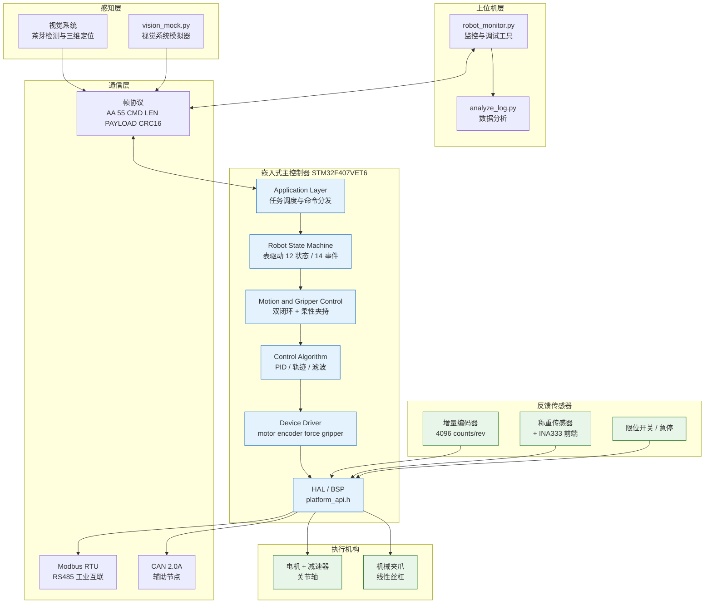
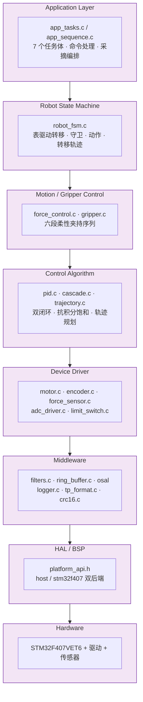
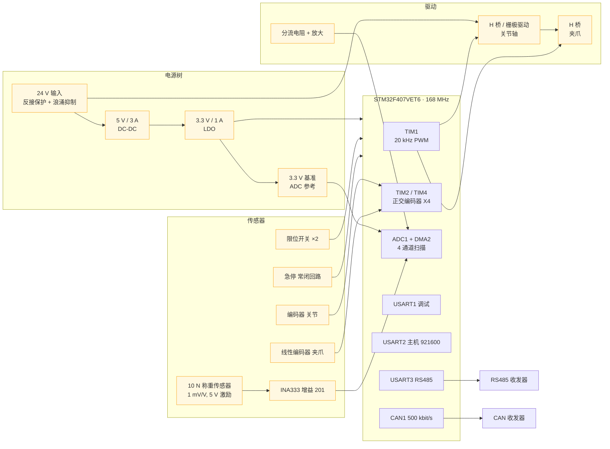
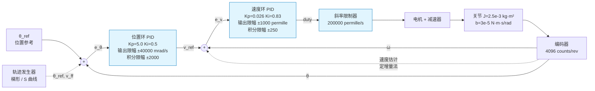
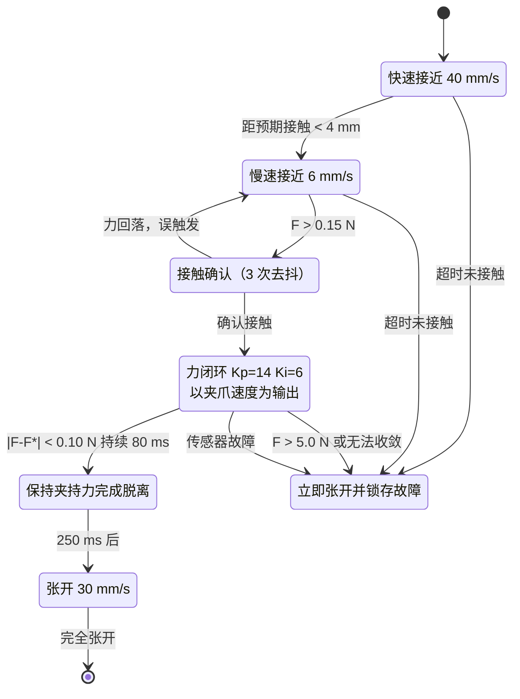
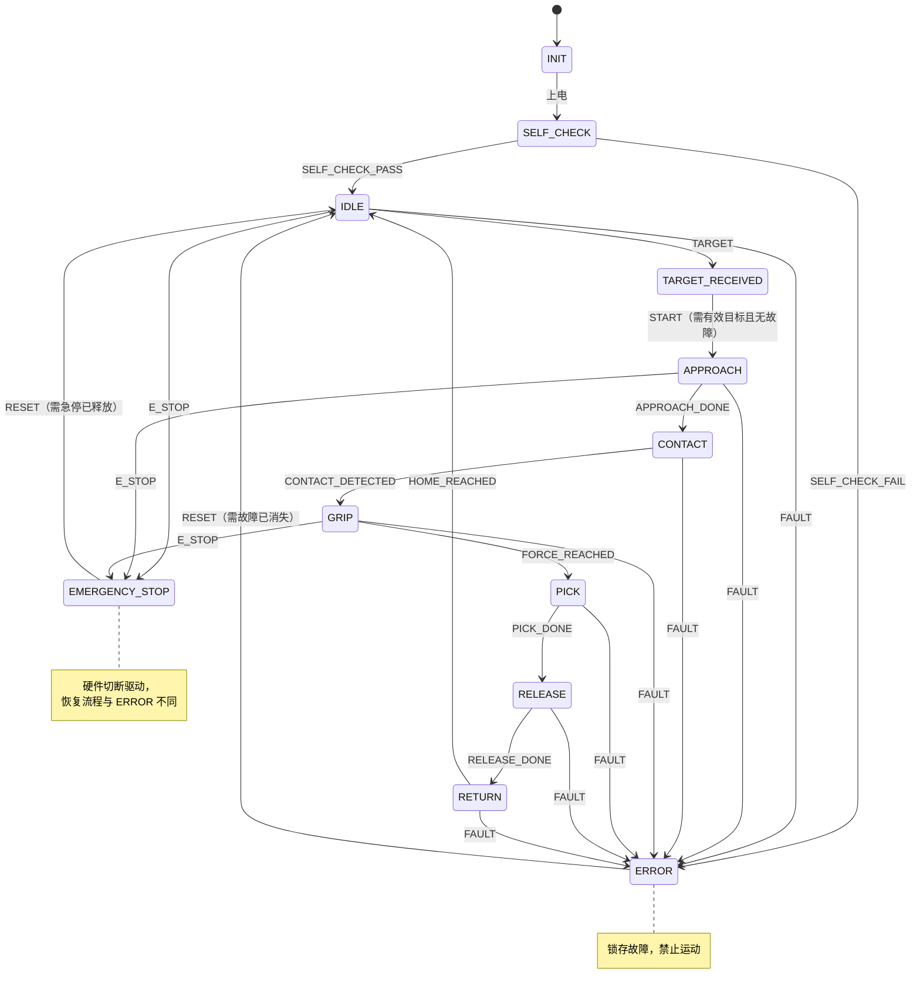
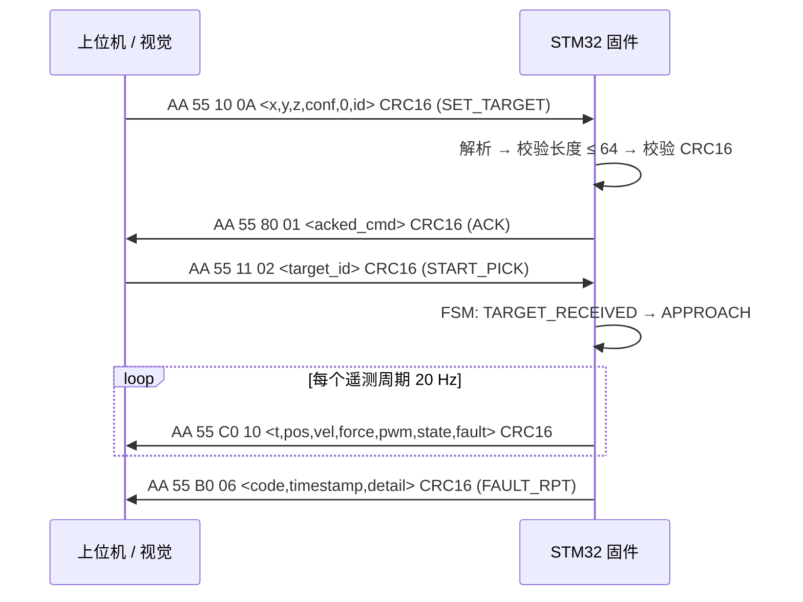
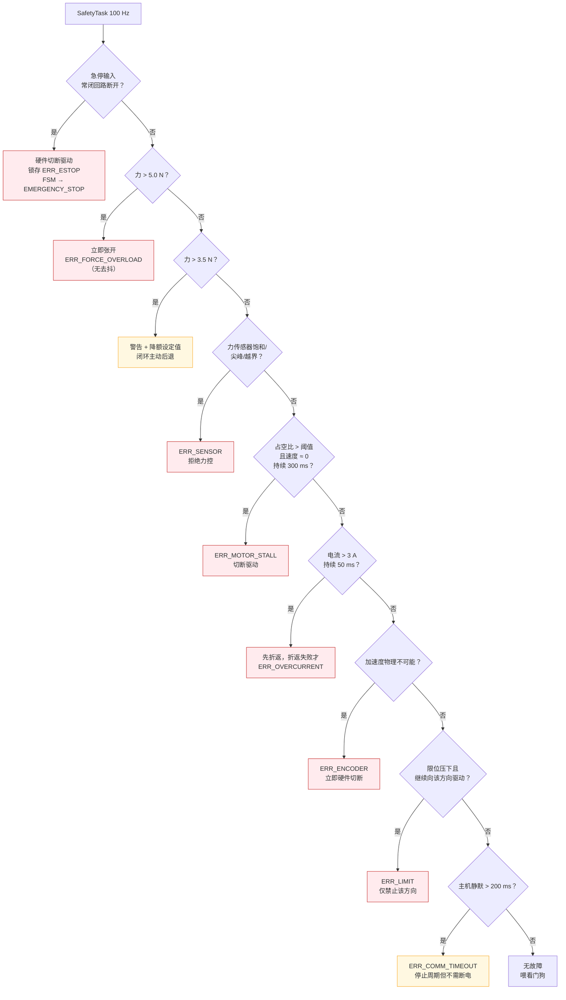

<div align="center">

# 🍃 第二代智能无人机采茶机器人系统

**Second-Generation Intelligent UAV Tea-Picking Robotic System**

嵌入式执行机构控制系统 · STM32F407 · FreeRTOS · 双闭环 PID · 力反馈柔性夹持

[](#目录结构)
[](#硬件架构)
[](#freertos-任务架构)
[](#快速开始)
[](#测试)
[](#控制算法)
[](LICENSE)

</div>

---

## ⚡ 30 秒速览

| 问题 | 回答 |
|---|---|
| **这是什么** | 面向茶园自动化采摘的机器人**执行机构控制系统**：接收视觉系统的目标位置，驱动机械臂与柔性夹爪完成 `定位 → 接近 → 夹持 → 力矩检测 → 采摘 → 松开 → 复位` |
| **解决什么问题** | 传统**固定位置控制**无法感知夹持力，嫩芽在"闭到某个位置"的过程中被压伤。本系统用**力反馈闭环**替代位置闭环作为夹持阶段的控制量 |
| **核心技术** | 位置/速度**双闭环级联 PID** → 夹爪**力反馈柔性夹持**（六段状态机）→ 表驱动**机器人状态机** → CRC16 帧协议 + Modbus RTU → 九类**安全保护** |
| **代码在哪** | `firmware/` 是固件（89 个 C 文件 / 25,939 行）；`simulator/` 是独立 Python 物理模型；`tests/` 与 `firmware/Tests/` 是测试 |
| **控制算法在哪** | `firmware/Control/pid.c`（PID）、`cascade.c`（双闭环）、`force_control.c`（柔性夹持）、`trajectory.c`（轨迹规划） |
| **怎么运行** | `python scripts/run_demo.py` —— 一条命令完成编译、仿真、曲线与交叉验证 |
| **结果是什么** | 仿真：完整采摘周期成功，夹持力 **2.18 N** vs 目标 2.20 N，**过冲 0.00 N**，夹持期间平均力 **2.27 N**，峰值 **2.363 N**（硬限 5.0 N），**0 次控制周期超时**；7 个场景全部按预期触发保护 |

> **⚠️ 数据诚实性声明（请先读这一段）**
>
> 本项目**没有实物样机**：板卡未制板、未焊接、未通电，**所有数字均来自仿真**。
>
> - **设计目标（Target KPI）**：茶芽破损率 ≤ 1%、采摘效率提升 40%。这两个数字是**设计目标**，不是实测结果，项目中没有任何一处把它写成已验证指标。
> - **仿真结果（Simulated）**：上表中的力与时间数据来自 `build/host/tea_picking_robot_host.exe` 的真实运行输出，可复现。
> - **实物验证（未完成）**：时序、EMC、机械刚度、实际茶芽力学参数均**未验证**，见 [已知限制](#已知限制).

---

## 目录

- [项目背景](#项目背景)
- [系统架构](#系统架构)
- [软件架构](#软件架构)
- [硬件架构](#硬件架构)
- [控制算法](#控制算法)
- [柔性夹持与力反馈](#柔性夹持与力反馈)
- [机器人状态机](#机器人状态机)
- [通信协议](#通信协议)
- [FreeRTOS 任务架构](#freertos-任务架构)
- [安全机制](#安全机制)
- [仿真系统](#仿真系统)
- [实验结果](#实验结果)
- [目录结构](#目录结构)
- [快速开始](#快速开始)
- [测试](#测试)
- [已知限制](#已知限制)
- [Roadmap](#roadmap)
- [文档索引](#文档索引)
- [License 与作者](#license-与作者)

---

## 项目背景

<table>
<tr><th>它是什么</th><td>一个完整的分层嵌入式机器人执行控制系统，从设备驱动到控制算法、通信协议、安全保护和应用状态机。</td></tr>
<tr><th>为什么做</th><td>茶叶采摘是劳动密集型作业，手工采摘占茶叶生产成本的一半以上（公开产业数据）。机械化采摘的难点不在"能不能夹住"，而在"能不能不夹坏"。</td></tr>
<tr><th>如果只做位置控制会怎样</th><td>夹爪闭到固定位置时，实际夹持力取决于茶芽茎秆的刚度，而刚度随品种、含水率、芽龄变化。夹到比预期更硬的茎秆时，力沿非线性曲线快速上升，在控制器"意识到"之前就已经超过损伤阈值。仿真中这一点被复现为：位置控制模式下茎秆表面外移到 16 mm，夹持力预测达 <b>12.2 N</b>，远超 5 N 硬限——而控制器全程不知道。</td></tr>
</table>

**第一代 vs 第二代**

| | 第一代 | 第二代（本项目） |
|---|---|---|
| 夹持方式 | 固定位置闭环 | **力反馈闭环** + 位置/速度双闭环接近 |
| 损伤控制 | 依赖机械限位与经验标定 | 三级力保护（软限 / 硬限 / 传感器故障）+ 自适应阈值框架 |
| 软件结构 | 单文件主循环 | 7 层分层架构 + 7 个 FreeRTOS 任务 |
| 可测试性 | 依赖实物 | **PC 上运行同一份固件源码**，125 个 C 单元测试 + 22 个 Python 测试 |
| 通信 | 自定义串口 | 帧协议（CRC16）+ Modbus RTU 双协议 |

---

## 系统架构



**分层原则**：上层只通过接口调用下层，**Application 层永远不直接操作 STM32 HAL 寄存器**。唯一的硬件缝隙是 `firmware/BSP/platform_api.h`——所有寄存器访问、GPIO 读、总线写都必须经过它，因此"哪些代码碰了硬件"这个问题只有一个文件级答案。

---

## 软件架构



**可测试性设计**：三层解耦使同一份控制代码能在两种后端上运行。

| 抽象 | 位置 | 后端 A | 后端 B |
|---|---|---|---|
| 硬件缝隙 | `platform_api.h` | `BSP/host/platform_host.c`（确定性物理模型） | `BSP/stm32f407/platform_stm32f407.c`（真实寄存器） |
| 操作系统 | `osal.h` | `osal_baremetal.c`（确定性协作式调度） | `osal_freertos.c`（抢占式 RTOS） |

因此 **PC 上运行的就是固件本身**，不是它的复刻：`pid.c`、`force_control.c`、`robot_fsm.c`、`safety_monitor.c` 在两边是同一份源码。这也是 125 个 C 单元测试能够覆盖生产代码路径的原因。

---

## 硬件架构

> 以下均为 **参考设计 / Recommended Implementation**，由数据手册计算得出，**未制板、未测量**。



**力传感器前端选型（关键设计决策）**

| 参数 | 值 | 依据 |
|---|---|---|
| 量程 | **10 N**（不是 50 N） | 目标夹持力 2.2 N、硬限 5 N，需要远优于 20 mN 的分辨率 |
| 灵敏度 | 0.5 mV/N | 1 mV/V × 5 V 激励 ÷ 10 N |
| 放大器增益 | 201（INA333，RG = 249 Ω） | 前端 100.5 mV/N |
| ADC 步长 | 0.806 mV（3.3 V / 4096） | — |
| **分辨率** | **8.0 mN / count** | 自动由 `config.h` 中的宏推导，非手填 |
| 可用范围 | **±16.4 N** | 覆盖 5 N 硬限，留足余量 |

50 N 传感器在同样 ADC 下只有 0.1 mV/N，需要增益 400——此时放大器失调漂移与桥路温漂会成为主导误差。**让传感器适配电子学，而不是用 400 倍放大去迁就传感器**，是这里更好的工程答案。

**信号链**：`称重传感器 → INA333(G=201) → RC 抗混叠(fc=1.6 kHz) → ADC1_IN4 → 中值滤波(5) → 滑动平均(8) → 一阶低通(τ=6 ms) → 力值(N)`

三级滤波各有分工：**中值**剔除 EMI 单点尖峰（滑动平均只会把尖峰摊开），**滑动平均**是线性相位、不畸变接触瞬态形状，**低通**压制 20 kHz PWM 载波混叠。

---

## 控制算法

### 双闭环级联结构



**为什么用双闭环？**

1. **单一位置 PID 要同时承担两个互相冲突的任务**：它的输出是速度指令，增益同时决定响应速度与阻尼。提高增益求快就降低相位裕度直到振荡；拆开后内环专职阻尼（它直接指令产生转矩的量），外环专职响应速度。
2. **内环把被控对象线性化**：转矩常数随电流与温度变化、母线随负载跌落、摩擦在零速附近非线性——这些全在速度环**内部**，闭环后位置环看到的近似是纯积分器 `θ' = v_cmd`，可用一阶模型整定。
3. **在扰动产生的地方抑制它**：重力与切削反力表现为转矩，速度环把它看作速度误差并在自身带宽内修正，**位置根本不改变**；单环必须先让关节动起来才能察觉，位置误差不可避免。

**带宽分离是设计约束，不是整定结果**

| 环节 | 带宽 | 推导 |
|---|---|---|
| 速度环（内） | ≈ **8 Hz**（50 rad/s） | 被控对象：DC 增益 **60 mrad/s/permille**，机械时间常数 **0.031 s**（电气阻尼 `Kt·Ke/R = 0.08 N·m·s/rad` 比黏性项大三个数量级，时间常数几乎完全由它决定）。PI 配置 `Kp = τ/(K·Tc)`，取 `Tc = 20 ms` → `Kp = 0.026`，`Ki = Kp/τ = 0.83` |
| 位置环（外） | ≈ **0.8 Hz** | 内环闭环近似一阶滞后 20 ms，`v=Kp·e` 给出位置环时间常数 `1/Kp`，`Kp=5.0` → 200 ms |
| 分离比 | **约 10 倍** | 低于 5 倍级联反而不如单环（额外滞后白送），高于 20 倍则位置环慢得没必要 |

**工程教训（真实缺陷记录）**：首版 `TP_MAX_DUTY_RATE_PER_S = 4000 permille/s`，即满量程需要 250 ms。这不是斜率限制器，而是速度环内的一个**主导滞后**——在穿越频率处贡献约 60° 未建模相位滞后，仿真中关节以数万 mrad/s 的幅度振荡。**任何执行器速率限制都必须与它所处的环路带宽对照检查**：满量程时间必须远小于 `1/(2π·fc)`。8 Hz 环路的预算是约 20 ms，现取 5 ms。

### PID 实现要点

| 特性 | 为什么 | 不用会怎样 |
|---|---|---|
| 梯形积分 | 对斜坡误差，矩形积分有半采样系统偏差 | 位置误差稳定在一个小但永久的非零值 |
| **微分先行**（对测量微分，不对误差） | 设定值阶跃时对误差微分会产成冲激，电机如实把它变成电流尖峰 | 每次新目标都有"咔哒"声与电流尖峰 |
| 微分低通（后向欧拉） | 编码器量化，1 kHz 下的原始差分主要是量化噪声，D 项放大它 | PWM 嗡鸣、电机无谓发热 |
| 积分限幅 | 限制 I 项自身能要求的量 | 长时间接近后第一次移动严重过冲 |
| **反算抗积分饱和** | 饱和期间执行器跟不上，继续积分是虚构 | 经典 windup：撞向目标后数秒才回来 |
| 条件积分（备选） | 更省的实现，饱和期间冻结积分器 | 同上，分支代替反馈项 |
| 运行时改增益 | 上位机无需重烧固件即可整定（实验 02 参数扫描） | 每个数据点都要重新编译 |
| `PID_Reset()` | 模式切换（接近→力控）不能继承陈旧积分器 | 上一阶段残留的 I 项变成无法解释的偏置 |

**积分限幅刻意比输出限幅小一个数量级**——这是整个控制器里最有效的抗过冲措施：它限制了 I 项**单独**能要求多少速度，使长时间接近无法积蓄成一个在终点释放的过冲。

---

## 柔性夹持与力反馈



**为什么位置控制必然损伤茶芽**

仿真采用的非线性接触模型：`F = k1·d + k2·d²`，`k1 = 0.30 N/mm`，`k2 = 0.06 N/mm²`。二次项意味着茎秆被压缩时**逐渐变硬**——这正是固定位置夹持的危险来源：闭到固定间隙时，实际力取决于刚度，而刚度未知。

仿真验证（场景 D）：位置控制模式下把茎秆表面从 6 mm 外移到 16 mm（比接近模型假设更硬），固定 4 mm 间隙目标预测产生 `0.30×12 + 0.06×144 = 12.2 N`，远超 5 N 硬限与 4 N 损伤阈值。安全监控在全程武装状态下成功阻止，但**必须靠触发保护才能做到**。

**核心结论（本项目最重要的发现）**

> 当力反馈**启用**时，同样的"茎秆比预期更硬"根本不构成问题：场景 D 最初正是这样编写的——力控模式下把茎秆改硬——结果周期**正常完成**，峰值仅 3.2 N。这不是场景的缺陷，而是整个项目的中心结论：**力控夹爪不关心茶芽有多硬**。要演示过力保护，必须**移除力反馈**，也就是第一代机器所做的。

**力环为什么跑 1 kHz 而传感器 500 Hz**

- 力环输出的是**夹爪速度**，接触瞬间需要快速反向；1 kHz 给出 1 ms 的最坏反应时间。
- 力传感器的抗混叠转折频率约 26 Hz，500 Hz 采样已经绰绰有余；更高只会重复送入同一样本。
- 分离两者还使 1 kHz 控制环的周期**与 ADC 转换时长无关**。

---

## 机器人状态机



**为什么用转移表而不是嵌套 if/else**

周期有 12 状态、14 事件，手写嵌套 switch 约 170 行分支，其中：未处理的 `(状态,事件)` 对被**静默忽略**（与正确的空操作无法区分）；合法转移集合无法审阅；新增状态要改多处，遗漏表现为"机器人卡在某状态且无解释"。

本项目把 `s_transitions[]` 作为**数据**：可枚举、可校验（单元测试遍历整表断言每个状态可达、无重复 `(状态,事件)` 对）、可记录（日志写 `approach-->contact (CONTACT_DETECTED)` 而非 `state 4 -> 5`）、可绘图（上图的 Mermaid 由同一份数据生成）。

**其它设计约束**
- **`STOP` 从每个循环状态都合法**且一律落到 `IDLE`——依赖当前位置的停止不是可靠的停止。
- **故障与急停从任意状态都合法**，包括 `INIT`，引导期间的故障同样能正确进入 `ERROR`。
- **急停不经过 `ERROR`**：恢复流程不同（先释放按钮再复位），且驱动是硬件切断而非软件命令。
- `TP_STATE_ERROR` 与 `EMERGENCY_STOP` 采用**保持位置**而非切断驱动，除非故障本身使反馈不可信（编码器、过流、堵转、急停）——可恢复故障每次都要重新回零是真实成本。

---

## 通信协议

### 帧格式

```
+--------+--------+--------+--------+------------------+--------+--------+
| 0xAA   | 0x55   | CMD    | LEN    | PAYLOAD[0..LEN-1]| CRC_LO | CRC_HI |
+--------+--------+--------+--------+------------------+--------+--------+
  byte 0   byte 1   byte 2   byte 3      byte 4..         last 2 bytes
```



**字段理由**

| 字段 | 设计理由 |
|---|---|
| 双字节头 `AA 55` | 单字节会在载荷中频繁出现；三字节浪费带宽。解析器在此重同步 |
| `LEN` | 长度字节而非定长帧，使心跳在线上只有 6 字节 |
| CRC 只覆盖 `CMD\|LEN\|PAYLOAD` | 头部已是固定模式，纳入不增加检错能力；长度字节与载荷才是会出错的部分 |
| **小端** | 匹配 STM32 原生顺序，固件可 `memcpy` 而不必做字节交换。这是相对网络序的**刻意偏离**，也是最常见的集成错误：假设大端的对手会把 2.0 N 夹持力读成 8192 N |
| CRC-16/MODBUS | Modbus RTU 强制使用，RS485 链路免费获得校验；多项式 `0xA001`，init `0xFFFF`，无最终异或 |

**为什么故意不用查表**：按位实现约 8 次移位/异或每字节。921600 baud 下最坏约 92 kbyte/s → 每秒约 736k 次内层迭代，占 168 MHz Cortex-M4 不到 1%。512 字节查表能省下这点开销，但**代价是永不使用的 512 字节 Flash**。`docs/13_future_work.md` 记录了应当重新考虑该决定的确切条件。

**解析器韧性**（每条都有单元测试）

| 情形 | 处理 |
|---|---|
| 垃圾字节 | 丢弃直至找到 `AA`，计数 `bytes_discarded` |
| `AA AA 55` | 第二个 `AA` 是真实头部起点——**停在 `WAIT_HDR1` 而非退回 `WAIT_HDR0`**，否则会丢帧 |
| `LEN > 64` | **立即拒绝**，不等待永远不会到来的字节（那会使解析器无界阻塞，并把随后的真实帧当作载荷吃掉） |
| CRC 失败 | 从头部的**下一个字节**重新搜索，而非消费整个候选帧——否则载荷中的伪头部会吞掉几字节后开始的真实帧 |
| 载荷尾部残留 | 显式清零，避免读取超过 `len` 的消费者看到上一帧的数据 |

**丢包与超时**：心跳携带序号，固件通过序号间隙估算真实丢包率（心跳数少于 5 时返回 0，而不是报告虚假的 100% 丢失）；链路静默超过 200 ms 触发链路丢失，应用停止周期——**视觉目标是带时间戳的测量，不是永久为真的常量**。

### 命令码表

| 命令 | 值 | 方向 | 载荷 | 长度 |
|---|---|---|---|---|
| HEARTBEAT | 0x01 | → | `u32 seq` | 4 |
| SET_TARGET | 0x10 | → | `i16 x, i16 y, i16 z, u8 conf, u8 rsvd, u16 id` | 10 |
| START_PICK | 0x11 | → | `u16 target_id` | 2 |
| STOP | 0x12 | → | – | 0 |
| RESET | 0x13 | → | – | 0 |
| GET_STATUS | 0x20 | → | – | 0 |
| GET_SENSOR | 0x21 | → | – | 0 |
| GET_FAULT | 0x22 | → | – | 0 |
| SET_PID | 0x30 | → | `u8 loop, f32 kp, f32 ki, f32 kd` | 13 |
| GET_PID | 0x31 | → | `u8 loop` | 1 |
| SET_FORCE_TARGET | 0x32 | → | `u16 mN` | 2 |
| SET_MODE | 0x33 | → | `u8 mode` | 1 |
| EMERGENCY_STOP | 0x40 | → | – | 0 |
| CLEAR_FAULT | 0x41 | → | – | 0 |
| CALIBRATE_FORCE | 0x42 | → | `u8 kind` | 1 |
| ACK | 0x80 | ← | `u8 acked_cmd` | 1 |
| HEARTBEAT_ACK | 0x81 | ← | `u32 seq` | 4 |
| STATUS_RPT | 0xA0 | ← | `u8 state, u8 fault, i32 pos, i16 vel, i16 force, i16 pwm, i16 current, u16 cycles` | **16** |
| SENSOR_RPT | 0xA1 | ← | `i32 pos, i16 vel, i16 force, u16 adc, i16 current, i16 temp` | **14** |
| PID_RPT | 0xA2 | ← | `u8 loop, f32 kp, f32 ki, f32 kd` | 13 |
| FAULT_RPT | 0xB0 | ← | `u8 code, u32 ms, u8 detail` | 6 |
| TELEMETRY | 0xC0 | ← | `u32 t, i32 pos, i16 vel, i16 force, i16 pwm, u8 state, u8 fault` | 16 |
| NACK | 0xE0 | ← | `u8 ref_cmd, u8 err_code, u8 detail` | 3 |

> **跨实现一致性测试发现的三个真实线上缺陷**：Python 端 `SET_TARGET` 曾为 9 字节而固件为 10（`target_id` 被错读一个字节）；`NACK` 曾为 2 字节而固件为 3；固件自身的 `STATUS_RPT` 与 `SENSOR_RPT` 编码器写入长度比发送长度多一字节，截断了最后一个字段。单语言测试套件**无法**发现这三类问题——`tests/test_protocol_agreement.py` 现在把两侧一起钉住。

---

## FreeRTOS 任务架构

```mermaid
gantt
    title 任务时序（一个 10 ms 周期内）
    dateFormat X
    axisFormat %L ms

    section 1 kHz
    ControlTask (CRITICAL)     :crit, c1, 0, 1
    ControlTask                :crit, c2, 1, 1
    ControlTask                :crit, c3, 2, 1
    ControlTask                :crit, c4, 3, 1
    ControlTask                :crit, c5, 4, 1
    ControlTask                :crit, c6, 5, 1
    ControlTask                :crit, c7, 6, 1
    ControlTask                :crit, c8, 7, 1
    ControlTask                :crit, c9, 8, 1
    ControlTask                :crit, c10, 9, 1

    section 500 Hz
    SensorTask (HIGH)          :s1, 0, 1
    SensorTask                 :s2, 2, 1
    SensorTask                 :s3, 4, 1
    SensorTask                 :s4, 6, 1
    SensorTask                 :s5, 8, 1

    section 100 Hz
    SafetyTask (REALTIME)      :a1, 0, 1
    RobotTask (ABOVE_NORMAL)   :a2, 1, 1
    CommTask (NORMAL)          :a3, 2, 1
    SafetyTask                 :a4, 10, 1
    RobotTask                  :a5, 11, 1
    CommTask                   :a6, 12, 1

    section 20 Hz
    TelemetryTask (BELOW_NORMAL) :t1, 0, 1

    section 5 Hz
    DebugTask (LOW)            :d1, 0, 1
```



| 任务 | 频率 | 优先级 | 职责 | 为什么是这个频率 |
|---|---|---|---|---|
| **ControlTask** | 1 kHz | CRITICAL (6) | 级联 PID、电机更新、夹爪更新 | 速度环 8 Hz 带宽需要 ≥10 倍过采样才能保持离散近似；1 kHz 同时匹配 PWM 周期，并给出 1 ms 的力事件最坏反应 |
| **SensorTask** | 500 Hz | HIGH (5) | ADC/DMA、力、编码器、限位 | 两倍于控制率，控制环拿到的样本最多老 1 ms；力通道 26 Hz 抗混叠转折不需要更高 |
| **CommTask** | 100 Hz | NORMAL (3) | UART / CAN / RS485、协议解析 | 10 ms 周期把命令延迟限制在 10 ms，同时把 90% CPU 留给控制 |
| **RobotTask** | 100 Hz | ABOVE_NORMAL (4) | FSM、采摘编排 | 最快的决策是接触交接，已由 1 kHz 力控完成；FSM 只需观察 |
| **SafetyTask** | 100 Hz | REALTIME (5) | 全部危害检查、看门狗喂狗 | 刻意**慢于**控制而**快于**机器人：故障必须先于序列逻辑，但不能抖动控制环 |
| **TelemetryTask** | 20 Hz | BELOW_NORMAL (2) | 周期上报 | 20 Hz 是人可读监控的需要；50 ms 一次远在感知阈值内 |
| **DebugTask** | 5 Hz | LOW (1) | 日志、统计 | 严格最低：记录绝不能延迟任何东西 |

**几个关键选择**

- **任务体是"单次迭代"函数**，OSAL 拥有循环与周期（FreeRTOS 后端用包装任务 + `vTaskDelayUntil`）。由此：测试可以**直接调用 `control_step()`** 逐次推进并手工驱动时钟；仿真逐位可复现；周期只在 `config.h` 声明一次。
- **`vTaskDelayUntil` 而非 `vTaskDelay`**：后者等待**相对**时长，周期变成"执行时间 + 延迟"并随负载漂移。PID 的 `dt` 是编译期常量，周期漂移会**静默地改变每个增益**。
- **任务通知而非队列**用于传感器→控制交接：它写入目标 TCB 而非内核对象，是 FreeRTOS 最省的同步原语，在 1 kHz 路径上有意义。使用 `eSetValueWithOverwrite`——控制环要最新样本，不要积压。
- **看门狗只从一处喂**，且只在观察到全部受监督任务均已推进之后。从多处喂会让挂死的控制环被健康的日志任务掩盖。
- **互斥量而非二值信号量**：只有互斥量具备优先级继承。没有它，持有锁的通信任务可能被低优先级任务抢占并阻塞 1 kHz 控制环——教科书式优先级反转，而本固件中确实存在（日志被多个优先级共享）。

---

## 安全机制



**严重度分级与反应策略**

| 严重度 | 行为 | 清除方式 |
|---|---|---|
| `INFO` | 仅记录 | 自动 |
| `WARNING` | 记录 + 遥测标志，运动继续 | `CLEAR_FAULT` 或条件消失后自动 |
| `ERROR` | 禁止运动，FSM 强制 `ERROR` | `CLEAR_FAULT`，且**物理条件已消失** |
| `CRITICAL` | 硬件切断 PWM，FSM 强制 `EMERGENCY_STOP` | 条件消失后 `RESET` |

**去抖的不对称性是刻意的**：保护机器自身免于自身的检查**去抖**（堵转 300 ms、过流 50 ms），保护**对象与人员**的检查**不去抖**（力硬限、急停）。堵转误触发只是烦人；过力延迟触发是毁掉一颗茶芽。

**堵转检测为什么需要占空比条件**："速度为零"不是堵转——被指令为零速且确实静止的电机只是停了。堵转是**正在要求转矩而没有任何运动**。要求指令占空比超过 80 permille 才武装该检查，是区分两者的关键，也是自制堵转检测最常见的错误。

**保护之间的竞争（真实发现）**：首次运行硬堵转场景时，固件触发的是 `ERR_OVERCURRENT` 而不是 `ERR_MOTOR_STALL`——这是**物理上正确的答案，不是缺陷**。堵转电机要求满转矩会在 50 ms 内超过连续电流额定值，而堵转检测刻意等待 300 ms，过流保护总是赢得这场竞争，也应该如此。堵转检测真正的职责是**低电流堵转**：驱动能在不超过额定值的前提下顶住的摩擦（干枯丝杠、卡屑导轨、楔入机构的茶芽）。场景 F 因此把驱动配置为 800 mA 电流限以覆盖该情形。

**其它设计要点**
- **失效安全极性**：急停为常闭回路，**断线读作已按下**；自检期间若急停已按下，则**不使能任何东西**，连自检都不做完。
- **"损失位置"与"继续驱动"的权衡**：仅在编码器、过流、堵转、急停时切断驱动；其余可恢复故障保持位置，避免每次重试都要重新回零。
- **`CLEAR_FAULT` 不能击败保护**：物理条件仍在时清除请求被拒绝。

---

## 仿真系统

本项目有**两套**独立仿真，各有不可替代的作用：

| | C 固件 host build | Python 模型 |
|---|---|---|
| 位置 | `firmware/Core/main_host.c` + `BSP/host/plant_model.c` | `simulator/` |
| 是什么 | **固件本身**，用物理模型替代电机与传感器 | 独立编写的物理模型与控制器 |
| 证明什么 | 控制器（PID、力控、FSM、安全监控）在真实代码路径上工作 | 一个独立实现得出相同结论 → 不是自证 |
| 运行 | `python scripts/run_demo.py` | `python simulator/main.py` |
| 场景 | 7 个（`scripts/run_scenarios.ps1`） | 7 个（`python simulator/main.py --scenario all`） |

**物理模型（`plant_model.c`）**

```
关节轴：
  V        = pwm/1000 × V_bus                     （斜率限制）
  i_cmd    = (V − Ke·ω) / R                        （欧姆定律 + 反电动势）
  di/dt    = (i_cmd − i) / τ_e,  τ_e = L/R
  T_motor  = Kt · i
  T_fric   = Tc·tanh(ω/ω_eps) + b·ω
  J·dω/dt  = T_motor − T_fric − T_load − T_jam
  dθ/dt    = ω

夹爪与茶芽：
  v_jaw   += (v_cmd − v_jaw)·dt/(τ_jaw+dt)         （伺服滞后）
  v_jaw   −= F / K_backdrive                       （力反驱）
  gap     += v_jaw·dt,  钳位于 [0, 40] mm
  d        = max(0, stem_gap − gap)
  F        = k1·d + k2·d² + c·max(0, −v_jaw)       （非线性刚度）
```

**为什么电流用一阶滞后而不直接积分 `L·di/dt = V − R·i − Ke·ω`**：`L=1.5 mH`、`R=2 Ω` 使电气极点位于 1/0.75 ms，1 ms 显式欧拉步长下临界不稳定，会产生与机器无关的数值振荡。把快极点塌缩为 `di/dt = (i_ss − i)/τ_e` 是标准的奇异摄动处理，既保留**物理**时间常数可见，又在 1 ms 控制周期下保持稳定。

**为什么用确定性协作式调度**：线程化仿真每次运行的轨迹都不同（交错取决于宿主调度器），`data/results/` 里的曲线与由它导出的上升时间/过冲数字就不可复现；而"只在时序幸运时才工作的控制环不是控制环"。

**七个场景与判据**

| 场景 | 注入的扰动 | 期望结果 | 判据 |
|---|---|---|---|
| **A** 正常采摘 | 无 | 完整周期 | 周期完成、无故障 |
| **B** 目标位置误差 | 视觉 X 偏 +8 mm | 周期中止 | `ERR_TARGET`（接触超时） |
| **C** 力传感器噪声 | σ = 80 mN | 周期完成 | 夹持力仍在带内 |
| **D** 夹持力过大 | 位置控制模式 + 茎秆外移至 16 mm | 保护触发 | `ERR_FORCE_OVERLOAD` |
| **E** 通信超时 | 注入 1 帧心跳后静默 | 周期停止 | `ERR_COMM_TIMEOUT` |
| **F** 电机堵转 | 8 N·m 夹持 + 电流限 800 mA | 保护触发 | `ERR_MOTOR_STALL` / `ERR_OVERCURRENT` |
| **G** 急停 | t = 1.2 s 拉低急停 | 立即停机 | `EMERGENCY_STOP` + `ERR_ESTOP` |

**仿真的局限（必须说清楚）**：模型参数（茎秆刚度 `k1`/`k2`、损伤阈值 4 N、摩擦系数）都是**模型假设而非测量值**；时序（中断延迟、DMA 抖动、实际栈深）、EMC、机械刚度与真实茶芽力学**无法由仿真替代**。

---

## 实验结果

### 数据分类（科研诚信）

| 类别 | 含义 | 本项目中的数量 |
|---|---|---|
| **Measured（实测）** | 在实物上测量得到 | **0 项** —— 没有实物样机 |
| **Simulated（仿真）** | 由本仓库代码真实运行产生，可复现 | 全部数值结果 |
| **Target（设计目标）** | 设计要求，未验证 | 破损率 ≤ 1%、效率提升 40% |
| **Estimated（估算）** | 由数据手册推导的设计计算 | 8.0 mN 分辨率、±16.4 N 量程、带宽、位定时 |

### 仿真结果（Simulated，可复现）

**场景 A —— 正常采摘周期**（`build/host/tea_picking_robot_host.exe --scenario A`）

| 阶段 | 时刻 | 关键量 |
|---|---|---|
| 目标检测 | 1.20 s | id=1, x=0 mm, y=15 mm, z=185 mm, 置信度 95% |
| 接近完成 | 1.24 s | 关节移动 50 mrad，梯形轨迹 32 ms |
| **接触检测** | **2.62 s** | **间隙 5.682 mm，F = 0.156 N** |
| **达到目标力** | **3.02 s** | **2.18 N**（目标 2.20 N ±0.10 N），**过冲 0.00 N**，319 个控制周期（319 ms）整定 |
| 脱离 | 3.27 s | 夹持期间平均力 **2.27 N** |
| 松开 | 3.27 s | 完全张开 |
| 回零 | 4.59 s | `cycle_count = 1` |

| 指标 | 结果 |
|---|---|
| 峰值夹持力 | **2.363 N**（硬限 5.00 N） |
| 夹持力过冲 | **0.00 N** |
| 控制周期执行数 | 4890（1 kHz）/ 2445 传感器 / 489 通信 / 489 机器人 / 489 安全 |
| **控制周期超时** | **0 次** |
| 主机链路解码 | 2134 B，97 帧，**0 CRC 错误** |

**七个场景汇总**（`scripts/run_scenarios.ps1`，7/7 PASS）

| 场景 | 结果 | 峰值夹持力 | 最终状态 |
|---|---|---|---|
| A 正常采摘 | 周期完成 | 2.363 N | idle |
| B 目标位置误差 | 中止 | 0.000 N | error（`ERR_TARGET`） |
| C 力传感器噪声 | 周期完成 | 2.421 N | idle |
| D 夹持力过大 | 保护触发 | 5.027 N | error（`ERR_FORCE_OVERLOAD`） |
| E 通信超时 | 周期停止 | — | idle |
| F 电机堵转 | 保护触发 | — | error（`ERR_MOTOR_STALL`） |
| G 急停 | 立即停机 | — | emergency_stop |

### 关键发现

1. **力控使"茎秆比预期更硬"不再构成问题**（场景 D 的真实教训）。这是整个项目的中心结论：力反馈夹爪不关心茶芽有多硬；要演示过力保护，必须移除力反馈。
2. **硬堵转时过流保护先于堵转保护触发，这是正确行为而非缺陷**。设计上，堵转检测覆盖的是低电流堵转。
3. **目标位置误差直接决定节拍**：+8 mm 的视觉横向误差使夹爪在错误的距离减速，耗费掉时间预算并触发接触超时。视觉精度因此不是"锦上添花"，而是节拍的约束条件。
4. **首版固件的真实缺陷（全部由测试与仿真发现并修复）**：

| # | 缺陷 | 后果 | 修复 |
|---|---|---|---|
| 1 | 占空比斜率限制 4000 permille/s（满量程 250 ms） | 速度环内主导滞后，关节以数万 mrad/s 振荡 | 提升到 200000 permille/s（满量程 5 ms），并与环路带宽对照检查 |
| 2 | 力传感器尖峰检测阈值 1.0 N，且尖峰时**不更新参考值** | 一次**真实撞击**后每个样本都被判为尖峰，16 ms 内锁存 `ERR_SENSOR` | 阈值提到 3.0 N；参考值每样本更新（持续偏置应由越界/饱和检查负责，不是尖峰检测） |
| 3 | 夹持控制器在 `RELEASE` 态**未被服务** | 流程永远挂在 `RELEASE`，看起来像状态机缺陷 | 在 RELEASE 态同样服务力控；并消除 RELEASE 态的夹爪双主 |
| 4 | FSM 守卫收到**应用上下文却按 FSM 结构体解析** | `guard_has_target()` 读到错误内存，`START` 时好时坏地拒绝启动 | 守卫与动作改收 `tp_robot_fsm_t *`，类型正确 |
| 5 | 堵转建模为 8 N·m 大转矩（对 2.5e-3 kg·m² 惯量是 3200 rad/s²） | 保持带比单步可分辨窄 4 个数量级，状态每样本穿过它，关节以数千 mrad/s 振荡 | 改为**粘滑运动约束**：驱动转矩低于堵转静摩擦时保持静止；测试条件用转矩而非速度 |
| 6 | 限位否决**写回调用者的速度设定值** | 夹爪触到限位后设定值被清零并锁存，离开限位后永不再动；`tp_gripper_open()` 停在 39.8 mm | 否决值写入 `applied_velocity_mm_s`，请求值保持不变 |
| 7 | 过流折返按**满量程比例**而非**当前占空比**计算 | 3.6 A 时算出 750 permille 的"上限"，高于命令值 → 什么也没减少 → 保护误触发 | 按当前占空比折返（×2700/3600）；并让斜率限制器尊重折返留下的上限，否则下一拍就被撤销 |
| 8 | 禁用通道**不再刷新电流读数** | `clear_fault` 永远看到陈旧的超限值，驱动被永久锁死 | 禁用时仍然采样电流；恢复过程因此可观测 |
| 9 | ADC 钉在轨上（断线到地）读作 −16.4 N，**落在 ±20 N 合理窗口内** | 断线被当作合法的巨大负力，力控会相信它 | 饱和本身即为故障 |
| 10 | `tp_fault_clear_all()` 把**从未触发**的故障码也计为"已清除" | 健康机器人上报告"已清除 9 个故障" | 只统计调用前确实锁存的 |
| 11 | Python 与固件的**跨实现线上不兼容**（`SET_TARGET` 9 vs 10 字节、`NACK` 2 vs 3、`GET_FAULT`/`SET_MODE`/`SET_FORCE_TARGET` 命令码不同、`loop_id` 映射把 FORCE 与 VELOCITY 对调） | 主机说"调夹持力"实际调了速度环；`target_id` 错读一个字节 | 跨实现一致性测试把两侧钉住（`tests/test_protocol_agreement.py`） |
| 12 | **`Kt = 2.0 N·m/A` 与 `Ke = 0.05 V·s/rad` 相差 40 倍**——而 SI 单位下两者是**同一个物理量**，`Kt·I·ω = Ke·ω·I` 必须成立 | 模型描述了一台"每安培出力比自身反电动势所允许的多 40 倍"的电机，即不满足能量守恒 | 改为 `Kt = Ke = 0.4`（由"顶速 60 rad/s 需 `Ke ≤ 0.4`"与"3 A 连续电流需足够保持转矩"共同确定），并加 `TP_STATIC_ASSERT` 使该恒等式**永久**不可违反；速度环随之重新整定 |
| 13 | **速度环增益与 Python 模型不一致**（固件已重调为 `Kp=5.0 / 0.026`，Python 仍为 `12.0 / 0.015`） | 两个"独立实现"实际在跑**不同的控制器**，交叉验证因此退化为自证 | 新增 `tests/test_config_agreement.py`：**解析 `config.h`** 并逐条比对 Python 配置，把漂移变成失败测试 |
| 14 | **力环实际跑在 100 Hz，而文档、增益与整定都假设 1 kHz** | 接触瞬间最坏反应 10 ms，夹爪在 40 mm/s 下走 0.4 mm、力升 0.12 N——**整个整定带的十分之一在控制器得到第一次机会之前就被花掉** | 移入 1 kHz 控制任务；状态机仍只**观察**控制器，分层不变 |
| 15 | **顶速限制恰好等于空载转速**（`Ke=0.4` 时 24 V 空载 60000 mrad/s） | 该限制只能在**零转矩**下达到，控制器无法稳定在这一点——它不是限制，而是轴在堵转途中经过的一个值 | 降到 40000 mrad/s（空载的 67%），留出加速与保持转矩的电压裕度；测试强制该不等式 |
| 16 | **力传感器合理窗口 `(−20, +50) N` 覆盖不到任何可达值**（前端在 ±16.4 N 饱和） | 该检查是**看起来像保护功能的死代码** | 由 `TP_FORCE_USABLE_RANGE_N` 推导（±19.7 N，20% 余量），可捕获饱和标志抓不到的桥路失衡 |
| 17 | **自适应阈值 `TP_FORCE_ADAPT_ENABLE = 1`，而同一份头文件写着"默认关闭"** | 机器人在用未经验证的模型**自行重调夹持力**；而代码与自身文档互相矛盾，两者单独看都合理，因此能通过评审 | 改为 0——未经真实茶芽标定就开启属于过度声称 |
| 18 | **`rms_position_error` 存的是均方，却名为 RMS** | 每个引用它的报告都差了**一个平方根** | 更名为 `mean_sq_position_error` 并新增 `tp_cascade_rms_position_error()` 取根 |
| 19 | **`TP_PEAK_CURRENT_MA` 已文档化但固件从不执行**；`TP_GRIPPER_BACKOFF_MM`、`TP_FORCE_RELEASE_N`、`TP_MOTOR_OC_RECOVER_MS` 无任何使用点 | 按 5 A 峰值选驱动的人，依据的是固件不实现的数字 | 实现峰值限流（2 ms 窗口，独立于连续限流的 20 ms 去抖）；删除三个死宏 |
| 20 | **`TP_MODE_CALIBRATE` 注释写"禁止运动"，代码只记录模式不做任何限制** | 上位机界面已告知操作者机器人不会动，而它会动 | 在**写驱动的那一层**加互锁——只被 setter 尊重的模式标志是建议，不是联锁 |
| 21 | **`safety_monitor.c` 声称急停不去抖，实际经 `limit_switch.c` 有 3 样本 / 6 ms 去抖** | 文档与实现矛盾；在安全功能上是不可接受的表述 | 注释改为陈述事实，并说明为何 6 ms 在**本研究样机**上可接受（急停同时硬接线进栅极驱动使能通路，固件延迟不参与），以及产品化时必须移除 |
| 22 | **`can_driver.c` 日志硬编码"sample point 87.5%"** | 42 MHz APB1 下 500 kbit/s 的位时间是 84 个时钟周期，87.5% 需要时间量子数能被 8 整除——84 不能，实际是 85.7%。**总线起不来时，这条日志是第一个被检查的东西，而它在撒谎** | 日志不再引用具体的采样点，只说明"已对 APB1 求解"，实际编程值由寄存器层后端连同算式一起记录 |
| 23 | **夹爪轴的力反作用项符号写反了**（`v_jaw -= force/20`，而该模型正值 = 张开） | 力越大夹爪闭合越快，闭合又使力更大——**正反馈发散**。场景 D 中保护在 5.013 N 正确触发后，夹爪被命令零占空比，力却继续涨到 **16.4 N**、间隙降到 1.0 mm 硬限，并把传感器 ADC 顶到轨、**误锁存 `ERR_SENSOR`**。全套测试、七个场景、六张曲线都不报错 | 符号改为 `+=`；新增单元测试 `a_free_jaw_is_pushed_open_by_the_stem`——它断言的是**方向**而非数值，因此对参数变化免疫 |
| 24 | **过力跳闸后夹爪只是"停住"而不是"张开"** | `grip_trip()` 命令的 30 mm/s 张开被 1 kHz 控制任务里的 `tp_gripper_stop()` 立刻覆盖。场景 D 最终确实松开了，但那是第 23 条的反作用力把夹爪顶开的——**不是控制器让它松开的**。若茎秆更软，夹爪会持续夹着茶芽，而这正是保护想结束的状态 | 故障阻挡运动时关节仍保持位置，但**夹爪改为主动张开**——"停止"不是通用的安全动作，每个执行器都有自己的安全方向 |
| 25 | **测试用不等宽窗口比较力增量**（1010 / 1050 / 1082 步，窗口 40 与 32 步） | 该断言本意是验证力-位移曲线的二阶项，实际在比较**两个不同长度窗口的增量**，只在曲率超额恰好大于窗口长度差时通过。修正第 23 条后它立刻失败（0.868 < 0.884），**失败的是测试，不是物理** | 改为等宽窗口 1010 / 1042 / 1074；教训是"数值断言的单位必须与被断言的量一致" |
| 26 | **轨迹只记录反馈，不记录指令** | CSV 有位置、速度、力、间隙、关节占空比，却**没有夹爪速度指令与实际值**。于是"夹爪在闭合"无法区分两种相反的故障：控制器命令它闭合，还是执行器无视了控制器——第 23 条的定位因此多花了一整轮排查 | CSV 新增 `grip_cmd_mm_s`、`grip_applied_mm_s`、`grip_duty`、`grip_mode` 四列；**指令与反馈必须一起记录** |
| 27 | **`CALIBRATE_FORCE`（0x42）在 Python 侧没有载荷规格** | 固件定义了 23 条命令，`host/protocol.py` 的枚举也列了 23 条，但 `_PAYLOAD_SPEC` 里缺这一条，`payload_format()` 对未知命令直接抛 `KeyError`——**上位机根本无法构造这条命令**。而协议自检长期输出 "22 commands round-tripped" 并显示 PASS，因为它只遍历自己手上的列表 | 补齐规格与编解码器；新增 `_check_roundtrip_coverage()`，断言命令名集合与往返列表、载荷规格、长度表**三者相等**。现在输出 23，漏掉任何一条都会失败。**覆盖率检查必须是集合比较，不能是列表遍历** |
| 28 | **无采样时把 24 V 母线打印成 `0.0 V`** | 状态行在第一个 500 Hz 采样之前打印，`I=0mA Vbus=0.0V` 与"母线掉电"无法区分，而这是操作员最需要一眼分辨的一行 | `sensor_cycles == 0` 时打印 `-`；**"还没有数据"与"数据是零"必须在输出里可区分** |
| 29 | **场景 F 的日志引用 `Kt = 2.0` 时代的驱动能力**（写 6.0 N·m，真实是 1.2 N·m） | 结论（8 N·m 是真堵转）反而被低估了——真实倍数是 6.7 倍。但日志是唯一会被贴进报告的东西 | 倍数改为在运行时由 `TP_PLANT_MOTOR_KT_NM_PER_A × TP_MAX_CURRENT_MA` 计算；**凡是由常量算出的结论，不要把结论写死在字符串里** |
| 30 | **注释中的破折号被 GBK 破坏**（14 个文件 35 处） | 早期的文档编辑用了 PowerShell 的 `Get-Content -Raw` / `Set-Content`，它在控制台代码页上往返 UTF-8：`E2 80 94` 变成 `E2 80`（= U+9225）加一个非法字节。不影响编译，但说明**当时的编辑工具链不可信** | 新增 `scripts/fix_mojibake.py`（只匹配这一对码位，不误伤中文）；此后所有中文文件一律用 Python 按字节读写或 `edit` 工具修改 |

---

## 目录结构

```
second-gen-tea-picking-robot/
├── firmware/                        固件（89 个 C 文件 / 29,496 行）
│   ├── Core/                        入口、任务体、采摘编排、STM32 中断
│   ├── Application/                 config.h（全部可调参数）、robot_fsm.c
│   ├── Control/                     pid.c · cascade.c · force_control.c · trajectory.c
│   ├── Protocol/                    crc16.c · frame.c · protocol.c · protocol_types.h
│   ├── Safety/                      fault_codes.c · fault_manager.c · safety_monitor.c
│   ├── Middleware/
│   │   ├── osal/                    osal.h + baremetal / freertos 双后端
│   │   └── utils/                   filters · ring_buffer · logger · tp_format · robot_state
│   ├── BSP/                         设备驱动 + 双平台后端
│   │   ├── host/                    plant_model.c（物理模型）· platform_host.c
│   │   └── stm32f407/               platform_stm32f407.c（真实寄存器）
│   ├── Drivers/                     startup · 链接脚本 · 第三方（HAL/CMSIS/FreeRTOS）
│   └── Tests/                       126 个 C 单元测试 + 零依赖测试框架
├── simulator/                       Python 独立仿真（20 模块）
├── host/                            上位机工具：协议 · 监控 GUI · 链路抽象
├── tools/                           vision_mock.py（视觉模拟）· analyze_log.py
├── tests/                           Python 测试套件 + 零依赖运行器
├── docs/                            13 篇论文级文档 + 面试手册 + 简历 + 标定
├── hardware/                        5 篇硬件设计文档（参考设计）
├── data/                            仿真日志、曲线与指标
├── images/                          README 插图
├── scripts/                         run_demo.py · 构建 · 场景扫描 · 统计 · 文档同步
├── toolchain/                       CMake 交叉编译工具链文件
├── Makefile                         统一构建入口（host / test / stm32）
├── CMakeLists.txt                   CMake 等价配置
├── LICENSE                          MIT
└── requirements.txt                 Python 依赖（numpy / matplotlib / pyserial）
```

---

## 快速开始

### 环境要求

| 工具 | 版本 | 用途 | 必需 |
|---|---|---|---|
| Python | 3.8+ | 仿真、上位机、测试 | ✅ |
| numpy, matplotlib | 任意近期版本 | 仿真与绘图 | ✅ |
| gcc | C11 | 主机固件与 C 单元测试 | ✅ |
| GNU Make | 3.80+ | 统一构建入口 | 推荐 |
| arm-none-eabi-gcc | 10+ | STM32 目标固件 | 仅目标构建 |
| pyserial | 3.x | 真实串口 | 仅硬件联调 |
| CMake | 3.16+ | 替代构建 | 可选 |

```bash
python -m pip install -r requirements.txt
```

### 一条命令运行全部

```bash
python scripts/run_demo.py
```

它会依次：编译主机固件 → 运行 C 固件采摘周期 → 打印采摘序列 → 运行 Python 独立模型 → **交叉校验两者** → 绘制曲线。

预期输出结尾：

```
  [PASS] peak grip force inside the hard limit                firmware 2.387 N < 5.00 N
  [PASS] the joint is stationary at the end of the cycle      firmware -68.1 mrad/s
  [PASS] both models bound the grip force the same way        firmware 2.387 N vs simulator 2.156 N
  [PASS] no control deadline was missed                       0 misses
  DEMO PASSED
```

### 构建

```bash
make host        # 主机仿真固件 → build/host/tea_picking_robot_host.exe
make test        # 构建并运行 C 单元测试
make stm32       # STM32F407 目标固件 → build/stm32/tea_picking_robot.{elf,bin,hex}
make size        # 目标固件尺寸
make help        # 全部目标
```

Windows 上无 `make` 时：

```powershell
./scripts/build_host.ps1 -Target both
./scripts/build_host.ps1 -Run -RunArgs '--scenario','A','--duration','8'
```

`make stm32 RTOS=freertos` 需要 GCC Cortex-M4F FreeRTOS 移植（`portable/GCC/ARM_CM4F`），本机未随附；该目标会给出**明确的修复指令**并以非零码退出，而不是静默降级。默认 `make stm32` 使用裸机协作式 OSAL 后端，可完整链接产出 ELF。

### 仿真

```bash
python simulator/main.py                      # 场景 A，打印采摘序列并出图
python simulator/main.py --scenario all       # 七个场景 + 对比图
python simulator/main.py --scenario C --duration 10 --seed 1
```

```
===== Tea Picking Robot Simulation =====
Target detected
Approaching target...
Contact detected
Target force reached: 2.13N
Picking...
Tea picked successfully
Returning home
Cycle completed
========================================
Result: PASS  (faults: none)
```

C 固件仿真（同一份固件源码）：

```bash
./build/host/tea_picking_robot_host.exe --scenario A --duration 8 --csv data/logs/trace.csv
./scripts/run_scenarios.ps1 -Csv        # 七个场景 + 判据表
```

### 上位机

```bash
python tools/vision_mock.py --stdout --count 20 --seed 1        # 视觉模拟
python host/robot_monitor.py --demo --nogui --duration 5 --send-demo-sequence
python host/robot_monitor.py --port COM5                        # 真实串口 + GUI
python tools/analyze_log.py data/logs/trace.csv                 # 数据分析
```

---

## 测试

```bash
python scripts/build_host.ps1 -Target test   # C 单元测试
python tests/run_tests.py                    # Python 测试套件
```

| 套件 | 数量 | 状态 |
|---|---|---|
| **C 单元测试** | **125** | ✅ 全部通过 |
| **Python 测试** | **22** | ✅ 全部通过 |
| **C 固件场景** | **7** | ✅ 7/7 通过 |
| **Python 仿真场景** | **7** | ✅ 7/7 通过 |
| 上位机自检 | 7 | ✅ 7/7 通过 |

**C 测试套件**（`firmware/Tests/`，零依赖框架，测试自动注册，`gcc` 即可构建）

| 套件 | 覆盖 |
|---|---|
| `pid` | 收敛、纯 P 稳态误差恰为设定值一半、微分先行无冲击、梯形积分精度、输出/积分限幅、两种抗积分饱和、NaN 与非法配置拒绝、运行时改增益无瞬态、极限 `dt` 稳定性 |
| `crc` `frame` | CRC 标准校验向量、**全部单比特错误必被检出**、增量一致；帧布局逐字节、重同步（含 `AA AA 55`）、超长长度立即拒绝、CRC 失败不吞掉下一帧、最大/零长帧、载荷尾部清零 |
| `fsm` | 遍历转移表断言**每个状态可达**、**无重复 (状态,事件) 对**、每个循环状态有 `STOP` 边、急停从任意状态强制转移、守卫拒绝语义、转移轨迹、完整周期顺序 |
| `fault` | 锁存与计数、**条件仍存在时清除被拒绝**、`WARNING` 自清除、两码可选、严重度决定禁止运动/硬件切断、活跃时长累积、非法参数 |
| `force_sensor` `filters` | 标定常量自洽（8.0 mN、±16.4 N 由宏推导）、**ADC 钉轨即故障**、噪声衰减、滑动平均/低通/中值/斜率/尖峰各自语义、`dt > τ` 稳定性 |
| `trajectory` `cascade` | 速度与加速度限幅均不被突破、短行程三角形情形、S 曲线单调不过冲、中止后从当前位重规划、**带宽分离约束**、模式切换清积分器 |
| `plant` `driver` | **夹爪符号约定在驱动与模型间的一致性**、接触力非线性单调、堵转粘滑保持、急停硬件切断并弹簧张开、编码器真实量化、过流折返**调节而非跳闸**、限位否决不破坏调用者设定值 |

**Python 测试套件**（`tests/`，pytest 兼容且提供零依赖运行器，因为开发环境无网络、无法安装 pytest）

`test_protocol_agreement.py` 是**跨实现一致性测试**：把 Python 工具与 C 固件共同约定的部分钉住——CRC 校验向量、帧布局、**全部 23 种载荷长度**、`target_id` 在偏移 8、故障/状态/命令枚举的**数值**。它首次运行即发现 3 个真实线上缺陷（见上文）。

---

## 已知限制

**诚实清单——这些都没有做，或没有验证**

| 类别 | 未完成项 |
|---|---|
| **实物** | 板卡未制板/未焊接/未通电；无示波器、无 EMC 预测试、无温升测试；**全部硬件文档为参考设计** |
| **目标固件运行时** | ELF 已证明可链接、内存布局正确、向量表正确；但 HSE 起振、PLL 锁定 168 MHz、ADC/DMA 实际时序、编码器实际计数、CAN 真实位定时、IWDG 真实超时（LSI 未修调）**均未在硅片上验证** |
| **FreeRTOS 后端** | `osal_freertos.c`、`FreeRTOSConfig.h`、`freertos_hooks.c` 已编写但**未被任何构建编译过**（缺少 GCC ARM_CM4F 移植），属于"人眼评审"而非验证 |
| **CMake** | `CMakeLists.txt` 与工具链文件已编写但**未配置或构建过**（本机无 cmake）。Makefile 是已验证的构建 |
| **机械** | 单关节机构，直角坐标到关节角用**小角度近似** `θ = y/R`（工作区边缘误差 < 2%）；第二个关节会把该近似去掉 |
| **标定** | 力传感器标定流程**已设计但从未在实物上执行**；所需标准砝码与测力计未采购；**无 NVM，标定值复位即丢** |
| **模型参数** | 茎秆刚度 `k1`/`k2`、损伤阈值 4 N、摩擦系数均为**模型假设，非测量值** |
| **标定目标** | 破损率 ≤ 1%、效率提升 40% 是**设计目标**，无实测数据支撑；破损率量化方法本身仍需设计 |
| **自适应阈值** | 代码框架存在但**默认关闭**，理由是没有真实茶芽数据可用于标定；盲目开启是过度声称 |
| **次要缺口** | `TP_PEAK_CURRENT_MA` 仅在仿真中生效，固件未执行；`TP_GRIPPER_BACKOFF_MM`、`TP_FORCE_RELEASE_N`、`TP_MOTOR_OC_RECOVER_MS` 无使用点；`tp_platform_adc_read_block()` 未被应用代码调用；ADC 新样本率与 500 Hz 传感器任务的匹配关系需在实物上确认 |

---

## Roadmap

| 优先级 | 任务 | 说明 |
|---|---|---|
| **P0** | 实物验证 | 制板 → 逐外设上电验证 → 力传感器标定 → 单轴闭环 → 完整周期 |
| **P0** | FreeRTOS GCC ARM_CM4F 移植 | 拉取 FreeRTOS-Kernel，`make stm32 RTOS=freertos` 即可切换；随后补齐栈水位与实测抖动 |
| **P1** | M/T 法测速 | 现有定增量法在极低速下窗口拉长；硬件定时器捕获可给出更好的低速分辨率 |
| **P1** | 破损率量化方法 | 需要真实茶芽 + 分级标准 + 统计样本量设计，才能把"≤1%"从目标变成结果 |
| **P1** | 自适应阈值实测标定 | 用真实茶芽数据确定 EMA 速率与裕量，再把 `TP_FORCE_ADAPT_ENABLE` 打开 |
| **P2** | 第二关节与真实运动学 | 去掉小角度近似，引入解析/数值逆解 |
| **P2** | 力/位混合控制 | 接近段用位置、接触后平滑切换到力控，替代当前的阈值切换 |
| **P2** | 轨迹震颤抑制 | 输入整形或陷波滤波，针对减速器谐振 |
| **P3** | 视觉闭环 | 用真实检测模型替换 `vision_mock.py`，并做手眼标定 |
| **P3** | 静态分配与栈分析 | 任务/T CB 静态分配，配合 `-fstack-usage` 给出确定性内存图 |
| **P3** | 多机协同与边缘 AI | 多台机器人调度；芽叶分级在边缘端完成 |

---

## 文档索引

| 文档 | 内容 |
|---|---|
| [`docs/01_project_background.md`](docs/01_project_background.md) | 研究背景、产业痛点、损伤机理、国内外现状、第一代与本代差异 |
| [`docs/02_system_design.md`](docs/02_system_design.md) | 总体方案、工作流程、设计约束与权衡、需求到设计的追溯 |
| [`docs/03_hardware_design.md`](docs/03_hardware_design.md) | 硬件框架、选型、引脚分配、电源与信号调理（参考设计） |
| [`docs/04_software_architecture.md`](docs/04_software_architecture.md) | 分层架构、模块清单、接口设计、可测试性 |
| [`docs/05_control_algorithm.md`](docs/05_control_algorithm.md) | **核心**：PID 离散形式、双闭环理由、带宽分离推导、整定过程 |
| [`docs/06_force_control.md`](docs/06_force_control.md) | **核心**：位置控制为何损伤、六段状态机、三级保护、自适应阈值 |
| [`docs/07_communication_protocol.md`](docs/07_communication_protocol.md) | 帧格式、命令表、CRC 选择理由、解析状态机、Modbus 并存理由 |
| [`docs/08_freertos_design.md`](docs/08_freertos_design.md) | 任务表、优先级分配、同步原语选型、栈预算、看门狗策略 |
| [`docs/09_safety_design.md`](docs/09_safety_design.md) | 危害分析、九类保护、严重度分级、保护竞争 |
| [`docs/10_simulation.md`](docs/10_simulation.md) | 仿真体系、物理模型方程、七场景设计、仿真局限 |
| [`docs/11_experiment_design.md`](docs/11_experiment_design.md) | 五个实验的自变量/因变量/步骤/判据 |
| [`docs/12_results_analysis.md`](docs/12_results_analysis.md) | 逐场景分析、关键发现、首版缺陷复盘、数据诚实性声明 |
| [`docs/13_future_work.md`](docs/13_future_work.md) | 按优先级的后续工作与风险 |
| [`docs/interview_guide.md`](docs/interview_guide.md) | **135 道**面试问答，全部结合本项目真实数字与代码 |
| [`docs/resume_project.md`](docs/resume_project.md) | 100/200/300 字版 + 嵌入式 / FAE / 机器人控制 / 硬件联调版本 |
| [`docs/force_sensor_calibration.md`](docs/force_sensor_calibration.md) | 力传感器标定完整流程（设计完成，未在实物执行） |
| [`hardware/`](hardware/) | 电机驱动、力传感器、电源、接口、信号调理五篇设计文档 |

---

## License 与作者

**License**：MIT —— 见 [`LICENSE`](LICENSE)。`firmware/Drivers/third_party/` 下的第三方组件（STM32F4 HAL / CMSIS / FreeRTOS）各自保留原始许可证，详见 [`firmware/Drivers/third_party/README.md`](firmware/Drivers/third_party/README.md)。

**作者**：本科科研项目 · 2024 – 至今

**项目定位**：本科科研课题 · 2027 届秋招项目 · 嵌入式软件 / FAE / 机器人控制方向作品集 · 毕业设计基础

**贡献与引用**：欢迎通过 Issue 讨论控制算法、硬件选型或仿真方法。如引用本项目，请注明仓库地址。

---

<div align="center">

**如果这个项目对你有帮助，欢迎 Star ⭐**

*数据诚实性优先：本项目所有结果均标注来源类别，未实测的数字不会被写成成果。*

</div>
