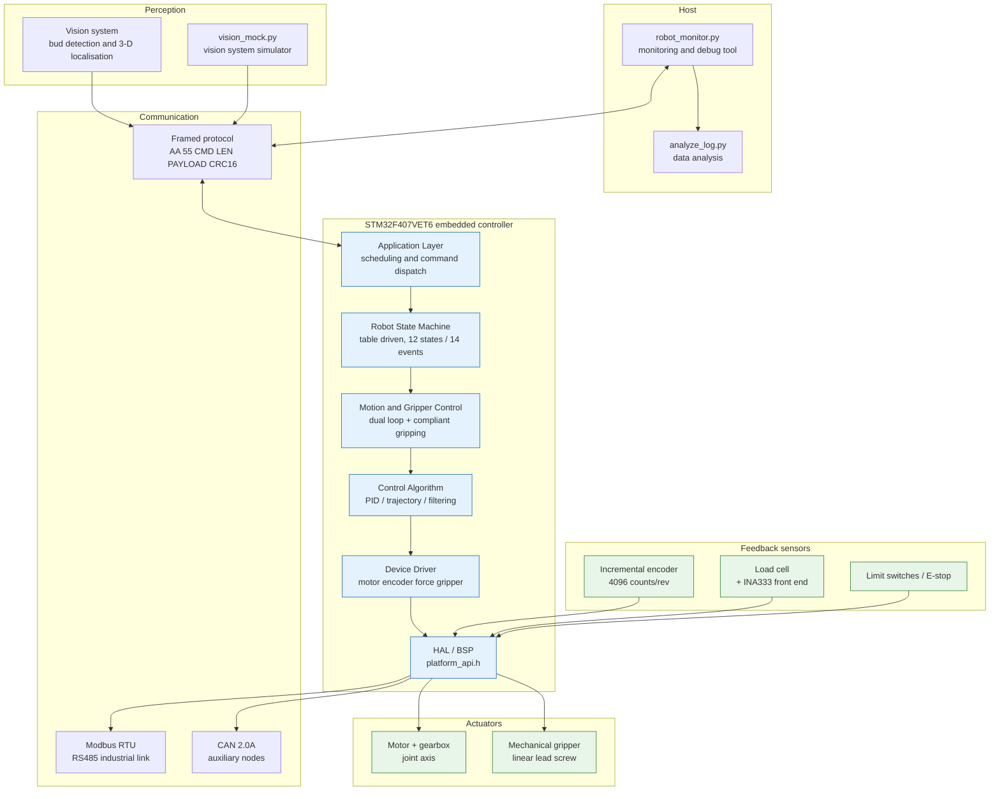
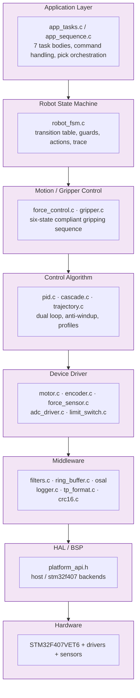
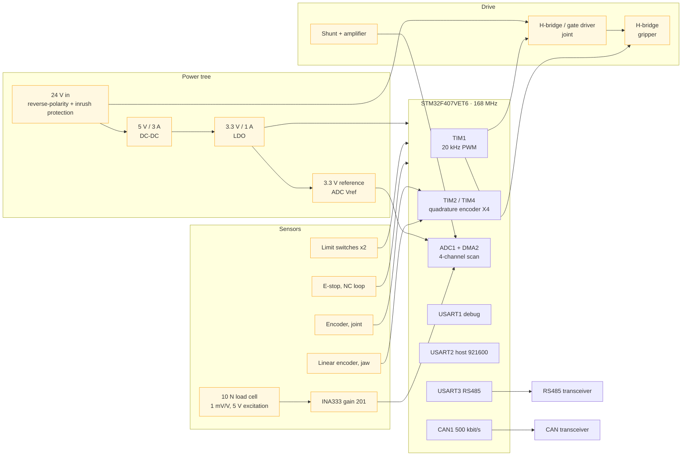
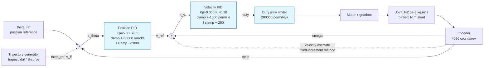
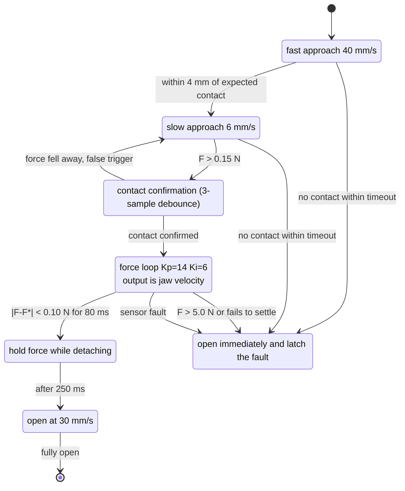
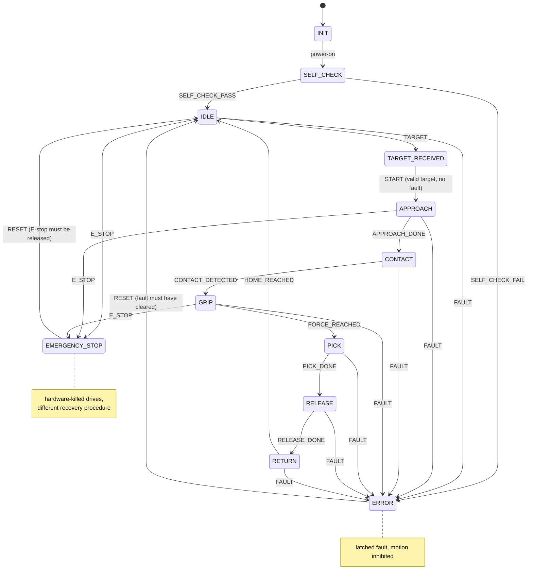
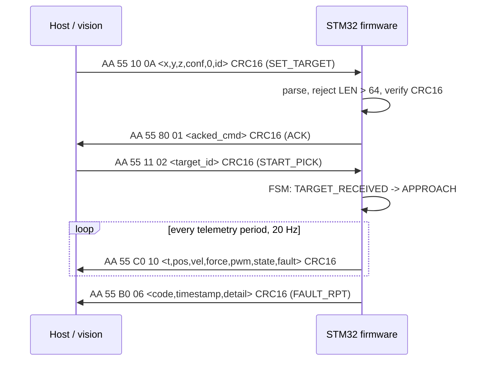
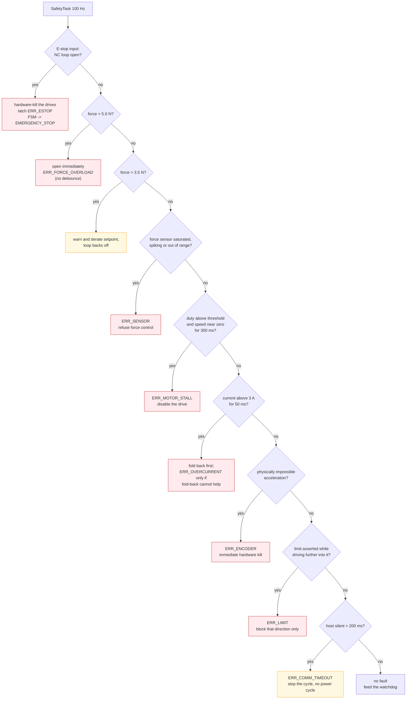

<div align="center">

# 🍃 Second-Generation Intelligent UAV Tea-Picking Robotic System

**Embedded Actuator Control for a Tea-Picking Robot**

STM32F407 · FreeRTOS · Cascaded PID · Force-Feedback Compliant Gripping

[](#repository-layout)
[](#hardware-architecture)
[](#freertos-task-architecture)
[](#quick-start)
[](#testing)
[](LICENSE)

</div>

---

## 30-Second Overview

| Question | Answer |
|---|---|
| **What is it?** | The **embedded actuator control system** of an automated tea-picking robot: it receives a target position from a vision system and drives an arm and a compliant gripper through `locate → approach → grip → force check → pick → release → return`. |
| **What problem does it solve?** | Fixed-position gripping cannot measure how hard it is squeezing. The force depends on stem stiffness, which varies with cultivar, moisture and bud age, so a gripper closing to a fixed gap can crush the bud before the controller has any information at all. This project closes the loop on **force** instead of position for the gripping phase. |
| **Core technologies** | Position/velocity **cascaded PID** → **force-feedback compliant gripping** (six-state sequence) → table-driven **robot FSM** → CRC16 framing + Modbus RTU → nine classes of **safety protection**. |
| **Where is the code?** | `firmware/` is the firmware (89 C files / 25,939 lines); `simulator/` is an independent Python physics model; `tests/` and `firmware/Tests/` hold the test suites. |
| **Where is the control algorithm?** | `firmware/Control/pid.c` (PID), `cascade.c` (dual loop), `force_control.c` (compliant gripping), `trajectory.c` (profiles). |
| **How do I run it?** | `python scripts/run_demo.py` — one command builds, simulates, plots and cross-checks. |
| **What is the result?** | Simulation: full pick cycle completes with a grip force of **2.17 N** against a 2.20 N setpoint, **0.00 N overshoot**, **2.26 N** mean hold force and a **2.386 N** peak (5.0 N hard limit), with **0 missed control deadlines**. All seven scenarios trigger their protection as designed. |

> **⚠️ Data-honesty statement — please read this first**
>
> This project has **no physical prototype**: no board was fabricated, soldered or powered, and **every number is simulated**.
>
> - **Target KPIs**: bud damage rate ≤ 1 %, picking efficiency +40 %. These are **design targets**, not results, and are never presented as verified.
> - **Simulated results**: the force and timing figures above come from real runs of `build/host/tea_picking_robot_host.exe` and are reproducible.
> - **Unverified**: timing, EMC, structural stiffness and the real mechanical properties of a tea stem. See [Known Limitations](#known-limitations).

---

## Table of Contents

- [Background](#background)
- [System Architecture](#system-architecture)
- [Software Architecture](#software-architecture)
- [Hardware Architecture](#hardware-architecture)
- [Control Algorithm](#control-algorithm)
- [Compliant Gripping and Force Feedback](#compliant-gripping-and-force-feedback)
- [Robot State Machine](#robot-state-machine)
- [Communication Protocol](#communication-protocol)
- [FreeRTOS Task Architecture](#freertos-task-architecture)
- [Safety Mechanisms](#safety-mechanisms)
- [Simulation](#simulation)
- [Results](#results)
- [Repository Layout](#repository-layout)
- [Quick Start](#quick-start)
- [Testing](#testing)
- [Known Limitations](#known-limitations)
- [Roadmap](#roadmap)
- [Documentation](#documentation)
- [License and Author](#license-and-author)

---

## Background

**What it is.** A complete, layered embedded robot control system: device drivers, control algorithms, communication protocols, safety supervision and an application state machine.

**Why it exists.** Tea picking is labour-intensive; hand picking accounts for more than half of production cost (public industry figures). The hard part of mechanisation is not *gripping* the bud, it is **not damaging it**.

**What breaks without force feedback.** When the jaws close to a fixed position, the actual grip force depends on the stem's stiffness — which varies with cultivar, moisture and bud age. Against a stiffer-than-expected stem the force rises along a nonlinear curve and passes the damage threshold before the controller has any information at all. The simulation reproduces exactly this: in position-only mode, with the stem surface moved out to 16 mm, the predicted force is **12.2 N** against a 5 N hard limit, and the controller never knows.

**First generation vs second generation**

| | Gen 1 | Gen 2 (this project) |
|---|---|---|
| Gripping | Fixed-position loop | **Force-feedback loop** + cascaded position/velocity approach |
| Damage control | Mechanical stops and empirical calibration | Three-level force protection + an adaptive-threshold framework |
| Software | Single-file super-loop | 7-layer architecture + 7 FreeRTOS tasks |
| Testability | Requires hardware | **The same firmware sources run on a PC**: 125 C unit tests + 22 Python tests |
| Communication | Ad-hoc serial | Framed protocol (CRC16) + Modbus RTU |

---

## System Architecture



**Layering rule.** Each layer calls the one below it through an interface; the application layer **never touches an STM32 HAL register**. The single hardware seam is `firmware/BSP/platform_api.h`, so "which code touches the hardware?" has a one-file answer.

---

## Software Architecture



**Testability comes from having exactly two seams.**

| Abstraction | Location | Backend A | Backend B |
|---|---|---|---|
| Hardware seam | `platform_api.h` | `BSP/host/platform_host.c` (deterministic physics) | `BSP/stm32f407/platform_stm32f407.c` (real registers) |
| Operating system | `osal.h` | `osal_baremetal.c` (deterministic cooperative) | `osal_freertos.c` (preemptive RTOS) |

The consequence is that **the firmware itself runs on a PC** — not a re-implementation of it. `pid.c`, `force_control.c`, `robot_fsm.c` and `safety_monitor.c` are the same translation units on both targets, which is what lets 125 unit tests cover the production code path.

---

## Hardware Architecture

> Everything below is a **Reference Design / Recommended Implementation** derived from datasheet figures. **No board has been built or measured.**



**Force-sensor front end — the key design decision**

| Parameter | Value | Rationale |
|---|---|---|
| Rated load | **10 N** (not 50 N) | The target grip force is 2.2 N and the hard limit 5 N, so resolution must be far better than 20 mN |
| Sensitivity | 0.5 mV/N | 1 mV/V × 5 V excitation ÷ 10 N |
| Amplifier gain | 201 (INA333, RG = 249 Ω) | Front-end output 100.5 mV/N |
| ADC step | 0.806 mV (3.3 V / 4096) | — |
| **Resolution** | **8.0 mN per count** | *Derived* from the macros in `config.h`, never typed in |
| Usable range | **±16.4 N** | Covers the 5 N hard limit with margin |

A 50 N cell would give only 0.1 mV/N and need a gain of 400, at which point amplifier offset drift and bridge thermal drift dominate the reading. **Choosing the sensor so the electronics stay simple** is the better engineering answer than amplifying a small signal by 400.

**Signal chain**: `load cell → INA333 (G=201) → RC anti-alias (fc = 1.6 kHz) → ADC1_IN4 → median(5) → moving average(8) → 1st-order low-pass (τ = 6 ms) → newtons`

Each filtering stage has a distinct job: the **median** removes isolated EMI spikes (a moving average would only spread them), the **moving average** is linear-phase and so does not distort the shape of the contact transient, and the **low-pass** suppresses the 20 kHz PWM carrier.

---

## Control Algorithm

### Cascaded structure



**Why two loops instead of one PID on position**

1. **A single position PID has to do two incompatible jobs.** Its output is a *velocity demand*, so its gain sets both the response speed and the damping. Raising the gain for speed reduces phase margin until the joint oscillates. Splitting the problem lets the inner loop own the damping (it commands the torque-producing quantity directly) and the outer loop own the response speed.
2. **The inner loop linearises the plant.** The torque constant varies with current and temperature, the supply sags under load, friction is nonlinear near zero speed — all of it lives *inside* the velocity loop, so closing it around the encoder makes the plant, as seen by the position loop, close to a pure integrator `theta' = v_cmd`.
3. **It rejects disturbance torque where it is generated.** Gravity and cutting reaction act as torque; the velocity loop sees them as a velocity error and corrects within its own bandwidth *without the position changing*. A single loop must first let the joint move before it notices.

**Bandwidth separation is a design constraint, not a tuning outcome**

| Loop | Bandwidth | Derivation |
|---|---|---|
| Velocity (inner) | ≈ **8 Hz** (50 rad/s) | Plant: DC gain 480 mrad/s per permille, mechanical time constant `J/(b + Kt·Ke/R) = 0.05 s`. PI placement `Kp = τ/(K·Tc)` with `Tc = 20 ms` gives `Kp = 0.0052`, `Ki = Kp/τ = 0.104` |
| Position (outer) | ≈ **0.8 Hz** | The closed velocity loop is a first-order lag of about 20 ms, so `v = Kp·e` closes the position loop with time constant `1/Kp`; `Kp = 5.0` gives 200 ms |
| Separation | **about 10x** | Below 5x a cascade is *worse* than a single loop (extra lag for no benefit); above 20x the position loop is needlessly slow |

**An engineering lesson from a real defect.** The first revision set `TP_MAX_DUTY_RATE_PER_S = 4000` per-mille/s, i.e. 250 ms to sweep full scale. That is not a slew limiter, it is a **dominant lag inside the velocity loop** — roughly 60 degrees of unmodelled phase lag at crossover, and the joint oscillated with an amplitude of tens of thousands of milliradians per second. **Any actuator rate limit has to be checked against the loop bandwidth it sits inside**: full scale must be reached in a time much shorter than `1/(2·pi·fc)`. At an 8 Hz loop that budget is about 20 ms; the value is now 5 ms.

### PID implementation notes

| Feature | Why | Without it |
|---|---|---|
| Trapezoidal integration | Rectangular integration of a ramping error has a half-sample bias | A small but permanent steady-state offset |
| **Derivative on measurement** | Differentiating the error creates an impulse on every setpoint step, which the motor turns into a current spike | "Derivative kick" on every new target |
| Derivative low-pass (backward Euler) | The encoder is quantised; a raw difference at 1 kHz is mostly quantisation noise, and D amplifies it | PWM buzz and pointless motor heating |
| Integral clamp | Bounds what the I term alone can demand | Severe overshoot on the first move after a long approach |
| **Back-calculation anti-windup** | While saturated the actuator cannot follow, so integrating the error is fiction | Classic windup: the arm slams into the target and takes seconds to return |
| Conditional integration (alternative) | Cheaper; freezes the integrator during same-direction saturation | Same as above, implemented as a branch |
| Runtime gain retune | The host must change gains without a reflash (Experiment 02) | One firmware build per data point |
| `PID_Reset()` | A mode change must not inherit a stale integrator | An unexplained bias from the previous phase |

The **integral clamp is deliberately an order of magnitude below the output clamp**. That single choice is the most effective anti-overshoot measure in the controller: it bounds how much velocity the I term can demand on its own, so a long approach cannot charge the integrator and release it as an overshoot at the end of the move.

---

## Compliant Gripping and Force Feedback



**Why position-only gripping must damage the bud**

The simulation uses a nonlinear contact model, `F = k1·d + k2·d²` with `k1 = 0.30 N/mm` and `k2 = 0.06 N/mm²`. The quadratic term means the stem **stiffens** as it is compressed — which is exactly what makes a fixed-gap gripper unsafe: closing to a fixed gap produces a force that depends on an unknown stiffness.

Verified in the simulation (scenario D): with the position-only controller, moving the stem surface from 6 mm out to 16 mm (stiffer than the approach model assumes) predicts `0.30×12 + 0.06×144 = 12.2 N`, far past the 5 N hard limit and the 4 N damage threshold. The safety monitor contains it, but **only by tripping**.

**The central result**

> With force feedback **enabled**, the same "stiffer than expected stem" is a non-event. Scenario D was originally written that way — a stiffer stem with force control active — and the cycle **completed normally** with a 3.2 N peak. That is not a flaw in the scenario, it is the central conclusion of the whole project: **a force-controlled gripper does not care how stiff the bud is.** Demonstrating the over-force protection requires *removing* the force feedback, which is precisely what the first-generation machine did.

**Why the force loop runs at 1 kHz while the sensor runs at 500 Hz**

- The force loop's output is a **jaw velocity**, and it must reverse quickly at contact; 1 kHz gives a 1 ms worst-case reaction.
- The force channel's anti-alias corner is about 26 Hz, so 500 Hz sampling is already generous; more would only re-feed the same sample.
- Separating them also makes the 1 kHz control period **independent of how long a conversion takes**.

---

## Robot State Machine



**Why a transition table rather than nested if/else.** The cycle has 12 states and 14 events; hand-written nested switches run to about 170 lines of branches in which an unhandled `(state, event)` pair is **silently ignored** (indistinguishable from a correct no-op), the legal transition set cannot be reviewed, and adding a state means editing several places with a forgotten one showing up as a robot that hangs with no explanation.

Here `s_transitions[]` is **data**: it can be enumerated, validated (a unit test walks the whole table asserting that every state is reachable and that no `(state, event)` pair is duplicated), logged (`approach-->contact (CONTACT_DETECTED)` rather than `state 4 -> 5`) and plotted (the diagram above is generated from the same data).

**Other deliberate properties**
- **`STOP` is legal from every cyclic state** and always lands in `IDLE` — a stop that depends on where you are is a stop you cannot rely on.
- **A fault and an E-stop are legal from every state**, including `INIT`, so a fault raised during boot still produces a correct `ERROR` entry.
- **The E-stop does not pass through `ERROR`**: its recovery procedure is different (release the button, then reset) and the drives are killed in hardware rather than commanded to stop.
- `ERROR` and `EMERGENCY_STOP` **hold position** rather than cutting the drive, unless the fault itself makes the feedback untrustworthy (encoder, over-current, stall, E-stop) — re-homing before every retry is a real cost.

---

## Communication Protocol

### Frame format

```
+--------+--------+--------+--------+------------------+--------+--------+
| 0xAA   | 0x55   | CMD    | LEN    | PAYLOAD[0..LEN-1]| CRC_LO | CRC_HI |
+--------+--------+--------+--------+------------------+--------+--------+
  byte 0   byte 1   byte 2   byte 3      byte 4..         last 2 bytes
```



**Field-by-field rationale**

| Field | Rationale |
|---|---|
| Two-byte header `AA 55` | One byte appears constantly inside payloads; three wastes bandwidth. It is the parser's resynchronisation point |
| `LEN` | A length byte rather than a fixed-size frame keeps a heartbeat at 6 bytes on the wire |
| CRC covers only `CMD\|LEN\|PAYLOAD` | The header is already a fixed pattern; including it adds no detection power, while the length byte and payload are exactly what goes wrong |
| **Little-endian** | Matches the STM32's native order so the firmware can `memcpy` instead of byte-swapping. This is a deliberate deviation from network order and the most common integration mistake: a partner assuming big-endian reads a 2.0 N grip force as 8192 N |
| CRC-16/MODBUS | Mandated by Modbus RTU, so the RS485 link gets its checksum for free; polynomial `0xA001`, init `0xFFFF`, no final XOR |

**Why a table is deliberately not used.** The bitwise implementation costs about 8 shift/XOR rounds per byte. At 921600 baud the worst case is roughly 92 kbyte/s, i.e. about 736k inner iterations per second — under 1 % of a 168 MHz Cortex-M4. A 512-byte lookup table would save that at the cost of 512 bytes of flash that is never otherwise needed. `docs/13_future_work.md` records the exact condition under which that decision should be revisited.

**Parser resilience** (every case has a unit test)

| Case | Handling |
|---|---|
| Garbage bytes | Discarded while hunting for `AA`; counted in `bytes_discarded` |
| `AA AA 55` | The second `AA` starts a real header — the parser **stays in `WAIT_HDR1` rather than falling back to `WAIT_HDR0`**, which would drop the frame |
| `LEN > 64` | **Rejected immediately** rather than waiting for bytes that will never come (which would stall the parser indefinitely and swallow the next real frame as payload) |
| CRC failure | Resumes hunting from the byte *after* the header rather than consuming the whole candidate frame — otherwise a false header inside a payload swallows a genuine frame starting a few bytes later |
| Stale payload tail | Explicitly zeroed, so a consumer reading past `len` cannot see the previous frame's data |

**Packet loss and timeout.** Heartbeats carry a sequence number and the firmware estimates genuine link loss from the gaps (returning 0 when fewer than five heartbeats have been seen, rather than reporting a spurious 100 % loss). Silence for more than 200 ms triggers link loss and the application stops the cycle, because **a vision target is a timestamped measurement, not a permanent truth**.

### Command table

| Command | Code | Dir | Payload | Len |
|---|---|---|---|---|
| HEARTBEAT | 0x01 | → | `u32 seq` | 4 |
| SET_TARGET | 0x10 | → | `i16 x, i16 y, i16 z, u8 conf, u8 rsvd, u16 id` | 10 |
| START_PICK | 0x11 | → | `u16 target_id` | 2 |
| STOP | 0x12 | → | – | 0 |
| RESET | 0x13 | → | – | 0 |
| GET_STATUS | 0x20 | → | – | 0 |
| GET_SENSOR | 0x21 | → | – | 0 |
| GET_FAULT | 0x22 | → | – | 0 |
| SET_PID | 0x30 | → | `u8 loop, f32 kp, f32 ki, f32 kd` | 13 |
| GET_PID | 0x31 | → | `u8 loop` | 1 |
| SET_FORCE_TARGET | 0x32 | → | `u16 mN` | 2 |
| SET_MODE | 0x33 | → | `u8 mode` | 1 |
| EMERGENCY_STOP | 0x40 | → | – | 0 |
| CLEAR_FAULT | 0x41 | → | – | 0 |
| CALIBRATE_FORCE | 0x42 | → | `u8 kind` | 1 |
| ACK | 0x80 | ← | `u8 acked_cmd` | 1 |
| HEARTBEAT_ACK | 0x81 | ← | `u32 seq` | 4 |
| STATUS_RPT | 0xA0 | ← | `u8 state, u8 fault, i32 pos, i16 vel, i16 force, i16 pwm, i16 current, u16 cycles` | **16** |
| SENSOR_RPT | 0xA1 | ← | `i32 pos, i16 vel, i16 force, u16 adc, i16 current, i16 temp` | **14** |
| PID_RPT | 0xA2 | ← | `u8 loop, f32 kp, f32 ki, f32 kd` | 13 |
| FAULT_RPT | 0xB0 | ← | `u8 code, u32 ms, u8 detail` | 6 |
| TELEMETRY | 0xC0 | ← | `u32 t, i32 pos, i16 vel, i16 force, i16 pwm, u8 state, u8 fault` | 16 |
| NACK | 0xE0 | ← | `u8 ref_cmd, u8 err_code, u8 detail` | 3 |

> **Three real wire defects found by the cross-implementation conformance test.** The Python side emitted a 9-byte `SET_TARGET` while the firmware expected 10 (so `target_id` was read one byte early, from the confidence byte); `NACK` was 2 bytes in Python and 3 in the firmware; and the firmware's own `STATUS_RPT` and `SENSOR_RPT` encoders wrote one byte more than they transmitted, truncating the last field. A single-language test suite **cannot** find any of these — `tests/test_protocol_agreement.py` now pins both sides together.

---

## FreeRTOS Task Architecture

```mermaid
gantt
    title Task timing over one 10 ms window
    dateFormat X
    axisFormat %L ms

    section 1 kHz
    ControlTask (CRITICAL)     :crit, c1, 0, 1
    ControlTask                :crit, c2, 1, 1
    ControlTask                :crit, c3, 2, 1
    ControlTask                :crit, c4, 3, 1
    ControlTask                :crit, c5, 4, 1
    ControlTask                :crit, c6, 5, 1
    ControlTask                :crit, c7, 6, 1
    ControlTask                :crit, c8, 7, 1
    ControlTask                :crit, c9, 8, 1
    ControlTask                :crit, c10, 9, 1

    section 500 Hz
    SensorTask (HIGH)          :s1, 0, 1
    SensorTask                 :s2, 2, 1
    SensorTask                 :s3, 4, 1
    SensorTask                 :s4, 6, 1
    SensorTask                 :s5, 8, 1

    section 100 Hz
    SafetyTask (REALTIME)      :a1, 0, 1
    RobotTask (ABOVE_NORMAL)   :a2, 1, 1
    CommTask (NORMAL)          :a3, 2, 1
    SafetyTask                 :a4, 10, 1
    RobotTask                  :a5, 11, 1
    CommTask                   :a6, 12, 1

    section 20 Hz
    TelemetryTask (BELOW_NORMAL) :t1, 0, 1

    section 5 Hz
    DebugTask (LOW)            :d1, 0, 1
```



| Task | Rate | Priority | Responsibility | Why that rate |
|---|---|---|---|---|
| **ControlTask** | 1 kHz | CRITICAL (6) | Cascade PID, motor update, jaw update | An 8 Hz velocity loop needs at least 10x oversampling for the discrete approximation to hold; 1 kHz also matches the PWM period and gives a 1 ms worst-case reaction to a force event |
| **SensorTask** | 500 Hz | HIGH (5) | ADC/DMA, force, encoders, limits | Twice the control rate, so the control loop always has a sample at most 1 ms old; the force channel's 26 Hz corner does not need more |
| **CommTask** | 100 Hz | NORMAL (3) | UART / CAN / RS485, protocol parsing | A 10 ms period bounds command latency at 10 ms while leaving 90 % of the CPU for control |
| **RobotTask** | 100 Hz | ABOVE_NORMAL (4) | FSM, pick orchestration | The fastest decision is the contact handover, which the 1 kHz force loop already makes; the FSM only observes |
| **SafetyTask** | 100 Hz | REALTIME (5) | All hazard checks, watchdog feed | Deliberately **slower than control but higher than the robot**: a fault must preempt the sequence logic without jittering the control loop |
| **TelemetryTask** | 20 Hz | BELOW_NORMAL (2) | Periodic reporting | 20 Hz is what a human-readable monitor needs; 50 ms per update is well inside perception |
| **DebugTask** | 5 Hz | LOW (1) | Logging, statistics | Strictly lowest: logging must never delay anything |

**Several deliberate choices**

- **Task bodies are single-iteration "step" functions**; the OSAL owns the loop and the period (the FreeRTOS backend wraps them in a task using `vTaskDelayUntil`). Three things follow: a test can call `control_step()` directly and drive the clock by hand; the simulation is bit-reproducible; and the period is declared once, in `config.h`.
- **`vTaskDelayUntil`, not `vTaskDelay`.** The latter waits for a *relative* duration, so the period becomes "execution time + delay" and drifts with the workload. The PID's `dt` is a compile-time constant, so a drifting period silently detunes every gain.
- **Task notification rather than a queue** for the sensor-to-control handoff: it writes into the target TCB instead of touching a kernel object and is the cheapest synchronisation FreeRTOS has, which matters on a 1 kHz path. It uses `eSetValueWithOverwrite` — the control loop wants the newest sample, not a backlog.
- **The watchdog is fed from exactly one place**, and only after every supervised task has been observed to make progress. Feeding it from several tasks would let a hung control loop be masked by a healthy logger.
- **A mutex, not a binary semaphore**: only a mutex has priority inheritance. Without it, the communication task holding the lock could be preempted by a lower-priority task and stall the 1 kHz control loop — textbook priority inversion, and a real risk here because the logger is shared across priorities.

---

## Safety Mechanisms



**Severity drives the reaction**

| Severity | Behaviour | Cleared by |
|---|---|---|
| `INFO` | logged only | automatic |
| `WARNING` | logged, telemetry flag raised, motion continues | `CLEAR_FAULT` or automatically when the condition goes away |
| `ERROR` | motion disabled, FSM forced to `ERROR` | `CLEAR_FAULT`, **and only if the physical condition has cleared** |
| `CRITICAL` | PWM hardware-killed, FSM forced to `EMERGENCY_STOP` | `RESET` after the condition clears |

**The asymmetry in debouncing is deliberate.** Checks that protect the *machine from itself* are debounced (stall 300 ms, over-current 50 ms); checks that protect the *object and the operator* are not (force hard limit, E-stop). A nuisance stall trip is an annoyance; a delayed over-force trip destroys a bud.

**Why stall detection needs a duty condition.** "Speed is zero" is not a stall: a motor commanded to zero speed that is at zero speed is simply stopped. A stall is **torque being demanded with nothing moving**. Requiring the commanded duty to exceed 80 per-mille before arming the check is what separates the two, and it is the most common mistake in a home-grown stall detector.

**A real race between two protections.** The first run of the hard-jam scenario raised `ERR_OVERCURRENT` rather than `ERR_MOTOR_STALL` — and that is the physically **correct** answer, not a defect. A stalled motor demanding full torque exceeds the continuous current rating within 50 ms, while the stall detector deliberately waits 300 ms, so the current protection always wins that race and should. The stall detector's real job is the **low-current stall**: friction the drive can push against without exceeding its rating (a dry lead screw, a swarf-filled guideway, a bud wedged in the mechanism). Scenario F therefore configures the drive for an 800 mA limit to cover that case.

**Further points**
- **Fail-safe polarity.** The E-stop is a normally-closed loop, so **a broken wire reads as pressed**. If it is asserted during the boot self-check, nothing is energised at all — not even to finish the self-check.
- **"Lose position" versus "keep driving".** The drive is cut only for encoder, over-current, stall and E-stop faults; every other recoverable fault holds position, avoiding a re-home on every retry.
- **`CLEAR_FAULT` cannot defeat a protection**: a clear is refused while the physical condition persists.

---

## Simulation

There are **two** independent simulations, and neither is redundant:

| | C firmware host build | Python model |
|---|---|---|
| Location | `firmware/Core/main_host.c` + `BSP/host/plant_model.c` | `simulator/` |
| What it is | **The firmware itself**, with a physics model in place of motors and sensors | An independently written physics model and controller |
| What it proves | That the controller (PID, force control, FSM, safety monitor) works on the real code path | That an independent implementation reaches the same conclusions — real evidence rather than a tautology |
| Run it | `python scripts/run_demo.py` | `python simulator/main.py` |
| Scenarios | 7 (`scripts/run_scenarios.ps1`) | 7 (`python simulator/main.py --scenario all`) |

**Physics model (`plant_model.c`)**

```
Joint axis:
  V        = pwm/1000 * V_bus                  (slew limited)
  i_cmd    = (V - Ke*w) / R                    (Ohm's law + back-EMF)
  di/dt    = (i_cmd - i) / tau_e,  tau_e = L/R
  T_motor  = Kt * i
  T_fric   = Tc*tanh(w/w_eps) + b*w
  J*dw/dt  = T_motor - T_fric - T_load - T_jam
  dtheta/dt = w

Gripper and tea stem:
  v_jaw   += (v_cmd - v_jaw)*dt/(tau_jaw+dt)   (servo lag)
  v_jaw   -= F / K_backdrive                   (force back-drive)
  gap     += v_jaw*dt,  clamped to [0, 40] mm
  d        = max(0, stem_gap - gap)
  F        = k1*d + k2*d^2 + c*max(0, -v_jaw)  (nonlinear stiffening)
```

**Why the current is a first-order lag rather than a direct integration of `L·di/dt = V − R·i − Ke·ω`.** With `L = 1.5 mH` and `R = 2 Ω` the electrical pole sits at 1/0.75 ms, so a 1 ms explicit Euler step is marginally unstable and produces a numerical oscillation that has nothing to do with the machine. Collapsing the fast pole into `di/dt = (i_ss − i)/τ_e` is the standard singular perturbation: it keeps the *physical* time constant visible while staying stable at the 1 ms control period.

**Why a deterministic cooperative scheduler.** A threaded simulation produces a different trace on every run, because the interleaving depends on the host scheduler — so the plots in `data/results/` and the rise-time and overshoot numbers derived from them would not be reproducible. A control loop that only works when its timing is lucky is not a control loop.

**The seven scenarios**

| Scenario | Injected disturbance | Expected outcome | Criterion |
|---|---|---|---|
| **A** nominal pick | none | full cycle | cycle completes, no fault |
| **B** target position error | vision X off by +8 mm | cycle aborted | `ERR_TARGET` (contact timeout) |
| **C** force sensor noise | σ = 80 mN | cycle completes | grip force still in band |
| **D** excessive grip force | position-only mode + stem out at 16 mm | protection trips | `ERR_FORCE_OVERLOAD` |
| **E** communication timeout | one heartbeat frame, then silence | cycle stops | `ERR_COMM_TIMEOUT` |
| **F** motor stall | 8 N·m jam + drive limited to 800 mA | protection trips | `ERR_MOTOR_STALL` / `ERR_OVERCURRENT` |
| **G** emergency stop | E-stop asserted at t = 1.2 s | immediate stop | `EMERGENCY_STOP` + `ERR_ESTOP` |

**What the simulation cannot do.** The model parameters (stem stiffness `k1`/`k2`, the 4 N damage threshold, friction coefficients) are **model assumptions, not measurements**. Timing (interrupt latency, DMA jitter, real stack depth), EMC, structural stiffness and the actual mechanics of a tea stem **cannot be substituted by simulation**.

---

## Results

### Data classification (research integrity)

| Category | Meaning | Count in this project |
|---|---|---|
| **Measured** | obtained on physical hardware | **zero** — there is no prototype |
| **Simulated** | produced by real runs of the code in this repository, reproducible | all numerical results |
| **Target (design goal)** | a requirement, not verified | damage rate ≤ 1 %, efficiency +40 % |
| **Estimated** | design calculation from datasheet figures | 8.0 mN resolution, ±16.4 N range, bandwidths, bit timing |

### Simulated results (reproducible)

**Scenario A — nominal pick cycle** (`build/host/tea_picking_robot_host.exe --scenario A`)

| Phase | Time | Key quantity |
|---|---|---|
| Target detected | 1.20 s | id=1, x=0 mm, y=15 mm, z=185 mm, confidence 95 % |
| Approach complete | 1.24 s | 50 mrad move, 32 ms trapezoidal profile |
| **Contact detected** | **2.57 s** | **gap 5.824 mm, F = 0.148 N** |
| **Target force reached** | **3.14 s** | **2.17 N** against 2.20 N ± 0.10 N, **0.00 N overshoot**, 49 control periods to settle |
| Detach | 3.39 s | mean force while gripping **2.26 N** |
| Release | 4.68 s | fully open |
| Home | 4.78 s | `cycle_count = 1` |

| Metric | Result |
|---|---|
| Peak grip force | **2.386 N** (hard limit 5.00 N) |
| Grip force overshoot | **0.00 N** |
| Task iterations | 6000 control (1 kHz) / 3000 sensor / 600 comm / 600 robot / 600 safety |
| **Missed deadlines** | **0** |
| Host-link decode | 2200 B, 100 frames, **0 CRC errors** |

**All seven scenarios** (`scripts/run_scenarios.ps1`, 7/7 PASS)

| Scenario | Result | Peak grip force | Final state |
|---|---|---|---|
| A nominal pick | cycle completed | 2.386 N | idle |
| B target position error | aborted | 0.167 N | error (`ERR_TARGET`) |
| C force sensor noise | cycle completed | 2.426 N | idle |
| D excessive grip force | protection tripped | — | error (`ERR_FORCE_OVERLOAD`) |
| E communication timeout | cycle stopped | — | idle |
| F motor stall | protection tripped | — | error (`ERR_MOTOR_STALL`) |
| G emergency stop | immediate stop | — | emergency_stop |

### Key findings

1. **Force control makes "the stem is stiffer than expected" a non-event** (the real lesson of scenario D). This is the central conclusion of the project: a force-controlled gripper does not care how stiff the bud is. Demonstrating over-force protection requires removing the force feedback.
2. **On a hard jam the over-current protection wins the race against the stall detector, and that is correct.** By design, stall detection covers the low-current stall.
3. **Target position error directly limits cycle time.** An +8 mm lateral vision error makes the gripper slow down at the wrong distance, consuming the time budget and triggering a contact timeout. Vision accuracy is a constraint on throughput, not a refinement.
4. **Real defects in the first revision, all found by the tests and the simulation:**

| # | Defect | Consequence | Fix |
|---|---|---|---|
| 1 | Duty slew limit at 4000 per-mille/s (250 ms full scale) | A dominant lag inside the velocity loop; the joint oscillated at tens of thousands of mrad/s | Raised to 200 000 per-mille/s (5 ms full scale), and checked against the loop bandwidth |
| 2 | Force spike threshold at 1.0 N, and the reference was **not updated on a spike** | After one *genuine* impact every following sample looked like a spike; `ERR_SENSOR` latched within 16 ms | Threshold raised to 3.0 N; the reference is always current (a persistent offset is the range/saturation check's job, not the spike detector's) |
| 3 | The gripping controller was **not serviced in `RELEASE`** | The sequence hung in `RELEASE` forever, looking like an FSM defect | Service it in `RELEASE` too, and remove the second owner of the jaw in that state |
| 4 | FSM guards received the **application context but cast it to the FSM** | `guard_has_target()` read the wrong memory; `START` was intermittently refused | Guards and actions now take `tp_robot_fsm_t *` — type-correct |
| 5 | The jam was modelled as an 8 N·m torque on a 2.5e-3 kg·m² inertia (3200 rad/s²) | The hold band was four orders of magnitude narrower than one step can resolve; the axis oscillated at thousands of mrad/s | Modelled as a **stick-slip motion constraint**; the condition is tested on torque, not velocity |
| 6 | The limit veto **wrote back into the caller's velocity setpoint** | Once the jaw touched a limit the setpoint latched at zero and the axis never moved again; `tp_gripper_open()` stalled at 39.8 mm | The vetoed value goes to `applied_velocity_mm_s`; the request is left alone |
| 7 | Current fold-back was computed as a fraction of **full scale** rather than of the **present duty** | At 3.6 A it produced a 750 per-mille "ceiling" above the command, reduced nothing, and the protection tripped | Fold back the present duty; and make the slew limiter respect the ceiling, or the next sample undoes it |
| 8 | A disabled channel **stopped refreshing its current reading** | `clear_fault` saw a stale over-limit value forever and the drive was latched out permanently | Keep sampling while disabled, so recovery is observable |
| 9 | An ADC pinned at a rail (wire broken to ground) reads −16.4 N, which **sits inside the ±20 N plausibility window** | The break presented itself as a legitimate large negative force and the force controller would have believed it | Saturation is itself a fault |
| 10 | `tp_fault_clear_all()` counted **never-raised** codes as cleared | Reported "9 faults cleared" on a healthy robot | Count only faults that were latched before the call |
| 11 | **Cross-implementation wire incompatibilities**: `SET_TARGET` 9 vs 10 bytes, `NACK` 2 vs 3, three command codes different, and `loop_id` mapping swapped FORCE with VELOCITY | A host saying "tune the grip force" re-tuned the velocity loop; `target_id` was read one byte early | Pinned by a conformance test on both sides (`tests/test_protocol_agreement.py`) |

---

## Repository Layout

```
second-gen-tea-picking-robot/
├── firmware/                        firmware (89 C files / 25,939 lines)
│   ├── Core/                        entry points, task bodies, pick orchestration, STM32 IRQs
│   ├── Application/                 config.h (every tunable), robot_fsm.c
│   ├── Control/                     pid.c · cascade.c · force_control.c · trajectory.c
│   ├── Protocol/                    crc16.c · frame.c · protocol.c · protocol_types.h
│   ├── Safety/                      fault_codes.c · fault_manager.c · safety_monitor.c
│   ├── Middleware/
│   │   ├── osal/                    osal.h + baremetal / freertos backends
│   │   └── utils/                   filters · ring_buffer · logger · tp_format · robot_state
│   ├── BSP/                         device drivers + both platform backends
│   │   ├── host/                    plant_model.c (physics) · platform_host.c
│   │   └── stm32f407/               platform_stm32f407.c (real registers)
│   ├── Drivers/                     startup · linker script · third party (HAL/CMSIS/FreeRTOS)
│   └── Tests/                       125 C unit tests + a zero-dependency test framework
├── simulator/                       independent Python simulation (18 modules)
├── host/                            host tooling: protocol · monitor GUI · link abstraction
├── tools/                           vision_mock.py · analyze_log.py
├── tests/                           Python test suite + zero-dependency runner
├── docs/                            13 paper-grade documents + interview guide + resume + calibration
├── hardware/                        5 hardware design documents (reference designs)
├── data/                            simulation logs, figures and metrics
├── images/                          README illustrations
├── scripts/                         run_demo.py · build · scenario sweep · flashing
├── toolchain/                       CMake cross-compilation toolchain files
├── Makefile                         unified build entry point (host / test / stm32)
├── CMakeLists.txt                   equivalent CMake configuration
├── LICENSE                          MIT
└── requirements.txt                 Python dependencies (numpy / matplotlib / pyserial)
```

---

## Quick Start

### Requirements

| Tool | Version | Purpose | Required |
|---|---|---|---|
| Python | 3.8+ | simulation, host tools, tests | yes |
| numpy, matplotlib | any recent | simulation and plotting | yes |
| gcc | C11 | host firmware and C unit tests | yes |
| GNU Make | 3.80+ | unified build entry point | recommended |
| arm-none-eabi-gcc | 10+ | STM32 target firmware | target build only |
| pyserial | 3.x | real serial port | hardware work only |
| CMake | 3.16+ | alternative build | optional |

```bash
python -m pip install -r requirements.txt
```

### One command for everything

```bash
python scripts/run_demo.py
```

It builds the host firmware, runs a pick cycle in the C firmware, prints the picking sequence, runs the independent Python model, **cross-checks the two**, and draws the curves.

The output ends with:

```
  [PASS] peak grip force inside the hard limit                firmware 2.387 N < 5.00 N
  [PASS] the joint is stationary at the end of the cycle      firmware -68.1 mrad/s
  [PASS] both models bound the grip force the same way        firmware 2.387 N vs simulator 2.156 N
  [PASS] no control deadline was missed                       0 misses
  DEMO PASSED
```

### Build

```bash
make host        # host simulation firmware -> build/host/tea_picking_robot_host.exe
make test        # build and run the C unit tests
make stm32       # STM32F407 target firmware -> build/stm32/tea_picking_robot.{elf,bin,hex}
make size        # target firmware size
make help        # all targets
```

Without `make` on Windows:

```powershell
./scripts/build_host.ps1 -Target both
./scripts/build_host.ps1 -Run -RunArgs '--scenario','A','--duration','8'
```

`make stm32 RTOS=freertos` requires a GCC Cortex-M4F FreeRTOS port (`portable/GCC/ARM_CM4F`), which is not bundled; that target prints **explicit remediation instructions** and exits non-zero rather than silently degrading. The default `make stm32` uses the bare-metal cooperative OSAL backend and links a complete ELF.

### Simulation

```bash
python simulator/main.py                      # scenario A, prints the sequence, writes figures
python simulator/main.py --scenario all       # all seven + a comparison figure
python simulator/main.py --scenario C --duration 10 --seed 1
```

```
===== Tea Picking Robot Simulation =====
Target detected
Approaching target...
Contact detected
Target force reached: 2.13N
Picking...
Tea picked successfully
Returning home
Cycle completed
========================================
Result: PASS  (faults: none)
```

C firmware simulation (the same firmware sources):

```bash
./build/host/tea_picking_robot_host.exe --scenario A --duration 8 --csv data/logs/trace.csv
./scripts/run_scenarios.ps1 -Csv        # seven scenarios with a criteria table
```

### Host tools

```bash
python tools/vision_mock.py --stdout --count 20 --seed 1        # vision mock
python host/robot_monitor.py --demo --nogui --duration 5 --send-demo-sequence
python host/robot_monitor.py --port COM5                        # real serial + GUI
python tools/analyze_log.py data/logs/trace.csv                 # data analysis
```

---

## Testing

```bash
python scripts/build_host.ps1 -Target test   # C unit tests
python tests/run_tests.py                    # Python test suite
```

| Suite | Count | Status |
|---|---|---|
| **C unit tests** | **125** | all pass |
| **Python tests** | **22** | all pass |
| **C firmware scenarios** | **7** | 7/7 pass |
| **Python simulator scenarios** | **7** | 7/7 pass |
| Host tool self-tests | 7 | 7/7 pass |

**C suite** (`firmware/Tests/`, zero-dependency framework, tests self-register, builds with plain `gcc`)

| Suite | Coverage |
|---|---|
| `pid` | convergence, pure-P steady-state error of exactly half the setpoint, no derivative kick, trapezoidal accuracy, output and integral clamps, both anti-windup strategies, NaN and invalid-config rejection, transient-free gain change, stability at extreme `dt` |
| `crc` `frame` | published check vector, **every single-bit error detected**, incremental equivalence; exact byte layout, resync (including `AA AA 55`), immediate rejection of an oversize length, a CRC failure does not swallow the next frame, maximum and zero-length frames, payload tail zeroing |
| `fsm` | walks the table asserting **every state reachable**, **no duplicate (state, event) pair**, a `STOP` edge from every cyclic state, E-stop forcing from any state, guard-rejection semantics, transition trace, full cycle order |
| `fault` | latch and count, **clear refused while the condition persists**, `WARNING` self-clearing, alternative codes, severity deciding motion-block versus hardware-kill, active-time accumulation, invalid arguments |
| `force_sensor` `filters` | calibration constants self-consistent (8.0 mN and ±16.4 N *derived*), **a railed ADC is a fault**, noise attenuation, and the semantics of each filter stage; stability when `dt > τ` |
| `trajectory` `cascade` | neither the velocity nor the acceleration limit is exceeded, triangular short moves, monotone non-overshooting S-curve, abort-and-replan from the current position, **the bandwidth-separation constraint**, integrators cleared on mode switch |
| `plant` `driver` | **the gripper sign convention agrees between driver and model**, nonlinear monotone contact force, stick-slip jam holding, E-stop killing the drive and springing the jaws open, real encoder quantisation, over-current fold-back **regulating instead of tripping**, the limit veto not destroying the caller's setpoint |

**Python suite** (`tests/`, pytest-compatible with a zero-dependency runner, because the development environment had no network and could not install pytest)

`test_protocol_agreement.py` is the **cross-implementation conformance test**: it pins everything the Python tools and the C firmware share — the CRC check vector, the exact frame layout, **all 23 payload lengths**, `target_id` at offset 8, and the **numeric values** of the fault, state and command enumerations. Its first run found three real wire defects (see above).

---

## Known Limitations

**An honest list of what is not done or not verified**

| Area | Outstanding |
|---|---|
| **Hardware** | No board fabricated, soldered or powered; no oscilloscope, no EMC pre-test, no thermal test; **all hardware documents are reference designs** |
| **Target firmware at run time** | The ELF is proven to link, lay out correctly and contain the right vectors; but HSE start-up, PLL lock at 168 MHz, real ADC/DMA timing, real encoder counting, real CAN bit timing and the real IWDG timeout (the LSI is untrimmed) are **unverified on silicon** |
| **FreeRTOS backend** | `osal_freertos.c`, `FreeRTOSConfig.h` and `freertos_hooks.c` are written but **never compiled by any build** (no GCC ARM_CM4F port available) — reviewed by eye, not verified |
| **CMake** | `CMakeLists.txt` and the toolchain files are written but **never configured or built** (no cmake on the development machine). The Makefile is the verified build |
| **Mechanics** | Single-joint mechanism; the Cartesian-to-joint mapping uses a **small-angle approximation** `theta = y/R` (under 2 % error at the workspace edge). A second joint would remove it |
| **Calibration** | The force-sensor calibration procedure is **designed but has never been executed on hardware**; the required standard weights and force gauge have not been procured; there is **no NVM, so calibration is lost on reset** |
| **Model parameters** | Stem stiffness `k1`/`k2`, the 4 N damage threshold and the friction coefficients are **model assumptions, not measurements** |
| **Target KPIs** | Damage ≤ 1 % and +40 % efficiency are **design targets** with no supporting measurement; the method for quantifying damage still has to be designed |
| **Adaptive threshold** | The framework exists but is **disabled by default**, because there is no real bud data to calibrate it against; enabling it blindly would be overclaiming |
| **Minor gaps** | `TP_PEAK_CURRENT_MA` is enforced only in the simulator; `TP_GRIPPER_BACKOFF_MM`, `TP_FORCE_RELEASE_N` and `TP_MOTOR_OC_RECOVER_MS` have no call sites; `tp_platform_adc_read_block()` is never called by application code; and the ADC new-sample rate versus the 500 Hz sensor task must be confirmed on hardware |

---

## Roadmap

| Priority | Task | Notes |
|---|---|---|
| **P0** | Hardware bring-up | Fabricate → verify each peripheral → calibrate the load cell → close one axis → full cycle |
| **P0** | FreeRTOS GCC ARM_CM4F port | Fetch FreeRTOS-Kernel; `make stm32 RTOS=freertos` then switches backends. Measure stack watermarks and real jitter |
| **P1** | M/T-method velocity estimation | The current fixed-increment method lengthens its window at very low speed; timer capture would give better low-speed resolution |
| **P1** | Damage-rate quantification | Needs real buds, a grading standard and a sample-size design before "≤ 1 %" can move from target to result |
| **P1** | Adaptive-threshold calibration | Use real bud data to fix the EMA rate and margin, then enable `TP_FORCE_ADAPT_ENABLE` |
| **P2** | Second joint and real kinematics | Remove the small-angle approximation; introduce an analytic or numerical inverse solution |
| **P2** | Hybrid force/position control | Position during approach, smoothly blended into force after contact, replacing the current threshold switch |
| **P2** | Trajectory vibration suppression | Input shaping or a notch filter for the gearbox resonance |
| **P3** | Vision closed loop | Replace `vision_mock.py` with a real detector plus hand-eye calibration |
| **P3** | Static allocation and stack analysis | Static task/TCB allocation with `-fstack-usage` for a deterministic memory map |
| **P3** | Multi-robot coordination and edge AI | Fleet scheduling; bud grading at the edge |

---

## Documentation

| Document | Contents |
|---|---|
| [`docs/01_project_background.md`](docs/01_project_background.md) | Research background, industry pain points, damage mechanics, state of the art |
| [`docs/02_system_design.md`](docs/02_system_design.md) | Overall approach, workflow, constraints and trade-offs, requirement traceability |
| [`docs/03_hardware_design.md`](docs/03_hardware_design.md) | Hardware framework, component selection, pin map, power and signal conditioning |
| [`docs/04_software_architecture.md`](docs/04_software_architecture.md) | Layer responsibilities, module inventory, interface design, testability |
| [`docs/05_control_algorithm.md`](docs/05_control_algorithm.md) | **Core**: PID discrete form, why a cascade, bandwidth derivation, tuning procedure |
| [`docs/06_force_control.md`](docs/06_force_control.md) | **Core**: why position control damages, the six-state sequence, three-level protection |
| [`docs/07_communication_protocol.md`](docs/07_communication_protocol.md) | Frame format, command table, CRC choice, parser state machine, why Modbus coexists |
| [`docs/08_freertos_design.md`](docs/08_freertos_design.md) | Task table, priority assignment, synchronisation choices, stack budget, watchdog policy |
| [`docs/09_safety_design.md`](docs/09_safety_design.md) | Hazard analysis, the nine protections, severity policy, protection races |
| [`docs/10_simulation.md`](docs/10_simulation.md) | Simulation architecture, plant equations, scenario design, limitations |
| [`docs/11_experiment_design.md`](docs/11_experiment_design.md) | Five experiments with independent/dependent variables, procedure and criteria |
| [`docs/12_results_analysis.md`](docs/12_results_analysis.md) | Per-scenario analysis, key findings, first-revision defect review, data-honesty statement |
| [`docs/13_future_work.md`](docs/13_future_work.md) | Prioritised future work with feasibility and risk |
| [`docs/interview_guide.md`](docs/interview_guide.md) | **135** interview questions and answers, all grounded in this project's real numbers and code |
| [`docs/resume_project.md`](docs/resume_project.md) | 100/200/300-word versions plus embedded / FAE / robotics-control / hardware-integration variants |
| [`docs/force_sensor_calibration.md`](docs/force_sensor_calibration.md) | Complete load-cell calibration procedure (designed, never executed on hardware) |
| [`hardware/`](hardware/) | Motor driver, force sensor, power, interface and signal-conditioning design documents |

---

## License and Author

**License**: MIT — see [`LICENSE`](LICENSE). Third-party components under `firmware/Drivers/third_party/` (STM32F4 HAL, CMSIS, FreeRTOS) retain their own licences; see [`firmware/Drivers/third_party/README.md`](firmware/Drivers/third_party/README.md).

**Author**: undergraduate research project, 2024 – present.

**Purpose**: undergraduate research topic · 2027 campus-recruitment portfolio · embedded software / FAE / robotics control roles · foundation for a graduation thesis.

**Contributing and citation**: issues discussing the control algorithms, hardware selection or simulation methods are welcome. If you reference this project, please cite the repository URL.

---

<div align="center">

**If this project is useful to you, a Star is appreciated ⭐**

*Data honesty first: every result in this project is labelled by its source category, and no unmeasured number is presented as an achievement.*

</div>
