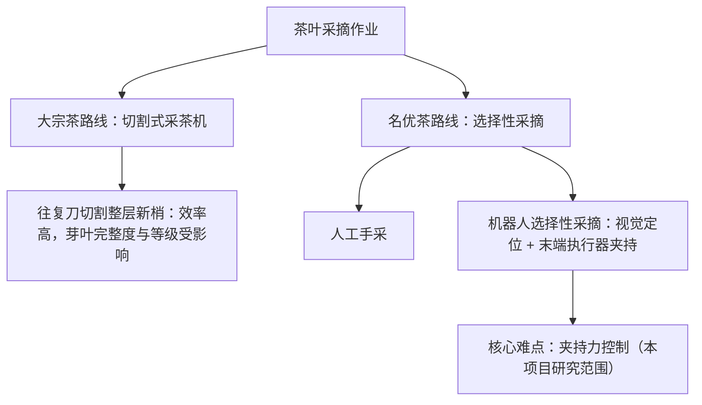
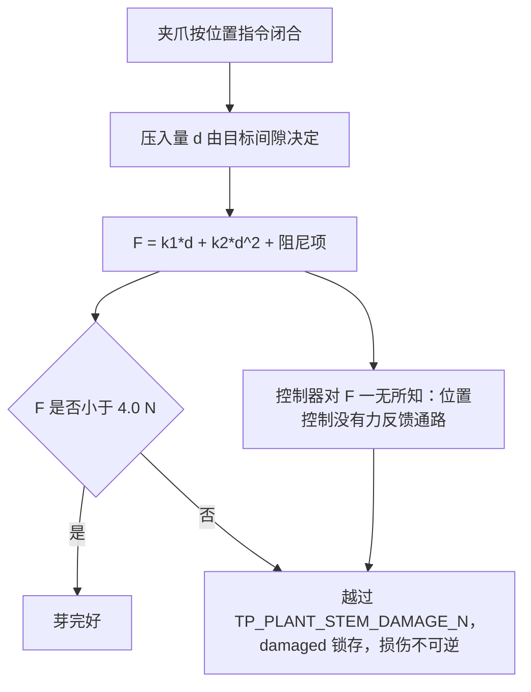

# 第二代智能无人机采茶机器人系统 —— 项目背景与立题依据

> 文档定位：本科毕业设计开题 / 中期报告的「项目背景」章，可直接拆成答辩 PPT 的前 6–8 页。
> 项目根目录：`D:\zhuomian\second-gen-tea-picking-robot`
> 固件版本：`TP_FW_VERSION_MAJOR/MINOR/PATCH = 2/0/0`（见 `firmware/Application/config.h`）

---

## 摘要

名优茶（单芽、一芽一叶）的采摘对象是**柔软、纤细、有生命的植物组织**，其力学刚度随品种、含水率、芽龄甚至一天中的时段而变化，机器人无法事先测得。传统采茶末端执行器沿用**固定位置控制**：把夹爪合到某个预先标定的间隙，认为"合到 4 mm 就等于夹住了芽"。本文从项目代码库中真实存在的非线性茶梗接触模型出发，说明这一做法为什么是**结构性不安全**的，而不是"参数没调好"。

核心论证链条（全部使用仓库中的真实常量复算）：

1. 茶梗接触力模型为 `F = k1*d + k2*d^2 + c*max(0, -v_jaw)`（`firmware/BSP/host/plant_model.h`），其中 `k1 = 0.30 N/mm`、`k2 = 0.06 N/mm²`、`c = 0.015 N·s/mm`。
2. 二次项让茶梗**越压越硬**。同样 12 mm 的压入量下，纯线性模型预测 3.6 N（低于 4.0 N 损伤阈值，看起来"安全"），而实际二次模型给出 **12.24 N**，是损伤阈值 `TP_PLANT_STEM_DAMAGE_N = 4.0f` 的 **3.06 倍**、硬限 `TP_FORCE_MAX_N = 5.00f` 的 **2.45 倍**。
3. 因此，固定位置控制在"茎秆比预期更硬"时**必然**冲过损伤阈值——控制器在拿到任何力信息之前就已经把芽压坏了。这不是精度问题，是**控制对象选择错误**。

本代系统把闭合依据从**位置**换成**力**：力 PID `Kp = 14.0 / Ki = 6.0 / Kd = 0.05`（`config.h`）输出夹爪速度，配合分段接近、接触确认、分级保护与接触超时中止，构成力闭环柔性夹持。

**证据边界（必须贯穿全文）**：本项目**没有实物硬件**——没有做过 PCB、没有在任何真实机器上测过任何东西、没有田间调研、没有采集任何产业数据。因此：

- 所有硬件相关内容一律标注 **参考设计 / Recommended Implementation，未制作实物板**；
- 所有结果数字一律标注 **仿真结果（Simulated）**；
- 所有指标一律标注 **设计目标 / Target KPI（未实测）**。

---

## 目录

- [1. 数据来源与诚实性声明](#1-数据来源与诚实性声明)
- [2. 研究背景](#2-研究背景)
- [3. 传统固定位置控制的损伤机理](#3-传统固定位置控制的损伤机理)
- [4. 国内外研究现状（研究方向分类综述）](#4-国内外研究现状研究方向分类综述)
- [5. 本项目要解决的问题](#5-本项目要解决的问题)
- [6. 第一代系统与本代系统的差异](#6-第一代系统与本代系统的差异)
- [7. 项目目标与非目标](#7-项目目标与非目标)
- [8. 小结](#8-小结)
- [9. 面试可能追问的问题](#9-面试可能追问的问题)

---

## 1. 数据来源与诚实性声明

本章是全篇的阅读前提。**凡与本声明冲突的表述，以本声明为准。**

### 1.1 三类标注约定

| 标注 | 含义 | 证据边界 |
|---|---|---|
| **仿真结果（Simulated）** | 来自 `firmware/Core/main_host.c`（host 编译）在 `firmware/BSP/host/plant_model.h` 物理模型上运行的结果 | 只能说明"在模型里是这样"，**不能**说明"在真机上是这样" |
| **设计目标 / Target KPI（未实测）** | 设计者设定的指标或代码中的判据阈值 | **没有任何实测支撑**；阈值是设计者挑的，精度是测出来的 |
| **参考设计 / Recommended Implementation，未制作实物板** | 硬件电路、器件选型、模拟前端链路 | 基于数据手册的**设计计算**，无实物板、无测量 |

正文中每一处涉及数字的表述都带上述标注之一。**没有标注的数字，就是本文档的错误。**

### 1.2 本项目的证据边界

- **没有实物硬件。** `config.h` 中力传感器前端一节自我声明：那组数字是"a **reference design** derived from datasheet figures, **not measurements taken on a built board**"。本文引用该链路时一律标注"参考设计，未制作实物板"。
- **没有田间调研、没有产业数据采集。** 第 2 章全部产业叙述均为定性转述，见 §1.3。
- **结果数字只来自仿真。** 本文引用的 Scenario A 与场景 A–G 数据来自 `build/host/tea_picking_robot_host.exe --scenario A` 与 `scripts/run_scenarios.ps1` 的那次运行记录。
- **仓库落盘产物的时效说明。** 撰写本文件时，`build/host/` 目录下只有 `obj/`，可执行文件本身不在库中；可核对的落盘产物是 `data/logs/host_scenario_A.csv` 等 CSV。另需说明：该 CSV（5021 行数据、1 kHz 逐周期记录）的 `force_n` 列峰值为 **2.3773 N**，与本文采用的 Scenario A 记录值 **2.386 N** 不同——两者是不同批次/不同时长的运行，**引用时应以同一次运行的完整输出为准，不要把不同运行的数字混用**。

### 1.3 关于产业数据的特别声明

**本项目没有做田间调研，没有采集任何产业数据。** 因此：

- 茶园面积、采茶用工缺口、人工采摘成本、名优茶采摘窗口期天数等**具体统计数字，本文一律不写**。
- 第 2 章只保留**定性**的行业共识描述，并逐条标注"公开资料 / 行业报道，**非本项目实测**"。
- 正式论文中若需引用这些数字，**必须补充具体来源（年鉴、统计公报、期刊或行业报告）并逐条核实**，本文不提供也不代替这一步。

> 宁可写成"公开报道普遍反映……（非本项目实测，需引用具体来源后才能写入正式论文）"，也不伪造统计数字。这是本任务的核心诚实要求。

### 1.4 两处必须先在代码层面澄清的矛盾与缺口

| 项 | 说法 A / 声明 | 说法 B / 实测事实 | 证据 |
|---|---|---|---|
| 自适应力阈值默认状态 | `force_control.h` 称其"shipped **disabled** by default"，理由是尚未在真实茶芽上验证 | `config.h` 中 `TP_FORCE_ADAPT_ENABLE (1)`，且 `force_control.c` 第 162 行 `fc->adapt_enabled = TP_FORCE_ADAPT_ENABLE;` → **实际默认开启** | 已双向核对两个文件 |
| 释放后 12 mm 后退 | `config.h` 定义 `TP_GRIPPER_BACKOFF_MM (12.0f)`（注释 "Retreat after release."），`force_control.h` 时序图也写 "RELEASE … back off 12 mm" | `force_control.c` 的 `TP_GRIP_RELEASE` 只以 `GRIP_RELEASE_SPEED_MM_S = 30.0f` **开爪**，未见按 12 mm 后退的实现；该常量除 `config.h` 外仅被 `fault_codes.h` 注释引用 | 已双向核对：`config.h` 第 274 行 / `fault_codes.h` 第 54 行注释 vs `force_control.c` RELEASE 分支 |

本文对自适应的表述一律采用"参数在库、**设计目标·未验证**，且头文件与实现默认值互相矛盾"的口径。列出这两条不是自我否定，而是为了在答辩中**先于评委提出**：能被当场指出并承认的缺口，远好过被当场指出的夸大。

---

## 2. 研究背景

### 2.1 茶叶采摘的产业痛点（公开资料 / 行业报道，非本项目实测）

> ⚠️ 本节为**定性**描述。所有定量数据均标注为待补充来源，本文不给出任何具体统计数字。

公开资料与行业报道普遍反映以下几类结构性矛盾（**非本项目实测，需引用具体来源后才能写入正式论文**）：

| 痛点 | 定性描述 | 本节证据状态 |
|---|---|---|
| 用工依赖 | 名优茶采摘高度依赖人工手采，采茶工老龄化与季节性短缺在主要产区被反复提及 | 公开报道，非本项目实测 |
| 窗口期短 | 名优茶对芽叶嫩度极敏感，可采期集中在很短的时段内，错过即降级为大宗茶 | 公开报道，非本项目实测 |
| 成本结构 | 人工采摘在名优茶成本中占比高，且随用工紧张而上升 | 公开报道，非本项目实测 |
| 机采局限 | 现有切割式采茶机以"一刀切"方式收获，难以满足名优茶对**单芽选择性**的要求 | 公开报道，非本项目实测 |

**对本文的用法**：上述矛盾只用来论证"选择性采摘的自动化是有价值的问题"，**不用来支撑任何本项目的能力主张**。本项目没有做过需求调研，因此不声称"本系统解决了某个具体的产业缺口"。

### 2.2 机械化采摘的技术分岔



分岔点的本质：大宗茶路线把"选哪一片叶子"这个问题**取消**了（整层切走）；名优茶路线必须**保留**这个选择，于是机器人必须逐个判断并逐个夹取——这才引出了"夹多紧"这个力学问题。

### 2.3 为什么"夹多紧"是本项目的立题核心

茶芽的力学刚度**不是常数**：

| 影响因素 | 对刚度的影响方向（定性） | 机器人能否事先知道 |
|---|---|---|
| 品种 / 品系 | 不同 | 否 |
| 含水率（降雨、灌溉、采摘时段） | 差异明显 | 否 |
| 芽龄 / 嫩度 | 越老越硬 | 只能间接估计 |
| 一天中的时段（蒸腾） | 有变化 | 否 |

结论：**以位置为控制量、以"预先标定的间隙"为目标的夹持方式，其安全性依赖于一个机器人无法测得的量。** 这一点在项目代码中有真实的问题陈述，见 `firmware/Control/force_control.h` 顶部注释：

> "A gripper that closes to a fixed *position* has no idea how hard it is squeezing: the force depends on the stem's stiffness, which varies with cultivar, moisture, bud age and even the time of day, and it is not something the robot can measure in advance."

---

## 3. 传统固定位置控制的损伤机理

### 3.1 真实的非线性接触模型（代码原文）

`firmware/BSP/host/plant_model.h` 中茶梗接触模型为：

```
d  = max(0, stem_gap - gap)                        (penetration, mm)
F  = k1 * d + k2 * d^2 + c * max(0, -v_jaw)         (N)
```

| 常量 | 数值 | 位置 | 物理含义 |
|---|---|---|---|
| `TP_PLANT_STEM_GAP_MM` | `6.0f` | `plant_model.h` | 默认茶梗表面位置：夹爪间隙 6.0 mm 处开始接触 |
| `TP_PLANT_STEM_K1_N_PER_MM` | `0.30f` | `plant_model.h` | 线性刚度 |
| `TP_PLANT_STEM_K2_N_PER_MM2` | `0.06f` | `plant_model.h` | **二次（硬化）刚度系数** |
| `TP_PLANT_STEM_DAMP_N_S_MM` | `0.015f` | `plant_model.h` | Kelvin-Voigt 内阻尼 |
| `TP_PLANT_STEM_DAMAGE_N` | `4.0f` | `plant_model.h` | 判定芽损伤的力阈值（锁存） |
| `TP_PLANT_JAW_HARD_STOP_MM` | `1.0f` | `plant_model.h` | 夹爪机械死点，间隙不可能低于此值 |

`plant_model.h` 对二次项的作用写得很直白：

> "The quadratic term is what makes the stem **stiffen** as it is compressed, and it is the reason a fixed-position gripper is unsafe."

### 3.2 参数复算：为什么"更硬的茎秆"必然导致损伤

#### 复算一：线性模型会骗人

固定 4 mm 间隙目标、茎秆表面在 16 mm（即 `main_host.c` 场景 D 的设定，`tp_plant_set_stem_gap(plant, 16.0f)`），则压入量 `d = 16.0 - 4.0 = 12.0 mm`。

| 用什么模型算 | 算式 | 结果 | 与 4.0 N 损伤阈值的关系 |
|---|---|---|---|
| 只用线性项（假设 `k2 = 0`） | `0.30 × 12` | **3.6 N** | 低于 4.0 N，**看起来安全** |
| 本项目真实模型（含二次项） | `0.30 × 12 + 0.06 × 12²` = `3.6 + 8.64` | **12.24 N** | **3.06 倍**，远超阈值 |
| 与设定值比较 | `12.24 / 2.20` | **5.56 倍** | 是 `TP_FORCE_TARGET_N` 的 5.56 倍 |
| 与硬限比较 | `12.24 / 5.00` | **2.45 倍** | 远超 `TP_FORCE_MAX_N` |

`firmware/Core/main_host.c` 场景 D 的注释记录了同一个算术并取整为 12.2 N：

> "With the jaws driving to a fixed 4 mm gap against a stem surface at 16 mm, the model predicts `0.30*12 + 0.06*144 = 12.2 N` - well past the 5 N hard limit and past the 4 N damage threshold."

**这是本项目最关键的一条论证**：二次项把"3.6 N（安全）"变成"12.24 N（损伤）"。固定位置控制的失败不是因为标定不准，而是因为它**用一个线性直觉去控制一个二次对象**。

#### 复算二：硬化项把"安全行程"砍掉一半以上

求 `F = TP_PLANT_STEM_DAMAGE_N = 4.0 N` 所需的压入量：

| 模型 | 方程 | 解得的压入量 d |
|---|---|---|
| 纯线性 `k1*d = 4.0` | `0.30 d = 4.0` | **13.33 mm** |
| 真实二次 `0.06d² + 0.30d − 4.0 = 0` | `d = (−0.30 + √(1.05)) / 0.12` | **6.04 mm** |

即：**三次项使"达到损伤阈值所需的行程"从 13.33 mm 缩短到 6.04 mm，缩小到约 45 %。** 对应到间隙上，在茎秆表面 16 mm 的情形下，夹爪必须停在约 `16.0 − 6.04 = 9.96 mm` 间隙处才能不做损伤；而固定位置控制的目标是 4 mm —— **超出安全位置 6 mm**。

#### 复算三：刚度参数的不确定性如何放大风险

固定 `d = 12.0 mm`，分别扰动两个刚度系数：

| 情形 | `k1` | `k2` | 计算 F | 倍数（对 4.0 N） |
|---|---|---|---|---|
| 更软（假想） | 0.15 | 0.06 | `1.8 + 8.64` = 10.44 N | 2.61× |
| **标称** | **0.30** | **0.06** | **12.24 N** | **3.06×** |
| 更硬（老芽/干旱） | 0.60 | 0.06 | `7.2 + 8.64` = 15.84 N | 3.96× |
| 线性项标称，二次项增大 | 0.30 | 0.09 | `3.6 + 12.96` = 16.56 N | 4.14× |

注意最上面一行：**即使茎秆比标称软一半，固定 12 mm 压入量仍然给出 10.44 N，是损伤阈值的 2.6 倍。** 也就是说，在"固定位置合到 4 mm"这个策略下，**刚度在合理范围内怎么变都挡不住损伤**——只有压入量本身变小才行。这正是"位置控制不可救"的量化表述。



### 3.3 阻尼项：接触瞬间的力阶跃

`c * max(0, -v_jaw)` 中 `c = TP_PLANT_STEM_DAMP_N_S_MM = 0.015f`（`plant_model.h`）。按不同接近速度复算：

| 接近速度 | 来源 | 阻尼项贡献 `0.015 × v` |
|---|---|---|
| 6 mm/s（慢接近） | `TP_APPROACH_SLOW_SPEED_MM_S = 6.0f` | **0.090 N** |
| 25 mm/s（力环输出上限） | `TP_FORCE_PID_OUT_MAX = 25.0f` | 0.375 N |
| 40 mm/s（快接近） | `TP_APPROACH_FAST_SPEED_MM_S = 40.0f` | **0.600 N** |
| 120 mm/s（夹爪机械极限） | `TP_GRIPPER_MAX_SPEED_MM_S = 120.0f` | **1.800 N** |

`plant_model.h` 对 `c` 的取值有明确说明（原文）："at the 40 mm/s fast-approach speed a coefficient of 0.05 N·s/mm would add 2.0 N of force in a single sample … the value is set to give **0.6 N** at the fast-approach speed and **0.09 N** at the slow-approach speed."

**这解释了两件事**：
1. 为什么必须有慢接近段：以 40 mm/s 冲上去，光是阻尼项就在一个采样内注入 0.6 N，超过接触阈值 `TP_FORCE_CONTACT_N = 0.15f` 的 4 倍；
2. Scenario A 的接触瞬间读数可以逐项复算（见下）。

**Scenario A 接触点复算校验（仿真结果）**：记录给出接触发生在夹爪间隙 **5.824 mm**、F = **0.148 N**。用真实参数复算：

```
d = TP_PLANT_STEM_GAP_MM − gap = 6.000 − 5.824 = 0.176 mm
静力项 = 0.30 × 0.176 + 0.06 × 0.176² = 0.0528 + 0.00186 = 0.05466 N
阻尼项 = 0.015 × 6.0 = 0.090 N          （慢接近 6 mm/s）
合计   = 0.05466 + 0.090 = 0.1447 N  ≈ 0.148 N ✔
```

复算与记录一致，说明该模型的三项都是"活的"。同时可见：**接触瞬间的力主要由阻尼项贡献（占 62 %）**，而接触阈值 `TP_FORCE_CONTACT_N = 0.15 N` 恰好落在慢接近下的理论接触力（0.1447 N）之上一点点——阈值与慢接近速度是耦合设计的，改接近速度就必须重算该阈值。

### 3.4 第一代纯位置控制的问题陈述（代码中可考）

`firmware/Core/main_host.c` 场景 D 注释中，对"如何演示过力保护"有一段诚实的说明（原文）：

> "The first attempt at this scenario simply made the stem stiffer while force control was active, and the cycle completed normally with a peak of 3.2 N. That is not a bug in the scenario, it is the central result of the whole project: **a force-controlled gripper does not care how stiff the bud is.** To demonstrate the over-force protection you have to remove the force feedback, **which is exactly what the first-generation machine did.**"

这段话给出两条本项目自证的事实：

1. **力控夹持对茎秆刚度不敏感**——把茎秆调硬，力控周期仍正常完成（峰值 3.2 N，仿真结果）；
2. **第一代机器的做法是移除力反馈、纯位置控制**——这也是场景 D 演示过力保护的唯一诚实方式：`tp_app_set_grip_mode(app, 1)` 切到 position-only baseline。

`firmware/Core/app_sequence.c` 中该 baseline 的实现与理由是真实存在的：

> "Position-only baseline: the jaw is driven by its own position loop and there is nothing for the force controller to do. **The safety monitor is still watching, which is the point of the experiment.**"

也就是说：实验设计承认纯位置控制会出事，唯一的问题是**监督层能不能及时拦住、拦得够不够早**。Scenario D 的答案（仿真结果）是：**拦不住**——周期中止于 `ERR_FORCE_OVERLOAD`，但**峰值夹持力"从未达到"**（即保护触发时损伤已经发生，见 §7.2）。

### 3.5 三个重要机制的三问

**「它是什么」** `plant_model.h` 中的茶梗接触模型：`F = k1*d + k2*d^2 + c*max(0, -v_jaw)`，`d = max(0, stem_gap - gap)`。它是一个**含硬化二次项和速度相关阻尼**的粘弹性接触模型，而不是线性弹簧。

**「为什么这么设计」** 因为线性的 `F = k*d` 会让"位置控制是安全的"这个错误结论在仿真里也成立——用线性模型做验证，位置控制的过力问题根本不会暴露出来。`plant_model.h` 明确说明它不是 mock："A mock would let the control loop *succeed* no matter how wrong the controller is, which is worse than no test at all." 引入二次项与阻尼，才能使"整定不好的 PID 在仿真里同样超调"、"固定位置控制在仿真里同样压坏芽"。

**「如果不用它会怎样」** 如果不含二次项：Scenario D 的 12 mm 压入量只会算出 3.6 N，**低于 4.0 N 损伤阈值**，仿真会给出"纯位置控制没有损伤"的结论，整个项目的立题依据消失。如果不含阻尼项：接触瞬间的力阶跃不存在，接触检测（`TP_FORCE_CONTACT_N`）在模型里会从 0 平滑爬升，Scenario A 的接触点 0.148 N 无法复现，慢接近段的设计理由也随之消失。

---

## 4. 国内外研究现状（研究方向分类综述）

### 4.1 关于文献引用的声明

> ⚠️ **本节不包含任何具体文献引用。** 撰写本文时未联网检索，仓库中也没有参考文献库，因此本文**不给出作者名、期刊名、年份或 DOI**。
> 本节只做**技术路线的分类综述**，描述各条路线在解决什么问题、代价是什么。
> **正式论文中的具体文献引用必须另行补充并逐条核实**（建议路径：农业工程学报 / 农业机械学报 / Computers and Electronics in Agriculture / IEEE-ASME Transactions on Mechatronics / Biosystems Engineering 等，但引用哪一篇必须自己查证后再写）。

### 4.2 农业采摘机器人末端执行器的技术路线谱系


### 4.3 五条路线的对比

| 路线 | 核心思路 | 解决什么问题 | 主要代价 / 局限 | 与本项目的关系 |
|---|---|---|---|---|
| **刚性夹持** | 两指刚性爪，按位置开合 | 结构简单、成本低、刚性好 | 无过力感知；对柔软对象**结构性不安全** | 本项目明确**不采用**，作为被否定的基线 |
| **柔性夹持** | 软体/欠驱动/柔性指，靠材料顺应被动限力 | 被动降低峰值力，无需传感 | 限力大小由材料决定，不可编程、不可在线调；夹持稳定性受材料老化影响 | 本项目**部分借鉴其思想**：接近段与释放段用速度而非位置 |
| **力觉反馈夹持** | 力传感器闭环，输出力或速度指令 | **直接**调节造成损伤的那个量 | 需要力传感器与标定；低速性能受噪声与量化限制 | **本项目的主线**（力 PID + 分级保护） |
| **力/位混合控制** | 位置环与力环按任务方向或按阶段切换 | 自由段求快、接触段求稳 | 模式切换点与切换瞬态需要处理 | 本项目采用**按阶段切换**的简化形式（FAST→SLOW→CONTACT_DETECT→FORCE_CONTROL） |
| **视觉伺服 + 力觉融合** | 视觉给目标位置，力觉给接触与抓握状态 | 提高一次成功率、减少空抓 | 视觉误差会直接变成力控行程误差 | 本项目已实现视觉目标接口（含置信度门限），但**视觉本身不在本项目范围** |

### 4.4 本项目在谱系中的位置

本项目**不主张**在力控制理论上有新贡献。它的位置是：把"力闭环 + 分级保护 + 可复现的无硬件验证"这套**工程组合**，在一个真实的农业采摘场景里做到端到端自洽，并在**没有实物板卡**的条件下做出一套可执行、可复核的验收证据链。

本项目**不主张**在力控制理论上有新贡献：力控算法采用成熟 PID，不做软体执行器（机械专业范围），不实现视觉算法（只定义目标接口与置信度门限）。**真正的着力点是验证方法**——用单一硬件接缝 + host 物理模型，让控制代码在无板条件下被真实执行与观测。

---

## 5. 本项目要解决的问题

### 5.1 问题清单（每条对应代码中真实存在的机制）

| # | 问题 | 代码中的对应机制 | 真实常量 / 位置 |
|---|---|---|---|
| 1 | 夹持力不可预知，按位置闭合会压坏芽 | 力闭环柔性夹持，输出夹爪**速度**而非位置 | `TP_FORCE_PID_KP 14.0f` / `KI 6.0f` / `KD 0.05f`，`TP_FORCE_PID_OUT_MAX 25.0f`（`config.h`） |
| 2 | 全速接近会在接触瞬间注入力阶跃 | 两段接近：40 mm/s → 6 mm/s，在预期接触点前 4 mm 减速 | `TP_APPROACH_FAST_SPEED_MM_S 40.0f`、`TP_APPROACH_SLOW_SPEED_MM_S 6.0f`、`TP_APPROACH_SLOW_AT_MM 4.0f`（`config.h`） |
| 3 | 单次噪声采样会被误判为接触 | 接触确认去抖：力须连续 3 个样本高于阈值；若力回落到阈值一半则退回慢接近 | `GRIP_CONTACT_DEBOUNCE 3u`、`TP_FORCE_CONTACT_N 0.15f`（`force_control.c` / `config.h`） |
| 4 | 过力必须有硬性拦截，且要当周期生效 | 硬限判定**排在控制器之前**：`F > 5.0 N` 立即开爪并锁存 `TP_FAULT_FORCE_OVERLOAD` | `TP_FORCE_MAX_N 5.00f`（`config.h`），`force_control.c` 第 255 行 |
| 5 | 硬限跳闸会丢掉整个周期，缺少中间档 | 软限降额：`F > 3.5 N` 不跳闸，而是把设定值降到 `3.5 × 0.9 = 3.15 N` 让环路主动退让 | `TP_FORCE_SOFT_LIMIT_N 3.50f`，`force_control.c` 第 274 行 |
| 6 | 视觉给错位置时会一直合到机械死点 | 接触超时中止：2500 ms 内未建立接触则中止并报 `TP_FAULT_TARGET` | `GRIP_CONTACT_TIMEOUT_MS 2500u`（`force_control.c`） |
| 7 | 力传感器故障时力控失效，但不能静默降级 | 传感器故障直接跳 `TP_FAULT_SENSOR`；降级为位置控制**必须记录为故障**而非静默进行 | `force_control.c` 第 260 行；`app_sequence.c` 第 519–524 行 |
| 8 | 故障码混淆会把操作员引向错误的子系统 | 力控把**实际**跳闸原因写入 `fault_code` 字段，而不是一律映射为过力 | `tp_force_control_fault_code()`（`force_control.h`） |
| 9 | 保持力的统计口径错误会得出错误的结论 | 区分"调节段"与"闭合全程"：只统计进带后的样本 | `regulated` / `hold_samples` / `hold_force_sum_n`（`force_control.h`） |
| 10 | 单环 PID 无法同时兼顾响应速度与阻尼 | 串级：位置环输出速度参考、速度环输出 PWM，带宽先定比例再整定 | `TP_POS_PID_KP 5.0f`、`TP_VEL_PID_KP 0.005f`（`config.h`）；`cascade.h` 顶部注释 |
| 11 | 没有实物板卡，控制代码无法被验证 | 单一编译期硬件接缝 + host 物理模型后端，让同一份控制代码在 PC 上真跑 | `firmware/BSP/platform_api.h`（两个后端：`host/platform_host.c`、`stm32f407/platform_stm32f407.c`） |
| 12 | 保护在条件未消失时被清除，等于关掉保护 | 清除路径统一拒绝：力仍高于软限时拒绝 `clear_fault` | `tp_force_control_clear_fault()`（`force_control.h`） |

### 5.2 机制一：力闭环柔性夹持

**「它是什么」** `tp_force_control_t`（`firmware/Control/force_control.h`）实现的六段子状态机：`TP_GRIP_IDLE` → `FAST_APPROACH` → `SLOW_APPROACH` → `CONTACT_DETECT` → `FORCE_CONTROL` → `PICK` → `RELEASE`，异常时进入 `TP_GRIP_FAULT`。核心是一个**力 PID**：输入力误差（N），输出**夹爪闭合速度**（mm/s），钳位 ±25 mm/s。

**「为什么这么设计」** 输出的物理量选择是关键。若力环输出位置增量，接触后的第一个周期就可能命令出一个足以损伤茶芽的位移；输出速度则天然构成"力—速度"积分链，且输出上限 `TP_FORCE_PID_OUT_MAX = 25.0f` 远低于夹爪机械极限 `TP_GRIPPER_MAX_SPEED_MM_S = 120.0f`。这个 25 是**约束**而非能力：它保证环路在接触后的第一个采样仍来得及反应。

**「如果不用它会怎样」** 回到 §3.2 复算一：固定 4 mm 间隙、茎秆在 16 mm，力达到 12.24 N，是损伤阈值 4.0 N 的 3.06 倍。Scenario D 的实验证实了这条路径（仿真结果）：周期中止并报 `ERR_FORCE_OVERLOAD`，但**保护触发时峰值力记录为"从未达到"**——即保护层拦住了继续施力，却没有能力阻止损伤发生。力反馈不是"让抓取更精准"的锦上添花，它是**唯一**能直接调节致伤量的通路。

### 5.3 机制二：分段接近与接触确认

**「它是什么」** 三阶段接近：`FAST_APPROACH`（40 mm/s，直到间隙进入预期接触点 +4 mm 之内）→ `SLOW_APPROACH`（6 mm/s，直到 `F > 0.15 N`）→ `CONTACT_DETECT`（力须连续 3 个样本高于阈值，否则退回慢接近）。确认接触时**立即把夹爪速度命令置零**（`force_control.c` 第 309 行），再交给力环。

**「为什么这么设计」** `force_control.h` 给出的理由是可计算的：从 40 mm 外以 6 mm/s 闭合需要约 5.7 s/芽，在 1 Hz 节拍目标下这已经是整个预算；但以 40 mm/s 直接撞上接触点，力环只有约 0.2 mm 的行程可以反应，而**撞击本身**（阻尼项 0.6 N，见 §3.3）就已经超过损伤阈值。所以必须"先快后慢"：快段省时间，慢段买控制权限。`force_control.c` 还记录了一个更细的取舍——若在 3 样本去抖窗口内继续闭合，会额外压入约 0.036 mm（约 11 mN），"acceptable but unnecessary"，因此直接停住。

**「如果不用它会怎样」** 不用慢接近：接触瞬间阻尼项注入 0.6 N，是 `TP_FORCE_CONTACT_N` 的 4 倍，接触判定被冲击淹没，力环接手时已经在压。不用接触确认去抖：单个越过阈值的尖峰就会把控制权交给力环，而夹爪里"什么都没有"——环路随即把空载当作欠载，全速闭合。不用前 4 mm 减速点：接触发生时控制器还处在速度环的饱和段，控制权限来不及建立。

### 5.4 机制三：分级保护与"当周期生效"

**「它是什么」** 保护按优先级执行（`force_control.c` 第 251–275 行，注释原文 "Priority 1 … Evaluated BEFORE the controller, so a hard over-force is acted on in the same control period it is detected in."）：

| 优先级 | 条件 | 动作 | 真实常量 |
|---|---|---|---|
| 1 | `F > TP_FORCE_MAX_N` | **立即开爪** + 锁存 `TP_FAULT_FORCE_OVERLOAD` | `5.00f` |
| 1' | 传感器故障 | 跳 `TP_FAULT_SENSOR`，拒绝继续力控 | — |
| 2 | `F > TP_FORCE_SOFT_LIMIT_N` | 降额设定值至 `3.5 × 0.9 = 3.15 N`，不跳闸 | `3.50f` |
| 3 | 接触超时 2500 ms | 中止并报 `TP_FAULT_TARGET` | `GRIP_CONTACT_TIMEOUT_MS` |

**「为什么这么设计」** 分级而不是单级：只有硬限一跳到底，会把每一次轻微超力都变成丢周期；只有软限则缺乏最后一道闸。软限"降额而不跳闸"是一个刻意的工程选择——它把保护从**开关**变成**连续退让**，环路仍然在闭环、芽仍然被抓住，只是主动减小目标力。硬限排在任何控制计算之前，是因为控制器的输出会给执行器"加速"信号，而保护必须在同周期压制它。

**「如果不用它会怎样」** 不用硬限只靠软限：软限降额到 3.15 N 后，环路仍在以 25 mm/s 上限闭合，遇到异常硬的目标会继续上冲直至机械死点。不用软限只靠硬限：每一个到达 3.5 N 的正常接触都会被跳闸并锁存，节拍直接不可用。不做"清除时条件仍为真则拒绝"：操作员连按两次清除就能把保护关掉，而芽还在被压着。

### 5.5 机制四：串级 PID 与带宽分离

**「它是什么」** `firmware/Control/cascade.h` 的两环结构：位置环（`TP_POS_PID_KP 5.0f` / `KI 0.5f`）输出**速度参考**并钳位到关节最大速度；速度环（`TP_VEL_PID_KP 0.005f` / `KI 0.10f`）输出 **PWM 千分比**。前馈加在**内环的参考**上而非内环的输出上。

**「为什么这么设计」** `cascade.h` 给出的三条理由都成立且互补：单环位置 PID 的增益同时决定响应速度与阻尼（方向相反）；内环把非线性（摩擦、母线压降、转矩常数变化）包在环内，使外环看到近似纯积分器 `θ' = v_cmd`；扰动转矩（重力、切割反力）在**产生它的那一层**被抑制，不必先让关节动起来。前馈加在内环参考上，是为了让速度限幅始终有效——加到输出上就等于绕过限速器。

**「如果不用它会怎样」** 单环结构下要同时满足"够快"和"不振荡"，实际结果是二者都取不到：调高增益提高响应就会压缩相位裕度直到极限环。`config.h` 里记录了**第一版速度环增益 `Kp = 0.015`（现值的 3 倍）**导致的后果（原文）："crossover at roughly 23 Hz and left too little phase margin once the electrical lag and the duty slew limiter were accounted for. The resulting limit cycle is what the initial simulation run showed."

### 5.6 机制五：单一硬件接缝与"模型而非桩"

**「它是什么」** `firmware/BSP/platform_api.h` 是全部寄存器/GPIO/总线访问的唯一编译期接缝，两个后端实现它：`firmware/BSP/host/platform_host.c`（接 `plant_model.h` 物理模型）与 `firmware/BSP/stm32f407/platform_stm32f407.c`（真机后端）。编译期由 `-DTP_PLATFORM_HOST` / `-DTP_PLATFORM_STM32F407` 选择。

**「为什么这么设计」** `main_host.c` 说明得很清楚："It is **the firmware**, compiled for the host … the same `pid.c`, `cascade.c`, `force_control.c`, `robot_fsm.c`, `safety_monitor.c` and `protocol.c` that run on the STM32 run here. That property is the whole reason the STM32 port is trustworthy. A separate PC model would validate the *model*; this validates the *firmware*."

**「如果不用它会怎样」** 如果另写一份 PC 端控制逻辑，验证的就只是那份拷贝；真机目标代码依然零执行。如果没有 `plant_model.h` 而用一个返回零的桩，控制环会在任何整定下"成功"，测试比不做更糟（`plant_model.h` 原文："A mock would let the control loop 'succeed' no matter how wrong the controller is, which is worse than no test at all."）。

⚠️ **诚实边界**：`platform_api.h` 的真机后端代码**从未编译、从未在实物上运行**（无实物板卡）。"代码已就位"不等于"已在 STM32 上验证"。

### 5.7 机制六：编译期静态断言

**「它是什么」** `config.h` 末尾的一组 `TP_STATIC_ASSERT`，在编译期检查参数间的不变量，例如：力目标的序关系（`TP_FORCE_TARGET_N < TP_FORCE_SOFT_LIMIT_N < TP_FORCE_MAX_N`，即 2.20 < 3.50 < 5.00）、五个任务速率必须整除 1 kHz 控制率、模拟前端在额定负载下不得超参考电压（`TP_FORCE_FULLSCALE_MV < TP_ADC_VREF_V * 1000`）、可用力量程必须覆盖硬力限（`TP_FORCE_USABLE_RANGE_N > TP_FORCE_MAX_N`）、位置环输出钳位要容得下关节最大速度。

**「为什么这么设计」** 这类参数组合一旦在运行期才暴露，表现往往是"关节冲过软限"或"力控永远达不到设定值"——排查成本远高于一次编译失败。把不变量变成构建失败，是成本最低的一种验证。

**「如果不用它会怎样」** 若有人把 `TP_FORCE_MAX_N` 改到 `TP_FORCE_USABLE_RANGE_N`（约 ±16.4 N，由前端设计计算得出，**参考设计未制作实物板**）之上，硬限保护的判定值就超出了传感器可读范围，保护将永远无法触发，而代码里没有任何地方会报错。

---

## 6. 第一代系统与本代系统的差异

### 6.1 先划清两条线

代码库中同时存在两类"第一代/第一版"记录，**必须分开**，否则会把"上一版固件的一个 bug"说成"第一代整机的特征"：**第一代整机（first-generation machine）**指上一代**机器**，代码库只能从一处注释（`main_host.c` 场景 D）得知其做法；**上一版固件（the first revision）**指本代码库自身的早期软件版本，注释中记录了若干缺陷。下表左列若属后者，一律标注"上一版"。

### 6.2 对照表（只写代码中可考的内容）

| 维度 | 第一代 / 上一版（代码中可考） | 本代系统 | 证据位置 |
|---|---|---|---|
| **闭合依据（整机层面）** | 移除力反馈，**纯位置控制**；要演示过力保护就必须关掉力控 | 力闭环柔性夹持，输出夹爪速度 | `main_host.c` 场景 D 注释原文 "which is exactly what the first-generation machine did" |
| 力传感器作用 | 无力反馈通路 | 力 PID 的反馈量，且参与硬限/软限/传感器故障三级判定 | `force_control.h`；`force_control.c` 第 255–263 行 |
| 占空比斜率限制 | `4000 千分比/秒` → 满量程需 250 ms，在 8 Hz 速度环内构成约 60° 未建模相位滞后，环路以"数万 mrad/s"振幅振荡 | `TP_MAX_DUTY_RATE_PER_S = 200000.0f` → 满量程 5 ms | `config.h` `TP_MAX_DUTY_RATE_PER_S` 注释原文 |
| 速度环增益 | `Kp = 0.015`（为现值的 3 倍），交越频率约 23 Hz，相位裕度不足 → 极限环 | `TP_VEL_PID_KP = 0.005f` | `config.h` 速度环注释原文 |
| 保持力统计口径 | 把整个闭合过程（含从接触阈值到设定值的爬升段）算入平均，使正确调节到 2.2 N 的周期被报成 **1.66 N** | 区分调节段：只累计进带后的样本 | `force_control.h` 保持段统计注释原文 |
| 力传感器尖峰检测 | 阻尼系数取值不当导致尖峰检测器**误触发** | `TP_PLANT_STEM_DAMP_N_S_MM = 0.015f`，按 40 mm/s 给 0.6 N、6 mm/s 给 0.09 N 反推 | `plant_model.h` 阻尼注释原文 |
| RELEASE 段服务 | 上一版未在 RELEASE 状态服务力控，导致控制器永不回 IDLE、`RELEASE_DONE` 事件不产生、机器人"夹爪永远开着"卡住 | 在 CONTACT / GRIP / PICK / **RELEASE** 四个状态都服务力控 | `app_sequence.c` 第 487–493 行注释原文 |
| 故障码映射 | 上一版把**所有**跳闸都映射成 `ERR_FORCE_OVERLOAD`，使"接触超时"（通常是视觉目标错）把操作员引去查称重传感器 | 上报实际跳闸原因（`tp_force_control_fault_code()`） | `app_sequence.c` 第 510–513 行注释原文 |
| 场景注入实现 | 上一版依赖 `default` 分支提供目标，导致场景 C/E/F 无目标可跑，空转 9 秒停在 `IDLE` 并以"不相干的原因"判失败 | 每个场景自行注入目标，场景相互独立 | `main_host.c` `host_apply_scenario` 注释原文 |
| 本体结构 | **代码库中无据可查，不计入对比** | 仅 2 个电机通道（关节 + 夹爪），其余关节被动/固定 | `bsp_types.h` `tp_motor_ch_t` 注释 |

### 6.3 明确不计入对比的部分

以下内容代码库中**无据可查**，因此本文件不写、答辩中不应声称：第一代机器的整机机械结构、尺寸、重量、材料；第一代使用的 MCU / 驱动器 / 传感器型号；第一代的任何实测性能数据；第一代与本代在产量、效率、成本上的任何比较数字。

> 只写"第一代移除了力反馈、采用纯位置控制"这一条，并且明确它的来源是**代码注释**，不是测试报告。

---

## 7. 项目目标与非目标

### 7.1 目标（两栏必须分开）

#### A. 已由仿真验证（**仿真结果 / Simulated**，非实测）

> 验证条件：`TP_PLATFORM_HOST` + `firmware/BSP/host/plant_model.h` 确定性物理模型；Scenario A 经 `build/host/tea_picking_robot_host.exe --scenario A` 运行；七场景经 `scripts/run_scenarios.ps1` 运行。
> **这些数字只说明"在模型里成立"。**

| 目标项 | 仿真结果 | 说明 |
|---|---|---|
| 目标检测时刻 | t = 1.20 s | `<` 场景注入时刻 |
| 接触判定条件 | 夹爪间隙 **5.824 mm**、F = **0.148 N** | 与 §3.3 的复算一致 |
| 力到达设定值 | **2.17 N**（设定 2.20 N，band ±0.10 N） | 落带内视为到位 |
| 超调 | **0.00 N** | 从下方进入带内，未越过设定值 |
| 收敛周期数 | **49 个控制周期**（1 kHz → 49 ms） | 接触→稳定 |
| 受控阶段平均保持力 | **2.26 N** | 只统计调节段（口径见 §6.2） |
| 峰值夹持力 | **2.386 N** | 硬限 5.00 N，占比 47.7 % |
| 节拍分解 | APPROACH→CONTACT **1.24 s**；GRIP **2.57 s**；PICK **3.14 s**；RELEASE **3.39 s**；RETURN/IDLE **4.78 s** | `cycle_count = 1` |
| 实时性 | 6000 控制周期 / 3000 传感器 / 600 通信 / 600 机器人 / 600 安全；**0 次截止期错失** | `deadline_misses = 0` |
| 主机链路解码校验 | **2200 B、100 帧、0 CRC 错误** | host 侧用与机器人**同一个**帧解析器回读自己发出的帧 |
| 保护有效性（A–G） | **7/7 PASS** | 场景表见 §7.2 |

#### B. 仍为设计目标 / Target KPI（**未实测**）

> ⚠️ 本栏**没有任何实测支撑**，对外表述只能写"设计目标"。其中"定位误差""夹持力误差""通信延迟"在代码中的形态是**判据阈值**，不是精度指标——**阈值是设计者挑的，精度是测出来的**。

| # | 设计目标 | 标注 | 代码中的判据/门限（非实测精度） |
|---|---|---|---|
| 1 | 茶芽破损率 **≤ 1 %** | 设计目标 / Target KPI（**未实测**） | **仓库中不存在该数据的采集与评定方法**；`TP_PLANT_STEM_DAMAGE_N = 4.0f` 只是**模型参数**，不是真实茶芽的测量结果 |
| 2 | 采摘效率提升 **40 %** | 设计目标 / Target KPI（**未实测**） | 无对照实验、无基线、无样本量 |
| 3 | 定位误差 | 设计目标 / Target KPI（**未实测**） | 代码判据：位置误差 \|e_pos\| 超过 5° 记一个周期（`cascade.h` `tracking_error_count`）；关节软限 ±90000 mrad（±90°） |
| 4 | 夹持力误差 | 设计目标 / Target KPI（**未实测**） | 代码判据：力误差进入 `±TP_FORCE_BAND_N = 0.10 N` 且连续保持 `TP_GRIPPER_SETTLE_MS = 80u` ms 判为"抓稳" |
| 5 | 通信延迟 | 设计目标 / Target KPI（**未实测**） | 代码门限：链路超时 `TP_COMM_TIMEOUT_MS = 200u`、心跳周期 `TP_COMM_HEARTBEAT_MS = 500u`、发送超时 `TP_COMM_TX_TIMEOUT_MS = 20u` |
| 6 | 单芽采摘节拍 1 Hz | 设计目标（未实测） | 仅作为设计约束出现在 `force_control.h` 的耗时推算中（40 mm 行程 ÷ 6 mm/s ≈ 5.7 s 是**设计计算**） |
| 7 | 硬限保护在**同周期**生效 | 设计目标（未实测于真机） | `force_control.c` 中硬限判定排在控制器之前——**代码结构可核对**，真机时序未测 |
| 8 | 抓取力设定 2.2 N（区间 0.8–3.0 N） | 设计目标（未实测） | `TP_FORCE_TARGET_N 2.20f`、`TP_FORCE_TARGET_MIN_N 0.80f`、`TP_FORCE_TARGET_MAX_N 3.00f`；**无真实茶芽标定** |
| 9 | 自适应力阈值 | 设计目标·未验证，**且默认值存在矛盾** | `TP_FORCE_ADAPT_ALPHA 0.05f`、`TP_FORCE_ADAPT_MARGIN_N 0.60f`；见 §1.4 |

### 7.2 七场景仿真验证明细（**仿真结果 / Simulated**）

> 来源：`scripts/run_scenarios.ps1`（7/7 PASS）。该脚本的判据来自 `main_host.c` 中的 `s_scenarios[]` 表：对故障注入场景，**完成一次采摘周期反而是失败**。

| 场景 | 注入内容（真实实现） | 结果（仿真） | 峰值夹持力 |
|---|---|---|---|
| **A** nominal pick | 正常工作区中央一个芽 | **周期完成** | **2.386 N** |
| **B** target position error | 视觉目标 +8 mm 横向（场景代码另注 +5 mm 深度） | 周期中止，`ERR_TARGET`（接触超时） | **0.167 N** |
| **C** force sensor noise | σ = 80 mN（约 10 个 LSB，`tp_plant_set_force_noise(plant, 0.08f)`） | **周期完成** | **2.426 N** |
| **D** excessive grip force | 纯位置控制（`tp_app_set_grip_mode(app, 1)`），茎秆面 16 mm，固定 4 mm 目标 | 中止，`ERR_FORCE_OVERLOAD` | **从未达到** |
| **E** communication timeout | 注入 1 帧真实心跳后链路静默 | 周期停止，`ERR_COMM_TIMEOUT` | – |
| **F** motor stall | 8 N·m 堵转（高于驱动 6.0 N·m 能力），驱动限制 800 mA | 中止，过流/堵转保护 | – |
| **G** emergency stop | t = 1.2 s 拉急停（`estop_asserted = 1`） | `EMERGENCY_STOP`，`ERR_ESTOP` | – |

**读表时必须注意的三点**：

1. **B 与 A 的对比是 0.167 N vs 2.386 N**：力从未接近损伤阈值，因为系统在**闭合之前**就因接触超时中止了。这证明了"目标错 → 宁可不采"的策略，而不是"力控能容忍错目标"。
2. **C 的峰值 2.426 N 高于 A 的 2.386 N**：80 mN 噪声使峰值上升约 40 mN。仍在硬限 5.00 N 之下、软限 3.50 N 之下，周期正常完成。
3. **D 的峰值"从未达到"是本项目最重要的诚实结论**：纯位置控制场景下，保护层触发了（报 `ERR_FORCE_OVERLOAD`），但峰值力一栏无法给出一个"被限制在安全值"的数字。按 §3.2 复算，该策略下的稳态力是 12.24 N——**保护能拦住"继续施力"，拦不住"已经造成的损伤"**。这正是"力反馈必须存在"而不是"保护可以做在力反馈之外"的实证。

### 7.3 非目标（Non-Goals）

以下内容**不在本项目范围内**，答辩时不应被当作"未完成的部分"：

| # | 非目标 | 从代码库真实范围推出的依据 |
|---|---|---|
| 1 | **不做整机机械结构设计** | `bsp_types.h` 中 `tp_motor_ch_t` 只有 2 个通道（`TP_MOTOR_JOINT`、`TP_MOTOR_GRIPPER`），注释原文："The arm's remaining joints are passive/fixed, so no third channel is reserved until the hardware exists." |
| 2 | **不做无人机飞控 / 飞行平台** | 代码库中没有任何飞控、姿态、航点相关模块；`TP_BUS_CAN` 注释指向"motor drives / aux nodes"，不是飞控总线 |
| 3 | **不做多关节机械臂 / 逆运动学** | 仅一个被驱动旋转关节；`app_tasks.h` 明确把笛卡尔目标映射为关节角是**投影**而非逆解："the mapping from a Cartesian target to a joint angle is a projection"，小角近似在 \|y\| ≤ 60 mm、约 300 mm 工作半径下精度优于 2 % |
| 4 | **不做视觉算法** | 只定义目标接口（坐标 + 置信度 + `target_id`）与门限 `TP_APP_MIN_CONFIDENCE = 60u`、`TP_APP_TARGET_STALE_MS = 1000u` |
| 5 | **不做 PCB / 不宣称已完成硬件** | **没有实物板卡**；`config.h` 力传感器前端自我声明为 reference design，"not measurements taken on a built board" |
| 6 | **不宣称已在 STM32 上验证** | 真机后端 `platform_stm32f407.c` 从未编译、从未在实物上运行；"代码写完"与"代码跑过"是两件事 |
| 7 | **不宣称已实现量产 / 已上茶园** | 所有结果均为**仿真结果**；没有田间试验、没有样机、没有产业数据采集 |
| 8 | **不给出破损率与效率提升的实测值** | 见 §7.1-B：**仓库中不存在**损伤评定方法与对照实验，只能写设计目标 |
| 9 | **不做电控系统以外的产线集成** | Modbus RTU 从站寄存器映射已实现，但源码引用的寄存器映射文档不在仓库，属交付前待补项 |
| 10 | **不声称力控理论创新** | 采用成熟 PID；本项目的贡献在工程组合与可复现验证（见 §4.4） |

---

## 8. 小结

1. **立题依据是一条可复算的算术，不是一句直觉。** 用仓库真实常量 `k1 = 0.30f`、`k2 = 0.06f`、`TP_PLANT_STEM_DAMAGE_N = 4.0f` 复算：固定 4 mm 间隙对 16 mm 茎秆给出 **12.24 N**（`main_host.c` 注释取整为 12.2 N），是损伤阈值的 **3.06 倍**；而只看线性项会得到 3.6 N 这个**骗人的安全值**。二次硬化项把"到达损伤阈值所需压入量"从 13.33 mm 压到 **6.04 mm**。固定位置控制在合理刚度区间内**怎么调都挡不住损伤**。
2. **本代系统把闭合依据从位置换成力。** 力 PID `Kp = 14.0 / Ki = 6.0 / Kd = 0.05`，输出夹爪速度并钳位 ±25 mm/s；配以 40/6 mm/s 两段接近、3 样本接触确认、5.0 N 硬限（当周期生效）、3.5 N 软限降额（3.15 N）、2500 ms 接触超时中止、以及"条件未消失则拒绝清除"的一致性保护。
3. **仿真层面自洽且可复现（仿真结果）。** Scenario A：接触点 5.824 mm / 0.148 N（与模型三项复算一致），2.17 N 到位、超调 0.00 N、49 个控制周期收敛、受控段均值 2.26 N、峰值 2.386 N（硬限 5.00 N 的 47.7 %），节拍 1.24/2.57/3.14/3.39/4.78 s，6000 周期 0 次截止期错失，链路 2200 B / 100 帧 / 0 CRC 错误；七场景 7/7 PASS。
4. **Scenario D 给出了最重要的一条自我约束。** 纯位置控制下保护确实触发了，但峰值力"从未达到"——保护能停止施力，不能撤销损伤。这是"力反馈不可替代"的实证。
5. **边界必须说清。** 没有实物硬件、没有 PCB、没有田间调研、没有产业数据；破损率 ≤ 1 % 与效率提升 40 % 等一律是 **设计目标 / Target KPI（未实测）**；所有数字均为 **仿真结果（Simulated）**；硬件描述一律是 **参考设计 / Recommended Implementation，未制作实物板**。

---

## 9. 面试可能追问的问题

**1. 你说固定位置"必然"损伤茶芽，凭什么用"必然"这个词？** 因为结论不依赖刚度取哪个值。固定 12 mm 压入量下，无论 `k1` 取 0.15（软一半）、0.30（标称）还是 0.60（硬一倍），算出的力分别是 10.44 N、12.24 N、15.84 N，全部是 `TP_PLANT_STEM_DAMAGE_N = 4.0f` 的 2.6 倍以上。真正决定结果的是**压入量**，而固定位置控制把压入量设成常数。唯一的例外是把目标间隙设得很保守，但那样就抓不住——所以问题不在参数，在控制量选错了。（**边界**：以上都是模型内复算，`k1`、`k2` 是**模型假设值**，没有对真实茶芽做过参数辨识。）

**2. 力控是不是就让茶芽绝对安全了？** 不是。力控把**稳态**力调节到 2.2 N，但峰值 2.386 N 里包含接触瞬态与阻尼项贡献（6 mm/s 慢接近下阻尼项就是 0.09 N）。真正保护芽的是"硬限 5.0 N 在控制器之前判定"这一条结构，以及 25 mm/s 的输出限幅。**而且这些都是在模型里验证的**：Scenario D 显示，一旦移除力反馈，保护虽触发但峰值力无法被限制在安全值——所以我的说法是"力反馈是必要条件"，不是"有力反馈就绝对安全"。

**3. 2.2 N、±0.10 N、80 ms 这些数是怎么来的？能说成实测精度吗？** **不能。** 2.2 N 是 `config.h` 里的 `TP_FORCE_TARGET_N`，是设计起点值，依据是"目标 < 软限 3.5 N < 硬限 5.0 N"的序关系（有编译期静态断言保护），**没有在真实茶芽上标定过**。±0.10 N 是 `TP_FORCE_BAND_N`，80 ms 是 `TP_GRIPPER_SETTLE_MS`——它们是**判定逻辑**（进带并连续保持多久算抓稳），不是精度实测值。精度必须靠标定后的重复性测试给出，那是下一步。另外我还要主动说明：`force_control.h` 说自适应阈值"默认关闭"，但 `config.h` 的 `TP_FORCE_ADAPT_ENABLE` 是 1、代码里实为默认开启，**这处矛盾我需要先澄清再对外表述**。

**4. 没有实物板卡，你怎么证明这套东西是能跑的？** 分两层说，不含糊。**能证明的**：同一份 `pid.c` / `cascade.c` / `force_control.c` / `robot_fsm.c` / `safety_monitor.c` 被编译成 host 可执行文件，对着含真实惯量、库仑摩擦、量化编码器、非线性茶梗刚度的模型真跑，产出逐周期 CSV、场景 A–G 的 PASS/FAIL，以及用**同一个**帧解析器回读自己发出帧得到的 0 CRC 错误记录。**不能证明的**：真机后端 `platform_stm32f407.c` 从未编译、从未在实物上运行过，"已在 STM32 上验证"这句话我不能说，只能说"代码已就位、待板验证"。**仿真自洽 ≠ 真机吻合**——模型参数也没做过辨识。

**5. 如果评委只允许你保留一个结果，你保留哪个？** 保留 **Scenario D**（仿真结果）：纯位置控制、茎秆在 16 mm，周期中止并报 `ERR_FORCE_OVERLOAD`，而**峰值夹持力一栏给不出任何数字——"从未达到"**。这一个结果同时说清了三件事：位置控制确实会出事；保护层确实工作了；但保护**拦不住已经造成的损伤**。它既是本项目的立题依据，也是本项目最诚实的自我约束——我没有把它包装成"保护有效"的漂亮数字。
