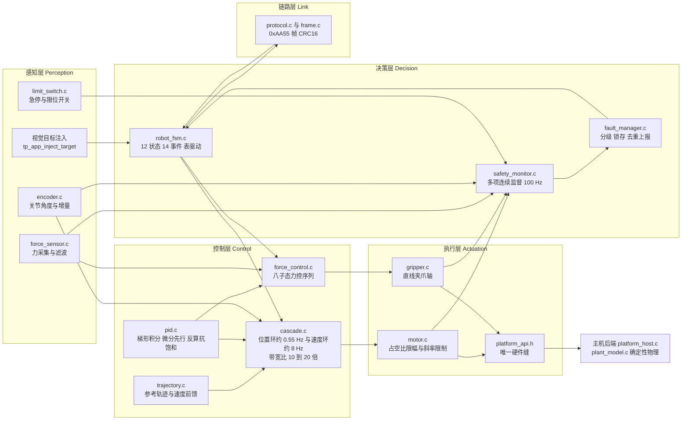
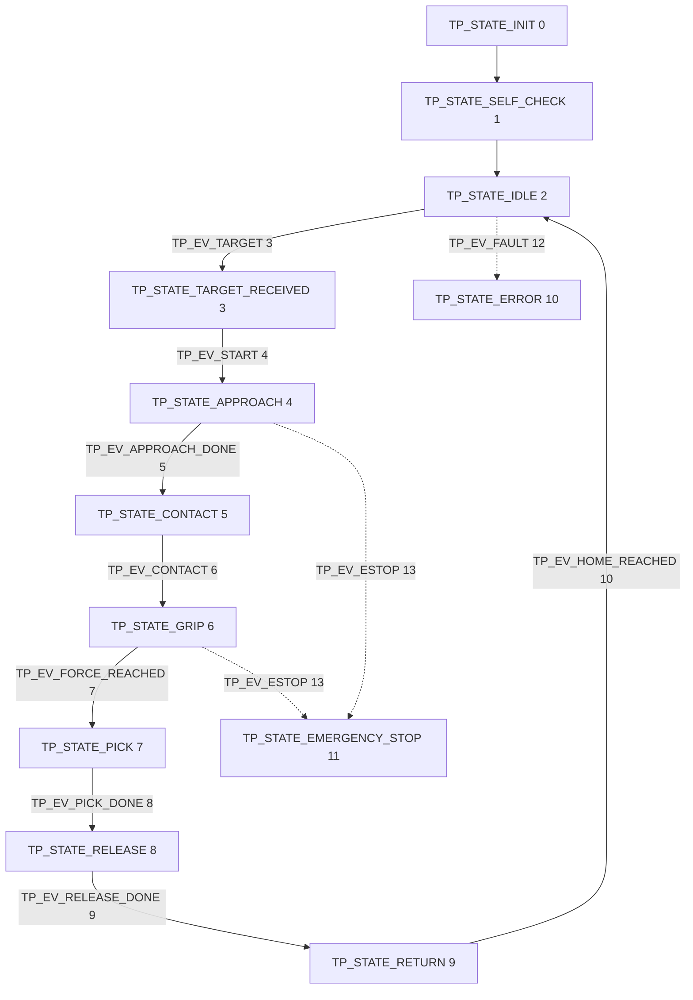
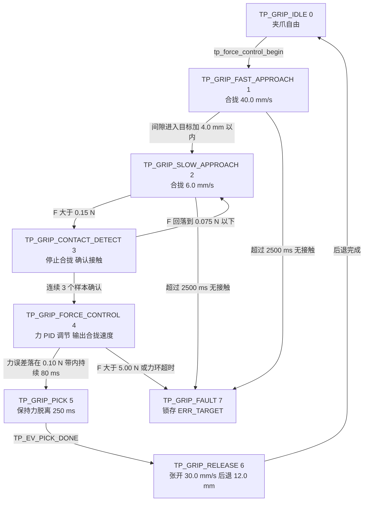
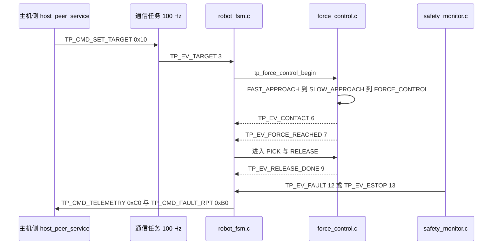

# 第二代智能无人机采茶机器人系统 —— 系统设计说明书

> 标注约定（全文严格遵守）：
> - **【仿真结果（Simulated）】** —— 来自 `build/host/tea_picking_robot_host.exe` 的确定性仿真，不是实测。
> - **【设计目标 / Target KPI（未实测）】** —— 设计意图与指标，本课题**没有实物机器**，从未实测。
> - **【参考设计 / Recommended Implementation，未制作实物板】** —— 图纸级/常量级硬件方案，未做 PCB，未打样。
> - **【代码事实】** —— 直接来自本仓库源文件，给出真实路径与真实符号名。

---

## 摘要

本文给出**第二代智能无人机采茶机器人系统**的系统级设计。系统的软件是一套可在两种后端上编译的嵌入式固件：目标后端 `-DTP_PLATFORM_STM32F407`（【参考设计 / Recommended Implementation，未制作实物板】）与主机确定性物理后端 `-DTP_PLATFORM_HOST`。**本课题没有实物硬件**：没有制作 PCB，没有在真实机器上标定或测试过任何一项指标。

系统围绕一个核心设计判断组织：**茶芽是柔性活体，夹持力必须被闭环调节，而不能靠固定位置合拢赌茎秆刚度**。因此系统在 `firmware/Control/force_control.c` 中实现了一个八子态的力控柔性夹持序列，由 `firmware/Control/pid.c` 的三个 PID 实例之一驱动，并由 `firmware/Safety/safety_monitor.c` 独立监督。

【仿真结果（Simulated）】Scenario A（nominal pick，`--scenario A`）：目标于 t = 1.20 s 被检测到；接触在夹爪间隙 5.824 mm、F = 0.148 N 时判定；力达到 2.17 N（设定值 2.20 N，band ±0.10 N），**超调 0.00 N**，49 个控制周期收敛；受控阶段平均保持力 **2.26 N**，峰值夹持力 **2.386 N**（硬限 5.00 N）；周期内 6000 控制周期、3000 传感器周期、600 通信周期、600 机器人周期、600 安全周期，**0 次截止期错失**；主机链路解码 2200 B、100 帧、**0 CRC 错误**。七个场景 7/7 PASS。

【设计目标 / Target KPI（未实测）】茶芽破损率 ≤ 1 %、采摘效率提升 40 %、定位误差、夹持力误差、通信延迟——均为**设计目标**，无实机数据支撑。

---

## 目录

- [摘要](#摘要)
- [1. 总体方案](#1-总体方案)
- [2. 系统组成](#2-系统组成)
- [3. 工作流程：定位 → 接近 → 夹持 → 力矩检测 → 采摘 → 松开 → 复位](#3-工作流程定位--接近--夹持--力矩检测--采摘--松开--复位)
- [4. 设计约束](#4-设计约束)
- [5. 关键设计决策与权衡](#5-关键设计决策与权衡)
- [6. 需求到设计的追溯](#6-需求到设计的追溯)
- [7. 本设计的边界与未做之事](#7-本设计的边界与未做之事)
- [小结](#小结)
- [面试可能追问的问题](#面试可能追问的问题)

---

## 1. 总体方案

### 1.1 总述

系统采用**分层 + 单一硬件缝**的结构。自下而上为：

1. **BSP 层**：`firmware/BSP/platform_api.h` 是全工程**唯一**的硬件接缝，所有寄存器访问、GPIO 读写、总线收发都必须经它。它只允许两个实现：`firmware/BSP/stm32f407/platform_stm32f407.c`（目标硅片，【参考设计 / Recommended Implementation，未制作实物板】）与 `firmware/BSP/host/platform_host.c`（确定性物理后端）。
2. **BSP 设备驱动**：`motor.c`、`gripper.c`、`encoder.c`、`force_sensor.c`、`limit_switch.c` 等，承担单位换算、限幅、标定、故障检测——因此**全部可单测行为都在这层**。
3. **Middleware**：`osal.h`（任务/周期抽象）、`filters.h`（中值 + 滑动平均 + 一阶低通）、`ring_buffer.h`、`robot_state.h`（状态词表）、`status.h`、`tp_format.h`。
4. **Control 层**：`cascade.c`（位置环 → 速度环）、`force_control.c`（柔性夹持序列）、`pid.c`、`trajectory.c`。
5. **Safety 层**：`fault_codes.h`（闭合故障码集合）、`fault_manager.c`（分级与锁存）、`safety_monitor.c`（每 10 ms 跑一次的多项监督）。
6. **Protocol 层**：`frame.c` + `crc16.c` + `protocol.c` + `protocol_types.h`，帧头 `0xAA 0x55`，CRC-16/MODBUS。
7. **Application / Core 层**：`robot_fsm.c`（表驱动机器人状态机）、`app_tasks.c`（七个任务的唯一汇聚点）、`app_sequence.c`、`main_host.c` / `main_stm32.c`。

`firmware/Core/main_host.c` 的注释明确了这套结构的意义：主机程序**不是重写、不是 mock**，它与 STM32 运行**同一份** `pid.c`、`cascade.c`、`force_control.c`、`robot_fsm.c`、`safety_monitor.c`、`protocol.c`。因此仿真验证的是**固件本身**，而不是模型。

### 1.2 总体框图

### 1.3 三问

**「它是什么」**
一个**七层、单向依赖**的嵌入式系统结构：感知 → 决策 → 控制 → 执行，链路层横向接入决策层，安全层旁路监督全部执行通路。层与层之间只通过头文件里的函数与结构体耦合，全工程只有 `platform_api.h` 一个位置触碰硬件。

**「为什么这么设计」**
因为这台机器的主要工程风险不在"能不能动"，而在**"能不能不损坏工作对象"**。把力控序列（连续控制问题）与状态机（离散决策问题）**物理分开放进两个文件**，是为了让二者都能被独立测试：`firmware/Application/robot_fsm.h` 注释直言——把两者混淆会得到"一个带 1 kHz 心跳的状态机，这是让两边都变得难以测试的著名做法"。同理，检测（`safety_monitor.c`）与反应（`fault_manager.c` + 应用层）分离，使检测逻辑可以只靠断言故障注册表来单测，**不需要机器人、也不需要时间**。

**「如果不用它会怎样」**
如果每层各自直接访问硬件，1 kHz 控制环里就会出现间接调用、空指针 vtable 风险，且"谁碰了硬件"无法在一处审计——`platform_api.h` 明确把"单一文件可审计"列为选型理由之一（安全评审会问的正是这件事）。如果力控与状态机合并，`TP_GRIP_*` 的八个子态（其中六个是序列阶段、两个由 PID 直接调节）就要塞进 100 Hz 的 FSM 心跳里，而力环的收敛时间是 49 个力控更新周期（【仿真结果（Simulated）】Scenario A）。⚠️ 此处必须交代一处**代码注释与实际调用点不一致**：源码注释称力环跑在 1 kHz（`app_sequence.c` 第 299–302 行、`app_tasks.h` 第 19 行），但 `tp_force_control_update()` 全仓库唯一调用点在 100 Hz 的 `tp_app_robot_step()`（`app_sequence.c` 第 506–507 行，传入 `dt_s = TP_ROBOT_PERIOD_MS / 1000.0f = 0.01 s`），因此 49 个更新周期按实现是**约 0.49 s**，而不是 49 ms。无论按 1 kHz 还是按 100 Hz 计算，力控与 100 Hz 的 FSM 心跳都不同量级，"合并后两边都不准"的结论不变；但**具体倍数必须以实际调用点为准**，不能沿用注释里的 1 kHz。

---

## 2. 系统组成

| 子系统 | 真实文件 | 职责 | 关键接口 |
|---|---|---|---|
| Application（状态机） | `firmware/Application/robot_fsm.h` / `robot_fsm.c` | 12 状态 14 事件的搬迁表；守卫与动作；64 条环形转移轨迹 | `tp_fsm_init()`、`tp_fsm_handle_event()`、`tp_fsm_step()`、`tp_fsm_force_state()`、`tp_fsm_set_fault_state()`、`tp_fsm_set_estop()`、`tp_fsm_set_target()` |
| Application（状态词表） | `firmware/Middleware/utils/robot_state.h` | `tp_robot_state_t` 的唯一定义，被 FSM、协议、监视工具三方共享 | `tp_state_name()`、`tp_state_desc()`、`tp_state_is_normal()`、`tp_state_allows_motion()` |
| Application（配置） | `firmware/Application/config.h` | 全部可调常量的唯一位置；底部 12 条编译期静态断言 | 宏常量 + `TP_STATIC_ASSERT` |
| Control（级联） | `firmware/Control/cascade.h` / `cascade.c` | 位置环 → 速度环，内嵌 `tp_trajectory_t` | `tp_cascade_init()`、`tp_cascade_update()`、`tp_cascade_set_gains()`、`tp_cascade_set_mode()` |
| Control（力控） | `firmware/Control/force_control.h` / `force_control.c` | 柔性夹持八子态序列；过力保护；接触超时 | `tp_force_control_begin()`、`tp_force_control_update()`、`tp_force_control_abort()`、`tp_force_control_mean_hold_force()` |
| Control（PID） | `firmware/Control/pid.h` / `pid.c` | 三个循环共用同一实现：位置环、速度环、力环 | `tp_pid_init()`、`tp_pid_update()`、`tp_pid_set_gains()`、`tp_pid_reset()` |
| BSP（硬件缝） | `firmware/BSP/platform_api.h` | 唯一硬件接缝：时钟、GPIO、PWM、ADC、总线、看门狗、临界区、紧急刹车 | `tp_platform_motor_set_pwm()`、`tp_platform_adc_read_block()`、`tp_platform_bus_write()`、`tp_platform_emergency_kill()` |
| BSP（类型） | `firmware/BSP/bsp_types.h` | 通道编号、机械常数、原始/工程量采样记录 | `TP_MOTOR_JOINT`、`TP_ENCODER_COUNTS_PER_REV = 4096`、`tp_measurement_t` |
| BSP（驱动） | `firmware/BSP/motor.c`、`gripper.c`、`encoder.c`、`force_sensor.c`、`limit_switch.c` | 单位换算、限幅、标定、器件级故障 | `tp_motor_set_duty()`、`tp_motor_foldback_factor()`、`tp_gripper_set_velocity_mm_s()`、`tp_force_sensor_get_force_n()` |
| Protocol | `firmware/Protocol/frame.c`、`crc16.c`、`protocol.c`、`protocol_types.h` | 帧编解码、CRC-16/MODBUS 校验、命令分发 | `tp_frame_encode()`、`tp_frame_parser_feed()`、`TP_CMD_SET_TARGET = 0x10`、`TP_CMD_EMERGENCY_STOP = 0x40` |
| Safety | `firmware/Safety/fault_codes.h`、`fault_manager.c`、`safety_monitor.c` | 闭合故障码集合与四级严重度；锁存策略；多项连续监督 | `tp_fault_name()`、`tp_fault_severity()`、`tp_fault_any_latched()`、`tp_safety_check_estop()` |
| Middleware | `firmware/Middleware/osal/osal.h`、`utils/filters.h`、`utils/ring_buffer.h`、`utils/status.h` | 周期任务抽象、信号滤波链、环形缓冲、统一返回码 | `osal_period_t`、`TP_FILTER_FORCE_MA_WINDOW = 8u`、`TP_FILTER_FORCE_LPF_TAU_S = 0.006f`、`TP_OK` |
| Core | `firmware/Core/app_tasks.h`、`app_tasks.c`、`app_sequence.c`、`main_host.c`、`main_stm32.c` | 唯一汇聚层：七个任务、应用上下文、命令处理、两个入口 | `tp_app_init()`、`tp_app_tick_1ms()`、`tp_app_inject_target()`、`tp_app_start_pick()`、`tp_app_set_grip_mode()` |

任务时基全部来自 `config.h`：`TP_CONTROL_FREQ_HZ = 1000u`、`TP_SENSOR_FREQ_HZ = 500u`、`TP_COMM_FREQ_HZ = 100u`、`TP_ROBOT_FREQ_HZ = 100u`、`TP_SAFETY_FREQ_HZ = 100u`、`TP_TELEMETRY_FREQ_HZ = 20u`、`TP_DEBUG_FREQ_HZ = 5u`；优先级 `TP_PRIO_CONTROL = 6u` 最高，`TP_PRIO_DEBUG = 0u` 最低。

---

## 3. 工作流程：定位 → 接近 → 夹持 → 力矩检测 → 采摘 → 松开 → 复位

### 3.1 机器人状态（`tp_robot_state_t`，真实定义在 `firmware/Middleware/utils/robot_state.h`）

> 说明：`firmware/Application/robot_fsm.h` 通过 `#include "robot_state.h"` 引入该枚举，枚举本身**不在** `robot_fsm.h` 中，而在 `firmware/Middleware/utils/robot_state.h`。这样做的原因见该文件注释：状态要在 FSM、线协议、上位机监视器三处一致，放在叶子头文件里可以让层次无环且**漂移不可能**。

| 取值 | 数值 | 含义 |
|---|---|---|
| `TP_STATE_INIT` | 0 | 上电，外设尚未校验 |
| `TP_STATE_SELF_CHECK` | 1 | 启动自检中：看门狗、传感器、限位、通信 |
| `TP_STATE_IDLE` | 2 | 健康静止，接受命令 |
| `TP_STATE_TARGET_RECEIVED` | 3 | 视觉目标已锁存并校验 |
| `TP_STATE_APPROACH` | 4 | 移向茶芽上方的预抓取位姿 |
| `TP_STATE_CONTACT` | 5 | 夹爪慢速合拢，监视接触力阶跃 |
| `TP_STATE_GRIP` | 6 | 力控合拢到指令夹持力 |
| `TP_STATE_PICK` | 7 | 夹爪闭合状态下脱离茶芽 |
| `TP_STATE_RELEASE` | 8 | 张开夹爪把茶芽放入收集筐 |
| `TP_STATE_RETURN` | 9 | 回到原位，准备下一个目标 |
| `TP_STATE_ERROR` | 10 | 故障锁存，运动被禁止 |
| `TP_STATE_EMERGENCY_STOP` | 11 | 急停生效，驱动被硬件级切断 |
| `TP_STATE_COUNT` | 12 | 状态数量，保持最后 |

配套事件 `tp_event_t`：`TP_EV_NONE = 0`、`TP_EV_SELF_CHECK_PASS = 1`、`TP_EV_SELF_CHECK_FAIL = 2`、`TP_EV_TARGET = 3`、`TP_EV_START = 4`、`TP_EV_APPROACH_DONE = 5`、`TP_EV_CONTACT = 6`、`TP_EV_FORCE_REACHED = 7`、`TP_EV_PICK_DONE = 8`、`TP_EV_RELEASE_DONE = 9`、`TP_EV_HOME_REACHED = 10`、`TP_EV_STOP = 11`、`TP_EV_FAULT = 12`、`TP_EV_ESTOP = 13`、`TP_EV_RESET = 14`、`TP_EV_EVENT_COUNT = 15`。

### 3.2 夹持子状态（`tp_grip_state_t`，`firmware/Control/force_control.h`）

| 取值 | 数值 | 含义 | 关键常量 / 判据 |
|---|---|---|---|
| `TP_GRIP_IDLE` | 0 | 未夹持，夹爪自由 | — |
| `TP_GRIP_FAST_APPROACH` | 1 | 快速合拢，接触前 | `TP_APPROACH_FAST_SPEED_MM_S = 40.0f` mm/s |
| `TP_GRIP_SLOW_APPROACH` | 2 | 慢速合拢，等待接触 | `TP_APPROACH_SLOW_SPEED_MM_S = 6.0f` mm/s；切换距离 `TP_APPROACH_SLOW_AT_MM = 4.0f` mm |
| `TP_GRIP_CONTACT_DETECT` | 3 | 确认接触为真而非噪声 | `TP_FORCE_CONTACT_N = 0.15f` N；`GRIP_CONTACT_DEBOUNCE = 3u` |
| `TP_GRIP_FORCE_CONTROL` | 4 | 调节夹持力 | `TP_FORCE_BAND_N = 0.10f` N；`GRIP_SETTLE_MS = TP_GRIPPER_SETTLE_MS = 80u` |
| `TP_GRIP_PICK` | 5 | 保持力同时脱离 | `GRIP_PICK_DURATION_MS = 250u`；`GRIP_PICK_CLOSE_SPEED_MM_S = 2.0f` mm/s |
| `TP_GRIP_RELEASE` | 6 | 张开并后退 | `GRIP_RELEASE_SPEED_MM_S = 30.0f` mm/s；`TP_GRIPPER_BACKOFF_MM = 12.0f` mm |
| `TP_GRIP_FAULT` | 7 | 保护触发，夹爪保持张开 | `GRIP_CONTACT_TIMEOUT_MS = 2500u` |

### 3.3 逐步说明

**第 1 步 定位（`TP_STATE_TARGET_RECEIVED`）**
视觉目标经 `TP_CMD_SET_TARGET = 0x10` 帧到达，或由 `tp_app_inject_target()` 直接注入。入口校验与协议处理函数**完全一致**——`app_tasks.h` 注释明确："从这里进来的目标无法绕过任何线上目标必须通过的检查"。门槛为 `TP_APP_MIN_CONFIDENCE = 60u`（置信度 0..100），超过 `TP_APP_TARGET_STALE_MS = 1000u` 的目标判为过期。关节角由 `TP_APP_MM_TO_MRAD = 3.333f` 把横向毫米映射为毫弧度。**本工程视觉是注入/mock 的，没有真实相机**（见第 7 节）。

**第 2 步 接近（`TP_STATE_APPROACH`）**
`cascade.c` 双环驱动关节：外环 `TP_POS_PID_KP = 5.0f`、`TP_POS_PID_KI = 0.5f`、`TP_POS_PID_IMAX = 2000.0f`、`TP_POS_PID_OUT_MAX = 60000.0f` mrad/s；内环 `TP_VEL_PID_KP = 0.005f`、`TP_VEL_PID_KI = 0.10f`、`TP_VEL_PID_IMAX = 250.0f`。速度前馈加在**内环的参考**上而不是输出上，这样内环仍然执行速度限幅，前馈永远可达。这里出现的"速度环约 8 Hz、位置环约 0.55 Hz"（`cascade.h`）与"位置环时间常数 200 ms、即约 0.8 Hz"（`config.h` 的调参依据）都是**设计推导值，不是实测带宽**——没有频响测试仪数据。

**第 3 步 夹持 / 力矩检测（`TP_STATE_CONTACT` → `TP_STATE_GRIP`）**
夹爪进入八子态序列。先以 40.0 mm/s 快速合拢；当间隙进入目标 + 4.0 mm 以内切到 6.0 mm/s 慢速；力超过 `TP_FORCE_CONTACT_N = 0.15f` N 后**暂停合拢**进入接触确认（保持合拢 3 个样本窗口会额外钻进约 0.036 mm、约 11 mN，代码注释判定为"可以接受但不必要"）；连续 `GRIP_CONTACT_DEBOUNCE = 3u` 个样本都在阈值之上才把控制权交给力环，并 `tp_pid_reset()` 清空积分器。若力回落到阈值的一半（0.075 N）以下，判定"不是接触"，退回慢速接近。力环输出是**合拢速度**，被限幅到 `TP_FORCE_PID_OUT_MAX = 25.0f` mm/s，增益 `TP_FORCE_PID_KP = 14.0f`、`TP_FORCE_PID_KI = 6.0f`、`TP_FORCE_PID_KD = 0.05f`、`TP_FORCE_PID_IMAX = 20.0f`、`TP_FORCE_PID_TAU_D_S = 0.010f`。当 |F − F\*| 落在 `TP_FORCE_BAND_N = 0.10f` N 带内并持续 `TP_GRIPPER_SETTLE_MS = 80u` ms，判定到位。
【仿真结果（Simulated）】Scenario A：接触判在间隙 5.824 mm、F = 0.148 N；力达 2.17 N（设定值 2.20 N），**超调 0.00 N**，49 个控制周期收敛，受控阶段平均保持力 2.26 N。

**第 4 步 采摘（`TP_STATE_PICK`）**
在保持夹持力的同时执行脱离：`GRIP_PICK_DURATION_MS = 250u` ms，合拢速度为 `GRIP_PICK_CLOSE_SPEED_MM_S = 2.0f` mm/s，关节叠加 `TP_APP_LIFT_MRAD = 60.0f` mrad 的抬升。此阶段无条件累计保持力统计（见 `force_control.h` 中 `regulated` / `hold_samples` 字段注释：把从接触阈值爬到设定值的上升段计入平均，会把一次正确调节到 2.2 N 的夹持报成 1.66 N——第一版正是这么错的）。

**第 5 步 松开与复位（`TP_STATE_RELEASE` → `TP_STATE_RETURN`）**
以 `GRIP_RELEASE_SPEED_MM_S = 30.0f` mm/s 张开，再后退 `TP_GRIPPER_BACKOFF_MM = 12.0f` mm。`force_control.h` 解释为什么必须**既张开又后退**：只张开会让茶芽搁在爪面上，下一周期会把它撞落到随机位置。随后 FSM 回 `TP_STATE_RETURN` → `TP_STATE_IDLE`，`cycle_count` 加一。
【仿真结果（Simulated）】Scenario A 节拍：APPROACH→CONTACT 1.24 s，GRIP 2.57 s，PICK 3.14 s，RELEASE 3.39 s，RETURN/IDLE 4.78 s，`cycle_count` = 1。

### 3.4 流程图与链路时序图

### 3.5 关键机制三问

**「它是什么」**
力控柔性夹持：`force_control.c` 用八个子状态把"合拢到某个间隙"换成"合拢到某个力"。量测是 `force_sensor.c` 提供的滤波力（中值窗口 `TP_FILTER_MEDIAN_WINDOW = 5u` + 滑动平均 `TP_FILTER_FORCE_MA_WINDOW = 8u` + 一阶低通 `TP_FILTER_FORCE_LPF_TAU_S = 0.006f`），被调量是夹爪合拢速度，设定值是 `TP_FORCE_TARGET_N = 2.20f` N。

**「为什么这么设计」**
`force_control.h` 把理由写成一句话：茶芽是柔软的、细的、活的对象；按固定**位置**合拢的夹爪不知道自己在多用力，而力取决于茎秆刚度，后者随品种、含水率、芽龄甚至一天中的时段变化，**机器人无法预先测得**。压到比预期更硬的茎秆上时，力沿 `tp_plant_stem_gripper` 的二次曲线上升，在控制器获得任何信息之前就已经超过压碎点。所以必须在力上闭环。同一文件还用表格逐条论证每个阶段为什么不能省：没有慢速接近，力环只有约 0.2 mm 行程反应，冲击本身就会超过损伤阈值；没有接触确认，单个噪声样本会把控制权交给力环而夹爪里其实什么都没有。

**「如果不用它会怎样」**
【仿真结果（Simulated）】Scenario D 就是被设计来回答这一问的：用**纯位置控制**、茎秆表面在 16 mm、夹爪驱动到固定 4 mm 间隙，模型预测力为 `0.30*12 + 0.06*144 = 12.2 N`，远超 5 N 硬限与 4 N 损伤阈值。结果是周期中止、`ERR_FORCE_OVERLOAD`，峰值夹持力一栏为"从未达到"。`main_host.c` 里还记录了一个更有说服力的中间结论：Scenario D 的第一次尝试是"在力控生效时把茎秆调硬"，结果周期正常完成、峰值只有 3.2 N——"这不是场景的 bug，这是整个项目的中心结果：**力控夹爪不在乎茶芽有多硬**"。要展示过力保护，必须把力反馈拿掉。

### 3.6 关键机制三问：表驱动状态机

**「它是什么」**
`robot_fsm.c` 中的一张**静态转移表**：表项为 `{from, event, to, name, guard, action}`（结构体 `tp_fsm_transition_t`，声明在 `firmware/Application/robot_fsm.h`），覆盖 12 状态 × 14 事件的合法组合。事件由 `tp_fsm_handle_event()` 投递：命中则执行转移、写 64 条环形轨迹（`TP_FSM_TRACE_DEPTH = 64u`）、动作在**状态已更新之后**执行；未命中记入 `rejected_events` 并返回 `TP_ERR_NOT_FOUND`；守卫否决则事件被"消费但未生效"、记入 `guard_rejections` 并返回 `TP_ERR_STATE`。另有一条旁路 `tp_fsm_force_state()`，仅供急停路径使用——表**不允许**说"不"。

**「为什么这么设计」**
因为这台机器需要被**审阅**，而不只是被运行。`robot_fsm.h` 列出三条手工 `switch` 的失效模式：未处理的 (状态, 事件) 对会被静默忽略，漏转移与正确空操作无法区分；合法转移集合无法审阅（"这台机器能否不经过 PICK 从 GRIP 到 RELEASE？"必须逐分支追踪）；加状态要改多处，漏一处表现为机器无声挂死。表作为数据则可枚举、可校验、可记录、可出图。

**「如果不用它会怎样」**
四个具体损失：① 单测无法走全表断言"每个状态可达、没有转移指向未定义状态"，只能靠"跑 2.5 s 一次接近"来验证（该文件明确说这会让测试套件慢到痛苦）；② 日志只能打印 `state 4 -> 5`，而现在是 `APPROACH-->CONTACT (CONTACT_DETECTED)`；③ 守卫误用应用上下文的那类 bug 会继续存在——`robot_fsm.h` 记录了第一版把应用上下文强转成 `tp_robot_fsm_t *`，导致守卫读到相邻字段、`guard_has_target()` 间歇性返回"无目标"、机器间歇性拒绝启动；④ 轨迹环（`TP_FSM_TRACE_DEPTH = 64u`）没有数据源，机器人跑一周也不会增长内存这一性质无从谈起。

### 3.7 关键机制三问：独立安全监督与故障分级

**「它是什么」**
`safety_monitor.c` 以 `TP_SAFETY_FREQ_HZ = 100u` 运行，对机器状态提出若干独立问题（过力、软限、堵转、过流、编码器、传感器、限位、通信超时、急停、看门狗）。它**不拥有任何执行器**：它只向 `fault_manager.c` 注册故障，并通过电机抽象停下驱动，由应用层决定怎么反应。故障的严重度分四级（`TP_SEVERITY_INFO / WARNING / ERROR / CRITICAL`），决定是否锁存、是否禁止运动、是否需要断电或显式 `RESET`。

**「为什么这么设计」**
`fault_codes.h` 给出的理由：过力事件在软件上可恢复，而编码器报告物理不可能的运动意味着**反馈通路不可信**，继续驱动是不可辩护的——两者不能用同一种处理。同样重要的是**检测与反应分离**：这样检测逻辑可以只靠断言故障注册表来单测，不需要机器人、也不需要时间。去抖策略也是刻意不对称的——`safety_monitor.h` 写明"保护机器自身的检查去抖，保护对象与人的检查不去抖"。

**「如果不用它会怎样」**
`fault_codes.h` 用 `TP_FAULT_TARGET` 的真实演化史回答了这一问：它第一版是 WARNING。WARNING 不锁存也不禁止运动，结果是状态机停在 `CONTACT`、力控停在 `FAULT`、**没有任何事件能推动它**，机器人永远停在一个名字写着"还在工作"的状态里。第二层后果是把 `TP_FAULT_TARGET` 错报成 `TP_FAULT_SENSOR`：前者意谓"茶芽不在相机所说的位置"，后者意谓"查称重传感器接线"——`fault_codes.h` 直言混淆这两者在本项目上浪费过真实调试时间。没有独立监督的第三层后果见 Scenario D：纯位置控的 12.2 N 全靠监督来兜底，而监督只能在力**已经**超限后才动作，力控则根本不会逼近那个限值。

---

## 4. 设计约束

约束清单，来源全部是仓库中的真实注释或真实静态断言：

| 约束 | 来源（真实文件 / 位置） | 对设计的影响 |
|---|---|---|
| 慢任务频率必须整除控制频率 | `firmware/Application/config.h` 底部 `TP_STATIC_ASSERT((TP_CONTROL_FREQ_HZ % TP_SENSOR_FREQ_HZ) == 0u, ...)` 等 5 条 | 任务天然谐波，任何调度抖动都可被"第 k 个 1 ms tick"确定性复现；改变任一频率都会在编译期失败而不是运行期跑偏 |
| 控制频率不能高到没有 1 ms tick | `config.h`：`TP_STATIC_ASSERT(TP_MS_PER_HZ(TP_CONTROL_FREQ_HZ) >= 1u, "CONTROL_FREQ is too high for a 1 ms tick")` | 控制周期锁死在毫秒整数网格 |
| 力阈值必须有序：目标 < 软限 < 硬限 | `config.h`：`TP_STATIC_ASSERT(TP_FORCE_TARGET_N < TP_FORCE_SOFT_LIMIT_N, ...)` 与 `TP_STATIC_ASSERT(TP_FORCE_SOFT_LIMIT_N < TP_FORCE_MAX_N, ...)`（2.20 < 3.50 < 5.00） | 保护等级不能倒挂；越限判断的优先级（见 `force_control.c` 第 251 行起的"Priority 1"块）在编译期被担保有意义 |
| 位置环输出限幅必须覆盖关节最大速度 | `config.h`：`TP_STATIC_ASSERT(TP_JOINT_MAX_SPEED_MRAD_S <= TP_POS_PID_OUT_MAX, ...)`（60000.0f ≤ 60000.0f） | 外环输出**就是**内环输入量程；不允许出现"控制器想给的速度被自身限幅吃掉" |
| 帧长必须小到能进 RX 环形缓冲 | `config.h`：`TP_STATIC_ASSERT(TP_PROTO_MAX_FRAME <= 128u, "Frame buffer must stay small enough for the RX ring")`（`TP_PROTO_MAX_PAYLOAD = 64u` + `TP_PROTO_OVERHEAD = 7u` = 71） | RAM 预算可控；接收环形缓冲尺寸不会随协议演进而爆掉 |
| 模拟前端在额定载荷下不得超量程 | `config.h`：`TP_STATIC_ASSERT(TP_FORCE_FULLSCALE_MV < (TP_ADC_VREF_V * 1000.0f), "Front-end gain over-ranges the ADC at rated load")` | 【参考设计 / Recommended Implementation，未制作实物板】前级增益 201 倍的选型被编译期锁住；`TP_FORCE_FULLSCALE_MV = 1005 mV`，远低于 3300 mV |
| 可用量程必须覆盖力硬限 | `config.h`：`TP_STATIC_ASSERT(TP_FORCE_USABLE_RANGE_N > TP_FORCE_MAX_N, "Usable force range must cover the hard force limit")` | 过载由固件判定而不是 ADC 无声贴轨；`TP_FORCE_ADC_SATURATION_N` 对应 32.8 N，`TP_FORCE_USABLE_RANGE_N` 约 ±16.4 N |
| 主机后端必须是**确定性仿真**，不是 mock | `firmware/BSP/host/plant_model.h` 注释："A mock would let the control loop succeed no matter how wrong the controller is, which is worse than no test at all." | 仿真结果具备工程意义；同时**也**限定了结论范围——仿真通过不等于实机通过 |
| 硬件接缝不得阻塞 | `firmware/BSP/platform_api.h`："No function here may block for longer than a few microseconds."；读函数失败时不得写输出 | 1 kHz 控制环可预测；调用方可在失败时保留上一次有效值 |
| 看门狗只允许一处喂 | `platform_api.h` 对 `tp_platform_watchdog_feed()` 的注释："Feeding it from several tasks would defeat the point" | 卡死的控制任务不会被健康的日志任务掩盖 |
| 急停输入为常闭回路 | `platform_api.h` 对 `tp_platform_io_read()` 的注释；`bsp_types.h` 中 `TP_IO_ESTOP` 注释 "NC loop, low = asserted" | 断线读作"已触发"，失效安全；极性由 `safety_monitor.c` 应用，接错线在日志里可见而不是被静默反相 |
| 看门狗超时必须大于最慢任务周期 | `config.h`：`TP_WDG_TIMEOUT_MS = 500u` 与 5 Hz 调试任务（200 ms） | 最慢任务仍在监督范围内 |
| 位置环与速度环带宽比必须在 10–20 倍 | `firmware/Control/cascade.h`："The ratio is chosen first (10-20x)"；`config.h` 位置环调参依据 | 低于 5 倍级联不如单环，高于 20 倍外环无谓变慢 |
| 机构只有一个受控关节 | `firmware/BSP/bsp_types.h`："The arm's remaining joints are passive/fixed, so no third channel is reserved"；`app_tasks.h` 的 `TP_APP_MM_TO_MRAD` 注释 | 笛卡尔→关节是投影近似，小角近似优于 2 %，在工作区边缘约 1.2 mm 误差；这是**机构限制**，标注在 `docs/13_future_work.md` |
| 力控与位置控不得在周期中途切换 | `app_tasks.h` 对 `tp_app_set_grip_mode()` 的 `@warning`：仅 idle 合法 | 避免"夹爪受一个控制器驱动、状态机在等另一个控制器的事件" |
| 无板温传感器时不得报 0.0 ℃ | `config.h`：`TP_SENSOR_TEMP_UNAVAILABLE = 32767` 及注释 | 宿主工具渲染 "3276.7 ℃" 是明显的哨兵值，而不是误导性的 "0.0 ℃" |

---

## 5. 关键设计决策与权衡

| # | 决策 | 备选方案 | 为什么选它（代码注释原文要点） | 代价 |
|---|---|---|---|---|
| 1 | 单一硬件缝 `platform_api.h` | 每个驱动一套函数指针 vtable | 三条理由：① 1 kHz 控制环**从不做间接调用**，无 BTB 压力、无空 vtable 条目风险，在无分支预测器的 Cortex-M4 上可测量；② 编译器看得见全部实现，`-O2` 能把 `tp_platform_motor_set_pwm` 内联成一次寄存器写，`--gc-sections` 能删掉未用部分；③ **移植面可在一个文件里审计**，这正是安全评审要问的 | 不支持"现场换传感器"式多态；新增设备要改 BSP |
| 2 | 位置 → 速度双闭环 `cascade.c` | 单个位置 PID | 三条理由：① 单环的输出既是速度指令又要定阻尼，两者互相拉扯；拆开后内环管阻尼、外环管响应速度；② 内环把被控对象**线性化**（把变力矩常数、电源跌落、低速非线性摩擦都包进内环），外环只需对一阶模型整定；③ 扰动（重力、剪切反力）在**产生处**被抑制，不必先移动关节 | 需要带宽间隔 ≥ 10 倍；`cascade.h` 明确写出反例：内环快不到 3 倍时，级联比单环更差（多出的滞后白送相位损失） |
| 3 | 力控夹持 | 位置控夹持到固定间隙 | 力取决于茎秆刚度，而刚度随品种/含水/芽龄/时段变化且无法预知；力沿二次曲线上升，位置控在获得信息前就越过压碎点 | 需要力传感器通道、需要接触检测状态机、需要退化路径（传感器故障时回退位置控） |
| 4 | 力环输出是**速度**而非位置增量 | 输出直接给位置指令 | 与 `gripper.c` 的 `tp_gripper_set_velocity_mm_s()` 接口一致，速度限幅天然存在；符号约定在 `force_control.c` 一处取反（正占空比合拢、正速度指令张开），"只取反一次"避免符号错误散落 | 速度积分带来的相位滞后需要 D 项与低通补偿 |
| 5 | 梯形积分 | 矩形积分 | `pid.h` 表格："Rectangular integration of a moving error biases the I term, which shows up as a steady-state offset"；若不用，位置误差会稳定在一个小的非零值 | 每周期多存一个 `err_prev`，多一次加法 |
| 6 | 微分先行（对量测微分）+ 微分低通 | 对误差微分、原始差分 | 对误差微分会在设定值阶跃时产生冲激，电机把它变成电流尖峰（"导数踢"：每次新目标都有一声闷响和可见电流尖峰）；编码器是量化的，1 kHz 下的原始差分主要是量化噪声，D 放大它会让 PWM 啸叫、电机无谓发热 | 需要 `meas_prev` 与 `d_filt` 两个状态，`TP_POS_PID_TAU_D_S = 0.002f`、`TP_VEL_PID_TAU_D_S = 0.001f`、`TP_FORCE_PID_TAU_D_S = 0.010f` 各需整定 |
| 7 | 电流用一阶滞后建模，而不是积分 `L·di/dt` | 直接积分 `L di/dt = V − R i − Ke ω` | `plant_model.h` 给出了**数值论证**：`L = 1.5 mH`、`R = 2 Ω` 时电极点位于 1/(0.75 ms)，1 ms 显式欧拉步**临界不稳定**，会产生与机器无关的数值振荡；把快极点坍缩成 `di/dt = (i_ss − i)/tau_e` 是标准奇异摄动，既保留**物理**时间常数又在 1 ms 周期下稳定 | 放弃亚毫秒尺度的电流纹波细节 |
| 8 | 堵转用**运动约束**（stick-slip），而非常值反向力矩 | 施加一个大反向力矩来"顶住" | `plant_model.c` 记录两次失败尝试：8 N·m 反向力矩除以 `J = 2.5e-3 kg·m²` 得 3200 rad/s²，一个 1 ms 步就改变 3.2 rad/s，而"被顶住"判据要求 \|ω\| ≤ 1e-4 rad/s——比一步能分辨的窄四个数量级，于是状态每样本都穿过该带，轴以数千 mrad/s 幅度振荡而不静止。结论："a jam is not a torque, it is a **motion constraint**"；在**施加力矩**上判条件（力矩是平滑有界量）彻底消除抖动 | 模型复杂度上升；`tp_plant_set_jam()` 的语义变成"约束阈值"而非"力矩" |
| 9 | FSM 期望写成**数据表** `s_scenarios[]`，而不是报告代码里的 `if` | 在报告处写 if 判断"周期是否完成" | `main_host.c` 注释："for the fault-injection scenarios **a completed pick cycle is a failure**"。若按"完成周期数"判成败，Scenario D 的正确行为会被报成 bug；把期望当数据，判据本身才有意义 | 场景表要与 `simulator/scenarios.py` 的七个场景保持同步 |
| 10 | 转移表（数据）而非嵌套 `switch` | `switch` 套 `switch`，约 170 行分支 | `robot_fsm.h` 列出三条：① 未处理的 (状态, 事件) 对会被**静默忽略**，漏转移与正确空操作长得一样；② 合法转移集合无法审阅（"这台机器能否不经过 PICK 从 GRIP 到 RELEASE？"）；③ 加状态要改多处，漏一处表现为机器无声挂死。表作为数据可枚举、可校验（单测走全表断言可达性）、可记录（日志写 `APPROACH-->CONTACT (CONTACT_DETECTED)` 而不是 `state 4 -> 5`）、可出图 | 需要额外维护守卫/动作签名；代价换来的是可验证性 |
| 11 | 守卫与动作接收 **FSM 实例**而非应用上下文 | 传应用上下文指针 | `robot_fsm.h` 记录了真实 bug：第一版传应用上下文，守卫把它强转成 `tp_robot_fsm_t *`——编译器看不见的类型错误，守卫于是读到应用结构体里恰好落在 FSM 字段偏移上的数据，`guard_has_target()` 静默返回"无目标"，机器**间歇性**拒绝启动周期。现在守卫需要的一切（目标标志、故障锁存、急停状态）都已由 setter 镜像进 FSM | 需要 setter 同步（`tp_fsm_set_fault_state()` / `tp_fsm_set_estop()` / `tp_fsm_set_target()`） |
| 12 | 尽力去抖 vs 不去抖，按保护对象区分 | 对所有检查统一去抖 | `safety_monitor.h`："checks that protect the machine from itself are debounced; checks that protect the object and the operator are not." 过力与软限**零去抖**（压碎茶芽不是瞬态），堵转 `TP_STALL_TRIP_MS = 300u`、过流 `TP_OVERCURRENT_TRIP_MS = 50u` 才去抖 | 过力检查必须放在控制器**之前**执行（`force_control.c` 的 Priority 1 块），才能在检出的同一周期生效 |
| 13 | 堵转检测要求"有占空比需求"才武装 | 只看"速度为零" | `safety_monitor.h`："Speed is zero"不是堵转——被指令为零速的电机本来就该静止；堵转是"**在被要求出力**却不动"。`TP_STALL_PWM_THRESHOLD = 80.0f` 千分比（8 % 占空比，绕组约 1.9 V）是明确的力矩指令而非残差；阈值取 80 是因为 `TP_VEL_PID_KI = 0.10` 下大位置误差约 100 ms 就能建立该需求，再由 300 ms 去抖主导检出延迟 | 长移动 + 真卡死才触发；"小移动撞上卡死"正确地不触发（`main_host.c` Scenario F 特意选 57° 长移动） |
| 14 | 自适应力阈值默认**关闭** | 默认开启 EMA 自适应 | `force_control.h` 写得直白："the fixed 2.2 N target is a **design starting point, not a measured optimum**"，自适应"尚未在真实茶芽上验证，盲目开启就是过度宣称" | 默认值需靠工程经验给定，`TP_FORCE_ADAPT_ENABLE = 1` 但实例默认 `adapt_enabled` 不打开 |
| 15 | 接触超时归为 `TP_FAULT_TARGET`（ERROR 级），而不是 `TP_FAULT_SENSOR`（WARNING 级） | 复用传感器故障码 / 报警不锁存 | `fault_codes.h` 记录了两层理由：① 两者把运维人员指向完全不同的地方——传感器故障意谓"查称重传感器接线"，本码意谓"茶芽不在相机所说的位置"，混淆**在本项目上浪费过真实调试时间**；② 第一版给 WARNING，WARNING 不锁存也不禁止运动，状态机就停在 `CONTACT`、力控停在 `FAULT`、且没有任何事件能推动它，机器人永远停在名字写着"还在工作"的状态里 | 需要独立的故障码与恢复提示 |

---

## 6. 需求到设计的追溯

| 需求 ID | 需求描述 | 实现位置（文件 + 符号） | 验证方式 | 状态 |
|---|---|---|---|---|
| REQ-F-01 | 夹持力闭环调节到设定值，稳态误差不超出 ±0.10 N 带 | `firmware/Control/force_control.c` `TP_GRIP_FORCE_CONTROL` + `firmware/Control/pid.c`；常量 `TP_FORCE_PID_KP/KI/KD`、`TP_FORCE_BAND_N`、`TP_GRIPPER_SETTLE_MS` | 场景 A（力达 2.17 N，超调 0.00 N，49 周期收敛）；场景 C（σ = 80 mN 噪声下仍完成，峰值 2.426 N） | 已仿真验证（Simulated） |
| REQ-F-02 | 峰值夹持力不得越过 5.00 N 硬限；越限在同一控制周期内生效 | `force_control.c` Priority 1 块（`if (force > TP_FORCE_MAX_N)` → `grip_trip(... TP_FAULT_FORCE_OVERLOAD ...)`）；`firmware/Safety/safety_monitor.c` 过力检查（零去抖） | 场景 A（峰值 2.386 N，远低于 5.00 N）；场景 D（纯位置控，复现超限并正确中止） | 已仿真验证（Simulated） |
| REQ-F-03 | 接触在有限时间内必须被找到，否则中止并上报"目标不可用" | `force_control.c` `GRIP_CONTACT_TIMEOUT_MS = 2500u` → `TP_FAULT_TARGET` | 场景 B（+8 mm 横向目标误差）：周期中止，`ERR_TARGET`（接触超时），峰值 0.167 N | 已仿真验证（Simulated） |
| REQ-F-04 | 软限 3.50 N 触发时降额而非直接中止 | `force_control.c` Priority 2 块：`fc->force_target_n = TP_FORCE_SOFT_LIMIT_N * 0.9f` | 代码路径存在，**未在七场景中被单独命中** | 仅设计目标 / Target KPI（未实测，无场景覆盖） |
| REQ-F-05 | 力环无法在规定时间内收敛时必须中止 | `force_control.c`：`grip_trip(... TP_FAULT_FORCE_OVERLOAD, "force loop failed to settle within timeout")` | 代码路径存在，**未在七场景中被单独命中** | 仅设计目标 / Target KPI（未实测，无场景覆盖） |
| REQ-S-01 | 电机堵转（有力矩需求且不转）时必须切断驱动 | `config.h` `TP_STALL_SPEED_THRESHOLD_MRAD_S = 30.0f`、`TP_STALL_PWM_THRESHOLD = 80.0f`、`TP_STALL_TRIP_MS = 300u`；`safety_monitor.c` 堵转检查 | 场景 F（8 N·m 堵转、驱动限制 800 mA）：中止，过流/堵转保护；`main_host.c` 允许 `TP_FAULT_MOTOR_STALL` 与 `TP_FAULT_OVERCURRENT` 二者之一 | 已仿真验证（Simulated） |
| REQ-S-02 | 过流必须按时间去抖后切断 | `config.h` `TP_MAX_CURRENT_MA = 3000.0f`、`TP_OVERCURRENT_TRIP_MS = 50u` | 场景 F（过流/堵转竞争，任一正确） | 已仿真验证（Simulated） |
| REQ-S-03 | 急停必须以硬件级切断全部驱动，且不得自动恢复 | `firmware/BSP/platform_api.h` `tp_platform_emergency_kill()` / `tp_platform_emergency_release()`；`fault_codes.h` `TP_FAULT_ESTOP`（CRITICAL）；`robot_state.h` `TP_STATE_EMERGENCY_STOP` | 场景 G：`EMERGENCY_STOP`，`ERR_ESTOP` | 已仿真验证（Simulated） |
| REQ-S-04 | 急停必须在自检前就被检查，带急停上电不得励磁 | `app_tasks.h` `tp_app_init()` 顺序说明第 2 条"limits and E-stop, and an immediate E-stop check" | 代码路径与调用顺序存在；**未在七场景中被单独命中** | 仅设计目标 / Target KPI（未实测，无场景覆盖） |
| REQ-P-01 | 链路静默超时必须停止周期，不得基于过期目标继续采摘 | `config.h` `TP_COMM_TIMEOUT_MS = 200u`；`fault_codes.h` `TP_FAULT_COMM_TIMEOUT` | 场景 E：先注入一帧真实心跳把监督"武装"，然后静默；周期停止，`ERR_COMM_TIMEOUT` | 已仿真验证（Simulated） |
| REQ-P-02 | 帧完整性必须可检出，链路解码零错误 | `firmware/Protocol/frame.c` `tp_frame_parser_feed()` → `TP_ERR_CRC`；`firmware/Protocol/crc16.h` CRC-16/MODBUS（多项式 0x8005，反射 0xA001，初值 0xFFFF） | 【仿真结果（Simulated）】Scenario A 主机侧解码：2200 B、100 帧、0 CRC 错误；`main_host.c` 用**同一个**解析器做端到端 codec 自检 | 已仿真验证（Simulated） |
| REQ-P-03 | 帧长必须受控且不超接收环形缓冲 | `config.h` `TP_PROTO_MAX_PAYLOAD = 64u`、`TP_PROTO_OVERHEAD = 7u`、`TP_STATIC_ASSERT(TP_PROTO_MAX_FRAME <= 128u, ...)` | 编译期断言（构建即验证） | 已仿真验证（Simulated，编译期） |
| REQ-R-01 | 实时任务不得错过截止期 | `app_tasks.h` 七任务表与优先级；`config.h` `TP_PRIO_CONTROL = 6u`、`TP_STACK_*` | 【仿真结果（Simulated）】Scenario A：6000 控制周期、3000 传感器、600 通信、600 机器人、600 安全周期，**0 次截止期错失** | 已仿真验证（Simulated） |
| REQ-R-02 | 实时性设计必须有可复算的时间预算 | `config.h` 占空比斜率 `TP_MAX_DUTY_RATE_PER_S = 200000.0f`（满量程 5 ms）及其注释（第一版误用 4000 千分比/秒 = 250 ms，在速度环内构成主导滞后，约 60° 未建模相位损失导致振荡） | 由仿真波形间接验证；**未做 CPU 负载实测** | 仅设计目标 / Target KPI（未实测） |
| REQ-V-01 | 茶芽破损率 ≤ 1 % | 由 REQ-F-01/02 的力控与过力保护支撑；代码无破损率计算 | **无实物、无茶芽样本、无实测** | 仅设计目标 / Target KPI（未实测） |
| REQ-V-02 | 采摘效率提升 40 % | 由 `TP_APPROACH_FAST_SPEED_MM_S` 快速接近与节拍设计支撑 | 【仿真结果（Simulated）】仅有单周期节拍（4.78 s 收尾），**无与第一代的对照实验** | 仅设计目标 / Target KPI（未实测） |
| REQ-V-03 | 定位误差指标 | `app_tasks.h` `TP_APP_MM_TO_MRAD = 3.333f` 及小角近似注释（工作区边缘约 1.2 mm 近似误差） | **无视觉硬件、无标定、无实测** | 仅设计目标 / Target KPI（未实测） |
| REQ-V-04 | 夹持力误差指标（真实茶芽） | `force_sensor.c` 标定链：`TP_FORCE_CAL_ZERO_COUNTS = 2048.0f`、`TP_FORCE_CAL_SCALE_N_PER_COUNT`（约 0.00802 N/count） | 【仿真结果（Simulated）】仅仿真带内误差；标定本身是**参考设计** | 仅设计目标 / Target KPI（未实测） |
| REQ-V-05 | 通信延迟指标 | `app_tasks.h` 任务表给出 100 Hz 通信周期 ⇒ 命令延迟界 10 ms；`TP_COMM_TIMEOUT_MS = 200u` | 该 10 ms 是周期预算的**推论**，非端到端实测 | 仅设计目标 / Target KPI（未实测） |

### 6.1 七场景总览【仿真结果（Simulated）】

来源：`scripts/run_scenarios.ps1`，7/7 PASS。

| 场景 | 结果 | 峰值夹持力 |
|---|---|---|
| A nominal pick | 周期完成 | 2.386 N |
| B target position error（+8 mm 横向） | 周期中止，`ERR_TARGET`（接触超时） | 0.167 N |
| C force sensor noise（σ = 80 mN） | 周期完成 | 2.426 N |
| D excessive grip force（纯位置控制，茎秆在 16 mm） | 中止，`ERR_FORCE_OVERLOAD` | （从未达到） |
| E communication timeout | 周期停止，`ERR_COMM_TIMEOUT` | – |
| F motor stall（8 N·m 堵转，驱动限制 800 mA） | 中止，过流/堵转保护 | – |
| G emergency stop | `EMERGENCY_STOP`，`ERR_ESTOP` | – |

**能力对照表**（设计目标 vs 仿真）

| 指标 | 设计目标 / Target KPI（未实测） | 仿真结果（Simulated） |
|---|---|---|
| 茶芽破损率 | ≤ 1 % | 无（仿真不产出破损率） |
| 采摘效率提升 | 40 % | 单周期节拍 4.78 s 收尾；无对照 |
| 定位误差 | 未给数值 | 无实测；仅机构近似分析约 1.2 mm（工作区边缘） |
| 夹持力误差 | 未给数值 | 带内 ±0.10 N，超调 0.00 N（场景 A） |
| 通信延迟 | 未给数值 | 无端到端实测；命令延迟界 10 ms 为周期推论 |
| 峰值夹持力 | ≤ 5.00 N | 2.386 N（场景 A） |
| 截止期错失 | 0 次 | 0 次（场景 A，6000/3000/600/600/600 周期） |
| 链路 CRC 错误 | 0 | 0（2200 B、100 帧） |

---

## 7. 本设计的边界与未做之事

诚实边界清单。这一节的内容与仿真结果同等重要：**本课题交付的是可审计的固件与其仿真验证，不是一台能下地的机器。**

1. **没有实物硬件。** 没有制作 PCB，没有打样，没有任何一块板子。`hardware/` 下只有设计文档（`force_sensor.md`、`motor_driver.md`、`power_design.md`、`signal_conditioning.md`、`interface_design.md`），库里有针对目标编译的产物（`build/stm32/tea_picking_robot.elf` / `.hex` / `.bin`），**能编译不等于做出来**。所有模拟前端、驱动、电源参数一律标注 **【参考设计 / Recommended Implementation，未制作实物板】**——包括 `config.h` 中的 `TP_LOADCELL_RATED_N = 10.0f`、`TP_FORCE_AMP_GAIN_STAGE1 = 201.0f`（INA333，RG = 249 Ω）、`TP_FORCE_FRONTEND_MV_PER_N`（100.5 mV/N）、`TP_ADC_MV_PER_COUNT` 等。
2. **没有真机标定。** `TP_FORCE_CAL_ZERO_COUNTS = 2048.0f` 是默认零载计数，`TP_FORCE_CAL_SCALE_N_PER_COUNT` 是由前级设计**推算**得到（约 0.00802 N/count、8.0 mN LSB），不是用砝码压出来的。没有任何零点漂移、温漂、桥路失调的实测数据。`config.h` 自己写明："The numbers below are a **reference design** derived from datasheet figures, not measurements taken on a built board."
3. **视觉是注入的 / mock 的，没有相机。** 仿真中目标通过 `tp_app_inject_target()`（`firmware/Core/app_tasks.h` 声明、`app_tasks.c` 实现）直接注入；仓库中的视觉侧是 `tools/vision_mock.py`——一个在抖动三维点阵上生成茶芽检测、发出 `SET_TARGET` 帧的**模拟器**。它诚实建模了漏检率、虚警率、重复检测率、测量噪声与真实丢包，但**它本身不是视觉算法**，也没有任何图像处理代码参与本系统的验证。
4. **第二关节未实现，机构只有一个受控关节。** `firmware/BSP/bsp_types.h` 明确写出："Two channels cover the current machine: the Cartesian arm's dominant joint ... and the gripper jaw ... The arm's remaining joints are **passive/fixed**, so no third channel is reserved until the hardware exists." 因此笛卡尔目标到关节角只是投影（`TP_APP_MM_TO_MRAD = 3.333f`），小角近似的残差在 `app_tasks.h` 中被标注为**当前机构的限制**而非建模便利。`TP_MOTOR_COUNT = 2`、`TP_ENCODER_COUNT = 2`、`TP_ADC_COUNT = 4`、`TP_IO_COUNT = 6` 就是全部硬件规模。
5. **没有真实茶芽。** 茎秆被建模为 `tp_plant_stem_gripper`：`F = k1·d + k2·d² + c·max(0, −v_jaw)`，其中 `TP_PLANT_STEM_K1_N_PER_MM = 0.30f`、`TP_PLANT_STEM_K2_N_PER_MM2 = 0.06f`、`TP_PLANT_STEM_DAMAGE_N = 4.0f`、`TP_PLANT_STEM_GAP_MM = 6.0f`。这些是**模型参数**，不是从真实茶芽测出来的力学参数，也没有做过任何品种/含水率/芽龄的对照。因此"破损率 ≤ 1 %"这一条**没有任何数据支撑**，只是设计目标。
6. **2.20 N 设定值是设计起点，不是实测最优。** 这一点由代码自己声明（`force_control.h` 关于 `TP_FORCE_ADAPT_ENABLE` 的注释）。自适应阈值机制存在但默认未在实例上启用，因为"尚未在真实茶芽上验证，盲目开启就是过度宣称"。
7. **力控的退化路径未被场景覆盖。** 传感器故障时回退位置控（`force_control.h` 保护优先级第 3 条、`tp_app_set_grip_mode()`）的代码路径存在，但七个场景里**没有**一个专门打这条路径，也没有覆盖 REQ-F-04（软限降额）、REQ-F-05（力环收敛超时）、REQ-S-04（带急停上电）。
8. **没有做过实时性实测。** 0 次截止期错失是**主机后端在 1 ms 确定性调度下**统计的（`app_tasks.h` 的 `deadline_misses`）。Cortex-M4 上真实的 CPU 负载、中断延迟、栈深裕量（`TP_STACK_*` 为设计值）都未测量。
9. **`docs/` 中部分被代码注释引用的文档并不存在。** 源码注释里出现过 `docs/units_convention.md`（`config.h`）、`docs/05_control_algorithm.md`（`cascade.h`）、`docs/13_future_work.md`（`app_tasks.h`），但本目录中**没有**这三个文件；`docs/11_experiment_design.md`（`plant_model.h` 引用）确实存在。引用前两个时应视为"计划中的文档"，而不是既有证据。
10. **仿真通过 ≠ 实机通过。** `plant_model.h` 一方面论证了"这不是 mock"（有真实惯量、真实电流限、真实库仑摩擦、量化编码器、非线性茎秆刚度），另一方面也恰好界定了结论的适用范围：一切数据都是**仿真结果（Simulated）**，任何"实测"字样在本课题中都不成立。

---

## 小结

1. 系统是**分层 + 单一硬件缝**的嵌入式固件，同一份源码在 STM32F407 与主机确定性物理后端上编译；主机后端是**仿真**而非 mock，这是仿真结论有意义的前提。
2. 核心机制是 **`force_control.c` 的八子态力控柔性夹持**，替代第一代的纯位置控；控制目标是夹持力而非间隙，因为茎秆刚度不可预知且受力呈二次上升。
3. 决策层是 **12 状态、14 事件的表驱动 FSM**（`robot_fsm.c`），与连续控制问题解耦；控制层是**位置 → 速度双闭环**（`cascade.c`）加力环，三个循环复用同一个 `pid.c`。
4. 保护分层明确：过力与软限零去抖且检查在控制器之前（同一周期生效），堵转/过流去抖，急停走 `tp_platform_emergency_kill()` 硬件路径。
5. 【仿真结果（Simulated）】Scenario A 峰值夹持力 2.386 N、超调 0.00 N、49 周期收敛、0 截止期错失、0 CRC 错误；七场景 7/7 PASS，其中 5 个故障注入场景（B、D、E、F、G）全部按预期中止或急停，而不是"完成周期"。
6. **本课题没有实物硬件**：没有 PCB、没有真机标定、视觉是注入/mock、第二关节未实现、无真实茶芽数据。所有硬件内容为【参考设计 / Recommended Implementation，未制作实物板】，所有指标类与实机结论为【设计目标 / Target KPI（未实测）】。
7. 本设计最有价值的产出不是"通过率高"，而是**把工程判断连同反例一起写进了代码注释**：第一版 4000 千分比/秒的斜率限制为什么是错的、堵转为什么不能建模成力矩、接触超时为什么不能算 WARNING、期望为什么必须写成数据表——这些都被记录在源码里，可以逐条复核。

---

## 面试可能追问的问题

1. **"你说力控比位置控好，怎么证明？如果仿真里把茎秆调硬，力控真的不受影响吗？"**
   这是本项目的中心结论，`main_host.c` 的 Scenario D 注释里有真实经过：第一次尝试就是在力控生效时把茎秆调硬，结果周期正常完成、峰值只有 3.2 N——**力控夹爪不在乎茶芽有多硬**。要展示过力保护，必须把力反馈拿掉，改用纯位置控并把茎秆放在 16 mm，此时模型预测 `0.30*12 + 0.06*144 = 12.2 N`，远超 5 N 硬限与 4 N 损伤阈值。诚实的补一句：这些全部是**仿真结果（Simulated）**，因为**没有实物机器**。

2. **"49 个控制周期收敛、超调 0.00 N，这个数字能信吗？"**
   能信的是它的**来源**：这是 `force_control.c` 中 `settle_samples` / `settle_peak_n` 的统计（周期从接触到首次进入 `TP_FORCE_BAND_N = 0.10f` 带内），由主机固件在 1 kHz 下逐周期记录，不是事后拟合。不能信的延伸是：它是在**模型化的茎秆**上得到的，模型参数 `K1 = 0.30 N/mm`、`K2 = 0.06 N/mm²` 是设计值而非实测值。超调为 0 的直接原因之一是接触确认阶段主动把合拢速度置零并 `tp_pid_reset()` 清积分器，给力环一个干净起点。

3. **"为什么把故障码分成四级？一个 ERROR 不够吗？"**
   因为**不同的故障需要不同的恢复路径**。`fault_codes.h` 的表格：INFO 只记日志；WARNING 记日志、置遥测标志、运动继续；ERROR 禁止运动并把 FSM 强推到 `ERROR`，只能在物理条件消失后 `CLEAR_FAULT`；CRITICAL 直接硬件级切断 PWM、FSM 强推到 `EMERGENCY_STOP`，需要断电或显式 `RESET`。`TP_FAULT_TARGET` 的注释记录了一个真实的教训：它第一版是 WARNING，而 WARNING 不锁存也不禁止运动，于是状态机停在 `CONTACT`、力控停在 `FAULT`、没有任何事件能推动它——机器人永远停在一个名字写着"还在工作"的状态里。

4. **"0 次截止期错失是怎么统计的？这能证明实时性吗？"**
   只能证明**在主机 1 ms 确定性调度下**没错过。`app_tasks.h` 定义了七个任务及其优先级（`TP_PRIO_CONTROL = 6u` 硬实时最高，`TP_PRIO_DEBUG = 0u` 最低），`main_host.c` 每个周期累加 `deadline_misses`；Scenario A 的 6000/3000/600/600/600 个周期全部无错失。**没有做过的**是 Cortex-M4 上的真实 CPU 负载、中断延迟与栈深裕量实测——`TP_STACK_*` 是设计值。

5. **"如果让你第二天就上真机，你最担心什么？"**
   按风险排序：① **力传感器的零点与标定**——`TP_FORCE_CAL_ZERO_COUNTS = 2048.0f` 和 0.00802 N/count 全部是从数据手册推算的**参考设计**，没压过砝码，而整个力控建立在它之上；② **2.20 N 这个设定值**——代码自己承认它是设计起点而非实测最优，且自适应默认未验证启用；③ **接触阈值 0.15 N 与去抖 3 个样本**在真实噪声环境下是否够用——仿真里 Scenario C 的 σ = 80 mN 是人为注入的（约 10 个 LSB），真实屏蔽不良的现场可能更差；④ **机构只有一个受控关节**，笛卡尔到关节是投影近似，实机上"目标偏 8 mm"可能比仿真更容易触发 `ERR_TARGET`。
