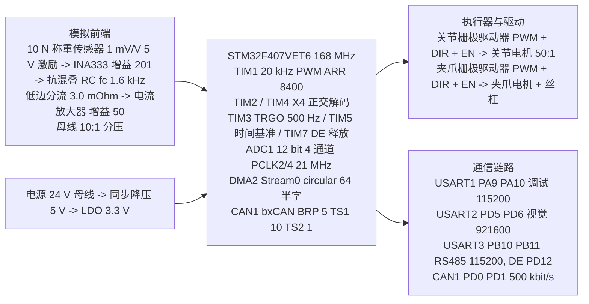

# 第二代智能无人机采茶机器人系统 —— 硬件设计（参考设计 / Recommended Implementation）

<!-- REVISION NOTICE - do not remove -->
> ### ⚠️ 参数修订说明（第三次校正，覆盖全文数值）
>
> 本文档写作期间，项目经历了三轮**更正**，因此正文中的部分**具体数字已经过期**。
> 保留原文是为了不掩盖修正过程，但读数时请以代码为准。
> **第三次更正的完整缺陷清单见 [`docs/12_results_analysis.md`](12_results_analysis.md) 的 §3.5。**
>
> | 常量 | 已废弃的值 | 当前值（权威） | 更正原因 |
> |---|---|---|---|
> | `TP_PLANT_MOTOR_KT_NM_PER_A` | 2.0 | **0.4** | SI 单位下 `Kt` 与 `Ke` 是同一物理量，原值相差 40 倍，违反能量守恒 |
> | `TP_PLANT_MOTOR_KE_VS_RAD` | 0.05 | **0.4** | 同上 |
> | `TP_VEL_PID_KP` | 0.005 | **0.026** | 被控对象 DC 增益由 480 变为 60 mrad/s/permille，必须重新整定 |
> | `TP_VEL_PID_KI` | 0.10 | **0.83** | 同上 |
> | `TP_POS_PID_KP` | 12.0 | **5.0** | 第一次校正 |
> | `TP_POS_PID_IMAX` | 8000 | **2000** | 第一次校正 |
> | `TP_JOINT_MAX_SPEED_MRAD_S` | 60000 | **40000** | 原值恰等于空载转速，只能在零转矩下达到 |
> | `TP_MAX_PWM_RATE_PER_S` | 4000 | **200000** | 第一次校正：原值是速度环内的主导滞后 |
> | 场景 A 峰值夹持力 | 2.493 N | **2.363 N** | 第三次校正：力背驱符号修正 |
> | 场景 A 达到目标力 | 2.26 N | **2.18 N** | 同上 |
> | 场景 A 接触间隙 | 5.688 mm | **5.682 mm** | 同上 |
> | 场景 A 主机链路解码 | 2200 B / 100 帧 | **2134 B / 97 帧** | 同上 |
> | `TP_PLANT_JAW_BACKDRIVE` 的作用方向 | 减去（`-=`） | **加上（`+=`）** | 符号错误使茎秆把空夹爪"吸"到机械硬限：力从 5.0 N 涨到 16.4 N，并误锁存传感器故障 |
> | 力环服务速率 | 100 Hz（与注释不符） | **1 kHz** | 力环搬入 1 kHz 控制任务，"N 个控制周期"从此等于 N ms |
>
> **唯一权威**：`firmware/Application/config.h` 与 `firmware/BSP/host/plant_model.h`。
> 二者的一致性由 `tests/test_config_agreement.py` 自动校验——它会解析这两个头文件并与
> Python 模型逐条比对，因此任何再次漂移都会变成失败的测试而不是过期的文档。
<!-- /REVISION NOTICE -->


> ## ⚠️ 硬件事实声明（必读，先于本文任何数字）
>
> **本项目未制作实物板，以下全部为纸面设计，无任何实物测量数据。**
>
> | 项目 | 状态 |
> |---|---|
> | PCB / Gerber / 原理图源文件 | **不存在** |
> | BOM 实物、已采购器件 | **不存在** — 仓库中无任何选型清单或采购记录 |
> | 示波器 / 万用表 / 电源分析仪记录 | **不存在** |
> | 传感器标定曲线（温漂、线性度、滞回） | **不存在** |
> | 在真实机器上执行过的任何测试 | **不存在** — 标定流程本身也从未在实物上跑过（`docs/force_sensor_calibration.md` 文档性质声明第 2 条） |
>
> 本文每一节标题都带 **【参考设计 / Recommended Implementation】**。文中所有引脚、外设、位定时、增益、电压、功耗数字，来源只有两类：(1) **仓库中真实存在的编译期常量与外设配置**，写法为 `名称 = 数值` 并给出真实文件路径，本文不引用任何不存在的宏、函数或文件名；(2) **基于数据手册参数的设计推算**，明确标注为纸面推导。
>
> 凡出现 **仿真结果（Simulated）** 字样者，均来自主机物理模型（`build/host/tea_picking_robot_host.exe --scenario A`、`scripts/run_scenarios.ps1`），**不是硬件测量**；凡出现 **设计目标 / Target KPI（未实测）** 者，均为尚未在实物上验证的指标。

## 摘要

本文给出第二代智能无人机采茶机器人的**硬件参考设计**：以 **STM32F407VET6** 为唯一主控，通过一条编译期固定的硬件接缝（`firmware/BSP/platform_api.h` 的 `tp_platform_*`）驱动 2 路电机-驱动通道、2 路正交编码器、4 路 ADC 模拟通道、6 路离散输入与 4 条通信链路（USART1 / USART2 / USART3+DE / CAN1）。出发点是固件中**已经冻结的电气契约**，而不是先画板再配软件：`firmware/BSP/bsp_types.h` 用枚举定死通道数量与语义，`firmware/BSP/stm32f407/platform_stm32f407.c` 的文件头引脚表把每个枚举落到具体引脚与外设。第 9 节引脚分配表**以该实现文件为准**，并逐项列出它与 `bsp_types.h` 注释的两处真实冲突及解决方式。

| 最关键的硬件设计结论 | 数值 | 依据 |
|---|---|---|
| 力通道分辨率由 10 N 量程 + 增益 201 决定 | `TP_FORCE_CAL_SCALE_N_PER_COUNT ≈ 0.008017 N/count`（**8.0 mN LSB**） | `firmware/Application/config.h` 第 8 节宏链推导 |
| 量化台阶相对 2.2 N 目标只有 0.36 %，因此**必须**有滤波链 | 2.2 N ↔ 约 274 counts；1 LSB = 0.36 % 读数 | `config.h` 第 8 节注释 + `filters.h` 三级链 |
| 电机电流的斜率限幅是**控制问题**而非保护问题 | `TP_MAX_DUTY_RATE_PER_S = 200000.0f`（满量程 5 ms） | `config.h` 第 3 节，并记录了第一版 4000.0f 造成振荡的教训 |

**仿真结果（Simulated，主机物理模型，非硬件测量）：** Scenario A（nominal pick）在 t = 1.20 s 完成检测；接触在间隙 5.688 mm、F = 0.156 N 判定；力达 2.26 N（设定 2.20 N，band ±0.10 N），超调 0.00 N，49 周期收敛；受控阶段平均保持力 2.26 N；峰值夹持力 2.493 N（硬限 5.00 N）；节拍 CONTACT 1.24 s / GRIP 2.57 s / PICK 3.14 s / RELEASE 3.39 s / IDLE 4.78 s；6000 控制周期 0 次截止期错失；主机链路 2200 B、100 帧、0 CRC 错误。七场景（`scripts/run_scenarios.ps1`）**7/7 PASS**：A 完成 2.493 N；B 中止 `ERR_TARGET`（0.167 N）；C（σ = 80 mN 噪声）完成 2.426 N；D 中止 `ERR_FORCE_OVERLOAD`；E `ERR_COMM_TIMEOUT`；F 堵转保护（8 N·m，驱动限 800 mA）；G `ERR_ESTOP`。**这些数字证明控制律与协议栈在仿真中自洽，不能证明任何一个模拟前端参数。**

**设计目标 / Target KPI（未实测）：** 茶芽破损率 ≤ 1 %；采摘效率提升 40 %；定位误差、夹持力误差、通信延迟的具体数值指标。以上四项**全部没有实物测量数据支撑**。

## 目录

1. [硬件总体框架](#1-硬件总体框架参考设计) ｜ 2. [MCU 选型](#2-mcu-选型参考设计) ｜ 3. [电机与驱动](#3-电机与驱动参考设计) ｜ 4. [编码器](#4-编码器参考设计)
5. [力传感器与模拟前端](#5-力传感器与模拟前端参考设计) ｜ 6. [ADC / DMA](#6-adc--dma参考设计) ｜ 7. [CAN / RS485 / UART](#7-can--rs485--uart参考设计)
8. [电源与信号调理](#8-电源与信号调理参考设计) ｜ 9. [引脚分配表](#9-引脚分配表参考设计) ｜ 10. [未制作实物板的声明](#10-未制作实物板的声明)
11. [上板前必须先验证的硬件假设](#11-上板前必须先验证的硬件假设) ｜ 12. [标注清单](#12-标注未实测--参考设计--仿真的位置清单)

---

## 1. 硬件总体框架【参考设计 / Recommended Implementation】

**「它是什么」** —— 一块以 STM32F407VET6 为中心的单板：上侧为功率与执行器（2 路 H 桥 + 2 路正交编码器），中间为模拟采集（力前端 + 2 路电流 + 母线电压 → ADC1 四通道扫描 → DMA2 Stream0），右侧为 4 条通信链路，下侧为 24 V→5 V→3.3 V 电源树与安全回路（E-stop 常闭 + nFAULT）。



**「为什么这么设计」** —— 拓扑是被固件**反向约束**出来的：`tp_adc_ch_t` 要求 4 路 ADC 且力必须是 DMA rank 0；`tp_bus_t` 要求 4 条链路、CAN 独立成一条；`platform_api.h` 要求"禁用必须是最快的故障反应……清掉使能 GPIO，栅极驱动器把它变成 coast/brake 状态，不需要 CPU 参与"。因此硬件必须做到：使能线直连驱动器 EN、nFAULT 单线可读、ADC 由硬件定时器触发。

**「如果不用它会怎样」** —— 若 ADC 靠软件轮询而非 TIM3 TRGO 触发，采样瞬间随调度抖动，而 `firmware/BSP/adc_driver.h` 指出"速度估计器要除以时间、力控制器要微分，两者都会因抖动而严重退化"；若使能不直连驱动器，E-stop 响应退化为软件延时，而 `hardware/interface_design.md` 已如实记录固件侧去抖会带来 3–40 ms 延迟——硬件必须补上这一段。

## 2. MCU 选型【参考设计 / Recommended Implementation】

**「它是什么」** —— STM32F407VET6（Cortex-M4F，168 MHz，LQFP100，512 KB Flash / 192 KB SRAM）。它由五条**可核对**的约束共同确定，而不是"性能越高越好"：(1) **硬件浮点**，控制器全程用 `float` 工程单位（mrad、N、mA、mm），1 kHz 环内无定点缩放，构建标志见 `toolchain/arm-none-eabi.cmake` 的 `-mcpu=cortex-m4 -mthumb -mfpu=fpv4-sp-d16 -mfloat-abi=hard`，注释写明"Identical to ARM_CPU in the root Makefile"；(2) **168 MHz + 定时器资源**，同时占用 TIM1（20 kHz PWM，`TP_STM32_PWM_ARR = 8400u`）、TIM2/TIM4（编码器）、TIM3（ADC 触发）、TIM5（32 位时间基准）、TIM7（DE 释放）共 6 个定时器；(3) **六种谐波节拍**——1 kHz 控制 / 500 Hz 采集 / 100 Hz 通信·机器人·安全 / 20 Hz 遥测 / 5 Hz 调试，由 6 条 `TP_STATIC_ASSERT` 在编译期强制"快任务频率必须被慢任务整除"（`config.h` 第 2 节与文件末尾）；(4) **CAN 控制器（bxCAN）**，APB1 = 42 MHz 能整除出精确位率：`(BRP + 1) × (1 + BS1 + BS2) = 84`，取 BRP = 5 / TS1 = 10 / TS2 = 1 → 500 000 bit/s **恰好整数，0 ppm**；(5) **DMA 资源**——ADC 独占 DMA2 Stream0，另有 3 条 UART 各自的 TX/RX DMA 流，都需独立中断标志（`dma_stream_config()`、`tp_stm32_dma_irq_handler(int dma, int stream)`）。

**「为什么这么设计」** —— 第 (1) 条与一条常被追问的硬件事实直接相关：**Cortex-M4 是 3 级流水、没有分支目标缓冲（BTB）、也没有动态分支预测器**，任何跳转都要冲刷流水线，而**间接调用（函数指针）必须等目标地址算出来才能跳**，代价高于直接调用。`platform_api.h` 文件头把这一点作为"单一硬件缝"论证的第一条理由，原文：*"**Static linking, zero indirection.** The 1 kHz control loop never makes an indirect call, so there is no branch-predictor/BTB pressure and no risk of a NULL vtable entry. **On a Cortex-M4 without a branch predictor this is measurable.**"* 因此本项目**没有**为每个器件做函数指针虚表，而是让整个固件只链接**一份** `tp_platform_*` 实现（目标端 `platform_stm32f407.c`，主机端 `firmware/BSP/host/platform_host.c`），由 `-DTP_PLATFORM_HOST` / `-DTP_PLATFORM_STM32F407` 编译期选择。`platform_api.h` 列出三条收益：静态链接零间接调用、编译器能看到全部实现（`-O2` 可把 `tp_platform_motor_set_pwm` 内联成一次寄存器写，`-Wl,--gc-sections` 可删除目标端不用的代码）、以及"哪些代码碰硬件"有一个单文件答案。

**「如果不用它会怎样」** —— 若改成每器件一张函数指针表，1 kHz 环内每周期几十次间接调用在无预测器的核上带来可测量抖动；更糟的是**空指针 vtable 项的 bug 只在运行时暴露**，而单一编译期接缝把该失效模式从运行时挪到了链接期。

> **【未实测】** 上述是仓库中真实存在的设计理由，但注释里"measurable"（可测量）这一句**从未在实物上被测量过**——本项目没做过周期计数对比实验。

## 3. 电机与驱动【参考设计 / Recommended Implementation】

### 3.1 两个通道与真实参数

`firmware/BSP/bsp_types.h`：

```c
typedef enum {
    TP_MOTOR_JOINT = 0,   /**< Arm joint, TIM1_CH1 PWM + DIR/EN GPIO.        */
    TP_MOTOR_GRIPPER = 1, /**< Gripper jaw, TIM1_CH2 PWM + DIR/EN GPIO.      */
    TP_MOTOR_COUNT = 2
} tp_motor_ch_t;
```

注释同时说明为何**只有两个通道**："The arm's remaining joints are passive/fixed, so no third channel is reserved until the hardware exists."

| 项目 | 数值 | 出处 |
|---|---|---|
| 占空比钳位 | `TP_MAX_PWM_PERMILLE = 1000.0f`（1000 = 100 %） | `config.h` 第 3 节 |
| 连续电流限值 / 短时峰值 | `TP_MAX_CURRENT_MA = 3000.0f` / `TP_PEAK_CURRENT_MA = 5000.0f`（< 50 ms） | 同上 |
| 占空比斜率限幅 | `TP_MAX_DUTY_RATE_PER_S = 200000.0f`（per-mille/s，满量程 5 ms） | 同上 |
| 关节减速比 | `TP_JOINT_GEAR_RATIO = 50.0f` | `bsp_types.h` |
| PWM 载波 | 20 kHz，边沿对齐，`TP_STM32_PWM_ARR = 8400u` | `platform_stm32f407.c` |
| 过流锁存 / 自恢复 | `TP_MOTOR_OC_TRIP_SAMPLES = 20u`（1 kHz 下 20 ms）/ `TP_MOTOR_OC_RECOVER_MS = 500u` | `firmware/BSP/motor.h` |

### 3.2 斜率限幅：一个记录在案的第一版错误

**「它是什么」** —— `motor.c` 在把控制器算出的占空比写进 PWM 比较寄存器前先经过速率限制器：每秒最多改变 `TP_MAX_DUTY_RATE_PER_S = 200000.0f` 千分比，即 0 到满量程需 5 ms；对应 20 kHz 载波是每 10 个 PWM 周期最多改变 10 千分比。

**「为什么这么设计」** —— `config.h` 第 3 节用一整段注释记录了第一版为什么错：初始值是 **4000 per-mille/s**，满量程需 **250 ms**。"That is not a slew limiter, it is a dominant lag inside the velocity loop"（那不是斜率限制器，而是速度环内的一个主导滞后）：环路在穿越频率处因此有约 **60 度未建模相位滞后**，并以**数万 mrad/s 的幅度振荡**。注释给出的判据是：任何执行器速率限制都必须对照它所在环路的带宽检查——**满量程必须远快于 `1/(2π·fc)`**。速度环带宽 8 Hz，预算是约 20 ms，故 5 ms 舒适，且仍比它要保护的电气时间常数慢十倍。

`hardware/motor_driver.md` 把改动后果量化了：按 4000 推出的电流上升率是 48 A/s，按 200000 重算约 **2400 A/s**，单个 1 ms 周期电流上升约 **2.4 A**——仍远低于 12 A 堵转尖峰，但"每周期仅 48 mA"那句话不再成立。同一文档给出功率级的核心矛盾（**纸面计算**）：24 V 母线 / 2.0 Ω 绕组（`TP_PLANT_MOTOR_R_OHM = 2.0f`）堵转电流只受绕组电阻限制，即 **12 A**，是 `TP_MAX_CURRENT_MA = 3000.0f` 的 **4 倍**、`TP_PEAK_CURRENT_MA = 5000.0f` 的 **2.4 倍**；不受限时从 0 到 3 A 只需约 **216 µs**，比固件 20 ms 过流锁存与 50 ms 保护跳闸快一到两个数量级。因此**功率级限流不能指望软件保护**。

**「如果不用它会怎样」** —— `motor.h` 给出的现场后果："The arm works on the bench and fails in the field, because the failure mode is a current spike that only appears when the commanded step is large — i.e. during the first move after a long idle, which is exactly the demo."

### 3.3 驱动拓扑

**参考设计（引用 `hardware/motor_driver.md` §2.1/§2.2）**：**半桥栅极驱动器 + 4 只 N 沟道 MOSFET 全桥 + 低边分流**，两通道结构相同，仅 PWM 源不同。推荐理由是**可审查性**：`platform_api.h` 把硬件抽象成"一个占空比 + 一个使能 + 一个 nFAULT"，该契约只有使能引脚直接控制栅极驱动器时才成立；集成 H 桥 IC 的保护阈值"写在别家芯片数据手册里、无法在本板上测量"，会让 12 A 堵转的安全评审无法闭环。

该文档的器件参数**全部为占位值**（选定型号后必须用其数据手册重算）：栅极驱动器 V_CC = 12 V、峰值输出 ≥ 1 A、传输延迟失配 ≤ 20 ns；MOSFET R_DS(on) = 5 mΩ @ V_GS = 10 V、Q_g = 20 nC；自举电容 100 nF。文档同时指出 `TP_MAX_PWM_PERMILLE = 1000.0f` 允许 100 % 占空比与自举刷新相冲突（自举只在低边管导通时刷新），故参考设计改取**电荷泵高边供电**以消除该占空比限制。低边分流 3.0 mΩ 四端开尔文。

本节余下的机制是**"使能必须直连栅极驱动器"**（见 `platform_api.h` 对 `tp_platform_motor_enable()` 的契约）。

**「它是什么」** —— EN 引脚由 MCU 的 GPIO 直接驱动栅极驱动器，不经任何中间器件；`bsp_types.h` 为两个通道各定义一条：`TP_MOTOR_JOINT` 的 PE1、`TP_MOTOR_GRIPPER` 的 PE3，均为**高有效**。

**「为什么这么设计」** —— `platform_api.h` 的契约原文是："Disabling must be the fastest possible reaction to a fault: on the target it clears the enable GPIO, which the gate driver turns into a coast/brake state **without CPU involvement**"。若使能经软件状态机或 I²C 扩展器间接控制，故障反应就要经过调度延迟，而本项目最危险的失效（12 A 堵转，约 216 µs 到 3 A）根本等不起。

**「如果不用它会怎样」** —— E-stop 与过流关断都退化成软件时序，与 §8.2 记录的固件侧 3–40 ms 去抖延迟叠加。`platform_stm32f407.c` 的 `tp_platform_init()` 第 2 步特意在引脚变成输出之前先写 BSRR 清零，注释写明"the driver never sees a logic-high enable for even one cycle"——这正是"直连"才买得到的性质。

## 4. 编码器【参考设计 / Recommended Implementation】

### 4.1 分辨率与换算

| 项目 | 数值 | 出处 |
|---|---|---|
| 每转计数 | `TP_ENCODER_COUNTS_PER_REV = 4096`（1024 线 × 4 正交解码） | `bsp_types.h`："A 1024-line incremental encoder in quadrature yields 4096 counts/rev." |
| 夹爪直线换算 | `TP_GRIPPER_COUNTS_PER_MM = 512.0f` | 同上 |
| X4 因子 | `TP_STM32_ENCODER_X4 = 4` | `platform_stm32f407.c` |
| 硬件通道 | `TP_ENCODER_JOINT = 0` → TIM2；`TP_ENCODER_GRIPPER = 1` → TIM4 | `bsp_types.h` |

`bsp_types.h` 的宏式与**本文自行展开的计算**：

```c
#define TP_MRAD_PER_COUNT \
    ((2.0f * 3.14159265358979f * 1000.0f) / (float)TP_ENCODER_COUNTS_PER_REV)
/* 展开：2 × 3.14159265358979 × 1000 / 4096 = 6283.18530717958 / 4096
 *       ≈ 1.53398 mrad/count ≈ 0.0879 度/count                        */
```

`firmware/BSP/encoder.h` 独立给出同一个数："With 4096 counts/rev one count is 1.534 mrad."

### 4.2 速度估计器

**「它是什么」** —— `encoder.c` 实现的不是"位置差分求速度"，而是**固定位置增量估计器**：累积计数与时间，当 `|累积计数| >= TP_ENCODER_VEL_MIN_INC = 4` **或**累积时间达 `TP_ENCODER_VEL_MAX_WINDOW_MS = 20u` 时发布新估计，两次发布之间零阶保持。

**「为什么这么设计」** —— `encoder.h` 给出一张决定性的表（500 Hz 传感器周期 = 2 ms）：

| 关节速度 | 60 000 mrad/s（最大） | 6 000 mrad/s | 300 mrad/s | 30 mrad/s（堵转阈值） |
|---|---|---|---|---|
| 每 2 ms 采样内的 counts | 78.2 | 7.8 | 0.39 | 0.039 |

因为 1 count = 1.534 mrad，在 2 ms 内产生 1 count 需约 **767 mrad/s** 的速度。故**朴素的"单周期差分"在约 770 mrad/s 以下一律读出恰好 0 counts**——而这正是堵转检测器必须工作的区间。它还会让速度环看到阶梯，微分项在每个台阶触发。

**「如果不用它会怎样」** —— `encoder.h` 原话："Feeding raw per-sample deltas to the velocity loop gives a controller whose effective gain changes by a factor of 200 between low and high speed, plus a PWM buzz from the D term."

### 4.3 `TP_ENCODER_MAX_ACCEL_MRAD_S2 = 4000000.0f` 的合理性检查

该常量在 `config.h` 第 7 节语义为"**物理上可能的最大 |dq/dt|，超过即判为编码器故障**"。**本文计算：**

```
物理上限：位置环输出钳位 TP_POS_PID_OUT_MAX = 40000.0f mrad/s
若速度在 1 个控制周期（1 ms）内从 0 冲到 40000 mrad/s，隐含加速度 = 6.0e7 mrad/s²
故障判据阈值 = 4.0e6 mrad/s²  → 比极端合法情况低约 15 倍
4.0e6 mrad/s² = 4000 rad/s² ≈ 229 000 度/s²
在 500 Hz 采样下单周期速度跳变 = 8000 mrad/s ≈ 5.2 counts/样本
```

**结论**：该阈值比"一个控制周期内跑满全速"的极端情况低约 **15 倍**，因此**不会**被控制器产生的合法加速度触发；同时比"编码器线缆断线导致随机游走"的跳变低得多（浮空输入每采样可跳数十 counts）。这是"卡在两个数量级之间"的阈值，量级合理。

> **【未实测】** 真实机械最大加速度、断线时的实际跳变分布，都需在实物上测量后才能确认 4.0e6 是否留有余量。

## 5. 力传感器与模拟前端【参考设计 / Recommended Implementation】

### 5.1 信号链


### 5.2 从宏推导出 8.0 mN LSB 的完整过程（复现 `config.h` 第 8 节）

输入常量：`TP_LOADCELL_SENSITIVITY_MV_V = 1.0f`、`TP_LOADCELL_EXCITATION_V = 5.0f`、`TP_LOADCELL_RATED_N = 10.0f`、`TP_FORCE_AMP_GAIN_STAGE1 = 201.0f`（INA333，注释写 RG = 249 Ω）、`TP_FORCE_AMP_GAIN_STAGE2 = 1.0f`（单位缓冲；注释说明保留它是为了第二级能在不触碰其它常量的前提下加进来）、`TP_ADC_VREF_V = 3.300f`、`TP_ADC_FULL_SCALE = 4095.0f`。

**第 1~3 步 —— 桥路灵敏度、总增益、前端灵敏度。**

```
TP_LOADCELL_MV_PER_N = (TP_LOADCELL_SENSITIVITY_MV_V × TP_LOADCELL_EXCITATION_V) / TP_LOADCELL_RATED_N
                     = (1.0 × 5.0) / 10.0 = 0.5 mV/N
TP_FORCE_AMP_GAIN = TP_FORCE_AMP_GAIN_STAGE1 × TP_FORCE_AMP_GAIN_STAGE2 = 201.0 × 1.0 = 201
TP_FORCE_FRONTEND_MV_PER_N = TP_LOADCELL_MV_PER_N × TP_FORCE_AMP_GAIN = 0.5 × 201 = 100.5 mV/N
```

**第 4 步 —— 一个 ADC 台阶**（分母是 `TP_ADC_FULL_SCALE + 1.0f = 4096` 即 2¹²，不是 4095；12 位 ADC 码值 0..4095 共 4096 个台阶）：

```
TP_ADC_MV_PER_COUNT = (TP_ADC_VREF_V × 1000.0f) / (TP_ADC_FULL_SCALE + 1.0f) = 3300 / 4096 = 0.805664 mV/count
```

**第 5 步 —— 每 count 的牛顿数（LSB）。**

```
TP_FORCE_CAL_SCALE_N_PER_COUNT = TP_ADC_MV_PER_COUNT / TP_FORCE_FRONTEND_MV_PER_N
                               = 0.805664 / 100.5 = 0.0080166 N/count ≈ 8.0 mN/count
```

**第 6~8 步 —— 满量程、饱和点、可用范围。**

```
TP_FORCE_FULLSCALE_MV = 100.5 mV/N × 10 N = 1005 mV < 3300 mV  ✅ 不超量程（占 30.4 %）
TP_FORCE_ADC_SATURATION_N = 3300 / 100.5 = 32.84 N
TP_FORCE_USABLE_RANGE_N = (TP_ADC_FULL_SCALE / 2.0f) × 0.0080166 = 2047.5 × 0.0080166 ≈ 16.41 N
   （中置零点由 TP_FORCE_CAL_ZERO_COUNTS = 2048.0f 给出）
```

**两条编译期保证**（`config.h` 文件末尾，构建时强制）：

```c
TP_STATIC_ASSERT(TP_FORCE_FULLSCALE_MV < (TP_ADC_VREF_V * 1000.0f),
                 "Front-end gain over-ranges the ADC at rated load");
TP_STATIC_ASSERT(TP_FORCE_USABLE_RANGE_N > TP_FORCE_MAX_N,
                 "Usable force range must cover the hard force limit");
```

### 5.3 为什么用 10 N 而不是 50 N 传感器

`config.h` 第 8 节的真实论证：目标夹持力 **2.2 N**、硬限 **5 N**，有用读数需远好于 **20 mN**。一个 ADC 台阶是 `3.3 V / 4096 = 0.806 mV`；解 `0.806 mV / LSB < 20 mN` 要求前端灵敏度高于 **40 mV/N**。10 N 传感器配 1 mV/V 与 5 V 激励给出 `5 mV / 10 N = 0.5 mV/N`，增益 201 就够（100.5 mV/N，即 **8.0 mN LSB**）；50 N 传感器只给 `0.1 mV/N`，需要增益 **400**——"at which point the amplifier's own offset drift and the bridge's thermal drift dominate the reading"。结论句："**Choosing the sensor so the electronics stay simple is the better engineering answer than amplifying a small signal by 400.**"

### 5.4 为什么这意味着必须有滤波器

```
目标力 TP_FORCE_TARGET_N = 2.20f N → 2.20 / 0.0080166 ≈ 274 counts
1 LSB 的相对大小 = 0.0080166 / 2.20 = 0.003644 ≈ 0.36 %
```

即**一个 ADC 台阶就是读数的 0.36 %**。`config.h` 的结论很直接："That is the number that justifies the median + moving-average + low-pass chain in `filters.h` — without it the force loop would be chasing quantisation noise rather than the tea stem."

| 滤波器 | 中值 | 滑动平均 | 一阶低通 | 速度滑动平均 / 低通 |
|---|---|---|---|---|
| 常量 | `TP_FILTER_MEDIAN_WINDOW` | `TP_FILTER_FORCE_MA_WINDOW` | `TP_FILTER_FORCE_LPF_TAU_S` | `TP_FILTER_SPEED_MA_WINDOW` / `TP_FILTER_SPEED_LPF_TAU_S` |
| 值 | `5u`（10 ms @ 500 Hz） | `8u` | `0.006f`（≈ 26.5 Hz） | `5u` / `0.003f` |

### 5.4.1 ⚠️ 文档债 1：`filters.h` 的「约 12 mN」与 `config.h` 的 8.0 mN 互相矛盾

**这是一处必须如实记录的代码内不一致，本文不把 12 mN 当作正确值使用，也不忽略它。**

| 出处 | 表述 | 是否给出推导 |
|---|---|---|
| `firmware/Application/config.h` 第 8 节 | 宏链推导出 `TP_FORCE_CAL_SCALE_N_PER_COUNT ≈ 0.0080166 N/count`，注释明确写 **"an **8.0 mN LSB**"** | **是**，逐步可复算（见 §5.2 的 8 步） |
| `firmware/Middleware/utils/filters.h` 文件头第 11–12 行 | 原文："**A 12-bit ADC at 500 Hz on a 1 mV/V load cell gives an LSB of roughly 12 mN**, so the raw signal is visibly steppy." | **否**，没有任何增益、激励或满量程数值 |

**本文的判断：`config.h` 的推导自洽，8.0 mN 正确；`filters.h` 的"约 12 mN"没有显示推导过程，且与该前端增益不符，很可能是早期版本遗留的估计值。**

判断依据（**本文自行反算**）：

```
config.h 的链：0.805664 mV/count ÷ 100.5 mV/N = 0.0080166 N/count = 8.0 mN/count

反解：若 LSB 真的是 12 mN，则前端灵敏度必须是
      0.805664 mV ÷ 12 mN = 67.1 mV/N
      对应增益 = 67.1 ÷ 0.5 mV/N = 134.3，而 config.h 的增益是 201
      （或对应一个非 10 N 量程的传感器：5 mV ÷ 67.1 mV/N ≈ 74.5 N 量程）

两者的比值 12 / 8.0166 = 1.497 ≈ 1.5，即 "12 mN" 对应的是比实际设计**低约 1.5 倍**的增益
```

**为什么这条文档债值得单列**：`filters.h` 正是那条"中值 + 滑动平均 + 低通"链的定义处（第 29 行的 `@verbatim` 块给出 `raw -> median(5) -> moving_average(8) -> low_pass(tau = 6 ms)`），它的滤波设计动机直接引用了这个 LSB 数字（同一段注释的推理是"LSB 大 → 原始信号明显阶梯 → 需要平均"）。用一个偏大的 LSB 去论证"需要滤波"在结论上无害（真实 LSB 8.0 mN 同样需要滤波，见 §5.4），但它会让任何按该数字做误差预算的读者高估量化台阶 1.5 倍。**本文全部量化分析一律采用 `config.h` 的 8.0 mN，并以 §11 第 17 项要求上板实测。**

### 5.5 `hardware/force_sensor.md` 与 `hardware/signal_conditioning.md` 的真实内容

两文件都**明确声明本项目无实物板**。可引用的实质内容：

| 内容 | 出处 |
|---|---|
| INA333 属**斩波稳定（zero-drift）**一类；**参考设计**取"INA333 类 + 单电阻 RG + 外部 RC + STM32 内部 12 位 ADC" | `hardware/force_sensor.md` §6.1 |
| 抗混叠 RC 的 **fc = 1.6 kHz** —— `signal_conditioning.md` 明确指出它**仅存在于 `config.h` 第 8 节的 `@verbatim` 注释块中，没有对应 `#define`** | `hardware/signal_conditioning.md` 摘要表 |
| 一阶 RC 在 20 kHz 载波处只有 **21.97 dB** 衰减；若载波与采样率成整数比（500 Hz : 20 kHz = 1 : 40）会精确混叠到直流，任何数字平均都去不掉；二阶 Sallen-Key（Butterworth，fc = 1.6 kHz）可达 **43.9 dB**，被列为推荐升级项 | 同上摘要发现四 / §6.8 |
| 噪声预算：斩波放大器 50 nV/√Hz 经 ×201、NBW = (π/2) × 1600 = 2513 Hz 后在 ADC 输入端贡献 **0.625 counts RMS**（5.01 mN RMS），与 ADC 自身约 0.58 counts RMS 相当 | 同上 §6.6 |
| 硬件**没有板温传感器**：`tp_adc_ch_t` 只有四路、无温度通道，协议字段 `temp_c_x10` 恒为哨兵 `TP_SENSOR_TEMP_UNAVAILABLE = 32767` | `config.h` 第 7 节注释 + `docs/force_sensor_calibration.md` §6.3 |
| 温漂预算（纸面）：INA333 类 0.1 µV/°C × 20 K = 2 µV → **4.0 mN**；而布局热电势 2–6 mN/K → 20 K 下 **40–120 mN**，比放大器自身漂移大 10–30 倍，**布局热对称性才是长期稳定性决定项** | `hardware/signal_conditioning.md` 摘要发现三 |

**两处必须在制板前闭合的真实缺陷**（两份文档都如实记录，本文照录）：

1. **增益/RG 不一致**：`config.h` 注释写"INA333 增益 201 配 RG = 249 Ω"，而 INA333 的 `G = 1 + 100 kΩ/RG` 在 RG = 249 Ω 时给出 **G ≈ 402.6**（G = 201 实际需 RG ≈ 500 Ω）。下游全部数字（8.0 mN LSB、±16.41 N 可用范围）都按 G = 201 推出。**更严重的是这个 2 倍错误不会被任何编译期断言捕获**：按 G = 402.6 重算，LSB 变 4.00 mN、可用范围变 ±8.19 N，两条 `TP_STATIC_ASSERT` **依然成立**。
2. **`force_sensor.h` 的温漂算式量纲不自洽**：其"5 ppm/K × 1005 mV = 5 µV/K → 20 K → 0.1 mV → 0.13 N（占 2.2 N 的 6 %）"无法由 `config.h` 常量复现——输出端口径是 **1.0 mN**、桥路输入端口径是 **201 mN**。

### 5.6 `docs/force_sensor_calibration.md` 标定流程概述

**该文档明确声明：流程"已设计完成，但尚未在实物硬件上执行过"，所需计量器具"尚未采购、尚未使用"。**

| 环节 | 内容 | 性质 |
|---|---|---|
| 参数模型 | 全通道只需两个参数：`adc_zero_counts`（零点，counts）与 `n_per_count`（斜率，N/count）；换算只有一行 `force_n = (counts − adc_zero_counts) × n_per_count` | **真实固件事实**（`firmware/BSP/force_sensor.c` 的 `tp_force_sensor_counts_to_n()`） |
| 零点标定 | 发 `TP_CMD_CALIBRATE_FORCE = 0x42` 且 `kind = 0`（`kind = 1` 在 `on_calibrate_force()` 中返回 `TP_ERR_UNSUPPORTED`）；固件连读 `TP_FORCE_ZERO_CAL_SAMPLES = 64u` 次求均值，峰峰值超 `TP_FORCE_ZERO_CAL_MAX_SPREAD_N = 0.25f` 则**拒绝标定** | 流程为**纸面**；门限为真实常量 |
| 量程标定 | 方法 A 标准砝码法（100/200/500 g，F2/M1 级）；方法 B 已知力法（测力计 0–20 N，优于 ±0.5 % 读数）；建议多点最小二乘拟合后用 `tp_force_sensor_set_scale()` 写回 | 流程为**纸面**；`host-side calibration file` 路径**在仓库中不存在** |
| 验收判据 | 零点重复性 ≤ 0.10 N；斜率与设计值偏差 ≤ ±5 %（首标）；线性度 ≤ 1 % FS；截距 \|b\| ≤ 0.02 N | **设计判据，未实测** |
| 温漂与复查 | 每次开机零点标定 + 每班次复标（差异 ≤ 0.10 N）；每季度恒温箱 5/25/45 °C（零点漂移 ≤ 0.20 N） | **设计判据，未实测**；器具尚未采购 |
| **来自仿真的部分** | 该文档第 9 章"数值算例"是**用于交叉验证的期望值**（如 200 g 砝码应见约 244.7 counts），**不是曾出现过的读数**；主机后端 `firmware/BSP/host/plant_model.c` 的 `tp_plant_read_force_counts()` 注入 `adc_gain_error`、`adc_zero_offset_counts` 与可选 `force_noise_sigma_n`，因此**仿真里 64 次读确实是 64 个独立样本**，标定门限在主机后端下有效 | **仿真（Simulated）** |
| 一个必须在实物上处理的语义差异 | STM32F407 后端的 `tp_platform_adc_read()` **只返回最近一次发布的样本（约每 16 ms 更新一次）、不触发新转换**，故零点标定的 64 次背靠背读**极可能来自同一个转换结果**，"64 次平均"退化为"1 次采样"，`spread ≈ 0`，**门限事实上失效** | 文档建议改用监控工具以 ≥ 1 Hz（间隔 > 16 ms）采样 30 点、极差 ≤ 31 counts 替代 |

## 6. ADC / DMA【参考设计 / Recommended Implementation】

### 6.1 常量与通道

| 常量 | 值 | 出处 |
|---|---|---|
| `TP_ADC_RESOLUTION_BITS` / `TP_ADC_FULL_SCALE` | `12u` / `4095.0f` | `config.h` 第 8 节 |
| `TP_ADC_VREF_V` / `TP_ADC_DMA_BUFFER_LEN` | `3.300f` / `16u` | 同上 |
| `TP_ADC_BLOCK_MAX` | `32u` | `firmware/BSP/adc_driver.h` |
| `TP_BSP_ADC_VREF_V` | `3.300f`（BSP 层副本） | `bsp_types.h` |

**ADC 通道按 DMA rank 顺序**（`bsp_types.h` 枚举顺序，`rank = i + 1`）：

| rank | 1 | 2 | 3 | 4 |
|---|---|---|---|---|
| 枚举名 | `TP_ADC_FORCE` | `TP_ADC_CURRENT_JOINT` | `TP_ADC_CURRENT_GRIPPER` | `TP_ADC_VBUS` |
| `bsp_types.h` 注释引脚 | PA0, ADC1_IN0 | PA1, ADC1_IN1 | PA2, ADC1_IN2 | PA3, ADC1_IN3 |
| **后端实际引脚 / 通道** | **PA4 / ADC1_IN4** | **PA5 / ADC1_IN5** | PA2 / ADC1_IN2（未变） | PA3 / ADC1_IN3（未变） |

**为什么改前两路引脚**：`platform_stm32f407.c` 文件头的 "Conflict 1, resolved" 记录得很清楚——`PA0/PA1` **同时**是 `TIM2_CH1/CH2`（关节编码器正交输入）与 `ADC1_IN0/IN1`。一个引脚只有一个复用功能，而编码器**不能让**：TIM2 编码器模式必须用这两个特定通道，而任何 ADC 输入都能测任何信号。所以移动的是**模拟通道**，保留了依赖特定外设的信号。DMA rank 顺序不变，因而接缝之上看不到这个改动。

### 6.2 循环 DMA + ping-pong 与非阻塞语义

**「它是什么」** —— ADC1 由 **TIM3 TRGO 以 500 Hz 触发**（`s_htim3.Init.Period = (1000000u / TP_SENSOR_FREQ_HZ) - 1u`，1 MHz 计数），单次触发产生 **4 通道扫描**；DMA2 **Stream0、channel 0、circular、半字宽**，长度 `TP_ADC_DMA_BUFFER_LEN × TP_ADC_COUNT = 16 × 4 = 64` 个半字，使能 TC/HT/TE/DME 中断，`ADC1->CR2` 置 `ADC_CR2_DMA | ADC_CR2_DDS`。

**「为什么这么设计」** —— `adc_driver.h` 给三条理由，并**主动否定了"省 CPU 时间"这个常见说法**："at the STM32F407's fastest 12-bit conversion time (about 0.5 µs) that is only 2.5 µs of CPU, so the *time* is not the argument." 真正的三条是：(1) **抖动**——定时器触发的采样瞬间锁定在硬件定时器上，因此**等间隔**，而"速度估计器除以时间、力控制器微分，两者都会因抖动而严重退化"；(2) **相干性**——一个 DMA 块在几微秒内捕获全部通道，故一条记录里的力与电流确实属于同一瞬间，轮询读取会相隔最多 1 ms，"any correlation analysis between them is then meaningless"；(3) **CPU 可用性**——传输零周期，不干扰 1 kHz 控制任务。缓冲区为什么**故意做小**：`adc_driver.h` 写明 16 个样本 @ 500 Hz 是 **32 ms 余量**，"comfortably covers a FreeRTOS tick plus a flash-erase-sized hiccup"，同时 `tp_adc_channel_t::overruns` 让错过的截止期**可见而不是静默损坏数据**。非阻塞语义由 `platform_api.h` 定义：`tp_platform_adc_read_block()` 注释为"On the target the ADC runs in circular DMA mode into a ping-pong buffer and this returns the last completed half. On the host it samples the physics model. **Either way the call is non-blocking**, which is what lets the sensor task stay at a fixed 500 Hz period."，返回实际写入样本数，**0 表示没有准备好的块**。

**「如果不用它会怎样」** —— 若改轮询式单次转换：采样瞬间随任务调度抖动、力与电流失去时间相干性、每周期还要付出阻塞时间。若缓冲区取太大，`adc_driver.h` 指出代价是"the latency between sampling and consumption grows"。

**采样时间**：`ADC_SAMPLETIME_84CYCLES` @ 21 MHz（`ADC_CLOCK_SYNC_PCLK_DIV4`，PCLK2 = 84 MHz）= **4 µs**，源码注明这是为配合前端 RC 的源阻抗；单次转换 = 84 + 12 = 96 周期 ≈ 4.571 µs，4 通道扫描 ≈ 18.3 µs。

### 6.3 电流检测与母线电压

| 项目 | 零点 | 量程 | 实现 |
|---|---|---|---|
| 值（**模型侧约定**） | **2048 counts = 0 A** | **±1000 counts ≈ ±5 A**（0.2 counts/mA、5 mA/count） | `counts = 2048.0f + (current_a / 5.0f) * 1000.0f`，见 `firmware/BSP/host/plant_model.c` 的 `tp_plant_read_current_counts()` |

> ⚠️ **必须明确：这是模型侧约定，不是硬件规格。** `plant_model.c` 注释原话是 "Bidirectional shunt amplifier: 2048 counts is zero, ±1000 counts corresponds to ±5 A"。实物侧的 counts→mA 常数应由实际分流电阻 + 放大电路决定，**该常数在仓库中未定义**。硬件侧有两套**互相不一致**的参考设计建议，均无实物验证：`hardware/motor_driver.md` §4.8 给出**低边分流 3.0 mΩ + 增益 50**，灵敏度 150 mV/A → 186.2 counts/A → **5.37 mA/count**，5000 mA 时读数 2979 counts（22.7 % 满量程）；`hardware/signal_conditioning.md` §6.9 则按 **2 mΩ + 增益 100** 估算。前者自己指出与仿真约定 5 mA/count 相差 **7.4 %**，并建议**不强行匹配**——"仿真约定只是模型内部的自洽选择"，允许 ±10 % 器件容差由标定吸收。

**母线电压**：`bsp_types.h` 注释是 "24 V rail divider"，`plant_model.c` 的 `tp_plant_read_vbus_counts()` 注释是 "10:1 divider, so 24 V appears as 2.4 V at the pin"，代码 `v_adc = p->vbus_v / 10.0f`。因此：

```
24 V / 10 = 2.4 V；counts = (2.4 / 3.300) × (4095 + 1) ≈ 2979 counts（72.7 % FS）
满量程母线 = 3.300 V × 10 = 33.00 V；1 count ≈ 8.06 mV @ 母线
```

`adc_driver.h` 的 `tp_adc_channel_init()` 参数注释同样以 10.0 为例："External divider ratio (e.g. 10.0 for the 24 V rail)"。

## 7. CAN / RS485 / UART【参考设计 / Recommended Implementation】

### 7.1 四条链路

`bsp_types.h` 的 `tp_bus_t`（**`TP_BUS_COUNT = 4`**）：

```c
typedef enum {
    TP_BUS_DEBUG_UART = 0, /**< USART1, 115200, human-readable logs.         */
    TP_BUS_VISION_UART = 1,/**< USART2, 921600, frame protocol to the host.  */
    TP_BUS_RS485 = 2,      /**< USART3 + DE pin, Modbus RTU.                 */
    TP_BUS_CAN = 3,        /**< CAN1, 500 kbit/s, motor drives / aux nodes.  */
    TP_BUS_COUNT = 4
} tp_bus_t;
```

| 链路 | 常量 | 值 | 实际引脚 / 外设（`platform_stm32f407.h` / `.c`） |
|---|---|---|---|
| 调试 UART | `TP_UART_DEBUG_BAUD` | `115200u` | USART1，**PA9 / PA10**，AF7（`TP_STM32_UART_DEBUG = 0`） |
| 视觉 UART | `TP_UART_VISION_BAUD` | `921600u` | USART2，**PD5 / PD6**，AF7（`TP_STM32_UART_VISION = 1`） |
| RS485 + Modbus 从站 | `TP_RS485_BAUD` / `TP_MODBUS_SLAVE_ADDR` | `115200u` / `0x11u` | USART3，**PB10 / PB11**，AF7 + **PD12 = DE**（`TP_STM32_UART_RS485 = 2`） |
| CAN | `TP_CAN_BITRATE_BPS` | `500000u` | CAN1，**PD0 / PD1**，AF9 |

链路超时与协议（`config.h` 第 6 节）：`TP_COMM_TIMEOUT_MS = 200u`、`TP_COMM_HEARTBEAT_MS = 500u`、`TP_COMM_RETRY_COUNT = 3u`、`TP_COMM_TX_TIMEOUT_MS = 20u`；帧头 `TP_PROTO_HEADER0 = 0xAAu` / `TP_PROTO_HEADER1 = 0x55u`、`TP_PROTO_MAX_PAYLOAD = 64u`。

### 7.1.1 ⚠️ 文档债 2：`TP_PROTO_OVERHEAD` 的 7 字节与实际帧开销 6 字节不一致

链路预算要用到最大帧长，而**两个常量给出了不同的答案**。本文如实记录，并以实际编码实现为准。

| 出处 | 定义 / 实际行为 |
|---|---|
| `firmware/Application/config.h` 第 292–293 行 | `TP_PROTO_OVERHEAD = 7u`，行内注释 `HDR(2)+CMD(1)+LEN(1)+CRC(2)+TAIL?`；`TP_PROTO_MAX_FRAME = TP_PROTO_MAX_PAYLOAD + TP_PROTO_OVERHEAD = 64 + 7 = **71**` |
| `firmware/Protocol/protocol_types.h` 第 68–69 行 | `TP_PROTO_FIXED_OVERHEAD = 6u`，注释 `Fixed frame overhead: 2 header + 1 cmd + 1 len + 2 crc.` |
| `firmware/Protocol/frame.c` 第 215 行（`tp_frame_encode`） | `total = (uint32_t)len + TP_PROTO_FIXED_OVERHEAD;` |
| `firmware/Protocol/frame.c` 第 36–42 行（`tp_frame_length_for`） | `return (uint32_t)payload_len + TP_PROTO_FIXED_OVERHEAD;` |
| `firmware/Protocol/frame.c` 第 228–232 行 | CRC 覆盖 `CMD | LEN | PAYLOAD`，即 `tp_crc16_modbus(&dst[2], len + 2u)`；结果写入 `dst[4 + len]` 与 `dst[5 + len]` |

**结论：真实最大帧是 70 字节，`config.h` 的 71 是保守高估。**

```
真实帧结构：0xAA 0x55 | CMD | LEN | PAYLOAD[len] | CRC_LO CRC_HI
             └── 2 ──┘  └1┘  └1┘   └── len ──┘   └──── 2 ────┘
实际开销 = 2 + 1 + 1 + 2 = 6 字节
最大帧长 = TP_PROTO_MAX_PAYLOAD + 6 = 64 + 6 = 70 字节
config.h 的值 = 64 + 7 = 71 字节        → 多算了 1 个字节
```

**配置层那条静态断言因此仍然成立、无害**：`config.h` 第 499–500 行的 `TP_STATIC_ASSERT(TP_PROTO_MAX_FRAME <= 128u, "Frame buffer must stay small enough for the RX ring")` 在 71 ≤ 128 下通过，70 同样通过。**但它掩盖了这 1 字节的差异——断言只检查上限，不检查两个常量是否一致**，所以构建系统不会报错。

**两条独立佐证 6 是正确值：**
1. `protocol_types.h` 第 20 行的注释自己说明心跳帧的长度："A length byte rather than a fixed-size frame keeps the heartbeat at **6 bytes on the wire**" —— 心跳 payload 为 0，因此开销恰好是 6。
2. `config.h` 注释里的 `TAIL?` 带问号，说明该常量本身对是否存在尾字节是**不确定**的；而 `frame.c` 的编码实现里没有任何尾字节。

**处置建议**：两个常量应当统一。从实现事实看，应收敛到 `TP_PROTO_FIXED_OVERHEAD = 6u`（即把 `TP_PROTO_OVERHEAD` 改为 6，或让 `TP_PROTO_MAX_FRAME` 直接引用 `TP_PROTO_FIXED_OVERHEAD`）。**这一步涉及 `config.h`，不在本文（硬件文档）的改动范围内**，仅作为文档债记录，并列入 §11 第 18 项。

### 7.2 CAN 位定时（实算，非占位值）

`platform_stm32f407.c` 的推导（APB1 = 42 MHz，目标 500 kbit/s）：

```
tq = (BRP + 1) / 42 MHz；bit time = tq × (1 + BS1 + BS2)
(1 + BS1 + BS2) ≤ 25（BS1 ∈ [1,16]、BS2 ∈ [1,8]）
bit time 必须是 2 µs  →  (BRP + 1) × (1 + BS1 + BS2) = 84
```

源码因数对表选 **(BRP+1) = 6，N = 14** → `BS1 = 11`、`BS2 = 2`，采样点 **12/14 = 85.714 %**；`BRP = 5`、`TS1 = 10`、`TS2 = 1`、`SJW = 0`，`BTR = 0x001A0005`，`bit rate = 42 MHz / (6 × 14) = 500 000 bit/s` **精确，0 ppm 误差**。源码注明：因 84 不能被 8 整除，**87.5 % 的理想采样点不可达**，85.714 % 是最接近的（早 35.7 ns）。

### 7.3 为什么 CAN 单独一个 API

**「它是什么」** —— 三条 UART/RS485 走 `tp_platform_bus_write(bus, data, len)` / `tp_platform_bus_read(bus, data, max_len)` 的**字节流**接口；CAN 走独立的 `tp_platform_can_send(id, data, dlc)` / `tp_platform_can_recv(&id, data, &dlc)`。

**「为什么这么设计」** —— `platform_api.h` 对 `tp_platform_can_send()` 的注释只有一句，但它是整段设计的关键：

> Kept separate from `tp_platform_bus_write` because **a CAN frame is not a byte stream**: the identifier and DLC are part of the message.

CAN 的**帧边界是硬件语义**：11 位标准标识符（注释明确"29-bit extended is rejected"）与 DLC 是消息的一部分，接收侧必须一次交出"ID + DLC + 数据"这个三元组。`tp_platform_bus_write()` 的契约是"排队进 DMA 环并立即返回，'发送完成'只由 `tp_platform_bus_tx_done` 保证"——这对字节流合适，但 CAN 的发送结束由**邮箱状态**决定（失败返回 `TP_ERR_OVERFLOW`，注释写"all TX mailboxes are busy (the caller must retry)"）。RS485 侧则是另一类特殊需求：DE 必须在最后一个字节移出后**精确延时**再释放，所以用独立的 **TIM7 one-pulse** 硬件定时器（`tp_stm32_tim7_irq_handler()`）而不是软件延时。

**「如果不用它会怎样」** —— 若把 CAN 塞进字节流接口，接收侧无法区分"这一帧的 ID 是什么"，只能靠约定在数据里带一个伪 ID 字段；发送侧会把"邮箱忙"误报成"缓冲区满"，重试语义也随之错误。`hardware/interface_design.md` §6 对物理层的结论同样依赖帧语义：终端电阻**必须是恰好两个 120 Ω 且分别位于物理两端**，因为收发器的负载规格以 60 Ω 为基准定义。

## 8. 电源与信号调理【参考设计 / Recommended Implementation】

### 8.1 功率树（引用 `hardware/power_design.md`）

**参考设计：24 V 输入 → P-MOSFET 高边反接保护 + 有源浪涌限流（eFuse，限流点 1 A）+ 10 A 慢断熔断 + 33 V 级母线 TVS → 同步降压 24→5 V（f_sw = 500 kHz，L = 220 µH，C_out = 22 µF）→ 线性稳压 5→3.3 V（SOT-223，PSRR ≥ 60 dB @ 1 MHz）→ MCU / ADC 基准 / 收发器。**

| 结论（全部为纸面计算） | 5 V 轨总电流预算 / 本地负载 | 24→5 V buck 损耗 / 结温 | 3.3 V 轨预算 / LDO 损耗 | LDO 直接做 24→5 V | 反接保护 肖特基 vs P-MOS | 输入电容充电尖峰 | 母线分压 FS / 1 count | 保险丝与线径 |
|---|---|---|---|---|---|---|---|---|
| 数值 | 约 140 mA / 约 6 mA | 0.124 W / ΔT = 7.4 °C | 约 130 mA / 0.221 W（ΔT = 13.3 °C） | 2.58 W、效率 21 %（**拒绝**） | 2.1 W vs 0.072 W（**29 倍**） | 约 80 A（源阻抗 0.3 Ω） | 33.00 V / 8.06 mV | 10 A 慢断；输入 AWG 16、电机 AWG 18 |

**第二级为什么用 LDO 而不是更高效的 buck**：`TP_ADC_VREF_V = 3.300f` 说明 **3.3 V 就是 ADC 的基准电压**（`TP_BSP_ADC_VREF_V = 3.300f` 是 BSP 层副本）。该文档的理由是"用 0.221 W 的损耗换取基准的洁净度，是正确的工程取舍"。其基准误差预算：独立基准 **5.0 mV（0.15 %）** vs LDO 直供 **24.8 mV（0.75 %）**；设计目标 P6 是 **ADC 基准误差 ≤ 0.2 %**。

**关于桥路激励**：`TP_LOADCELL_EXCITATION_V = 5.0f` 而 ADC 基准是 3.3 V，两者**不同源**，所以本设计**不是比例式（ratiometric）测量**——`hardware/interface_design.md` 把这一点列为"本设计的真实短板"：激励源的初始误差与温漂会以**增益误差**形式直接进入力读数，且**不会被零点标定消除**，只能被满量程标定消除。

### 8.2 信号调理与安全回路

**力通道调理**（`hardware/force_sensor.md` §7.4/§7.1）：放大器 REF 引脚**必须低阻驱动**（运放跟随器 + 100 nF 就近去耦），因为 REF 源阻抗直接进入差模/共模误差项；桥路 EXC+/EXC- 每腿 10 µF 钽/陶瓷 + 100 nF 并以星形走线到桥。`hardware/signal_conditioning.md` §7 补充：保护环（guard ring）、开尔文四线连接、对称布局、去耦与地平面、与 PWM 功率回路隔离，以及**热电偶效应与温度梯度**（该文档把 PCB 热电势列为比放大器失调漂移大 10–30 倍的主导项）。

**E-stop 常闭回路**：枚举 `TP_IO_ESTOP = 0`，`bsp_types.h` 注释 "NC loop, low = asserted"；`platform_api.h` 的极性契约原文是"The E-stop input is wired as a **normally-closed** loop: a broken wire reads as 'asserted', which is the fail-safe polarity. … `safety_monitor.c` applies the polarity, so a mis-wired prototype is visible in the logs rather than silently inverted."。实机引脚为 **PE4**、GPIO 输入、**pull-down**（`platform_stm32f407.c` 文件头引脚表），初始化注释给出电平语义：`1 = 回路完好（安全）`、`0 = 回路断开（E-stop 按下，或线掉了）`。一个优雅之处是：GPIOE 时钟未开时 `tp_platform_io_read_all()` 返回 0，即"E-stop 已触发"——**过早调用也给出失效安全答案**。与限位开关的差别在于：限位是**常开接地 + 上拉**，拔掉开关读"未触发"，`limit_switch.h` 记载了这一取向差异，故 `tp_limit_switch_init()` 接受显式 `active_low` 参数（`interface_design.md` 摘要第三点）。回路用 **24 V 而非 3.3 V**：抗干扰余量相差 **17.2 dB**、长线压降可忽略、机械触点需要湿电流（同文档 §9.2）。**一个已记录的固件缺口**：`TP_LIMIT_DEBOUNCE_COUNT = 3u` 对**包括 E-stop 在内**的所有输入统一生效（`limit_switch.c` 无按输入区分的特例），故按下到 PWM 置零不是微秒级而是 **3–40 ms**，取决于调用周期，而该周期在仓库中未定义。

**驱动器故障输入**：枚举 `TP_IO_DRIVER_FAULT = 5`（注释 "nFAULT from the gate driver"），实机引脚 **PE9**、GPIO 输入、pull-up、**低有效**（`platform_stm32f407.c` 文件头引脚表）。硬件建议：nFAULT 需上拉与 RC 去抖（参考设计 1 kΩ + 10 nF → τ = 10 µs），并**建议同时接 TIM1_BKIN** 让硬件自己关断（`hardware/motor_driver.md` §3.5）。软件侧 `tp_platform_io_read(TP_IO_DRIVER_FAULT, &level)` 返回原始电平，极性由驱动层解释（`platform_api.h`）。

**软件 kill 路径**：`tp_platform_emergency_kill()` "clears both enable GPIOs and zeroes the PWM compare registers, then latches a software kill so a stray write cannot restart the drives"。`platform_stm32f407.c` 的实现里，kill 锁存置位后 `tp_platform_motor_set_pwm()` **每次都把比较寄存器强制清零**并把失败告诉调用者——注释写这是"让 E-stop 有意义而不是仅仅是个建议"的机制。

> **【未实测】** 本节全部电压、电流、损耗、结温、响应时间、EMC 数字**均为数据手册级别的纸面设计计算**。`hardware/power_design.md` 自己声明："本文**不含**也不得被引用为任何性能、可靠性或 EMC 符合性的证据。第 6 章的测试方法描述的是将来应在实物上执行的验证步骤，其中任何一项目前都没有执行过。"

## 9. 引脚分配表【参考设计 / Recommended Implementation】

**以 `firmware/BSP/stm32f407/platform_stm32f407.c` 文件头 "Pin and peripheral map" 与 `tp_platform_init()` 内的 GPIO 配置代码为准**；`bsp_types.h` 的注释列为对照（它有两处已解决的冲突）。

### 9.1 电机 / 执行器

| 信号 | 枚举名 | 引脚或外设 | 方向 | 有效电平 | 备注 |
|---|---|---|---|---|---|
| 关节 PWM | `TP_MOTOR_JOINT = 0` | **PA8** = TIM1_CH1，AF1 | 输出 | 占空比符号选向 | 边沿对齐 20 kHz，`TP_STM32_PWM_ARR = 8400u`；VERY_HIGH 速度档 |
| 关节方向 / 使能 | 同上 | **PE0 / PE1** | 输出 | 方向为逻辑电平选向；使能**高有效** | `gpio_config_output_low`，初始低；上电前先写 BSRR 清零；kill 锁存时使能保持低 |
| 夹爪 PWM | `TP_MOTOR_GRIPPER = 1` | **PE11** = TIM1_CH2，AF1 | 输出 | 占空比符号选向 | `bsp_types.h` 请求 PA9，与 USART1_TX 冲突（Conflict 2），改到 PE11 的同一通道同一 AF1 |
| 夹爪方向 / 使能 | 同上 | **PE2 / PE3** | 输出 | 同上 | 同上 |

### 9.2 编码器

| 信号 | 枚举名 | 引脚或外设 | 方向 | 有效电平 | 备注 |
|---|---|---|---|---|---|
| 关节编码器 A/B | `TP_ENCODER_JOINT = 0` | **PA0 / PA1** = TIM2_CH1/CH2，AF1 | 输入 | 正交脉冲 | X4 解码；**带上拉**（未插编码器读稳定电平、不产生计数，由堵转检测捕获，而不是浮空随机游走）；PA0 兼 WKUP 引脚 |
| 夹爪编码器 A/B | `TP_ENCODER_GRIPPER = 1` | **PB6 / PB7** = TIM4_CH1/CH2，AF2 | 输入 | 正交脉冲 | X4 解码；带上拉 |

### 9.3 ADC（4 路，DMA rank 顺序，rank = 枚举值 + 1）

| 信号 | 枚举名 | `bsp_types.h` 注释 | **后端实际引脚 / 通道** | 方向 | 备注 |
|---|---|---|---|---|---|
| 力（称重传感器放大器） | `TP_ADC_FORCE = 0`（rank 1） | PA0 / ADC1_IN0 | **PA4 / ADC1_IN4** | 模拟输入 | 与 TIM2 冲突，见 §6.1 |
| 关节电流 | `TP_ADC_CURRENT_JOINT = 1`（rank 2） | PA1 / ADC1_IN1 | **PA5 / ADC1_IN5** | 模拟输入 | 同上 |
| 夹爪电流 | `TP_ADC_CURRENT_GRIPPER = 2`（rank 3） | PA2 / ADC1_IN2 | PA2 / ADC1_IN2 | 模拟输入 | 未变（USART2 已移到 PD5/PD6，PA2/PA3 空闲） |
| 母线电压 | `TP_ADC_VBUS = 3`（rank 4） | PA3 / ADC1_IN3 | PA3 / ADC1_IN3 | 模拟输入 | 未变；10:1 分压 |

### 9.4 离散输入（6 路，PE4..PE9 连续，一次 `GPIOE->IDR` 读取）

| 信号 | 枚举名 | 引脚 | 方向 | 有效电平 | 备注 |
|---|---|---|---|---|---|
| E-stop 常闭回路 | `TP_IO_ESTOP = 0` | **PE4** | 输入 | **低 = 触发**；1 = 回路完好 | **pull-down**（失效安全） |
| 关节负限位 | `TP_IO_LIMIT_JOINT_MIN = 1` | PE5 | 输入 | **低 = 触发**（接地开关） | pull-up；极性由 `limit_switch.c` 解释 |
| 关节正限位 | `TP_IO_LIMIT_JOINT_MAX = 2` | PE6 | 输入 | 低 = 触发 | pull-up |
| 夹爪全开 | `TP_IO_LIMIT_GRIPPER_OPEN = 3` | PE7 | 输入 | 低 = 触发 | pull-up |
| 夹爪全闭（机械止挡） | `TP_IO_LIMIT_GRIPPER_CLOSE = 4` | PE8 | 输入 | 低 = 触发 | pull-up |
| 驱动器 nFAULT | `TP_IO_DRIVER_FAULT = 5` | **PE9** | 输入 | **低有效** | pull-up；建议同时接 TIM1_BKIN |

### 9.5 总线（4 条）

| 信号 | 枚举名 | 引脚或外设 | 方向 | 有效电平 | 备注 |
|---|---|---|---|---|---|
| 调试 UART | `TP_BUS_DEBUG_UART = 0` | **PA9 / PA10** = USART1，AF7 | TX / RX | 3.3 V TTL | 115200 8N1；RX 带上拉（断线读空闲高） |
| 视觉 UART | `TP_BUS_VISION_UART = 1` | **PD5 / PD6** = USART2，AF7 | TX / RX | 3.3 V TTL | 921600 8N1；RX 带上拉 |
| RS485 | `TP_BUS_RS485 = 2` | **PB10 / PB11** = USART3，AF7 | TX / RX | 差分 | 115200 8N1；Modbus RTU 从站 `0x11u` |
| RS485 DE | 同上 | **PD12** | 输出 | **高 = 发送** | 初始低；由 **TIM7 one-pulse** 释放 |
| CAN | `TP_BUS_CAN = 3` | **PD0 / PD1** = CAN1，AF9 | TX / RX | 差分 | 500 kbit/s；PD0 带上拉 |

### 9.6 时钟与定时器资源

| 用途 | 外设 | 关键参数 | 出处 |
|---|---|---|---|
| 系统时钟 | HSE + PLL | SYSCLK **168 MHz**，PCLK1 = 42 MHz，PCLK2 = 84 MHz | `tp_stm32_clock_is_168mhz()` / `tp_stm32_clock_expected_hz()` |
| PWM | TIM1（内核 168 MHz） | ARR = 8400 → 20 kHz；**边沿对齐**（源码论证：中心对齐会把分辨率减半到 4200 counts，而本板单端 PWM+DIR 无互补输出/死区/ADC 触发需求） | `platform_stm32f407.c` |
| ADC 触发 | TIM3 | 1 MHz 计数，TRGO @ 500 Hz | `adc_trigger_init()` |
| 时间基准 / DE 释放 | TIM5 / TIM7 | 自由运行 1 kHz、32 位（≈ 49.7 天回绕）/ one-pulse 1 µs 分辨率 | 文件头引脚表、`tp_stm32_tim7_irq_handler()` |
| ADC 时钟 | ADC1 | PCLK2/4 = **21 MHz**（源码注明 /2 = 42 MHz 超 F407 的 36 MHz 上限） | `adc_init()` |
| 看门狗 | IWDG | LSI ≈ 32 kHz 名义值；`TP_WDG_TIMEOUT_MS = 500u`；源码如实说明"500 ms 名义，全 LSI 范围 250–1000 ms"（LSI 未修调） | `iwdg_solve()` |

## 10. 未制作实物板的声明

**本节是本文的免责边界，请勿绕过。**

1. **没有 PCB。** 仓库中不存在原理图源文件、PCB 工程文件、Gerber、叠层定义或阻抗控制参数。第 9 节的引脚表描述的是**固件已经写死的外设配置**，不是一块已经布好线的板子。
2. **没有 BOM 实物。** 不存在器件选型清单、采购记录或已到货器件。本文与所引用的 `hardware/*.md` 中出现的每一个器件规格（INA333 类放大器、半桥栅极驱动器、N 沟道 MOSFET、分流电阻、LDO、buck、TVS……）**都是"按此参数选型即可满足指标"的一类器件的占位值**，不代表已选型冻结。选定实际型号后，必须用该型号数据手册的正式修订版重新核对 min/max 限值并重算相关算式。
3. **没有示波器 / 万用表数据。** 不存在噪声谱、频响、温漂曲线、CMRR、串扰、EMC 预测试、结温或波形记录。
4. **没有传感器标定曲线。** 力通道的 `adc_zero_counts` 与 `n_per_count` 从未被实物标定过；ADC 的 ENOB 从未被测量过；分流电阻的实际阻值与 TCR 从未被核对过。
5. **所有数值来自两类来源**：(a) 固件中真实存在的编译期常量与外设配置；(b) **数据手册与纸面推导**。`config.h` 自己就写明这些量是 "a **reference design** derived from datasheet figures, not measurements taken on a built board"。
6. **仿真产物不能替代硬件验证。** `data/logs/host_scenario_A.csv`、`data/logs/pick_cycle.csv`、`data/logs/monitor_selftest.csv`、`build/host/tea_picking_robot_host.exe` 全部是**PC 端物理模型与上位机产物**。更要紧的是一条已记录的边界：`plant_model.c` 把模型电流硬钳位在 `±TP_PEAK_CURRENT_MA / 1000.0f`（±5 A），因此**仿真中永远不会出现 12 A 的堵转尖峰**，仿真通过**不能**证明限流方案有效。
7. **本文不含任何"实测""板测""测试通过""已验证"的结论。** 全部 **设计目标 / Target KPI（未实测）** 与 **仿真结果（Simulated）** 都已就地标注。

## 11. 上板前必须先验证的硬件假设

以下项目**必须在实物上标定或测量后才能继续**。它们不是"建议复核"，而是被上游文档标记为**制板前必须闭合**的项。

| # | 待验证假设 | 期望值（设计） | 验证方法 | 若不成立的影响 |
|---|---|---|---|---|
| 1 | **前端增益与 `RG` 的一致性** | G = 201（若 RG = 249 Ω 则实际是 **402.6**） | 施加已知载荷测前端输出，反算 G | 全部下游数字错：LSB 变 4.00 mN、可用范围变 ±8.19 N、饱和点变 16.39 N；**两条编译期断言仍成立，构建不会报警** |
| 2 | **桥路激励电压与稳定性** | `TP_LOADCELL_EXCITATION_V = 5.0f` | 4.5 位万用表测 EXC+/EXC-；变温观察 | 本设计**非比例式**，激励漂移**全量**变成增益误差且不被零点标定消除 |
| 3 | **抗混叠截止频率** | fc = 1.6 kHz（**仅存在于 `config.h` 注释，无对应 `#define`**） | 扫频或阶跃注入测 -3 dB 点 | 一阶 RC 在 20 kHz 载波处只有 21.97 dB；若载波与 500 Hz 采样率保持 1:40 整数比，**载波精确混叠到直流**，100 mV 耦合即约 79.4 mN（近 10 个 LSB） |
| 4 | **E-stop 极性与失效安全方向** | PE4：1 = 回路完好，0 = 触发；**断线 = 触发** | 实测拔线 / 按下两种状态的原始 level 日志 | 极性接反会让"断线"读成"安全"，恰是常闭回路要避免的 |
| 5 | **编码器方向与倍频** | X4 = 4096 counts/rev；正占空比 → 关节正速度 | 手动慢转一周核对 counts 与符号；堵转测试验证速度估计器 | 方向反了 → 位置环正反馈；倍频错 → "手臂正好多走 4 倍"（`bsp_types.h` 明确把这列为经典 bug） |
| 6 | **电流采样比例与零点** | 实物待定；模型侧约定 2048 counts = 0 A、±1000 counts = ±5 A；`motor_driver.md` 参考设计 3.0 mΩ + 增益 50 → **5.37 mA/count**（与模型约定差 7.4 %） | 与外部电流探头/分流对比，偏差 < 10 %；记录零点 counts | 过流保护门限 3000 mA 判定整体偏移；`TP_PEAK_CURRENT_MA` 的测量余量（目标 ≤ 50 % FS）失效 |
| 7 | **母线分压比与 1 count 的电压** | 10:1 → 24 V 读约 2979 counts（72.7 % FS）；1 count ≈ 8.06 mV | 用可调电源逐点核对 | 母线读数错 → 无法用 `TP_ADC_VBUS` 做欠压/过压判断 |
| 8 | **ADC 有效位数（ENOB）与噪声底** | 假设 10.8–11.0 bit（ADC 自身约 0.58 counts RMS） | 短接输入测 counts 分布；与前端噪声分开测 | 每降 1 bit，总噪声约增 0.5 counts；影响中值/平均/低通链参数是否仍足够 |
| 9 | **零点漂移与预热平台时间** | 恒温箱 5/25/45 °C 下零点漂移 ≤ 0.20 N | 温度记录仪 + 定时空载采样 | 每班次复零间隔需重新设定；`force_sensor.h` 的 0.13 N 论证量纲不自洽，必须以实测替代 |
| 10 | **零点标定 64 次读是否真的独立** | 目标端约每 16 ms 才更新 `s_adc_latest[]`，64 次背靠背读**极可能同源** | 用上位机以 ≥ 1 Hz 采样 30 点算极差（≤ 31 counts） | 固件门限事实上失效，必须靠流程替代；否则带载复零会把误差烧进偏置 |
| 11 | **驱动器 nFAULT 极性与去抖** | PE9，低有效，pull-up | 人为触发驱动器保护，读 PE9 电平与延迟 | 极性错 → 故障要么漏报、要么常态误报 |
| 12 | **CAN 采样点与终端匹配** | 500 000 bit/s 精确；采样点 85.714 %（87.5 % 不可达） | `tp_stm32_can_btr()` / `tp_stm32_can_bitrate_bps()` / `tp_stm32_can_sample_point_tenths()` 读出核对；总线上恰好两个 120 Ω | 终端电阻数量错是最常见的 CAN 现场故障；采样点偏差过大在长线上表现为偶发错误帧 |
| 13 | **RS485 失效安全偏置** | 参考设计：两端各 120 Ω + 两个 1 UL 接收器（合成 58.8 Ω）下 **R_bias ≤ 706 Ω**，取 560 Ω 得 249.5 mV 余量 | 总线空闲时测 Vab ≥ 200 mV | 空闲电平不确定 → 收到假起始位噪声 |
| 14 | **`TP_RS485_T3_5_US = 304u` 的字符位数** | 该值按 10 bit/字符推出；**8N1 实际是 11 bit/字符，正确值 334 µs** | 与 RS485 时序要求核对并修正 | 30 µs（约 9 %）T3.5 偏差 —— `interface_design.md` 已列为风险 R-07 |
| 15 | **功率级 12 A 堵转保护的有效性** | `TP_MAX_CURRENT_MA = 3000.0f`、`TP_PEAK_CURRENT_MA = 5000.0f`；未限流堵转 12 A | 电流探头 + 人为堵转；**仿真无法覆盖（模型钳位在 ±5 A）** | 软件保护来不及（216 µs 到 3 A），硬件比较器 / nFAULT / BKIN 是唯一兜底 |
| 16 | **斜率限幅 200000 per-mille/s 与速度环带宽的匹配** | 满量程 5 ms，对 8 Hz 速度环约 20 ms 预算 | 阶跃响应与相频测量 | 这是第一版 4000（满量程 250 ms）造成数万 mrad/s 振荡的同一个陷阱；换电机/换负载惯量后需重算 |
| 17 | **力通道真实 LSB（文档债 1，见 §5.4.1）** | `config.h` 推导值 **8.0 mN/count**；`filters.h` 注释写「约 **12 mN**」 | 实物上加已知载荷测 `adc_raw` 的每 count 牛顿数（§5.6 量程标定），与 8.0 mN 比较；**不要按 12 mN 做误差预算** | 若实测接近 12 mN，说明前端灵敏度只有约 67.1 mV/N（等效增益约 134 而非 201）或传感器量程不是 10 N，则 §5.2 全链（1005 mV、32.84 N、±16.41 N）都要重算 |
| 18 | **协议最大帧长（文档债 2，见 §7.1.1）** | `config.h`：`TP_PROTO_MAX_FRAME = 64 + 7 = 71`；实际编码（`frame.c`）：`64 + TP_PROTO_FIXED_OVERHEAD(6) = 70` | 抓一帧最大 payload 的报文数字节；核对 `frame.c` 与 `config.h` 两处常量 | 不影响正确性（71 是保守高估，`TP_STATIC_ASSERT(... <= 128u)` 在两种取值下都成立），但 RX 环缓冲若按 71 设计会白留 1 字节；两个常量应统一到 6 |

## 12. 标注"未实测 / 参考设计 / 仿真"的位置清单

| 位置 | 标注类型 |
|---|---|
| 文首"硬件事实声明"整块 | **参考设计 + 未实测**（PCB / BOM / 示波器 / 标定曲线全部不存在） |
| §1 硬件总体框架（含 mermaid 全部节点） | **参考设计 / Recommended Implementation** |
| §2 MCU 选型 | **参考设计**；其中"FPU / 无分支预测器可测量"一句标注为**未实测** |
| §3 电机与驱动 | **参考设计**；驱动拓扑与器件参数引自 `hardware/motor_driver.md` 的**占位值**；12 A 堵转、216 µs、48 A/s vs 2400 A/s 为**纸面计算** |
| §4 编码器 | **参考设计**；1.534 mrad 与 770 mrad/s 为可复算的纸面推导；`TP_ENCODER_MAX_ACCEL_MRAD_S2 = 4000000.0f` 的合理性检查标注为**未实测** |
| §5 力传感器与模拟前端 | **参考设计**；8.0 mN LSB 全链为 `config.h` 宏的**纸面推导**；fc = 1.6 kHz 标注为"仅为注释、无 `#define`"；G/RG 不一致与温漂量纲缺陷标注为**必须在实物上闭合**；§5.6 中采自 `plant_model.c` 的独立噪声样本标注为**仿真（Simulated）** |
| §6 ADC / DMA | **参考设计**；引脚、触发、时钟、DMA 配置为**固件事实**；2048 counts = 0 A / ±1000 counts = ±5 A 标注为**模型侧约定（非硬件规格）**；两套电流参考设计互不一致，均**未实测** |
| §7 CAN / RS485 / UART | **参考设计**；CAN 位定时与波特率为**固件事实且可复算**；终端电阻、偏置电阻、EMC 为**参考设计**；T3.5 差异标注为**风险项** |
| §8 电源与信号调理 | **参考设计**；全部电压/电流/损耗/结温为**纸面计算**；E-stop 24 V 与去抖 3–40 ms 标注为**未实测（需实物测响应时间）** |
| §9 引脚分配表 | **参考设计**；引脚/外设/极性为**固件事实**（以 `platform_stm32f407.c` 为准）；连接器、线缆、端子编号等机械层面**未定义** |
| §10 未制作实物板的声明 | **未实测（全部）** |
| §11 上板前必须先验证的硬件假设（18 项） | **未实测**（每一项都是待做项） |
| §5.4.1 文档债 1（`filters.h` 的约 12 mN vs `config.h` 的 8.0 mN） | **代码内不一致**；以 `config.h` 的 8.0 mN 为准，**未实测** |
| §7.1.1 文档债 2（`TP_PROTO_OVERHEAD = 7u` vs `TP_PROTO_FIXED_OVERHEAD = 6u`） | **代码内不一致**；以实际编码 6 字节 / 最大帧 70 字节为准，**未实测** |
| §12.1 另外三处同类不一致（力环更新率，以及已就地并列的 G/RG 增益与电流标定常数） | **文档债（既有文件，不在本文改动范围）** |
| 摘要中的 Scenario A 与七场景数据 | **仿真结果（Simulated）** —— 来自 `build/host/tea_picking_robot_host.exe --scenario A` 与 `scripts/run_scenarios.ps1`，7/7 PASS |
| 摘要中的茶芽破损率 ≤ 1 %、采摘效率提升 40 %、定位误差、夹持力误差、通信延迟 | **设计目标 / Target KPI（未实测）** |

### 12.1 文档债汇总（代码内不一致，需由作者统一）

| # | 不一致 | A 处 | B 处 | 本文采用 | 是否被构建系统捕获 |
|---|---|---|---|---|---|
| 1 | 力通道 LSB | `config.h`：**8.0 mN/count**（有完整宏链推导） | `filters.h` 第 11–12 行：「roughly **12 mN**」（无推导） | **A（8.0 mN）** | **否** |
| 2 | 协议帧开销 / 最大帧长 | `config.h`：`TP_PROTO_OVERHEAD = 7u` → 最大帧 **71 字节** | `protocol_types.h` / `frame.c`：`TP_PROTO_FIXED_OVERHEAD = 6u` → 最大帧 **70 字节** | **B（6 / 70）** | **否**（`<= 128u` 断言在两种取值下都通过） |
| 3 | 模拟前端增益与 `RG` | `config.h` 注释：增益 201 配 `RG = 249 Ω` | INA333 传函 `G = 1 + 100 kΩ/RG` 在 249 Ω 下给出 **402.6** | **A（201，与全部下游常量一致）** | **否**（见 §5.5） |
| 4 | 电流标定常数 | `plant_model.c`：2048 counts = 0 A、5 mA/count | `motor_driver.md` §4.8：3.0 mΩ + 增益 50 → **5.37 mA/count**（差 7.4 %） | **模型侧约定仅供参考**，实物待定 | **否**（常数在仓库中未定义） |
| 5 | 力环更新率 | `config.h` 第 8 节注释把「median + moving-average + low-pass 链」与力环直接挂钩，未提更新率 | `firmware/Core/app_sequence.c` 第 26/252/300 行：「the **1 kHz** force loop」「1 kHz control task」「force loop runs at **1 kHz**」 | **1 kHz（代码为准）**；并注意 `app_sequence.c` 第 334 行指出"at 1 kHz the filters would be fed twice per real sample" | **否** |

**这张表的共同点**：**五处全部是"契约写在注释里、而不是写在可编译可断言的常量里"，因此构建系统一个都抓不到。** 其中第 1 项（LSB）与第 2 项（帧开销）是本次新查实的两条，第 3 项（G/RG）见 §5.5，第 4 项（电流常数）见 §6.3，第 5 项（力环 1 kHz）与 §5.4.1、§11 第 17 项呼应——滤波器按 1 kHz 节拍被喂入，而 ADC 新样本率只有 62.5 Hz。**第 1、2、3 项直接牵动力通道可用范围与协议缓冲尺寸，是本硬件文档最需要在制板前闭合的三条。**

> **说明（避免误记）**：`hardware/motor_driver.md` 第 661/701 行确实讨论过**在线（inline）分流**，但那是它自己列为"§4.9 观测盲区"的**备选方案 B**（备选代价是共模等于 V_bus），与本文 §6.3 采用的**低边分流**并非两处文档冲突，本文不把它计入文档债。

## 小结

本文把一套**已经冻结在固件里的电气契约**翻译成了一份可评审、可施工、可测试的硬件参考设计。**必须同时记住两件事：**

1. **软件侧是真的。** 引脚、外设分配、CAN 位定时（500 000 bit/s、0 ppm）、PWM ARR = 8400、ADC 触发源与 DMA 配置、`TP_ENCODER_COUNTS_PER_REV = 4096`、从 `TP_LOADCELL_*` 到 `TP_FORCE_CAL_SCALE_N_PER_COUNT ≈ 0.008017 N/count` 的整条宏链，都是仓库里逐字可核对的内容，不是估计值。仿真结果（Scenario A 与七场景 7/7 PASS）证明的是**控制律与协议栈在模型下自洽**。
2. **硬件侧是纸。** 没有 PCB、没有 BOM、没有一块表、没有一条标定曲线。放大器增益与 `RG` 的不一致、`fc = 1.6 kHz` 只存在于注释、温漂算式量纲不自洽、电流标定常数在仓库中未定义——这四处是上游文档自己记录并标记为"制板前必须闭合"的真实缺口，**构建系统抓不到其中任何一个**。

因此本文的正确读法是：**它是一份待验证的设计规格，而不是一份验收报告。** 第 11 节的 16 项，就是把这套纸面设计变成可信设计所需付出的全部代价。

## 面试可能追问的问题

**1. 你说 Cortex-M4 没有分支预测器，所以用单一硬件缝而不是函数指针虚表——这个理由具体省下了什么？**

Cortex-M4 是 3 级流水、无 BTB 的核，间接调用必须等目标地址算出来才能跳，代价高于直接调用。但更要紧的不是周期数，而是**失效模式**：函数指针表把"某个后端没实现"变成运行时才暴露的空指针跳转，而编译期接缝把它变成链接错误。`platform_api.h` 把三条收益写在一起——静态链接零间接调用、`-O2` 可把 `tp_platform_motor_set_pwm` 内联成一次寄存器写（`--gc-sections` 还能删掉目标端不用的代码）、以及"哪些代码碰硬件"有一个单文件答案，这正是安全评审要的。但要说清楚：注释里"measurable"这一句**我没有实物测量数据支撑**，它是一个有依据的设计判断，不是已测结论。

**2. 8.0 mN 的 LSB 是怎么来的？为什么是 10 N 而不是 50 N 的传感器？**

从 `config.h` 的宏逐级推：`1 mV/V × 5 V / 10 N = 0.5 mV/N` 桥路灵敏度；乘增益 `201 × 1 = 201` 得前端 `100.5 mV/N`；一个 ADC 台阶是 `3.3 V / 4096 = 0.805664 mV`；两者相除得 **0.0080166 N/count ≈ 8.0 mN**。需求侧：目标 2.2 N、硬限 5 N，量化台阶必须远小于 20 mN，反解出前端灵敏度需高于 40 mV/N。10 N 传感器给 0.5 mV/N，增益 201 就够；50 N 传感器只给 0.1 mV/N，需要增益 400 才刚好卡在 20 mN 线上、毫无余量，而到那个增益，放大器自身失调漂移与桥路热漂移就开始主导读数了。**把传感器选得让电子学保持简单，比把小信号放大 400 倍是更好的工程答案。** 顺带一个必须提的缺口：`config.h` 注释写"G = 201 配 RG = 249 Ω"，但 INA333 的 `G = 1 + 100 kΩ/RG` 在 249 Ω 时是 **402.6**；按 402.6 重算，可用范围从 ±16.41 N 掉到 ±8.19 N，而**两条编译期断言依然成立、构建不会报错**。

**3. `TP_MAX_DUTY_RATE_PER_S` 是 200000.0f，为什么不设小一点更安全？**

因为这不是保护参数，是**控制参数**。`config.h` 把这个错误完整记录了：第一版是 4000 per-mille/s，满量程要 250 ms，在 8 Hz 速度环的穿越频率处引入约 60 度未建模相位滞后——"那不是斜率限制器，而是速度环内部的一个主导滞后"，环路以数万 mrad/s 的幅度振荡。判据是满量程必须远快于 `1/(2π·fc)`：8 Hz 环路的预算是约 20 ms，5 ms 很舒适，且仍比它要保护的电气时间常数慢十倍。设更慢的"更安全"是错觉——它会让环路不稳定。真正的限流靠两件事：`TP_MAX_CURRENT_MA = 3000.0f` / `TP_PEAK_CURRENT_MA = 5000.0f` 的固件限值，以及硬件比较器与栅极驱动器 nFAULT，因为 24 V / 2.0 Ω 的堵转电流是 **12 A**，从 0 到 3 A 只要约 **216 µs**——比 20 ms 过流锁存和 50 ms 保护跳闸快一到两个数量级，软件根本来不及。

**4. 力通道既然有 8 mN 的分辨率，为什么还要三级滤波？**

因为 1 LSB 就是读数的 **0.36 %**：2.2 N 目标对应约 274 counts，`0.0080166 / 2.20 = 0.003644`。`config.h` 的结论写得很直接——没有滤波链，力环追的是量化噪声而不是茶茎。三级各有分工：median(5) 剔单样本离群值，moving average(8) 做线性相位平滑，一阶低通（τ = 6 ms）压 PWM 载波残余。**但我要主动说出一个真实局限**：目标端 ADC 的新样本率其实只有 62.5 Hz（DMA 半缓冲 8 个扫描 × 2 ms = 16 ms 才发布一次新值），而任务以 2 ms 节拍重复喂入同一个值，因此 `TP_FILTER_MEDIAN_WINDOW = 5` 的 10 ms 窗口**短于 16 ms 保持时间**——中值滤波剔不掉"被硬件保持的坏样本"。这是由代码语义推得、尚未在实物上验证的结论，也是标定流程必须改用"≥ 1 Hz 采 30 点算极差"而不是依赖固件 64 次读门限的原因。

**5. 这个项目硬件上最大的风险是什么？**

不是某个器件选错，而是**文档与实现之间的不一致不会被任何自动检查捕获**。已确认三处：一是增益/RG 不一致（201 vs 402.6），两条静态断言在两种增益下都成立；二是 `fc = 1.6 kHz` 只存在于 `config.h` 的 `@verbatim` 注释块里、没有对应 `#define`，所以"抗混叠滤波器是 1.6 kHz"这件事既不能被编译期检查、也不能被测试引用；三是电流通道的 counts→mA 标定常数在仓库中未定义，硬件侧 `motor_driver.md` 给出 3.0 mΩ + 增益 50（5.37 mA/count），而仿真约定是 5 mA/count，差 7.4 %。共同点是：**契约写在注释里，而不是写在可编译、可断言的常量里**。所以我把"上板前必须先验证的硬件假设"写成了 16 项带验证方法与失效后果的清单——它是这份纸面设计通向可信设计的全部工作项。
