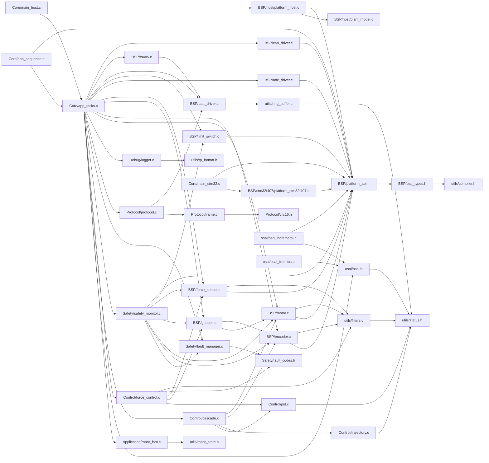
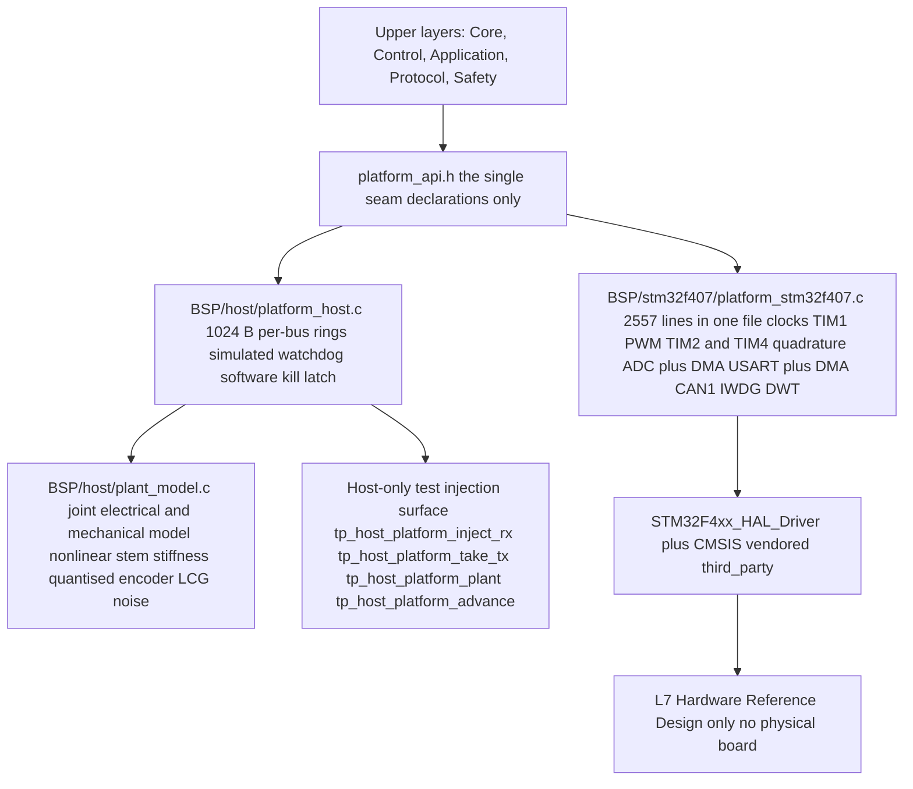
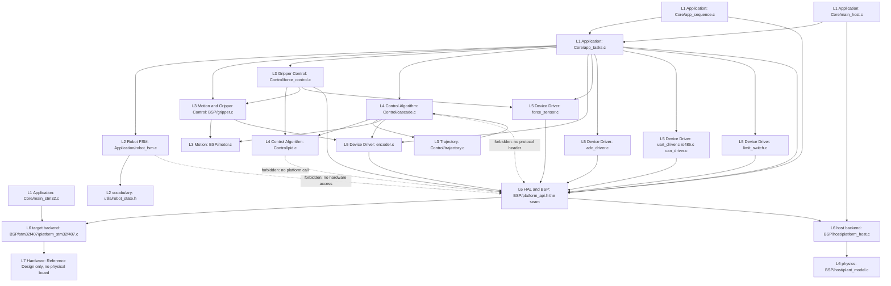

# 第二代智能无人机采茶机器人系统 —— 软件架构设计文档

> ## ⚠️ 文档性质声明（必读）
>
> **本文档是设计文档 / 参考设计（Design Document / Reference Design），不是测试报告，也不是实测记录。**
>
> 1. **本项目没有任何实物硬件。** 没有 PCB、没有板子、没有真机装配、没有真机测量。仓库中不存在 Gerber、BOM、原理图源文件与任何板级实测数据。凡涉及硬件后端处，一律标注 **参考设计 / Recommended Implementation，未制作实物板**。
> 2. **所有结果数据只来自 STEP 2 的仿真运行**，一律标注 **仿真结果（Simulated）**；凡属指标承诺处，一律标注 **设计目标 / Target KPI（未实测）**。
> 3. 本文档中的**全部目录名、文件名、函数名、宏名、构建目标名**均来自对本仓库源码与构建脚本的真实读取，**没有虚构符号**。"文档注释与仓库实际不一致"之处在 §8.6 逐条列出。
> 4. 本文档只描述**软件架构**；硬件电路与传感前端见 `hardware/` 下配套参考设计文档。

---

## 摘要

本系统的代码资产分三层：**C 固件** `firmware/`（既可直接交叉编译为 STM32F407VET6 镜像，也可本地编译为 PC 可执行文件）、**Python 仿真与上位机工具链** `simulator/` `host/` `tools/`、**构建与验证脚本** `scripts/` `CMakeLists.txt` `Makefile`。

架构的核心是**两道缝**：

- **第一道缝 `firmware/BSP/platform_api.h`**：全部寄存器访问、GPIO 读写与总线收发必须经此头文件声明的函数，恰好两个完整实现——`firmware/BSP/stm32f407/platform_stm32f407.c`（**参考设计 / Recommended Implementation，未制作实物板**）与 `firmware/BSP/host/platform_host.c`（确定性物理模型）。
- **第二道缝 `firmware/Middleware/osal/osal.h`**：任务、队列、互斥量、信号量、任务通知与时间全部经 `osal_*` API 抽象，后端为 `osal_freertos.c` 与 `osal_baremetal.c`。

两道缝的结果是：**1 kHz 控制环、力控序列、状态机与安全监控这四块最需要正确性的代码，可以在只有 C 编译器的 PC 上被编译、被单测、被端到端仿真**，且与运行在 MCU 上的是**同一份源码**。

**仿真结果（Simulated）** —— `scripts/run_scenarios.ps1` 七场景扫描，7/7 PASS：

| 场景 | 注入内容 | 期望 | 结论 |
|---|---|---|---|
| A | 标称采摘 | 完成 1 个循环 | PASS，峰值夹持力 2.386 N |
| B | 视觉目标位置误差 | `ERR_TARGET` | PASS |
| C | 力传感器噪声 σ = 80 mN | 完成 1 个循环 | PASS，峰值夹持力 2.426 N |
| D | 过大夹持力（关闭力反馈，纯位置模式） | `ERR_FORCE_OVERLOAD` | PASS |
| E | 通信超时 | `ERR_COMM_TIMEOUT` | PASS |
| F | 电机堵转 | 过流 / 堵转保护 | PASS |
| G | 紧急停止 | `ERR_ESTOP` | PASS |

**仿真结果（Simulated）** —— 场景 A 关键量化指标：

| 指标 | 数值 | 说明 |
|---|---|---|
| 目标检测时刻 | t = 1.20 s | 仿真时间 |
| 接触间隙 / 接触力 | 5.824 mm / 0.148 N | 首次判定接触（阈值 `TP_FORCE_CONTACT_N = 0.15 N`） |
| 稳态夹持力 | 2.17 N（设定 2.20 N，band ±0.10 N） | 落在容差带内 |
| 超调 / 收敛时间 | 0.00 N / 49 个控制周期 | 约 49 ms，力环 1 kHz |
| 受控阶段平均保持力 | 2.26 N | 仅统计进入容差带之后 |
| 峰值夹持力 | 2.386 N（硬限 `TP_FORCE_MAX_N = 5.00 N`） | 距硬限 2.6 倍余量 |
| 节拍 | CONTACT 1.24 s / GRIP 2.57 s / PICK 3.14 s / RELEASE 3.39 s / IDLE 4.78 s | 各阶段进入时刻 |
| 实时性 | 6000 控制周期，0 次截止期错失 | 汇总自 `osal_get_task_stats()` |
| 主机链路 | 2200 B、100 帧、0 CRC 错误 | 收发两端使用同一套编解码器 |

**设计目标 / Target KPI（未实测）**：茶芽破损率 ≤ 1 %；采摘效率提升 40 %；定位误差；夹持力误差；通信延迟。以上五项**没有任何实测数据支撑**，答辩时必须以"仿真中观察到的现象"而非"已达成的指标"表述。

---

## 目录

- [1. 分层架构](#1-分层架构) · [1.1 真实目录树](#11-真实目录树) · [1.2 七层到真实文件的映射](#12-七层到真实文件的映射) · [1.3 每层的职责与依赖许可](#13-每层的职责与依赖许可) · [1.4 依赖方向的代码证据](#14-依赖方向的代码证据)
- [2. 模块清单与依赖关系](#2-模块清单与依赖关系) · [2.1 模块清单](#21-模块清单) · [2.2 依赖关系 mermaid 图](#22-依赖关系-mermaid-图)
- [3. 目录结构说明](#3-目录结构说明)
- [4. 关键接口设计：platform_api.h 作为单一硬件缝](#4-关键接口设计platform_apih-作为单一硬件缝)
- [5. OSAL 抽象与两个后端](#5-osal-抽象与两个后端)
- [6. 可测试性设计](#6-可测试性设计)
- [7. 分层 mermaid 图](#7-分层-mermaid-图)
- [8. 架构上的已知不足](#8-架构上的已知不足)
- [9. 命名与编码约定](#9-命名与编码约定)
- [小结](#小结) · [面试可能追问的问题](#面试可能追问的问题)

---

## 1. 分层架构

### 1.1 真实目录树

由 `Get-ChildItem -Recurse` 实际枚举得到，只列真实存在的路径；`firmware/Drivers/third_party/` 只列到二级（原样 vendored）。

```text
second-gen-tea-picking-robot/
├── CMakeLists.txt / Makefile            # 双构建入口（前者头注释声明"从未运行过"）
├── firmware/
│   ├── Application/   config.h, robot_fsm.c/.h
│   ├── BSP/           adc_driver, bsp_types.h, can_driver, encoder, force_sensor,
│   │                  gripper, limit_switch, motor, platform_api.h, rs485, uart_driver
│   │   ├── host/          plant_model.c/.h, platform_host.c/.h
│   │   └── stm32f407/     platform_stm32f407.c/.h, syscalls_stm32f407.c
│   ├── Control/       cascade.c/.h, force_control.c/.h, pid.c/.h, trajectory.c/.h
│   ├── Core/          app_entry.c/.h, app_sequence.c, app_tasks.c/.h, freertos_hooks.c,
│   │                  FreeRTOSConfig.h, main_host.c, main_stm32.c,
│   │                  stm32f4xx_hal_conf.h, stm32f4xx_it.c/.h
│   ├── Debug/         logger.c/.h
│   ├── Drivers/       device/（空）, startup/（.s/.ld/system_stm32f4xx.c）, third_party/
│   ├── Middleware/    osal/（osal.h + 两个后端）, utils/（compiler.h, filters,
│   │                  ring_buffer, robot_state, status, tp_format）
│   ├── Protocol/      crc16, frame, protocol, protocol_codec.c, protocol_types.h
│   ├── Safety/        fault_codes, fault_manager, safety_monitor
│   └── Tests/         test_framework.c/.h + 6 个测试源文件（共 122 个用例）
├── hardware/          force_sensor.md, interface_design.md, motor_driver.md,
│                      power_design.md, signal_conditioning.md
├── host/              link.py, protocol.py, robot_monitor.py, selftest.py, sim_robot.py
├── simulator/         config/controller/fsm/gripper/pid/plant/plotting/profiles/safety/
│                      scenarios/scenario_types/sequencer/simulation/telemetry/main.py
├── scripts/           build.ps1, build_host.ps1, build.sh, flash_openocd.sh, run_scenarios.ps1
├── toolchain/         arm-none-eabi.cmake, CMakeLists.txt
├── tools/             analyze_log.py, vision_mock.py
├── tests/             空目录          ├── images/   空目录
├── data/              logs/ 与 results/（仿真产物）
└── docs/              本套文档
```

> **注意**：根目录 `tests/` 是**空目录**；真实单元测试全部在 `firmware/Tests/`。两个构建系统都只认后者（`Makefile` 的 `TEST_SRCS := $(wildcard $(FW)/Tests/*.c)`、`CMakeLists.txt` 的 `TP_TESTS_DIR`）。见 §8。

### 1.2 七层到真实文件的映射

任务给定的七层与仓库目录**不是一一对应**的，下表如实标注错位。

| 层 | 层次名 | 真实文件 | 错位说明 |
|---|---|---|---|
| L1 | Application | `Core/app_tasks.c/.h`、`Core/app_sequence.c`、`Core/main_host.c`、`Core/main_stm32.c`、`Core/app_entry.c/.h`、`Application/config.h` | 应用层横跨 `Core/` 与 `Application/`；后者实际只放了 `config.h` 与状态机 |
| L2 | Robot FSM | `Application/robot_fsm.c/.h` | 在 `Application/` 而非 `Core/` |
| L3 | Motion / Gripper Control | `BSP/gripper.c/.h`、`BSP/motor.c/.h`、`Control/force_control.c/.h`、`Control/trajectory.c/.h` | **关键错位**：横跨 `BSP/` 与 `Control/`。`gripper.c`/`motor.c` 在 BSP（持有电机与编码器句柄），夹持序列 `force_control.c` 在 Control（内含一个 PID 与 8 状态序列） |
| L4 | Control Algorithm | `Control/pid.c/.h`、`Control/cascade.c/.h` | `force_control.c` 同目录但更靠近 L3——它是序列控制器，内嵌一个 L4 的 `tp_pid_t` |
| L5 | Device Driver | `BSP/{adc_driver,can_driver,encoder,force_sensor,limit_switch,rs485,uart_driver}.c/.h`、`BSP/bsp_types.h` | 这些驱动**不直接碰寄存器**，只调用 `platform_api.h` |
| L6 | HAL / BSP | `BSP/platform_api.h`（接口）、`BSP/stm32f407/platform_stm32f407.c`（目标后端，参考设计）、`BSP/host/platform_host.c`、`BSP/host/plant_model.c`、`Drivers/third_party/{CMSIS,STM32F4xx_HAL_Driver}` | `platform_api.h` 是"缝"本身，两个后端才是 L6 的实现 |
| L7 | Hardware | 不存在 | **参考设计 / Recommended Implementation，未制作实物板**；见 `hardware/` 下 5 份文档 |

**这张表本身即架构信息**：`firmware/` 按"谁和谁一起被修改"分目录，而非按层分。`BSP/` 装的是"任何持有硬件句柄的东西"。

### 1.3 每层的职责与依赖许可

| 层 | 职责 | 明确**不做**什么 | 允许依赖谁 | 不允许依赖谁 |
|---|---|---|---|---|
| L1 Application | 持有唯一上下文 `tp_app_context_t`；装配全部模块；注册七个任务；实现 `tp_protocol_ops_t` 回调表；采摘序列编排 | 不做控制律运算、不做帧编解码、不做故障判据 | L2–L6 全部 | 无（树根） |
| L2 Robot FSM | 只回答"在状态 S 收到事件 E 去哪、路上做什么"；维护转换表、64 深度转换轨迹环、守卫与动作 | **不碰硬件、不算控制输出、不编码协议帧**；不自己跑夹持序列 | `utils/robot_state.h`、`status.h`（`robot_fsm.c` 实测只 include `robot_fsm.h, compiler.h, config.h, logger.h`） | 不依赖 `platform_api.h`、不依赖 `Protocol/`、不依赖 `Control/` |
| L3 Motion / Gripper Control | 把"以 v mm/s 闭合""把关节转到 θ"翻译为驱动层调用；夹持序列 8 个子状态推进 | 不做 PID 积分与限幅（交给 L4）；不做越限判据（交给 Safety） | L4 `pid.h`、L5 `motor.h`/`encoder.h`/`gripper.h`、`filters.h` | 不依赖协议层、不依赖 FSM |
| L4 Control Algorithm | `pid.c` 的积分/微分/抗饱和/限幅；`cascade.c` 内外环与带宽分离；`trajectory.c` 参考轮廓 | **不读写任何 I/O、不调用 `platform_api.h`**；不做模式决策（模式由 L1 设置） | 仅 `status.h`、`compiler.h`、`logger.h`、`config.h`（`pid.c` 实测 include：`pid.h, compiler.h, logger.h`） | 不依赖协议头、不依赖 BSP 驱动、不依赖 `platform_api.h` |
| L5 Device Driver | 工程单位换算、限幅、标定、健康判据（堵转/越限/尖峰）、去抖 | 不访问寄存器；不实现 PID；不做安全策略决策 | L6 `platform_api.h`；`utils/{filters,ring_buffer,status}` | 不依赖 `Control/`、`Safety/`、`Protocol/` |
| L6 HAL / BSP | 唯一的寄存器与总线访问点；两后端各实现同一组函数 | 不得向上层暴露任何寄存器符号（`platform_api.h` 只 include `<stdint.h>`、`bsp_types.h`、`status.h`） | 目标后端可依赖 HAL/CMSIS；仿真后端可依赖 `plant_model.h` | 上层不得反向被 L6 依赖；`platform_host.h` 只允许 `BSP/host` 与测试树 include |
| L7 Hardware | —（未制作实物板） | — | — | — |

### 1.4 依赖方向的代码证据

**证据 1：Control 层宁可重复声明常量，也不 include 协议头。** `Control/cascade.h` 第 98–100 行原文：*"They are re-declared rather than reused **so that the Control layer does not have to include a protocol header — the dependency would point upward and make `cascade.c` untestable without the protocol module**."* 对应代码 `#define TP_CASCADE_LOOP_POSITION 0u` / `TP_CASCADE_LOOP_VELOCITY 1u`，其值与 `SET_PID`/`PID_RPT` 的线上编码刻意一致，使应用的 `loop_id` 映射成为恒等函数。实测 include 图证实：`cascade.c → cascade.h, compiler.h, config.h, logger.h`，**无任何 `protocol*.h`**。

**证据 2：FSM 守卫拿 FSM 自身，不拿应用上下文。** `Application/robot_fsm.h` 第 98–108 行记录了一个真实缺陷：第一版把应用上下文传给守卫、守卫再 cast 成 `tp_robot_fsm_t *`，编译器看不见这个类型错误，于是 `guard_has_target()` 读到的是"应用结构体中恰好同偏移的无关字段"，表现为**间歇性拒绝启动循环**。修复后签名为 `int (*guard)(tp_robot_fsm_t *fsm)`，外部状态只能经 4 个 setter（`tp_fsm_set_target` / `tp_fsm_set_fault_state` / `tp_fsm_set_estop` / `tp_fsm_force_state`）显式镜像进来。

**证据 3：状态词汇表下沉为叶子头文件。** `Middleware/utils/robot_state.h` 说明 `tp_robot_state_t` 若住在 `robot_fsm.h`，"协议层就得 include 一个应用层头文件，**这会把分层倒置**"；若复制一份，新增状态时两份静默漂移。实测 `protocol_types.h → bsp_types.h, compiler.h, config.h, fault_codes.h, robot_state.h`，确实不 include 任何 `Application/` 或 `fault_manager.h`。`Safety/fault_codes.h` 以同一理由独立存在。

**证据 4：协议层不知道"机器人"是什么。** `Protocol/protocol.h` 第 6–23 行：协议层通过 16 个回调组成的 `tp_protocol_ops_t` 反向调用应用层，"依赖箭头在运行期朝上、在编译期朝下"；全部回调由 `Core/app_tasks.c` 里的静态函数实现。`protocol.h` 只 include `frame.h, protocol_types.h, status.h, uart_driver.h`。

**证据 5：`cascade.h` 确实依赖了 BSP 头文件——这是真实的层间妥协。** `cascade.h` include 了 `encoder.h` 与 `motor.h`，因为 `cascade.h` 的签名是 `float tp_cascade_update(tp_cascade_t *c, tp_encoder_t *enc, float dt_s);`。即 **L4 为获取"编码器句柄"这一类型反向依赖了 L5 的头文件**。这是为避免在 L4 定义镜像类型而做的有意取舍，代价是 L4 无法完全脱离 BSP 编译，§8 记为已知不足。

#### **「它是什么」**

一套把"决策 / 算法 / 设备 / 寄存器"分层隔离的目录与依赖约定：七个逻辑层，由 `platform_api.h`（第 6 层之内的缝）与 `osal.h`（横切关注点的缝）两处收口，靠 include 图而非文档强制。

#### **为什么这么设计**

因为本项目**没有硬件**。"控制代码是否正确"只能靠 PC 上的可重复仿真回答。要让同一份 `pid.c` / `cascade.c` / `force_control.c` / `robot_fsm.c` 既上 MCU 又上 PC，它们就必须**不直接依赖任何平台设施**：不 `xTaskCreate`、不读寄存器、不含 `#ifdef STM32`。分层不是审美，是把"能否被验证"变成结构属性。次要理由是故障定位：一次采摘失败可能源于视觉目标错误、力传感器漂移、力控律发散或安全判据误触发，单向依赖让"改哪层不影响哪层"成为可回答的问题。

#### **如果不用它会怎样**

- 若没有 L2/L3 分离：FSM 直接驱动夹持序列，产生"带 1 kHz 心跳的状态机"，离散决策与连续调节耦合在一个函数里，两者都难测（`robot_fsm.h` 明确反对）。
- 若没有 L4 与 I/O 隔离：`test_pid.c` 的 20 个用例（`first_update_has_no_derivative_kick`、`back_calculation_unwinds_a_saturated_integrator`、`non_finite_input_is_refused_and_latched` 等）全部写不出来。
- 若没有"守卫只拿 FSM"：会重演 guard 类型错误导致的间歇性拒不启动。
- 若没有"词汇表下沉"：协议层反向 include 应用层，或两份枚举静默漂移，监控程序从插入点之后全部错标。

---

## 2. 模块清单与依赖关系

### 2.1 模块清单

"依赖模块"取自对每个文件 `#include "..."` 的机械提取，"被谁依赖"取自同一份图的反向查找。单测友好度：★★★★★ = 纯逻辑仅依赖 `status.h`；★★★ = 需要确定性的平台后端；★ = 需真实外设或真实时间。

| # | 模块 | 真实文件 | 对外头文件 | 依赖模块 | 被谁依赖 | 单测友好度 |
|---|---|---|---|---|---|---|
| 1 | 平台缝 | `BSP/platform_api.h` | 自身 | `bsp_types.h`, `status.h` | 全部驱动、`force_control.c`、`safety_monitor.c`、`osal_baremetal.c`、`app_sequence.c`、`main_stm32.c` | ★★ |
| 2 | 硬件词汇表 | `BSP/bsp_types.h` | 自身 | `compiler.h` | 全部 BSP 驱动、`protocol_types.h`、`app_tasks.h` | ★★★★★ |
| 3 | 电机驱动 | `BSP/motor.c/.h` | `motor.h` | `bsp_types.h`, `filters.h`, `platform_api.h` | `gripper.c`, `cascade.h`, `safety_monitor.h`, `app_tasks.c` | ★★★ |
| 4 | 编码器驱动 | `BSP/encoder.c/.h` | `encoder.h` | `bsp_types.h`, `filters.h`, `platform_api.h` | `gripper.h`, `cascade.h`, `safety_monitor.h` | ★★★ |
| 5 | 力传感器 | `BSP/force_sensor.c/.h` | `force_sensor.h` | `bsp_types.h`, `filters.h`, `platform_api.h` | `force_control.h`, `safety_monitor.h`, `app_tasks.c` | ★★★ |
| 6 | 夹爪驱动 | `BSP/gripper.c/.h` | `gripper.h` | `bsp_types.h`, `encoder.h`, `motor.h`, `platform_api.h` | `force_control.h`, `safety_monitor.h`, `app_tasks.c` | ★★★ |
| 7 | ADC 前端 | `BSP/adc_driver.c/.h` | `adc_driver.h` | `bsp_types.h`, `filters.h`, `platform_api.h` | `app_tasks.h`, `app_sequence.c` | ★★★ |
| 8 | 限位/急停输入 | `BSP/limit_switch.c/.h` | `limit_switch.h` | `bsp_types.h`, `platform_api.h` | `safety_monitor.h`, `app_tasks.c` | ★★★ |
| 9 | UART 链路 | `BSP/uart_driver.c/.h` | `uart_driver.h` | `bsp_types.h`, `ring_buffer.h`, `platform_api.h` | `protocol.h`, `rs485.h`, `app_tasks.h` | ★★★ |
| 10 | RS485 / Modbus RTU | `BSP/rs485.c/.h` | `rs485.h` | `bsp_types.h`, `ring_buffer.h`, `uart_driver.h`, `platform_api.h` | `app_tasks.h`, `app_sequence.c` | ★★ |
| 11 | CAN 传输 | `BSP/can_driver.c/.h` | `can_driver.h` | `bsp_types.h`, `platform_api.h` | `app_tasks.h`, `app_sequence.c` | ★★ |
| 12 | host 后端 | `BSP/host/platform_host.c/.h` | `platform_host.h` | `plant_model.h`, `platform_api.h`, `ring_buffer.h`, `tp_format.h` | `main_host.c`, `app_entry.c`, `test_control.c`, `test_plant_gripper.c` | ★★★★★ |
| 13 | 物理模型 | `BSP/host/plant_model.c/.h` | `plant_model.h` | `bsp_types.h`, `status.h` | `platform_host.h`、测试 | ★★★★★ |
| 14 | STM32 后端 | `BSP/stm32f407/platform_stm32f407.c/.h` | `platform_stm32f407.h` | `platform_api.h`, `stm32f4xx_hal.h`, `ring_buffer.h` | `main_stm32.c`, `stm32f4xx_it.c`, `freertos_hooks.c` | ★（**参考设计，未制作实物板**） |
| 15 | 系统调用桩 | `BSP/stm32f407/syscalls_stm32f407.c` | 无 | `config.h`, `stm32f4xx_hal.h`, `platform_stm32f407.h` | 链接期（newlib） | ★ |
| 16 | PID | `Control/pid.c/.h` | `pid.h` | `status.h`（`.c` 另加 `compiler.h`, `logger.h`） | `cascade.h`, `force_control.h`, `app_tasks.h` | ★★★★★（20 用例） |
| 17 | 串级控制 | `Control/cascade.c/.h` | `cascade.h` | `encoder.h`, `motor.h`, `pid.h`, `trajectory.h` | `app_tasks.h` | ★★★（6 用例） |
| 18 | 轨迹生成 | `Control/trajectory.c/.h` | `trajectory.h` | `status.h` | `cascade.h`, `app_tasks.h` | ★★★★★（6 用例） |
| 19 | 力控夹持序列 | `Control/force_control.c/.h` | `force_control.h` | `filters.h`, `force_sensor.h`, `fault_codes.h`, `gripper.h`, `pid.h`, `platform_api.h` | `app_tasks.h`, `app_sequence.c` | ★★★（七场景端到端覆盖） |
| 20 | 日志 | `Debug/logger.c/.h` | `logger.h` | `config.h`, `tp_format.h` | 几乎全部 `.c` | ★★★★ |
| 21 | OSAL 接口 | `Middleware/osal/osal.h` | 自身 | `status.h` | `app_tasks.h`、两个后端 | ★★★★ |
| 22 | 裸机后端 | `Middleware/osal/osal_baremetal.c` | 无（实现 `osal.h`） | `osal.h`, `compiler.h`, `config.h`, `logger.h`, `platform_api.h` | 链接期（host 与裸机 STM32） | ★★★★★ |
| 23 | FreeRTOS 后端 | `Middleware/osal/osal_freertos.c` | 无（实现 `osal.h`） | `osal.h`, `FreeRTOS.h`, `task.h`, `queue.h`, `semphr.h` | 链接期（`RTOS=freertos`） | ★（**未在真机运行过**） |
| 24 | 工具宏 | `Middleware/utils/compiler.h` | 自身 | 无 | 全部 | ★★★★★ |
| 25 | 数字滤波器 | `Middleware/utils/filters.c/.h` | `filters.h` | `status.h` | `adc_driver.h`, `encoder.h`, `force_sensor.h`, `motor.h`, `force_control.h` | ★★★★★（22 用例） |
| 26 | 环形缓冲 | `Middleware/utils/ring_buffer.c/.h` | `ring_buffer.h` | `status.h` | `uart_driver.h`, `rs485.h`, `platform_host.c`, `app_tasks.h` | ★★★★★（7 用例） |
| 27 | 状态词汇表 | `Middleware/utils/robot_state.c/.h` | `robot_state.h` | 无 | `robot_fsm.h`, `protocol_types.h`, `app_sequence.c` | ★★★★★ |
| 28 | 状态码 | `Middleware/utils/status.c/.h` | `status.h` | 无 | 全部 | ★★★★★ |
| 29 | 轻量格式化 | `Middleware/utils/tp_format.c/.h` | `tp_format.h` | 无 | `logger.c`, `fault_manager.c`, `platform_host.c`, `app_sequence.c` | ★★★★★ |
| 30 | CRC | `Protocol/crc16.c/.h` | `crc16.h` | 无 | `frame.c`, `protocol.c`、测试 | ★★★★★（5 用例） |
| 31 | 帧编解码 | `Protocol/frame.c/.h` | `frame.h` | `protocol_types.h`, `crc16.h` | `protocol.h`, `main_host.c` | ★★★★★（11 用例） |
| 32 | 协议会话与分发 | `Protocol/protocol.c/.h` | `protocol.h` | `frame.h`, `protocol_types.h`, `uart_driver.h`, `crc16.h` | `app_tasks.c`, `app_sequence.c` | ★★★★ |
| 33 | 载荷编解码 | `Protocol/protocol_codec.c` | `protocol_types.h` | `protocol_types.h`, `compiler.h` | `protocol.c` | ★★★★★ |
| 34 | 协议词汇表 | `Protocol/protocol_types.h` | 自身 | `bsp_types.h`, `config.h`, `fault_codes.h`, `robot_state.h` | `frame.h`, `protocol.h` | ★★★★★ |
| 35 | 故障码 | `Safety/fault_codes.c/.h` | `fault_codes.h` | 无 | `fault_manager.h`, `force_control.h`, `protocol_types.h` | ★★★★★（4 用例） |
| 36 | 故障注册表 | `Safety/fault_manager.c/.h` | `fault_manager.h` | `fault_codes.h`, `status.h`, `tp_format.h` | `safety_monitor.h`, `app_tasks.c`, `app_sequence.c` | ★★★★★（9 用例） |
| 37 | 安全监控 | `Safety/safety_monitor.c/.h` | `safety_monitor.h` | `encoder.h`, `fault_manager.h`, `force_sensor.h`, `gripper.h`, `limit_switch.h`, `motor.h`, `platform_api.h` | `app_tasks.c` | ★★★ |
| 38 | 状态机 | `Application/robot_fsm.c/.h` | `robot_fsm.h` | `robot_state.h`, `compiler.h`, `config.h`, `logger.h` | `app_tasks.h`, `app_sequence.c` | ★★★★★（13 用例） |
| 39 | 集中配置 | `Application/config.h` | 自身 | `compiler.h` | 几乎全部 `.c` | ★★★★★（12 条静态断言） |
| 40 | 应用装配 | `Core/app_tasks.c/.h` | `app_tasks.h` | 21 个头文件 | `app_sequence.c`, `main_host.c`, `main_stm32.c` | ★★★ |
| 41 | 任务体与序列 | `Core/app_sequence.c` | 由 `app_tasks.h` 声明 | `app_tasks.h`, `platform_api.h`, `robot_state.h`, `tp_format.h` | 链接期 | ★★★ |
| 42 | 弱默认入口 | `Core/app_entry.c/.h` | `app_entry.h` | `app_tasks.h`（仅 `__has_include` 探测）、`platform_api.h`、`platform_host.h` | 链接期 | ★★ |
| 43 | PC 入口 | `Core/main_host.c` | 无（`main`） | `app_tasks.h`, `platform_host.h`, `tp_format.h` | 链接期 | ★★★★★（七场景即端到端测试） |
| 44 | MCU 入口 | `Core/main_stm32.c` | 无（`main`） | `stm32f4xx_hal.h`, `app_entry.h`, `platform_api.h`, `platform_stm32f407.h` | 链接期 | ★ |
| 45 | 中断转发 | `Core/stm32f4xx_it.c/.h` | `stm32f4xx_it.h` | `stm32f4xx_hal.h`, `platform_stm32f407.h`, `FreeRTOS.h` | 链接期（向量表） | ★ |

**模块数：45**（不含 `firmware/Tests/` 的 7 个文件与 `Drivers/third_party/` 的第三方源码）。其中 `Core/app_tasks.h` 一行 include 了 **21 个**头文件，是全仓库唯一的"知道所有模块"的文件——其文件头也承认："This is the **only** file in the firmware that knows about every module at once."

### 2.2 依赖关系 mermaid 图

箭头方向 = 依赖方向（`A --> B` 读作"A 依赖 B"）。为可读性按层分组，仅画跨模块边。



图中可见三条"干净"的短链（`pid`/`trajectory` → `status`；`filters`/`ring_buffer` → `status`；`crc16` 零依赖）与三条"长"的装配链（`app_tasks` 几乎连到所有模块、`main_host` 连 host 后端、`main_stm32` 连 STM32 后端）。**整图是一个以 `app_tasks` 为扇入中心、以 `status.h` 为扇出底座的 DAG，没有环。**

#### **「它是什么」**

一份把 45 个模块的真实 include 关系显式化的清单与有向图，用于回答"改这个文件会波及谁"。

#### **为什么这么设计**

因为依赖图是**唯一能够自动验证的分层证据**——文档里的分层会腐烂，`#include` 不会。实测结果里最有价值的是两条**负向证据**：`robot_fsm.c` 不 include `platform_api.h`（L2 不碰硬件）、`pid.c` 不 include 任何 BSP 头（L4 不碰硬件）。这两条断言可用一条 CI 命令检查，无需人工评审。

#### **如果不用它会怎样**

会退化成"每个文件按需 include"。本仓库已经吃过一次亏并修复：`cascade.h` 若直接 include `protocol_types.h` 复用 `loop_id`，`cascade.c` 就无法脱离协议模块测试；`robot_fsm.h` 若让守卫拿 context 指针，就重现"编译器看不见的类型错误导致间歇性拒不启动"。口头约定顶不住一次"就加一个 include"的便利。

---

## 3. 目录结构说明

| 目录 | 真实内容 | 真实用途 | 未实测 / 参考设计标注 |
|---|---|---|---|
| `firmware/Application` | `config.h`、`robot_fsm.c/.h` | L1 集中配置（9 节常量 + 12 条编译期断言）+ L2 表驱动状态机（12 状态 / 15 事件 / 转换表 + 64 深度轨迹环） | `config.h` 第 369–425 行的力传感前端参数（INA333 增益 201、10 N 量程、8.0 mN LSB）为**参考设计 / Recommended Implementation**，由数据手册推算，**未在制作的板上测量** |
| `firmware/BSP` | 11 组驱动 + `bsp_types.h` + `platform_api.h` | L5 设备驱动（单位换算、限幅、标定、健康判据）+ L6 缝头文件 | 驱动只调 `platform_api.h`，故可在 PC 上运行 |
| `firmware/BSP/host` | `platform_host.c/.h`、`plant_model.c/.h` | 仿真后端：确定性物理模型 + 故障注入入口。`platform_host.h` 明确禁止 `Core/`、`Control/`、`Application/`、`Protocol/`、`Safety/` include 它 | `plant_model.h` 的机电参数（R=2 Ω、L=1.5 mH、Kt=2.0 N·m/A、J=2.5e-3 kg·m²、茎秆 k1=0.30 N/mm、k2=0.06 N/mm²）为**模型参数，非实测** |
| `firmware/BSP/stm32f407` | `platform_stm32f407.c`（2557 行）、`.h`（254 行）、`syscalls_stm32f407.c` | 目标硅片后端：时钟、GPIO、TIM1 PWM、TIM2/TIM4 正交解码、ADC+DMA、三路 USART+DMA、CAN1、IWDG、DWT 微秒延时、HardFault 报告 | **参考设计 / Recommended Implementation，未制作实物板**；寄存器编程依据参考手册，未经硬件验证 |
| `firmware/Control` | `pid`、`cascade`、`trajectory`、`force_control` | L4 算法 + L3 夹持序列 | `force_control.h` 明确声明自适应力阈值 `TP_FORCE_ADAPT_ENABLE` **默认关闭**，因为"没有对真实茶芽验证过" |
| `firmware/Core` | 9 个文件 | 装配（`app_tasks.c`）、任务体与序列（`app_sequence.c`）、weak 默认入口（`app_entry.c`）、两个 `main`、FreeRTOS 钩子与配置、中断转发 | 目标侧路径未在实物上运行 |
| `firmware/Debug` | `logger.c/.h` | 分级日志（DEBUG/INFO/WARN/ERROR/NONE）、可插拔 sink、时间戳来自 `tp_log_set_time_source`、2048 B 日志环 | — |
| `firmware/Drivers` | `third_party/`（CMSIS、STM32F4xx_HAL_Driver、FreeRTOS V10.0.1）、`startup/`（`.s`、`STM32F407VET6_FLASH.ld`、`system_stm32f4xx.c`）、`device/`（**空**） | `third_party` 原样 vendored 不修改；`startup` 提供向量表、`Reset_Handler` 与链接脚本 | `portable/` 下**只有 `RVDS/ARM_CM3`**，缺 `GCC/ARM_CM4F`，故 `RTOS=freertos` 会以可操作错误信息中止（见 §5） |
| `firmware/Middleware/osal` | `osal.h`（456 行）、`osal_baremetal.c`（623 行）、`osal_freertos.c`（624 行） | 第二道缝：任务 / 队列 / 互斥量 / 计数信号量 / 任务通知 / 时间 / 周期助手 / 统计 | FreeRTOS 后端 **未在真机运行过** |
| `firmware/Middleware/utils` | `compiler.h`、`filters`、`ring_buffer`、`robot_state`、`status`、`tp_format` | 零/极低依赖基础设施：工具宏、五种滤波器 + 尖峰检测、SPSC 字节环、状态词汇表、统一状态码、不依赖 libc 的 `tp_snprintf` | — |
| `firmware/Protocol` | `crc16`、`frame`、`protocol`、`protocol_codec.c`、`protocol_types.h` | 帧协议（头 `0xAA 0x55`，字段 CMD / LEN / PAYLOAD / CRC16，小端）+ 命令分发 + 会话监督 + 丢包估计 | — |
| `firmware/Safety` | `fault_codes`、`fault_manager`、`safety_monitor` | 故障码闭集（12 项 × 4 级严重度）、注册表（active / latched / count 三问分离 + 16 深度事件环）、八项连续危险监督 | 阈值均为**设计目标（未实测）**，如 `TP_STALL_PWM_THRESHOLD = 80.0f`、`TP_STALL_TRIP_MS = 300u` |
| `firmware/Tests` | `test_framework.c/.h` + **6 个测试源文件、共 122 个用例** | 自注册式极简单测框架（256 用例上限、`__attribute__((constructor))` 自动注册、`qsort` 稳定输出）+ 分层测试 | 被测代码在 host 后端运行，属**仿真验证**；STM32 后端无任何覆盖 |
| `hardware/` | `force_sensor.md`、`interface_design.md`、`motor_driver.md`、`power_design.md`、`signal_conditioning.md` | 硬件参考设计文档 | **全部为设计文档 / 参考设计**，各文件开头自带性质声明：无 PCB/BOM/Gerber、无实测记录、器件型号一律标注为参考设计 |
| `host/` | `link.py`、`protocol.py`、`robot_monitor.py`、`selftest.py`、`sim_robot.py` | Python 上位机：串口链路、协议编解码、状态监控 | 未与真实硬件联调 |
| `simulator/` | `config`、`controller`、`fsm`、`gripper`、`pid`、`plant`、`plotting`、`profiles`、`safety`、`scenarios`、`scenario_types`、`sequencer`、`simulation`、`telemetry`、`main.py` | Python 侧独立仿真器：与 C 固件平行的参考实现，用于交叉验证与出图（`data/results/*.png`） | Python 模型是模型，不是真机 |
| `tools/` | `analyze_log.py`、`vision_mock.py` | `analyze_log.py` 解析 CSV 出指标；`vision_mock.py` 模拟视觉向前端送目标 | 视觉为 mock，非真实相机 |
| `scripts/` | `build.ps1`、`build_host.ps1`、`build.sh`、`flash_openocd.sh`、`run_scenarios.ps1` | 构建包装、OpenOCD 烧录、**七场景扫描**（判据为固件 stdout 的 `Simulation: PASS`） | `flash_openocd.sh` 面向**不存在的实物板**，从未执行 |
| `tests/` | **空目录** | 无内容；真实单测在 `firmware/Tests/` | 见 §8 |
| `data/` | `logs/`（`scenario_A..G_log.csv`、`*_metrics.json`、`host_scenario_A..G.csv`、`pick_cycle.csv`、`monitor_selftest.csv`、`dbgF.csv`）、`results/`（13 张 PNG） | 仿真产物落盘，供 `tools/analyze_log.py` 与 Python 绘图复用 | 全部为**仿真结果（Simulated）** |
| `docs/` | `01_project_background.md`、`02_system_design.md`、`03_hardware_design.md`、`04_software_architecture.md`（本文）、`11_experiment_design.md`、`force_sensor_calibration.md`、`interview_guide.md`、`resume_project.md` | 毕业设计开题/中期报告与答辩材料 | 以仿真结论为准 |
| `toolchain/` | `arm-none-eabi.cmake`、`CMakeLists.txt` | 交叉编译工具链文件与支持目标（校验工具链存在、汇报变量） | 头注释声明 **"NOT TESTED: cmake is absent on the machine this port was written on"** |
| `images/` | **空目录** | 未使用 | — |
| `build/` | `host/`、`stm32/` | `make host` / `make stm32` 输出 | — |

---

## 4. 关键接口设计：platform_api.h 作为单一硬件缝

### 4.1 它是什么

`firmware/BSP/platform_api.h` 文件头第一条断言：*"Every register access, every GPIO read and every byte put on a bus in this project goes through the functions declared here. Exactly two implementations exist."* 后端表（原文照录）：

| Backend | File | Built when |
|---|---|---|
| STM32F407VET6 silicon | `firmware/BSP/stm32f407/platform_stm32f407.c` | `-DTP_PLATFORM_STM32F407` |
| Deterministic physics | `firmware/BSP/host/platform_host.c` | `-DTP_PLATFORM_HOST` |

接口分 9 组：生命周期与时间（`tp_platform_init`、`tp_platform_time_ms`、`tp_platform_delay_ms`、`tp_platform_delay_us`）、离散 IO（`tp_platform_io_read`、`tp_platform_io_read_all`）、电机（`tp_platform_motor_set_pwm`、`tp_platform_motor_enable`、`tp_platform_motor_is_enabled`、`tp_platform_motor_current_ma`）、编码器（`tp_platform_encoder_read`、`tp_platform_encoder_reset`）、ADC（`tp_platform_adc_read`、`tp_platform_adc_read_block`）、总线（`tp_platform_bus_write`、`tp_platform_bus_read`、`tp_platform_bus_tx_done`、`tp_platform_can_send`、`tp_platform_can_recv`）、看门狗（`tp_platform_watchdog_init`、`tp_platform_watchdog_feed`、`tp_platform_watchdog_caused_reset`）、临界区（`tp_platform_enter_critical`、`tp_platform_exit_critical`）、安全输出（`tp_platform_emergency_kill`、`tp_platform_emergency_release`、`tp_platform_is_killed`）。

### 4.2 为什么不用 vtable：文件头给出的三条真实论证

原文（第 16–31 行）先承认 vtable 是"更现代"的答案、并说明它在什么场景下才对（"当一个产品要出货两种可互换的传感器时"），然后给出三条具体理由：

1. **静态链接、零间接调用。** *"The 1 kHz control loop never makes an indirect call, so there is no branch-predictor/BTB pressure and no risk of a NULL vtable entry. On a Cortex-M4 without a branch predictor this is measurable."*
2. **编译器看得见一切。** *"With a single implementation per build, `-O2` can inline `tp_platform_motor_set_pwm` down to a register store, and `-Wl,--gc-sections` removes whatever the target does not use."*
3. **端口可以在一份文件里审计。** *"'Show me everything that touches the hardware' has a one-file answer, which is exactly what a safety review asks for."*

文件头还补了关键边界：**缝足够窄，使上面的设备驱动承载全部逻辑**——单位换算、限幅、标定、故障检测——因此也承载全部可单测的行为。这正是 §6 测试金字塔成立的前提。

### 4.3 实现契约

`platform_api.h` 第 38–44 行的 `Contract for implementers`：

| 契约 | 原文 | 架构含义 |
|---|---|---|
| 不得阻塞 | *"No function here may block for longer than a few microseconds."* | 使本接口可用于 1 kHz 环而不破坏周期；`tp_platform_bus_write` 因此是"DMA 入环即返回"，完成条件由 `tp_platform_bus_tx_done` 单独查询 |
| 失败不写输出 | *"`tp_platform_*_read` functions must never write to their output on failure, so a caller can keep the previous good value."* | 让调用方能保留上次好值。`app_sequence.c` 的传感器任务正靠它做 vbus 回退：`if (tp_platform_adc_read(TP_ADC_VBUS, &counts) == TP_OK) { ... } else { vbus = app->meas_vbus_v; }` |
| init 前可调用 | *"Every function must be safe to call before `tp_platform_init()`, except where noted; the boot self-test deliberately probes the hardware before the drivers are up."* | 使 `main_stm32.c` 能在 `tp_platform_init()` **之前**读看门狗复位原因并据其拒绝自动恢复运动 |

另有两条同等重要的接口决定：**E-stop 走常闭回路**（*"a broken wire reads as 'asserted', which is the fail-safe polarity"*，原始电平交给 `safety_monitor.c` 判极性，使错接在日志里可见而非被静默反相）；**看门狗只从一个地方喂**（*"Called from exactly one place — the safety task — after every supervised task has reported in. Feeding it from several tasks would defeat the point: a hung control task would still be masked by a healthy logger."* 该约定在 `tp_app_safety_step()` 中落实为四个计数器全部非零才喂狗）。

### 4.4 两个后端、一份接口



#### **「它是什么」**

一个用函数声明（而非函数指针表）表达的硬件接口，配两个编译期二选一的完整实现，把"平台相关"代码压缩到恰好一个文件。

#### **为什么这么设计**

因为本项目的验证路径是**"同一份固件源码编译两次"**：一次 `-DTP_PLATFORM_HOST` 给 PC，一次 `-DTP_PLATFORM_STM32F407` 给 MCU。若缝是运行期的，PC 上跑的就不再是"将要烧进板子的那份程序"，而是"行为相似的替身"，验证价值随之作废。三条论证中前两条服务于性能与可预测性，第三条服务于安全评审与答辩（"谁碰了硬件？"一条命令可答）；契约三条服务于可用性。

#### **如果不用它会怎样**

- **用 vtable**：1 kHz 环出现间接调用（Cortex-M4 无分支预测器），`-O2` 无法把 `tp_platform_motor_set_pwm` 内联成寄存器写，多一个"vtable 项为 NULL"的失败模式，且 `-Wl,--gc-sections` 删不掉未使用的后端。
- **让驱动直接 `#include "stm32f4xx_hal.h"`**：`motor.c`/`force_sensor.c` 无法在 PC 上编译，122 个单测与七场景端到端测试全部不存在，`data/results/*.png` 也无从生成——本项目将退化为"没有硬件就不能验证任何东西"。
- **让两个后端同时可链接**：`tp_platform_init` 等符号重复定义；构建系统对此有显式防护（见 §5）。

---

## 5. OSAL 抽象与两个后端

### 5.1 真实 API（签名抄自 `Middleware/osal/osal.h`）

```c
#define OSAL_NO_WAIT      0u
#define OSAL_WAIT_FOREVER 0xFFFFFFFFu

typedef enum {
    OSAL_PRIO_IDLE = 0, OSAL_PRIO_LOW = 1, OSAL_PRIO_BELOW_NORMAL = 2,
    OSAL_PRIO_NORMAL = 3, OSAL_PRIO_ABOVE_NORMAL = 4, OSAL_PRIO_HIGH = 5,
    OSAL_PRIO_REALTIME = 6, OSAL_PRIO_CRITICAL = 7
} osal_prio_t;

typedef struct osal_task  osal_task_t;   /* 不透明句柄，定义在两个 .c 中 */
typedef struct osal_queue osal_queue_t;
typedef struct osal_mutex osal_mutex_t;
typedef struct osal_sem   osal_sem_t;
typedef void (*osal_task_step_fn_t)(void *arg);
typedef void (*osal_tick_hook_t)(uint32_t elapsed_us);

typedef struct { uint32_t last_ms, period_ms, overruns, executions; } osal_period_t;
typedef struct { const char *name; uint32_t executions, overruns,
                 max_latency_us, period_ms; } osal_task_stats_t;
```

全部 30 个函数（按 `osal.h` 的分节照抄，同一行的两个签名属同一分类）：

| 分类 | 真实签名 |
|---|---|
| 生命周期 | `tp_status_t osal_init(void);` |
| 生命周期 | `tp_status_t osal_task_create(osal_task_t **out, const char *name, osal_task_step_fn_t step, void *arg, osal_prio_t prio, uint32_t stack_words, uint32_t period_ms);` |
| 生命周期 | `tp_status_t osal_task_delete(osal_task_t *task);` |
| 生命周期 | `tp_status_t osal_start(void);` / `void osal_request_stop(void);` / `int osal_stop_requested(void);` |
| 时间 | `uint32_t osal_time_ms(void);` / `void osal_delay_ms(uint32_t ms);` / `void osal_set_tick_hook(osal_tick_hook_t hook);` |
| 时间 | `void osal_period_init(osal_period_t *p, uint32_t period_ms);` / `void osal_period_wait(osal_period_t *p);` / `uint32_t osal_period_overruns(const osal_period_t *p);` |
| 队列 | `tp_status_t osal_queue_create(osal_queue_t **out, uint32_t depth, uint32_t item_size);` / `tp_status_t osal_queue_delete(osal_queue_t *q);` |
| 队列 | `tp_status_t osal_queue_send(osal_queue_t *q, const void *item, uint32_t timeout_ms);` |
| 队列 | `tp_status_t osal_queue_recv(osal_queue_t *q, void *item, uint32_t timeout_ms);` / `uint32_t osal_queue_count(const osal_queue_t *q);` / `tp_status_t osal_queue_reset(osal_queue_t *q);` |
| 互斥量 | `tp_status_t osal_mutex_create(osal_mutex_t **out);` / `tp_status_t osal_mutex_delete(osal_mutex_t *m);` |
| 互斥量 | `tp_status_t osal_mutex_lock(osal_mutex_t *m, uint32_t timeout_ms);` / `tp_status_t osal_mutex_unlock(osal_mutex_t *m);` |
| 信号量 | `tp_status_t osal_sem_create(osal_sem_t **out, uint32_t initial, uint32_t max_count);` / `tp_status_t osal_sem_delete(osal_sem_t *s);` |
| 信号量 | `tp_status_t osal_sem_take(osal_sem_t *s, uint32_t timeout_ms);` / `tp_status_t osal_sem_give(osal_sem_t *s);` |
| 任务通知 | `tp_status_t osal_task_notify_give(osal_task_t *task, uint32_t value);` |
| 任务通知 | `tp_status_t osal_task_notify_wait(uint32_t timeout_ms, int clear_on_exit);` |
| 诊断 | `uint32_t osal_get_task_stats(osal_task_stats_t *out, uint32_t max);` / `const char *osal_backend_name(void);` |

### 5.2 关键 API 决定：任务函数是"一步"，不是无限循环

`osal.h` 把这条列为 *"the key API decision"*。传给 `osal_task_create` 的函数**只做一次迭代就返回**，不得含 `for(;;)`、不得无限阻塞；循环与周期由 OSAL 拥有（FreeRTOS 后端是包装任务 `for(;;) { step(); vTaskDelayUntil(...); }`，裸机后端由调度器按周期调用 `step()`）。三个后果：

1. **测试可直接调用 `tp_app_control_step()`**，一次一步、时钟手摇。`app_tasks.h` 因此专门声明七个可直接调用的 step 入口：`tp_app_control_step`、`tp_app_sensor_step`、`tp_app_comm_step`、`tp_app_robot_step`、`tp_app_safety_step`、`tp_app_telemetry_step`、`tp_app_debug_step`。
2. **仿真逐位可复现**：固定顺序、固定模拟时刻，每台机器产生同一条轨迹，`data/results/` 的图因此可复现。
3. **周期只声明一次**，在 `config.h`（1000 / 500 / 100 / 100 / 100 / 20 / 5 Hz），OSAL 与文档读同一个宏。

`app_sequence.c` 的 `tp_app_tick_1ms()` 是这条设计的直接产物：按 Control → Safety → Sensor → Robot → Comm → Telemetry → Debug 的顺序在 `tick_ms % period == 0` 时逐个调用 step，注释明确说它 "mirror the bare-metal scheduler exactly"。

### 5.3 两个后端的语义差异

| 语义维度 | FreeRTOS 后端 `osal_freertos.c` | 裸机后端 `osal_baremetal.c` | 生产代码是否受影响 |
|---|---|---|---|
| 调度 | 真抢占，硬件 tick（`vTaskDelayUntil` 保证绝对周期） | 协作式：优先级由高到低 → 同优先级按声明顺序；模拟毫秒时钟 | 否，所有 step 都写成非阻塞 |
| 时间来源 | `xTaskGetTickCount() * (1000/configTICK_RATE_HZ)` | `s_bm.time_ms`，仅在 tick 中递增 | 否 |
| 延时语义 | `vTaskDelay(pdMS_TO_TICKS(ms))`，真的让出 CPU | **推进模拟时钟并调用 tick hook（推进物理模型）**，不耗时 | 否；这是"测试不花真实时间"的机制 |
| 队列语义 | `xQueueCreate/Send/Receive`，支持阻塞与超时 | 固定 `storage[8][64]`，**超时参数被显式忽略**（`(void)timeout_ms;`） | 是：满/空时立即返回 `TP_ERR_OVERFLOW` / `TP_ERR_NOT_READY` |
| 互斥量 | `xSemaphoreCreateMutex()`，**有优先级继承**（注释说明：只有 mutex 有优先级继承，否则持锁的通信任务被低优先级任务抢占会造成教科书式优先级反转） | 只维护 `owner_marker` + `lock_count` 递归计数；不阻塞、**无优先级继承** | 否（协作式下无锁竞争） |
| 计数信号量 | `xSemaphoreCreateCounting()`，`take` 可阻塞超时 | 纯计数器，为 0 时立即 `TP_ERR_TIMEOUT` | 否 |
| 任务通知 | `xTaskNotify(..., eSetValueWithOverwrite)` / `xTaskNotifyWait` | 覆盖式 `notify_value` + `notify_pending`；**无法识别"调用者是谁"**，故 `notify_wait` 对任一有挂起通知的任务生效（注释说明生产代码在裸机后端不走此路径） | 否 |
| 停止机制 | `osal_request_stop()` 为 no-op（"停 RTOS 就是系统复位"），`osal_stop_requested()` 恒返回 0 | `s_bm.stop` 标志，`osal_start()` 循环退出并返回 | 是：使 `main_host.c` 能跑固定时长后收尾出报告 |
| tick hook | no-op（真实时间自己走） | `s_bm.hook`，host 注册为 `tp_host_platform_advance()`，每 tick 推进 1000 µs | 是：仿真时间与物理模型严格同步 |
| 任务统计 | `max_latency_us` 恒为 0；`executions`/`overruns` 由包装任务计数 | `max_latency_us` 有真实值；`overruns` 在 hook 推进时间时递增 | 是：`tp_app_debug_step()` 汇总两者 |
| `osal_task_create` | 要求 `stack_words != 0`；12 项任务表；`LOG_INFO` 打印实际 tick 数 | 忽略 `stack_words`（host 用 C 栈，仅记录）；12 项任务表；`LOG_DEBUG` | 是（仅日志级别差异） |
| 未模拟项（原文声明） | — | *"Preemption **within** a task, priority inversion, and stack overflow"* 均不模拟，超期改由 overrun 计数器上报 | 是：这是"诚实的失败模式" |

**必须在答辩中明确说出**：**`osal_freertos.c` 从未在真机上运行过；本项目已验证的全部行为都来自裸机协作式后端（host）。** 即便在目标侧，`make stm32` 的默认 `RTOS` 也是 `baremetal`（`Makefile` 第 54–70 行、`RTOS ?= baremetal`）；`RTOS=freertos` 会因仓库只 vendored 了 `portable/RVDS/ARM_CM3`（Arm/Keil 编译器专用、且是 CM3 端口，在 `-mfloat-abi=hard` 下不保存浮点上下文）而以可操作错误信息中止，`Makefile` 与 `CMakeLists.txt` 都写明了修复方式。**FreeRTOS 路径与实物板一样属于未验证部分。**

### 5.4 为什么 OSAL 是"第二道缝"

第一道缝解决"硬件相关"，第二道缝解决"调度相关"。二者都必须存在，因为可测试性会被两件事破坏：调用 `xTaskCreate`，或读写寄存器；只堵一个，PC 上的单测仍写不出来。`osal.h` 给出的三条理由与 `platform_api.h` 同构：可复现（线程化仿真每次轨迹不同，rise-time 与超调数字就不可复现）、物理模型必须与任务同步推进、确定性正是被测对象（*"A control loop that only works when its timing is lucky is not a control loop."*）

#### **「它是什么」**

一组 30 个函数的调度抽象层，两个完整后端：FreeRTOS（真抢占、硬件 tick、优先级继承）与裸机协作式（固定顺序、模拟时钟、推进物理模型）。

#### **为什么这么设计**

因为"能在 PC 上跑"是本项目唯一可用的验证手段，而 RTOS 调用是把代码钉死在目标上的最直接方式。OSAL 还顺带解决一个具体问题：七个任务体是"独立步骤"，于是 `tp_app_tick_1ms()` 能用 9 行复刻调度器行为而不必真的启动调度器——这使 `main_host.c` 的主循环可以自控节奏（每毫秒先 `tp_host_platform_advance(1000u)` 再 `tp_app_tick_1ms(&app)`，顺序与裸机调度器一致，避免"任务看到落后一拍的时钟"，那会在环传递函数里表现为一个采样延迟）。

#### **如果不用它会怎样**

- 业务代码散落 `xTaskCreate`/`vTaskDelay`：`app_sequence.c` 无法在 PC 上编译，122 个单测失去被测对象，七场景端到端测试不存在。
- 若改用宿主 OS 线程（`osal_baremetal.c` 明确否决的方案）：轨迹每次不同，`data/results/` 不可复现；物理积分器需要自己的时钟，与任务的漂移会静默改变等效采样时间——而**采样时间正是控制实验要测的量**。
- 若两个后端同时链接：`osal_init` 等符号重复定义（两个后端都无条件 `#define` 自己的选择宏，构建系统显式只选一个）。

---

## 6. 可测试性设计

### 6.1 测试框架

`firmware/Tests/test_framework.h`（262 行）为自注册式极简框架。文件头解释了为什么不用 Unity / CMocka / Ceedling：*"in the environment this project was developed in there was **no network access at all**, so a missing dependency could not be fetched. A 200-line header that compiles with `gcc` is worth more here than a better framework nobody can run."* 自动注册靠 `TP_TEST_CASE(suite, name)` 生成 `__attribute__((constructor))` 注册函数，因此**新增测试文件不需改任何清单**（*"Forgetting to register a new test is a real failure mode with table-based runners"*），上限 `TP_TEST_MAX_CASES = 256u`。断言宏全部真实存在：`TP_FAIL`、`TP_ASSERT`、`TP_ASSERT_MSG`、`TP_ASSERT_EQ`、`TP_ASSERT_NE`、`TP_ASSERT_GT`、`TP_ASSERT_LT`、`TP_ASSERT_NEAR`、`TP_ASSERT_FINITE`、`TP_ASSERT_STR_EQ`。`TP_ASSERT_NEAR` 用**绝对**容差而非相对容差——*"a relative comparison is actively misleading near zero, which is exactly where a control loop spends most of its settled time."* `test_framework.c`（168 行）的 `main()` 支持 `--suite NAME` 与 `--list`，用 `qsort` + `test_compare` 按 suite→name 排序使两次构建的日志可 diff；它还记录了一个真实构建故障：缺 `<stdlib.h>` 导致 `qsort` 隐式声明，GCC 14 起直接报错，*"so the test binary could not be built at all"*。

### 6.2 真实测试文件与断言主题

| 文件 | 用例数 | 断言主题（真实用例名节选） |
|---|---|---|
| `firmware/Tests/test_pid.c` | 20 | `converge_to_setpoint_with_integral`、`proportional_only_leaves_steady_state_error`、`first_update_has_no_derivative_kick`、`derivative_on_measurement_ignores_setpoint_step`、`trapezoidal_integration_tracks_a_ramp`、`output_is_clamped`、`integral_is_clamped_independently`、`integral_clamp_cannot_exceed_output_clamp`、`back_calculation_unwinds_a_saturated_integrator`、`conditional_integration_also_unwinds`、`init_rejects_bad_configuration`、`non_finite_input_is_refused_and_latched`、`uninitialised_instance_is_inert`、`negative_integral_gain_is_rejected`、`reset_clears_integrator_and_divergence`、`gains_can_be_changed_without_a_transient`、`set_limits_reclamps_a_wound_up_integrator`、`term_breakdown_matches_the_output`、`feed_forward_is_added_after_the_gains`、`derivative_low_pass_stays_stable_for_large_dt` |
| `firmware/Tests/test_filters.c` | 22 | `filters_mavg/*`（priming、求平均、窗口钳位、拒收非有限值、reset）、`filters_lpf/*`（`alpha_comes_from_the_time_constant`、`step_response_follows_the_analytic_curve`、`stays_stable_when_dt_exceeds_tau`、`tau_can_be_changed_at_runtime`）、`filters_median/*`（`removes_a_single_outlier`、`even_lengths_are_rounded_up`）、`filters_slew/*`、`filters_spike/*`、`ringbuf/*`（`capacity_is_rounded_down_to_a_power_of_two`、`full_buffer_drops_the_new_byte_not_the_old`、`block_write_is_all_or_nothing`、`peek_does_not_consume`、`high_water_mark_is_tracked`、`wraps_many_times_without_corruption`） |
| `firmware/Tests/test_plant_gripper.c` | 24 | `plant_gripper/*`（`duty_sign_agrees_between_driver_and_plant`、`positive_duty_closes_the_jaw`、`contact_force_is_nonlinear_and_monotone`、`damage_flag_latches_above_the_threshold`、`jaw_never_leaves_its_mechanical_range`）、`plant_joint/*`（`zero_duty_leaves_a_gravity_loaded_axis_free`、`encoder_quantises_at_the_real_resolution`、`soft_end_stops_hold_the_axis`、`duty_slew_limit_is_respected`、`jam_holds_the_axis_when_the_drive_cannot_beat_it`、`a_weak_jam_still_allows_laboured_motion`、`estop_kills_the_drive_and_opens_the_jaw`）、`plant_sensor/*`（`force_counts_include_quantisation_and_noise`、`sensor_errors_are_injected_reproducibly`、`adc_readings_saturate_rather_than_wrap`、`io_bitmask_polarity_is_fail_safe`）、`driver_motor/*`、`driver_encoder/*`、`driver_gripper/*`、`driver_limit_switch/debounces_a_bouncing_contact` |
| `firmware/Tests/test_fsm_fault.c` | 22 | `fsm/*`（`every_transition_targets_a_defined_state`、`no_duplicate_state_event_pair`、`every_normal_state_is_reachable_from_idle`、`very_state_has_a_stop_and_a_fault_edge`、`error_and_estop_require_their_condition_to_clear`、`start_requires_a_valid_target`、`full_cycle_walks_every_phase_in_order`、`estop_from_every_state_lands_in_emergency_stop`、`unhandled_event_is_counted_not_fatal`、`trace_records_transitions_oldest_first`、`dwell_time_is_measured_from_entry`、`state_vocabulary_is_consistent`、`invalid_arguments_are_rejected`）、`fault/*`（`raise_latches_and_counts`、`clear_is_refused_while_active`、`warning_severity_self_clears`、`errors_block_motion_and_criticals_kill`、`clear_all_reports_how_many_were_cleared`、`active_time_accumulates`、`every_code_has_a_name_and_a_hint`、`invalid_arguments_are_rejected`、`formatted_summary_is_readable`） |
| `firmware/Tests/test_crc_frame.c` | 16 | `crc/*`（`modbus_check_vector`、`empty_buffer_returns_init`、`incremental_matches_one_shot`、`single_bit_errors_are_always_detected`、`crc8_atm_is_deterministic_and_order_sensitive`）、`frame/*`（`encode_layout_is_exact`、`encode_rejects_oversize_and_small_buffer`、`round_trip_through_the_parser`、`decode_verifies_and_rejects`、`resynchronises_after_garbage`、`resynchronises_on_a_doubled_header`、`rejects_an_oversize_length_immediately`、`a_corrupt_crc_does_not_swallow_the_next_frame`、`a_zero_length_frame_round_trips`、`maximum_length_frame_round_trips`、`stray_payload_tail_is_zeroed`） |
| `firmware/Tests/test_control.c` | 18 | `force_sensor/*`（`design_calibration_is_self_consistent`、`counts_to_newtons_uses_the_offset`、`filter_chain_attenuates_noise`、`plausibility_constants_are_consistent`、`saturation_is_flagged`、`invalid_arguments_are_rejected`）、`trajectory/*`（`step_profile_reaches_the_target_at_once`、`trapezoid_respects_velocity_and_acceleration_limits`、`short_moves_use_the_triangular_case`、`s_curve_is_monotone_and_never_overshoots`、`abort_holds_position_and_replans_from_there`、`invalid_arguments_are_rejected`）、`cascade/*`（`bandwidth_separation_is_at_least_five_to_one`、`mode_switch_clears_the_integrators`、`off_mode_outputs_zero_duty`、`reference_outside_the_joint_range_is_rejected`、`gains_can_be_set_and_read_per_loop`、`invalid_state_arguments_are_rejected`） |
| **合计** | **122** | 6 个测试源文件；覆盖"正常 / 边界 / 非法 / 异常状态"四类输入 |

`cascade/bandwidth_separation_is_at_least_five_to_one` 的设计意图值得单独说明：它断言的是**内外环带宽分离比**而非某个具体增益——*"Asserting the separation rather than either value lets the gains be retuned without breaking the test, while still catching a change that quietly destroys the design."* 这是"测试设计约束而非测试数值"的范例。

### 6.3 `platform_host.c` 提供的故障注入入口

`firmware/BSP/host/platform_host.h` 是**只允许 host 侧使用**的头文件，文件头明确：*"Nothing in `firmware/Core`, `firmware/Control`, `firmware/Application`, `firmware/Protocol` or `firmware/Safety` may include this header. That rule is what guarantees the STM32 build is the *same program* and not a lookalike."*（唯一例外是 `app_entry.c` 的 weak 心跳，其 include 被 `#if defined(TP_PLATFORM_HOST)` 包裹；该头文件提到的 `scripts/check_layering.py` 在本仓库**并不存在**，见 §8.6。）

| 入口 | 真实签名 | 用途 |
|---|---|---|
| 物理真值 | `tp_plant_t *tp_host_platform_plant(void);` | 拿到传感器背后的真值，与固件"以为的值"对比 |
| 注入 RX | `tp_status_t tp_host_platform_inject_rx(tp_bus_t bus, const uint8_t *data, uint32_t len);` | 以真实协议帧扮演视觉主机；缓冲满时**整帧丢弃** |
| 取走 TX | `uint32_t tp_host_platform_take_tx(tp_bus_t bus, uint8_t *out, uint32_t max_len);` | 抽干固件发出的字节（消费） |
| 窥视 TX | `uint32_t tp_host_platform_peek_tx(tp_bus_t bus, uint8_t *out, uint32_t max_len);` | 不消费地查看 |
| 推进时间 | `void tp_host_platform_advance(uint32_t elapsed_us);` | 推进模拟时钟并积分物理模型；host 上注册为 OSAL tick hook |
| 母线电压 | `void tp_host_platform_set_vbus(float volts);` | 演示"母线跌落先于电机异常被察觉" |
| 复位 | `void tp_host_platform_reset(void);` | 回到上电态并清空总线缓冲 |
| 丢字节统计 | `uint32_t tp_host_platform_rx_dropped(tp_bus_t bus);` | RX 缓冲满导致的丢弃计数 |
| 调试打印 | `void tp_host_platform_dump_tx(tp_bus_t bus, const char *label);` | 打印一条总线缓冲描述 |

物理模型侧的注入旋钮（`plant_model.h`）：`tp_plant_set_jam`（堵转阻力矩）、`tp_plant_set_encoder_fault`、`tp_plant_set_force_noise`、`tp_plant_set_sensor_error`（乘性增益误差 + 加性零点偏移）、`tp_plant_set_stem_gap`（移动茎秆表面）、`tp_plant_set_seed`（LCG 播种以复现噪声）。

`main_host.c` 的 `host_peer_service()` 是这些入口的实际用法：用 `tp_host_platform_take_tx` 抽干 `TP_BUS_VISION_UART` 与 `TP_BUS_DEBUG_UART`，再用**固件自己的解析器** `tp_frame_parser_feed()` 重新解码——*"which is a cheap and genuine end-to-end check of the frame codec"*。这正是 STEP 2 中"2200 B、100 帧、0 CRC 错误"的来源。

### 6.4 纯逻辑模块不依赖硬件

实测 include 图给出的直接证据：

| 模块 | 实际 include | 结论 |
|---|---|---|
| `Control/pid.c` | `pid.h, compiler.h, logger.h` | 不碰硬件、不碰时间、不碰 RTOS |
| `Control/pid.h` / `trajectory.h` / `utils/filters.h` | 仅 `status.h` | 唯一依赖是状态码枚举 |
| `utils/crc16.h` | （无） | 零依赖 |
| `Protocol/frame.c` | `frame.h, compiler.h, crc16.h` | 纯字节逻辑 |
| `Safety/fault_codes.c` | `fault_codes.h` | 纯查表 |
| `Application/robot_fsm.c` | `robot_fsm.h, compiler.h, config.h, logger.h` | **不含 `platform_api.h`、不含 `osal.h`** |

### 6.5 `main_host.c` 的七场景即端到端测试

`s_scenarios[]`（`host_scenario_expect_t` 数组，7 行）把每场景的成功判据写成**数据**而非报告代码里的 `if`：

| 字母 | 标题 | 期望完成循环 | 期望故障 | 期望故障码 | 备选码 | 期望末状态 |
|---|---|---|---|---|---|---|
| A | nominal pick | 是 | 无 | `TP_FAULT_NONE` | — | `TP_STATE_IDLE` |
| B | target position error | 否 | 有 | `TP_FAULT_TARGET` | — | 不约束 |
| C | force sensor noise | 是 | 无 | `TP_FAULT_NONE` | — | `TP_STATE_IDLE` |
| D | excessive grip force | 否 | 有 | `TP_FAULT_FORCE_OVERLOAD` | — | 不约束 |
| E | communication timeout | 否 | 有 | `TP_FAULT_COMM_TIMEOUT` | — | 不约束 |
| F | motor stall | 否 | 有 | `TP_FAULT_MOTOR_STALL` | `TP_FAULT_OVERCURRENT` | 不约束 |
| G | emergency stop | 否 | 有 | `TP_FAULT_ESTOP` | — | `TP_STATE_EMERGENCY_STOP` |

文件对"为什么用数据表"的解释：*"for the fault-injection scenarios **a completed pick cycle is a failure**, because the whole point is that the protection stops the robot. A harness that reported '0 cycles completed' as a failure for scenario D would be reporting the correct behaviour as a bug."*

场景 D 的实现方式本身是一个工程结论：第一版试图在力控开启时让茎秆更硬，结果循环正常完成、峰值 3.2 N。文件原文记录——*"That is not a bug in the scenario, it is the central result of the whole project: **a force-controlled gripper does not care how stiff the bud is.**"* 因此要展示过力保护**必须移除力反馈**（`tp_app_set_grip_mode(app, 1)`），让位置环驱动到固定 4 mm 间隙而茎秆表面在 16 mm，模型预测 0.30×12 + 0.06×144 = 12.2 N，远超 5 N 硬限。`scripts/run_scenarios.ps1` 是这层的包装：逐个以 `--scenario X --duration 9 --quiet` 运行 host 可执行文件，用正则从 stdout 抽取 `pick cycles`、`faults`、`peak grip force`、`final state`、`deadline misses`，判据是 `Simulation: PASS`。

### 6.6 构建系统：真实 target 与真实编译开关

`CMakeLists.txt`（375 行）与 `Makefile`（518 行）都真实存在。`CMakeLists.txt` 第 5 行必须原样引用：

> **`!! THIS FILE HAS NEVER BEEN RUN !!`** — *"`cmake` is not installed on the machine this port was written on … Every command in the verification report was therefore produced with the root **Makefile**, which is the verified build. … If CMake and the Makefile ever disagree, the Makefile is right and this file is the thing to fix."*

**Makefile 真实 target**：`help`（默认）、`host`、`test`、`stm32`、`size`、`sections`、`symbols`、`clean`、`distclean`。**CMake 真实 target**：`tea_picking_robot_host`、`tea_picking_robot_tests`、`tea_picking_robot.elf`、`tp_sections`、`tp_symbols`、`tp_help`；CTest 测试名 `unit_tests`，工作目录 `${TP_HOST_BUILD_DIR}`。**CMake 真实 option**：`TP_BUILD_HOST`（ON）、`TP_BUILD_TESTS`（ON）、`TP_BUILD_STM32`（OFF）、`TP_RTOS`（`baremetal`/`freertos`）、`TP_TESTS_DIR`、`TP_FREERTOS_DIR`、`TP_FREERTOS_PORT_DIR`。

| 目标 | 编译选项 | 宏定义 | 链接 |
|---|---|---|---|
| host（`HOST_CFLAGS`） | `-std=gnu11 -O2 -g -Wall -Wno-type-limits -MMD -MP` | `-DTP_PLATFORM_HOST=1 -DTP_OSAL_BAREMETAL=1` | `-lm` |
| host（CMake，等价） | `-std=gnu11 -O2 -g -Wall -Wno-type-limits` | `TP_PLATFORM_HOST=1 TP_OSAL_BAREMETAL=1` | `m` |
| 测试二进制 | 同 host；**链接 `firmware/Tests/*.c` + 全部 host 源码** | 同 host | `-lm` |
| STM32（`ARM_CFLAGS`） | `-mcpu=cortex-m4 -mthumb -mfpu=fpv4-sp-d16 -mfloat-abi=hard -Os -g3 -ffunction-sections -fdata-sections -Wall -Wextra -Wno-type-limits -MMD -MP` | `-DUSE_HAL_DRIVER -DSTM32F407xx -DTP_PLATFORM_STM32F407=1`，另加 `-DTP_OSAL_BAREMETAL=1` 或 `-DTP_OSAL_FREERTOS=1` | `-nostartfiles -T$(LDSCRIPT) -Wl,--gc-sections -Wl,-z,noexecstack -Wl,-Map=...`，库 `-lm -lnosys` |

五条值得引用的构建设计说明：

- **`-Wno-type-limits` 有明确理由**：防御性参数检查写成 `if (((int)id < 0) || (id >= TP_IO_COUNT))`，ARM 上枚举无符号故 `(int)id < 0` 恒假，gcc 在约 20 个调用点报 `-Wtype-limits`。Makefile 说明改驱动层不是这次移植该做的决定，而"一份有二十条相同误报的构建日志是没人看的日志"；检查保留且有效（负值 cast 进无符号枚举变成极大值，被第二个比较拦下）。
- **测试与固件共用一份 `HOST_SRCS`**：*"a test exercises the production code rather than a copy of it"*；Makefile 也说明"只有一个 Makefile"的理由——每个子 Makefile 都要复制 include 路径与工具链开关，"一个在甲处正确、在乙处过期的开关会产生一个与受测二进制行为不同的二进制"。
- **`-MMD -MP` + `-include $(...:.o=.d)`**：否则改 `platform_api.h` 或 `config.h` 会留下过期目标文件，"构建会'成功'地链接到按旧接口编译的代码"。
- **`TP_STATIC_ASSERT`**：`config.h` 末尾 12 条编译期断言，覆盖"所有任务频率必须整除控制频率""接触力目标 < 软限 < 硬限""前端增益不得使 ADC 在额定负载下过范围""可用力量程必须覆盖硬限"等；实现来自 `compiler.h`（C11 用 `_Static_assert`，否则退回 `typedef char ...[cond?1:-1]`）。
- **`-Wall` 出现在两个目标，`-Wextra` 只出现在 ARM 目标**——即 host（跑 122 个测试的那个构建）警告等级反而更低。这是真实的不对称，见 §8.6。

### 6.7 测试金字塔

| 层 | 数量 / 载体 | 真实文件 | 覆盖对象 | 运行方式 | 数据性质 |
|---|---|---|---|---|---|
| 单元测试 | **122 用例 / 6 源文件** | `firmware/Tests/test_{pid,filters,crc_frame,fsm_fault,control,plant_gripper}.c` | PID、滤波器与环形缓冲、CRC 与帧编解码、FSM 与故障注册表、轨迹与串级、力传感器标定、物理模型与驱动 | `make test` → `build/host/tea_picking_robot_tests.exe` | 仿真验证 |
| 集成测试 | `force_sensor` 滤波链、`cascade` 模式切换与带宽分离、`plant_joint` 堵转/软限位、`driver_*` 系列 | 同上（跨模块用例） | 驱动 ↔ 物理模型 ↔ 算法的接口一致性 | 同上 | 仿真验证 |
| 端到端（固件级） | **7 场景 / 1 个可执行文件** | `Core/main_host.c`（`s_scenarios[]`）、`scripts/run_scenarios.ps1` | 协议帧注入 → 目标校验 → 轨迹 → 力控 → FSM → 安全 → 遥测回读的完整闭环 | `scripts/run_scenarios.ps1`（7/7 PASS） | **仿真结果（Simulated）** |
| 跨实现一致性 | Python 平行仿真 | `simulator/*.py`、`data/results/*.png` | C 固件与独立 Python 模型交叉对比 | `simulator/main.py` | 仿真结果（Simulated） |
| 主机工具自检 | 上位机链路回环 | `host/selftest.py`、`data/logs/monitor_selftest.csv` | 上位机协议编解码自洽 | 脚本运行 | 仿真验证 |
| **不在金字塔内** | — | `BSP/stm32f407/platform_stm32f407.c`、`osal_freertos.c`、`main_stm32.c` 及其寄存器路径 | 无任何自动化覆盖 | 无 | **参考设计 / Recommended Implementation，未制作实物板** |

#### **「它是什么」**

一套"零外部依赖 + 自动注册 + 与固件同源"的测试基础设施，加一层用 host 物理模型驱动的七场景端到端验证，以及一层构建系统级的编译期断言。

#### **为什么这么设计**

验证预算被两个约束夹住：**没有硬件**、**没有网络**（装不上 Unity/CMocka）。叠加后的可行解只有一个：把"设备"变成可编译进来的确定性物理模型，把"测试框架"变成 200 行自带注册机制的 C 头文件，把"端到端场景"变成固件自己的 `main()`。所有设计的落点同一处——**让被测对象就是生产代码本身**。编译期断言是这一思想的静态版本：`config.h` 的动态一致性（频率可整除、力阈值有序、前端不过范围）在构建阶段被证明，而不必等到运行。

#### **如果不用它会怎样**

- 没有物理模型：力控整定只能靠"看起来对"，`cascade/bandwidth_separation_is_at_least_five_to_one` 这类"测试设计约束"的用例无法存在；`config.h` 记录的第一版 `TP_MAX_DUTY_RATE_PER_S = 4000`（爬满量程需 250 ms）在 8 Hz 速度环里变成主导滞后并导致振荡的教训也不会被抓住。
- 没有场景表：故障注入场景的判据会被写成"循环是否完成"，而这对 D/E/F/G 恰好是**反向判据**——测试会把正确行为报成 bug。
- 没有编译期断言：`TP_FORCE_FULLSCALE_MV < 3300 mV` 这类设计错误会留到运行期以 ADC 削顶的形式出现，而削顶正是 `config.h` 特别想避免的（*"overload is detected by the firmware rather than clipping silently against the rail"*）。

---

## 7. 分层 mermaid 图

节点标签与 §1 的七层命名一致，并把每层真实文件与真实依赖边画在同一视图；虚线为**被禁止的依赖**。



**读法**：所有跨层箭头都指向下层（`A1 --> B1` 表示应用层依赖状态机，不是反过来）。三条虚线是本仓库真实存在的约束，各有实测 include 证据："`D2` 不得依赖协议头"由 `cascade.h` 注释与 `cascade.c` 的 include 列表共同证明；"`B1` 不得访问硬件"由 `robot_fsm.c` 的 include 列表证明；"`D1` 不得调用平台函数"由 `pid.c` 的 include 列表证明。

---

## 8. 架构上的已知不足

### 8.1 `app_sequence.c` 承担了过多职责（部分成立）

**实测结论**（基于该文件 999 行的真实阅读）：它同时包含五类内容，**确实偏多**——(1) 七个任务体（`tp_app_control_step`、`tp_app_sensor_step`、`tp_app_safety_step`、`tp_app_comm_step`、`tp_app_robot_step`、`tp_app_telemetry_step`、`tp_app_debug_step`）；(2) 采摘序列编排（`tp_app_robot_step` 内一个覆盖 12 个状态分支的 `switch`）；(3) **两套**"子状态→事件"映射（`app_map_grip_state()` 力控路径、`app_map_position_only_state()` 位置模式基线路径）与**两套**停止路径（`app_hold_position()`、`app_disable_drive()`）；(4) 目标注入与校验（`tp_app_target_to_motion()`、`tp_app_inject_target()`，含置信度门限 `TP_APP_MIN_CONFIDENCE`、工作空间范围检查、陈旧目标丢弃）；(5) 状态格式化与调度复刻（`tp_app_format_status()` 的 13 字段 `tp_snprintf`、`tp_app_tick_1ms()` 的 9 行调度器复刻）。

**关于"是否包含 Modbus"：不成立。** Modbus RTU 在 `BSP/rs485.c` 与 `rs485.h`（含 `TP_RS485_T3_5_US = 304u`、DE 方向控制、3.5 字符静默判帧），`app_sequence.c` 只在 `tp_app_comm_step()` 里调用 `tp_rs485_service(&app->rs485)`。**关于"是否包含模式管理"：部分不成立**——`tp_app_set_mode()` 与 `tp_app_set_grip_mode()` 定义在 `Core/app_tasks.c`，但 `grip_position_only` 的**全部行为分支**都在 `app_sequence.c`（`app_begin_approach` 与 `tp_app_robot_step` 两处）。

**真实代价与边界**：文件本身承认做过一次拆分——*"It is split from `app_tasks.c` (which holds the wiring, the command handlers and the lifecycle) because the two halves fail for different reasons: wiring bugs are found at boot, sequence bugs are found in a machine that runs but picks wrongly."* 进一步拆分的自然边界是把两个 `app_map_*_state()` 与 `app_hold_position`/`app_disable_drive` 移入 `Core/app_grip_bridge.c`（纯映射，可独立单测），把 `tp_app_format_status()` 移入 `Debug/`。这属于 future work，**不应在交付前改动被测代码**。

### 8.2 `main_host.c` 把测试期望写成数据表的代价

**收益**：判据与报告代码分离（§6.5），故障场景的反向判据不可能被写错，新增场景只需加一行。

**代价（真实存在）**：

1. **判据逻辑仍散落在报告代码里**。`s_scenarios[]` 只是期望值；四项判定（`cycle_ok`、`fault_ok`、`code_ok`、`state_ok`）写在 `main()` 内一段约 65 行的块里，且 `code_ok` 需同时检查 `tp_fault_is_active`、`tp_fault_is_latched` **以及直接读注册表内部数组 `app.faults.record[(int)exp->expect_code].count > 0u`**——最后一项**穿透了封装**（绕过了公开访问器 `tp_fault_get_record()`）。数据表越像声明式，这段命令式补偿代码就越突兀。
2. **期望与注入分处两地**。期望在 `s_scenarios[]`，注入在 `host_apply_scenario()` 的 `switch`（约 125 行），靠字母 `'A'..'G'` 关联。新增场景要改两处，而"只改一处"的失败模式是**静默的**：注入生效但期望保持默认（`host_scenario_lookup()` 找不到字母时回退到 `s_scenarios[0]`，即场景 A 的期望），结果是一个"看起来在测新场景、实际按场景 A 判定"的运行。文件头已记录过一次同类事故：第一版依赖 `default` 分支提供目标，*"which silently left scenarios C, E and F with nothing to do"*。
3. **形成两套判据**。`scripts/run_scenarios.ps1` 又用正则从 stdout 重新解析；若固件输出格式改变，`Get-SummaryField` 静默返回 `'?'`，但脚本仍以 `Simulation: PASS` 为最终判据，于是只有最终判定可信、中间列可能全为 `'?'` 而不报警。
4. **一处 API 不完整**：`host_apply_scenario()` 的场景 G 直接写 `plant->estop_asserted = 1;`，而其余注入都走 `tp_plant_set_*` setter。这是对 `tp_plant_t` 结构的直接字段写入。

### 8.3 `tp_app_context_t` 是否成为"上帝对象"（部分成立）

**实测字段分组**（`Core/app_tasks.h` 第 141–248 行，6 组、约 45 个字段）：

| 分组 | 真实字段（节选） |
|---|---|
| devices | `joint_encoder`、`joint_motor`、`gripper`、`force`、`adc_force`、`adc_vbus`、`sw_estop`、`sw_limit_min`、`sw_limit_max`、`link_host`、`link_debug`、`rs485`、`can` |
| control | `cascade`、`grip_ctl`、`lift_traj` |
| supervision | `faults`、`safety`、`safety_in`、`fsm` |
| communication | `proto` |
| application state | `target`、`mode`、`grip_position_only`、`cycle_count`、`last_comm_ms`、`comm_seen`、`boot_ok`、`self_check_done` |
| measurements | `meas_position_mrad`、`meas_velocity_mrad_s`、`meas_force_n`、`meas_current_ma`、`meas_vbus_v`、`meas_tick_ms` |
| timing / diagnostics | 7 个 `osal_period_t period_*`、`control_cycles`、`tick_ms`、`sensor_cycles`、`comm_cycles`、`robot_cycles`、`safety_cycles`、`telemetry_sent`、`last_fault_code`、`last_fault_latched`、`fault_log_count`、`deadline_misses`、`initialised` |

**支持"不是"的论据**：字段是**结构体组合**而非扁平变量（`tp_cascade_t cascade;`、`tp_fault_manager_t faults;`），因此它本质是一份装配清单。文件明确给出三条收益：测试可在栈上建自己的实例而无全局状态、`arm-none-eabi-nm` 一行回答内存占用、任务函数接受 `void *` 因而可重入。

**支持"是"的论据**：它被全部七个任务体访问，横跨六个关注点。尤其是 `meas_*` 六个字段，事实上是 sensor task 与 control task 之间的**无锁共享内存**，`app_tasks.h` 专门论证："32 位对齐 float 存储在单核 MCU 上原子，因此无需锁；结构体本身不原子，但每个字段独立有意义，且对一个自身带宽只有 8 Hz 的反馈信号来说，慢一个周期的值总是可接受的。"

**结论**：`tp_app_context_t` 是"有意的上帝对象"，代价被显式接受并写入注释。真正需要警惕的不是字段多，而是 `meas_*` 这组无锁共享内存的隐含契约——**它没有类型系统层面的强制**（谁都可以写 `meas_force_n`），只靠"只有 sensor task 写、只有 control task 读"的注释约定；一旦提高控制带宽或改为双核，这条论证即失效，而失效点藏在一个结构体注释里，不在任何接口上。改进方向是把 `meas_*` 收进一个带单写者约束的 `tp_measurement_set_t`，只暴露 `_publish()` / `_snapshot()` 两个函数。

### 8.4 头文件内联实现与 `.c` 实现的划分（基本一致，有两处例外）

**实测**：对 `firmware/` 头文件树做 `static inline` / `TP_ALWAYS_INLINE` 扫描，只有**一处**函数体内联：

```c
/* firmware/Middleware/utils/status.h */
static inline int tp_status_failed(tp_status_t status)
{
    return (status != TP_OK) ? 1 : 0;
}
```

其余全为 `#define` 宏，集中在 `utils/compiler.h`（`TP_STATIC_ASSERT`、`TP_ARRAY_SIZE`、`TP_MIN/MAX/CLAMP`、`TP_FABS`、`TP_FSIGN`、`TP_DEADBAND`、`TP_ISNAN/ISINF/ISFINITE`、`TP_NOP`、`TP_BREAKPOINT` 等）与 `utils/filters.h`（`TP_FILTER_MEDIAN_MAX = 9u`），另有 `config.h` 的 `TP_MS_PER_HZ()` 与 `protocol_types.h` 的 `TP_CMD_IS_REPORT()`。

**判定：划分一致**——头文件放类型、宏与唯一一个零成本谓词，`.c` 放状态机、算法与 I/O。**但有两处值得记录**：

1. `TP_ALWAYS_INLINE` 在 `compiler.h` 中定义为 `__attribute__((always_inline)) static inline`，**全仓库没有任何使用点**。它服务于 `platform_api.h` 所称"`-O2` 可以内联到寄存器写"的目标，但当前没有代码消费它——属于"有定义、无调用者"的死宏。
2. `Debug/logger.h` 包含 `#include "config.h"`，而 `config.h` 在 `Application/`。即**日志层的头文件反向依赖了应用层的配置目录**，`Debug/` 因此在 §2.2 的依赖图里不是叶子层。这条边虽小，却违反"目录即层次"的直观预期，读者容易漏掉。

### 8.5 `platform_stm32f407.c` 超过 2500 行：单文件端口的代价

**事实**：`firmware/BSP/stm32f407/platform_stm32f407.c` 实测 **2557 行**（同目录的 `platform_host.c` 615 行，二者必须实现同一组接口），是全仓库最大的单个源文件，也是最无法被测试覆盖的文件。

**收益（引用 `platform_api.h` 第三条论证做权衡）**：*"**The port is auditable in one file.** 'Show me everything that touches the hardware' has a one-file answer, which is exactly what a safety review asks for."* 在答辩/安全评审场景下这句话可被检验：只需读一个文件即可确认"没有别处碰寄存器"。同时单一文件保证了 §4.2 第 2 条成立（编译器全可见、可内联、可 `--gc-sections`），并使"后端二选一"的编译期决策点从 16 处降为 2 处。

**代价**：**不可单测**——该文件依赖 `stm32f4xx_hal.h`，无法在 PC 上编译，`firmware/Tests/` 的 122 个用例**没有一个**覆盖它；`platform_api.h` 的三条契约（不阻塞、失败不写输出、init 前可调用）在该后端上**只有人工代码评审保证**。**评审成本**——2557 行超出一次评审会的注意力预算，而"一个文件回答完"与人类实际的注意力预算之间存在矛盾。**一处真实缺口**——`tp_stm32_uart_baud_error_ppm()` 的注释写明"anything over 10000 ppm should be recorded as a **known limitation**"，即是否需记入已知限制取决于真机读数，而真机不存在。

**部分缓解**：`platform_stm32f407.h`（254 行）把 **32 个**只读诊断访问器集中导出（`tp_stm32_iwdg_prescaler_div`、`tp_stm32_iwdg_reload`、`tp_stm32_reset_flags`、`tp_stm32_can_btr`、`tp_stm32_can_bitrate_bps`、`tp_stm32_can_sample_point_tenths`、`tp_stm32_can_bus_off`、`tp_stm32_uart_baud_error_ppm`、`tp_stm32_uart_actual_baud`、`tp_stm32_critical_depth`、`tp_stm32_dwt_available` 等），文件头说明其目的是"让启动日志报告硬件实际是什么，而不是代码打算做什么"，且"评审者应当能对着参考手册复核，而不必重新推导"——这把可审计性从源码分成了**源码 + 运行时自述**两部分。

**权衡结论**：在"没有硬件"的前提下，单文件端口的收益大于代价，因为**它有收益，而替代方案在同样不可测的同时还失去了可审计性**。若将来真做出板子，应优先为该文件写一份对照参考手册的分节索引，并把"E-stop 输入极性""DMA 半满处理""IWDG 实际超时"三项做成上电自检的显式打印项。

### 8.6 文档注释与仓库实际不一致之处（真实存在，逐条列出）

以下均为**代码注释里提到但仓库中不存在**的符号。它们不影响已通过的测试，但会让读者找不到文件；答辩时应主动说明这是移植期留下的引用漂移。

| 引用位置（真实存在） | 被引用的路径 | 是否存在 |
|---|---|---|
| `Core/app_entry.c` 文件头与第 6 行 | `firmware/Application/app_tasks.c` | **否**，真实文件是 `firmware/Core/app_tasks.c`。同一件事在 `Core/app_tasks.h` 的 `tp_app_start()` 注释里被正确写成 `firmware/Core/app_entry.c`——两处互相指错方向 |
| `Core/main_stm32.c` 第 8 行 | `firmware/Application/app_tasks.c` | **否**，同上 |
| `Application/config.h` 第 20 行 | `docs/units_convention.md` | **否** |
| `Application/config.h` 第 190 行、`Control/cascade.h` 第 51 行 | `docs/05_control_algorithm.md` | **否** |
| `Core/app_sequence.c` 第 301 行、`Control/force_control.h` | `docs/06_force_control.md` | **否** |
| `BSP/rs485.h` 第 33 行 | `docs/07_communication_protocol.md` | **否** |
| `Middleware/osal/osal_freertos.c` 第 26 行 | `docs/08_freertos_design.md` | **否** |
| `Core/app_tasks.h` 第 87 行、`osal_freertos.c` 第 249 行 | `docs/13_future_work.md` | **否** |
| `BSP/host/platform_host.h` 第 16 行 | `scripts/check_layering.py` | **否**（该 CI 检查尚未实现） |
| `Application/robot_fsm.h` 第 33 行 | `scripts/gen_fsm_diagram.py`（及 README 中的 FSM 图） | **否**；仓库中也没有 README.md |
| `Control/force_control.h` 第 20 行 | `tp_plant_stem_gripper`（函数名） | **否**；物理模型中无此符号，实际是 `plant_model.c` 中茎秆接触力的积分（k1·d + k2·d² + c·v 项） |
| `Protocol/protocol.h` 第 19 行 | `test_protocol.c` | **否**；因此 `tp_protocol_ops_t` 回调表这条"可注入桩"的可测性设计**目前没有对应测试**，协议层只经 `main_host.c` 端到端路径间接覆盖 |
| `scripts/run_scenarios.ps1` 第 13 行 | `scripts/run_demo.py` | **否** |
| 仓库根目录 | `LICENSE` | **否**；但几乎每个源文件末尾都写着 `@copyright MIT License, see LICENSE.` |
| 仓库根目录 | `README.md` | **否** |
| `CMakeLists.txt` / `Makefile` / `toolchain/CMakeLists.txt` | 本机构建可行性 | Makefile 头部声明该机器是 **GNU Make 3.80 + cmd.exe**；`CMakeLists.txt` 声明"从未运行过"；`toolchain/CMakeLists.txt` 声明 cmake 缺席 |

另有三处**代码内部的不一致**：

1. `platform_host.h` 声明 *"Nothing in `firmware/Core` … may include this header"*，但 `firmware/Core/app_entry.c` 第 53 行确实 `#include "platform_host.h"`（被 `#if defined(TP_PLATFORM_HOST)` 包裹）。规则的本意是"不得编译进目标构建"，表述过于绝对。
2. `-Wextra` 只加在 ARM 目标上，host 目标只有 `-Wall`——**跑 122 个测试的那个构建，警告等级反而更低**。
3. `firmware/Drivers/device/`、`tests/`、`images/` 三个目录为空。前两者在文档中被引用（`device/` 是"预留具体器件驱动"，`tests/` 被误当作测试目录），实际无内容。

---

## 9. 命名与编码约定

以下约定全部由代码事实归纳，附真实使用点。

| 约定 | 规则 | 真实例证 |
|---|---|---|
| 函数/变量前缀 | 公共符号一律 `tp_`，模块名在第二段 | `tp_platform_init`、`tp_fsm_handle_event`、`tp_force_control_update`、`tp_cascade_set_gains`、`tp_filter_lpf_update`、`tp_plant_set_jam` |
| 宏 `TP_` + 单位后缀 | 全大写下划线，量纲写进名字 | `TP_CONTROL_FREQ_HZ`、`TP_FORCE_MAX_N`、`TP_MAX_PWM_PERMILLE`、`TP_MAX_DUTY_RATE_PER_S`、`TP_JOINT_MAX_SPEED_MRAD_S`、`TP_STALL_PWM_THRESHOLD`、`TP_PROTO_MAX_PAYLOAD` |
| 类型 `_t` 后缀 | 所有 typedef 结构/枚举带 `_t` | `tp_status_t`、`osal_prio_t`、`tp_robot_state_t`、`tp_pid_t`、`tp_app_context_t`、`tp_plant_t`、`tp_fault_code_t`、`osal_period_t` |
| 枚举首值 `= 0`、末值 `*_COUNT` | 显式且稳定，因数值在线上与日志中出现 | `TP_OK = 0`；`TP_FAULT_NONE = 0` … `TP_FAULT_CODE_COUNT = 12`；`TP_STATE_INIT = 0` … `TP_STATE_COUNT = 12`；`TP_MOTOR_COUNT = 2`、`TP_ADC_COUNT = 4`、`TP_IO_COUNT = 6`、`TP_BUS_COUNT = 4`；`OSAL_PRIO_IDLE = 0` … `OSAL_PRIO_CRITICAL = 7` |
| 错误返回风格 `tp_status_t` | `TP_OK = 0` 且**每个错误为负数**，故 `if (status < 0)` 是合法兜底；每码独立枚举值；配套 `tp_status_str()`（返回 `.rodata` 中的 `"TP_ERR_CRC"`）与 `tp_status_desc()`（`"crc mismatch"`） | `status.h`：`TP_ERR_PARAM = -1`、`TP_ERR_STATE = -2`、`TP_ERR_TIMEOUT = -3`、`TP_ERR_CRC = -4`、`TP_ERR_RANGE = -5`、`TP_ERR_NO_MEM = -6`、`TP_ERR_NOT_READY = -7`、`TP_ERR_UNSUPPORTED = -8`、`TP_ERR_IO = -9`、`TP_ERR_FAULT_ACTIVE = -10`、`TP_ERR_BUSY = -11`、`TP_ERR_OVERFLOW = -12`、`TP_ERR_NOT_FOUND = -13`、`TP_ERR_PROTOCOL = -14`、`TP_ERR_DIVERGED = -15` |
| 显式弃值 | 有意忽略返回值时写 `(void)` | `app_sequence.c` 通篇 `(void)tp_cascade_set_mode(...)`、`(void)tp_motor_update(...)`；`platform_host.c` 的 `(void)memset(...)` |
| 静态变量 `s_` 前缀 | 文件级 `static` 变量以 `s_` 开头，且打包成匿名结构体 | `osal_freertos.c`：`s_tasks[RTOS_MAX_TASKS]`、`s_queues[4]`、`s_mutexes[4]`、`s_sems[4]`、`s_rtos{initialised, created}`；`osal_baremetal.c`：`s_bm{time_ms, stop, running, hook, ticks, late_ticks, initialised}`；`platform_host.c`：`s_host`、`s_bus[TP_BUS_COUNT]`、`s_plant`；`main_host.c`：`s_scenarios[]`；`test_framework.c`：`s_cases`、`s_case_count`、`s_failures` |
| 文件内部函数不加 `tp_` | 用 `static` + 短名 | `app_sequence.c`：`app_map_grip_state`、`app_hold_position`、`app_disable_drive`、`app_begin_approach`、`app_map_position_only_state`；`main_host.c`：`host_write_csv_header`、`host_capture_row`、`host_apply_scenario`、`host_parse_args`、`host_peer_service` |
| 公开类型 vs 不透明句柄 | 公开用 `typedef struct { ... } tp_xxx_t;`；不透明用 `typedef struct osal_task osal_task_t;` 且定义在 `.c` | 公开：`tp_cascade_t`、`tp_fault_manager_t`、`tp_protocol_ops_t`；不透明：`osal_task_t`、`osal_queue_t`、`osal_mutex_t`、`osal_sem_t`。`tp_robot_fsm_t` 用第三种：头文件同时给 `typedef struct tp_robot_fsm tp_robot_fsm_t;` 与 `struct tp_robot_fsm { ... }`，理由是"测试与图生成器要遍历转换表" |
| Doxygen 注释风格 | 文件头 `@file` + `@brief` + `@details`（含表格、`@verbatim` 图、`@note`/`@warning`）；公开函数 `@brief` + `@param[in]/[out]` + `@return`；文件末 `@copyright MIT License, see LICENSE.` | 90 余个手写文件一致。`@details` 普遍包含"为什么这么设计"与"不这么做会怎样"，如 `filters.h` 的 *"What happens if you skip them"*、`force_control.h` 的 *"Why each stage exists"* 表、`safety_monitor.h` 的 *"why each one needs debouncing"* 表 |
| `#include` 顺序 | 自己的头文件 → 标准库 → 项目头文件（按依赖层次由低到高） | `app_sequence.c`：`"app_tasks.h"` → `<string.h>` → `"compiler.h", "config.h", "logger.h", "platform_api.h", "robot_state.h", "tp_format.h"` |
| 头文件保护 | `TP_<语义>_H` 全大写 | `TP_PLATFORM_API_H`、`TP_OSAL_H`、`TP_ROBOT_FSM_H`、`TP_APP_TASKS_H`、`TP_TEST_FRAMEWORK_H`、`TP_PLANT_MODEL_H` |
| C++ 兼容 | 每个公开头文件都有 `#ifdef __cplusplus extern "C" {` | `platform_api.h`、`osal.h`、`robot_fsm.h`、`status.h`、`bsp_types.h` 等；纯 C 的 `compiler.h` 也带 |
| 单位编码进名字 | 量纲写在标识符末尾 | `_mrad`、`_mrad_s`、`_mrad_s2`、`_mm`、`_mm_s`、`_n`、`_ma`、`_v`、`_nm`、`_permille`、`_counts`、`_ms`、`_us`、`_s`。`config.h` 附有"内部单位 / 线上单位"对照表（关节角 mrad / mrad int32；夹爪间隙 mm / µm uint16；力 N / mN int16；电流 mA / mA int16；PWM per-mille / per-mille int16） |
| "无魔法数字"原则 | 全部可调数值集中在 `Application/config.h`，分 9 节（构建与平台选择 / 任务速率与周期 / 物理与执行器限值 / PID 默认增益 / 力反馈与柔性夹持 / 通信参数 / 安全阈值 / 传感器信号调理 / 调试参数），并用 `TP_STATIC_ASSERT` 强制节间一致性 | `config.h` 文件头原文：*"Every tunable number of the system lives here so that no 'magic number' is scattered across the source tree."* 末尾 12 条断言，例如 `TP_STATIC_ASSERT((TP_CONTROL_FREQ_HZ % TP_SENSOR_FREQ_HZ) == 0u, "SENSOR_FREQ must divide CONTROL_FREQ");`、`TP_STATIC_ASSERT(TP_FORCE_TARGET_N < TP_FORCE_SOFT_LIMIT_N, "TARGET_FORCE must be below the soft limit");`、`TP_STATIC_ASSERT(TP_FORCE_FULLSCALE_MV < (TP_ADC_VREF_V * 1000.0f), "Front-end gain over-ranges the ADC at rated load");` |
| 派生常量而非重复常量 | 能算出来的写成宏表达式 | `config.h`：`TP_MS_PER_HZ(hz)`、`TP_CONTROL_DT_S`、`TP_LOADCELL_MV_PER_N`、`TP_FORCE_FRONTEND_MV_PER_N`、`TP_ADC_MV_PER_COUNT`、`TP_FORCE_CAL_SCALE_N_PER_COUNT`、`TP_FORCE_USABLE_RANGE_N`。注释明确"it can never drift out of step with the gain constants above" |
| 修订历史写进注释 | 被修正过的错误与其后果写入注释，而非只留在 git log | `config.h` 记录 `TP_MAX_DUTY_RATE_PER_S` 从 4000 改为 200000 的原因（4000 时在 8 Hz 速度环引入约 60° 未建模相位滞后、导致大幅振荡）与速度环增益从 `Kp = 0.015` 降到 `0.005` 的原因；`force_control.h` 记录 hold-force 统计口径修正（曾把 2.2 N 报成 1.66 N）；`robot_fsm.h` 记录守卫签名缺陷；`main_host.c` 记录场景 D 与场景 C/E/F 的两处方案修正 |

#### **「它是什么」**

一套从 `tp_`/`TP_` 前缀、`_t` 类型后缀、`s_` 静态变量前缀、负数错误码、`(void)` 显式弃值、单位进名字、集中常量 + 编译期断言，到"把修正过的错误写进注释"的完整编码规约。

#### **为什么这么设计**

因为这些约定**各自替代了一种具体的失败模式**：`tp_`/`TP_`/模块名前缀 → 在一个有 45 个模块、21 个头的汇聚点的代码库里，能从符号名反查归属；负数错误码 + `TP_OK = 0` → `if (status < 0)` 是合法兜底，且"忘记处理新错误码"不会静默成功（新增枚举值默认非 0）；`(void)` 显式弃值 → 让"我确实没看这个返回值"成为需要写下来的决定；`s_` 前缀 + 匿名结构体 → "这个后端有哪些全局状态"成为可数的问题；单位进名字 → 本项目最容易犯的错正是单位错（`protocol_types.h` 警告：一个假设大端的合作方"会把 2.0 N 的夹持力读成 8192 N"）；集中常量 + 静态断言 → 让设计意图在构建期被证明；把修正写进注释 → 本项目没有硬件，**注释是唯一能传递"这个数为什么是这个数"的载体**，`git log` 对答辩评委不可见，注释可见。

#### **如果不用它会怎样**

- 没有集中常量：`config.h` 记录的两次真实调参事故（占空比斜率限制、速度环增益）会以"散落在 20 个文件里的魔数"存在，改一处漏一处。
- 没有编译期断言：`TP_CONTROL_FREQ_HZ % TP_SENSOR_FREQ_HZ` 这类谐波要求只在运行期以"某任务偶尔慢一拍"的形式暴露，而 `app_tasks.h` 已说明周期必须谐波（*"every other rate must divide it evenly so that the slow tasks are harmonic with respect to the fast one"*）。
- 没有 `(void)` 约定：`-Wunused-result` 的噪声会迫使作者关闭该警告，从而同时失去真正的检查。
- 没有单位后缀：接口横跨 mrad / mm / N / mA / per-mille / counts 六种量纲、15 个函数在 `platform_api.h` 一处收口，单位错配概率会显著上升。
- 没有把修正写进注释：`platform_api.h` 的单文件端口、`config.h` 的集中常量、`main_host.c` 的场景表这三个"可被后来者改坏"的设计点，都会在第一次重构时失去存在的理由。

---

## 小结

1. **架构的核心是两道缝，不是七层目录。** `BSP/platform_api.h` 收口硬件（两个后端：`platform_stm32f407.c` 为**参考设计 / Recommended Implementation，未制作实物板**；`platform_host.c` + `plant_model.c` 为确定性物理模型），`Middleware/osal/osal.h` 收口调度（两个后端：`osal_freertos.c` **未在真机运行过**；`osal_baremetal.c` 是**全部已验证行为的来源**）。缝的价值可用一句话检验：**122 个单元测试与 7 个端到端场景跑的是将要烧进板子的那份源码，不是它的替身。**

2. **分层靠依赖方向强制，且可被 grep 验证。** 三条负向证据最有说服力：`robot_fsm.c` 不 include `platform_api.h`；`pid.c` 只 include `pid.h, compiler.h, logger.h`；`cascade.h` 宁重复声明 `TP_CASCADE_LOOP_POSITION/VELOCITY` 也不 include 协议头，其注释给出的理由是"the dependency would point upward and make `cascade.c` untestable without the protocol module"。

3. **已验证的结论全部来自仿真。** 七场景 7/7 PASS（A 完成，峰值 2.386 N；B `ERR_TARGET`；C σ=80 mN 完成，峰值 2.426 N；D `ERR_FORCE_OVERLOAD`；E `ERR_COMM_TIMEOUT`；F 过流/堵转保护；G `ERR_ESTOP`）；场景 A 的夹持力 2.17 N 对设定 2.20 N、超调 0.00 N、49 个控制周期收敛、受控阶段平均保持力 2.26 N、峰值 2.386 N（硬限 5.00 N）、6000 控制周期 0 次截止期错失、主机链路 2200 B / 100 帧 / 0 CRC 错误。**以上全部标注为仿真结果（Simulated）。** 破损率 ≤ 1 %、效率提升 40 %、定位误差、夹持力误差、通信延迟五项为**设计目标 / Target KPI（未实测）**。

4. **已知不足是设计的一部分，不是缺陷清单。** `app_sequence.c` 确实承担了任务体、序列编排、两套子状态映射、目标注入与状态格式化（但**不含 Modbus**，Modbus 在 `rs485.c`）；`main_host.c` 的数据表判据仍需 65 行命令式补偿代码并直接读注册表内部数组；`tp_app_context_t` 是"有意的上帝对象"，其中 `meas_*` 六个字段构成一组无锁共享内存，其正确性依赖"32 位对齐 float 原子 + 8 Hz 反馈带宽"这条会随硬件演进失效的论证；`platform_stm32f407.c` 的 2557 行是"单文件端口可审计"的代价，换来 `platform_api.h` 承诺的"一个文件回答谁碰硬件"。§8.6 逐条列出 16 处文档注释与仓库实际不一致的引用漂移与 3 处代码内部不一致。

5. **答辩时的三条纪律**：不说"实测"，说"仿真"；不说"已实现硬件后端"，说"参考设计，未制作实物板"；不把 FreeRTOS 后端的所有权属讲成"已在真机验证"。这三条恰好也是 `platform_api.h`、`osal.h`、`hardware/*.md` 各自文件头主动做出的声明。

---

## 面试可能追问的问题

**Q1：为什么用 `platform_api.h` 这种"一个函数声明集合"的编译期缝，而不是给每个驱动一个 vtable？**

`platform_api.h` 的文件头先承认 vtable 是更现代的答案、并说明它在什么场景下才对（一个产品出货两种可互换传感器）。本项目只有一块固定板、变的只是"目标"（真机 vs 物理模型），因此三条收益胜出：1 kHz 环里不出现间接调用（Cortex-M4 无分支预测器，且没有 NULL vtable 项的失败模式）；单一实现使 `-O2` 能把 `tp_platform_motor_set_pwm` 内联到寄存器写、`-Wl,--gc-sections` 能删掉未用部分；"谁碰了硬件"有一个文件的答案。反过来说，若将来要支持两种可互换的力传感器，vtable 就是正确选择——这也是文件头自己写下的。

**Q2：`osal.h` 说"任务函数是 step 而不是无限循环"，这条决定的收益具体是什么？**

三个可验证的收益。第一，测试可以一次一步地手动调用 `tp_app_control_step()`，配合 `tp_host_platform_advance()` 手摇时钟，于是"跑 500 次控制环并断言力收敛"成为无线程、无 sleep、无 flaky 的确定性单测。第二，`tp_app_tick_1ms()` 因此能用 9 行按优先级复刻裸机调度器（Control → Safety → Sensor → Robot → Comm → Telemetry → Debug），且 `main_host.c` 的主循环可以先 `tp_host_platform_advance(1000u)` 再 `tp_app_tick_1ms(&app)`，保证任务不会看到落后一拍的时钟。第三，周期只在 `config.h` 声明一次，两个后端与文档读同一个宏。

**Q3：两个 OSAL 后端的语义差异有哪些？生产代码怎么做到不受影响？**

差异有九处：调度（真抢占 vs 固定顺序协作式）、时间来源（`xTaskGetTickCount` vs 模拟时钟）、延时语义（真让出 CPU vs 推进模拟时钟并调 tick hook）、队列超时（支持阻塞 vs 超时参数被显式忽略）、互斥量优先级继承（有 vs 无）、信号量阻塞（有 vs 无）、任务通知（写入目标 TCB vs 覆盖式挂起值，且裸机无法识别调用者）、停止机制（no-op vs `s_bm.stop`）、任务统计（`max_latency_us` 恒为 0 vs 有真值）。生产代码不受影响的原因是**每个 step 都被写成非阻塞**——`osal.h` 明文说明 *"So the two backends behave identically in practice"*，且差异是"documented here rather than hidden, because a reader comparing the two files will notice it"。另外必须补一句：**FreeRTOS 后端从未在真机运行过，已验证的全部行为来自裸机后端。**

**Q4：`platform_stm32f407.c` 有 2557 行，这样合理吗？**

在"没有硬件"的前提下合理，但代价要讲清。收益是可审计性：`platform_api.h` 承诺"'什么在碰硬件'有一个文件的答案，这正是安全评审会问的"，2557 行是这句话的物理形态；同时保证编译期后端唯一性（若按外设拆成 8 个文件，后端选择的编译期二选一会从 2 处变成 16 处）。代价是它无法在 PC 上编译，`firmware/Tests/` 的 122 个用例**没有一个**覆盖它，`platform_api.h` 的三条契约（不阻塞、失败不写输出、init 前可调用）在该后端上只靠人工评审保证；2557 行也超出一次评审会的注意力预算。部分缓解是 `platform_stm32f407.h` 导出 32 个只读诊断访问器，让"硬件实际是什么"可在启动日志里被复核。若真做出板子，应优先为该文件写参考手册分节索引，并把 E-stop 极性、DMA 半满处理、IWDG 实际超时做成上电自检的显式打印项。

**Q5：`tp_app_context_t` 有约 45 个字段，它是不是上帝对象？**

部分是。支持"不是"的理由：字段是**结构体组合**而非扁平变量（`tp_cascade_t cascade`、`tp_fault_manager_t faults`），本质是一份装配清单；文件明确给出三条收益——测试可在栈上建实例、`arm-none-eabi-nm` 一行回答内存占用、任务函数接受 `void *` 因而可重入。支持"是"的理由：它被全部七个任务体访问，横跨六个关注点；最需警惕的是 `meas_position_mrad`、`meas_velocity_mrad_s`、`meas_force_n`、`meas_current_ma`、`meas_vbus_v`、`meas_tick_ms` 六个字段——它们事实上是 sensor task 与 control task 之间的**无锁共享内存**，正确性依赖"32 位对齐 float 在单核 MCU 上原子，且反馈自身带宽只有 8 Hz，慢一个周期的值总是可接受"这条论证。这条契约**没有任何类型系统强制**（谁都能写 `meas_force_n`），只靠"只有 sensor task 写、只有 control task 读"的注释约定；一旦提高控制带宽或改成双核就会失效，而失效点藏在一个结构体注释里，不在任何接口上。改进方向是把 `meas_*` 收进带单写者约束的 `tp_measurement_set_t`，只暴露 `_publish()` / `_snapshot()` 两个函数。
