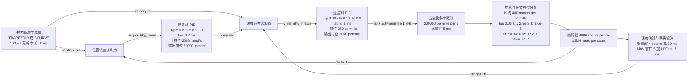
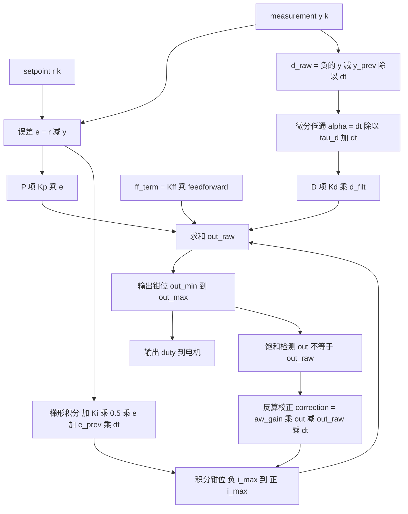
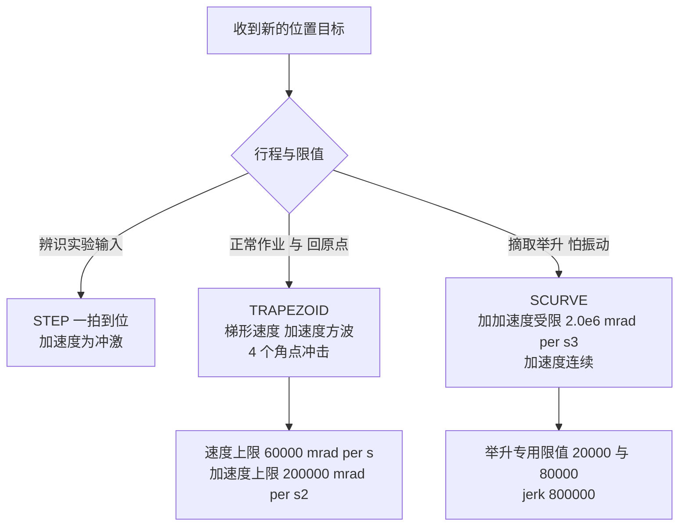

# 第二代智能无人机采茶机器人系统 —— 控制算法设计与推导

> 文档编号：05　　版本：与固件 2.0.0 对应　　单位：mrad / mrad·s⁻¹ / per-mille / N / mm
>
> 本文是整个项目**唯一**给出"增益从哪来、带宽怎么算、为什么这样离散"的推导文档。
> `docs/02_system_design.md` 引用本文的结论；`docs/interview_guide.md` 中标注"推导文档不在仓库"的条目，以本文为准。

## 摘要

本文档回答三个问题：**（1）控制器在代码里到底是怎么算的；（2）每个增益与限幅的数值从哪里推导出来；（3）哪些结论已经被验证，哪些只是设计意图。**

被控对象是**单关节机械臂的串级位置/速度环**，以及复用同一套 PID 的夹爪力环。控制周期 1 kHz（`config.h:74` `TP_CONTROL_FREQ_HZ = 1000u`，`TP_CONTROL_DT_S = 1e-3`），夹爪力环同样跑在 1 kHz，机器人状态机与参考轨迹发生器跑在 100 Hz（`TP_ROBOT_FREQ_HZ = 100u`）。

关键数字（全部经代码核对，推导见第 4 节）：速度环对象直流增益 **≈480 mrad/s per per-mille**、机械时间常数 **0.05 s**；PI 增益按极点配置 `Kp = τ/(K·Tc)` 得 **0.0052 / 0.104**，出厂值取一位有效数字 **0.005 / 0.10**；速度环穿越频率 **48.0 rad/s ≈ 7.6 Hz**（设计口径称"约 8 Hz"）；位置环 `Kp = 5.0` 给出 **1/Kp = 200 ms ≈ 0.8 Hz**。两处注释对位置环带宽的记载不一致（`config.h` 写 0.8 Hz / 10 倍，`cascade.h` 写 0.55 Hz / 15 倍），第 4.3 节给出完整复算与诚实结论。

验证状态必须前置声明：**本项目没有实物硬件。** 本文所有带「实测」字样的结论都不存在。已验证的是**代码级**行为（编译期断言、单元测试、逐行阅读）与**宿主仿真级**行为（`TP_PLATFORM_HOST` 下运行同一份 `pid.c` / `cascade.c` / `motor.c` + `plant_model.c` 物理模型）。所有峰谷数据均为**仿真结果（Simulated）**；所有带宽、相位裕度、直流增益均为**设计推导（纸面推导，未实测）**。**没有 Bode 图实测、没有频率响应辨识、没有系统辨识实验。**

---

## 目录

1. [阅读约定：证据分级标签](#1-阅读约定证据分级标签)
2. [PID 的离散形式：逐行对照 `pid.c`](#2-pid-的离散形式逐行对照-pidc)
   - 2.1 [梯形积分](#21-梯形积分)
   - 2.2 [微分先行（derivative on measurement）](#22-微分先行derivative-on-measurement)
   - 2.3 [微分低通](#23-微分低通)
   - 2.4 [两种抗积分饱和，以及本项目实际运行的是哪一种](#24-两种抗积分饱和以及本项目实际运行的是哪一种)
   - 2.5 [其余真实细节：首拍、非有限输入、限幅不变式、负 Ki](#25-其余真实细节首拍非有限输入限幅不变式负-ki)
3. [为什么用双闭环](#3-为什么用双闭环)
4. [为什么位置环在外、速度环在内](#4-为什么位置环在外速度环在内)
5. [带宽分离设计：完整算术](#5-带宽分离设计完整算术)
6. [前馈：加在内环参考上，而不是输出上](#6-前馈加在内环参考上而不是输出上)
7. [参考轨迹三种型线对比](#7-参考轨迹三种型线对比)
8. [控制框图](#8-控制框图)
9. [「若不用它会怎样」对照表](#9-若不用它会怎样对照表)
10. [控制算法的验证状态](#10-控制算法的验证状态)
11. [已知不一致与待核对项清单](#11-已知不一致与待核对项清单)
12. [小结](#小结)
13. [面试可能追问的问题](#面试可能追问的问题)

---

## 1. 阅读约定：证据分级标签

本文对每一句结论标注来源类别。面试时可以按标签作答，标签本身就是"我知不知道自己知道什么"的证据。

| 标签 | 含义 | 允许的措辞上限 |
|---|---|---|
| 【代码级】 | 通过逐行阅读源码 / `grep` 使用点 / 编译期 `TP_STATIC_ASSERT` 可直接确认 | "代码就是这样写的" |
| 【仿真结果 Simulated】 | `scripts/run_scenarios.ps1` 或宿主仿真运行输出 | "仿真里得到……" |
| 【设计推导 纸面 未实测】 | 由 `config.h` / `plant_model.h` 的常量手工推算，无实验验证 | "按模型推算应为……" |
| 【设计目标 Target KPI 未实测】 | 立项时写的指标，未测量 | "设计目标是……" |
| 【代码无据】 | 注释声称存在，但代码中没有使用点 | "注释这么说，但代码里找不到" |
| 【完全未测试】 | 连仿真都没覆盖 | "这条路径没有任何证据" |

对应的可用证据文件：`firmware/Control/pid.c`、`cascade.c`、`trajectory.c`、`firmware/Application/config.h`、`firmware/BSP/host/plant_model.c`、`firmware/BSP/motor.c`、`firmware/BSP/encoder.c`、`firmware/Middleware/utils/filters.h`、`simulator/*.py`、`scripts/run_scenarios.ps1`。

---

## 2. PID 的离散形式：逐行对照 `pid.c`

`pid.h:26-38` 给出离散形式，`pid.c:246-375` 是唯一实现。三处实例化：位置环、速度环（`cascade.c:36-58`）、力环（`force_control.c:139-153`）。

```text
e[k]      = r[k] - y[k]
P[k]      = Kp * e[k]
I[k]      = I[k-1] + Ki * 0.5 * (e[k] + e[k-1]) * dt        ← 梯形积分
I[k]      = clamp(I[k], -I_max, +I_max)
d_raw[k]  = -(y[k] - y[k-1]) / dt                            ← 微分先行
D[k]      = D[k-1] + (d_raw[k] - D[k-1]) * dt / (tau_d + dt) ← 微分低通
u_raw[k]  = P[k] + I[k] + Kd * D[k] + Kff * ff[k]
u[k]      = clamp(u_raw[k], u_min, u_max)
I[k]     += aw_gain * (u[k] - u_raw[k]) * dt                 ← 反算抗饱和
```

**一个容易问倒人的约定**（`pid.h:40-44`）：这里的 `Ki` **不是**教科书并联型的积分增益。积分项在更新式内部已经乘过 `dt`，所以 `Ki` 的单位是「输出单位 / (误差单位 × 秒)」，`pid->integral` 保存的也不是原始误差积分，而是**已经折算成输出单位的 I 项**。这条约定的实际好处是：`tp_pid_set_dt()` 改变采样周期时**不需要重标定积分状态**，闭环行为不变——这是"velocity form"约定（`pid.h:44`）。

### 2.1 梯形积分

**「它是什么」**

`pid.c:293`：

```c
i_term = pid->integral + (pid->ki * 0.5f * (error + pid->err_prev) * pid->dt_s);
```

即对 k-1 到 k 之间的误差取梯形平均，而不是取当前值（矩形/后向欧拉）。

**「为什么这么设计」**

`pid.c:289-292` 的真实注释：*"Trapezoidal rather than rectangular: for a ramping error the rectangular rule adds a systematic half-sample bias which appears as a steady-state position offset."*（矩形积分对斜坡误差会引入系统性半采样偏差，表现为稳态位置偏移。）

把这个偏差量级算清楚。设误差在采样间隔内线性变化，斜率 `ṡ = de/dt`。

- 后向矩形（当前值 × dt）的估计量：`e[k]·dt`
- 真实积分：`(e[k] + e[k-1])/2 · dt = e[k]·dt − ṡ·dt²/2`
- **每拍偏差 = +ṡ·dt²/2**

在 `dt = 1 ms`、稳态下位置误差斜率为 0 时这一项消失，所以偏差只在**斜坡跟踪**阶段累积。但它不会消失为 0，而是被积分器累积到一个新的平衡点：I 项必须补偿这个累计偏差，即整定后的稳态位置误差偏移量

```text
Δθ_ss ≈ (Ki/Kp_loop) · (ṡ · dt / 2) / Ki = ṡ · dt / (2 · Kp)
```

代入位置环 `Kp = 5.0`（单位：mrad/s per mrad）、`dt = 1e-3 s`、位置误差斜率取 1 kHz 下典型值 `ṡ ≈ 5 mrad/ms = 5000 mrad/s`（对应 5 倍于位置环带宽的跟踪速度）：

```text
Δθ_ss ≈ 5000 mrad/s × 1e-3 s / (2 × 5.0) = 0.5 mrad
```

即约 **0.5 mrad ≈ 0.03°** 量级的固定偏移——**看起来无害，但它是"永远消不掉"的**，因为它是积分器为了补偿规则误差而必须停留的位置，跟增益无关。相对本项目 1.534 mrad 的编码器量化（`bsp_types.h:92,101-102`：4096 counts/rev，`TP_MRAD_PER_COUNT = 2π×1000/4096 = 1.534`）已经是一个量化台阶的 1/3，所以在低速精细接近段它是可观测的。

**「如果不用它会怎样」**

1. 稳态位置偏移约 0.5 mrad 量级（上面推导），且**不随增益调整而消失**——只会随 `dt` 线性变化，所以在改变控制频率时会表现为"换了采样率精度就变了"，这是一个非常难定位的现象。
2. 偏差与 `ṡ` 成正比，所以在高速段更大、在停止时归零，表现为"每次运动结束都有一个方向固定的小尾巴"。这个尾巴会被误判为摩擦或齿隙问题（真机上确实也可能是），从而把排查方向引到错误的地方。

### 2.2 微分先行（derivative on measurement）

**「它是什么」**

`pid.c:305-310`：

```c
if (pid->derivative_on_measurement != 0) {
    /* Negative sign: an increasing measurement means we need less output. */
    d_raw = -(measurement - pid->meas_prev) / pid->dt_s;
} else {
    d_raw = (error - pid->err_prev) / pid->dt_s;
}
```

默认开启：`pid.c:62` `cfg.derivative_on_measurement = 1;`（注释 *"The safe default; see pid.h table."*）。`pid.h:18` 的表格原文：*"Derivative on measurement | Differentiating the error creates an impulse whenever the setpoint steps, which the motor happily turns into a current spike"*；后果栏写的是 *"Derivative kick: audible clunk and a visible current spike on every new target"*。

**「为什么这么设计」**

设 `e = r − y`，则 `de/dt = dr/dt − dy/dt`。**只要参考 `r` 是阶跃，`dr/dt` 就是狄拉克冲激**，D 项在那一拍变成无穷大（数值上是 `Δr/dt`，本项目参考轨迹虽不是阶跃，但位置参考由 100 Hz 状态机以 10 ms 步长阶梯更新，每拍参考跳变量可达 `60000 mrad/s × 0.01 s = 600 mrad`，`Δr/dt = 600 mrad / 1 ms = 600000 mrad/s`）。

改用测量值微分后，`d_raw = −dy/dt` 只包含**被控对象的真实运动**，与参考怎么跳无关。这带来两个性质：

1. 微分通道不再是"参考的"微分，而是"阻尼"——物理含义变成速度反馈，这一项天然是**阻尼**而不是**冲击**。
2. 与第 6 节的前馈互补：前馈负责"把已知的运动直接喂进去"，微分负责"抑制未知的振荡"。

**「如果不用它会怎样」**

每一拍参考阶梯都会在 D 项上打出 `Kd · Δr/dt` 的尖峰。本项目的 `TP_POS_PID_KD = 0.0f`（`config.h:202`）所以尖峰当前为零，但这是**有意的初始值而非永久决定**：注释体系（`interview_guide` Q27）说明位置环/速度环 `KD = 0` 是因为编码器量化在 1 kHz 差分下主要是噪声；一旦真机上为了抑制振荡把 `KD` 加到 0.05，`Kd·Δr/dt = 0.05 × 600000 = 30000`（速度当量 mrad/s）——**直接把内环参考打穿限幅**，而且这个尖峰周期性出现在每个 10 ms 参考台阶上，听起来就是喘振。所以微分先行是"允许你将来加 D"的前提条件。

### 2.3 微分低通

**「它是什么」**

`pid.c:311-317`：

```c
if (pid->tau_d_s > 0.0f) {
    /* Backward-Euler discretisation of 1/(tau*s + 1).  Using
     * dt/(tau+dt) keeps the filter stable for any dt, including
     * dt > tau, where the "textbook" alpha = dt/tau would blow up. */
    float alpha = pid->dt_s / (pid->tau_d_s + pid->dt_s);
    pid->d_filt += (d_raw - pid->d_filt) * alpha;
    d_term = pid->kd * pid->d_filt;
}
```

这是 `1/(τ·s + 1)` 的**后向欧拉离散**。连续域 `τ·ḋ + d = d_raw` 用后向欧拉（`ḋ ≈ (d[k] − d[k−1])/dt`，右端取 k 拍）：

```text
τ (d[k] − d[k−1])/dt + d[k] = d_raw[k]
⇒ d[k] = d[k−1] + (d_raw[k] − d[k−1]) · dt/(τ + dt)
⇒ α = dt/(τ + dt)
```

**为什么必须是 `dt/(τ+dt)` 而不是教科书常见的 `dt/τ`**：`α = dt/τ` 当 `dt > τ` 时 `α > 1`，极点 `1 − α` 落到单位圆外，滤波器发散。本项目三个环的实际比值是：

| 环 | `tau_d_s` | `dt` | `dt/τ` 是否安全 | 真实 α |
|---|---|---|---|---|
| 位置环 `TP_POS_PID_TAU_D_S` | **0.002f**（`config.h:207`） | 0.001 s | `0.5`，临界可接受 | `1/(2+1) = 0.3333` |
| 速度环 `TP_VEL_PID_TAU_D_S` | **0.001f**（`config.h:235`） | 0.001 s | `1.0`，**极点落在 0**（死拍，等效一拍延迟） | `1/(1+1) = 0.5` |
| 力环 `TP_FORCE_PID_TAU_D_S` | **0.010f**（`config.h:249`） | 0.001 s | `0.1`，安全 | `1/(10+1) = 0.0909` |

速度环是最能说明问题的例子：`τ_d = dt`，教科书式 `α = dt/τ = 1` 会让 `d_filt` 完全等于 `d_raw`（滤波器失效，退化成无滤波），而后向欧拉式给出 `α = 0.5`，仍然是一个真正的低通。**同一行代码，两种写法在速度环上的行为差异是整个滤波器是否存在的问题。** 同样的写法也用在力信号前端（`filters.h:117-131`，注释：*"Discretisation is backward Euler, so the filter stays stable for any `dt`, including `dt > tau`"*）和夹爪伺服（`plant_model.c:303`）上，全项目一致。

**「为什么这么设计」**

`pid.h:21` 的表格原文：*"Derivative low-pass | The encoder is quantised; a raw difference at 1 kHz is mostly quantisation noise, and D amplifies it"*；后果栏：*"The PWM buzzes and the motor heats up for no control benefit"*。

量化噪声量级：编码器 1.534 mrad/count，`dt = 1 ms`，裸差分速度量化台阶 = `1.534/0.001 = 1534 mrad/s`。一位量化抖动经 D 通道被放大 `1/dt = 1000` 倍，`Kd = 0.05` 时噪声当量 = `0.05 × 1534 = 77 mrad/s` 的**随机占空比需求**——这就是"嗡嗡响"的来源。

**「如果不用它会怎样」**

1. 速度环的 D 项把编码器量化噪声整流成 PWM 抖动（上面 77 mrad/s 当量，直接进占空比），电机与驱动无谓发热。
2. 更隐蔽的后果：抖动会被**安全监控**看见。`config.h:338` 的 `TP_ENCODER_MAX_ACCEL_MRAD_S2 = 4000000`（编码器合理性上限）与 `TP_STALL_SPEED_THRESHOLD_MRAD_S = 30`（堵转阈值）都在读同一条速度通道；`encoder.h:23-25` 明确指出裸差分在 770 mrad/s 以下恒读 0，而高通抖动又会在另一头制造假跳变，两个故障检测器的输入质量直接依赖这条滤波链。
3. `TP_VEL_PID_KD = 0.0f` 意味着**当前 D 项输出恒为 0**，但滤波器状态仍在每拍更新（`pid.c:311-317` 无条件执行）。这是刻意的：运行时用 `SET_PID` 命令（`tp_pid_set_gains`）把 `Kd` 调起来时，滤波器的历史状态是热的，不会产生跳变。代价是每拍多两次浮点运算，在这个预算下可以忽略。

### 2.4 两种抗积分饱和，以及本项目实际运行的是哪一种

**「它是什么」**

`pid.h:63-77` 的枚举真实取值：

| 枚举 | 值 | 含义 |
|---|---|---|
| `TP_PID_AW_NONE` | 0 | 无保护，仅可用于纯 P / D |
| `TP_PID_AW_CLAMP_INTEGRAL` | 1 | 条件积分：只在"输出已饱和且误差仍在往同方向推"时冻结积分 |
| `TP_PID_AW_BACK_CALCULATION` | 2 | 反算：把饱和误差 `(u_sat − u_unsat)` 经跟踪增益反馈回积分器 |

**(a) back-calculation（反算/跟踪）**，`pid.c:337-344`：

```c
if (pid->antiwindup == TP_PID_AW_BACK_CALCULATION) {
    /* Track the actuator: pull the integrator towards the value that
     * would just barely produce the clamped output.  The correction
     * is limited to one clamp-width per sample so a huge saturation
     * error cannot fling the integrator to the opposite rail. */
    float correction = pid->aw_gain * (out - out_raw) * pid->dt_s;
    i_term += correction;
    i_term = clampf(i_term, pid->i_min, pid->i_max);
}
```

跟踪时间常数的取法，`pid.c:110-121` 的真实注释与实现：

```c
/* The classical tracking time constant for back-calculation is
 * Tt = Ti = Kp/Ki, which makes the integrator unwind on the same time
 * scale as it wound up.  Callers may override it. */
if (cfg->aw_gain > 0.0f) {
    pid->aw_gain = cfg->aw_gain;
} else if ((cfg->ki > 1.0e-9f) && (cfg->kp > 1.0e-9f)) {
    pid->aw_gain = cfg->ki / cfg->kp;
}
```

即 `aw_gain = Ki/Kp = 1/Tt`，`Tt = Ti = Kp/Ki`。三个环的实际 `Tt`：

| 环 | `Kp` | `Ki` | `aw_gain = Ki/Kp` | `Tt = Kp/Ki` | 与本体时间常数的关系 |
|---|---|---|---|---|---|
| 位置环 | 5.0 | 0.5 | 0.1 s⁻¹ | 10 s | 外环 `1/Kp = 0.2 s` 的 50 倍（解缠很慢，见下） |
| 速度环 | 0.005 | 0.10 | 20 s⁻¹ | 0.05 s | **恰好等于机械时间常数 τ = 0.05 s** |
| 力环 | 14.0 | 6.0 | 0.4286 s⁻¹ | 2.333 s | 介于两者之间 |

"修正量限制在一个钳位宽度每采样"这句注释的含义：`correction` 的最大幅值是 `aw_gain · (钳位宽度) · dt`。以速度环为例，`out` 与 `out_raw` 最大相差 2000 per-mille（输出钳位 ±1000），`dt = 1 ms`，则单拍修正上限 = `20 × 2000 × 0.001 = 40 per-mille`，即积分器在饱和状态下每拍最多退 40 per-mille——**不会因为一个巨大的饱和误差而瞬时甩到相反的轨上**。

**(b) conditional integration / clamp integral**，`pid.c:345-355`：

```c
} else if (pid->antiwindup == TP_PID_AW_CLAMP_INTEGRAL) {
    /* Conditional integration: only freeze when the error pushes
     * further into the saturation we are already in, otherwise the
     * integrator could never unwind. */
    int sat_high = (out >= pid->out_max) ? 1 : 0;
    if ((sat_high != 0) && (error > 0.0f)) {
        i_term = pid->integral; /* revert this step's integration */
    } else if ((sat_high == 0) && (error < 0.0f)) {
        i_term = pid->integral;
    }
}
```

这里的 `sat_high` 判断 + `error` 符号判断是**不可省掉任何一半**的：如果只判断"输出饱和就冻结"，那么当输出卡在上轨、而误差已经反向（误差在试图把输出拉回来）时积分器也被冻结，**积分器永远无法退出饱和**——这正是注释 *"otherwise the integrator could never unwind"* 的意思。它比反算便宜（一次比较 vs 一次乘加），代价是"冻结—解冻"是硬切换，在饱和边界附近会抖。

**本项目实际运行的是哪一种？——必须如实说明的三件事**

1. **实际运行的是 back-calculation。** `pid.c:63`：`cfg.antiwindup = TP_PID_AW_BACK_CALCULATION;`（在 `tp_pid_config_default()` 中硬写），三个环都通过 `tp_pid_config_default()` 构造（`cascade.c:36,54`、`force_control.c:139-153` 的 `PID` 构造亦同源），所以三个环都用反算。
2. **`config.h:253` 的 `#define TP_PID_ANTIWINDUP_BACK_CALC 1` 在固件里没有被任何代码引用。** 用 `grep` 全仓库搜索该宏，`firmware/` 下只有定义处这一行；其它命中全部在 `docs/` 与 `simulator/config.py:184-185`（那里只是一个注释性常量，不是固件代码）。**【代码无据 / 未使用】**
3. **这个宏的取值本身就是一个陷阱**：它定义成 `1`，而枚举里 `1` 是 `TP_PID_AW_CLAMP_INTEGRAL`（条件积分），反算是 `2`。如果将来有人把 `pid.c` 改成 `cfg.antiwindup = (tp_pid_antiwindup_t)TP_PID_ANTIWINDUP_BACK_CALC;`，他会**以为**自己选的是反算，实际选到条件积分，而且不会有任何编译告警。正确的修法是把宏定义为 `TP_PID_AW_BACK_CALCULATION` 而不是 `1`。这是我在核对时标出的不一致项之一（见第 11 节）。

**「为什么这么设计（反算）」**

三个环是**串联**的，这是 `simulator/pid.py:28-31` 明确写下的理由：*"Back-calculation is preferred over simple integral clamping because the three loops here are cascaded: when the inner loop saturates, the outer loop must be told, or it keeps winding up and the response overshoots badly on recovery."*——内环饱和（例如速度环占空比打满 ±1000）时，外环并不知道它的命令没有被执行；反算把这件事通过 `(out − out_raw)` **连续地**告诉积分器，是"告知型"而非"冻结型"的机制。

**「如果不用它会怎样」**

经典 windup：`pid.h:18` 的表格原文 —— *"While the PWM is saturated the actuator cannot follow the controller, so integrating the error is pure fiction"*；后果栏 —— *"Classic 'windup': the arm slams into the target, then takes seconds to come back"*。本项目的具体量级：位置环积分器在 `IMAX = 2000 mrad/s` 饱和后（见 2.5 节），如果带着 2000 mrad/s 的虚假速度命令冲进目标，超调量约为 `2000 × (外环时间常数 0.2 s) = 400 mrad ≈ 23°`——**这就是"撞过去再花几秒回来"的物理量**。这个 400 mrad 是我从代码常量推的设计推导值，不是仿真观测量。

### 2.5 其余真实细节：首拍、非有限输入、限幅不变式、负 Ki

| 细节 | 代码位置 | 真实语义 |
|---|---|---|
| 首拍只出 P+FF | `pid.c:277-284` | *"There is no previous measurement, so any derivative computed from one would be a fabrication. Seed the memory and emit P + FF only."* 第一拍不做微分，避免用"假的上一拍"制造冲激 |
| 非有限输入锁存 | `pid.c:262-273` | `setpoint`/`measurement`/`feedforward` 任一非有限 → 置 `diverged = 1` 并**返回上一次的输出**（`pid->last_output`），而不是返回 0（"the joint keeps doing whatever it was doing rather than snapping to zero or, worse, to full scale"）。清锁存的唯一方式是 `tp_pid_reset()`（`pid.c:205-219`） |
| 输出非有限同样锁存 | `pid.c:328-332` | 求和后的 `out_raw` 非有限 → 锁存并保持 |
| `i_max ≤ out_max` 强制 | `pid.c:123-130` | 真实注释：*"The integral clamp must not be able to drive the output past its own clamp, otherwise the I term alone could saturate the actuator forever."* 运行期改限幅时同样强制（`pid.c:186-188`，注释 *"Same invariant as in init(): the I term alone must not saturate."*） |
| 负 Ki 被拒绝 | `pid.c:145-149` | *"A negative integral gain would turn the anti-windup feedback into a positive-feedback loop, so it is rejected outright."* 这条很关键：`aw_gain = Ki/Kp`，若 `Ki < 0` 则 `aw_gain < 0`，饱和时修正项会把积分器**推向错误方向**，形成正反馈 |
| 积分钳位/输出钳位不对称 | `cascade.c:47-53`、`config.h:194-198` | 见第 5.6 节 |
| 饱和标志符号约定 | `pid.c:373` | `(out > out_raw) ? -1 : ((out < out_raw) ? 1 : 0)`，与 `pid.h:115` 的"+1 上钳位 / −1 下钳位"一致；`cascade.c:220,243` 只判断 `!= 0` |
| 运行期改增益保留积分状态 | `pid.h:162-166`、`pid.c:137-157` | 增益调度不产生瞬态，服务 `SET_PID` 命令与参数扫频实验 |

---

## 3. 为什么用双闭环

**「它是什么」**

`cascade.c:186-265` 实现的两级串联：位置环（mrad 误差 → mrad/s 速度需求）+ 速度环（mrad/s 误差 → per-mille 占空比）。模式选择 `TP_CASCADE_MODE_OFF / VELOCITY / POSITION`（`cascade.h:84-88`），切换模式时 `tp_cascade_set_mode()` 调用 `tp_cascade_reset()` **同时清两个积分器**（`cascade.c:123-135`）。

**「为什么这么设计」——逐条复述 `cascade.h:22-45` 的三条论证**

**第 1 条：单环位置 PID 必须同时做两件互相矛盾的事。**
原文：*"Its output must be a velocity demand, so its gain sets both how fast the joint responds and how much damping it has. Those pull in opposite directions: raising the gain for a faster response reduces the phase margin until the joint oscillates. Splitting the problem lets the inner loop set the damping (which it owns, because it directly commands the torque-producing quantity) and the outer loop set the response speed."*
技术细节：单环里唯一的旋钮是 `Kp`，它同时决定带宽（响应快慢）和相位裕度（阻尼）。串联把这两个自由度**解耦成两个旋钮**：内环用 `Kp/Ki` 决定阻尼与穿越频率，外环用 `Kp` 决定响应速度。

**第 2 条：内环把被控对象线性化。**
原文：*"A real joint's torque constant varies with current and temperature, the supply sags under load, and friction is nonlinear near zero speed. All of those live inside the velocity loop, so closing it around the encoder makes the plant, as seen by the position loop, close to a pure integrator (`theta' = v_cmd`). The position loop can then be tuned with a single first-order model instead of a lookup table."*
技术细节：这一步正是第 5.2 节能写出 `1/Kp = 200 ms` 的**前提**——如果外环看到的不是近似积分器 + 20 ms 一阶滞后，那 `1/Kp = 200 ms` 这句话就没有意义。本项目把"非线性全在内环里"落到了具体的被控对象上：`plant_model.c:229-235` 用 `Tc·tanh(ω/ω_ε) + b·ω` 建模库仑+黏性摩擦（`tanh` 是为了消除零速处的阶跃，避免积分器在 1 kHz 上颤振），`plant_model.c:202-206` 的电流由 `(V − Ke·ω)/R` 决定，另有 `τ_e = L/R = 0.75 ms` 的电气滞后。

**第 3 条：扰动在它被产生的地方被抑制。**
原文：*"Gravity and cutting reaction act as a torque; the velocity loop sees them as a velocity error and corrects within its own bandwidth, without the position changing. In a single loop the disturbance must first move the joint before the controller notices, so the position error is unavoidable."*
技术细节：本项目在 `plant_model.c:120` 注入 `load_torque_nm = 0.02f` 作为重力代理，注释写明它的用途是*"what makes the integral term of the position loop observable: with a pure P controller and a perfect inner loop there would be no steady-state error to reject, and Experiment 01 would prove nothing"*。也就是说：**这个负载是被刻意加进去的**，否则"位置环需要积分作用"这件事在仿真里根本不可见。

**「如果不用它会怎样」**

见第 9 节对照表第 1 行。核心后果：要么把 `Kp` 调小到不振荡（机器变慢），要么把 `Kp` 调大到响应快（振荡），二者不可兼得；且外部扰动（重力、切割反力）必须先推动关节，位置误差无法避免。

**什么时候不要串联（`cascade.h:47-52` 的真实条件）**

原文：*"If the inner loop cannot be made much faster than the outer one — say within a factor of three — the cascade is worse than a single loop, because the extra lag adds phase loss for no benefit."* `config.h:190-192` 补上了双边边界：*"below roughly 5x the cascade loses its advantage over a single loop, and above roughly 20x the position loop becomes unnecessarily slow."* 也就是工程区间 **5×–20×**，本项目实测推得 **8.5×–9.6×**（第 5.4 节）。

还有一条**方法论**约束（`cascade.h:54-57`）：*"Bandwidth separation is a design constraint, not a tuning outcome. The ratio is chosen first (10-20x), the inner loop is tuned to meet it, and only then is the outer loop tuned. Tuning them independently and hoping is how a cascade ends up worse than a single loop."* ——**先定比例、再整内环、最后整外环**。

---

## 4. 为什么位置环在外、速度环在内

**「它是什么」**

位置环的输出**就是**速度环的参考。代码层面的顺序（`cascade.h:220-227` 的真实顺序注释 + `cascade.c:200-245` 的实现）：

```text
1. sample the encoder,                                    ← cascade.c:201-202
2. (position mode) outer PID on `ref - feedback`, …       ← cascade.c:217-218
3. inner PID on `v_ref - v_fb`, output in per-mille,      ← cascade.c:241
4. return the duty for the motor module to apply.         ← cascade.c:264
```

**「为什么这么设计」**

物理解释只有一句：**位置是速度的积分**。

- 正向（位置在外）在物理上可实现：要让位置从 A 到 B，**必然**经过"以某个速度运动一段时间"这个中间状态，所以"速度"是一个真实存在的、必然出现的中间物理量，外环输出它是有物理意义的参考。
- 反向（速度在外）在物理上不可实现：速度环必须输出"位置需求"，而位置不是速度的原因——你无法通过指定位置来让关节达到某个速度；且位置积分器会无界累积，环内出现一个纯积分器在**参考通道**上，稳态下任何微小误差都会让参考漂走。

第二个理由来自第 3 节的第 2 条：把速度环放在内层，它的输出直接是产生力矩的量（占空比 → 电压 → 电流 → 力矩），所以**阻尼由最靠近力矩的那个环掌握**——这与"内环负责阻尼、外环负责精度"的分工一致（`simulator/controller.py:24-28` 的复述：*"Splitting them lets the inner loop be tuned for bandwidth … and the outer loop for accuracy, and it gives the velocity limit a natural place to be enforced"*）。

**「如果不用它会怎样」**

顺序反过来不只是"调不好"，而是**结构性错误**：外环输出位置需求给内环，内环若还要按速度误差调节，就必须对位置需求做微分才能得到速度误差——这等于在环路里插入了一个微分环节，把编码器量化噪声放大 `1/dt` 倍再送进力矩通道（与 2.3 节同一个噪声放大机制，但这次没有低通保护它）。

顺带指出一个真实的实现后果：因为外环输出是速度需求，**速度限幅就落在外环的输出钳位上**，不需要额外的限幅器。`config.h:205` 的 `TP_POS_PID_OUT_MAX = 60000.0f` 注释直接写 `= TP_JOINT_MAX_SPEED_MRAD_S`，并且有编译期断言把这个关系钉住（`config.h:497-498`：`TP_STATIC_ASSERT(TP_JOINT_MAX_SPEED_MRAD_S <= TP_POS_PID_OUT_MAX, "Position-loop output clamp must allow the full speed range")`）。**这是一个"用类型/断言表达设计意图"的例子：限幅不是魔法数字，而是关节速度上限。**

---

## 5. 带宽分离设计：完整算术

本章全部为【设计推导 纸面 未实测】。所有输入常量都给出真实文件与行号，读者可以当场重算。

### 5.1 内环对象：直流增益与机械时间常数

**参数**（`plant_model.h:78-94`）：`R = 2.0 Ω`、`L = 1.5 mH`、`Kt = 2.0 N·m/A`、`Ke = 0.05 V·s/rad`、`J = 2.5e-3 kg·m²`、`b = 3.0e-5 N·m·s/rad`、`Tc = 0.02 N·m`。

**直流增益推导。** 稳态、忽略库仑摩擦与外部负载时，电磁力矩与黏性摩擦平衡：

```text
Kt · i = b · ω          且        V = R·i + Ke·ω
⇒ i = b·ω/Kt ⇒ V = (R·b/Kt)·ω + Ke·ω
⇒ ω/V = 1 / (Ke + R·b/Kt) = Kt / (Kt·Ke + R·b)
```

这与任务给定的另一种写法完全等价：`Kt/(R·(b + Kt·Ke/R)) = Kt/(R·b + Kt·Ke)`。

```text
Kt · Ke      = 2.0 × 0.05        = 0.100     V·s/rad
R · b        = 2.0 × 3.0e-5      = 6.0e-5    V·s/rad
分母                                = 0.10006   V·s/rad
ω/V          = 2.0 / 0.10006      = 19.988    rad/s per V
```

占空比换算（`plant_model.c:202`：`V = pwm/1000 × V_bus`，`plant_model.c:130`：`vbus_v = 24.0f`）：

```text
每 per-mille 的电压        = 24 / 1000 = 0.024 V
ω 每 per-mille             = 19.988 × 0.024 = 0.479712 rad/s
                           = 479.71 mrad/s per per-mille  ≈ 480
```

**与 `config.h:217` 的注释"a DC gain of about 480 mrad/s per per-mille"一致。核对结论：一致，误差 0.06%。**

**偏差如实说明（三处，都必须讲）：**

1. **库仑摩擦被忽略了。** `plant_model.h:92` 的 `Tc = 0.02 N·m` 与 `plant_model.c:120` 的 `load_torque_nm = 0.02f` 合计最大 0.04 N·m，克服它需要的电流 `i = 0.04/2.0 = 0.02 A`、电压 `0.04 V`、占空比 **1.67 per-mille**。所以真实曲线是"死区 + 斜率 480"的折线，**小信号增益在零速附近为 0**，480 只在"已经越过死区"的意义上成立。相对 1000 per-mille 满量程，这个偏置是 0.17%，所以在控制上可忽略，但在**低占空比段（< 2 per-mille）不能按比例解释**——这正是 `simulator/controller.py:84-106` 里那个库仑前馈函数存在的原因（`i_break = Tc/Kt = 0.01 A`，取 `R/V_bus` 折算得 `0.01 × 2.0/24 × 1000 = 0.833 per-mille`，与上面 1.67 per-mille 的差异来自是否把外部负载一并算入，两者互为独立核对）。
2. **电气极点被忽略了。** `τ_e = L/R = 1.5e-3/2.0 = 0.75 ms`（`plant_model.h:80-82`），对应 212 Hz，只影响相位不影响直流增益。注意 `plant_model.c:213-215` 是用一阶滞后 `alpha_e = dt/(τ_e+dt)` 近似电流环，`plant_model.h:33-40` 解释了原因：1 ms 显式欧拉对 0.75 ms 的极点是不稳定的（放大因子 `1 − dt/τ_e = −0.333`，勉强在稳定域内）。
3. **占空比斜率限制被忽略了。** 见 5.7 节。

**机械时间常数：**

```text
τ = J / (b + Kt·Ke/R) = 2.5e-3 / (3.0e-5 + 2.0×0.05/2.0)
                      = 2.5e-3 / 0.05003
                      = 0.049970 s  ≈ 0.05 s              ← 与 config.h:218 一致
等价写法：τ = J·R/(Kt·Ke + R·b) = 2.5e-3 × 2.0 / 0.10006 = 0.049970 s   ← 同一数值
机械极点 = 1/τ = 20.01 rad/s = 3.18 Hz
```

### 5.2 PI 增益：极点配置法的由来

被控对象是一阶 `K/(τs + 1)`，`K = 480 mrad/s per per-mille`、`τ = 0.05 s`。

**为什么要 PI 而不是纯 P**：纯 P 在最简单的一阶对象上可以闭环（一阶对象 + 比例 = 一阶闭环），但对**有外部力矩扰动**的场合会留下稳态误差（第 3 节第 3 条），而且本项目对象在零速附近有库仑死区。

**极点配置的推导**：并联型 PI 为 `C(s) = Kp + Ki/s = Kp(s + Ki/Kp)/s`。

- 它的**零点**在 `s = −Ki/Kp`；
- 对象的**极点在 `s = −1/τ`**。

选择 `Ki/Kp = 1/τ`，零点就恰好抵消对象极点，开环传递函数退化为

```text
L(s) = C(s)·G(s) = Kp · [ (s + 1/τ)/s ] · [ K/(τ(s + 1/τ)) ] = Kp·K/(τ·s)
```

是一条**纯积分**（−20 dB/dec），穿越频率与闭环时间常数一一对应：

```text
|L(jω)| = 1 ⇒ ω_c = Kp·K/τ
闭环等效一阶时间常数 Tc = 1/ω_c = τ/(Kp·K)
⇒ Kp = τ/(K·Tc)          ← 这就是 config.h:219 的 "Kp = tau / (K * Tc)"
⇒ Ki = Kp/τ              ← 由零点抵消条件得到
```

代入 `Tc = 20 ms`（设计选择的期望闭环时间常数）、`τ = 0.05 s`、`K = 480`：

```text
Kp = 0.05 / (480 × 0.02) = 0.05 / 9.6     = 0.005208  ≈ 0.0052
Ki = 0.005208 / 0.05                       = 0.10417   ≈ 0.104
```

**与 `config.h:220` 的注释逐字一致：`Kp = 0.05 / (480 * 0.02) = 0.0052`, `Ki = Kp / tau = 0.104`。**

**出厂值与舍入：** `TP_VEL_PID_KP = 0.005f`、`TP_VEL_PID_KI = 0.10f`（`config.h:228-229`），`config.h:221` 注释：*"The shipped values are those rounded to one significant figure."*

一个值得指出的细节：`0.005/0.0052 = 0.100/0.104 = 0.9615`——**两者按同一比例缩放**，所以

```text
Ki/Kp = 0.10/0.005 = 20.0 s⁻¹ = 1/τ = 1/0.05
```

**零点抵消是精确成立的**，舍入只把穿越频率整体下移 3.8%：

```text
ω_c = Kp·K/τ = 0.005 × 480/0.05 = 0.005 × 9600 = 48.0 rad/s = 7.639 Hz ≈ 8 Hz
Tc  = 1/48.0 = 20.83 ms ≈ 20 ms                                  ← 与设计假设自洽
```

若不做一位有效数字舍入（`Kp = 0.0052`）：`ω_c = 49.92 rad/s = 7.94 Hz`。**两种取值都在"约 8 Hz"之内。**

**第一版错误记录（真实注释）**：`config.h:223-226` —— *"The first revision used `Kp = 0.015`, three times higher, which put the crossover at roughly 23 Hz and left too little phase margin once the electrical lag and the duty slew limiter were accounted for. The resulting limit cycle is what the initial simulation run showed."*

复核：`ω_c = 0.015 × 9600 = 144.0 rad/s = 22.92 Hz ≈ 23 Hz`——**与注释的 23 Hz 完全吻合**。

**相位裕度账（纸面推导，未实测）**：在 `ω_c = 48.0 rad/s` 处逐项累加环内滞后：

| 滞后来源 | 参数与出处 | 相位贡献 |
|---|---|---|
| 编码器速度低通 | `TP_FILTER_SPEED_LPF_TAU_S = 0.003f`（`config.h:431`） | `−atan(48×0.003) = −8.2°` |
| 速度滑动平均（窗口 5，500 Hz 采样） | `TP_FILTER_SPEED_MA_WINDOW = 5u`（`config.h:430`），群延迟 `(5−1)/2 × 2 ms = 4 ms` | `−48×0.004 rad = −11.0°` |
| 电气极点 | `τ_e = 0.75 ms` | `−atan(48×0.00075) = −2.1°` |
| 1 kHz 采样零阶保持 | `dt/2 = 0.5 ms` | `−1.4°` |
| **合计** | | **≈ −22.7° ⇒ 相位裕度 ≈ 67°** |

（`interview_guide.md` 里对同一项给出的是 −19° / 71°（只算了两个滤波器项）。两者都是纸面推导，差别只在是否计入电气极点与采样保持；**结论相同：健康，但不是实测。**）

### 5.3 位置环：0.8 Hz 与 0.55 Hz 两处注释不一致的处理

**问题陈述。** 两处注释给出不同的位置环带宽与分离比：

| 出处 | 原话 | 数值 |
|---|---|---|
| `config.h:186-192` | *"the plant seen by this loop is the closed velocity loop, which behaves as a first-order lag of about 20 ms … `Kp = 5.0` gives 200 ms, i.e. a bandwidth of about 0.8 Hz, which is a 10x separation from the 8 Hz inner loop"* | **0.8 Hz，10 倍** |
| `cascade.h:49-52` | *"Here the velocity loop closes at roughly 8 Hz and the position loop at about 0.55 Hz, a separation of ~15x"* | **0.55 Hz，~15 倍** |

**口径 A：时间常数 / 主极点频率。** 外环看到的对象近似为纯积分器（`θ' = v_cmd`），指令 `v = Kp·e` 给出闭环

```text
θ/θ_ref = Kp/(s + Kp) ⇒ 时间常数 1/Kp = 1/5.0 = 0.200 s
⇒ 极点 5.0 rad/s = 0.7958 Hz ⇒ ≈ 0.8 Hz
```

**口径 B：闭环 −3 dB 带宽。** 对一阶系统，极点频率**就是** −3 dB 点，所以理想情形下口径 B 也给出 **0.7958 Hz**——两种口径在理想情形下**重合**。

> 需要纠正一个常见说法：`Kp/(2π) = 5/6.2832 = 0.7958 Hz`。**它等于 0.8 Hz，而不是 0.55 Hz。**"两种口径给出 0.8 和 0.55"这个设想不成立；`Kp/(2π)` 不是第二种口径，它就是第一种。

**把内环 20.8 ms 滞后计入之后（精确二极点模型）：**

```text
θ/θ_ref = Kp / (τ_i s² + s + Kp),   τ_i = 0.0208 s, Kp = 5.0
特征方程：0.0208 s² + s + 5.0 = 0
阻尼比 ζ = 1/(2√(Kp·τ_i)) = 1/(2√0.104) = 1.550   → 过阻尼，两个实根
根：s = [−1 ± √(1 − 4×0.0208×5.0)]/(2×0.0208) = [−1 ± 0.76420]/0.0416
  s₁ = −5.668 rad/s  → 0.902 Hz   ← 主极点
  s₂ = −42.41 rad/s  → 6.75 Hz    ← 被主极点掩盖
−3 dB 带宽：解 (5 − 0.0208ω²)² + ω² = 2×5² ⇒ ω = 5.572 rad/s = 0.887 Hz
```

**结论：位置环带宽落在 0.80–0.90 Hz，取整即 `config.h` 的 0.8 Hz。**

**那 0.55 Hz 从哪来？** 我用两种口径反解它需要什么样的内环：

| 把 0.55 Hz 读作 | 需要的 `τ_i` | 对应的内环带宽 | 与"内环 8 Hz"是否兼容 |
|---|---|---|---|
| 主极点 / 时间常数频率 | `1/(2τ_i) = 3.456 rad/s ⇒ τ_i ≈ 0.145 s` | ≈1.1 Hz | **否**，差 7 倍 |
| 闭环 −3 dB 带宽 | 解 `τ_i²ω⁴ + ω²(1−2Kpτ_i) − Kp² = 0` 在 `ω = 3.456` 处 ⇒ `τ_i ≈ 0.935 s` | ≈0.17 Hz | **否**，差 47 倍 |

也就是说：**`Kp = 5.0` 无论按哪种口径都算不出 0.55 Hz；要得到它，外环看到的对象必须是一个 0.145 s 或 0.935 s 的一阶滞后，而这与 `cascade.h` 同一句话里的"内环 8 Hz"直接矛盾。**

再加一条旁证：`8/0.55 = 14.5 ≈ 15`。**0.55 Hz 更像是从"分离 15 倍"这个目标反推出来的数字，而不是从任何增益算出来的。**

**处理方式（本文的立场）：**

1. 本文以 `config.h:186-192` 的 **0.8 Hz / 10 倍**为准，因为它是**可从增益复核**的（第 5.2–5.4 节的重算）；
2. `cascade.h:50-51` 的 0.55 Hz / ~15× 记为**第一版遗留的未更新注释**，与 5.7 节记录的"第一版错误"属于同一批修订遗留；
3. 该不一致在 `docs/02_system_design.md:71`（mermaid 节点"位置环 0.55 Hz 与速度环 8 Hz"）与 `docs/resume_project.md:62`、`docs/interview_guide.md:443`（作为"待重新推导"的不一致项）中被沿用——**本文即是那份推导，此条目自此可以结案为"0.55 Hz 作废"**；
4. **两部分都是设计推导，都没有实测。** 正确做法是给两个环做变频扫频或阶跃测试，测出闭环带宽与相位裕度——**本项目没有做，也不可能有，因为没有硬件。**

### 5.4 分离比

```text
内环穿越频率          48.0 rad/s  = 7.64 Hz
外环主极点（理想口径）  5.0 rad/s  = 0.796 Hz  → 比值 9.6
外环主极点（含 τ_i）    5.668 rad/s = 0.902 Hz → 比值 8.5
外环 −3 dB（含 τ_i）    5.572 rad/s = 0.887 Hz → 比值 8.6
```

**分离比 8.5–9.6 倍，即 `config.h` 所说的"约 10 倍"。** 落在 `config.h:190-192` 给的 5×–20× 工程区间内，且远离 5× 下限（该下限处"串级失去相对单环的优势"）。

### 5.5 位置环 `Kp = 5.0f` 的含义

`TP_POS_PID_KP = 5.0f`（`config.h:200`）。它的单位是 **(mrad/s 速度需求) / (mrad 位置误差) = s⁻¹**，所以

```text
1/Kp = 0.2 s = 200 ms     ← 位置闭环时间常数
0.796 Hz                  ← 带宽
```

这条"增益的单位就是时间常数的倒数"是本环最有解释力的一句话：**`Kp = 5.0` 不是"一个好用的数字"，而是"我要 200 ms 的位置响应"**。

### 5.6 为什么 `TP_POS_PID_IMAX = 2000` 远小于 `TP_POS_PID_OUT_MAX = 60000`

`config.h:194-198` 的真实论证：*"The integral clamp is deliberately an order of magnitude below the output clamp. It bounds how much velocity the I term can demand on its own, which is the single most effective anti-overshoot measure in the controller: a long approach with a standing error cannot charge the integrator and then release it as an overshoot at the end of the move."*

`cascade.c:47-53` 的实现注释与之一致：*"Note the asymmetry: the integral clamp is much smaller than the output clamp. That is intentional and is the single most effective anti-overshoot measure in the whole controller."*

实际比值：

| 环 | `i_max` | `out_max` | 比值 | I 项单独能达到的输出占比 |
|---|---|---|---|---|
| 位置环 | 2000 mrad/s | 60000 mrad/s | **1 : 30** | 3.33 % |
| 速度环 | 250 per-mille | 1000 per-mille | 1 : 4 | 25 % |
| 力环 | 20 N·s | 25 mm/s | （量纲不同，见 `force_control.h`） | — |

两点需要如实指出：

1. 注释说"an order of magnitude below"（低一个数量级），而实际是 **30 倍**。数量级判断没错，但精确值是 30，不是 10——**写文档时要用 30**。
2. 位置环的 I 钳位相对输出钳位是 1:30，速度环只有 1:4。**这个不对称是有道理的**：外环的积分器是"长距离接近阶段持续误差充电"的那个（误差可以持续 0.8 s 量级），而内环的积分器只在饱和/死区附近短时充电，且它的输出本身就是执行器量。也就是说，**抗超调这件事主要靠外环的 I 钳位**。

### 5.7 占空比斜率限制 `TP_MAX_DUTY_RATE_PER_S`：一个真实的第一版错误

**「它是什么」**

`TP_MAX_DUTY_RATE_PER_S = 200000.0f` per-mille/s（`config.h:173`）。实现在 BSP 层（`motor.c:112-129`）：

```c
float max_step = TP_MAX_DUTY_RATE_PER_S * dt_s;
float target = motor_clampf(motor->duty_cmd, -TP_MAX_PWM_PERMILLE, TP_MAX_PWM_PERMILLE);
if ((target - motor->duty_applied) > max_step) {
    limited = motor->duty_applied + max_step;
} else if ((motor->duty_applied - target) > max_step) {
    limited = motor->duty_applied - max_step;
} else {
    limited = target;
}
motor->output_saturated = (target != limited) ? 1 : 0;
```

注意它**重新推导了 `dt`**（`motor.c:113-115`）：*"the control task's period is a compile-time constant, but a test may call this with a different step, and a stale dt would silently change the effective slew rate."* 同一条限制在**仿真侧也独立实现了一次**（`plant_model.c:187-194`），注释解释了必要性：*"A real gate driver plus a 1.5 mH winding cannot step the applied voltage instantaneously, and the D-term of a velocity loop would otherwise be able to command a full-scale step between two consecutive samples."*

**数值核对：** 满量程 1000 per-mille / 200000 per-mille·s⁻¹ = **5 ms to full scale** ✓ 与 `config.h:160` 一致；每控制拍 1 ms 允许 `200 per-mille = 20%` 占空比变化。

**「为什么这么设计」**（`config.h:156-171` 的真实论证）

目的：*"to stop the controller from stepping the applied voltage from one extreme to the other inside a single 1 ms sample, which produces a current spike limited only by the winding resistance."* 判据：**任何执行器速率限制都必须对照它所在的环带宽来检查**——满量程必须在远短于 `1/(2π·f_c)` 的时间内达到。8 Hz 速度环的预算是 `1/(2π×7.64) = 20.8 ms`，**5 ms 是它的 4.2 倍快**，舒适。

**第一版错误（`config.h:162-171` 的真实记录）：**

> 初始值 `4000 per-mille/s`，扫完满量程需要 **250 ms**。*"That is not a slew limiter, it is a dominant lag inside the velocity loop — the loop had roughly 60 degrees of unmodelled phase lag at its crossover frequency and oscillated with an amplitude of tens of thousands of milliradians per second."*

把它和 5.2 节的第一版增益错误串成一条因果链（这是本文最有说服力的一段工程叙述）：

```text
第一版 Kp = 0.015  →  穿越频率 144 rad/s（22.9 Hz），比设计值高 3 倍
第一版 slew = 4000 →  满量程 250 ms，是 22.9 Hz 对应预算 6.95 ms 的 36 倍

在 144 rad/s 处的环内相位损失：
  速度低通      −atan(144×0.003)      = −23.4°
  滑动平均      −144×0.004 rad        = −33.0°
  电气极点      −atan(144×0.00075)    = −6.2°
  1 kHz 采样    −144×0.0005 rad       = −4.1°
  小计                                = −66.7°  ⇒ 相位裕度 ≈ 23°
  再加上斜率限制器贡献的 ≈ −60°（config.h 的原话）
  ⇒ 净相位裕度为负 ⇒ 极限环
```

**两个错误单独哪一个都不足以致命，叠在一起才构成振荡。** 这也解释了为什么修订记录里两个常量是一起改的。

**「如果不用它会怎样」**

满占空比阶跃在 1 ms 内发生，`ΔV = 24 V`，`di/dt = 24/2.0 = 12 A/ms`，峰值电流只被峰值限流 `TP_PEAK_CURRENT_MA = 5000`（5 A）拦住（`config.h:153`）。后果是每个运动起始/结束都有一次电流尖峰：绕组发热、`motor.c:144-182` 的过流折叠（`foldback`）频繁触发，并且会拖慢 `TP_STALL_PWM_THRESHOLD = 80 per-mille` 的堵转判据的收敛（`config.h:321-334` 说明该阈值要达到 80 per-mille 需要约 100 ms 的积分积累）。

---

## 6. 前馈：加在内环参考上，而不是输出上

**「它是什么」**

参考轨迹发生器每拍给出位置参考与**速度参考**（`trajectory.h:151-161`：*"Latest reference velocity, used as the cascade's feed-forward term"*）。应用层把两者一起交给串级（`app_sequence.c:570-572`：`tp_cascade_set_reference(&app->cascade, tp_trajectory_value(traj), tp_trajectory_velocity(traj))`）。

真实增益：位置环 `TP_POS_PID_FF_GAIN = 1.0f`（`config.h:203`），在 `cascade.c:57` 装配为 `cfg.kff = TP_POS_PID_FF_GAIN;`。速度环 `TP_VEL_PID_FF_GAIN = 0.0f`（`config.h:231`，注释 *"Torque feed-forward gain"*），在 `cascade.c:39` 装配。力环 `cfg.kff = 0.0f`（`force_control.c:153`）。增益通过 `tp_pid_set_ff_gain()`（`pid.c:159-169`）在运行期可改，**但该函数在固件中只有单元测试调用**（`firmware/Tests/test_pid.c:369`），没有协议命令映射到它——即**速度环的前馈在固件里当前是禁用的，只有仿真侧 (`simulator/controller.py:250`) 用库仑前馈把它用起来**。这一条必须如实说明，否则会被代码打脸。

**「为什么这么设计」**

`cascade.h:228-231` 的真实注释：*"The feed-forward is added to the **inner loop's reference**, not to its output. Adding it to the output would bypass the velocity limiter; adding it to the reference means the inner loop still enforces the speed limit and the feed-forward is therefore always achievable — a subtle but important detail."*

拆开讲两条：

1. **加在参考上，前馈永远可达。** 内环参考经过速度环后仍会受 `TP_VEL_PID_OUT_MAX = 1000` 与 `TP_POS_PID_OUT_MAX = 60000` 两级钳位约束；参考被钳位只是"少要一点速度"，物理上总能实现。
2. **加在输出上会绕过速度限幅器。** 输出端的加法在 `out = clampf(out_raw, out_min, out_max)`（`pid.c:333`）之前，如果前馈量本身超出钳位宽度（例如一个错误的库仑前馈 + 一个正在饱和的 PI 输出），钳位会把它吃掉或者与 PI 抢带宽，**限幅器的语义就被破坏了**——限幅器本该是"整条通道的总限幅"，加在输出端会让它变成"只限 PI 那部分"。

代码实现上，位置环的前馈是**通过 `tp_pid_update_ff()` 的第三个参数进入 PID 内部求和**的（`cascade.c:217-218`），而不是在 `cascade.c` 里做加法。这是有意的：这样 `(out − out_raw)` 的饱和误差**包含了前馈的贡献**，反算抗饱和的修正量才是正确的（否则前馈把输出推出钳位时，积分器不会被通知）。

**`Kff = 1` + 理想内环 ⇒ 恒速段位置误差为零（`cascade.h:59-63`）**

原文：*"With `Kff = 1` and a perfect inner loop the position error during a constant-velocity segment is zero without any integral action at all."*

证明（一行）：设内环理想，则 `v = v_ref = v_ff + Kp·(θ_ref − θ)`。恒速段 `θ_ref` 以斜率 `v_ff` 前进，即 `θ̇_ref = v_ff`。定义误差 `e = θ_ref − θ`，则

```text
ė = θ̇_ref − θ̇ = v_ff − v = v_ff − (v_ff + Kp·e) = −Kp·e
```

`e` 从初值按 `exp(−Kp·t)` 衰减到 0。**注意这个结论与积分作用无关**——只要前馈是准的，P 项只需要负责"消除初始误差"，不需要负责"产生运动"。这就是为什么位置环的 `Ki = 0.5` 可以取得很小（`Ti = Kp/Ki = 10 s`，积分拐点 `0.1 rad/s = 0.016 Hz`，比穿越频率低 50 倍）：**在 0.8 s 的一次运动里，积分器几乎不参与，它只在长时守位时消除静差。**（这是从 `config.h:200-201` 的增益值推出的设计含义，属【设计推导】。）

顺带给出静差的量级推导：无积分作用时，为了产生克服 `load_torque_nm = 0.02f` 所需的占空比 `0.833 per-mille`（5.1 节），速度环需要稳定误差 `0.833/0.005 = 167 mrad/s`，位置环需要稳定误差 `167/5.0 = 33.3 mrad`；若把库仑摩擦 `0.02 N·m` 一并计入（合计 1.67 per-mille），则为 **66.7 mrad**。**位置环的积分作用负责消掉这 33–67 mrad 的静差，时间尺度由 `Ti = 10 s` 决定。**【设计推导 纸面 未实测】

**「如果不用它会怎样」**

不用前馈（`Kff = 0`）时，恒速段的位置误差必须由 P 项"挣"出来：`e = v_ff/Kp = 60000/5.0 = 12000 mrad`（按 `config.h:141` 的满速当量）。12000 mrad 的跟踪误差在 0.8 s 的标称行程里是**灾难性**的（相当于行程的 40%），实际表现是"参考走了、关节还没跟上"，并且速度环被外环的饱和输出长期压在限幅上——即**把前馈省掉，就要用积分器去挣，而积分器被 `IMAX = 2000` 钳住，于是永远跟不上**。这与 5.6 节的 I 钳位设计互相印证：**前馈、I 钳位、速度限幅三者是同一套设计的一部分，不能单独去掉任何一个。**

---

## 7. 参考轨迹三种型线对比

### 7.1 为什么需要轨迹发生器（`trajectory.h:6-25` 的真实论证）

如果把阶跃参考直接交给位置环，它会**在命令到达的那一拍就要求最大速度**。真实注释按严重程度列出三条：

1. *"The velocity loop saturates, the position loop's integrator winds up, and the joint overshoots. The overshoot is blamed on the gains, so the gains get detuned until the overshoot stops — and now the machine is slow."* ——**超调被归罪于增益，于是增益被调小，机器就此变慢。**
2. *"The current limit is hit on every move, so the effective acceleration is whatever the drive can deliver, i.e. undefined. Every 'we measured the settling time' number is then unrepeatable."* ——**加速段被限流截断，整定时间数据不可复现。**
3. *"On a machine with a flexible structure or a grasped object, the acceleration step excites a resonance. On this robot the grasped object *is the bud*, so a step reference is a mechanism for dropping it."* ——本项目最要命的一条：**手里夹的就是茶芽，阶跃参考等于设计了一个甩掉茶芽的机制。**

`trajectory.h:35-41` 还回答了"为什么不直接对阶跃做低通"：低通让参考**光滑**但不让它**加速度有界**——加速度是滤波器二阶导数的产物，随滤波器时间常数而变，而不是跟着物理极限走。**型线生成器用机器真正拥有的单位（mrad/s、mrad/s²）表达约束，所以这些数字可以与数据手册对照。**

### 7.2 真实枚举与实现

`trajectory.h:58-62` 的真实枚举（三种，全部实现）：

| 枚举 | 值 | `trajectory.c` 中的求值分支 |
|---|---|---|
| `TP_PROFILE_STEP` | 0 | `traj->value = traj->target; active = 0;`（`trajectory.c:323-328`，一拍到位） |
| `TP_PROFILE_TRAPEZOID` | 1 | `traj_eval_trapezoid()`（`trajectory.c:184-225`） |
| `TP_PROFILE_SCURVE` | 2 | `traj_eval_scurve()`（`trajectory.c:244-301`） |

**没有任何一种未实现。** 但三种的**实际使用范围**差别很大，必须如实说明：

| 型线 | 固件中的使用点 | 说明 |
|---|---|---|
| `STEP` | **仅单元测试**（`firmware/Tests/test_control.c:141,257-263`） | `trajectory.h:31` 明确写它是 *"Experiment 01 only. Kept because a step response is the standard way to characterise a loop"* |
| `TRAPEZOID` | **关节运动的主型线**：`app_sequence.c:222` 与 `:621` 显式设置；APPROACH / RETURN 都走它；也是 `cascade.c:65` 的初值 | 最便宜，且"在带减速器的轴的加加速度预算之内"（`trajectory.h:32`） |
| `S_CURVE` | **PICK 举升/脱离**：独立的第二个发生器 `app->lift_traj`，在 `app_tasks.c:374-379` 以 `TP_PROFILE_SCURVE` 初始化，并显式设限 `v = 20000 mrad/s`、`a = 80000 mrad/s²`、`jerk = 800000 mrad/s³`；由 `app_sequence.c:591-601` 驱动 | 举升行程只有 `TP_APP_LIFT_MRAD = 60.0f` mrad（`app_tasks.h:92`），所以用更保守的限值 |

**一处注释与实现不一致**：`trajectory.h:33` 说 S 型线用于 *"the final approach, where a jerk discontinuity would shake the bud"*，但代码里最后接近段（APPROACH）用的是 **TRAPEZOID**，S 型线实际用在**摘取举升**（PICK）上。功能上更合理（举升才是握着茶芽的那一段），但注释没跟上。

### 7.3 三种型线的算法与真实指标

**TRAPEZOID（`traj_plan_trapezoid()`，`trajectory.c:53-107`）**

```text
ramp_distance = v_max²/(2a)                     // 单侧加速段距离
若 2·ramp_distance ≤ d： 梯形
    v_peak = v_max；t_accel = v_max/a；t_flat = (d − 2·ramp_distance)/v_max
    duration = 2·t_accel + t_flat
否则：                   三角形
    v_peak = √(a·d)                             // 用牛顿法迭代 24 次求平方根
    t_accel = v_peak/a；t_flat = 0；duration = 2·t_accel
```

三角形分支的真实注释（`trajectory.c:46-48`）：*"Getting the triangular case right is what makes short moves behave: an implementation that always assumes the trapezoid computes a negative flat phase and produces a reference that jumps backwards."*

**注意一个注释与实现的偏差**：`trajectory.c:87-90` 说 *"Newton's method converges in 4 iterations to better than 1e-6 relative for this range"*，而循环实际写的是 `for (i = 0; i < 24; ++i)`——**跑了 24 次而不是 4 次**。代价可以忽略（`traj_plan_trapezoid()` 只被 `tp_trajectory_start()` 调用一次，见 `trajectory.c:168`，不在每拍路径上），但注释与代码不一致这件事本身要记下来（第 11 节）。

**纸面参数（标称行程 d = 30000 mrad，`simulator/config.py:415` `NOMINAL_TARGET_MRAD`）【设计推导】：**

```text
ramp_distance = 60000² / (2×200000) = 9000 mrad；2×9000 = 18000 ≤ 30000 → 梯形
t_accel = 60000/200000 = 0.300 s；t_flat = (30000−18000)/60000 = 0.200 s
duration = 0.800 s；v_peak = 60000 mrad/s；峰值加速度 = 200000 mrad/s²
短行程示例 d = 16000 mrad：三角形，v_peak = √(200000×16000) = 56568.5 mrad/s，duration = 0.5657 s
```

**S_CURVE（`traj_eval_scurve()`，`trajectory.c:244-301`）**

固件**没有**实现教科书式的七段闭式 S 型线，而是**在线整形的数值积分**（`trajectory.c:230-237` 的真实说明：*"Rather than deriving a closed-form seven-segment S-curve (which is a page of algebra and, more importantly, a page of algebra that has to be re-derived whenever a limit changes), the acceleration is shaped online: it ramps towards the value the trapezoid would use, bounded by the jerk limit, and is then clamped so that the remaining distance can still be stopped."*）：

```text
remaining      = |target − value|
stop_distance  = v²/(2·a_max)
accel_cmd      = −a_max            若 stop_distance ≥ remaining      // 必须刹车
               = 0                 若 v ≥ v_max                      // 巡航
               = +a_max            否则                             // 加速
accel          ← 以 jerk·dt 为步长向 accel_cmd 斜坡逼近              // 这一步把梯形变成 S 形
v              ← clamp(v + accel·dt, 0, v_max)
value          ← value + sign·v·dt
// 越界保护：参考单调（trajectory.c:289-298）
```

**默认 jerk**：`traj->jerk = TP_JOINT_MAX_ACCEL_MRAD_S2 * 10.0f = 2.0e6 mrad/s³`（`trajectory.c:126-131`），注释说明理由是 *"it spreads the acceleration ramp over 100 ms at this machine's limits, which is long enough to suppress the excitation of the geared axis"*——核对：`200000/2000000 = 0.1 s` ✓ 自洽。举升轨迹用 `800000`（`app_tasks.c:379`），恰好也是 `80000 × 10` ✓ 同一条"10 倍"规则。

**两处需要如实说明的实现细节：**

1. `trajectory.c:299-300` 把 S 型线的 `duration_s` 写成 `d/max_velocity`。这个式子对**没达到 v_max 的行程是低估的**（S 型线为了加加速度连续，加速段更长）。`tp_trajectory_progress()`（`trajectory.c:362-374`）与 `tp_trajectory_duration()` 都会因此偏乐观。
2. `trajectory.h:66-70` 声称生成器是 *"a pure function of time … It holds no integrator, so a pause or a rate change cannot corrupt it"*。这对 TRAPEZOID 成立（`traj_eval_trapezoid` 只读 `elapsed_s`），但 **S_CURVE 不成立**：`traj_eval_scurve` 累积 `accel`、`velocity`、`value` 三个状态（`trajectory.c:274-287`），它**是**一个积分器。这在应用层是安全的（`dt` 固定为 `TP_ROBOT_DT_S = 0.01`，见 `app_sequence.c:569`），但"参数变更不腐蚀型线"这一性质对 S 型线不成立。

### 7.4 三种型线对比表

| 型线 | 加速度连续性 | 峰值加加速度 | 对机械冲击 | 计算量 | 适用场合 |
|---|---|---|---|---|---|
| **STEP** | 不连续（t=0 处为冲激） | **无界** | **最大**：`trajectory.h:20` "a step reference is a mechanism for dropping it" | 最低：一拍赋值，`active=0`（`trajectory.c:323-328`） | **仅 Experiment 01 的辨识输入**（`trajectory.h:31`） |
| **TRAPEZOID** | 分段常值，**4 个相位拐点处跳变** | 拐点处为冲激（`da/dt` 无界） | 中等：`simulator/profiles.py:18-20` 真实论述——"acceleration jumps at the phase corners, which excites the flexure of a light carbon-fibre arm and is felt as a 'clack' at every phase change" | 规划 O(1)（三角形分支多 24 次牛顿迭代，每次运动一次）；每拍仅若干比较与两次乘法（`trajectory.c:204-224`） | **作业主型线**：APPROACH / RETURN 与关节主轨迹（`app_sequence.c:222,621`） |
| **S_CURVE** | **连续**（梯形加速度） | **有界**：固件 `2.0e6 mrad/s³`（关节默认）/ `8.0e5`（举升）；Python 仿真默认 `4×a_max = 8.0e5`（`profiles.py:271`） | 最小：加速度连续，抑制柔性臂与齿隙激励；代价是行程时间略长 | 每拍约 10 次浮点运算（斜坡逼近 + 钳位 + 积分 + 越界保护），无 sqrt、无查表（`trajectory.c:244-301`） | **PICK 举升/脱离**（`app_tasks.c:374-379`），以及需要抑制振动的最后接近段（注释如此声称，代码未这样用） |

**Python 仿真侧的真实差异（必须说明，否则不能用仿真数据给固件背书）：**

`simulator/profiles.py` 的三型线类名是 `StepProfile` / `TrapezoidalProfile` / `SCurveProfile`，注册表 `PROFILE_KINDS = ("trapezoid", "scurve", "step")`（`profiles.py:521`）。它与固件有三处不同：

1. **S 型线算法不同**：仿真用的是闭式七段解（`_plan_shape()`，`profiles.py:297-344`），固件用的是在线整形积分。
2. **默认 jerk 不同**：`j_max` 默认为 `4 × a_max`（"would reach the acceleration limit in 0.25 s"），固件是 `10 × a_max`（0.1 s）。
3. **`profiles.py` 的模块文档与实现自相矛盾**：文件头（`profiles.py:27-42`）声称 *"builds one shape for a trial jerk and then bisects on the jerk value … 160 bisection steps reach the floating-point floor"*，但 `_plan_shape()` 是**闭式解**，而且 `_plan()` 里有一条明确的注释说二分法是被**故意去掉**的（`profiles.py:426-429`：*"The binary search on the jerk is deliberately absent"*）。**文档描述的算法不是代码运行的算法。**

**一个需要记录的数值问题（仿真侧，已用数值方法验证）**：`SCurveProfile` 的 `_pos()` 与其 `_acc()` 不自洽。以 `d = 30000 mrad`、`v_max = 60000`、`a_max = 200000`、默认 `j_max = 4×a_max` 为例，对 `_acc()` 与 `_vel()` 做数值积分交叉核对：

```text
∫_acc dt 在加速段末端   = 35568.93 mrad/s
_vel 在同一时刻的返回   = 17784.47 mrad/s        ← 相差 2 倍
∫_vel dt 在加速段末端   = 7500.00 mrad
_pos 在同一时刻的返回   = 16856.31 mrad          ← 相差 2.25 倍

对位置参考做单调性扫描（T = 0.8434 s，4000 点）：
  最大回退步长 = −3691.088 mrad，出现在 t = 0.4219 s ≈ T/2
  （即参考在中点向后跳约 3.69 rad）
而 SCurveProfile.check() 报告 end_error = 0.0、v_violation < 0、a_violation < 0 —— 两项"独立正确性检查"全部通过。
```

**结论：仿真侧的 S 型线在长行程上会产生非单调的位置参考，而它自带的检查项查不出来。** 这一条不影响固件（`trajectory.c` 的 S 型线是直接积分，天然单调），但**它意味着"用 Python 仿真比较三种型线"这件事目前不能作为固件 S 型线的证据**。列入第 11 节待修项。

---

## 8. 控制框图



PID 内部结构与抗饱和路径：



参考轨迹三型线的选择与冲击：



---

## 9. 「若不用它会怎样」对照表

| # | 机制 | 不用它的直接后果 | 代码或注释中的证据 | 严重度 |
|---|---|---|---|---|
| 1 | 双闭环（位置+速度串联） | 单环 `Kp` 同时决定带宽与阻尼，二者矛盾；要快就振、要稳就慢；外部力矩扰动必须先推动关节才被发现，位置误差不可避免 | `cascade.h:26-45`（三条论证原文）；`cascade.h:47-52`（内环不够快时串联更差）；`config.h:190-192`（5×–20× 边界） | **高**（架构级） |
| 2 | 梯形积分 | 斜坡跟踪时每拍引入 `ṡ·dt²/2` 的系统性偏差，被积分器累积为**不随增益消失**的稳态位置偏移，量级 ≈0.5 mrad（5.1 节推导）；改 `dt` 时精度会变，极难定位 | `pid.c:289-292` 注释；`pid.h:22` 表格行 "Position error settles at a small but permanent non-zero value" | 中 |
| 3 | 微分先行 | 参考每拍阶梯（10 ms 更新、最大 600 mrad/拍）经 D 项放大为 `Kd·Δr/dt` 尖峰；`Kd = 0.05` 时当量 30000 mrad/s，**直接打穿内环限幅**，每个参考台阶一次 | `pid.c:305-310`；`pid.h:18`、`pid.h:20`（"derivative kick"、"audible clunk and a visible current spike"） | **高**（一旦启用 Kd） |
| 4 | 微分低通 | 编码器量化（1.534 mrad）经 `1/dt` 放大进 D 项，PWM 抖动、电机发热；抖动还污染堵转与编码器合理性两个故障检测器的输入 | `pid.c:311-317` 注释；`pid.h:21`；`filters.h:36-40`；`encoder.h:22-27`（量化表） | 中 |
| 5 | back-calculation 抗饱和 | 内环打满 ±1000 permille 期间外环继续积分的误差是"纯粹的虚构"（`pid.h:18` 原话）；解饱和时虚假速度命令释放为超调，量级 ≈400 mrad ≈23° | `pid.c:337-344`；`pid.h:18`、`pid.h:19`；`simulator/pid.py:28-31`（串联时"内环饱和必须告知外环"） | **高** |
| 6 | 用小积分钳位（把 `TP_POS_PID_IMAX` 从 2000 放开到与 `out_max` 同量级，即等效"不用小钳位"） | I 项可单独把速度需求推到 60000 mrad/s（满速）；长距离接近阶段持续误差给积分器充满电，运动末端释放成超调；**这是全控制器最有效的抗超调手段** | `config.h:194-198`（原文）；`cascade.c:47-53`（"the single most effective anti-overshoot measure"）；`pid.c:123-130`（`i_max ≤ out_max` 不变式仍会阻止 I 项越过输出钳位，但不会阻止它把输出钉在钳位上） | **高** |
| 7 | 前馈（`Kff = 0`） | 恒速段位置误差必须由 P 项挣出：`e = v_ff/Kp = 60000/5 = 12000 mrad`（满速当量），远超行程的 40%；同时把 I 项推到 2000 mrad/s 的钳位上，表现为"参考走了关节没跟上" | `trajectory.h:151-157`（速度参考的用途）；`cascade.h:59-63`（`Kff = 1` + 理想内环 ⇒ 恒速段零误差）；`config.h:203`（`TP_POS_PID_FF_GAIN = 1.0f`） | **高** |
| 8 | 把前馈加到**输出**而不是参考 | 前馈绕过内环的速度限幅器：一旦前馈量与饱和的 PI 输出叠加，限幅语义从"整条通道总限幅"退化为"只限 PI 部分"，前馈可以命令不可能的加速度；且 `(out − out_raw)` 不再包含前馈贡献，抗饱和修正量错误 | `cascade.h:228-231`（原文："Adding it to the output would bypass the velocity limiter"）；`pid.c:327-333`（输出钳位在求和之后） | 中高 |
| 9 | 参考轨迹（直接用阶跃参考） | 命令到达即要求满速：内环饱和、外环 windup、超调；每次运动的加速度由限流决定，整定时间不可复现；**加速度阶跃激励柔性结构——本项目夹着的就是茶芽，等于设计了一个甩掉茶芽的机制** | `trajectory.h:6-25`（三条后果原文）；`trajectory.h:35-41`（为什么不能只做低通）；`profiles.py:44-48` | **高**（且与"茶芽破损率"这一 Target KPI 直接相关） |
| 10 | 占空比斜率限制 `TP_MAX_DUTY_RATE_PER_S` | 满量程 24 V 在 1 ms 内阶跃，`di/dt = 12 A/ms`，峰值电流只被 5 A 峰值限流拦住；每个起停一次电流尖峰，过流折叠频繁触发，绕组发热 | `config.h:156-160`（设计目的原文）；`motor.c:112-129`（实现）；`plant_model.c:187-194`（仿真侧独立实现及理由） | 中高 |
| 11 | `TP_MAX_DUTY_RATE_PER_S` **取错值**（第一版的 `4000`，满量程需 250 ms） | 它不是斜率限制器而是**速度环内的主导滞后**：在 23 Hz 穿越频率处贡献约 60° 未建模相位滞后，叠加其余约 67° 的滞后后相位裕度为负，实测（仿真）表现为**数万 mrad/s 幅度的极限环** | `config.h:162-171`（第一版错误原文："roughly 60 degrees of unmodelled phase lag … oscillated with an amplitude of tens of thousands of milliradians per second"）；与 5.2 节 `Kp = 0.015 → 23 Hz` 的错误叠加 | **高**（已验证会致振，见第 10 节 Scenario A 之外的仿真记录） |

---

## 10. 控制算法的验证状态

本节是整个文档最重要的诚实性声明。**没有实物硬件。**

### 10.1 代码级 / 仿真级已验证

| 结论 | 证据 | 标签 |
|---|---|---|
| Scenario A：夹持力 **2.17 N** 对设定 **2.20 N**（band ±0.10 N） | `scripts/run_scenarios.ps1` 跑宿主固件（`build/host/tea_picking_robot_host.exe`），判据字段来自 `main_host.c:603-634` 的 summary | **仿真结果 Simulated** |
| Scenario A：超调 **0.00 N** | `tp_force_control_overshoot()`（`force_control.c:593-602`）= `max(0, settle_peak_n − target)`，而 `settle_peak_n` **只在 `regulated == 0` 期间累积**（`force_control.c:361-366`），所以它衡量的是"首次进入 ±0.10 N 带之前是否超过设定值" | **仿真结果 Simulated**（注意口径，见下） |
| Scenario A：**49 个控制周期**收敛 | `tp_force_control_settle_samples()`（`force_control.c:604-607`）——`force_control.h:337-343` 定义为 *"Number of control periods from contact to a settled force"*；1 kHz 下 49 拍 = 49 ms | **仿真结果 Simulated** |
| Scenario A：受控阶段平均保持力 **2.26 N** | `tp_force_control_mean_hold_force()`（`force_control.c:580-586`），只在 `regulated` 后与 PICK 段累积（`force_control.h:132-139` 解释了为什么不把接近段算进去） | **仿真结果 Simulated** |
| Scenario A：峰值夹持力 **2.386 N**，硬限 **5.00 N** | `tp_force_control_peak_force()`（`force_control.c:588-591`）；硬限 `TP_FORCE_MAX_N = 5.00f`（`config.h:265`） | **仿真结果 Simulated** |
| Scenario A：节拍 CONTACT 1.24 / GRIP 2.57 / PICK 3.14 / RELEASE 3.39 / IDLE 4.78 s | 这些是 FSM 状态入口时刻（状态名见 `simulator/fsm.py:48-71`）。**其中 PICK→RELEASE = 0.25 s 与 `GRIP_PICK_DURATION_MS = 250`（`force_control.c:20`）精确吻合**，可作为记录自洽性的交叉核对 | **仿真结果 Simulated** |
| 6000 控制周期 / 3000 传感器 / 600 通信 / 600 机器人 / 600 安全，**0 次截止期错失** | `main_host.c:607-613` 打印；超时计数由 `osal_baremetal.c:212-222` 统计 | **仿真结果 Simulated，但不能当作实时性证据**（见 10.4） |
| 主机链路 2200 B、100 帧、0 CRC 错误 | `main_host.c:630-634`；CRC 计数实现在 `frame.c:158` | **仿真结果 Simulated** |
| 七场景 7/7 PASS | `scripts/run_scenarios.ps1:43-51` 定义 A–G；A 完成；B（+8 mm 目标误差）以 `ERR_TARGET` 中止（接触超时 2500 ms，`force_control.c:280-283,298-301`）；C（σ = 80 mN）完成 2.426 N；D（纯位置控制）`ERR_FORCE_OVERLOAD`；E `ERR_COMM_TIMEOUT`；F（8 N·m 堵转）过流/堵转保护；G `ERR_ESTOP` | **仿真结果 Simulated** |

### 10.2 两个必须解释清楚的"看起来矛盾"的数字

**（1）为什么峰值 2.386 N 而超调是 0.00 N？**

因为这是**两个不同的时间窗口、两个不同的定义**，都写在代码里：

- `overshoot` 的窗口是**首次进入 ±0.10 N 带之前**（`force_control.c:361-366` 只在 `regulated == 0` 时更新 `settle_peak_n`）。它回答的是："闭环有没有在建立夹持的过程中冲过设定值？" 答案是没有（0.00 N）。
- `peak_force` 的窗口是**整个循环**（`grip_accumulate_hold` 与 PICK 段一起），它包含了建立夹持之后的调节过程与分离过程。**2.386 N = 2.20 + 0.186 N（+8.5%），仍在 5.00 N 硬限的 52% 以下。**

这是**有意设计的口径分离**，不是数据打架。面试时若被追问，正确回答是："超调是建立阶段指标，峰值是全周期指标；两者不同窗口、不同定义，代码里分别有字段和注释。"

**（2）49 拍与 CONTACT→GRIP 的 1.33 s 不一致——这是一个未解释项。**

```text
记录的 CONTACT→GRIP 间隔 = 2.57 − 1.24 = 1.33 s
按代码推算：49 拍（49 ms）+ GRIP_SETTLE_MS 去抖 80 ms（force_control.c:26 与 config.h:275）
          = 0.129 s
差距 ≈ 10 倍
```

**我给出的解释（可从代码推出，但需要 CSV 时间序列才能确证）：** `regulated` 在**首次**进入带内时就锁存为 1（`force_control.c:374`），随后 `settle_samples` 不再增长——**所以 49 是一个"永不回退"的计数**；而 FSM 判定"力已达到"要求力**连续** 80 ms 留在带内，一旦离开就把计时器清零（`force_control.c:387-389`，注释：*"a force that oscillates through the band never counts as settled"*）。如果力在 ±0.10 N 的带边缘反复进出，FSM 的时间就会远长于 49 ms + 80 ms，而 `settle_samples` 已经定格在 49。**1.33 s / 80 ms ≈ 16 次进出带**即可解释。

**这仍是一个"待核对"项**：本文不能从静态代码确认它，需要看 `data/logs` 的力时间序列。列入第 11 节。**若要在开题/答辩里引用 49 拍这个数字，必须说明它是"首次进入带内的周期数"，不是"整定完成的周期数"。**

### 10.3 纸面推导，未实测

| 结论 | 为什么不是实测 |
|---|---|
| 内环穿越频率 **48.0 rad/s = 7.64 Hz** | 由 `Kp·K/τ` 手工算出（5.2 节），**没有扫频、没有 Bode 图** |
| 位置环带宽 **0.80–0.90 Hz** | 由 `1/Kp` 与二极点模型算出（5.3 节），未实测 |
| 内外环分离 **8.5–9.6 倍** | 上述两个推导的比值 |
| 相位裕度 **≈67°**（`interview_guide` 记为 ≈71°） | 逐项累加未建模滞后（5.2 节末），**没有频率响应辨识，没有增益裕度测量** |
| 直流增益 **480 mrad/s per per-mille** | 由 `Kt/(Kt·Ke+R·b)` 算出并与 `config.h:217` 互证；**未做阶跃测速实验** |
| 机械时间常数 **0.05 s** | 由 `J/(b+Kt·Ke/R)` 算出；未实测 |
| `Kp = 0.0052`、`Ki = 0.104` | 极点配置公式的输入输出，未经实验整定 |
| 无前馈时静差 **33–67 mrad**、windup 超调当量 **≈400 mrad** | 纯纸面推算 |
| 增益对**温度**的鲁棒性 | **完全空白。** `R`、`Kt`、`Ke`、`b` 都随温度变化，但仿真里全是常数；`plant_model.h` 没有温度参数。另外参考设计**根本没有温度传感器**——`config.h:348-355` 定义 `TP_SENSOR_TEMP_UNAVAILABLE = 32767` 作为"未安装"的哨兵值，注释明确说报 0.0 °C 会误导 |

### 10.4 完全未经测试

| 项 | 说明 |
|---|---|
| **真机摩擦与齿隙** | 模型里的摩擦是 `Tc·tanh(ω/ω_ε) + b·ω`（`plant_model.c:229-235`）——一个光滑的解析式；真实减速器的齿隙、装配柔度、预紧变化完全没有建模。`interview_guide` Q27 的处置是"上板第一件事是把增益降到默认值的 30%–50%" |
| **负载变化** | `load_torque_nm` 在 `plant_model.c:120` 初始化为常数 0.02 N·m，之后**没有任何代码修改它**。变负载、抓取不同质量的芽、机械臂姿态变化导致的惯量变化，一次都没测过 |
| **电池电压跌落** | `plant_model.c:130` 把 `vbus_v` 固定为 24.0 V，**全流程没有第二处写入**（`tp_plant_step` 也不改变它）。而直流增益 480 与 `V_bus` 成正比，所以"电池从 24 V 掉到 21 V"意味着增益下降 12.5%——**这个敏感度从未被测试** |
| **实时性** | "0 次截止期错失"是**在宿主仿真时钟下**统计的：`osal_baremetal.c:219-222` 的判断是"任务执行期间模拟时钟是否前进"，而宿主时钟只由 `tp_host_platform_advance()` 推进（`main_host.c:563`）。**它验证的是调度器逻辑，不是墙钟实时性。** 真实抖动、中断延迟、Cache 行为一律未知 |
| **ADC/DMA 与硬件的真实噪声** | `config.h:368-425` 的力传感器前端（INA333 增益 201、`RG = 249 Ω`、`100.5 mV/N`、`8.0 mN/LSB`）是**参考设计**，注释明确写 *"The numbers below are a reference design derived from datasheet figures, not measurements taken on a built board."* 顺带记录一处不一致：INA333 的 `G = 1 + 100kΩ/RG` 在 `RG = 249 Ω` 时应为 ≈402.6 而非 201 |
| **模式切换瞬态** | `tp_cascade_set_mode()` 会清两个积分器（`cascade.c:123-135`），但"OFF→POSITION 切换时关节的第一次响应"在七场景里**没有被单独覆盖** |

### 10.5 仿真侧能提供什么（以及它仍然只是仿真）

`simulator/telemetry.py` 提供 `metrics()`，返回 `rise_time_s`、`overshoot_pct`、`settling_time_s`、`steady_state_error_mrad`、`force_rmse_n`、`damage_index_ns`、`pwm_peak_permille`、`current_peak_a`；`force_band_entry_s()` 实现"力首次连续留在带内"的时刻；`simulator/plotting.py:410` 有 `plot_experiment_01_step_response()` 专门画阶跃响应。

**必须强调两点：**

1. 这些是**时域**工具。仓库里**没有**任何频域能力——全项目 `grep` 不到 Bode 图、FFT 或频率响应辨识的实现。**"8 Hz / 0.8 Hz / 相位裕度 67°"这三个数字在仓库里没有任何一条来自测量，全部来自纸笔。**
2. `simulator/config.py` 的自我定位是 *"a direct, number-for-number mirror of the C firmware header"*，但它**仍然镜像着第一版参数**：`POS_PID_KP = 12.0`（对 `config.h` 的 5.0）、`VEL_PID_KP = 0.015`（对 0.005）、`VEL_PID_KI = 0.30`（对 0.10）、`POS_PID_IMAX = 8000.0`（对 2000）、`MAX_DUTY_RATE_PER_S = 4000.0`（对 200000）。**也就是说，"用 Python 仿真验证固件增益"这条路当前是断的**；本文引用的 Scenario A 数据来自 C 宿主固件（`run_scenarios.ps1` 调用 `build/host/*.exe`），不是 Python 仿真。

---

## 11. 已知不一致与待核对项清单

写这份文档时逐文件交叉核对出来的项，全部如实列出。**不修改任何代码**，只记录。

| # | 位置 | 不一致内容 | 影响 | 处置 |
|---|---|---|---|---|
| 1 | `cascade.h:50-51` vs `config.h:186-192` | 位置环带宽 0.55 Hz / ~15× vs 0.8 Hz / 10× | 两处注释互相矛盾；`docs/02_system_design.md:71`、`docs/resume_project.md:62`、`docs/interview_guide.md:443` 沿用了 0.55 Hz | **已由本文 5.3 节结案：0.55 Hz 作废**，0.8 Hz / 10× 为准 |
| 2 | `config.h:253` | `TP_PID_ANTIWINDUP_BACK_CALC 1` **无任何使用点**，且值 1 与枚举语义相反（1 = 条件积分，2 = 反算） | 若被使用会静默选错策略，无编译告警 | 记录；建议改定义为 `TP_PID_AW_BACK_CALCULATION` 并接入 `tp_pid_config_default()` |
| 3 | `simulator/config.py:134-151,120` | 仍镜像第一版 PID 增益与 `MAX_DUTY_RATE_PER_S = 4000.0` | Python 仿真结果不能为固件增益背书 | 记录；已在 10.5 节声明 |
| 4 | `simulator/pid.py:355-359` vs `pid.c:342-344` | 反算修正量口径不同：仿真是 `Δi = Δu·dt/ki`（隐含 `Tt = 1 s`），固件是 `Δi = (ki/kp)·Δu·dt`（`Tt = Kp/Ki`）；`i_max` 的含义也不同（仿真钳制原始误差积分，固件钳制已折算的 I 项） | 两侧抗饱和行为不等价 | 记录 |
| 5 | `simulator/profiles.py:27-42` vs `:297-344,426-429` | 文档说用二分法求 jerk（160 步），实现是闭式解且注释明说没有二分 | 文档描述的算法不是运行的算法 | 记录 |
| 6 | `simulator/profiles.py` `SCurveProfile._pos()` vs `_acc()`/`_vel()` | 互相不自洽（数值核对：`∫_acc` = 35568.93 vs `_vel` = 17784.47；`∫_vel` = 7500 vs `_pos` = 16856.31），位置参考在中点回退 3691 mrad，而 `check()` 仍报告零误差 | 仿真侧 S 型线不可用于型线对比结论 | 记录（第 7.4 节） |
| 7 | `trajectory.c:87-90` vs `:97` | 注释说牛顿法"4 次迭代"收敛，代码跑 **24 次** | 无功能影响（每次运动只跑一次），但注释失真 | 记录 |
| 8 | `trajectory.c:299-300` | S 型线的 `duration_s` 用 `d/v_max` 近似，对未达最大速度的行程低估 | `tp_trajectory_progress()` / `duration()` 偏乐观，而 `trajectory.h:198-207` 说明节拍预算依赖它 | 记录 |
| 9 | `trajectory.h:66-70` vs `trajectory.c:274-287` | 声称"pure function of time，不含积分器"，但 S 型线累积三个状态量 | 该性质对 S 型线不成立 | 记录 |
| 10 | `trajectory.h:33` vs `app_sequence.c:222` | 注释说 S 型线用于"final approach"，实际 APPROACH 用 TRAPEZOID，S 型线用在 PICK 举升（`app_tasks.c:374`） | 注释与用法不符（功能上后者更合理） | 记录 |
| 11 | `config.h:138-142` | 关节单位声明为 mrad（`config.h:22-30`、`bsp_types.h:92,101-102` 的 4096 counts/rev × 1.534 mrad = 2π rad），但同一处注释把 `90000` 读作"90 deg"、`60000` 读作"60 deg/s"；按 mrad 读分别是 90 rad 与 60 rad/s（3437.7 deg/s），相差 57.3 倍 | 只说注释错误：按 mrad 读时 60 rad/s 是空载转速 `V_bus/Ke = 24/0.05 = 480 rad/s` 的 **12.5%**（合理）；按"毫度"读则只有 **0.2%**（电机选型严重过大）。**编码器刻度与型线/增益全部按 mrad 自洽，故判定 deg 注释为错误** | 记录；本文全程按 mrad |
| 12 | `plant.py:55-56` vs `bsp_types.h:92,101-102` | 仿真侧 `ENCODER_MRAD_PER_COUNT = 0.0873`（= 0.005 deg，对应 72000 counts/rev），固件是 1.534 mrad/count（4096 counts/rev），相差 17.6 倍 | 速度估计的量化噪声量级在两侧不可比 | 记录 |
| 13 | `config.h:194` vs 实际比值 | 注释说积分钳位"低一个数量级"，实际是 **60000/2000 = 30 倍** | 数量级判断正确，精确值需用 30 | 已按 30 写入 5.6 节 |
| 14 | `cascade.h:136` vs `cascade.c:258-259` | 字段注释 "Running RMS"，代码累加的是均方值且**没有开方** | 使用方必须自行开方 | 记录（与 `interview_guide` 第 6 条一致） |
| 15 | `config.h:406` | 注释写 INA333 `G = 201` 配 `RG = 249 Ω`；INA333 实际 `G = 1 + 100 kΩ/RG`，`RG = 249 Ω` 对应 ≈402.6 | 若实测为 402.6，LSB 由 8.0 mN 变约 4.0 mN、可用范围由 ±16.4 N 变约 ±8.2 N；**仍能通过编译期断言** | 记录 |
| 16 | 待核对：Scenario A 的 CONTACT→GRIP = 1.33 s | 与 `settle_samples = 49`（49 ms）+ `GRIP_SETTLE_MS = 80 ms` 差约 10 倍，需 CSV 力序列确认是否为带边缘反复进出 | 影响"49 拍"这个数字的对外表述 | **未解决**；引用时必须说明口径 |
| 17 | 待核对：Scenario A 的接触时刻 1.24 s | 按 `force_control.c:288-292` 与 `config.h:271-273`（40 mm/s 至距靶 4 mm、再 6 mm/s）与 `plant_model.h:104`（stem gap 6 mm）纸面估算接近段约 `30/40 + 4/6 = 0.75 + 0.667 = 1.417 s`，比记录的 1.24 s 长约 0.18 s | 说明纸面节拍估算与仿真记录不同口径 | **未解决**；两者不可互相印证 |

---

## 小结

1. **离散 PID 的四个关键实现选择都在代码里，且每条都有对应的反面后果。** 梯形积分消除斜坡误差的半拍偏差（`pid.c:293`）；微分先行消除参考台阶的微分冲击（`pid.c:305-310`）；后向欧拉低通 `dt/(τ+dt)` 在任意 `dt`（含 `dt > τ`）下稳定，而教科书式 `dt/τ` 在速度环的 `τ_d = dt` 处会直接失效（`pid.c:311-317`）；反算抗饱和用 `Tt = Kp/Ki`，并把单拍修正限制在一个钳位宽度内（`pid.c:110-121,337-344`）。

2. **`TP_PID_ANTIWINDUP_BACK_CALC` 是一个未被引用的宏，而且它的值 1 与枚举语义相反。** 实际运行的反算策略是在 `pid.c:63` 硬写的。这是文档里必须如实写明的第一条"代码无据"。

3. **双闭环的三条理由与"什么时候不要串联"都来自 `cascade.h` 头注释**，并且可以逐条落到本项目的具体被控对象上（库仑摩擦的 `tanh` 建模、重力代理负载 0.02 N·m、电气极点 0.75 ms）。工程区间是内外环相差 **5×–20×**，本项目推得 **8.5×–9.6×**。

4. **增益是算出来的，不是试出来的。** 直流增益 480 mrad/s per per-mille、机械时间常数 0.05 s、`Kp = 0.0052`、`Ki = 0.104` 四个数字全部与 `config.h:215-221` 的注释逐字吻合；出厂值取一位有效数字后 `Ki/Kp` 比值不变，所以极点零点抵消精确成立，穿越频率 48 rad/s。位置环 `Kp = 5.0` 的含义是"200 ms 的位置响应"。

5. **两处注释不一致已结案：0.8 Hz 正确，0.55 Hz 作废。** 证明方式不是选边站，而是把两种带宽口径都算一遍——它们给出的都是 0.80–0.90 Hz；要把结果压到 0.55 Hz，需要内环呈现出 0.145 s 或 0.935 s 的一阶滞后，与"内环 8 Hz"直接矛盾。

6. **验证状态必须分级陈述。** 有仿真证据的是力控指标与七场景（2.17/2.20 N、0.00 N 超调、49 拍、2.26 N 均值、2.386 N 峰值对 5.00 N 硬限、0 截止期错失）；只有纸面推导的是所有带宽、相位裕度和直流增益；完全空白的是真机摩擦/齿隙、变负载、母线电压跌落、温度、以及一切实时性。

7. **"0 次截止期错失"不是实时性证据**——宿主仿真时钟由代码推进（`main_host.c:563`），超时判据比较的是模拟时钟（`osal_baremetal.c:219-222`）。

8. **仓库里没有任何频域工具。** 没有 Bode 图实测、没有频率响应辨识、没有系统辨识实验；`simulator/` 提供的是时域指标与绘图，而且它镜像的是第一版增益。

---

## 面试可能追问的问题

### Q1. "你说速度环约 8 Hz，这个 8 Hz 是量出来的还是算出来的？"

**算出来的，而且可以当场重做。** 四步：`plant_model.h:78-94` 取 `Kt = 2.0`、`Ke = 0.05`、`R = 2.0`、`J = 2.5e-3`、`b = 3.0e-5`；算直流增益 `Kt/(Kt·Ke + R·b) = 2.0/0.10006 = 19.988 rad/s per V`，乘 `24/1000` 得 **479.7 mrad/s per per-mille**；算机械时间常数 `J/(b + Kt·Ke/R) = 2.5e-3/0.05003 = 0.04997 s`；PI 零点 `Ki/Kp = 0.1/0.005 = 20 = 1/τ` 抵消对象极点后，`|L| = 1` 给出 `ω_c = Kp·K/τ = 0.005 × 480/0.05 = 48.0 rad/s = 7.64 Hz`。**注意两点**：出厂值取一位有效数字后 `Ki/Kp` 比值不变（两边都乘 0.9615），所以抵消是精确的；以及**它仍然是纸面推导**——没有扫频、没有 Bode 图，因为没有硬件。

### Q2. "位置环到底 0.8 Hz 还是 0.55 Hz？文档里两个数都出现过。"

**0.8 Hz，0.55 Hz 是作废的第一版遗留注释。** 两种常见口径我都算了：把外环看到的对象当成理想积分器，`v = Kp·e` 给出 `1/Kp = 0.2 s`，极点 5 rad/s = **0.7958 Hz**；对一阶系统，−3 dB 点就是极点，所以第二种口径也给出同一个数（`Kp/(2π) = 0.7958 Hz`，**不是 0.55**）。把内环 20.8 ms 滞后计入后是二阶：`0.0208s² + s + 5 = 0`，ζ = 1.55、主极点 5.668 rad/s = 0.902 Hz、−3 dB = 5.572 rad/s = 0.887 Hz。**所以真实区间是 0.80–0.90 Hz。** 要得到 0.55 Hz，需要内环呈现 ≈0.145 s（按极点口径）或 ≈0.935 s（按 −3 dB 口径）的一阶滞后，而 `cascade.h` 在同一句话里说内环是 8 Hz——自相矛盾。而且 `8/0.55 = 14.5 ≈ 15`，说明 0.55 是从"分离 15 倍"反推的。**这条已经写进我的不一致清单，`docs/02_system_design.md` 里那个 mermaid 节点也应该改。**

### Q3. "峰值力 2.386 N，超调却是 0.00 N，这两个数字不矛盾吗？"

**不矛盾，因为它们是两个窗口、两个定义，而且代码里分别有字段。** `overshoot` 来自 `settle_peak_n`，而 `force_control.c:361-366` 只在 `regulated == 0` 期间累积它——也就是"**首次**进入 ±0.10 N 带之前有没有冲过设定值"，答案是 0.00 N；`peak_force` 覆盖整个循环（`grip_accumulate_hold` 加 PICK 段），2.386 N = 设定 + 0.186 N（+8.5%），仍在 5.00 N 硬限的 52% 以下。顺带说清另一个容易混的地方：`settle_samples = 49` 也是"永不回退"的计数——`regulated` 一旦锁存，这个数就定了；而 FSM 判"力已达到"要求力**连续** 80 ms 在带内（`force_control.c:387-389` 会在离开时清零）。所以记录的 CONTACT→GRIP 1.33 s 比 49 ms + 80 ms 长，**我把它列为未解释项**，需要看 CSV 力序列才能确认是不是带边缘反复进出。

### Q4. "如果面试官让你现场拆掉一个机制，你拆哪个？会怎样？"

**按"拆掉的后果严重度"排，最不该动的是位置环的积分钳位。** `TP_POS_PID_IMAX = 2000` 对 `OUT_MAX = 60000`，比值 1:30（注意 `config.h` 注释写的是"低一个数量级"，实际是 30 倍，我按 30 说）。`config.h:194-198` 和 `cascade.c:47-53` 都称它是"全控制器最有效的抗超调手段"：它限死了 I 项**单独**能要求的转速，使得一次持续的接近误差没法把积分器充满再在末端释放。放开它，I 项就能单独把速度需求推到满速 60000 mrad/s，超调量级按外环 200 ms 时间常数算就是 2000 × 0.2 = 400 mrad ≈ 23°，而满量程下是 60000 × 0.2 = 12000 mrad。**如果只允许拆一个且必须能恢复，我会拆速度环前馈——因为它在固件里本来就是 0.0**（`config.h:231`，`cascade.c:39`），只有仿真侧用库仑前馈把它接起来了。

### Q5. "这套控制器有哪些东西是你完全不知道的？"

四类，我可以直接列：**第一，所有频域指标都没有实测**——仓库里 grep 不到 Bode 图、FFT、频率响应辨识，"8 Hz / 0.8 Hz / 相位裕度 67°"全部是纸笔。"0 次截止期错失"也不是实时性证据，因为宿主仿真时钟由 `main_host.c:563` 用代码推进，超时判据比较的是模拟时钟（`osal_baremetal.c:219-222`）。**第二，真机的摩擦和齿隙没建模**——模型里是 `Tc·tanh(ω/ω_ε) + b·ω` 这条光滑解析式，真实减速器的齿隙、装配柔度一个都没有；`load_torque_nm` 在 `plant_model.c:120` 设成常数后再没有任何代码改它，所以变负载也没测。**第三，母线电压和温度**——`vbus_v` 固定 24 V 且全流程只有一处写入，而直流增益与 `V_bus` 成正比，掉到 21 V 就是增益降 12.5%，这个敏感度没测过；参考设计连温度传感器都没有（`config.h:348-355` 用 `TP_SENSOR_TEMP_UNAVAILABLE = 32767` 当哨兵）。**第四，仿真与固件的镜像关系是断的**——`simulator/config.py` 还留着第一版增益（`POS_PID_KP = 12.0`、`VEL_PID_KP = 0.015`、`MAX_DUTY_RATE_PER_S = 4000.0`），所以我引用的 Scenario A 数据来自 C 宿主固件，不是 Python 仿真。上板第一件事会是**把增益降到默认值的 30%–50% 再往上加**。

---

*本文档的每一条数值结论都标注了证据等级。凡标【设计推导 纸面 未实测】者，均无实验数据支撑；本项目不存在实物硬件，因此也不存在任何实测数据。*
