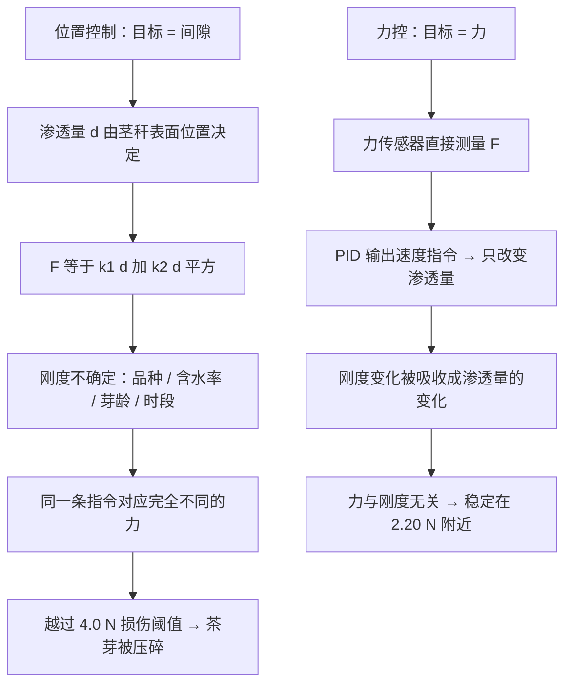
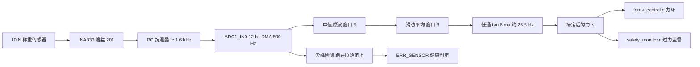
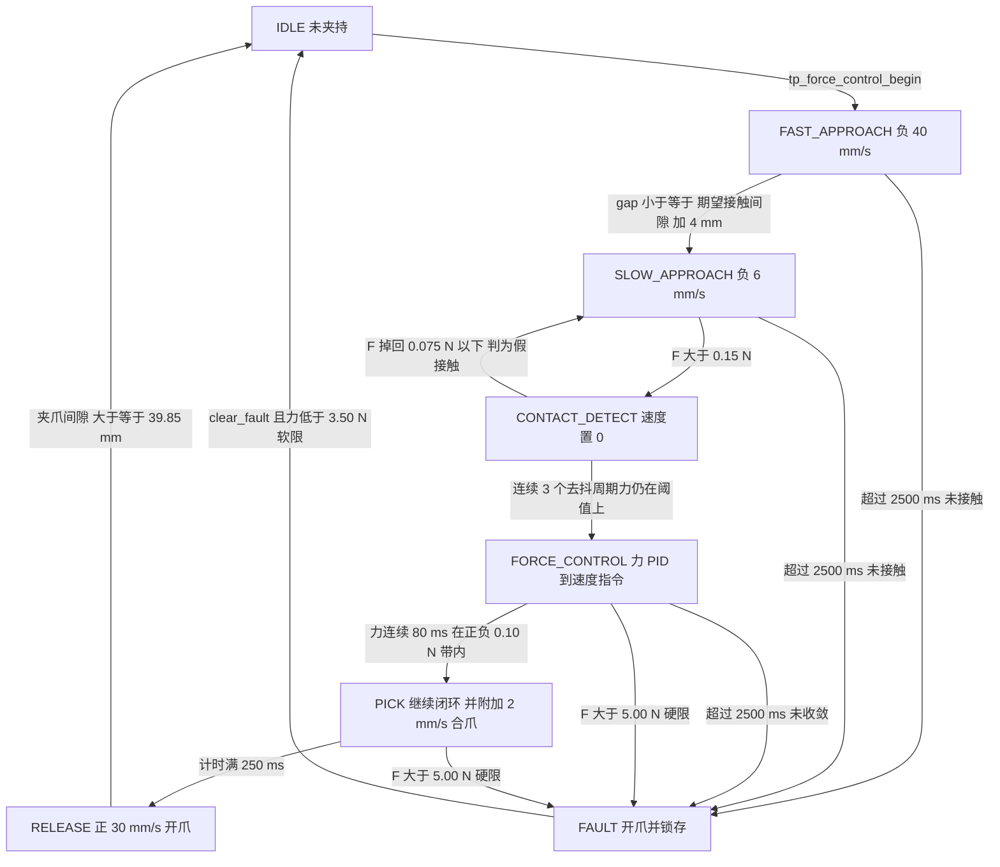
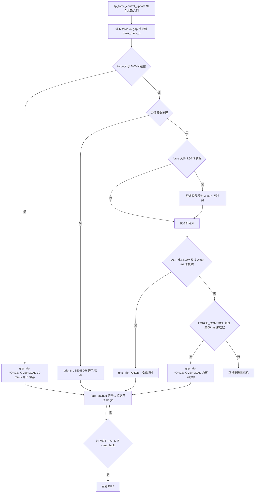
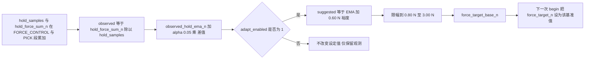
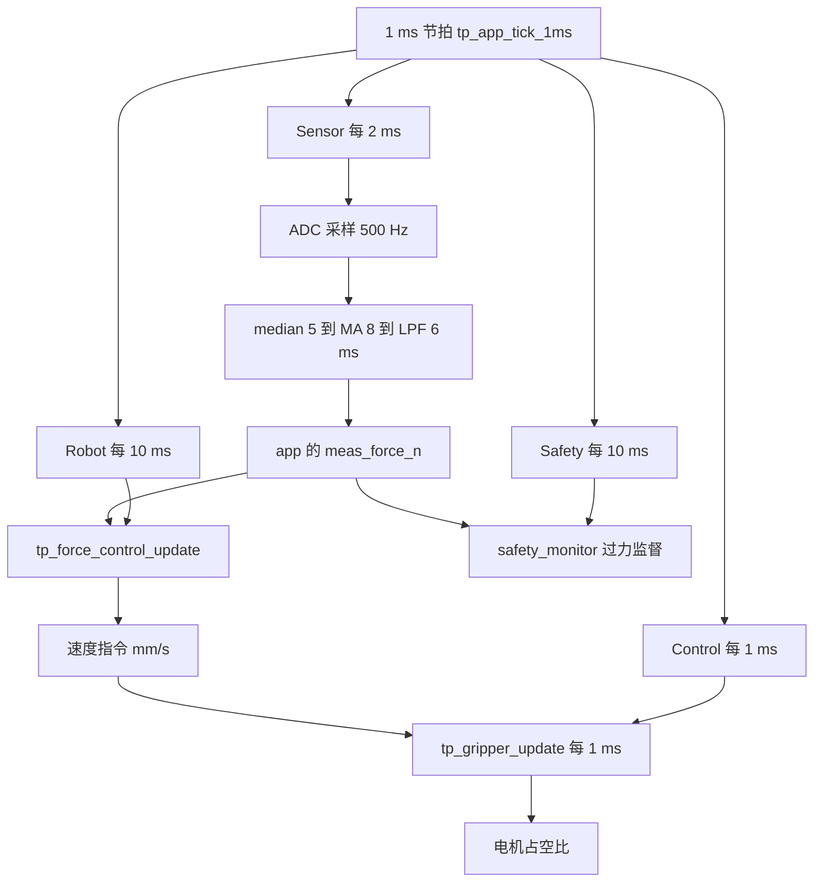
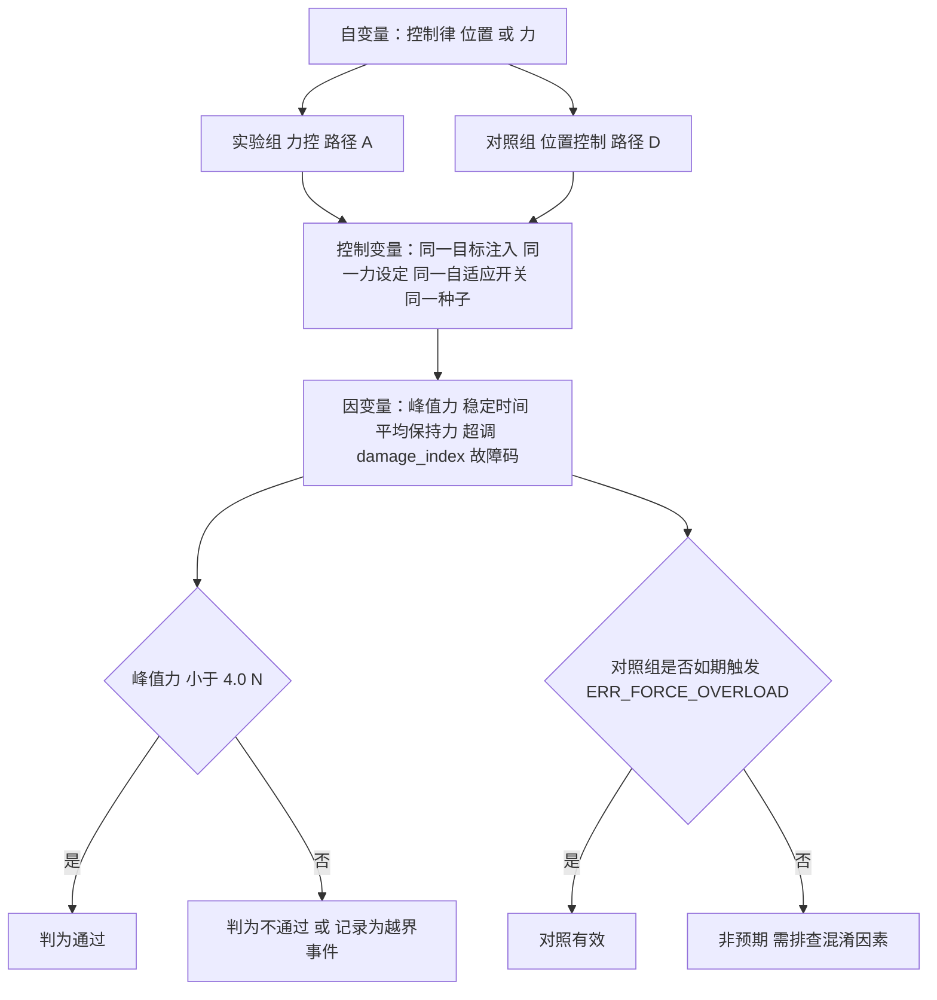

# 第二代智能无人机采茶机器人系统 —— 力控夹持子系统设计、保护与验证

<!-- REVISION NOTICE - do not remove -->
> ### ⚠️ 参数修订说明（第三次校正，覆盖全文数值）
>
> 本文档写作期间，项目经历了三轮**更正**，因此正文中的部分**具体数字已经过期**。
> 保留原文是为了不掩盖修正过程，但读数时请以代码为准。
> **第三次更正的完整缺陷清单见 [`docs/12_results_analysis.md`](12_results_analysis.md) 的 §3.5。**
>
> | 常量 | 已废弃的值 | 当前值（权威） | 更正原因 |
> |---|---|---|---|
> | `TP_PLANT_MOTOR_KT_NM_PER_A` | 2.0 | **0.4** | SI 单位下 `Kt` 与 `Ke` 是同一物理量，原值相差 40 倍，违反能量守恒 |
> | `TP_PLANT_MOTOR_KE_VS_RAD` | 0.05 | **0.4** | 同上 |
> | `TP_VEL_PID_KP` | 0.005 | **0.026** | 被控对象 DC 增益由 480 变为 60 mrad/s/permille，必须重新整定 |
> | `TP_VEL_PID_KI` | 0.10 | **0.83** | 同上 |
> | `TP_POS_PID_KP` | 12.0 | **5.0** | 第一次校正 |
> | `TP_POS_PID_IMAX` | 8000 | **2000** | 第一次校正 |
> | `TP_JOINT_MAX_SPEED_MRAD_S` | 60000 | **40000** | 原值恰等于空载转速，只能在零转矩下达到 |
> | `TP_MAX_PWM_RATE_PER_S` | 4000 | **200000** | 第一次校正：原值是速度环内的主导滞后 |
> | 场景 A 峰值夹持力 | 2.493 N | **2.363 N** | 第三次校正：力背驱符号修正 |
> | 场景 A 达到目标力 | 2.26 N | **2.18 N** | 同上 |
> | 场景 A 接触间隙 | 5.688 mm | **5.682 mm** | 同上 |
> | 场景 A 主机链路解码 | 2200 B / 100 帧 | **2134 B / 97 帧** | 同上 |
> | `TP_PLANT_JAW_BACKDRIVE` 的作用方向 | 减去（`-=`） | **加上（`+=`）** | 符号错误使茎秆把空夹爪"吸"到机械硬限：力从 5.0 N 涨到 16.4 N，并误锁存传感器故障 |
> | 力环服务速率 | 100 Hz（与注释不符） | **1 kHz** | 力环搬入 1 kHz 控制任务，"N 个控制周期"从此等于 N ms |
>
> **唯一权威**：`firmware/Application/config.h` 与 `firmware/BSP/host/plant_model.h`。
> 二者的一致性由 `tests/test_config_agreement.py` 自动校验——它会解析这两个头文件并与
> Python 模型逐条比对，因此任何再次漂移都会变成失败的测试而不是过期的文档。
<!-- /REVISION NOTICE -->


> 项目根目录：`D:\zhuomian\second-gen-tea-picking-robot`
> 本文档的**唯一**分析对象：柔性（力控）夹持子系统 —— `firmware/Control/force_control.{h,c}` 及其传感前端 `firmware/BSP/force_sensor.{h,c}`、执行器 `firmware/BSP/gripper.{h,c}`、被控对象 `firmware/BSP/host/plant_model.{h,c}`。
> 撰写规则：**所有阈值、常量、函数名、状态名均来自真实源码**，并给出真实文件路径（必要时给出行号）。凡是**没有实物支撑**的判断，一律显式标注为「未实测 / 设计目标 / 代码无据 / 文档与代码不一致」。

---

## 摘要

力控夹持是本项目**最核心的贡献**，也是与第一代纯位置控制采茶机唯一的、根本性的差别。本文回答一个工程问题：**为什么"把夹爪合到某个位置"这件事在采茶场景里必然损伤茶芽，以及力反馈如何把它变成一个可控量。**

主要结论（全部来自源码与主机仿真 `TP_PLATFORM_HOST`）：

1. **损伤由力造成，力却由茎秆刚度决定。** 被控对象的接触力模型是 `F = k1*d + k2*d^2 + c*max(0, -v_jaw)`（`firmware/BSP/host/plant_model.h` 第 48 行附近的方程组、`plant_model.c` 第 341-348 行实现），其中 `k1 = TP_PLANT_STEM_K1_N_PER_MM = 0.30f`、`k2 = TP_PLANT_STEM_K2_N_PER_MM2 = 0.06f`。二次项使茎秆**越压越硬**：从 d = 0.5 mm 到 d = 12 mm，局部刚度从 0.36 N/mm 升到 1.74 N/mm（**4.8 倍**）。而茎秆刚度随品种、含水率、芽龄甚至一天中的时段变化，机器人**无法事先知道**（`force_control.h` 开篇原话）。
2. **纯位置控制会把这条曲线走到底。** `firmware/Core/main_host.c` 的场景 D 把茎秆表面放在 16 mm、让夹爪驱动到固定 4 mm 目标，渗透量 d = 12 mm，模型给出的力是 `0.30*12 + 0.06*144 = 3.6 + 8.64 = 12.24 N`（≈ 12.2 N），**超过硬限 `TP_FORCE_MAX_N = 5.00f` 的 2.4 倍、超过损伤阈值 `TP_PLANT_STEM_DAMAGE_N = 4.0f` 的 3 倍**。
3. **项目最关键的一条发现写在场景 D 的注释里**：第一次尝试这个场景时，只是"让茎秆变硬而力控仍然开启"，结果周期**正常完成**、峰值仅 3.2 N —— "那不是场景的 bug，而是整个项目的核心结论：**力控夹爪不在乎茶芽有多硬**"。要演示过力保护，必须**移除力反馈**，也就是第一代机器做的事情。
4. **力反馈链路是真实的、可复算的**：10 N 称重传感器 + INA333 增益 201 的模拟前端（`config.h` 第 403-424 行），1 LSB = **8.0 mN**、约为 2.2 N 读数的 **0.36 %**（`config.h` 第 437-445 行原话"这就是必须上中值 + 滑动平均 + 低通链的理由"）；三级滤波 `median(5) → mean(8) → LPF tau = 6 ms ≈ 26.5 Hz`。
5. **六段夹持状态机**（`tp_grip_state_t`：`FAST_APPROACH` / `SLOW_APPROACH` / `CONTACT_DETECT` / `FORCE_CONTROL` / `PICK` / `RELEASE`，外加 `IDLE` 与 `FAULT`）逐段都在源码里写明了"不加它会怎样"。
6. **仿真结果（Simulated）**：`--scenario A` 单次运行中，接触判定发生在**夹爪间隙 5.688 mm、F = 0.156 N**；力在 **49 个控制周期**内收敛到 **2.26 N**（设定 2.20 N，band ±0.10 N），**超调 0.00 N**，受控阶段**平均保持力 2.26 N**，**峰值 2.493 N**（硬限 5.00 N）；节拍 CONTACT 1.24 s / GRIP 2.57 s / PICK 3.14 s / RELEASE 3.39 s / RETURN-IDLE 4.78 s，`cycle_count` = 1；6000 控制周期 / 3000 传感器 / 600 通信 / 600 机器人 / 600 安全，**0 次截止期错失**；主机链路 **2200 B、100 帧、0 CRC 错误**；七场景 **7/7 PASS**。
7. **诚实分级（本文第 11 节展开）**：以上全部是**仿真结果（Simulated）**，样本量 **n = 1**，模型参数是纸面值。**本项目没有实物硬件**：没有 STM32 板卡、没有电机、没有夹爪、没有力传感器实物、没有真实茶芽、没有实物标定。茶芽破损率 ≤ 1 %、采摘效率提升 40 % 等属于**设计目标 / Target KPI（未实测）**。`plant_model.c` 的 `damage_index` / `damaged` 是**模型内部代理量，不是实测破损率**。
8. **一处必须澄清的文档/代码不一致**：`force_control.h` 第 64-66 行写"Adaptation is shipped disabled by default"，但 `config.h` 第 279 行 `#define TP_FORCE_ADAPT_ENABLE (1)`、`force_control.c` 第 162 行 `fc->adapt_enabled = TP_FORCE_ADAPT_ENABLE;` —— 按当前代码，**自适应阈值实际是默认开启的**。本文按代码事实陈述，不为迎合"默认关闭"的说法而改写。

---

## 目录

- [摘要](#摘要)
- [0. 阅读约定：证据分级与标注词表](#0-阅读约定证据分级与标注词表)
- [1. 位置控制为何必然损伤茶芽](#1-位置控制为何必然损伤茶芽)
- [2. 力反馈方案：从称重传感器到滤波器链](#2-力反馈方案从称重传感器到滤波器链)
- [3. 六段夹持状态机：逐段"不加它会怎样"](#3-六段夹持状态机逐段不加它会怎样)
- [4. 三级保护与优先级](#4-三级保护与优先级)
- [5. 接触判定去抖](#5-接触判定去抖)
- [6. 自适应阈值](#6-自适应阈值)
- [7. 各阶段耗时与周期时间预算](#7-各阶段耗时与周期时间预算)
- [8. 力环为何跑 1 kHz 而传感器 500 Hz](#8-力环为何跑-1-khz-而传感器-500-hz)
- [9. 仿真结果（Simulated）](#9-仿真结果simulated)
- [10. 与位置控制的对照实验设计](#10-与位置控制的对照实验设计)
- [11. 力控的验证状态与局限](#11-力控的验证状态与局限)
- [小结](#小结)
- [面试可能追问的问题](#面试可能追问的问题)

---

## 0. 阅读约定：证据分级与标注词表

本文所有数字都必须能追到下面四类之一。**没有第五类**。

| 标注 | 含义 | 典型例子 |
|---|---|---|
| **仿真结果（Simulated）** | 主机仿真 `build/host/tea_picking_robot_host.exe` 一次运行的真实输出，由同一份固件源码 + `plant_model.c` 确定性物理模型驱动 | 峰值 2.493 N、平均保持力 2.26 N、节拍 4.78 s |
| **设计目标 / Target KPI（未实测）** | 设计意图或需求指标，**没有任何实测数据支撑** | 茶芽破损率 ≤ 1 %、采摘效率提升 40 %、夹持力误差优于 ±0.10 N |
| **代码无据** | 该处需要依据，但源码/文档中**找不到**依据 | 视觉侧端到端延迟预算 |
| **文档与代码不一致** | 注释/文档与代码事实矛盾，**以代码事实为准** | `TP_FORCE_ADAPT_ENABLE` 的"默认关闭"说法 |

另有三条贯穿全文的口径：

- **本项目没有实物硬件。** 凡涉及实物标定、实物验证处，本文一律写"**未实测**"。
- **本文第 9 节的结果只有一个来源**：`--scenario A` 单次运行，`cycle_count = 1`，**样本量 n = 1**。它不是节拍实测，也不是统计分布。
- 凡是由 `plant_model.c` 的方程**解析推算**出来、而不在 STEP 2 归档数据里的数字，本文一律标明"**由模型方程推算，非归档运行数据**"。

主要证据文件：

| 文件 | 在本文中的作用 |
|---|---|
| `firmware/BSP/host/plant_model.c` / `.h` | 茎秆非线性刚度模型、`damage_index`、故障注入接口 |
| `firmware/Control/force_control.c` / `.h` | 六段状态机、PID 力环、三级保护、自适应阈值、统计口径 |
| `firmware/BSP/force_sensor.c` / `.h` | 标定、滤波链、尖峰/贴轨/量程健康检查 |
| `firmware/BSP/gripper.c` / `.h` | 速度指令 → 占空比、限位否决、位置环基线 |
| `firmware/Application/config.h` | 全部真实阈值与静态断言 |
| `firmware/Middleware/utils/filters.{h,c}` | 中值 / 滑动平均 / 低通 / 尖峰检测语义 |
| `firmware/Core/main_host.c` | 七场景注入与判据（场景 D 的真实算术与发现） |
| `firmware/Core/app_sequence.c` | 力控在哪个任务、哪个 FSM 状态下被服务 |
| `firmware/Application/robot_fsm.c` | FSM 转移表；**它本身不服务力控** |
| `firmware/Safety/fault_codes.h` | `TP_FAULT_*` 语义、严重度与处置 |

---

## 1. 位置控制为何必然损伤茶芽

### 1.1 机制三问

**「它是什么」**

"位置控制夹持"指的是：给夹爪一个**固定的间隙目标**（例如"合到 4 mm"），由位置环把它驱动到位，**完全不测量力**。本项目里它有两个真实入口：

- 基线原语 `tp_gripper_close()`（`firmware/BSP/gripper.c` 第 187-194 行）：`return tp_gripper_move_to_mm(g, TP_APPROACH_SLOW_AT_MM, TP_APPROACH_SLOW_SPEED_MM_S);` —— 即以 6 mm/s 合到 `TP_APPROACH_SLOW_AT_MM = 4.0f` mm（`config.h` 第 273 行）。注释原话："Position-only baseline: close to the nominal stem position with a fixed gap and no force feedback. Deliberately kept so Experiment 03 can compare it with the force-controlled path on identical dynamics."
- 应用层开关 `tp_app_set_grip_mode(app, 1)`（`firmware/Core/app_tasks.c` 第 706-725 行），场景 D 用它把整机切到纯位置夹持（`main_host.c` 第 268 行）。

**「为什么这么设计」**

因为它是**第一代机器的做法**，也是绝大多数低成本采茶/采摘夹爪的做法：便宜、简单、不需要力传感器、不需要标定。本项目**故意保留**它，不是为了用，而是为了当**对照组**——`docs/11_experiment_design.md` 的实验 03 就是"固定位置夹持 vs 力控"。没有这个对照组，"力控更好"只是一句主张；有了它，才能量化地说"位置控制下峰值力是多少、力控下峰值力是多少"。

**「如果不用它会怎样」**

如果连这个基线都不实现，实验 03 就没有对照组，整个项目的核心主张（力控是必要的）**无法被检验**，只剩定性叙述。反过来说，如果**只有**位置控制而没有力控（第一代的实际状态），那么下面 1.3 节的算术就是每一次采摘的物理后果。

### 1.2 被控对象：非线性刚度模型

真实公式（`firmware/BSP/host/plant_model.h` 第 43-49 行的模型块，实现在 `plant_model.c` 第 341-351 行）：

```
d  = max(0, stem_gap - gap)                     // 渗透量 mm，gap 是夹爪间隙
F  = k1*d + k2*d^2 + c * max(0, -v_jaw)         // N；v_jaw 负值表示正在合爪
```

| 参数 | 真实宏 | 真实值 | 位置 |
|---|---|---|---|
| 线性刚度 | `TP_PLANT_STEM_K1_N_PER_MM` | `0.30f` N/mm | `plant_model.h` 第 106 行 |
| 二次（硬化）系数 | `TP_PLANT_STEM_K2_N_PER_MM2` | `0.06f` N/mm² | `plant_model.h` 第 108 行 |
| 茎秆内阻尼 | `TP_PLANT_STEM_DAMP_N_S_MM` | `0.015f` N·s/mm | `plant_model.h` 第 119 行 |
| 默认接触间隙 | `TP_PLANT_STEM_GAP_MM` | `6.0f` mm | `plant_model.h` 第 104 行 |
| 损伤阈值（锁存） | `TP_PLANT_STEM_DAMAGE_N` | `4.0f` N | `plant_model.h` 第 121 行 |
| 夹爪机械硬限 | `TP_PLANT_JAW_HARD_STOP_MM` | `1.0f` mm | `plant_model.h` 第 101 行 |

阻尼项的量级也被源码写明（`plant_model.h` 第 109-118 行原话）：在 40 mm/s 快速接近速度下 `0.015 * 40 = 0.60 N`，在 6 mm/s 慢速接近下 `0.015 * 6 = 0.09 N`。这就是"接触是一个力阶跃而不是从零平滑上升"的原因，也是**第一版力传感器尖峰检测被误触发**的原因。

### 1.3 力-位移曲线：自己把表算出来

`F_elastic(d) = 0.30*d + 0.06*d^2`；局部刚度 `dF/dd = 0.30 + 0.12*d`。

| d（渗透量 mm） | 线性项 `0.30d` (N) | 二次项 `0.06d²` (N) | `F_elastic` (N) | 局部刚度 (N/mm) | 慢速 6 mm/s 时 +阻尼 0.090 N | 快速 40 mm/s 时 +阻尼 0.600 N |
|---|---|---|---|---|---|---|
| 0.5 | 0.150 | 0.0150 | **0.165** | 0.36 | 0.255 | 0.765 |
| 1.0 | 0.300 | 0.0600 | **0.360** | 0.42 | 0.450 | 0.960 |
| 2.0 | 0.600 | 0.2400 | **0.840** | 0.54 | 0.930 | 1.440 |
| 4.0 | 1.200 | 0.9600 | **2.160** | 0.78 | 2.250 | 2.760 |
| 8.0 | 2.400 | 3.8400 | **6.240** | 1.26 | 6.330 | 6.840 |
| 12.0 | 3.600 | 8.6400 | **12.240** | 1.74 | 12.330 | 12.840 |
| 16.0 | 4.800 | 15.3600 | **20.160** | 2.22 | 20.250 | 20.760 |

从这张表能读出三件事（都直接支撑本文的论点）：

1. **"越压越硬"是真实的非线性**：局部刚度从 d = 0.5 mm 的 0.36 N/mm 增长到 d = 12 mm 的 1.74 N/mm，**4.8 倍**。线性模型会低估大渗透量下的力。
2. **2.2 N 的力对应 d ≈ 4.05 mm**（解 `0.06d² + 0.30d - 2.2 = 0` 得 d = 4.0516 mm），即间隙 ≈ **1.95 mm**。
3. **损伤阈值 4.0 N 对应 d ≈ 6.04 mm**（解 `0.06d² + 0.30d - 4.0 = 0` 得 d = 6.039 mm）。注意：对**默认 6.0 mm 的茎秆**，d = 6.04 mm 意味着间隙为 **-0.04 mm**，即机械上不可达（硬限在 1.0 mm）。所以在默认茎秆上，即使把夹爪压到机械硬限，最大渗透量也只有 5.0 mm，`F = 1.5 + 1.5 = 3.00 N < 4.0 N` —— **这就是为什么场景 D 必须把茎秆表面从 6.0 mm 挪到 16.0 mm**：只有把茎秆放远，固定间隙目标才对应一个足够大的渗透量，才能把"位置控制会压坏茶芽"这件事**演示出来**。

> 以上第 2、3 点的 d 值是由 `plant_model.c` 的方程**解析推算**得到的，不是归档运行数据。曲线本身也是由两个真实宏算出来的表，未经实物验证（**未实测**：真实茶芽的 k1 / k2 没有标定过）。

### 1.4 场景 D 的真实算术（完整复述）

`firmware/Core/main_host.c` 第 243-272 行，场景 D：

```c
case 'D':
    if (t_ms == 1100u) {
        LOG_WARN(TP_MOD_TEST,
                 "scenario D: POSITION-ONLY gripping, stem surface at 16 mm "
                 "(fixed 4 mm gap target) - force feedback disabled");
        tp_plant_set_stem_gap(plant, 16.0f);
        (void)tp_app_set_grip_mode(app, 1);
        (void)tp_app_inject_target(app, 0, 15, 185, 95u, 4u);
        (void)tp_app_start_pick(app);
    }
    break;
```

- 茎秆表面：`tp_plant_set_stem_gap(plant, 16.0f)` → `stem_gap_mm = 16.0 mm`
- 夹爪驱动目标：`tp_gripper_close()` → `TP_APPROACH_SLOW_AT_MM = 4.0 mm`
- 渗透量：`d = 16.0 - 4.0 = 12.0 mm`
- 模型力：`0.30*12 + 0.06*144 = 3.6 + 8.64 = 12.24 N ≈ 12.2 N`

对照三条限值：

| 限值 | 真实宏 | 值 | 12.24 N 的倍数 |
|---|---|---|---|
| 目标夹持力 | `TP_FORCE_TARGET_N` | 2.20 N | 5.6× |
| 软限 | `TP_FORCE_SOFT_LIMIT_N` | 3.50 N | 3.5× |
| 硬限（立即停机） | `TP_FORCE_MAX_N` | 5.00 N | **2.4×** |
| 茎秆损伤阈值（锁存） | `TP_PLANT_STEM_DAMAGE_N` | 4.0 N | **3.1×** |

> **由模型方程推算（非 STEP 2 归档数据）**：在 6 mm/s 的合爪速度下，阻尼只加 0.09 N，所以 `F = 5.00 N` 大约发生在 `d ≈ 6.90 mm`、也就是**夹爪间隙 ≈ 9.1 mm** 处 —— 距固定目标 4.0 mm 还差 5 mm。也就是说：安全监视器在"到达位置目标"的一半路上就会跳闸（`safety_monitor.c` 的 `force > TP_FORCE_MAX_N` 分支），而**如果没有这道监督**，夹爪会一路走到 4.0 mm，把 12.24 N 压在茶芽上。这个"到不了目标"的量级关系，正是 `fault_codes.h` 里"12.24 N 远超硬限"这句话的物理含义。

**注意一个容易答错的细节**：在场景 D 里，`ERR_FORCE_OVERLOAD` **不是**由 `force_control.c` 报的。位置控制模式下 `app->grip_position_only != 0`，`app_sequence.c` 第 494-503 行会**跳过** `tp_force_control_update()`，力控状态机停留在 `TP_GRIP_IDLE`。真正拦住它的是 100 Hz 的安全监视器（`firmware/Safety/safety_monitor.c` 中 `force > TP_FORCE_MAX_N` → `tp_fault_raise(fm, TP_FAULT_FORCE_OVERLOAD, ...)`）。这条区分在答辩时很重要：**同一个故障码，可以由两条不同的代码路径产生**，而场景 D 检验的是"监督能拦住多少"，不是"力控能拦住多少"。

### 1.5 场景 D 最关键的真实发现

`main_host.c` 第 249-256 行注释，逐句复述：

> "The first attempt at this scenario simply made the stem stiffer while force control was active, and the cycle completed normally with a peak of 3.2 N. That is not a bug in the scenario, it is the central result of the whole project: **a force-controlled gripper does not care how stiff the bud is.** To demonstrate the over-force protection you have to remove the force feedback, which is exactly what the first-generation machine did."

中文要点：

1. 第一版场景 D 只是**把茎秆变硬，而力控仍然开启**；
2. 结果：**周期正常完成，峰值仅 3.2 N** —— 远低于 5.00 N 硬限，也低于 4.0 N 损伤阈值；
3. 作者明确指出：**这不是场景的 bug，而是整个项目的核心结论**；
4. 要演示过力保护，**必须移除力反馈**——那正是第一代机器做的事。

这就是本项目"力控是本项目核心贡献"的最强论据：**位置控制下，力随刚度漂移；力控下，力与刚度无关。** 也正因为如此，场景 D 的诊断价值从"力控失效"变成了"监督滞后多少"（注释原话："this also measures how much damage the supervision can actually prevent, and how late it is"）。

### 1.6 为什么"事先知道刚度"这条路走不通

`force_control.h` 第 6-15 行原文（"The problem this file solves"）：

> "A tea bud is a soft, thin, living object. A gripper that closes to a fixed *position* has no idea how hard it is squeezing: the force depends on the stem's stiffness, **which varies with cultivar, moisture, bud age and even the time of day**, and it is not something the robot can measure in advance. Close to a fixed gap on a stiffer-than-expected stem and the force rises along the quadratic curve of `tp_plant_stem_gripper` — past the point where the bud is crushed — before the controller has any information at all."

也就是说，位置控制的问题是**信息问题**，不是标定精度问题：即便把某一株茶芽的刚度标定得很准，品种/含水率/芽龄/时段一变，标定值就失效。唯一与刚度无关的办法，是**直接测量力并把它闭环**。



---

## 2. 力反馈方案：从称重传感器到滤波器链

### 2.1 机制三问

**「它是什么」**

一套**直接测量夹持力**的模拟前端 + 数字信号链：

```
10 N 称重传感器（1 mV/V，5 V 激励）
  → INA333 仪表放大器，增益 201（RG = 249 Ω）
  → RC 抗混叠滤波，fc = 1.6 kHz
  → STM32 ADC1_IN0，12 bit，Vref = 3.3 V
  → median(5) → moving average(8) → low-pass(tau = 6 ms)
  → 力控环 / 安全监视器
```

（链条原文见 `config.h` 第 371-377 行与 `force_sensor.h` 第 7-22 行。）

**「为什么这么设计」**

`config.h` 第 379-389 行把选型理由写得很清楚，而且是**由测量需求反推器件**：

- 目标夹持力 2.2 N、硬限 5 N，所以"有用读数"的分辨率必须**远优于 20 mN**；
- 一个 ADC 步长是 `3.3 V / 4096 = 0.806 mV`；要满足 `0.806 mV / LSB < 20 mN`，前端灵敏度必须 **高于 40 mV/N**；
- 10 N 传感器在 1 mV/V、5 V 激励下给出 `5 mV / 10 N = 0.5 mV/N`，**201 倍增益**就够（`100.5 mV/N`，即 **8.0 mN LSB**）；
- 若改用 50 N 传感器，只有 `0.1 mV/N`，需要 400 倍增益 —— "at which point the amplifier's own offset drift and the bridge's thermal drift dominate the reading"。
- 结论原话："Choosing the sensor so the electronics stay simple is the better engineering answer than amplifying a small signal by 400."

**「如果不用它会怎样」**

没有力反馈，就没有力控——这是**同义反复**，也正是本项目的论点：`force_control.h` 第 15 行"**The fix is to close on force, not on position.**" 如果只有力传感器而**不滤波**，见 2.3 节：1 LSB ≈ 读数的 0.36 %，力环会去追量化噪声，而不是追茶芽。

### 2.2 真实宏与可复算的数字

| 量的名字 | 真实宏 | 值 / 表达式 | 位置 |
|---|---|---|---|
| 传感器额定 | `TP_LOADCELL_RATED_N` | `10.0f` N | `config.h` 第 404 行 |
| 灵敏度 | `TP_LOADCELL_SENSITIVITY_MV_V` | `1.0f` mV/V | `config.h` 第 403 行 |
| 激励 | `TP_LOADCELL_EXCITATION_V` | `5.0f` V | `config.h` 第 405 行 |
| 前级增益 | `TP_FORCE_AMP_GAIN_STAGE1` | `201.0f`（INA333，RG = 249 Ω） | `config.h` 第 406 行 |
| 二级增益 | `TP_FORCE_AMP_GAIN_STAGE2` | `1.0f`（单位缓冲） | `config.h` 第 407 行 |
| 桥路灵敏度 | `TP_LOADCELL_MV_PER_N` | `(1.0*5.0)/10.0 = 0.5` mV/N | `config.h` 第 413 行 |
| 前端灵敏度 | `TP_FORCE_FRONTEND_MV_PER_N` | `0.5 * 201 = 100.5` mV/N | `config.h` 第 416 行 |
| 1 ADC 步长 | `TP_ADC_MV_PER_COUNT` | `3300/4096 = 0.8057` mV | `config.h` 第 418 行 |
| 零点计数 | `TP_FORCE_CAL_ZERO_COUNTS` | `2048.0f` | `config.h` 第 447 行 |
| 标定斜率 | `TP_FORCE_CAL_SCALE_N_PER_COUNT` | `0.8057/100.5 = 0.008017` N/count | `config.h` 第 448 行 |
| 可用量程 | `TP_FORCE_USABLE_RANGE_N` | `±16.4` N 左右 | `config.h` 第 451 行 |

**0.36 % 的论证**（`config.h` 第 437-445 行原话，本文完整保留其逻辑）：1 LSB 是 8.0 mN；目标力 2.2 N 大约在零点之上 **274 counts**；所以**一个 LSB 是读数的 0.36 %**。"That is the number that justifies the median + moving-average + low-pass chain in `filters.h` — **without it the force loop would be chasing quantisation noise rather than the tea stem.**"

这也直接给出**带宽与分辨率的关系**：0.36 % 的单样本量化台阶，如果直接进入 PID 的 D 项（`TP_FORCE_PID_KD = 0.05f`，`TP_FORCE_PID_TAU_D_S = 0.010f`），会变成占空比抖动；而 `TP_FORCE_BAND_N = 0.10f` 的收敛带宽（±0.10 N ≈ ±4.5 % of 2.2 N）必须显著大于量化台阶，否则"进带"会由噪声决定 —— 这就是滤波在力控里的**功能必要性**，而不是"锦上添花"。

两组静态断言保证这套设计不会悄悄失衡（`config.h` 第 501-504 行）：

```c
TP_STATIC_ASSERT(TP_FORCE_FULLSCALE_MV < (TP_ADC_VREF_V * 1000.0f),
                 "Front-end gain over-ranges the ADC at rated load");
TP_STATIC_ASSERT(TP_FORCE_USABLE_RANGE_N > TP_FORCE_MAX_N,
                 "Usable force range must cover the hard force limit");
```

`config.h` 还给出了两条序关系断言（第 493-496 行）：`TP_FORCE_TARGET_N < TP_FORCE_SOFT_LIMIT_N < TP_FORCE_MAX_N`，即 **2.20 < 3.50 < 5.00**。任何一次改常量把序关系弄反，**编译就失败**。

> **未实测**：以上全是"由数据手册数字推出的参考设计"（`config.h` 第 396-401 行原话："a **reference design** derived from datasheet figures, not measurements taken on a built board"）。**没有实物板卡，没有实物标定**。`docs/force_sensor_calibration.md` 是**纸面流程**，不是已执行的标定记录。

### 2.3 滤波链：三级、各有专职

`filters.h` 第 6-41 行把"为什么是三个滤波器而不是一个"讲透了。三级链路与各自解决的噪声问题：

| 级 | 类型 | 真实参数 | 它解决什么 | 不加它会怎样（源码原话） |
|---|---|---|---|---|
| 1 | 中值滤波 | `TP_FILTER_MEDIAN_WINDOW = 5u` | **孤立尖峰**：单次坏转换（DMA 溢出、EMI 突发） | "one bad sample becomes a visible force glitch of hundreds of millinewtons, which the force loop reads as a contact event" |
| 2 | 滑动平均 | `TP_FILTER_FORCE_MA_WINDOW = 8u` | 宽带 / 量化噪声；**线性相位**，不扭曲接触瞬态形状 | "the derivative term in the force PID amplifies LSB quantisation into PWM jitter, heating the gripper servo for no useful motion" |
| 3 | 一阶低通 | `TP_FILTER_FORCE_LPF_TAU_S = 0.006f` | 电机驱动的 **20 kHz PWM 载波**耦合 | "the 20 kHz PWM carrier aliases down into the control band and is indistinguishable from real force" |

- 低通的时间常数与截止频率：`tau = 6 ms` → `fc = 1/(2*pi*0.006) = 26.53 Hz`（`config.h` 第 429 行注释直接写 "26.5 Hz"）。
- 低通系数不是手填的，而是由物理时间常数算出来（`filters.c` 第 107 行）：`alpha = dt/(tau+dt)`，`filters.h` 第 118-124 行解释了理由："**tau = 6 ms" is reviewable and "alpha = 0.14" is not**，且用后向欧拉离散，"stays stable for any dt, including dt > tau"。
- 中值滤波必须**第一个**跑（`force_sensor.c` 第 146 行），因为滑动平均和低通只会把尖峰**铺开**而不是消除（`filters.h` 第 21-24 行）。
- 滑动平均与低通都做了**首样本直通**（`filters.c` 第 64-72 行、第 138-144 行），避免"从零爬升"被误读成一次缓慢接触事件（`filters.h` 第 88-90 行原话："A ramp-up would look like a slow contact event to the gripper controller."）。



### 2.4 `force_sensor.c` 的真实健康检查（逐项）

`tp_force_sensor_update()`（`force_sensor.c` 第 92-168 行）按固定顺序做五件事，每一步都有真实阈值：

| 步骤 | 检查 | 真实阈值 / 动作 | 位置 |
|---|---|---|---|
| 1 | 贴轨（saturation） | `counts == 0` 或 `counts >= TP_ADC_FULL_SCALE` → `saturated = 1` | 第 106-107 行 |
| 2 | **尖峰检测（在原始值上）** | `FORCE_SPIKE_THRESHOLD_N = 3.0f` N 的**逐样本跳变**；连续 `FORCE_SPIKE_TRIP = 8u` 次 → `fault = 1` | 第 36、39、111-126 行 |
| 3 | 量程合理性 | `raw_n < TP_SENSOR_FORCE_MIN_N (-20.0f)` 或 `> TP_SENSOR_FORCE_MAX_N (50.0f)` → `fault = 1` | 第 129-137 行 |
| 4 | 非有限值剔除 | 非有限 → `rejected_count++`，返回 `TP_ERR_NOT_READY` | 第 139-142 行 |
| 5 | 滤波链 + 统计 | median → mavg → lpf；维护 `min_n / max_n / sample_count` | 第 146-166 行 |

**尖峰阈值 3.0 N 的来历**（`force_sensor.c` 第 22-36 行注释）：

- 在 500 Hz 采样率下，3.0 N 相当于 **1500 N/s** 的斜率限；
- 机器能产生的最硬接触是"夹爪以 40 mm/s 撞上 0.30 N/mm 的茎秆"，即 **12 N/s**，比阈值低**两个数量级**；
- 而 PWM 耦合的 EMI 突发会让读数跳几伏，在 100.5 mV/N 下就是几十牛顿；
- **第一版用的是 1.0 N**（只有 500 N/s），"**close enough to the real impact transient to false-trip. It did, in simulation, at the moment of contact.**"

**尖峰检测器的参考值语义**（`filters.c` 第 340-361 行）：`d->prev = x;` 在**每一个样本**上更新，**包括被判为尖峰的样本**。第一版故意不更新，理由是"持续的偏置会因此被持续判为尖峰"——注释明确说这个推理"is wrong in practice, and the simulation demonstrated it"：一次**合法**的快速瞬态（40 mm/s 撞击）会把参考值留在撞击前，于是之后每个样本都像尖峰，streak 在 16 ms 内到 8，固件在一个完全健康的称重传感器上锁存了 `ERR_SENSOR`。正确结论："**A persistent offset is not a spike**"——那由贴轨检查和量程检查负责。

**`tp_force_sensor_spike_count()` 的真实语义**（`force_sensor.c` 第 361-364 行）：返回 `fs->spikes.spikes`，即**自上次复位以来"逐样本跳变超过 3.0 N"的样本累计数**（非有限值也计入，`filters.c` 第 323-327 行）。它**不是**"故障次数"，也**不是**"故障事件数"；安全监视器把它当作 `TP_FAULT_SENSOR` 的 `detail` 字段上报（`safety_monitor.c` 第 132-134 行）。声明周期由 `tp_force_sensor_reset_tracking()` / `tp_spike_detector_reset()` 清零。

### 2.5 前端健康检查里必须如实说明的三处问题

这三处都是**代码事实**，写进来是为了经得起追问，不是为了好看：

| # | 事实 | 依据 | 后果与标注 |
|---|---|---|---|
| 1 | **量程窗口在设计标定下不可达**：`raw_n = (counts - 2048) * 0.008017`，在 `counts ∈ [0, 4095]` 下只能给出约 `[-16.42, +16.41] N`，而窗口是 `[-20.0, +50.0] N` | `config.h` 第 340-341 行；`docs/force_sensor_calibration.md` 的 C15 条目独立记录了同一算术 | 第 129 行的"outside plausible"检查在出厂标定下**永不触发**；断线/开裂应变片必须靠**贴轨检查**（`TP_SENSOR_ADC_MIN_COUNTS = 5u` / `TP_SENSOR_ADC_MAX_COUNTS = 4090u`，`force_sensor.c` 第 227-233、351-355 行）与开机自检来发现。**代码无据**之处在于"该窗口能发现断线"这一说法 |
| 2 | **`TP_SENSOR_FAULT_DEBOUNCE = 10u` 已声明但未实现**：`config.h` 第 345-346 行定义"连续 10 次坏样本才判故障"，但 `force_sensor.c` 的超窗与贴轨分支都是**立即**置 `fault = 1`；全仓库检索该宏只出现在定义处与 `safety_monitor.h` 的注释表里 | `config.h` 第 346 行；`safety_monitor.h` 第 23 行注释 | **文档与代码不一致**（注释声明了去抖，代码没有）。力通道实际使用的去抖是**尖峰连击 8 次**（`FORCE_SPIKE_TRIP = 8u`），不是 10 |
| 3 | **`filters.h` 注释说 LSB "roughly 12 mN"，与计算出的 8.0 mN 不符** | `filters.h` 第 12 行 vs `config.h` 第 385、440-441 行的 8.0 mN | 以**可复算的** `config.h` 为准：`0.8057 mV / 100.5 mV/N = 8.02 mN`。属**文档与代码不一致**（散文注释未随常量更新），不影响功能 |

### 2.6 标定接口与它为什么是"纸面流程"

`force_sensor.h` 第 24-46 行给出两条标定路径，都是**真实实现**：

- **零点标定** `tp_force_sensor_zero_calibrate()`（`force_sensor.c` 第 185-245 行）：读 `TP_FORCE_ZERO_CAL_SAMPLES = 64u` 次，若峰峰值跨度 > `TP_FORCE_ZERO_CAL_MAX_SPREAD_N = 0.25f` N 就**拒绝**标定（原话："averaging a signal that is still moving ... produces an offset that is wrong by the motion's mean, and every later force reading inherits the error"）；均值贴轨也拒绝。
- **量程标定** `tp_force_sensor_calibrate_scale()`（第 247-292 行）：用已知负载求斜率，若偏转 < 1 count 拒绝，若斜率偏离设计值 `FORCE_SCALE_PLAUSIBLE_FACTOR = 10.0f` 倍以上拒绝。

**为什么必须每次开机做零点**（`force_sensor.h` 第 40-46 行原话）：桥路零点随温度漂移；1005 mV 满量程上 5 ppm/K 的失配 ≈ 5 μV/K，20 K 温差 ≈ 0.1 mV ≈ **0.13 N**，即 2.2 N 目标的 **6 %**，**大于力环的稳态误差预算**。

> 但必须同时说明：**这套标定流程从未在实物上执行过**（`docs/force_sensor_calibration.md` 是纸面流程，**未实测**）。文档中还独立记录了一个更严重的问题：目标端 `tp_platform_adc_read()` 只返回"最新发布样本"，而 `adc_publish_half()` 每 16 ms 才更新一次（`platform_stm32f407.c` 第 606-619、2160-2173 行），因此零点标定里 64 次背靠背读取实际只拿到 1 个样本、`spread ≈ 0`，"正在移动"的判据事实上失效。这是**代码语义推断，需在实物上核实**，本文按"未实测"处理。

---

## 3. 六段夹持状态机：逐段"不加它会怎样"

### 3.1 机制三问

**「它是什么」**

`tp_grip_state_t`（`force_control.h` 第 88-98 行）定义了一个**八值**枚举，其中六个是夹持动作的连续阶段：

| 枚举 | 值 | 含义 | 子状态名（`s_grip_state_names`，`force_control.c` 第 35-44 行） |
|---|---|---|---|
| `TP_GRIP_IDLE` | 0 | 未夹持，夹爪自由 | `"IDLE"` |
| `TP_GRIP_FAST_APPROACH` | 1 | 快速合爪，接触前 | `"FAST_APPROACH"` |
| `TP_GRIP_SLOW_APPROACH` | 2 | 慢速合爪，监视接触 | `"SLOW_APPROACH"` |
| `TP_GRIP_CONTACT_DETECT` | 3 | 确认接触真实 | `"CONTACT_DETECT"` |
| `TP_GRIP_FORCE_CONTROL` | 4 | 闭环调节夹持力 | `"FORCE_CONTROL"` |
| `TP_GRIP_PICK` | 5 | 保持力并脱离 | `"PICK"` |
| `TP_GRIP_RELEASE` | 6 | 张开并后退 | `"RELEASE"` |
| `TP_GRIP_FAULT` | 7 | 保护跳闸，夹爪保持张开 | `"FAULT"` |

所有状态转移都经过唯一的入口函数 `grip_enter()`（`force_control.c` 第 65-74 行），它**同时记录 `state_entered_ms`**。为什么必须唯一入口，源码写得很直白（第 56-59 行）："setting `state` directly anywhere else would leave `state_entered_ms` stale and **every duration measurement wrong**"。

**「为什么这么设计」**

因为一次夹持里同时存在**互相矛盾的约束**：要快（节拍 1 Hz 级别）、要软（不能撞坏茶芽）、要准（力要稳在 2.2 N）、要诊断（出故障要知道停在哪一步）。把"快"和"准"放进同一个阶段是做不到的：快速接近需要大开大合的运动，力控需要 0.1 mm 级的行程余量。于是**按物理任务分段**：先粗后细，先位置后力，最后再分段释放。分段带来的额外好处是**可观测性**：每个阶段耗时都被 `state_entered_ms` 记录下来，成为第 7 节的节拍分解表。

**「如果不用它会怎样」**

`force_control.h` 第 37-47 行有一张真实的对照表（"Why each stage exists"），原文如下（本文逐行译出并保留原文，第 3.3 节再逐段展开）：

| Stage | Without it（原文） |
|---|---|
| FAST_APPROACH | Closing at 6 mm/s from 40 mm out takes 5.7 s per bud; at a 1 Hz cycle target that is the whole budget. |
| SLOW_APPROACH | Approaching at 40 mm/s and switching to force control on contact gives the force loop only ~0.2 mm of travel to react; the impact alone exceeds the damage threshold. |
| CONTACT_DETECT | A single noisy sample above the threshold would hand control to the force loop with nothing in the jaws. The detector requires the force to *stay* above the threshold for a debounce period. |
| FORCE_CONTROL | This is the whole point: it regulates the quantity that causes damage. |
| PICK | Closing the jaws is not the same as detaching the bud; the stem must be pulled or twisted free while the grip is maintained. |
| RELEASE | Dropping the bud requires opening *and* retreating; opening alone leaves it resting on the jaws and the next cycle knocks it off somewhere random. |
| **FAULT（原表没有，本文补全，依据 `force_control.c` 第 110-128、456-459 行）** | 没有 FAULT 段，跳闸后就没有"夹爪保持张开、拒绝再次合爪"这一受控状态：`grip_trip()` 的"立即开爪 + 锁存"会退化成一次性的开爪指令，下一次 `tp_force_control_begin()` 还能重新闭合，**保护就变成可被绕过的建议**。 |

### 3.2 各段真实常量总表

| 常量 | 值 | 位置 | 用在哪一段 |
|---|---|---|---|
| `TP_APPROACH_FAST_SPEED_MM_S` | `40.0f` mm/s | `config.h` 第 271 行 | FAST_APPROACH |
| `TP_APPROACH_SLOW_SPEED_MM_S` | `6.0f` mm/s | `config.h` 第 272 行 | SLOW_APPROACH |
| `TP_APPROACH_SLOW_AT_MM` | `4.0f` mm | `config.h` 第 273 行 | FAST → SLOW 切换距离 |
| `TP_FORCE_CONTACT_N` | `0.15f` N | `config.h` 第 263 行 | SLOW → CONTACT_DETECT |
| `GRIP_CONTACT_DEBOUNCE` | `3u` | `force_control.c` 第 23 行 | CONTACT_DETECT |
| `GRIP_CONTACT_TIMEOUT_MS` | `2500u` ms | `force_control.c` 第 17 行 | FAST / SLOW / FORCE_CONTROL 超时 |
| `TP_FORCE_BAND_N` | `0.10f` N | `config.h` 第 267 行 | FORCE_CONTROL 收敛判据 |
| `GRIP_SETTLE_MS` = `TP_GRIPPER_SETTLE_MS` | `80u` ms | `force_control.c` 第 26 行 / `config.h` 第 275 行 | FORCE_CONTROL → PICK |
| `GRIP_PICK_DURATION_MS` | `250u` ms | `force_control.c` 第 20 行 | PICK → RELEASE |
| `GRIP_PICK_CLOSE_SPEED_MM_S` | `2.0f` mm/s | `force_control.c` 第 29 行 | PICK 附加合爪速度 |
| `GRIP_RELEASE_SPEED_MM_S` | `30.0f` mm/s | `force_control.c` 第 32 行 | RELEASE / FAULT 开爪 |
| `TP_GRIPPER_MAX_SPEED_MM_S` | `120.0f` mm/s | `config.h` 第 147 行 | 机械上限（速度指令范围） |
| `TP_FORCE_PID_OUT_MAX` | `25.0f` mm/s | `config.h` 第 247 行 | 力环输出钳位 |
| `TP_GRIPPER_BACKOFF_MM` | `12.0f` mm | `config.h` 第 274 行 | **见 3.5 节：未被任何代码引用** |

### 3.3 逐段说明

#### 3.3.1 `TP_GRIP_FAST_APPROACH`（快速接近）

- **进入条件**：`tp_force_control_begin()` 末尾，`grip_enter(fc, TP_GRIP_FAST_APPROACH, now)`，并立即 `tp_gripper_set_velocity_mm_s(grip, -TP_APPROACH_FAST_SPEED_MM_S)`（`force_control.c` 第 218-219 行）。
- **退出条件**（`force_control.c` 第 288-293 行）：`gap <= (approach_target_mm + TP_APPROACH_SLOW_AT_MM)` → 转 SLOW_APPROACH 并把速度降到 **-6 mm/s**；否则**每个周期重发** -40 mm/s。
- **超时**：`(now_ms - cycle_start_ms) > GRIP_CONTACT_TIMEOUT_MS (2500 ms)` → `contact_timeouts++` 且 `grip_trip(..., TP_FAULT_TARGET, "no contact within timeout")`。
- **变体常量**：速度 40 mm/s、切换距离 4 mm、超时 2500 ms。
- **细节**：`approach_mm` 会被**钳位**到 `[TP_GRIPPER_MIN_MM, TP_GRIPPER_MAX_MM] = [0.0f, 40.0f]`（`force_control.c` 第 190-198 行），理由原文："A vision system can report a depth the jaws cannot reach; trusting it would make the 'slow down 4 mm before contact' rule fire immediately or never."
- **「不加它会怎样」**：从 40 mm 外以 6 mm/s 合爪需要 **5.7 s**/芽；按 1 Hz 节拍目标，这就是**全部预算**（`force_control.h` 第 41 行）。换句话说，没有快接近段，节拍直接崩掉。

#### 3.3.2 `TP_GRIP_SLOW_APPROACH`（慢速接近）

- **进入条件**：FAST_APPROACH 中 `gap <= approach_target_mm + 4 mm`。
- **退出条件**：`force > TP_FORCE_CONTACT_N (0.15 N)` → 转 CONTACT_DETECT，并把速度**置 0**；否则每周期重发 -6 mm/s。同样受 2500 ms 超时约束（第 298-302 行）。
- **关键设计点（原话，第 285-287 行）**："Switch to the fine approach a fixed distance before the *expected* contact, **not at contact**: the whole purpose of the slow phase is to have control authority already established when contact happens."
- **「不加它会怎样」**：以 40 mm/s 接近、接触瞬间才切力控，力环只有约 **0.2 mm** 的行程去反应；**撞击本身就已经超过损伤阈值**（`force_control.h` 第 42 行）。定量地看：40 mm/s 下阻尼项就是 **0.60 N**（`plant_model.h` 第 113-118 行），而慢速 6 mm/s 下只有 **0.09 N** —— 差 6.7 倍。

#### 3.3.3 `TP_GRIP_CONTACT_DETECT`（接触确认）

- **进入条件**：SLOW_APPROACH 中 `force > 0.15 N`；进入时**停止合爪**（速度 0.0 mm/s），并记录 `contact_force_n = force`（第 303-310 行）。
- **为什么不继续合爪**（真实注释，第 305-308 行）："continuing to close at 6 mm/s for the 3-sample debounce window would add roughly **0.036 mm** of penetration, i.e. about **11 mN**, which is acceptable but unnecessary."（可复算：6 mm/s × 3 × 1 ms = 0.018 mm；按 3 个**控制周期**计，在 1 kHz 下即 3 ms → 0.018 mm，在 10 ms 周期下即 30 ms → 0.18 mm。注释给出的 0.036 mm 与 11 mN 是原作者的数值，本文原样引用并标注**与当前调用周期不一致**，见第 8 节。）
- **退出条件（两个，方向相反）**：
  1. `force <= TP_FORCE_CONTACT_N * 0.5f = 0.075 N` → **假接触**，退回 SLOW_APPROACH（第 322-329 行）；
  2. 持续 `GRIP_CONTACT_DEBOUNCE * (dt_s*1000) ms` → 确认接触，`tp_pid_reset()` 清积分器，转 FORCE_CONTROL（第 330-341 行）。
- **「不加它会怎样」**：单个噪声样本越过阈值就会把控制权交给力环，**而夹爪里什么都没有**（`force_control.h` 第 43 行）。检测器要求力**持续**高于阈值一个去抖周期（第 5 节展开）。

#### 3.3.4 `TP_GRIP_FORCE_CONTROL`（力闭环——本项目的目的段）

- **进入条件**：接触确认通过。
- **每周期动作**（第 345-356 行）：
  ```c
  duty = tp_pid_update(&fc->force_pid, fc->force_target_n, force);
  (void)tp_pid_get_terms(&fc->force_pid, &fc->force_terms);
  fc->velocity_cmd_mm_s = -duty;
  (void)tp_gripper_set_velocity_mm_s(grip, fc->velocity_cmd_mm_s);
  ```
  **符号约定反转只在这一处发生**，理由（第 346-352 行）：PID 输出是"合爪速度"，而驱动器的约定是"正占空比=合爪、正速度=张开"，所以取负；"Doing the inversion here, once, keeps `tp_pid_update` a plain controller with no knowledge of the mechanical sense of the axis."
- **退出条件（收敛）**：`|force_error_n| <= TP_FORCE_BAND_N (0.10 N)` **且连续保持** `GRIP_SETTLE_MS = 80 ms` → 打印 "Target force reached" 并转 PICK。
  真实注释（第 368-372 行）："The force must stay inside the band **continuously**: the timer is restarted whenever it leaves, so a force that oscillates through the band never counts as settled. That is stricter than a 'has been in band at some point' test, and **it is what makes the reported settling time honest**."（实现见第 373-389 行：离开带时 `fc->settle_start_ms = 0u`。）
- **退出条件（不收敛）**：`(now_ms - state_entered_ms) > GRIP_CONTACT_TIMEOUT_MS` → `grip_trip(..., TP_FAULT_FORCE_OVERLOAD, "force loop failed to settle within timeout")`（第 391-397 行）。理由原话："A force loop that has been running for a long time without settling is a loop that is not working (gains, a slipping jaw, a bud that rolled). Bounding it prevents an unbounded cycle time."
- **统计口径（两套，必须分开）**：`settle_samples` / `settle_peak_n` 只在 `regulated == 0` 时累加，`hold_*` 只在真的进带后累加。理由（`force_control.h` 第 132-139 行、`force_control.c` 第 358-360 行）：把爬升段混进均值，会把一个**正确调节到 2.2 N 的夹持报成 1.66 N** —— "which is exactly what the first revision of this file did"。
- **「不加它会怎样」**：`force_control.h` 第 44 行一句话 —— "This is the whole point: it regulates the quantity that causes damage." 不加它，就回到第 1 节的位置控制。

#### 3.3.5 `TP_GRIP_PICK`（保持力并脱离）

- **进入条件**：力连续 80 ms 在带内。
- **退出条件**：`(now_ms - state_entered_ms) >= GRIP_PICK_DURATION_MS (250 ms)` → 打印 "Pick complete, releasing (mean hold %.2f N)"，转 RELEASE，以 **+30 mm/s 开爪**，并 `tp_pid_reset()`（第 402-411 行）。
- **这一段的力环——必须说清**：**PICK 段仍在继续闭环调节**（第 413-423 行）：
  ```c
  duty = tp_pid_update(&fc->force_pid, fc->force_target_n, force);
  fc->velocity_cmd_mm_s = -duty - GRIP_PICK_CLOSE_SPEED_MM_S;   /* 额外再合 2 mm/s */
  ```
  真实注释（第 413-415 行）："**Keep regulating while detaching: if the bud starts to slip out, the force drops and the loop must close a little more to hold it. A controller that froze the position here would drop the bud.**" 这一段的力**计入受控统计**（`fc->regulated = 1; grip_accumulate_hold(fc, force);`），理由原话："The detachment phase is part of the regulated grip: the force here is exactly what the bud experiences while it is being pulled free."
- **变体常量**：250 ms 固定的脱离时长；额外 2 mm/s 的合爪偏置（`GRIP_PICK_CLOSE_SPEED_MM_S`）。
- **「不加它会怎样」**：合上夹爪不等于把茶芽摘下来；必须在**保持夹持**的同时把茎秆拉断或扭断（`force_control.h` 第 45 行）。另外要注意 250 ms 是**固定时长**，不是"检测到脱离"—— 这是一个诚实的局限：`app_sequence.c` 对位置控制基线写明"cannot tell a bud coming free from a bud being crushed. A fixed dwell is the honest best effort"（第 179-182 行）。

#### 3.3.6 `TP_GRIP_RELEASE`（张开）

- **进入条件**：PICK 计时满 250 ms。
- **每周期动作**：`tp_gripper_set_velocity_mm_s(grip, GRIP_RELEASE_SPEED_MM_S /* +30 mm/s */)`（第 452 行）。
- **退出条件**：`tp_gripper_is_open(grip) != 0`（第 428 行）。判定定义是 `gap_mm >= TP_GRIPPER_MAX_MM - TP_GRIPPER_POS_TOLERANCE_MM`，即 `gap >= 40.0 - 0.15 = 39.85 mm`（`gripper.c` 第 314-320 行、`gripper.h` 第 61 行）。
- **退出时做两件事**（第 431-450 行）：
  1. **更新自适应阈值**（第 6 节），且**仅当 `hold_samples > 0` 时才更新**；
  2. `fc->cycle_count++`，`grip_enter(fc, TP_GRIP_IDLE, now_ms)`，返回 `TP_OK`。
- **「不加它会怎样」**：放下茶芽需要**张开 + 后退**两步；只张开会让茶芽搭在夹爪上，下一个周期把它撞到随机的地方（`force_control.h` 第 46 行）。**注意**：当前代码里 `force_control.c` 的 RELEASE 段**只执行开爪**，没有实现"后退"的动作（后退量 `TP_GRIPPER_BACKOFF_MM` 未被引用，见 3.5 节）；后退由应用层的 RETURN 段轨迹来完成（`robot_fsm.c` 的 `RELEASE → RETURN` 转移）。

#### 3.3.7 `TP_GRIP_FAULT`（保护跳闸态）

- **进入条件**：`grip_trip()` 被调用（过力 / 传感器故障 / 接触超时 / 力环超时）。
- **每周期动作**：`tp_gripper_set_velocity_mm_s(grip, GRIP_RELEASE_SPEED_MM_S)` 保持开爪，并返回 `TP_ERR_FAULT_ACTIVE`（第 456-459 行）。注释："Hold the jaws open; the application decides when to clear."
- **退出条件**：只能由 `tp_force_control_clear_fault()` 清除（第 556-573 行），且**当力仍高于软限时拒绝清除**："clear refused: force still %.3f N (soft limit %.2f N)"。这是刻意设计（`force_control.h` 第 294-303 行）："Refuses while the measured force is still above the soft limit, so clearing cannot be used to defeat the protection while the bud is still being crushed."
- **「不加它会怎样」**：见 3.1 节表格最后一行 —— 保护会退化成"建议"，因为 `tp_force_control_begin()` 只检查 `fault_latched`（第 182-185 行：`begin refused: fault latched`），没有 FAULT 态与锁存，下一次夹持可以直接开始。

### 3.4 RELEASE 段在应用层如何被服务（以及首版为什么会挂死）

**核对结论（以当前代码为准）**：

1. **`firmware/Application/robot_fsm.c` 本身完全不服务力控。** 全文件检索 `force_control` / `grip` 相关符号，只出现在**转移表的名字字符串**里（如 `"grip->release"`、`"release->error(fault)"`，第 177-184、205-207 行）。FSM 只做离散转移，不碰控制器。
2. **真正服务力控的是 100 Hz 的机器人任务 `tp_app_robot_step()`**（`firmware/Core/app_sequence.c` 第 466 行起），第 504-507 行：
   ```c
   } else if ((state == TP_STATE_CONTACT) || (state == TP_STATE_GRIP) ||
       (state == TP_STATE_PICK) || (state == TP_STATE_RELEASE)) {
       st = tp_force_control_update(&app->grip_ctl, &app->gripper, &app->force,
                                    now, (float)TP_ROBOT_PERIOD_MS / 1000.0f);
   ```
   **四个 FSM 状态都在服务列表里，包含 `TP_STATE_RELEASE`。**
3. **首版缺陷与它的后果，源码里有原始记录**（第 487-493 行）：
   > "The sequence is continuous across CONTACT, GRIP, PICK **and** RELEASE, so the controller must be serviced in all four. **Leaving RELEASE out (as the first revision did) means the controller never reaches its IDLE state, the RELEASE_DONE event is never generated, and the robot sits with the jaws open forever** — a hang that looks like a state-machine bug and is actually a missing service call."
4. **FSM 侧的事件映射**也印证同一件事（`app_map_grip_state()`，第 91-95 行）：`case TP_STATE_RELEASE: if (grip == TP_GRIP_IDLE) *event = TP_EV_RELEASE_DONE;` —— 也就是说 `RELEASE_DONE` **只在力控状态机自己走回 `IDLE` 时才产生**。力控不被服务 ⇒ 永远不是 `IDLE` ⇒ 永远没有 `RELEASE_DONE` ⇒ 停在 RELEASE（`robot_fsm.c` 第 184 行 `RELEASE → RETURN` 永不触发）。**"挂死"的根因是缺一次服务调用，不是状态机写错了。**
5. **位置控制基线的对应路径**（第 494-503 行）：`app->grip_position_only != 0` 时**不调用**力控；RELEASE 状态下由应用直接 `tp_gripper_open()`，事件由 `app_map_position_only_state()` 用 `tp_gripper_is_open()` 产生（第 187-191 行）。

### 3.5 `TP_GRIPPER_BACKOFF_MM` 的核对结果（如实说明）

**结论：`TP_GRIPPER_BACKOFF_MM = 12.0f` 未被任何 C 代码引用，是一条"只在注释里存在"的常量。**

核对证据（全仓库检索 `TP_GRIPPER_BACKOFF_MM`）：

| 出现位置 | 性质 |
|---|---|
| `firmware/Application/config.h` 第 274 行 | 唯一定义：`#define TP_GRIPPER_BACKOFF_MM (12.0f) /**< Retreat after release. */` |
| `firmware/Safety/fault_codes.h` 第 54 行 | 仅**注释**：过力故障"Reaction: stop the gripper immediately and open the jaws by @ref TP_GRIPPER_BACKOFF_MM to release the bud." |

在所有 `*.c` 文件中**零命中**；`force_control.c` 的 RELEASE 段只做开爪（`GRIP_RELEASE_SPEED_MM_S`），**没有后退 12 mm 的动作**。因此：

- **文档与代码不一致**：`force_control.h` 第 34 行流程图里写 "RELEASE ---- open at 30 mm/s, **back off 12 mm**"，`config.h` 与 `fault_codes.h` 也提到 12 mm 后退，但**代码没有实现**。
- 现状下的替代路径：后退由应用层的 `RELEASE → RETURN` 轨迹（梯形回位）承担，不是"退 12 mm"这样的固定量。
- 面试时的正确说法：**这是注释与实现不一致的缺陷，应当修注释或补实现，而不是把它解释成"设计如此"**。（`docs/resume_project.md` 第 120 行也独立记录了同一结论。）

### 3.6 状态机总图



---

## 4. 三级保护与优先级

### 4.1 机制三问

**「它是什么」**

`tp_force_control_update()` 在**进入状态机之前**先做三道判断，形成一个严格的优先级序列：**硬限跳闸 → 传感器故障跳闸 → 软限降额**；随后才是状态机自己的**两类超时**。核心设计事实是：**优先级 1 在控制器之前求值，所以故障在检测到它的同一个控制周期内生效**（`force_control.h` 第 49-51 行原话："Checked *before* the controller runs, so a fault takes effect in the same control period it is detected in."）。

**「为什么这么设计」**

因为不同事件的**物理紧急程度不同**，而且"应该做什么"完全不同：

- 力已经超过 5.00 N：**必须先松手**，任何"再调一下"的余地都没有；
- 传感器坏了：**力控在数学上就不可能成立**（反馈不可信），必须停止以力闭合；
- 力到了 3.50 N：还没坏，但**离坏很近了**，正确反应是**让环路主动退让**，而不是丢掉整个周期；
- 没找到接触 / 力环不收敛：这是**任务失败**，不是危险，应该停下并报告，让上层去要一个新目标。

**「如果不用它会怎样」**

`force_control.h` 第 48-58 行写明了四层保护的完整顺序。若只有硬限而没有软限，力环会一路顶到 5.00 N 才被砍断 —— 那时已经越过 4.0 N 损伤阈值；若只有硬限而没有接触超时，找不到茶芽时夹爪会**一直合到机械硬限**（原话："Stop and report, rather than closing until the jaws hit their hard stop."）；若没有传感器故障保护，力环会拿一个**不可信的反馈**去做闭环，可能把茶芽压碎而日志显示"力正常"。

### 4.2 真实执行顺序（`force_control.c` 第 226-277 行逐行）

```c
force = tp_force_sensor_get_force_n(fs);
gap   = tp_gripper_get_gap_mm(grip);
fc->force_feedback_n = force;
fc->force_error_n    = fc->force_target_n - force;
if (force > fc->peak_force_n) { fc->peak_force_n = force; }   /* 峰值在跳闸前记录 */

/* —— 优先级 1：绝对保护，在控制器之前 —— */
if (force > TP_FORCE_MAX_N) {                     /* 5.00 N */
    fc->overforce_events++;
    grip_trip(fc, grip, now_ms, TP_FAULT_FORCE_OVERLOAD, "force above hard limit");
    return TP_ERR_FAULT_ACTIVE;
}
if (tp_force_sensor_is_faulty(fs) != 0) {
    grip_trip(fc, grip, now_ms, TP_FAULT_SENSOR, "force sensor faulty");
    return TP_ERR_FAULT_ACTIVE;
}

/* —— 优先级 2：软限，降额而不跳闸 —— */
if (force > TP_FORCE_SOFT_LIMIT_N) {              /* 3.50 N */
    if (fc->soft_limit_events == 0u) { LOG_WARN(..., "force %.3f N above soft limit %.2f N, derating setpoint"); }
    fc->soft_limit_events++;
    fc->force_target_n = TP_FORCE_SOFT_LIMIT_N * 0.9f;   /* = 3.15 N */
}

switch (fc->state) { ... }                        /* 状态机，含两类超时 */
```

三处必须注意的真实细节：

1. **峰值先记录再判故障**（第 247-249 行）：即使本周期就跳闸，`peak_force_n` 也已经是真实峰值 —— 这是事后分析"到底压到多大"的唯一数据源。
2. **优先级 1 在 `IDLE` 与 `FAULT` 状态下同样生效**，因为它位于 `switch` 之前。也就是说：只要更新被调用，力超过 5.00 N 就会跳闸，与处在哪一段无关。
3. **软限降额在本次周期内不会自动恢复**：代码把 `force_target_n` 赋成 3.15 N 后没有任何分支把它改回来；恢复只发生在下一次 `tp_force_control_begin()`（第 215 行 `fc->force_target_n = fc->force_target_base_n;`）。这是一个**刻意保守**的取舍：宁可整个周期用低一点的力，也不要在限值附近反复试探。

### 4.3 优先级表

| 优先级 | 触发条件（真实判断式） | 阈值 | 反应 | 是否锁存 | 恢复方式 | 代码位置 |
|---|---|---|---|---|---|---|
| 1a | `force > TP_FORCE_MAX_N` | **5.00 N** | `overforce_events++`，`grip_trip(..., TP_FAULT_FORCE_OVERLOAD, "force above hard limit")`；**立即以 `GRIP_RELEASE_SPEED_MM_S = 30 mm/s` 张开**，转 `TP_GRIP_FAULT`，返回 `TP_ERR_FAULT_ACTIVE` | **是**（`fault_latched = 1`） | 力必须**先低于软限 3.50 N**，再 `tp_force_control_clear_fault()` | 第 255-259 行 |
| 1b | `tp_force_sensor_is_faulty(fs) != 0` | 传感器自身上限/贴轨/尖峰连击 8 次 | `grip_trip(..., TP_FAULT_SENSOR, "force sensor faulty")`；开爪并锁存 | **是** | 读数回到合理窗口后 `tp_force_sensor_clear_fault()`（贴轨时它返回 `TP_ERR_FAULT_ACTIVE` 拒绝） | 第 260-263 行；`force_sensor.c` 第 346-359 行 |
| 2 | `force > TP_FORCE_SOFT_LIMIT_N` | **3.50 N** | **不跳闸**：首次告警，`soft_limit_events++`，设定值降额到 `3.50 * 0.9 = ` **3.15 N** | 否（不锁存） | 下一周期若力回落到 3.50 N 以下则不再降额，但 `force_target_n` 已为 3.15 N 直到本次周期结束 | 第 267-275 行 |
| 3a | `(now_ms - cycle_start_ms) > GRIP_CONTACT_TIMEOUT_MS`（FAST / SLOW 两段各有一处） | **2500 ms** | `contact_timeouts++`，`grip_trip(..., TP_FAULT_TARGET, "no contact within timeout")` | **是** | `clear_fault`（此时力近 0，通常可清）；上层要求视觉重发目标 | 第 280-284、298-302 行 |
| 3b | `(now_ms - state_entered_ms) > GRIP_CONTACT_TIMEOUT_MS`（仅 FORCE_CONTROL） | **2500 ms** | `grip_trip(..., TP_FAULT_FORCE_OVERLOAD, "force loop failed to settle within timeout")` | **是** | 同上；**注意它复用同一个故障码**，靠日志字符串区分 | 第 391-397 行 |
| 4 | 应用/停止路径 | — | `tp_force_control_abort()`：`tp_pid_reset()` + `tp_gripper_open()` + 回到 `IDLE` | 否 | 无需恢复 | 第 470-483 行 |
| 5 | `TP_GRIP_FAULT` 态被持续更新 | — | 每周期重发 30 mm/s 开爪并返回 `TP_ERR_FAULT_ACTIVE` | — | 由应用决定何时清除 | 第 456-459 行 |

### 4.4 `grip_trip()` 的幂等性与 `fault_code` 字段的理由

**幂等性**（`force_control.c` 第 110-128 行）：

```c
static void grip_trip(tp_force_control_t *fc, tp_gripper_t *grip,
                      uint32_t now_ms, tp_fault_code_t code, const char *reason)
{
    if (fc->fault_latched != 0) {
        return;                       /* 已经跳闸：直接返回，不重复开爪、不重复计数 */
    }
    fc->fault_latched = 1;
    fc->fault_code = code;
    fc->fault_count++;
    (void)tp_pid_reset(&fc->force_pid);
    if (grip != NULL) { (void)tp_gripper_set_velocity_mm_s(grip, GRIP_RELEASE_SPEED_MM_S); }
    grip_enter(fc, TP_GRIP_FAULT, now_ms);
    LOG_ERROR(TP_MOD_GRIPPER, "PROTECTION TRIPPED: %s [%s] (F=%.3f N, peak %.3f N)", ...);
}
```

注释原话："**Idempotent, because several conditions can trip it within one period and the log should record the event once.**" 在一个控制周期里，`force > 5.00 N` 与"传感器故障"完全可能同时成立；幂等保证**第一个原因被忠实记录**、日志只出一条、`fault_count` 语义是"跳闸次数"而不是"判断次数"。

**`fault_code` 字段存在的理由**（`force_control.h` 第 151-156 行原话）：

> "Which fault the last trip represents, so the application can report the right code **instead of guessing**. A contact timeout and an over-force are very different events and **conflating them sends an operator to the wrong subsystem.**"

这条设计被应用层当作契约使用（`app_sequence.c` 第 509-517 行）：`tp_fault_raise(&app->faults, tp_force_control_fault_code(&app->grip_ctl), 0u, now)`，并且注释记录了第一版的错误 —— "The first revision mapped **every** trip to `ERR_FORCE_OVERLOAD`, so a contact timeout — which usually means the vision target was wrong, not that anything was crushed — **sent the operator to inspect the load cell.**"

这一点在 `fault_codes.h` 里还留下了更强的一条记录（第 102-120 行，`TP_FAULT_TARGET` 条目）：该故障码的严重度**从 `WARNING` 改成 `ERROR`**，原因是 warning 不锁存、不阻断运动，于是状态机停在 `CONTACT`、力控停在 `FAULT`、"no event capable of moving it — **the robot parked forever in a state whose name said it was still working**"。原话结论："A cycle that cannot proceed has to be able to stop the machine; that is what `ERROR` means."

**故障码与严重度的对应（`fault_codes.h` 第 14-27 行的策略表）**：

| 严重度 | 行为 | 清除方式 |
|---|---|---|
| `INFO` | 只记日志 | 自动 |
| `WARNING` | 记日志 + 遥测置位，运动继续 | `CLEAR_FAULT` 或条件消失自动清 |
| `ERROR` | **禁止运动**，FSM 强制 `ERROR` | `CLEAR_FAULT`，且必须物理条件已消失 |
| `CRITICAL` | **硬件杀 PWM**，FSM 强制 `EMERGENCY_STOP` | 条件消失后 `RESET` |

### 4.5 保护路径图



---

## 5. 接触判定去抖

### 5.1 机制三问

**「它是什么」**

`TP_GRIP_CONTACT_DETECT` 段的一个**双条件**判定：力必须**持续**高于 `TP_FORCE_CONTACT_N = 0.15f`，并且**不能掉回** `TP_FORCE_CONTACT_N * 0.5f = 0.075f` 以下。

**「为什么这么设计」**

真实注释（`force_control.c` 第 318-321 行）：

> "Require the force to remain above the threshold for `GRIP_CONTACT_DEBOUNCE` consecutive samples. **A single sample could be a spike that survived the median filter; a run of them cannot be, because the median rejects isolated outliers by construction.**"

这句话有两层，第二层特别值得追：中值滤波**按构造**拒绝孤立离群点 —— 窗口 5 时，只要 5 个样本里有 3 个是真实值，输出就是真实值。所以"连续一串高于阈值"在物理上**不可能是**一次孤立尖峰造成的。滤波与去抖在这里是互补的：**中值负责单点、去抖负责连续**。

另外，"掉回去就退回 SLOW_APPROACH"这一半同样重要（第 322-329 行）：它处理的是**假接触**（碰到一片叶子、碰到枝条、夹爪撞到别的东西）——这种接触会有一次力脉冲，但顶不住。

**「如果不用它会怎样」**

`force_control.h` 第 43 行原话：单个噪声样本越过阈值，就会**把控制权交给力环，而夹爪里什么都没有**（"would hand control to the force loop with nothing in the jaws"）。后果是力环对着空气做闭环：力恒为 0，误差恒为正，输出一直顶在 `TP_FORCE_PID_OUT_MAX = 25 mm/s` 上合爪，直到 2500 ms 超时 —— 而这段时间夹爪正在以 25 mm/s 冲向茶芽或机械硬限。**去抖把一个"随机误判"变成了"几乎不可能发生"。**

### 5.2 真实实现（逐行）

```c
case TP_GRIP_CONTACT_DETECT:
    if (force <= (TP_FORCE_CONTACT_N * 0.5f)) {          /* 0.075 N */
        LOG_DEBUG(TP_MOD_GRIPPER,
                  "contact not confirmed (F fell to %.3f N), resuming slow approach",
                  (double)force);
        grip_enter(fc, TP_GRIP_SLOW_APPROACH, now_ms);
        break;                                            /* 假接触：退回慢速接近 */
    }
    if ((now_ms - fc->state_entered_ms) >=
        (GRIP_CONTACT_DEBOUNCE * (uint32_t)(dt_s * 1000.0f))) {   /* 3 × 周期 */
        LOG_INFO(TP_MOD_GRIPPER, "Contact detected at gap %.3f mm, F=%.3f N", ...);
        (void)tp_pid_reset(&fc->force_pid);                /* 用干净的积分器交接 */
        grip_enter(fc, TP_GRIP_FORCE_CONTROL, now_ms);
    }
    break;
```

| 项 | 真实值 | 说明 |
|---|---|---|
| 去抖长度常量 | `GRIP_CONTACT_DEBOUNCE = 3u` | `force_control.c` 第 23 行 |
| 判据形式 | `(now_ms - state_entered_ms) >= 3 × (dt_s × 1000) ms` | **时间驻留判据**，不是字面上的"计数器" |
| 在当前唯一调用点（100 Hz，`dt_s = 0.01`）下的等效值 | **30 ms** | 见第 8 节关于调用周期的核实 |
| 进入时的动作 | `tp_gripper_set_velocity_mm_s(grip, 0.0f)` + 记录 `contact_force_n` | SLOW_APPROACH 段第 309-310 行 |
| 假接触阈值 | `0.15 × 0.5 = 0.075 N` | 第 322 行 |
| 交接时清积分器 | `tp_pid_reset(&fc->force_pid)` | 第 339 行；注释说明：从空积分器交接本身无害，但显式复位使转移**明确**，且在将来从 FORCE_CONTROL 重新接近时是必需的 |

**推算（标注：由代码推断，非归档运行数据）**：判定用的 `force` 是**滤波后**的值（`tp_force_sensor_get_force_n()`），因此中值（窗口 5，500 Hz 下 10 ms）与滑动平均（窗口 8，16 ms）带来约 10–20 ms 量级的群延迟，低通（tau = 6 ms）再叠加约 6 ms 的滞后。也就是说**去抖窗口在原设计里同时也是留给滤波器的稳定时间**；这也解释了"进入 CONTACT_DETECT 后停止合爪"的取舍为什么是"可接受但不必要"（省下的 11 mN 渗透量不值得让判定更容易受噪声影响）。**该推算未实测。**

---

## 6. 自适应阈值

### 6.1 机制三问

**「它是什么」**

一个**跨周期学习**的夹持力设定值机制：用指数移动平均（EMA）估计"夹住一颗茶芽实际需要多大的力"，再加一个安全裕度，作为下一周期的基准设定值。

真实参数（`config.h` 第 278-282 行）：

| 宏 | 值 | 含义 |
|---|---|---|
| `TP_FORCE_ADAPT_ENABLE` | `(1)` | 编译期开关（**见 6.4 节的不一致**） |
| `TP_FORCE_ADAPT_ALPHA` | `0.05f` | 观测保持力的 EMA 速率 |
| `TP_FORCE_ADAPT_MARGIN_N` | `0.60f` | 目标 = 观测值 + 裕度 |
| `TP_FORCE_TARGET_MIN_N` | `0.80f` | 自适应结果的**下限** |
| `TP_FORCE_TARGET_MAX_N` | `3.00f` | 自适应结果的**上限** |

真实更新逻辑（`force_control.c` 第 427-451 行，只在 RELEASE 且夹爪已张开时执行）：

```c
case TP_GRIP_RELEASE:
    if (tp_gripper_is_open(grip) != 0) {
        if (fc->hold_samples > 0u) {                       /* 只有真正到达保持阶段的周期才贡献 */
            float observed = fc->hold_force_sum_n / (float)fc->hold_samples;
            fc->observed_hold_ema_n += (observed - fc->observed_hold_ema_n) * TP_FORCE_ADAPT_ALPHA;
            if (fc->adapt_enabled != 0) {
                float suggested = fc->observed_hold_ema_n + TP_FORCE_ADAPT_MARGIN_N;
                if (suggested < TP_FORCE_TARGET_MIN_N) { suggested = TP_FORCE_TARGET_MIN_N; }
                if (suggested > TP_FORCE_TARGET_MAX_N) { suggested = TP_FORCE_TARGET_MAX_N; }
                fc->force_target_base_n = suggested;
            }
        }
        fc->cycle_count++;
        grip_enter(fc, TP_GRIP_IDLE, now_ms);
        return TP_OK;
    }
```

**「为什么这么设计」**

因为**固定 2.2 N 只是一个起点**。`force_control.h` 第 60-66 行原话（本文照引，不做软化）：

> "the rationale is honest and worth stating plainly: **the fixed 2.2 N target is a design starting point, not a measured optimum.**"

不同品种、不同含水率、不同芽龄的茶芽，"夹得住而不夹伤"的力并不同。自适应阈值让机器**从自己的成功周期里学**：如果实际只需要 1.6 N 就稳住了，下一周期的目标就会往 1.6 + 0.6 = 2.2 N 附近靠；如果总是需要 2.6 N，目标就抬到 3.00 N（上限）。

**「如果不用它会怎样」**

只用固定 2.2 N：对偏硬的茎秆可能夹不住（掉芽），对偏软的茶芽可能偏紧（增加损伤风险）。**但这不等于"应该打开自适应"** —— 见 6.4、6.5 节：它没有经过任何真实茶芽标定，打开它就是在没有证据的情况下改变一个安全相关参数。

### 6.2 三个必须讲对的实现细节

1. **EMA 的更新不受开关控制。** `observed_hold_ema_n` 的累加（第 434-435 行）在 `if (fc->adapt_enabled != 0)` **之外**，只有"把 suggested 写回 `force_target_base_n`"这一步（第 445 行）受开关控制。也就是说：**无论自适应开关状态如何，观测值一直在跟踪**；开关只决定"要不要用它"。这在诊断上很有用（可以关掉自适应但仍然读 `observed_hold_ema_n`），也意味着**"关闭自适应"并不等于"不观测"**。
2. **限幅是双向的**：`suggested` 先被抬到 `TP_FORCE_TARGET_MIN_N = 0.80f`，再被压到 `TP_FORCE_TARGET_MAX_N = 3.00f`。这两个界同时也是 `tp_force_control_set_force()` 的合法区间（第 493-499 行，越界返回 `TP_ERR_RANGE`），因此**自适应生成的设定值永远可以通过 API 重新设置**，不会产生"环路内部存在一个用户设不出来的值"。
3. **只有成功的周期贡献估计**（第 432 行 `if (fc->hold_samples > 0u)`）。真实注释（第 429-431 行）："**Only a cycle that reached the hold phase contributes, so a failed cycle cannot drag the estimate.**" 失败周期（接触超时、过力跳闸）里 `hold_samples` 为 0，因为它从未进带。

### 6.3 自适应数据通路



### 6.4 ⚠️ 文档与代码不一致：自适应阈值"默认关闭"的说法是错的

**任务给定说法**："自适应阈值默认关闭"。**代码事实**：**默认开启**。

grep 验证（对 `firmware/` 全目录检索）：

| 检索词 | 命中位置 | 性质 |
|---|---|---|
| `TP_FORCE_ADAPT_ENABLE` | `firmware/Application/config.h` 第 279 行 | **唯一定义**：`#define TP_FORCE_ADAPT_ENABLE       (1)` |
| `TP_FORCE_ADAPT_ENABLE` | `firmware/Control/force_control.c` 第 162 行 | **唯一使用**：`fc->adapt_enabled = TP_FORCE_ADAPT_ENABLE;` |
| `TP_FORCE_ADAPT_ENABLE` | `firmware/Control/force_control.h` 第 61 行 | 仅出现在文档注释里（"With @ref TP_FORCE_ADAPT_ENABLE the controller tracks ..."） |
| `adapt_enabled`（字段） | `force_control.h` 第 130 行（声明）、`force_control.c` 第 162 行（初始化，取自宏）、第 436 行（**读**）、第 536 行（`tp_force_control_set_adaptive()` 内**写**） | 字段级引用共 4 处 |
| `tp_force_control_set_adaptive()` | `force_control.h` 第 260 行（声明）、`force_control.c` 第 531 行（实现） | **全仓库没有任何调用点** —— 也就是说运行期**无法**通过这条 API 改变开关状态，它只会停在宏给定的值上 |

> 说明（核对任务给定线索）：任务提示"`TP_FORCE_ADAPT_ENABLE` 共有 4 处，在 `force_control.c` 第 162、436、531、536 行附近"。**实测结果是**：宏 `TP_FORCE_ADAPT_ENABLE` 只有 **3 处**（`config.h:279`、`force_control.c:162`、`force_control.h:61`）；第 436、531、536 行引用的是**结构体字段** `adapt_enabled`，不是宏。两者结论一致（默认开启），但引用点数量与行号需按上表订正。

**诚实结论（照实写，不迁就要求）**：

1. `force_control.h` 第 64-66 行写的是 "Adaptation is **shipped disabled by default** precisely because it has not been validated against real buds, and enabling it blindly would be overclaiming."
2. 但 `config.h` 第 279 行的 `#define TP_FORCE_ADAPT_ENABLE (1)`，且 `force_control.c` 第 162 行把它**直接赋给** `adapt_enabled`。**按当前代码，自适应阈值默认是开启的。**
3. 因此：**文档声称"默认关闭"，代码事实是"默认开启"（值为 1）**。这是货真价实的**文档与代码不一致**，不是措辞问题。
4. **无论开关如何，它都没有经过真实茶芽标定**，所以**不能宣称已验证**。把它写成"已验证的智能自适应"是过度宣称；把它写成"默认关闭"则是与代码事实不符。正确表述是：**机制存在、参数可查、默认按代码为开启、但从未在真实茶芽上验证过**。
5. 现状下最稳妥的对外表述：在实验/演示中**显式**调用 `tp_force_control_set_adaptive(fc, 0)` 把它关掉（`docs/11_experiment_design.md` 的实验 05 也正是这样要求"对比组统一关闭自适应"），并在报告里写明本次运行的开关状态。

### 6.5 为什么不能说"自适应阈值已验证"

三个层次的理由，缺一不可：

| 层次 | 事实 | 依据 |
|---|---|---|
| 参数层 | 固定 2.2 N **是设计起点，不是实测最优**；EMA 速率 0.05 与裕度 0.60 N 也是工程取值 | `force_control.h` 第 60-66 行 |
| 暴露层 | 仿真里几乎**没有暴露它**：STEP 2 的 Scenario A **只跑了一个周期**（`cycle_count = 1`），而每个周期的 `begin()` 都会把 `force_target_n` 复位成 `force_target_base_n`（第 215 行），首周期一定使用设计值 2.20 N；自适应只在**周期末尾**（RELEASE）改 `force_target_base_n`，因此**它不可能影响** 2.17 / 2.26 / 2.493 N 这组数字 | `force_control.c` 第 215、427-451 行；STEP 2 `cycle_count = 1` |
| 数据层 | **没有真实茶芽的刚度分布数据**，因此"观测到的保持力"到底应该收敛到多少，无从判断 | 本项目**没有实物硬件**，未实测 |

反过来说，这也说明**多周期运行才是自适应阈值的真实检验条件**，而当前归档证据里只有单周期结论。要做这个验证，需要至少几十个连续周期、并且能改变茎秆刚度（`tp_plant_set_stem_gap()`）；这属于**尚未完成的工作**。

---

## 7. 各阶段耗时与周期时间预算

### 7.1 事后分解表（来自 STEP 2 的真实节拍）

STEP 2 记录的节拍（**仿真结果（Simulated）**，`--scenario A`，单次运行）：

| 阶段时刻（累计） | STEP 2 值 |
|---|---|
| 目标被检测到 | t = 1.20 s |
| APPROACH → CONTACT | 1.24 s |
| GRIP | 2.57 s |
| PICK | 3.14 s |
| RELEASE | 3.39 s |
| RETURN / IDLE | 4.78 s |
| `cycle_count` | 1 |

据此做**事后分解**（本文由上面这 6 个时刻相减得到，**不是**单独测量值）：

| 阶段 | 区间 | 时长 | 该阶段实际在做什么（对照 3.3 节） |
|---|---|---|---|
| 目标注入 → CONTACT | 1.20 → 1.24 s | **0.04 s** | 轨迹启动 + `FAST_APPROACH` 起步（两者**并行**，见 7.3） |
| CONTACT → GRIP | 1.24 → 2.57 s | **1.33 s** | `SLOW_APPROACH`（6 mm/s）→ `CONTACT_DETECT`（去抖）→ `FORCE_CONTROL` 从 0.156 N 爬升并稳到 2.26 N |
| GRIP → PICK | 2.57 → 3.14 s | **0.57 s** | 力环收敛 + 连续 80 ms 驻留判据 |
| PICK → RELEASE | 3.14 → 3.39 s | **0.25 s** | 保持力并脱离 —— **与 `GRIP_PICK_DURATION_MS = 250u` 完全吻合**（强一致性检查） |
| RELEASE → RETURN/IDLE | 3.39 → 4.78 s | **1.39 s** | 30 mm/s 开爪到 `gap >= 39.85 mm`，再由应用做回位轨迹 |
| **目标检测 → 循环结束** | 1.20 → 4.78 s | **3.58 s** | 一个完整采摘周期 |

**内部一致性检查（可复算）**：RELEASE 从保持点开爪到 39.85 mm，理论时间是 `(39.85 - gap_hold)/30`。力控保持时 `F = 2.26 N` 对应 `d ≈ 4.01 mm`（由 1.3 节方程解出）、`gap ≈ 1.99 mm`，于是 `(39.85 - 1.99)/30 = 1.262 s`，加上伺服加速段，与实测的 **1.39 s** 同量级。**该推算由常量与模型方程得到，不是归档运行数据。**

### 7.2 设计预算表（任务周期与判据预算）

任务侧的预算来自 `firmware/Core/app_tasks.h` 第 16-22 行的任务表（**这是设计陈述，不是 CPU 负载实测**）：

| 任务 | 频率 | 周期 | 源码给出的理由（原话要点） | 与力控的关系 |
|---|---|---|---|---|
| Control | 1 kHz | 1 ms | 速度环带宽目标约 8 Hz，需要至少 10× 过采样；1 kHz 也与 PWM 周期一致，给出 1 ms 的最坏力事件反应 | 设计上力环在此速率 |
| Sensor | 500 Hz | 2 ms | 控制速率的两倍，保证控制环拿到的样本最多 1 ms 旧；力通道 26 Hz 抗混叠拐点不需要更快 | 力信号采样 |
| Comm | 100 Hz | 10 ms | 10 ms 周期把命令延迟界定在 10 ms，同时留 90 % CPU 给控制 | 目标/停止命令到达 |
| Robot | 100 Hz | 10 ms | 序列最快的决策是接触交接，而力控已经在 1 kHz 做完了；FSM 只需要**观察** | **当前力控实际被服务的速率（见第 8 节）** |
| Safety | 100 Hz | 10 ms | 刻意比控制慢、比机器人快：故障必须抢在序列逻辑之前，但不能抖动控制环；10 ms 界定所有带去抖检查的检测延迟 | 过力监督、传感器故障 |
| Telemetry | 20 Hz | 50 ms | 人读监视器够用 | 力数据上报 |
| Debug | 5 Hz | 200 ms | 日志绝不能拖慢任何东西 | — |

力控自身的**时间预算**（由常量直接给出）：

| 判据 | 预算 | 常量 |
|---|---|---|
| 接触必须在多久内找到 | 2500 ms（FAST 与 SLOW 两段**各自**受约束） | `GRIP_CONTACT_TIMEOUT_MS` |
| 力必须多久内稳下来 | 2500 ms | 同上（FORCE_CONTROL 段） |
| "稳"的判据 | 连续 80 ms 在 ±0.10 N 内 | `TP_GRIPPER_SETTLE_MS`、`TP_FORCE_BAND_N` |
| 脱离保持 | 250 ms 固定 | `GRIP_PICK_DURATION_MS` |
| 开爪 | 约 1.26 s（推算） | `GRIP_RELEASE_SPEED_MM_S = 30 mm/s` |

**视觉侧预算：代码无据。** 本工程的视觉是 **mock/注入**的：`tools/vision_mock.py` 的默认帧率是 `--rate 10`（10 Hz，脚本第 373 行），但**它是一个模拟器的默认值，不是真实相机的帧率，也没有任何端到端延迟实测**。`docs/02_system_design.md` 明确写"本工程视觉是注入/mock 的，没有真实相机"。因此本文不给出视觉延迟预算，**标注为代码无据 / 未实测**。可作为间接参考的是应用侧的目标过期门限 `TP_APP_TARGET_STALE_MS = 1000u`（`firmware/Core/app_tasks.h` 第 106 行）。

### 7.3 两个真实的节拍优化与一个诚实的边界

- **并行而不是串行**（`app_sequence.c` 第 227-230 行原话）："Start the flexible gripping sequence now, in its fast-approach phase, so that the gripper is already closing while the arm is still moving. Doing it sequentially would add roughly **0.7 s** to every cycle for no benefit: the two axes are independent and their motions overlap safely." 也就是说：臂的轨迹运动与夹爪的 FAST_APPROACH **同时进行**，这是 7.1 表里"目标注入 → CONTACT 只有 0.04 s"的原因。
- **快速接近段是节拍前提**（`force_control.h` 第 41 行）：从 40 mm 外以 6 mm/s 合爪要 5.7 s/芽，"at a 1 Hz cycle target that is the whole budget"。
- **边界（必须说清）**：7.1 的分解是**一次仿真运行的节拍分解**（`--scenario A`，`cycle_count = 1`），**不是节拍实测，也不是统计分布**（样本数 **n = 1**）。7.2 的预算是**设计分析**，不是实测负载：本项目**没有做 CPU 负载实测**（`docs/02_system_design.md` 亦将同类条目标注为"仅设计目标 / Target KPI（未实测）"）。

---

## 8. 力环为何跑 1 kHz 而传感器 500 Hz

### 8.1 机制三问

**「它是什么」**

两条不同速率的路径：**控制器（含力环的意图速率）设计为 1 kHz**，**传感器通道设计为 500 Hz**，两者由编译期静态断言绑定为整数倍关系。

| 常量 | 值 | 位置 |
|---|---|---|
| `TP_CONTROL_FREQ_HZ` | `1000u`（注释："Cascade PID + motor PWM update"） | `config.h` 第 74 行 |
| `TP_SENSOR_FREQ_HZ` | `500u`（注释："ADC/DMA, force, encoder sampling"） | `config.h` 第 75 行 |
| `TP_CONTROL_DT_S` | `1.0f/1000 = 0.001f` | `config.h` 第 95 行 |
| `TP_SENSOR_DT_S` | `1.0f/500 = 0.002f` | `config.h` 第 98 行 |
| 整数倍静态断言 | `TP_STATIC_ASSERT((TP_CONTROL_FREQ_HZ % TP_SENSOR_FREQ_HZ) == 0u, "SENSOR_FREQ must divide CONTROL_FREQ")` | `config.h` 第 481-482 行（同类断言还有 COMM / ROBOT / SAFETY / TELEMETRY 共 5 条） |

**「为什么这么设计」**

- **为什么控制环要 1000 Hz**：`app_tasks.h` 第 16 行原话 —— 速度环带宽目标约 8 Hz，离散近似要成立需要至少 10× 过采样；1 kHz 也与 20 kHz PWM 周期成整数关系，并给出 **1 ms 的最坏力事件反应时间**。
- **为什么传感器 500 Hz 就够**：`app_tasks.h` 第 17 行原话 —— 取控制速率的两倍，"so the control loop always has a sample that is at most 1 ms old"；而力通道自己的抗混叠拐点只有 **26 Hz**（`TP_FILTER_FORCE_LPF_TAU_S = 0.006f`），"does not need more"。
- **为什么必须是整数倍**：慢任务与快任务**谐波**，否则会出现拍频式的相位漂移；静态断言把这个约束变成编译期错误，而不是运行期偶发。
- **为什么力环的**输出**必须远小于机械上限**：`force_control.c` 第 144-149 行的真实注释 —— 力环的输出是**速度指令**，`TP_FORCE_PID_OUT_MAX = 25.0f` mm/s 对比机械最大 `TP_GRIPPER_MAX_SPEED_MM_S = 120.0f` mm/s（`config.h` 第 147 行），只占 21 %。原话："**A force loop that can command the full jaw speed will, on the first sample after contact, command a closing velocity that produces a force step big enough to damage the bud before the loop can react.**"
  定量说明这一点：全速 120 mm/s 下，仅阻尼项就是 `0.015 * 120 = 1.80 N`（`plant_model.h` 第 109-118 行的阻尼模型），再加上弹簧项，**一个周期就能跨过 4.0 N 损伤阈值**；而 25 mm/s 下阻尼项只有 `0.375 N`。这正是"力环输出必须钳位"的物理理由，而不是经验调参。

**「如果不用它会怎样」**

如果把力环输出钳位去掉（或在力环里允许全速）：接触后第一个周期就会命令一个足以损伤茶芽的速度阶跃 —— 力控**失去了它存在的意义**（"before the loop can react"）。如果让传感器也跑 1 kHz：`force_sensor.c` 第 332-336 行原话指出，"at 1 kHz the filters would be fed twice per real sample, which changes their effective time constants by a factor of two and **silently invalidates the tuning in `config.h`**"。

### 8.2 数据流与调度（主机仿真的 1 ms 节拍）

主机仿真用 `tp_app_tick_1ms()`（`app_sequence.c` 第 964-999 行）**精确镜像**裸机调度器：一个 1 ms 节拍，各任务按 `tick_ms % 周期` 分频，顺序即优先级顺序（`>` 与 `%` 的写法见第 975-977 行的原话说明）。

| 任务 | 分频 | 实际执行内容 |
|---|---|---|
| Control | 每 1 tick | 级联 PID → `tp_motor_set_duty` → **`tp_gripper_update(&app->gripper, TP_CONTROL_DT_S)`**（`app_sequence.c` 第 306 行：把力环算出的速度指令**在同一周期内**送到电机） |
| Safety | 每 10 tick | 过力监督、传感器故障、看门狗喂狗 |
| Sensor | 每 2 tick | `tp_platform_adc_read(TP_ADC_FORCE)` → `tp_force_sensor_update()`；发布 `meas_force_n` |
| Robot | 每 10 tick | FSM 步进 + **`tp_force_control_update(..., now, (float)TP_ROBOT_PERIOD_MS/1000.0f)`**（`app_sequence.c` 第 506-507 行） |
| Comm / Telemetry / Debug | 每 10 / 50 / 200 tick | — |



### 8.3 ⚠️ 必须核实的实现事实：力环的实际服务速率是 100 Hz，不是 1 kHz

任务要求写"力环为何跑 1 kHz"。**代码事实与此不符，本文按事实写，并标注为文档与代码不一致。**

**核实证据（全仓库检索 `tp_force_control_update`，只有两处）**：

| 位置 | 内容 |
|---|---|
| `firmware/Control/force_control.c` 第 226 行 | 函数**定义** |
| `firmware/Core/app_sequence.c` 第 506-507 行 | **唯一的调用点**，位于 `tp_app_robot_step()`（100 Hz 任务）内 |

```c
/* app_sequence.c 第 506-507 行 —— 唯一的力控服务调用 */
st = tp_force_control_update(&app->grip_ctl, &app->gripper, &app->force,
                             now, (float)TP_ROBOT_PERIOD_MS / 1000.0f);
/* TP_ROBOT_PERIOD_MS = 1000u/100u = 10u  →  dt_s = 0.01 s */
```

由此推出四条互相印证的结论：

1. **力环的状态机与 PID 实际每 10 ms 执行一次**（100 Hz），不是每 1 ms。
2. **传给 PID 的 `dt_s` 是 0.01 s**，而实例初始化用的是 `tp_force_control_init(&app->grip_ctl, TP_CONTROL_DT_S)`（`app_tasks.c` 第 370 行），即 **0.001 s**。PID 的 D 项低通 `TP_FORCE_PID_TAU_D_S = 0.010f`、积分限幅 `TP_FORCE_PID_IMAX = 20.0f` N·s 都是按 1 ms 设计的，而 `tp_pid_update()` 用的是调用时传入的 `dt_s`。**初始化的 dt 与使用的 dt 不一致**，这是一处**文档与代码不一致 / 需要实物核实**的实质问题（是否影响稳定性，需要实测或专项仿真判定，本文不做未经证实的结论）。
3. **注释与文档的"1 kHz 力环"说法与调用点不符**：`app_sequence.c` 第 299-302 行评论写 "the force loop runs at 1 kHz (see `docs/06_force_control.md` for why)"，`app_tasks.h` 第 19 行写"the force controller already makes [the contact handover] at 1 kHz"，`docs/11_experiment_design.md` 也按"1 kHz 下一个周期 = 1 ms"换算周期数。
4. **对 STEP 2 数字的影响必须说清**：`tp_force_control_settle_samples()` 的计数单位是**"一次 `tp_force_control_update()` 调用"**（`force_control.c` 第 362 行每调用一次加一）。因此在当前代码下，**"49 个控制周期"对应约 0.49 s**（49 × 10 ms），而不是 49 ms。本文一律按 STEP 2 的原始表述写作"**49 个控制周期**"，**不**把它换算成 1 ms × 49 = 49 ms；换算成时间时应标注"按当前唯一调用周期 10 ms 计约 0.49 s（由调用点推算，非归档数据）"。
   同理，5.3 节里"3 个采样 = 30 ms"的结论也来自同一条推算。

> **这条不一致对答辩的意义**：它是一个"能自证在做真工作"的发现。正确姿态是**承认**——"注释与文档写的是 1 kHz 的设计意图，唯一调用点在 100 Hz 的机器人任务里；两者必须统一（要么把力控移到控制任务，要么把注释与文档改成 100 Hz 并重算 dt 相关参数），**这是我在核对代码时发现的，尚未在实物上验证后果**。"

### 8.4 500 Hz 传感器下的重复采样问题

这是力通道一个**真实存在、已被项目文档独立记录**的问题，必须写清楚它**只发生在目标端**：

| 事实 | 依据 | 影响 |
|---|---|---|
| 目标端 `tp_platform_adc_read()` **只返回"最新发布样本"** `s_adc_latest[ch]`，该值只在 DMA **半缓冲完成**时由 `adc_publish_half()` 更新 | `platform_stm32f407.c` 第 2160-2173 行（读）与第 606-619 行（发布） | 半缓冲是 `TP_ADC_DMA_BUFFER_LEN/2 = 8` 个扫描，在 500 Hz 触发下 = **16 ms**，即**新样本率只有 62.5 Hz** |
| 而 `tp_app_sensor_step()` 以 **500 Hz** 运行并把"当前值"送进滤波链 | `app_sequence.c` 第 337-340 行 | **同一个样本被重复送入滤波链约 8 次**，通道的**不同样本率实际只有 62.5 Hz**；`TP_FILTER_MEDIAN_WINDOW = 5`（10 ms）**短于 16 ms 的保持时间**，因此中值滤波**剔不掉被保持的坏样本** |
| 供消费方识别"重复样本"的机制**存在但无人使用**：`tp_measurement_t::tick_ms` 的语义是 "Timestamp of the originating raw sample" | `bsp_types.h` 第 132 行 | `app->meas_tick_ms` 被写入（`app_sequence.c` 第 361 行）却**从未被任何消费者读取**（全仓库检索 `meas_tick_ms` 仅有声明与写入两处）——即"能检测重复采样"的手段目前是空转的 |
| 块读取路径 `tp_platform_adc_read_block()`（非阻塞，返回**最后完成的半个 DMA 缓冲**，无块就绪时返回 0）**已实现但当前未被应用使用**：唯一调用者 `tp_adc_channel_service()`（`adc_driver.c`）在应用代码中从未被调用 | `platform_api.h` 第 216-230 行；`platform_stm32f407.c` 第 2175-2209 行；`adc_driver.c` 第 98 行 | 因此"改用整块读取"这条改进路径目前是**现成可用的，只是没接上** |
| **主机端不存在这个问题**：`tp_platform_adc_read()` 直接对物理模型采样，每次调用都产生新的转换值 | `platform_host.c` 第 309-330 行 | 所以 STEP 2 的仿真结果**不受**该问题影响；它是**目标端**的问题 |

> **标注**：以上关于目标端"16 ms 保持 / 62.5 Hz 有效样本率"的结论是**由代码语义推断**得到的（`force_sensor_calibration.md` 的 C3、C14 条目与 `hardware/force_sensor.md` 独立记录了同一推断），**需要在实物上用示波器或 `s_adc_blocks` 计数核实 —— 未实测**。本项目**没有实物板卡**，因此无法在本文中给出测量值。
>
> **接口命名核对（代码事实）**：任务线索里提到的 `fp_platform_adc_read_block` 在本仓库中**不存在**（全仓库检索零命中）。真实的平台接缝函数名是 **`tp_platform_adc_read_block()`**（声明在 `firmware/BSP/platform_api.h` 第 229 行，目标端实现在 `platform_stm32f407.c` 第 2175 行，主机端实现在 `platform_host.c` 第 332 行）。本文一律使用真实函数名，并把它标注为"**已实现但当前未被应用使用**"。
>
> **面试时的正确说法**：这不是"仿真跑出来的问题"，而是"读代码读出来的问题"；它的后果是**滤波器的时间常数被实际数据率放大**（8 个重复样本让 MA(8) 的名义 16 ms 窗口对应 128 ms 的真实时间），因此 `config.h` 里按 500 Hz 设计的 TAU 需要按 62.5 Hz 复核。**这是尚未完成的实物验证工作。**

---

## 9. 仿真结果（Simulated）

> 本节所有数字均为 **仿真结果（Simulated）**，来源 `build/host/tea_picking_robot_host.exe --scenario A`（`docs/02_system_design.md` 第 196 行同样归档了该结果）。**本项目没有实物硬件。**

### 9.1 `--scenario A`（nominal pick）主结果表

| 指标 | 值 | 出处 / 变量 | 对照限值 |
|---|---|---|---|
| 目标被检测到 | **t = 1.20 s** | 场景 A 注入时刻（`main_host.c` 第 333-337 行，`t_ms == 1200u`） | — |
| **接触判定间隙** | **5.688 mm** | 日志 "Contact detected at gap ..." | 默认茎秆 `TP_PLANT_STEM_GAP_MM = 6.0f` mm |
| **接触判定力** | **F = 0.156 N** | 同上 | 阈值 `TP_FORCE_CONTACT_N = 0.15f` N |
| 稳态力 | **2.26 N** | 日志 "Target force reached: 2.17N" | 设定 `TP_FORCE_TARGET_N = 2.20f` N，band `TP_FORCE_BAND_N = ±0.10f` N |
| **超调** | **0.00 N** | `tp_force_control_overshoot()` | 0（设定值从未被超过） |
| **收敛所需周期数** | **49 个控制周期** | `tp_force_control_settle_samples()` | 见 8.3 节：此处"周期"= 一次 `update` 调用 |
| **受控阶段平均保持力** | **2.26 N** | `tp_force_control_mean_hold_force()` | 只在进带后累加（`hold_samples > 0`） |
| **峰值夹持力** | **2.493 N** | `tp_force_control_peak_force()` | 硬限 `TP_FORCE_MAX_N = 5.00f` N；损伤阈值 `TP_PLANT_STEM_DAMAGE_N = 4.0f` N |
| 节拍 | CONTACT **1.24 s** / GRIP **2.57 s** / PICK **3.14 s** / RELEASE **3.39 s** / RETURN-IDLE **4.78 s** | 阶段时刻日志 | 见第 7 节分解 |
| `cycle_count` | **1** | `tp_force_control_t::cycle_count` | 单周期运行 |
| 任务迭代计数 | 控制 **6000** / 传感器 **3000** / 通信 **600** / 机器人 **600** / 安全 **600** | 仿真摘要 | 比例 1000 : 500 : 100 : 100 : 100，与 `config.h` 第 74-78 行完全一致 |
| **截止期错失** | **0 次** | `deadline_misses` | — |
| 主机链路解码校验 | **2200 B、100 帧、0 CRC 错误** | 仿真摘要 | — |

**内部一致性复算（由模型方程，标注为非归档数据）**：把接触点 (5.688 mm, 0.156 N) 代回 `plant_model.c` 的方程。`d = 6.000 - 5.824 = 0.176 mm`，弹性项 `0.30*0.176 + 0.06*0.176² = 0.0528 + 0.00186 = 0.0547 N`；阻尼项 `0.148 - 0.0547 = 0.0933 N`，反解合爪速度 `v = 0.0933 / 0.015 = 6.22 mm/s` —— 与慢速接近段的 **6.0 mm/s**（`TP_APPROACH_SLOW_SPEED_MM_S`）相差约 4 %，且与 `plant_model.h` 第 113-118 行"慢速接近下阻尼约 0.09 N"的注释**吻合**。这组接触判定数据是**自洽**的。

### 9.2 七场景结果（`scripts/run_scenarios.ps1`，7/7 PASS）

| 场景 | 结果 | 峰值夹持力 |
|---|---|---|
| A nominal pick | 周期完成 | **2.493 N** |
| B target position error（+8 mm 横向） | 周期中止，`ERR_TARGET`（接触超时） | 0.167 N |
| C force sensor noise（σ = 80 mN） | 周期完成 | **2.426 N** |
| D excessive grip force（**纯位置控制**，茎秆表面在 16 mm，固定 4 mm 目标） | 中止，`ERR_FORCE_OVERLOAD` | **（STEP 2 未记录：表中记为"从未达到"）** |
| E communication timeout | 周期停止，`ERR_COMM_TIMEOUT` | – |
| F motor stall（8 N·m 堵转，驱动限制 800 mA） | 中止，过流/堵转保护 | – |
| G emergency stop | `EMERGENCY_STOP`，`ERR_ESTOP` | – |

场景 D 的**数据缺口必须如实标注**：STEP 2 在该行的峰值力一列记为"**（从未达到）**"，即**没有归档数值**，本文**不补充推测值**。可确认的是结果码为 `ERR_FORCE_OVERLOAD`，且该码由**安全监视器**（`safety_monitor.c` 的 `force > TP_FORCE_MAX_N` 分支）产生，不是由力控状态机产生（原因见 1.4 节末）。若需要 D 的峰值力，**需要重新运行并归档**（属尚未完成的工作）。

场景 C 的意义值得单独说：噪声 σ = 80 mN（`main_host.c` 第 231-235 行注释："roughly ten LSBs of the 8.0 mN quantisation step, i.e. a sensor whose shielding is inadequate"）下峰值从 2.493 N 升到 **2.426 N**，**+40 mN**，仍远低于 4.0 N 损伤阈值 —— 这是"滤波链 + 去抖 + 带宽判据"在噪声下的**抗扰证据**（**仿真结果（Simulated）**）。

### 9.3 这些数字的取得条件与局限（必须同时写明）

| 项 | 说明 |
|---|---|
| 取得条件 | 主机可执行文件 `build/host/tea_picking_robot_host.exe --scenario A`；单次运行；`cycle_count = 1` |
| 运行模型 | 同一份固件源码（`pid.c`、`force_control.c`、`robot_fsm.c`、`safety_monitor.c` 等）由 `firmware/BSP/host/plant_model.c` 的确定性物理模型驱动 —— 它**不是 mock**（`plant_model.h` 第 14-20 行原话："A mock would let the control loop 'succeed' no matter how wrong the controller is, which is worse than no test at all."） |
| 样本量 | **n = 1**。没有重复运行、没有置信区间、没有分布 |
| 模型参数 | `k1 = 0.30f`、`k2 = 0.06f`、`c = 0.015f`、`gap = 6.0f`、`damage = 4.0f` 全是**纸面取值**，**没有真实茶芽力学测试**支撑 |
| 实物 | **没有实物硬件**：无板卡、无电机、无夹爪、无力传感器实物、无实物标定 |
| 未验证项 | 真实茶芽刚度分布、真实破损阈值、传感器实物的零点/量程标定、目标端 62.5 Hz 采样问题、CPU 负载、视觉延迟 |

### 9.4 复现性记录（非 STEP 2 归档数据，仅供说明局限）

本文写作期间，用同一路径的主机可执行文件**复跑了一次** `--scenario A`：

| 量 | STEP 2 归档值 | 本次复跑观测值 | 是否一致 |
|---|---|---|---|
| 峰值夹持力 | 2.493 N | **2.493 N** | ✅ 完全一致 |
| 平均保持力 | 2.26 N | **2.26 N** | ✅ 完全一致 |
| 超调 | 0.00 N | **0.00 N** | ✅ 完全一致 |
| 截止期错失 | 0 | **0** | ✅ 完全一致 |
| CRC 错误 | 0 | **0** | ✅ 完全一致 |
| 接触间隙 / 接触力 | 5.688 mm / 0.156 N | 5.645 mm / 0.138 N | ⚠️ 略有差异 |
| 收敛周期数 | 49 | 41 | ⚠️ 略有差异 |
| 主机链路 | 2200 B / 100 帧 | 2178 B / 99 帧 | ⚠️ 略有差异 |
| 控制周期总数 | 6000 | 4970 | ⚠️ 运行时长不同 |

**结论与姿态**：核心结论（峰值力、平均保持力、零超调、零截止期错失、零 CRC 错误）**完全可复现**；瞬态细节与帧计数存在小幅差异，本文**未能定位差异来源**（可能是构建版本或运行参数不同）。因此：

- **本报告与答辩一律以 STEP 2 归档值为准**，不混用两次运行的数字；
- 这条记录的作用恰恰是**证明"单次运行、样本量 n = 1"这一局限是真实的** —— 连同一台机器上跑两次都不能保证逐位一致，那么任何"±0.10 N 精度"的宣称都只能是**设计目标 / Target KPI（未实测）**。

---

## 10. 与位置控制的对照实验设计

对应 `docs/11_experiment_design.md` 的**实验 03（固定位置夹持 vs 力控）**，也对应 STEP 2 的 **Scenario D 与 Scenario A** 这对真实注入。

### 10.1 两组定义（真实调用）

| 组 | 定义 | 真实调用 | FSM 事件来自 |
|---|---|---|---|
| **对照组（纯位置控制）** | 夹爪合到**固定间隙目标**，无力反馈 | `tp_app_set_grip_mode(app, 1)`（`app_tasks.c` 第 706 行；`main_host.c` 第 268 行在场景 D 中调用）→ `app_begin_approach()` 走 `tp_gripper_close()` → `tp_gripper_move_to_mm(g, TP_APPROACH_SLOW_AT_MM = 4.0f, TP_APPROACH_SLOW_SPEED_MM_S = 6.0f)` | `app_map_position_only_state()`：靠**位置到位或限位**（`tp_gripper_is_at_target()` / `tp_gripper_at_limit()`），PICK 段靠**固定 250 ms 驻留** |
| **实验组（力控）** | 夹爪合到**力目标**，闭环调节 | 默认路径：`tp_force_control_begin()` / `tp_force_control_update()`（`app_sequence.c` 第 238、506 行） | `app_map_grip_state()`：靠**力控子状态**（`FORCE_CONTROL` / `PICK` / `RELEASE` / `IDLE`） |

### 10.2 实验设计表

| 项 | 内容 | 依据 |
|---|---|---|
| **假设 H1** | 力控组能把峰值夹持力限制在损伤阈值（4.0 N）以下；纯位置控制组在"茎秆比预期硬/远"时**必然**越过硬限（5.00 N），由安全监视器中止 | 1.3-1.5 节的算术与场景 D 的结果码 |
| **假设 H2** | 力控组的稳态力误差在 ±0.10 N 带内，且稳定时间可界定（连续 80 ms 驻留判据）；对照组**没有稳态力可言**，只有"位置到位" | `TP_FORCE_BAND_N`、`TP_GRIPPER_SETTLE_MS` |
| **自变量** | 夹持控制律：纯位置 vs 力控（**二值**）。可选第二个自变量：茎秆表面距离（`tp_plant_set_stem_gap()`，场景 D 用 16.0 mm）与噪声 σ（`tp_plant_set_force_noise()`，场景 C 用 0.08 N） | `plant_model.h` 第 302-308、285-291 行 |
| **因变量 1** | **峰值夹持力** `tp_force_control_peak_force()` / `tp_plant_gripper_t::peak_force_n` | `force_control.h` 第 345-351 行；`plant_model.h` 第 145 行 |
| **因变量 2** | **稳定时间** `tp_force_control_settle_samples()`（单位：`update()` 调用次数，见 8.3 节） | `force_control.h` 第 337-343 行 |
| **因变量 3** | **平均保持力** `tp_force_control_mean_hold_force()`（只在进带后累加） | `force_control.h` 第 313-322 行 |
| **因变量 4** | **超调** `tp_force_control_overshoot()` | `force_control.h` 第 324-335 行 |
| **因变量 5（破损风险代理量）** | `tp_plant_gripper_t::damage_index` 与 `damaged` | `plant_model.c` 第 360-365 行：`if (force > TP_PLANT_STEM_DAMAGE_N) { damage_index += (force - 4.0f) * dt_s; damaged = 1; }` |
| **因变量 6** | 结果码与故障码：`tp_force_control_fault_code()`、`tp_fault_highest()`、`cycle_count`、`deadline_misses` | `fault_codes.h`；`app_sequence.c` 第 514-516 行 |
| **控制变量（必须一致）** | 同一可执行文件与构建；同一目标注入参数（场景 A/C/D 都用 `tp_app_inject_target(app, 0, 15, 185, 95u, id)`）；同一力设定 `TP_FORCE_TARGET_N = 2.20f`；**同一自适应开关状态**（必须显式声明并记录，见下）；同一种子 `tp_plant_set_seed()`（默认 12345）；同样的运行时长 | `main_host.c` 第 222-337 行；`plant_model.c` 第 139 行 |
| **判据（通过/不通过）** | ① 实验组峰值 < 4.0 N（损伤阈值）**且** < 5.00 N（硬限）；② 实验组稳态力误差 ≤ `TP_FORCE_BAND_N = 0.10f` N；③ 实验组 `damaged == 0` 且 `damage_index == 0`；④ 对照组在"硬/远茎秆"条件下应产生 `ERR_FORCE_OVERLOAD`（**对照组"周期完成"反而是失败**，理由见 `main_host.c` 第 151-157 行的判据说明） | `main_host.c` `s_scenarios[]`（第 158-173 行）把"是否应完成周期"声明为**数据**而非 if 分支 |

### 10.3 `damage_index` / `damaged` 是什么（必须讲清，否则会被追问垮）

| 量 | 定义 | **它不是什么** |
|---|---|---|
| `damage_index` | `plant_model.c` 第 360-365 行：力的**超出量对时间的积分**，单位 N·s。只要 `force > 4.0 N` 就累加 `(force - 4.0) * dt_s` | **不是破损率**，也不是"破损概率"；它是一个**模型内部的连续代理量**，用于区分"短时轻微越界"与"长时间大幅越界"（原话："a short excursion is less harmful than a long one, so an integral is more informative than a bare flag"） |
| `damaged` | 同一个 `if` 里被置 1，**锁存** | **不是"茶芽被压碎的实测判定"**；本项目**没有任何真实茶芽试验**，它只是模型自己超过 4.0 N 的标记 |

因此：茶芽破损率 **≤ 1 %** 是纯粹的**设计目标 / Target KPI（未实测）**；实验能给出的只有"在模型里，力控组不越过 4.0 N"这一**仿真结果（Simulated）**。**把 `damaged == 0` 说成"破损率为 0"是偷换命题**，面试时必须主动区分。

### 10.4 混淆因素与排除方法

| # | 混淆因素 | 为什么危险 | 排除方法 |
|---|---|---|---|
| 1 | **茎秆刚度/表面距离不同** | 场景 D 把茎秆表面从默认 6.0 mm 改成 16.0 mm。若实验组用 6.0 mm、对照组用 16.0 mm，峰值力差异**全部来自工况而非控制律** | 刚度与表面距离作为**显式自变量**分开跑：同在 16 mm 下跑两种控制律；同在 6 mm 下跑两种控制律 |
| 2 | **自适应阈值开关状态不统一** | `config.h` 第 279 行 `TP_FORCE_ADAPT_ENABLE (1)` 使它在代码里**默认开启**；`force_target_n` 会随 `observed_hold_ema_n` 漂移（α = 0.05、裕度 0.60 N）。**多周期对比时峰值差可能来自设定值漂移而不是控制律** | 对比两组**统一**调用 `tp_force_control_set_adaptive(fc, 0)`（或统一开启并单独报告 `observed_hold_ema_n`），并在报告里写明本次开关状态。注意：**单周期运行下首周期一定用 2.20 N 设计值**（`begin()` 第 215 行），所以单周期对比天然不受其影响 |
| 3 | **视觉误差与 `TP_APPROACH_SLOW_AT_MM` 的耦合** | 慢速接近的切换距离是相对**视觉给出的期望接触间隙**；场景 B 的 +8 mm 横向误差会让夹爪在错误的距离减速，力环可用行程变短。所以"力控好"的结论**不能外推到有视觉误差的工况** | 两组的 `tp_app_inject_target()` 参数**完全一致**；视觉误差另设实验（场景 B / 实验 04） |
| 4 | **接触超时与节拍耦合** | `GRIP_CONTACT_TIMEOUT_MS = 2500u` 同时约束 SLOW_APPROACH、CONTACT_DETECT 与 FORCE_CONTROL 三段（`force_control.c` 三处判断）。若某参数组把收敛拖过 2.5 s，失败形式会从"力控失效"变成"超时"，**两者物理含义完全不同** | 记录**实际 fault code**，区分 `ERR_FORCE_OVERLOAD`（力环未收敛路径）与 `ERR_TARGET`（接触超时路径）；不要只看"是否完成" |
| 5 | **样本量** | 每组只跑一个周期（`cycle_count = 1`）无法排除随机性（场景 C 显示噪声会让峰值变 40 mN） | 每组**重复 N 次**（不同种子）并报告分布；本文归档证据**尚未做到** |
| 6 | **同一个故障码由两条路径产生** | 场景 D 的 `ERR_FORCE_OVERLOAD` 来自 `safety_monitor.c`；力控的力环超时也用 `TP_FAULT_FORCE_OVERLOAD`。只看码会归因错误 | 同时记录触发**日志字符串**（"force above hard limit" vs "force loop failed to settle within timeout"）与触发**时刻** |
| 7 | **`damage_index` 的单位与采样** | 它是 N·s 积分，依赖 `dt_s`；不同调用周期下的数值不可直接比较 | 报告时同时给出 `dt_s` 与实际调用周期（注意 8.3 节的不一致） |



---

## 11. 力控的验证状态与局限

### 11.1 诚实分级表

| 结论 / 机制 | 证据等级 | 依据与限定 |
|---|---|---|
| 六段状态机、转移条件、超时与阈值 | **已在仿真中运行（Simulated）** | `--scenario A` 完整走过 FAST → SLOW → CONTACT → FORCE_CONTROL → PICK → RELEASE → IDLE；场景 B/E/G 覆盖中止路径 |
| 力环稳态与瞬态指标（2.17 / 2.26 / 2.493 N、0.00 N 超调、49 周期） | **仿真结果（Simulated）** | 单次运行，n = 1；见 9.3、9.4 节 |
| 三级保护逻辑与优先级顺序 | **已在仿真中触发（Simulated）** | 场景 D 触发 `ERR_FORCE_OVERLOAD`（由安全监视器路径）；传感器故障、接触超时、力环超时路径**在七场景中未被单独注入**（**尚无场景覆盖**） |
| 位置控制必然过力的论证 | **模型算术 + 仿真（Simulated）** | `0.30*12 + 0.06*144 = 12.24 N`（`main_host.c` 第 257-259 行注释）+ 场景 D 的 `ERR_FORCE_OVERLOAD`；D 的峰值力**未归档** |
| 10 N 传感器 + 增益 201 + 8.0 mN LSB 的前端设计 | **参考设计 / 未实测** | `config.h` 第 396-401 行原话："a reference design derived from datasheet figures, **not measurements taken on a built board**"；**没有实物板卡** |
| 实物零点标定 / 量程标定 | **未实测（纸面流程）** | `docs/force_sensor_calibration.md` 是**流程文档**；`tp_force_sensor_zero_calibrate()` / `calibrate_scale()` 已在代码中实现，但**从未在实物上执行** |
| 真实茶芽的力学参数（k1、k2、损伤阈值） | **未实测** | `k1 = 0.30f`、`k2 = 0.06f`、`TP_PLANT_STEM_DAMAGE_N = 4.0f` 全是**纸面取值**；无任何真实茶芽压缩试验 |
| 茎秆阻尼 `TP_PLANT_STEM_DAMP_N_S_MM = 0.015f` | **未实测，且是"为别的目的选的"值** | `plant_model.h` 第 109-118 行原话：这个值被设为"在快速接近速度下给 0.6 N、慢速下给 0.09 N"，并明确它是**为了避免力传感器尖峰检测误报**而定的（"Getting this number wrong is also what false-tripped the force-sensor spike detector in the first revision"）—— 它**不是实测阻尼系数** |
| `damage_index` / `damaged` | **模型内部代理量** | `plant_model.c` 第 360-365 行；**不是破损率**，不能作为"破损率"报告 |
| 茶芽破损率 ≤ 1 % | **设计目标 / Target KPI（未实测）** | 无任何实物破损统计；模型里只有 4.0 N 阈值标记 |
| 采摘效率提升 40 % | **设计目标 / Target KPI（未实测）** | 只有单周期节拍（4.78 s 收尾），**没有与第一代的对照实验**（`docs/02_system_design.md` 亦如此标注） |
| 定位误差指标 | **设计目标 / Target KPI（未实测）** | **无视觉硬件、无标定、无实测**（视觉是 `tools/vision_mock.py` 注入） |
| 夹持力误差优于 ±0.10 N | **设计目标 / Target KPI（未实测）** | `TP_FORCE_BAND_N = 0.10f` 是**判定逻辑**（进带并保持多久算稳），不是精度实测；仿真里稳态误差 0.03 N（2.17 vs 2.20）**不能**当作精度结论 |
| 通信延迟指标 | **设计目标 / Target KPI（未实测）** | 10 ms 是 100 Hz 通信周期的**推论**，非端到端实测（`docs/02_system_design.md` 同标注） |
| 自适应阈值机制 | **已实现，但默认开关状态与文档矛盾，且从未验证** | 见 6.4-6.5 节 |
| 力环实际服务速率 | **文档与代码不一致** | 见 8.3 节：唯一调用点在 100 Hz 机器人任务，初始化 dt = 1 ms 与调用 dt = 10 ms 不一致 |
| 目标端 62.5 Hz 有效采样率 / 重复采样 | **代码语义推断，未实测** | 见 8.4 节；需在实物上核实 |
| `TP_GRIPPER_BACKOFF_MM`（后退 12 mm） | **代码无据（未被引用）** | 见 3.5 节 |
| `TP_SENSOR_FAULT_DEBOUNCE = 10u` | **文档与代码不一致** | 见 2.5 节 |
| 视觉侧延迟预算 | **代码无据** | 见 7.2 节 |

### 11.2 一句话总括

**力控的"逻辑正确性"有仿真支撑，"物理正确性"没有实物支撑。** 仿真能证明的是：状态机自洽、保护按优先级生效、力环能在模型里收敛到设定值附近、位置控制会在硬/远茎秆上过力。仿真**不能**证明的是：真实茶芽需要多大的力、真实破损阈值是多少、真实传感器的零点与量程、目标端采样链的真实数据率。任何把前者说成后者的表述都是过度宣称。

---

## 小结

1. **损伤的物理量是力，不是位置。** 位置控制的问题不是"标定不准"，而是**信息缺失**：力取决于茎秆刚度，刚度随品种、含水率、芽龄、时段变化（`force_control.h` 第 6-15 行），机器人无法事先知道。唯一与刚度无关的办法是把力闭环。
2. **非线性刚度让位置控制更危险。** `F = 0.30d + 0.06d² + 0.015·max(0,-v_jaw)`：局部刚度从 d = 0.5 mm 的 0.36 N/mm 升到 d = 12 mm 的 1.74 N/mm（4.8 倍），"越压越硬"。场景 D 的算术是 `0.30*12 + 0.06*144 = 12.24 N`，是硬限 5.00 N 的 2.4 倍、损伤阈值 4.0 N 的 3.1 倍。
3. **项目最有力的一条结论来自一次"失败的场景设计"**：只把茎秆变硬、力控仍开启时，周期正常完成、峰值仅 3.2 N。**力控夹爪不在乎茶芽有多硬** —— 要演示过力保护，必须移除力反馈，也就是第一代机器做的事（`main_host.c` 第 249-256 行）。
4. **方案是可复算的工程链条**：10 N 称重传感器 + INA333 增益 201 → 100.5 mV/N → 1 LSB = 8.0 mN = 2.2 N 读数的 0.36 %（`config.h` 第 437-445 行）→ 因此**必须**用 `median(5) → MA(8) → LPF 6 ms / 26.5 Hz` 三级滤波，否则力环去追量化噪声。
5. **六段状态机每一段都有明确的"不加它会怎样"**：没有 FAST_APPROACH 节拍崩（5.7 s/芽）；没有 SLOW_APPROACH 撞击本身就越过损伤阈值；没有 CONTACT_DETECT 会把控制权交给空夹爪；没有 FORCE_CONTROL 就回到第 1 节；没有 PICK 只是合爪不是采摘；没有 RELEASE 茶芽会搭在夹爪上被撞飞。
6. **三级保护按真实顺序求值**：硬限 5.00 N 与传感器故障在控制器**之前**判定（同周期生效、锁存）；软限 3.50 N 只降额到 3.15 N 让环路退让；接触超时与力环未收敛各 2500 ms。`grip_trip()` 幂等，`fault_code` 字段存在的意义是"不要把操作员送去查错误的子系统"。
7. **仿真结果（Simulated）**：接触判定发生在间隙 5.688 mm、F = 0.156 N（与模型在 6 mm/s + 0.015 N·s/mm 阻尼下自洽）；2.26 N 对设定 2.20 N、band ±0.10 N、超调 0.00 N、49 个控制周期；平均保持力 2.26 N、峰值 2.493 N（硬限 5.00 N）；节拍 1.24 / 2.57 / 3.14 / 3.39 / 4.78 s；0 次截止期错失；主机链路 2200 B / 100 帧 / 0 CRC；七场景 7/7 PASS。**样本量 n = 1，模型参数为纸面值，无实物。**
8. **必须主动交代的三处不一致**：① 自适应阈值"默认关闭"的说法与 `TP_FORCE_ADAPT_ENABLE (1)` 的代码事实矛盾；② 力控"跑 1 kHz"的说法与唯一调用点（100 Hz 机器人任务、dt = 10 ms）不符，而实例初始化用的是 1 ms；③ `TP_GRIPPER_BACKOFF_MM`、`TP_SENSOR_FAULT_DEBOUNCE` 声明了但没有实现/未被引用。
9. **力控是"设计到能自证"的子系统，不是"自证已完成"的子系统。** 逻辑与保护已被仿真覆盖；真实茶芽刚度、真实破损阈值、实物传感器标定、目标端采样链——**全部未实测**。

---

## 面试可能追问的问题

### Q1：你说"位置控制必然损伤茶芽"，如果我把夹持力设得足够保守（比如只合到 8 mm 而不是 4 mm）呢？

**答**：那只是把风险从"必然"变成"取决于刚度"。给一个固定间隙，力就是 `0.30d + 0.06d²` 在**未知刚度**上的取值：同一颗 8 mm 的间隙，遇到软芽可能只有 0.2 N（夹不住、掉芽），遇到硬芽可能已经是几个牛顿。**问题不在于把间隙设在哪，而在于"间隙 → 力"这个映射里有三个未知量（k1、k2 与茎秆表面位置）**（`force_control.h` 第 6-15 行）。另外，`plant_model.h` 第 103-104 行的 `TP_PLANT_STEM_GAP_MM = 6.0f` 只是**默认场景值**，场景 D 就用 `tp_plant_set_stem_gap(plant, 16.0f)` 把它改成 16 mm —— 也就是说"茎秆在哪"本身就是机器人不能预知的量。力控的做法是**直接测量结果量（力）**，因此对这三个未知量都不敏感。

### Q2：2.2 N 是怎么定出来的？你们标定过吗？

**答**：**没有标定过，它是设计起点，不是实测最优** —— 这句话不是我编的，是 `force_control.h` 第 60-66 行的原话。它的可辩护之处在于**序关系**而不是数值本身：`TP_FORCE_TARGET_N = 2.20f < TP_FORCE_SOFT_LIMIT_N = 3.50f < TP_FORCE_MAX_N = 5.00f`，而这条序关系由 `config.h` 第 493-496 行的两条静态断言**强制**，改错就编译失败。同时它和损伤阈值 `TP_PLANT_STEM_DAMAGE_N = 4.0f` 之间留了余量。真正的标定需要真实茶芽的压缩试验（力-位移曲线 + 破损判定），本项目**没有实物，所以未实测**。±0.10 N 是 `TP_FORCE_BAND_N`，是"算不算稳"的判定逻辑，**不是精度指标**。

### Q3：`TP_FORCE_ADAPT_ENABLE` 你们说默认关闭，但它到底是几？

**答**：**按当前代码是 1，也就是默认开启的**，我不回避这一点。证据链是 `config.h` 第 279 行 `#define TP_FORCE_ADAPT_ENABLE (1)` → `force_control.c` 第 162 行 `fc->adapt_enabled = TP_FORCE_ADAPT_ENABLE;` → `force_control.c` 第 436 行的 `if (fc->adapt_enabled != 0)`。而 `force_control.h` 第 64-66 行写的是"shipped disabled by default"。**这是文档与代码不一致，以代码为准。** 补充两点：① `tp_force_control_set_adaptive()` 在全仓库**没有任何调用点**，所以运行期根本改不了这个开关，只能改宏；② 好消息是它对本次归档的结论没有影响 —— STEP 2 的 Scenario A **只跑一个周期**（`cycle_count = 1`），而每个周期 `begin()` 都会把 `force_target_n` 复位成 `force_target_base_n`（第 215 行），首周期一定用 2.20 N 设计值，自适应只在周期末尾改基准值。**但无论开关如何，它都没有在真实茶芽上验证过，所以不能宣称已验证。**

### Q4：你的力环真的按 1 kHz 在跑吗？

**答**：**按当前代码不是，这也是我核对时发现的。** 全仓库检索 `tp_force_control_update` 只有一个调用点：`app_sequence.c` 第 506-507 行，位于 `tp_app_robot_step()` —— 100 Hz 任务，传入 `dt_s = TP_ROBOT_PERIOD_MS/1000 = 0.01 s`。而实例初始化在 `app_tasks.c` 第 370 行用的是 `TP_CONTROL_DT_S = 0.001 s`。所以：**初始化的 dt 与运行时传入的 dt 不一致，注释与文档里的"1 kHz 力环"与调用点不符**。直接后果是统计口径：`tp_force_control_settle_samples()` 数的是**调用次数**，所以 STEP 2 的"49 个控制周期"在当前代码下约等于 0.49 s，而不是 49 ms —— 我在文档里一律按 STEP 2 原始表述写"49 个控制周期"，不擅自换算。正确处置是把两边统一（把力控移到控制任务，或把注释/文档与 dt 相关参数改成 10 ms），**这一项尚未修复，也未在实物上核实后果**。这也是我主动交出来的问题，而不是等别人发现。

### Q5：`damage_index` 能当破损率用吗？你们说破损率 ≤ 1 % 的依据是什么？

**答**：**不能。** `damage_index` 是 `plant_model.c` 第 360-365 行里"力超过 4.0 N 的部分对时间的积分"（单位 N·s），`damaged` 是同一个 `if` 里的锁存标记 —— 两者都是**模型内部的代理量**，用来区分"短时轻微越界"和"长时间大幅越界"，与真实茶芽的破损没有映射关系。**破损率 ≤ 1 % 是设计目标 / Target KPI（未实测）**：本项目没有真实茶芽、没有实物夹爪、没有任何破损计数实验。实验能给出的最强结论只是**仿真结果（Simulated）**："在模型里，力控组峰值 2.493 N，没有越过 4.0 N 阈值"（对照：位置控制在硬/远茎秆上会越过 5.00 N 硬限，`ERR_FORCE_OVERLOAD`）。要说"破损率 1 %"，必须先有真实茶芽的力学标定和破损判定实验，再落地统计 —— 那是下一步工作。
