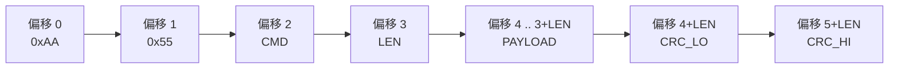
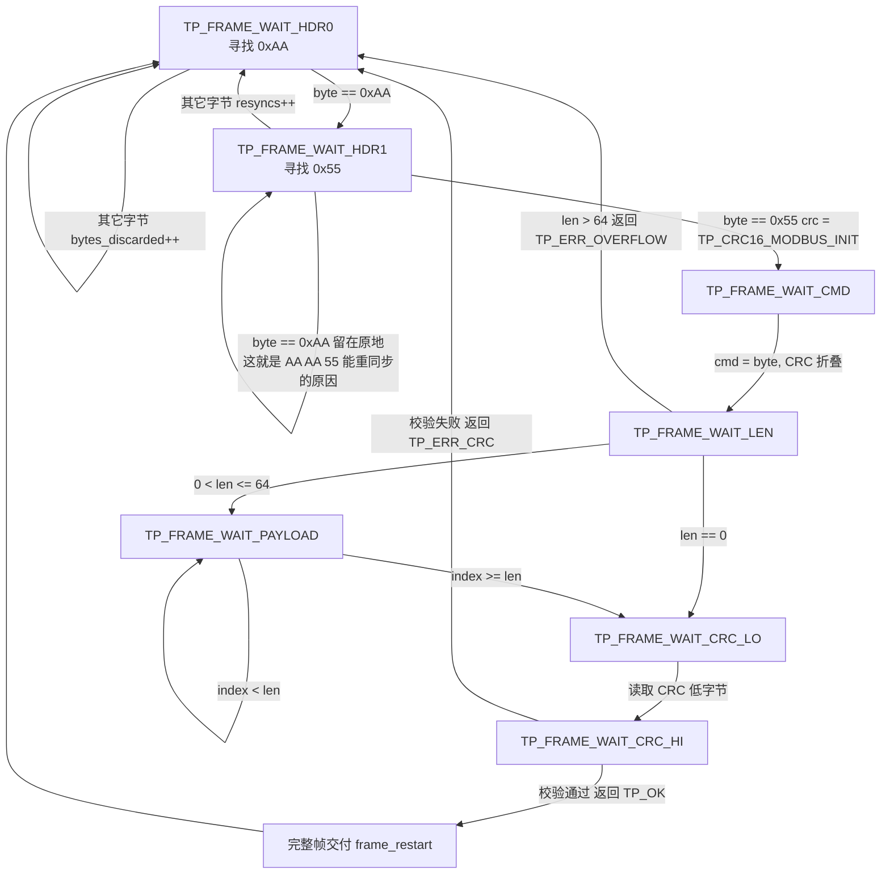
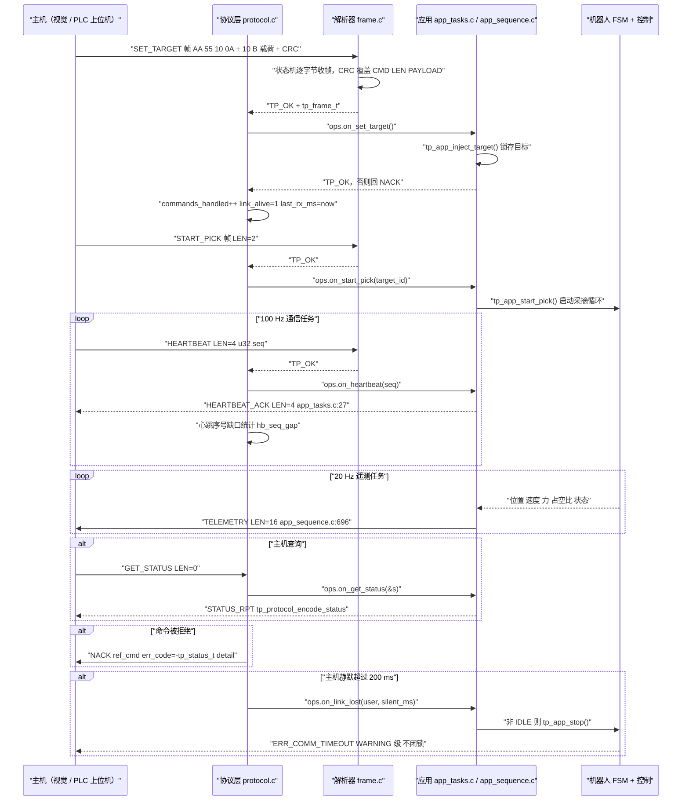

# 第二代智能无人机采茶机器人系统 —— 通信协议设计（07）

## 摘要

本文档描述第二代智能无人机采茶机器人系统的**通信协议设计**：视觉主机链路上的自定义帧协议（帧头 `AA 55`、CMD、LEN、PAYLOAD、CRC-16/MODBUS），以及 RS485 现场总线上的 Modbus RTU 从站配置。文中每个命令码、回报码、错误码、常量与函数名都逐条抄自源码，并给出真实路径与符号名。先声明两件事：

1. **本项目没有实物硬件。** 没有绘制、打样、焊接过任何电路板，链路行为全部在 **host 仿真**中验证：固件以 `TP_PLATFORM_HOST` 编译为 `build/host/tea_picking_robot_host.exe`，用 `tp_host_platform_inject_rx()` 注入真实字节、用 `tp_host_platform_take_tx()` 取走固件真正发出的字节，再用**固件自己的解析器**重新解码。凡涉及收发器、终端电阻、屏蔽、隔离等电气层内容，一律标注 **参考设计 / Recommended Implementation，未制作实物板**。
2. 结果数据全部来自仿真，标注 **仿真结果（Simulated）**；设计指标标注 **设计目标 / Target KPI（未实测）**，本文不给出任何实测延迟数值。

可引用的仿真结果只有两项：Scenario A 主机链路解码校验 **2200 B、100 帧、0 CRC 错误**；Scenario E（communication timeout）周期停止并置位 `ERR_COMM_TIMEOUT`。七场景 **7/7 PASS**（`scripts/run_scenarios.ps1`）。

## 目录

- [1. 通信拓扑](#1-通信拓扑)
- [2. 帧格式](#2-帧格式)
- [3. 小端约定与常见错误](#3-小端约定与常见错误)
- [4. 全部命令码表](#4-全部命令码表)
- [5. 全部回报码表](#5-全部回报码表)
- [6. 错误码表](#6-错误码表)
- [7. CRC-16/MODBUS 与"故意不用查表"](#7-crc-16modbus-与故意不用查表)
- [8. 解析状态机与重同步](#8-解析状态机与重同步)
- [9. 超时、丢包统计与链路监督](#9-超时丢包统计与链路监督)
- [10. Modbus RTU 与自定义协议并存](#10-modbus-rtu-与自定义协议并存)
- [11. 一次完整通信流程](#11-一次完整通信流程)
- [12. 十六进制逐字节解读](#12-十六进制逐字节解读)
- [13. 仿真验证结论](#13-仿真验证结论)
- [14. 标注清单](#14-标注清单)
- [小结](#小结)
- [面试可能追问的问题](#面试可能追问的问题)

## 1. 通信拓扑

| 链路 | 平台枚举 | 波特率宏（值） | 协议 | 对端 | 代码位置 |
|---|---|---|---|---|---|
| 视觉主机链路 | `TP_BUS_VISION_UART` | `TP_UART_VISION_BAUD`（`921600u`） | 自定义帧协议 | 视觉主机 / PC 工具 | `firmware/Core/app_tasks.c:394` |
| 调试串口 | `TP_BUS_DEBUG_UART` | `TP_UART_DEBUG_BAUD`（`115200u`） | 日志文本 | 串口终端 | `firmware/Core/app_tasks.c:398` |
| RS485 现场总线 | `TP_BUS_RS485` | `TP_RS485_BAUD` = `TP_MODBUS_BAUD`（`115200u`） | Modbus RTU | 第三方 PLC | `firmware/Core/app_tasks.c:402` |
| CAN 辅助总线 | `TP_BUS_CAN` | `TP_CAN_BITRATE_BPS`（`500000u`） | CAN + CRC-8/ATM | 驱动器 | `firmware/BSP/can_driver.h` |

**「它是什么」**
通信任务（`TP_COMM_FREQ_HZ = 100u`）每次调用 `tp_app_comm_step()`（`app_sequence.c:431`），固定顺序服务各链路：`tp_uart_service_rx()` → `tp_protocol_service()` → `tp_uart_service_tx()` → `tp_rs485_service()` → `tp_can_service()`。分层自上而下：`protocol.c`（会话/派发/回报编码）→ `frame.c`（帧编解码与流式解析）→ `crc16.c`（校验）→ `uart_driver.c`（环形缓冲）→ `platform_api.h`（BSP 缝隙）。

**「为什么这么设计」**
`app_sequence.c:445-447` 注释给出顺序理由：主机命令的延迟要求最短，"一条被打满的 RS485 或 CAN 链路不能拖慢一条 STOP 命令"。

**「如果不用它会怎样」**
若把主机链路也挂到 RS485 上与 Modbus 共享总线，`START_PICK` 的最坏延迟会由第三方主站的轮询周期决定。`frame.c` 是字节流的纯函数、不接触硬件，正是为了让同一解析器复用到 CAN 与 RS485（`uart_driver.h:18-20`）。

## 2. 帧格式

### 2.1 线上字节布局

`protocol_types.h:7-12` 与 `frame.c:199-234` 给出的真实布局**没有尾字节（TAIL）**：



| 偏移 | 字段 | 宽度 | 常量/来源与说明 |
|---|---|---|---|
| 0–1 | `HDR0` / `HDR1` | 2 B | `TP_PROTO_HEADER0 = 0xAAu` / `TP_PROTO_HEADER1 = 0x55u`（`config.h:289-290`） |
| 2 | `CMD` | 1 B | `tp_cmd_t`，命令码或回报码 |
| 3 | `LEN` | 1 B | `0..TP_PROTO_MAX_PAYLOAD = 64u`（`config.h:291`） |
| 4..3+LEN | `PAYLOAD` | LEN B | 小端字段，见第 4 / 5 节 |
| 4+LEN | `CRC_LO` | 1 B | `crc & 0x00FF`，CRC 低字节先发 |
| 5+LEN | `CRC_HI` | 1 B | `(crc >> 8) & 0x00FF`（`frame.c:231-232`） |

CRC 覆盖 **`CMD | LEN | PAYLOAD`**：`crc = tp_crc16_modbus(&dst[2], (size_t)len + 2u);`（`frame.c:230`）。帧头**不在**覆盖范围内，`protocol_types.h:22-25` 记录理由：帧头是固定模式，算进去不增加检错能力，反而给已损坏的帧头第二次通过校验的机会。

### 2.2 三问

**「它是什么」**
变长、带 16 位校验的二进制帧协议：`AA 55 CMD LEN PAYLOAD CRC16`。总长 = `LEN + TP_PROTO_FIXED_OVERHEAD`，`TP_PROTO_FIXED_OVERHEAD = 6u`（`protocol_types.h:69`）= 2 字节帧头 + 1 CMD + 1 LEN + 2 CRC。

**「为什么这么设计」**

逐字段理由如下。

- **`HDR0 = 0xAA`（`10101010`）/ `HDR1 = 0x55`（`01010101`）**：两者互为逐位取反，是位交替模式。位交替有两个工程价值：线路上没有长直流分量，接收端不易丢失位定时；**A/B 极性接反时 `AA 55` 变成 `55 AA`**，解析器在 `TP_FRAME_WAIT_HDR1` 立刻失步并计入 `resyncs`，而不是收到一堆看似正常的垃圾。第二字节取 `0xAA` 的逐位取反值，正是为了这个可识别性。
- **两字节帧头**：`protocol_types.h:14-17` 写明"一个字节会在载荷里被频繁误命中，三个字节浪费带宽"，`AA 55` 在随机载荷中出现的概率是 `2^-16`。
- **CMD 与 LEN 分开**：`LEN` 让上层不看 CMD 就能先判帧长是否可信——`frame.c:102` 在读到 LEN 的**当拍**即做上限检查，把畸形帧检测提前到载荷到达之前。
- **LEN 是长度字节而非定长帧**：`protocol_types.h:19-21` 记录"心跳帧在线路上是 6 字节，而不是被填充到最大帧"。`test_crc_frame.c:281` 断言零载荷帧长 `len == 6u`。
- **CRC16 放最后、只覆盖 CMD/LEN/PAYLOAD**：流式解析器收完载荷即可比对，无需回溯；一帧之内三个字段任何一个被干扰都会检出。

**「如果不用它会怎样」**
不用帧头，固件无法知道一次 `read()` 返回的是半帧、三帧还是一帧加下一帧的开头——`frame.h:6-12` 原文："试图一次读完整帧的解析器在台面上能工作（消息慢且单独到达），在现场会失败（遥测与命令交织）"。不用 LEN，只能靠"沉默一段时间"判帧边界，会被 100 Hz 任务抖动污染。不用 CRC，一个被 PWM 逆变器干扰翻转的 CMD 字节会被当成另一条合法命令执行。

### 2.3 开销常量与实际编码的一致性核对 ★

**结论：`config.h` 的 `TP_PROTO_OVERHEAD` 与 `frame.c` 的实际编码不一致，差 1 字节。**

`config.h:292-293`：`#define TP_PROTO_OVERHEAD (7u)  /**< HDR(2)+CMD(1)+LEN(1)+CRC(2)+TAIL? */`，`#define TP_PROTO_MAX_FRAME (TP_PROTO_MAX_PAYLOAD + TP_PROTO_OVERHEAD)`。`protocol_types.h:68-69` 另有 `#define TP_PROTO_FIXED_OVERHEAD 6u`，注释为 "Fixed frame overhead: 2 header + 1 cmd + 1 len + 2 crc"。`tp_frame_encode()` 用的正是后者：`total = (uint32_t)len + TP_PROTO_FIXED_OVERHEAD;`（`frame.c:215`）。

| 量 | 值 | 来源 |
|---|---|---|
| `TP_PROTO_MAX_PAYLOAD` | 64 | `config.h:291` |
| `TP_PROTO_OVERHEAD` | **7** | `config.h:292`（注释自带问号 `TAIL?`） |
| `TP_PROTO_MAX_FRAME` | **71** = 64 + 7 | `config.h:293` |
| `TP_PROTO_FIXED_OVERHEAD` | **6** | `protocol_types.h:69` |
| 真实最大帧长 | **70** = 64 + 6 | `frame.c:215`；`test_crc_frame.c:305` 断言 `len == TP_PROTO_MAX_PAYLOAD + 6u` |，`tp_frame_encode` 只写 `dst[0..5+len]`，末字节是 `CRC_HI`——`config.h` 注释里的 `TAIL?` 是未落实的设想，不应被引用为协议事实。`TP_PROTO_MAX_FRAME = 71` 比真实最大帧 70 多 1 字节，方向安全：`tp_protocol_send_frame()` 的 `uint8_t buffer[TP_PROTO_MAX_FRAME]`（`protocol.c:48`）只是偏大 1 字节，`uart_driver.c:100` 的 `uint8_t chunk[TP_PROTO_MAX_FRAME]` 同理；TX 环形缓冲为 `TP_UART_BUFFER_SIZE = 512u`（`uart_driver.h:46`），70 与 71 都能整帧入队，"整帧或零字节"语义不受影响。该不一致也不影响静态断言 `TP_PROTO_MAX_FRAME <= 128u`（71 ≤ 128，`config.h:499-500`）。**建议（未实施）**：让 `TP_PROTO_OVERHEAD` 派生自 `TP_PROTO_FIXED_OVERHEAD` 或直接删除，避免同一个数字在两处定义。

### 2.4 帧缓冲区为什么必须小

`config.h:499-500`：`TP_STATIC_ASSERT(TP_PROTO_MAX_FRAME <= 128u, "Frame buffer must stay small enough for the RX ring");`

| 理由 | 代码依据 |
|---|---|
| 每条 UART 链路有两块尺寸级静态缓冲：`rx_storage` / `tx_storage` 各 512 B | `uart_driver.h:46,60-61` |
| `tp_uart_service_tx()` 另有一个栈上 `uint8_t chunk[TP_PROTO_MAX_FRAME]` | `uart_driver.c:100` |
| 通信任务栈仅 `TP_STACK_COMM = 512u` **字**（不是字节） | `config.h:109` |
| 解析器把整块载荷放进结构体两份：`tp_frame_t::payload[]` 与 `tp_frame_parser_t::payload[]` | `frame.h:72,95` |
| STM32F407 只有 512 kB flash / 192 kB RAM | `tp_format.h:10` |

由波特率与字节数算出的理论上界：921600 8N1（10 位/字节）下 70 字节约 **760 µs**——**设计目标（由波特率与帧长计算，未实测）**。

## 3. 小端约定与常见错误

**「它是什么」**
所有多字节字段线上均为**小端**（低字节在前）。`protocol_types.h:27-33` 明确记录，并指出最典型的集成错误："假设大端的一方会把 2.0 N 的夹持力读成 8192 N。"

**「为什么这么设计」**
STM32 原生字节序就是小端。`protocol_types.h:28-30`："与 STM32 的原生顺序一致，固件可以把载荷 `memcpy` 进结构体、再 `memcpy` 出来，而不需要任何字节交换步骤。"在 1 kHz 控制与 100 Hz 通信共存的系统里，省掉的不是几个周期，而是**一整类**"某个字段忘了交换"的偶发错误。

**「如果不用它会怎样」**
选大端（网络序）会让每个字段都需显式交换，而"显式"意味着**可能漏写**，且漏写只在特定数值下才看得出来（`int16_t 2` 与 `512` 互换后都像合法值）。选小端的代价是"上位机必须知道这是小端"，该代价由 `protocol_types.h` 文件头注释与 `host/protocol.py` 的 `"<"` 小端前缀（如 `CMD.STATUS_RPT: ("<BBihihhH"` 类格式串）显式承担。

### 3.1 真实的编解码实现

全部集中在 `firmware/Protocol/protocol_codec.c`，**逐字节手工组装**，不用 `memcpy(&x, buf, 2)` 这类依赖内存布局的写法。

| 函数 | 实现要点 | 行号 |
|---|---|---|
| `tp_le_put_i16` | 先 `(uint16_t)v`，再 `& 0x00FFu` / `>> 8` | `protocol_codec.c:11-18` |
| `tp_le_get_i16` | `return (int16_t)((uint16_t)in[0] \| ((uint16_t)in[1] << 8));` | `protocol_codec.c:51-57` |
| `tp_le_get_i32` | 四次左移 0/8/16/24 按 `uint32_t` 拼装后再转 `int32_t` | `protocol_codec.c:67-74` |
| `tp_fixed_from_float` | 先查 `TP_ISFINITE`，乘 `scale`、**四舍五入（half away from zero）**、再饱和 | `protocol_codec.c:85-109` |
| `tp_fixed_to_float` | `(float)value / scale` | `protocol_codec.c:111-117` |

`tp_le_get_i16` **先按无符号拼装再整体转带符号**——这是唯一正确做法；`tp_le_put_i16` 同理由 `(uint16_t)v` 再移位，避免对负数右移的实现定义行为。`firmware/Middleware/utils/tp_format.h` 与字节序**无关**：它是本项目自研的 `snprintf` 替代品（`tp_vsnprintf` / `tp_format_float`），用于日志与 CSV；它与协议的唯一关系是抓包与日志里的十六进制由它渲染（`%02X` 等，`tp_format.h:18-21`）。字节序实现全在 `protocol_codec.c`，此处不把 `tp_format.h` 说成编解码模块。

### 3.2 内部单位 / 线上单位对照表

`config.h:22-30`（文件头注释里的真实表格）：

| 物理量 | 内部单位 | 线上单位 | 字段与编码宏 |
|---|---|---|---|
| 关节角度 | mrad（float） | mrad（int32） | `tp_payload_status_t::pos_mrad` |
| 关节速度 | mrad/s（float） | mrad/s（int16） | `vel_mrad_s`，`TP_WIRE_MRAD_S = 1.0f` |
| 夹爪开口 | mm（float） | um（uint16） | `TP_WIRE_MM_TO_UM = 1000.0f`（`protocol_types.h:353`） |
| 力 | N（float） | mN（int16） | `force_mn`，`TP_WIRE_N_TO_MN = 1000.0f` |
| 电机电流 | mA（float） | mA（int16） | `current_ma`，`TP_WIRE_MA = 1.0f` |
| PWM 占空比 | per-mille | per-mille（int16） | `pwm_permille`，`TP_WIRE_PERMILLE = 1.0f` |
| 笛卡尔目标 | mm（float） | mm（int16） | `tp_payload_set_target_t::x_mm/y_mm/z_mm` |

真实用法见 `app_tasks.c:82-89`：`tp_fixed_from_float(app->meas_force_n, TP_WIRE_N_TO_MN, -32768, 32767)`。

### 3.3 常见错误清单（含实测大小）

右侧数值为**用 gcc 编译真实头文件、对真实结构体取 `sizeof`/`offsetof` 得到的实测值**（x86-64 SysV 对齐规则与 ARM AAPCS 对这些类型一致），非推算。

| 错误 | 具体表现 | 真实证据 |
|---|---|---|
| 主机按**大端**解析 | 2.0 N 被读成 8192 N | `protocol_types.h:30-33` 明确记录 |
| **`int16_t` 负数位移写错** | `(int16_t)(in[1] << 8)` 直接拼带符号数，符号扩展出错 | 正确写法见 `protocol_codec.c:56` |
| **mm 与 um 混淆** | 夹爪开口差 1000 倍 | 内部 mm / 线上 um |
| **mN 与 N 混淆** | 力目标 2.20 N 写进 `force_mn` 变成 2 mN | `TP_WIRE_N_TO_MN = 1000.0f` |
| **结构体直接 `memcpy`** | 发出含填充的错位数据 | `tp_payload_fault_t` 结构体 12 B / 线上 6 B |
| **`memcpy` 往返解码** | 同上反向 | `tp_protocol_decode_set_target()`（`protocol.c:121-134`）逐字段读 `src[0],src[2],src[4],src[6],src[7],src[8]` |

| 载荷结构体 | `sizeof`（含填充） | 线上字节数 | 差异原因 |
|---|---|---|---|
| `tp_payload_set_target_t` | 10 | 10 | 无填充；`reserved` 字段存在就是为了保持 10 字节（`protocol_types.h:145`） |
| `tp_payload_start_pick_t` | 2 | 2 | 无填充 |
| `tp_payload_pid_t` | **16** | 13 | `uint8_t loop_id` 后的 `float` 需 4 字节对齐（`loop_id` off=0，`kp` off=4） |
| `tp_payload_force_target_t` | 2 | 2 | 无填充 |
| `tp_payload_mode_t` / `tp_payload_ack_t` | 1 | 1 | 无填充 |
| `tp_payload_nack_t` | 3 | 3 | 无填充（但 Python 侧只定义 `"<BB"` 2 B，见 12.5） |
| `tp_payload_status_t` | **20** | 15（布局 16） | `uint8_t` 后的 `int32_t` 对齐产生 2 字节填充，末尾再补到 4 的倍数 |
| `tp_payload_sensor_t` | **16** | 13（布局 14） | 末尾补齐到 4 的倍数 |
| `tp_payload_fault_t` | **12** | 6 | `fault_code`(off=0) 后 `timestamp_ms`(off=4) 有 3 字节填充，`detail`(off=8) 后再补到 12 |
| `tp_payload_telemetry_t` | 16 | 16 | 字段顺序恰好使填充为零，但代码仍逐字段编码（`protocol.c:212-218`） |

`tp_payload_fault_t` 最有说服力：结构体 12 B、线上 6 B，`memcpy` 会发出既错位又超长的载荷，而且**它的 CRC 仍然是对的**——接收方校验通过，然后在语义上彻底错乱。

## 4. 全部命令码表

`protocol_types.h:91-122`，共 **23** 条（`TP_CMD_*`），一条不漏。方向判定 `TP_CMD_IS_REPORT(c) (((uint8_t)(c) >= 0x80u) ? 1 : 0)`（`protocol_types.h:125`）。

| # | 命令码 | 值 | 方向 | 载荷 | 线上长度 | 应答 |
|---|---|---|---|---|---|---|
| 1 | `TP_CMD_HEARTBEAT` | `0x01` | 主机→机器人 | `u32 seq`（无命名结构体） | 4 | `TP_CMD_HEARTBEAT_ACK` |
| 2 | `TP_CMD_SET_TARGET` | `0x10` | 主机→机器人 | `tp_payload_set_target_t` | 10 | 无专用应答 |
| 3 | `TP_CMD_START_PICK` | `0x11` | 主机→机器人 | `tp_payload_start_pick_t` | 2 | 无专用应答 |
| 4 | `TP_CMD_STOP` | `0x12` | 主机→机器人 | 空 | 0 | 无专用应答 |
| 5 | `TP_CMD_RESET` | `0x13` | 主机→机器人 | 空 | 0 | 无专用应答 |
| 6 | `TP_CMD_GET_STATUS` | `0x20` | 主机→机器人 | 空 | 0 | `TP_CMD_STATUS_RPT` |
| 7 | `TP_CMD_GET_SENSOR` | `0x21` | 主机→机器人 | 空 | 0 | `TP_CMD_SENSOR_RPT` |
| 8 | `TP_CMD_GET_FAULT` | `0x22` | 主机→机器人 | 空 | 0 | `TP_CMD_FAULT_RPT` |
| 9 | `TP_CMD_SET_PID` | `0x30` | 主机→机器人 | `tp_payload_pid_t` | 13 | 无专用应答 |
| 10 | `TP_CMD_GET_PID` | `0x31` | 主机→机器人 | `u8 loop` | 1 | `TP_CMD_PID_RPT` |
| 11 | `TP_CMD_SET_FORCE_TARGET` | `0x32` | 主机→机器人 | `tp_payload_force_target_t` | 2 | 无专用应答 |
| 12 | `TP_CMD_SET_MODE` | `0x33` | 主机→机器人 | `tp_payload_mode_t` | 1 | 无专用应答 |
| 13 | `TP_CMD_EMERGENCY_STOP` | `0x40` | 主机→机器人 | 空 | 0 | 无专用应答 |
| 14 | `TP_CMD_CLEAR_FAULT` | `0x41` | 主机→机器人 | 空 | 0 | 无专用应答 |
| 15 | `TP_CMD_CALIBRATE_FORCE` | `0x42` | 主机→机器人 | `u8 kind` | 1 | 无专用应答 |
| 16 | `TP_CMD_ACK` | `0x80` | 机器人→主机 | `tp_payload_ack_t` | 1 | — |
| 17 | `TP_CMD_HEARTBEAT_ACK` | `0x81` | 机器人→主机 | `u32 seq` | 4 | — |
| 18 | `TP_CMD_STATUS_RPT` | `0xA0` | 机器人→主机 | `tp_payload_status_t` | 15（布局 16，见 12.5） | — |
| 19 | `TP_CMD_SENSOR_RPT` | `0xA1` | 机器人→主机 | `tp_payload_sensor_t` | 13（布局 14，见 12.5） | — |
| 20 | `TP_CMD_PID_RPT` | `0xA2` | 机器人→主机 | `tp_payload_pid_t` | 13 | — |
| 21 | `TP_CMD_FAULT_RPT` | `0xB0` | 机器人→主机 | `tp_payload_fault_t` | 6 | — |
| 22 | `TP_CMD_TELEMETRY` | `0xC0` | 机器人→主机 | `tp_payload_telemetry_t` | 16 | — |
| 23 | `TP_CMD_NACK` | `0xE0` | 机器人→主机 | `tp_payload_nack_t` | 3 | — |

代码注释的区间划分（`protocol_types.h:82-89`）：`0x01-0x0F` 会话与存活；`0x10-0x1F` 运动命令；`0x20-0x2F` 查询；`0x30-0x3F` 参数写入；`0x40-0x4F` 安全；`0x50-0x7F` 预留；`0x80-0xDF` 应答与回报；`0xE0-0xFF` 错误与确认（后两者均为机器人→主机）。

分派器的实现事实（`protocol.c:230-393`）：`protocol_dispatch_command()` 只处理上表第 1–15 条；第 16–23 条走 `default`，返回 `TP_ERR_NOT_FOUND` 并回 `NACK`，`protocol.c:387-391` 注释说明这是故意的（"把一个回报码发到机器人方向是远端的配置错误，而不是链路故障"）。长度在派发前逐条校验：`HEARTBEAT >= 4u`、`SET_TARGET >= 10u`、`START_PICK >= 2u`、`SET_PID >= 13u`、`SET_FORCE_TARGET >= 2u`、`SET_MODE`/`GET_PID`/`CALIBRATE_FORCE >= 1u`，不满足即 `TP_ERR_UNSUPPORTED` → `NACK`。此外 `tp_protocol_send_ack()`（`protocol.c:75`）**在固件中无调用点**——`TP_CMD_ACK` 可编码但当前应用从不发送；`tp_protocol_send_heartbeat_ack()` 的唯一真实调用点是 `on_heartbeat()`（`app_tasks.c:27`）。

## 5. 全部回报码表

代码里**没有** `TP_RPT_*` 命名族：回报码与命令码共用 `tp_cmd_t`，靠 `>= 0x80` 区分方向。下表逐条列出这 8 条回报，字段与长度以结构体定义为准。

| 回报码 | 值 | 载荷结构体 | 字段（偏移 / 宽度 / 单位） | 线上长度 |
|---|---|---|---|---|
| `TP_CMD_ACK` | `0x80` | `tp_payload_ack_t` | `acked_cmd` (0, 1 B, 命令码) | 1 |
| `TP_CMD_HEARTBEAT_ACK` | `0x81` | 无命名结构体 | `seq` (0, 4 B, u32 小端) | 4 |
| `TP_CMD_STATUS_RPT` | `0xA0` | `tp_payload_status_t` | `state`(0,1B) `fault_code`(1,1B) `pos_mrad`(2,4B,mrad) `vel_mrad_s`(6,2B,mrad/s) `force_mn`(8,2B,mN) `pwm_permille`(10,2B,‰) `current_ma`(12,2B,mA) `cycle_count`(14,2B) | 15（布局 16） |
| `TP_CMD_SENSOR_RPT` | `0xA1` | `tp_payload_sensor_t` | `pos_mrad`(0,4B,mrad) `vel_mrad_s`(4,2B) `force_mn`(6,2B,mN) `adc_raw`(8,2B,12-bit) `current_ma`(10,2B,mA) `temp_c_x10`(12,2B,0.1 °C) | 13（布局 14） |
| `TP_CMD_PID_RPT` | `0xA2` | `tp_payload_pid_t` | `loop_id`(0,1B) `kp`(1,4B,f32) `ki`(5,4B,f32) `kd`(9,4B,f32) | 13 |
| `TP_CMD_FAULT_RPT` | `0xB0` | `tp_payload_fault_t` | `fault_code`(0,1B) `timestamp_ms`(1,4B,u32) `detail`(5,1B) | 6 |
| `TP_CMD_TELEMETRY` | `0xC0` | `tp_payload_telemetry_t` | `t_ms`(0,4B) `pos_mrad`(4,4B) `vel_mrad_s`(8,2B) `force_mn`(10,2B) `pwm_permille`(12,2B) `state`(14,1B) `fault`(15,1B) | 16 |
| `TP_CMD_NACK` | `0xE0` | `tp_payload_nack_t` | `ref_cmd`(0,1B) `err_code`(1,1B,`tp_status_t` 取负) `detail`(2,1B,派发路径传 `frame->len`) | 3 |

`PID_RPT` 用原始 IEEE-754 浮点，`protocol.c:178-181` 记录理由："固定点会回避表示问题，但三个回路的增益动态范围极大（12.0 与 0.015），对所有回路都用定点要么损失分辨率，要么浪费字节。"`temp_c_x10` 在**参考设计 / 未制作实物板**上没有传感器：`on_get_sensor()` 直接写 `TP_SENSOR_TEMP_UNAVAILABLE`（`= 32767`，即 3276.7 °C），`app_tasks.c:111-114` 注明"报告一个编造的值比报告上位机已经理解为'未测量'的哨兵值更糟"。

## 6. 错误码表

### 6.1 故障码：`firmware/Safety/fault_codes.h`

`tp_fault_code_t`（`fault_codes.h:48-128`）共 **12** 条故障 + 1 个计数哨兵；数值**按枚举声明顺序**（代码中显式赋值，与顺序一致）。短名与严重度取自 `fault_codes.c:25-56` 的 `s_fault_table[]`，即线上 `FAULT_RPT` / `STATUS_RPT` 里数字对应的名字。

| 值 | 枚举名 | `tp_fault_name()` | 含义 | 严重度 | 闭锁 |
|---|---|---|---|---|---|
| 0 | `TP_FAULT_NONE` | `ERR_NONE` | 无故障，健康 | `TP_SEVERITY_INFO` | 否 |
| 1 | `TP_FAULT_FORCE_OVERLOAD` | `ERR_FORCE_OVERLOAD` | 夹持力超 `TP_FORCE_MAX_N`（5.0 N） | `TP_SEVERITY_ERROR` | 是 |
| 2 | `TP_FAULT_MOTOR_STALL` | `ERR_MOTOR_STALL` | 电机被驱动但关节不动 | `TP_SEVERITY_ERROR` | 是 |
| 3 | `TP_FAULT_OVERCURRENT` | `ERR_OVERCURRENT` | 电流超 `TP_MAX_CURRENT_MA` 达 `TP_OVERCURRENT_TRIP_MS` | `TP_SEVERITY_ERROR` | 是 |
| 4 | `TP_FAULT_ENCODER` | `ERR_ENCODER` | 编码器反馈物理上不可能 | `TP_SEVERITY_CRITICAL` | 是 |
| 5 | `TP_FAULT_COMM_TIMEOUT` | `ERR_COMM_TIMEOUT` | `TP_COMM_TIMEOUT_MS` 内无有效帧 | `TP_SEVERITY_WARNING` | 否（可自清） |
| 6 | `TP_FAULT_SENSOR` | `ERR_SENSOR` | 传感器超范围 / 卡死 / 持续尖峰 | `TP_SEVERITY_ERROR` | 是 |
| 7 | `TP_FAULT_LIMIT` | `ERR_LIMIT` | 限位开关被撞仍继续驱动 | `TP_SEVERITY_WARNING` | 否 |
| 8 | `TP_FAULT_ESTOP` | `ERR_ESTOP` | 急停触发（软件命令或常闭回路断开） | `TP_SEVERITY_CRITICAL` | 是 |
| 9 | `TP_FAULT_WATCHDOG` | `ERR_WATCHDOG` | 看门狗复位或超时 | `TP_SEVERITY_CRITICAL` | 是 |
| 10 | `TP_FAULT_TARGET` | `ERR_TARGET` | 视觉目标不可达或已失效 | `TP_SEVERITY_ERROR` | 是 |
| 11 | `TP_FAULT_INTERNAL` | `ERR_INTERNAL` | 内部不变量被破坏 | `TP_SEVERITY_ERROR` | 是 |
| 12 | `TP_FAULT_CODE_COUNT` | —（非故障码） | 已定义故障码个数，必须保持在最后 | — | — |

严重度枚举 `tp_severity_t`（`fault_codes.h:133-138`）：`TP_SEVERITY_INFO = 0`、`TP_SEVERITY_WARNING = 1`、`TP_SEVERITY_ERROR = 2`、`TP_SEVERITY_CRITICAL = 3`。闭锁是代码实现的：`tp_fault_is_latching()`（`fault_codes.c:83-88`）返回 `(sev >= TP_SEVERITY_ERROR) ? 1 : 0`，故上表末列可由严重度直接推出。`fault_codes.h:18-27` 给出策略：`INFO` 仅记日志；`WARNING` 记日志 + 遥测标志、运动继续、条件消失自动清除；`ERROR` 停运动并把 FSM 拉到 `ERROR`；`CRITICAL` 硬件级杀 PWM、FSM 拉 `EMERGENCY_STOP`，需断电或显式 `RESET`。

两条与通信直接相关：`tp_fault_severity()` 对未知码**返回 `TP_SEVERITY_ERROR`**（`fault_codes.c:76-79`），注释为"fail safe：一个无法识别的码不能被当成无害的"；通信超时定为 `WARNING` 而非 `ERROR`，`safety_monitor.c:278-281` 注释："丢掉主机必须停止本轮循环，但不应该需要断电才能恢复。"因此 `TP_FAULT_COMM_TIMEOUT` 不闭锁，条件消失后由 `tp_fault_clear_condition()` + `tp_fault_clear()` 自动清除（`safety_monitor.c:293-296`）。

### 6.2 协议层返回码：`tp_status_t`（`firmware/Middleware/utils/status.h`）

共 16 个取值（`TP_OK` + 15 个错误），错误全为负值，`TP_OK = 0`，符合 POSIX 风格，`if (status < 0)` 即兜底（`status.h:16-17`）。通信相关取值：

| 值 | 枚举名 | 通信场景中何时返回 |
|---|---|---|
| 0 | `TP_OK` | 帧完整且 CRC 通过（`frame.c:155`） |
| −1 | `TP_ERR_PARAM` | 传入 NULL 指针；`tp_frame_decode` 的 `len < 6` |
| −2 | `TP_ERR_STATE` | `START_PICK` 指定的 `target_id` 与已锁存的不是同一个（`app_tasks.c:48-55`） |
| −4 | `TP_ERR_CRC` | 帧收齐但校验失败（`frame.c:165`），`tp_status_desc` 返回 `crc mismatch` |
| −5 | `TP_ERR_RANGE` | 编码失败（`protocol.c:59`）；`loop_id >= TP_PID_LOOP_COUNT` |
| −7 | `TP_ERR_NOT_READY` | 解析器还需更多字节（正常路径，非错误） |
| −8 | `TP_ERR_UNSUPPORTED` | 回调表对应项为 NULL，或载荷长度不足 |
| −11 | `TP_ERR_BUSY` | RS485 正在接收时被要求切到发送（`rs485.h:123`） |
| −12 | `TP_ERR_OVERFLOW` | **LEN > `TP_PROTO_MAX_PAYLOAD`**（`frame.c:110`） |
| −13 | `TP_ERR_NOT_FOUND` | 命令码在主机→机器人方向无处理分支（`protocol.c:391`） |
| −14 | `TP_ERR_PROTOCOL` | 帧头不是 `AA 55`，或 `6 + LEN != len`（`frame.c:246,250`） |

**关于 LEN 超限的准确结论**：`frame.c:102-111` 在读到 LEN **当拍**判断 `p->len > (uint8_t)TP_PROTO_MAX_PAYLOAD`，命中则 `length_errors++`、`resyncs++`、`frame_restart()`，返回 **`TP_ERR_OVERFLOW`**（不是 `TP_ERR_RANGE`）。`TP_ERR_RANGE` 在本协议层用于"编码失败"与"`loop_id` 越界"，两者不可混用；`tp_frame_length_for()` 对超限长度返回 `0u`（`frame.c:36-42`）。

### 6.3 `NACK` 的线上 `err_code` 换算

`tp_protocol_send_nack()`（`protocol.c:83-95`）：`buf[0] = ref_cmd; buf[1] = (uint8_t)(-(int)status); buf[2] = detail;` 即 `err_code = -tp_status_t`，线上为**正数**（注释：`protocol.c:89-90`"取负使一个负的内部状态变成正的上线码；0 会与'无错误'无法区分"）。

| `tp_status_t` | 值 | 线上 | | `tp_status_t` | 值 | 线上 |
|---|---|---|---|---|---|---|
| `TP_ERR_PARAM` | −1 | 1 | | `TP_ERR_IO` | −9 | 9 |
| `TP_ERR_STATE` | −2 | 2 | | `TP_ERR_FAULT_ACTIVE` | −10 | 10 |
| `TP_ERR_TIMEOUT` | −3 | 3 | | `TP_ERR_BUSY` | −11 | 11 |
| `TP_ERR_CRC` | −4 | 4 | | `TP_ERR_OVERFLOW` | −12 | 12 |
| `TP_ERR_RANGE` | −5 | 5 | | `TP_ERR_NOT_FOUND` | −13 | 13 |
| `TP_ERR_NO_MEM` | −6 | 6 | | `TP_ERR_PROTOCOL` | −14 | 14 |
| `TP_ERR_NOT_READY` | −7 | 7 | | `TP_ERR_DIVERGED` | −15 | 15 |
| `TP_ERR_UNSUPPORTED` | −8 | 8 | | | | |

`detail` 在派发路径里传的是**收到的载荷长度**：`tp_protocol_send_nack(proto, frame->cmd, st, frame->len)`（`protocol.c:419`）。这是可观测的调试线索：主机收到 `NACK(ref_cmd=0x20, err_code=13, detail=0)` 就知道自己发了一条 0 载荷的未知命令。

## 7. CRC-16/MODBUS 与"故意不用查表"

**「它是什么」**
`firmware/Protocol/crc16.c` 用**逐位（bitwise）**方式实现 CRC-16/MODBUS，另附 CRC-8/ATM（多项式 `0x07`、初值 `0x00`、MSB-first、不反射）。参数见 `crc16.h:8-9`：多项式 `0x8005`，反射形式 `0xA001`，初值 `0xFFFF`，无最终异或，输入与输出都反射；初值常量为 `TP_CRC16_MODBUS_INIT = 0xFFFFu`（`crc16.h:53`）。

**「为什么这么设计」**
`crc16.h:10-20` 给出三条理由：Modbus RTU 强制要求 CRC-16/MODBUS，RS485 链路"免费"得到校验；它是**有目录编号的标准 CRC**，互操作方可拿公开检验值验证实现而不必读本项目代码；16 位宽度给出 `2^-16` 误接受概率，且能检出**所有单比特错误、所有奇数位错误、长度不超过 16 位的突发错误**——最后这条最关键，"在有 PWM 驱动的机器上，干扰产生的是**突发**而不是孤立比特翻转"。

**「如果不用它会怎样」**
自创多项式后既不能引用公开检验值（互操作与代码审查失去锚点），又可能选到检错能力更差的生成多项式。改用累加和一类弱校验，突发错误几乎无法保证被检出——机器人最怕的正是"校验通过但数据错了"这种静默失效。

### 7.1 为什么故意不用查表 —— 有真实的源码注释依据

`crc16.h:22-30` 原文：

> "下面的逐位实现每字节大约需要 8 轮移位/异或。在 921600 波特率下，链路最坏情况交付约 92 kbyte/s，也就是每秒约 736 k 次内层迭代，占一颗 168 MHz Cortex-M4 的不到 1 %。512 字节的查表能把这一点降到百分之一中的几个百分点，代价是 512 字节永远用不到的 flash。**因此故意没有加表**；`docs/13_future_work.md` 记录了重新审视该决定的确切条件（持续流量超过约 5 Mbaud，或者 CPU 预算更紧）。"

即：**1 kHz 控制循环 + 100 Hz 通信任务下，逐位 CRC 的 CPU 代价可接受**（最坏约 736 k 内层迭代/秒，< 1 % of 168 MHz Cortex-M4）；**省下 512 字节 ROM**（STM32F407 为 512 kB flash / 192 kB RAM，`tp_format.h:10`）；更重要的第三条理由是**避免查表数组被误改的风险**——表驱动实现是一大块不透明的 `const uint16_t[256]`，一旦被改动或生成错误，检错能力会在**不报错**的情况下退化（CRC 仍会算出"一个值"，只是算错了）；逐位实现只有 6 行，可用公开检验值锁定。

值得注意的对照：**同一项目的 Python 上位机反而用了查表**——`host/protocol.py:70` 的 `_CRC_TABLE = _build_crc_table()`。这不是矛盾，而是同一取舍在两个平台上的不同答案（PC 不在乎 512 字节 ROM），且两边靠同一检验值互相锁定。

真实实现（`crc16.c:9-27`）：`crc ^= (uint16_t)byte;` 然后 8 轮 `if (crc & 0x0001u) crc = (crc >> 1) ^ 0xA001u; else crc >>= 1;`。`crc16.c:13-17` 注释说明这是"反射算法……与教科书式 MSB-first 形式加上输入输出反射后逐位完全相同，而后者正是 `CRC-16/MODBUS` 所规定的"。

**校验向量（已实测验证）**：`TP_CRC16_MODBUS_CHECK = 0x4B37u`（`crc16.h:56`），即对 ASCII `"123456789"` 的 CRC。撰文时用一段按 `crc16.c` 完全相同的初值/反射/异或规则独立实现的 PowerShell 脚本计算得到 `0x4B37`，与常量一致，并以此交叉验证第 12 节所有示例帧的 CRC。固件侧的同一条断言在 `test_crc_frame.c:16-24`。

## 8. 解析状态机与重同步

**「它是什么」**
`tp_frame_parser_t`（`frame.h:87-104`）是**字节流上的显式状态机**：一次喂一个字节（`tp_frame_parser_feed`），吐出完整帧；也可整块喂（`tp_frame_parser_feed_buffer`）。它是输入的纯函数，不接触任何硬件——`frame.h:16-17` 指出这正是协议测试能用任意字节序列（包括恶意序列）驱动它的原因。状态枚举 `tp_frame_state_t`（`frame.h:56-64`）共 7 个真实枚举名：`TP_FRAME_WAIT_HDR0`(0)、`TP_FRAME_WAIT_HDR1`(1)、`TP_FRAME_WAIT_CMD`(2)、`TP_FRAME_WAIT_LEN`(3)、`TP_FRAME_WAIT_PAYLOAD`(4)、`TP_FRAME_WAIT_CRC_LO`(5)、`TP_FRAME_WAIT_CRC_HI`(6)。

**「为什么这么设计」**
`frame.h:6-12` 写明根本理由："UART 交付的是字节，不是帧。固件永远不能假定一次 `read()` 恰好返回一条消息：它可能返回半帧、三帧，或者一帧加下一帧的头两个字节。"显式状态机让"字节到达"与"帧完整"解耦，因此**不需要超时来判帧边界**——帧边界由 LEN 决定，超时只用于链路监督（第 9 节）。

**「如果不用它会怎样」**
若按"攒够一段沉默就读一帧"或"假定一次读就是一帧"实现，在台面上（消息慢且单独到达）能工作，在现场（遥测与命令交织、DMA 一次交付多帧）必然失败——`frame.h:9-12` 的判断是"在台面上能工作，在现场会失败"。

### 8.1 全部状态转移（逐条抄自 `frame.c:68-170`）

| 当前状态 | 输入 | 动作 | 次态 | 返回值 |
|---|---|---|---|---|
| `WAIT_HDR0` | `byte == TP_PROTO_HDR0` (0xAA) | — | `WAIT_HDR1` | `TP_ERR_NOT_READY` |
| `WAIT_HDR0` | 其它 | `bytes_discarded++` | `WAIT_HDR0` | `TP_ERR_NOT_READY` |
| `WAIT_HDR1` | `byte == TP_PROTO_HDR1` (0x55) | `crc = TP_CRC16_MODBUS_INIT` | `WAIT_CMD` | `TP_ERR_NOT_READY` |
| `WAIT_HDR1` | `byte == TP_PROTO_HDR0` (0xAA) | `bytes_discarded++`（**留在原地**） | `WAIT_HDR1` | `TP_ERR_NOT_READY` |
| `WAIT_HDR1` | 其它 | `bytes_discarded++`，`resyncs++` | `WAIT_HDR0` | `TP_ERR_NOT_READY` |
| `WAIT_CMD` | 任意 | `cmd = byte`；`crc = tp_crc16_modbus_byte(crc, byte)` | `WAIT_LEN` | `TP_ERR_NOT_READY` |
| `WAIT_LEN` | `byte <= 64` | `len = byte`；`crc` 折叠；`index = 0` | `len==0` → `WAIT_CRC_LO`，否则 `WAIT_PAYLOAD` | `TP_ERR_NOT_READY` |
| `WAIT_LEN` | `byte > 64` | `length_errors++`，`resyncs++`，`frame_restart()` | `WAIT_HDR0` | **`TP_ERR_OVERFLOW`** |
| `WAIT_PAYLOAD` | 任意 | `payload[index++] = byte`；`crc` 折叠 | `index >= len` → `WAIT_CRC_LO`，否则 `WAIT_PAYLOAD` | `TP_ERR_NOT_READY` |
| `WAIT_CRC_LO` | 任意 | `crc_rx = byte`；`crc_bytes = 1` | `WAIT_CRC_HI` | `TP_ERR_NOT_READY` |
| `WAIT_CRC_HI` | `crc_rx == crc` | 填 `out`；载荷尾部清零；`frames_ok++`；`last_frame_ms = now_ms`；`frame_restart()` | `WAIT_HDR0` | **`TP_OK`** |
| `WAIT_CRC_HI` | `crc_rx != crc` | `crc_errors++`，`resyncs++`，`frame_restart()` | `WAIT_HDR0` | **`TP_ERR_CRC`** |
| `default` | 不可达 | `frame_restart()` | `WAIT_HDR0` | `TP_ERR_NOT_READY` |

每一拍都执行 `p->bytes_consumed++`（`frame.c:66`）。

### 8.2 状态机图（真实枚举名）



### 8.3 重同步的四条真实规则

1. **坏字节退回**：`WAIT_HDR0` 丢弃非 `0xAA` 字节并计入 `bytes_discarded`；`WAIT_HDR1` 遇到既非 `0x55` 也非 `0xAA` 的字节，退到 `WAIT_HDR0` 并计入 `resyncs`（`frame.c:86-90`）。
2. **`AA AA 55` 正确重同步**：`WAIT_HDR1` 遇到第二个 `0xAA` 时**留在 `WAIT_HDR1`**（`frame.c:81-85`），注释原文："`AA AA 55`：第二个 AA 才是真正帧头的开始。留在这里而不是退回 `WAIT_HDR0`，才是能正确重同步而不是丢掉一整帧的原因。"`test_crc_frame.c:199-218` 对此有断言。
3. **LEN 超限立即拒绝**：`frame.c:102-111`，原因："等待对端永远不会发来的字节会让解析器停滞不确定长的时间，而在这段时间里到达的真帧会被当作载荷吃掉。"
4. **CRC 失败只丢弃已提交的帧头**：`frame.c:158-165`，原文："从*下一个*字节继续搜索，而不是从候选帧之后——载荷里的假帧头不能吞掉几个字节之后才真正开始的一帧。"`test_crc_frame.c:239-270` 用"载荷里故意含 `AA 55`"的用例锁定。

统计量的设计意图见 `frame.h:81-85`：`crc_errors` 上升意味着干扰或波特率不匹配，`length_errors` 意味着组帧问题或与对端版本不一致，`resyncs` 意味着上游某处在截断帧——"各自指向不同的故障，因此一个笼统的'坏帧'计数是无用的"。

## 9. 超时、丢包统计与链路监督

**「它是什么」**
链路监督是 `tp_protocol_service()` 里的一小段（`protocol.c:483-496`）：若 `last_rx_ms != 0` 且 `now_ms - last_rx_ms > TP_COMM_TIMEOUT_MS`，且 `link_alive` 仍为 1，则清 `link_alive`、打 `LOG_WARN`、调用 `ops.on_link_lost(user, silent)`。安全监视器（`safety_monitor.c:278-297`）独立地把"沉默超时"变成故障码。

**「为什么这么设计」**
`protocol.h:24-29`："每一个被接受的帧都会更新 `last_rx_ms`。如果主机沉默超过 `TP_COMM_TIMEOUT_MS`，应用会通过 `on_link_lost` 得到通知；**运动不得基于过期的目标数据继续**——一个视觉目标是一个带时间戳的*测量值*，不是永久真理。"

**「如果不用它会怎样」**
`app_tasks.c:286-289` 给出最坏情况的原文描述："丢掉的主机必须停止本轮循环，而不只是被记一笔：继续去采一个视觉系统早已重新评估过的目标，正是机器人采错茶芽的方式。"

### 9.1 四个常量与真实使用情况

`config.h:295-300`：

| 常量 | 值 | 代码注释含义 | 固件中的真实引用 |
|---|---|---|---|
| `TP_COMM_TIMEOUT_MS` | `200u` | 无有效帧 → 链路丢失 | **真实使用**：`protocol.c:486`、`safety_monitor.c:284` |
| `TP_COMM_HEARTBEAT_MS` | `500u` | 主机心跳周期 | **未检索到使用点** |
| `TP_COMM_RETRY_COUNT` | `3u` | 重试次数 | **未检索到使用点** |
| `TP_COMM_TX_TIMEOUT_MS` | `20u` | 发送超时 | **未检索到使用点** |

后三个是**已配置但尚未实现消费方**的参数——如实写出，不把它们描述成已生效的机制。心跳的**周期**由主机侧决定（`host/robot_monitor.py` 周期发送 `CMD.HEARTBEAT`），机器人侧只负责应答与监督。

### 9.2 监督必须先被 "arm" 才会超时

**协议层**：超时分支外有 `if (proto->last_rx_ms != 0u)`（`protocol.c:484`），刚上电时 `last_rx_ms == 0`，因此**从未听到过主机的机器人不会报告链路丢失**。`link_alive` 只在成功派发一条命令后置 1（`protocol.c:406`），而收到 `HEARTBEAT` 时**无条件**置 1 并刷新 `last_rx_ms`（`protocol.c:441-451`），注释："心跳即使处理函数返回错误也必须被应答，否则主机自己的链路监督会在机器人正老老实实上报一条坏命令时宣布机器人死了。保持链路存活是传输层的职责，不取决于应用是否喜欢这个载荷。"

**应用层**：`safety_monitor.c:282` 的条件是 `if (in->comm_seen != 0)`，而 `comm_seen` 只在通信任务观察到 `frames_in` 增长时才置 1（`app_sequence.c:456-459`）：

```c
if (app->proto.frames_in > before) {
    app->comm_seen = 1;
    app->last_comm_ms = now;
}
```

**Scenario E 正是穿过这条生产路径被验证的。** `main_host.c:274-296` 注释原文：

> "链路监督必须先被 **arm** 才会超时：一个从未听到过主机的机器人不能报告链路丢失，因为开机时没有什么可以失去的。所以这个场景先在主机总线上注入**一帧真实的心跳帧**——由同一个编码器生成、与真实主机会发出的完全相同——然后转入静默。超时因此是穿过生产路径被验证的，与拔掉线缆完全一样。"

```c
if (t_ms == 200u) {
    uint8_t frame[16];
    uint32_t len = tp_frame_encode(frame, sizeof(frame), TP_CMD_HEARTBEAT,
                                   NULL, 0u);
    LOG_INFO(TP_MOD_TEST,
             "scenario E: one heartbeat frame, then the link goes silent");
    (void)tp_host_platform_inject_rx(TP_BUS_VISION_UART, frame, len);
}
```

注入的正是 `tp_frame_encode(..., TP_CMD_HEARTBEAT, NULL, 0u)` 编出的 6 字节真帧（即 12.1 节逐字节解读的那一帧），经 `tp_host_platform_inject_rx()` 进入固件自己的 RX 环形缓冲；随后不再有任何帧，`last_comm_ms` 停在注入时刻，`> TP_COMM_TIMEOUT_MS`（200 ms）后安全监视器置位 `TP_FAULT_COMM_TIMEOUT`。**仿真结果（Simulated）**：Scenario E 周期停止，`ERR_COMM_TIMEOUT`；`main_host.c:167` 的场景期望表把 `TP_FAULT_COMM_TIMEOUT` 写为必须命中的码。

### 9.3 TX 环形缓冲满的丢帧统计与 `tp_platform_bus_tx_done` 语义

**丢帧如何发生与统计**：`tp_uart_write_frame()`（`uart_driver.c:72-96`）通过 `tp_ring_buffer_write()` 整帧写入 TX 环形缓冲，失败即 `link->tx_rejected++`（`uart_driver.h:68` 定义为"TX 环形缓冲满而丢弃的帧数"）并打出含排空耗时估算的 `LOG_WARN`。环形缓冲是"整帧或零字节"——`uart_driver.h:113-115`："在写入任何内容之前先按整帧长度检查环形缓冲，因此一帧要么完整入队，要么完全不入队。"

**host 仿真里没人读链路的真实后果**：`main_host.c:424-435` 注释原文："在目标板上是视觉工具读这条链路；**在 host 构建里没有任何人读**，所以平台的发送环形缓冲会在几百毫秒内填满，于是每一帧遥测都被报告为丢弃——这是一个**测试夹具的产物，而不是固件的缺陷**。"为消除这一假象，`main_host.c` 提供 `host_peer_service()`（`main_host.c:453-484`）扮演链路读取端：用 `tp_host_platform_take_tx()` 排空字节，再用**与机器人同一个解析器**重新解码，统计 `bytes`/`frames`/`telemetry`/`status`/`crc_errors`，从而"在每次运行时都把编码器与解码器互相对打"（`main_host.c:431-435`）。

**`tp_platform_bus_tx_done` 的语义**：`platform_api.h:264-270`——"总线发送器是否已经排空。返回 1 表示空闲，0 表示仍有传输在进行中。"必要性见 `platform_api.h:238-243`："在目标板上写入被排入 DMA 环形缓冲并立即返回；'已完全发送'这个条件只由 `tp_platform_bus_tx_done` 保证。这是刻意的：把通信任务阻塞在一帧 60 字节、921600 波特率（0.65 ms）的时长上还可以接受，但阻塞一次 Modbus 重试就不行。"消费点 `uart_driver.c:107-109`：`if (tp_platform_bus_tx_done(link->bus) == 0) return 0u;`。**host 后端恒返回 1**（`platform_host.c:379-387`），注释："仿真瞬时完成发送：字节已经在捕获环形缓冲里，所以 DMA 传输按定义已经完成。"因此 RS485 方向控制（DE）与 shift-register 排空这类真实时序在仿真中**没有被覆盖**——凡涉及收发器、DE 时序、终端电阻、屏蔽、隔离，一律为 **参考设计 / Recommended Implementation，未制作实物板**。

## 10. Modbus RTU 与自定义协议并存

**「它是什么」**
同一条固件内并存两套线路协议：视觉主机链路上的自定义帧协议（921600，`TP_UART_VISION_BAUD`）与 RS485 总线上的 Modbus RTU（115200，`TP_MODBUS_BAUD = TP_RS485_BAUD = 115200u`），本机从站地址 `TP_MODBUS_SLAVE_ADDR = 0x11u`（`config.h:305-308`），两者共用同一个 CRC 实现（`crc16.h`）。

**「为什么这么设计」**
`firmware/BSP/rs485.h:28-38` 原文理由："它们服务不同的对端。自定义帧协议与本项目自己的上位机软件通信，承载机器人专属数据（目标坐标、故障码、PID 增益）。Modbus RTU 的存在是为了让同一台机器能被集成进一个已经有 PLC 的工厂……在有标准的地方实现标准，只在没有标准的地方自定义协议，才是正确的划分。重新发明 Modbus 比这两种选择都更糟。"

**「如果不用它会怎样」**
只用自定义协议：无法接入现成 PLC，需对方为私有协议写驱动，在真实项目里通常直接被否决。只用 Modbus：寄存器模型装不下"带 `target_id` 的视觉目标 + 置信度"这类结构化语义，也装不下变长浮点 PID 增益，会被迫拆成多寄存器并另行约定打包规则——那等于发明了一个更差的私有协议，还丢掉了互操作性。

### 10.1 代码事实：Modbus 支持到什么程度（如实陈述）

**已存在且有代码依据的部分：**

| 内容 | 位置 | 事实 |
|---|---|---|
| 从站地址 / 波特率 | `config.h:305-308` | `TP_MODBUS_SLAVE_ADDR = 0x11u`；`TP_RS485_BAUD = 115200u`；`TP_MODBUS_BAUD = TP_RS485_BAUD` |
| 初始化与调用点 | `app_tasks.c:402-403`、`app_sequence.c:453` | `tp_rs485_init(..., TP_RS485_BAUD, TP_MODBUS_SLAVE_ADDR);`；`tp_rs485_service(&app->rs485);`（100 Hz 通信任务内） |
| 3.5 字符静默 / DE 保护时间 / 最大帧长 | `rs485.h:57-64` | `TP_RS485_T3_5_US = 304u`、`TP_RS485_DE_GUARD_US = 20u`、`TP_RS485_MAX_FRAME = 256u` |
| 功能码宏 | `rs485.h:66-70` | `TP_MODBUS_FC_READ_HOLDING (0x03u)`、`TP_MODBUS_FC_READ_INPUT (0x04u)`、`TP_MODBUS_FC_WRITE_SINGLE (0x06u)`、`TP_MODBUS_FC_WRITE_MULTIPLE (0x10u)` |
| 异常码宏 | `rs485.h:72-76` | `TP_MODBUS_EXC_ILLEGAL_FUNCTION (0x01u)`、`TP_MODBUS_EXC_ILLEGAL_ADDRESS (0x02u)`、`TP_MODBUS_EXC_ILLEGAL_VALUE (0x03u)`、`TP_MODBUS_EXC_SLAVE_FAILURE (0x04u)` |
| 功能码的**唯一**用处 | `rs485.c:169-206` | `rs485_expected_length()` 用功能码**推导期望帧长**，判定"还在到达"还是"被截断"；注释："从功能码推导长度，才是让帧定界可靠而不只依赖时序的办法" |

**代码中未见的部分（如实声明，不编造）：**

- **代码中未见寄存器映射（register map）。** `rs485.h:33-34` 引用了"`docs/07_communication_protocol.md` 里的寄存器映射"，但固件源码中**不存在**任何保持寄存器表、输入寄存器表或地址分配常量。**本文因此不提供寄存器映射表**——提供一张无代码依据的寄存器表就是编造。
- **代码中未见 Modbus 请求处理与响应生成。** 四个功能码宏只被 `rs485_expected_length()` 使用（`rs485.c:179-195`），没有 switch 分支读写寄存器、没有构造响应；`TP_MODBUS_EXC_*` 在 `.c` 文件中**无任何引用**。
- **`tp_rs485_poll_frame()` 在固件中无调用点**：它被声明（`rs485.h:179`）并实现（`rs485.c:208-267`），但全仓库无引用；`tp_rs485_send_frame()`（`rs485.c:78`）同样无调用点。即 RS485 端口目前只运行方向状态机、静默窗口判定与帧计数，**不会发出任何 Modbus 帧，也不会应答任何 Modbus 请求**。
- 因此可准确声称的是：**从站地址与波特率已配置并完成初始化，物理层帧定界（长度推导 + 3.5 字符静默 + DE 方向控制）已实现；Modbus 应用层（寄存器映射、功能码分派、异常响应）未见实现。**
- **参考设计 / Recommended Implementation，未制作实物板**：收发器选型、DE 引脚极性、终端电阻、隔离、屏蔽与接地均无实物板；`rs485.h:6-26` 对 DE 断言/释放/静默时序的分析（"任何一个搞错都会产生只在长线缆和多节点下才出现的故障——也就是说，在台面上永远不会出现"）属于设计层面分析。

## 11. 一次完整通信流程



流程中的三个真实细节：**①** `link_alive` 的双重刷新——正常派发成功置 1（`protocol.c:406`），`HEARTBEAT` 即使处理函数返回错误也置 1（`protocol.c:448-451`）。**②** 心跳序号缺口统计（`protocol.c:246-251`）：`delta = seq - hb_seq_last`，仅当 `1 < delta < 1000` 时把 `delta - 1` 累加进 `hb_seq_gap`；注释："无符号减法可以正确处理回绕，而大于一个合理窗口（比如 1000）的缺口意味着主机重启了，而不是丢了 1000 帧——把它算成丢包会报告一个虚假的 100% 中断。"**③** 丢包率估计（`tp_protocol_loss_estimate()`，`protocol.c:505-523`）：`hb_received < 5u` 时返回 `0.0f`，"样本太少，这里报一个数字就是把噪声当成测量值"；该函数在固件中**无调用点**，是给上位机监控工具的接口（`host/link.py` 有自己的 `loss_ratio`）。

## 12. 十六进制逐字节解读

本节所有 CRC 都是**实际计算**的：用一段按 `crc16.c` 完全相同的初值（`0xFFFF`）、反射多项式（`0xA001`）、右移、无最终异或规则实现的 PowerShell 脚本计算，并先用公开检验值 `"123456789" → 0x4B37`（= `TP_CRC16_MODBUS_CHECK`）验证脚本本身正确，再计算下述各帧。CRC 在线路上**低字节在前**（`frame.c:231-232`）。

### 12.1 `TP_CMD_HEARTBEAT`（空载荷，6 字节）

这是 Scenario E 注入的那一帧，由 `tp_frame_encode(frame, sizeof(frame), TP_CMD_HEARTBEAT, NULL, 0u)` 生成。

```
AA 55 01 00 00 20
```

| 偏移 | 字节 | 字段 | 含义 |
|---|---|---|---|
| 0 | `0xAA` | `TP_PROTO_HDR0` | 帧头第一字节 |
| 1 | `0x55` | `TP_PROTO_HDR1` | 帧头第二字节 |
| 2 | `0x01` | `TP_CMD_HEARTBEAT` | 命令码 |
| 3 | `0x00` | `LEN` | 载荷长度 0 |
| 4 | `0x00` | `CRC_LO` | CRC 低字节 |
| 5 | `0x20` | `CRC_HI` | CRC 高字节 |

CRC 范围 = `01 00`（`dst[2]` 起 `len + 2 = 2` 字节），`crc = 0x2000`。总长 6 = `0 + TP_PROTO_FIXED_OVERHEAD`，与 `test_crc_frame.c:281` 的断言 `len == 6u` 一致。注意该帧 LEN=0，`protocol_dispatch_command()` 的 `TP_CMD_HEARTBEAT` 分支会因 `frame->len < 4u` 返回 `TP_ERR_UNSUPPORTED` 并回 `NACK`；但 `tp_protocol_feed()` 会**先**把 `link_alive = 1`、`last_rx_ms = now_ms` 置好（`protocol.c:441-451`）——这正是"链路监督被 arm 了"的机制，Scenario E 需要的只是"收到过一个有效帧"这个事实。

### 12.2 `TP_CMD_SET_FORCE_TARGET`（2 字节载荷，8 字节）

载荷 `force_mn = 2200`（即 `TP_FORCE_TARGET_N = 2.20f` N → `2200 mN`），`2200 = 0x0898`，小端即 `98 08`。

```
AA 55 32 02 98 08 C5 5A
```

| 偏移 | 字节 | 字段 | 含义 |
|---|---|---|---|
| 0–1 | `AA 55` | `HDR0` / `HDR1` | 帧头 |
| 2 | `0x32` | `TP_CMD_SET_FORCE_TARGET` | 参数写入区间 `0x30-0x3F` |
| 3 | `0x02` | `LEN` | 载荷 2 字节（`sizeof(tp_payload_force_target_t)` 恰为 2） |
| 4 | `0x98` | `force_mn` 低字节 | `0x0898 & 0xFF` |
| 5 | `0x08` | `force_mn` 高字节 | `(0x0898 >> 8) & 0xFF` |
| 6–7 | `C5 5A` | `CRC_LO` / `CRC_HI` | `crc = 0x5AC5`，范围 `32 02 98 08` |

**这正是小端"常见错误"的最佳演示**：若主机按大端把 `98 08` 读成 `0x9808 = 38920 mN = 38.9 N`，机器人会去夹一个远超硬限 `TP_FORCE_MAX_N = 5.00f` N 的力，立刻触发 `ERR_FORCE_OVERLOAD`——同一段字节，两种解释相差 17.7 倍。同理多字段示例：`TP_CMD_SET_TARGET` 载荷 `x_mm=15, y_mm=185, z_mm=95, confidence=95, reserved=0, target_id=1` 编出 `AA 55 10 0A 0F 00 B9 00 5F 00 5F 00 01 00 60 20`（16 字节，CRC 范围 `10 0A` + 10 字节载荷，`crc = 0x2060`），与 `main_host.c:334` 场景 A 的 `tp_app_inject_target(app, 0, 15, 185, 95u, 1u)` 一致。

### 12.3 `TP_CMD_STATUS_RPT`（真实线上帧，21 字节）

这一帧不是手算的，而是**用真实固件代码跑出来的**：编译 `protocol.c` / `frame.c` / `crc16.c` / `protocol_codec.c` / `status.c`，填入 `state = 4`、`fault_code = 0`、`pos_mrad = 12345`、`vel_mrad_s = -200`、`force_mn = 2130`、`pwm_permille = 150`、`current_ma = 420`、`cycle_count = 7`，调用 `tp_protocol_send_status()`，由 `tp_uart_write_frame()` 的桩捕获真帧：

```
AA 55 A0 0F 04 00 39 30 00 00 38 FF 52 08 96 00 A4 01 07 12 38
```

| 偏移 | 字节 | 字段 | 含义 |
|---|---|---|---|
| 0–1 | `AA 55` | 帧头 | — |
| 2 | `0xA0` | `TP_CMD_STATUS_RPT` | 回报区间 `0x80-0xDF` |
| 3 | `0x0F` | `LEN` | **15**（见 12.4：字段布局为 16） |
| 4 | `0x04` | `state` | `tp_robot_state_t` 值 4 |
| 5 | `0x00` | `fault_code` | `TP_FAULT_NONE` |
| 6–9 | `39 30 00 00` | `pos_mrad` | `0x00003039` = 12345 mrad |
| 10–11 | `38 FF` | `vel_mrad_s` | `0xFF38`（有符号）= −200 mrad/s |
| 12–13 | `52 08` | `force_mn` | `0x0852` = 2130 mN |
| 14–15 | `96 00` | `pwm_permille` | 150 ‰ |
| 16–17 | `A4 01` | `current_ma` | `0x01A4` = 420 mA |
| 18 | `0x07` | `cycle_count` **低字节** | 7 |
| — | （缺失） | `cycle_count` **高字节** | `0x00`，**没有出现在线上** |
| 19–20 | `12 38` | `CRC_LO` / `CRC_HI` | `crc = 0x3812`，范围 `A0 0F` + 15 字节载荷 |

`vel_mrad_s = -200` 的字节对 `38 FF` 值得单独注意：低字节 `0x38`、高字节 `0xFF`；若主机按大端读成 `0x38FF = 14591`，速度符号与量级**同时**错掉。

### 12.4 载荷长度一致性核对（本文实测发现）★

构造 12.3 节示例时，用真实源码实测出三处**实现与文档/上位机不一致**，逐条给出证据。

**事实一：`tp_protocol_encode_status()` 写入 16 字节，却返回 15。**

- 源码：`protocol.c:105-119`，最后一次写入是 `tp_le_put_u16(&dst[14], s->cycle_count);`（写 `dst[14]` 与 `dst[15]`），函数 `return 15u;`。`protocol.h:318` 写 "at least 15 bytes"，`protocol_types.h:201` 写 "`STATUS_RPT` payload: 15 bytes"。
- 实测：把 16 字节缓冲整体填 `0xCC` 后调用，得到 `04 00 39 30 00 00 38 FF 52 08 96 00 A4 01 07 00`，且 `buf[15] == 0x00`（若未写入应为 `0xCC`）——**证明第 16 个字节确实被写入**。
- 后果一：`tp_protocol_send_status()` 传入的是 `uint8_t buffer[15]`（`protocol.c:139`），因此这是一次**越过 15 字节局部数组的越界写（1 字节，未定义行为）**。后果二：随后用 `len = 15u` 发送，`cycle_count` 的**高字节永远到不了线上**（12.3 节实测帧偏移 18 之后直接是 CRC）。
- 上位机期望值是 **16**：`host/protocol.py:320-322` 的 `CMD.STATUS_RPT: ("<BBihhhhH", (...))`，`struct.calcsize` 为 16。因此**字段布局（16）才是本意**，"15" 是过时的数字。

**事实二：`tp_protocol_send_sensor()` 同样差 1 字节。**

- 源码：`protocol.c:151-167`，`uint8_t buffer[13]`，最后一次写入是 `tp_le_put_i16(&buffer[12], s->temp_c_x10);`（写 `buffer[12]` 与 `buffer[13]`），随后 `tp_protocol_send_frame(..., 13u)`；`protocol_types.h:217` 写 "`SENSOR_RPT` payload: 13 bytes"。
- 字段总和是 **14**（4+2+2+2+2+2），上位机 `host/protocol.py:323-325` 的 `"<ihhHhh"` 也正好 14 字节。因此 `temp_c_x10` 的**高字节被丢弃**：无温度传感器时该字段是 `TP_SENSOR_TEMP_UNAVAILABLE = 32767 = 0x7FFF`（`config.h:355`），高字节 `0x7F` 恰是哨兵的识别位；丢弃后主机拿到 `0x00xx` 形式的值，**会渲染成一个看起来合理的温度而不是哨兵**，恰好违背 `config.h:349-354` 记录的设计意图（"渲染成 0.0 °C 会主动误导"）。同样存在 1 字节越界写（`buffer[13]`，数组只有 13 字节）。

**事实三（跨语言一致性）：`SET_TARGET` 与 `NACK` 的长度约定与上位机不同。**

`host/protocol.py:305` 的 `CMD.SET_TARGET: ("<hhhBH", ...)` 是 **9** 字节（不含 `reserved`），而固件线路上是 **10** 字节且派发要求 `frame->len >= 10u`（`protocol.c:258`）——上位机按自己的表构造的 `SET_TARGET` 会被固件判为 `TP_ERR_UNSUPPORTED` 并回 `NACK`。`host/protocol.py:331` 的 `CMD.NACK: ("<BB", ...)` 是 **2** 字节，而固件发送 **3** 字节（`ref_cmd`, `err_code`, `detail`）。

**为什么这些不一致在 Scenario A 里看不出来（重要的验证边界）：** 链路层 CRC 是对**实际发送的那 15 / 13 字节**计算的，因此校验**必然通过**——Scenario A 的 **0 CRC 错误（仿真结果）** 与上述不一致**并不矛盾**；而 host 仿真的对端 `host_peer_service()`（`main_host.c:453-484`）只按 `frame.cmd` **计数** `TELEMETRY` 与 `STATUS_RPT`，**不解码载荷**。因此必须明确：**Scenario A 的 2200 B / 100 帧 / 0 CRC 错误只证明"组帧、CRC、流式解析、重同步"这条链路级路径正确，不证明载荷布局与上位机解析一致。** 本节三处不一致属于载荷级问题，需要在上位机与固件联调（或一条按 `host/protocol.py` 的真解码测试）中才能暴露。本文只如实记录，不修改 `docs/` 以外的任何文件。

## 13. 仿真验证结论

| 项 | 内容 | 标注 |
|---|---|---|
| 验证平台 | host 仿真 `build/host/tea_picking_robot_host.exe`，注入 `tp_host_platform_inject_rx()`、取走 `tp_host_platform_take_tx()` | **仿真结果（Simulated）** |
| Scenario A | 主机链路解码校验 **2200 B、100 帧、0 CRC 错误**（对应 `main_host.c:630-634` 打印的 `host link (rx side)` 行） | **仿真结果（Simulated）** |
| Scenario E | 通信超时：先注入一帧真实 `TP_CMD_HEARTBEAT` arm 链路监督，再静默；周期停止，置位 `ERR_COMM_TIMEOUT`（`TP_FAULT_COMM_TIMEOUT`） | **仿真结果（Simulated）** |
| 场景总表 | 七场景 7/7 PASS（`scripts/run_scenarios.ps1`，`A`–`G`） | **仿真结果（Simulated）** |
| 通信延迟 | 无实测值；仅给出由波特率与帧长算出的理论上界（921600 8N1 下 70 字节约 760 µs） | **设计目标 / Target KPI（未实测）** |
| 吞吐 / 误码率 / 长线缆行为 | 未做任何实测；host 仿真中 `tp_platform_bus_tx_done()` 恒返回 1，不断言任何真实时序 | **未实测；参考设计** |
| 电气层（收发器、终端电阻、屏蔽、隔离、DE 时序） | 未制作实物板 | **参考设计 / Recommended Implementation，未制作实物板** |

## 14. 标注清单

| 位置 | 标注类型 | 具体说明 |
|---|---|---|
| §摘要、§13 | **仿真结果（Simulated）** | Scenario A（2200 B / 100 帧 / 0 CRC）、Scenario E（`ERR_COMM_TIMEOUT`）、七场景 7/7 PASS |
| §2.4、§13 | **设计目标 / Target KPI（未实测）** | 通信延迟、帧时延上界（约 760 µs @ 70 B / 921600 8N1）——由波特率与字节数算出，无实测值 |
| §1、§9.3、§10.1、§13 | **参考设计 / Recommended Implementation，未制作实物板** | RS485 收发器、DE 方向时序、终端电阻、屏蔽、隔离；`rs485.h:6-26` 的时序分析；`platform_stm32f407.c` 的 USART/DMA 寄存器级配置 |
| §5 | **参考设计 / 未制作实物板** | `temp_c_x10` 无温度传感器，恒发哨兵 `TP_SENSOR_TEMP_UNAVAILABLE`（`config.h:349-355`、`app_tasks.c:111-114`） |
| §6.1 | **按枚举声明顺序** | `tp_fault_code_t` 数值 0–11；严重度取自 `fault_codes.c` 的 `s_fault_table[]` |
| §2.3 | **代码不一致，已如实结论** | `TP_PROTO_OVERHEAD = 7u` vs `TP_PROTO_FIXED_OVERHEAD = 6u`；`TP_PROTO_MAX_FRAME = 71` vs 真实最大帧 70；协议**无 TAIL 字节** |
| §12.4 | **本文实测发现** | `STATUS_RPT` 写 16 发 15、`SENSOR_RPT` 写 14 发 13，均含 1 字节越界写；`SET_TARGET` / `NACK` 与 `host/protocol.py` 长度不一致 |
| §9.1 | **代码无据 / 未使用** | `TP_COMM_HEARTBEAT_MS`、`TP_COMM_RETRY_COUNT`、`TP_COMM_TX_TIMEOUT_MS` 在固件中**未检索到使用点** |
| §10.1 | **代码无据 / 未使用** | 代码中**未见寄存器映射**；四个功能码宏只用于 `rs485_expected_length()`；`TP_MODBUS_EXC_*` 无引用；`tp_rs485_poll_frame()`、`tp_rs485_send_frame()` 无调用点 |
| §4、§11 | **代码无据 / 无调用点** | `tp_protocol_send_ack()`（`TP_CMD_ACK`）无调用点；`tp_protocol_loss_estimate()`、`tp_protocol_link_alive()` 无调用点 |
| §7.1 | **源码注释依据** | "故意不加查表"的取舍由 `crc16.h:22-30` 注释记录（非本文推理）：约 736 k 迭代/s、< 1 % of 168 MHz M4、省 512 B flash、超过约 5 Mbaud 时重新评估 |
| §3.3 | **本文实测（编译真实头文件）** | 各载荷结构体的 `sizeof` / `offsetof` 数值 |
| §12 | **本文实际计算** | 所有 CRC 数值（含校验向量 `0x4B37`）；12.3 节帧由真实 `protocol.c` 代码运行产生 |

## 小结

1. **帧格式**为 `AA 55 CMD LEN PAYLOAD CRC16`，无尾字节；开销实际为 6 字节（`TP_PROTO_FIXED_OVERHEAD`），而 `config.h` 的 `TP_PROTO_OVERHEAD = 7u` 多算 1 字节，方向安全但不一致。帧头 `AA`/`55` 的位交替特性同时服务于线路极性识别与重同步。
2. **小端约定**与 STM32 原生序一致，编解码全部在 `protocol_codec.c` 逐字段实现，从不整体 `memcpy` 结构体；实测各载荷结构体与线上长度存在 0–6 字节的填充差异，`tp_payload_fault_t`（12 vs 6）最极端。
3. **23 条命令码**、**8 条回报码**、**12 条故障码**、**16 个 `tp_status_t`** 全部逐条列出，`NACK` 的 `err_code` 为 `-tp_status_t`（正数上线）。
4. **CRC-16/MODBUS 逐位实现**，"故意不用查表"的取舍在 `crc16.h` 注释中有明确记录（CPU < 1 %、省 512 B flash、约 5 Mbaud 为重新评估门槛）。
5. **7 状态解析状态机**具备 `AA AA 55` 重同步、LEN 当拍限幅（`TP_ERR_OVERFLOW`）、CRC 失败只丢弃已提交帧头三条真实策略。
6. **链路监督必须先被 arm**：`last_rx_ms != 0` 与 `comm_seen != 0` 双重门槛；Scenario E 用 `tp_frame_encode` 造一帧真心跳注入后静默，穿生产路径验证超时。
7. **Modbus 与自定义协议并存**：前者服务第三方 PLC，后者承载机器人专有语义；从站地址与波特率已配置、物理层帧定界已实现，**但应用层未见实现**——本文拒绝提供无代码依据的寄存器映射表。
8. 本文在构造示例帧时**实测发现三处载荷长度不一致**，并说明了为什么 Scenario A 的 "0 CRC 错误" 与它们并不矛盾：链路级 CRC 始终对实际发送的字节计算，而 host 对端只按 CMD 计数、不解码载荷。

全部结论的边界：**没有实物硬件**，链路验证仅覆盖 host 仿真；涉及电气层的内容为参考设计；结果数据为仿真结果；延迟类指标为未实测的设计目标。

## 面试可能追问的问题

**1. "`0xAA 0x55` 为什么偏偏是这两个值？换成 `0x5A 0xA5` 行不行？"**
要点：`0xAA = 10101010`、`0x55 = 01010101` 互为逐位取反，是两字节即可构成的位交替模式。两个好处：线路上没有长直流分量（利于接收端位定时）；A/B 极性接反时 `AA 55` 变成 `55 AA`，解析器在 `TP_FRAME_WAIT_HDR1` 立刻失步并计入 `resyncs`（`frame.c:86-90`），而不是收到一堆看似正常的垃圾。`0x5A 0xA5` 同样满足取反对与交替模式，功能等价，选 `AA 55` 更多是习惯；真正的选择依据是"两字节 + 取反对 + `2^-16` 的低误命中率"，该取舍在 `protocol_types.h:14-17` 有记录（一字节太频繁、三字节浪费带宽）。

**2. "`TP_PROTO_OVERHEAD` 是 7，`TP_PROTO_FIXED_OVERHEAD` 是 6，你的协议到底几字节开销？"**
要点：真实开销是 **6**（HDR 2 + CMD 1 + LEN 1 + CRC 2），由 `tp_frame_encode()` 的 `total = len + TP_PROTO_FIXED_OVERHEAD` 决定，并被 `test_crc_frame.c:305` 的 `len == TP_PROTO_MAX_PAYLOAD + 6u` 锁定。`config.h` 的 `7u` 其注释是 `HDR(2)+CMD(1)+LEN(1)+CRC(2)+TAIL?`，加出来是 6，问号说明尾字节只是未落实的设想；协议里**没有** TAIL。后果是 `TP_PROTO_MAX_FRAME = 71` 比真实最大帧 70 多 1 字节，方向安全（发送缓冲偏大 1 字节），也不影响 `TP_PROTO_MAX_FRAME <= 128u` 静态断言。坦诚答法：这是重复定义同一个数字造成的漂移，正确修法是让 `TP_PROTO_OVERHEAD` 派生自 `TP_PROTO_FIXED_OVERHEAD` 或直接删除。

**3. "为什么 CRC 不用查表？你们不是有 1 kHz 控制循环吗？"**
要点：直接引用 `crc16.h:22-30`：每字节 8 轮移位/异或；921600 波特率下最坏约 92 kbyte/s，即约 736 k 内层迭代/秒，占 168 MHz Cortex-M4 不到 1 %；512 字节查表能压到"百分之一中的几个百分点"，代价是 512 字节永远用不到的 flash。第三条理由是逐位实现只有 6 行、可用公开检验值 `"123456789" → 0x4B37` 锁定，而 256 项的 `const` 表被改动后 CRC 仍会算出"一个值"，检错能力退化是**静默**的。加分点：同一项目的 Python 上位机**用了**查表（`host/protocol.py:70` 的 `_CRC_TABLE`），因为 PC 不在乎 512 字节 ROM——同一取舍在两个平台上的不同答案，两边靠同一检验值互相锁定。

**4. "主机拔掉线缆后机器人会怎样？为什么不是一上电就报通信超时？"**
要点：协议层超时分支套在 `if (proto->last_rx_ms != 0u)` 里（`protocol.c:484`），安全侧还有 `if (in->comm_seen != 0)`（`safety_monitor.c:282`），而 `comm_seen` 只在 `frames_in` 增长时置 1（`app_sequence.c:456-459`）。所以**从未听到过主机**的机器人不会报链路丢失——开机时没什么可失去的，否则每次上电都会刷一条假故障。Scenario E 正是按此语义设计：`main_host.c:274-291` 先用 `tp_frame_encode(..., TP_CMD_HEARTBEAT, NULL, 0u)` 造一帧**真心跳**，经 `tp_host_platform_inject_rx()` 注入（注释："链路监督必须先被 arm 才会超时"），然后静默；超过 `TP_COMM_TIMEOUT_MS = 200` ms 后置位 `TP_FAULT_COMM_TIMEOUT`。其严重度是 **WARNING 而非 ERROR**（`fault_codes.c:36-39`、`safety_monitor.c:278-281`）：丢主机必须停本轮循环，但不该需要断电才能恢复。应用侧 `on_link_lost()` 若 FSM 不在 `IDLE` 就 `tp_app_stop()`（`app_tasks.c:290-293`）——"继续去采一个视觉系统早已重新评估过的目标，正是机器人采错茶芽的方式"。

**5. "你怎么知道你们的协议实现是正确的？验证覆盖到哪一层？"**
要点：分三层如实回答。**协议/单元层**：`firmware/Tests/test_crc_frame.c` 用公开检验值、全部单比特错误必被检出、`AA AA 55` 重同步、`AA 55` 出现在载荷里时 CRC 失败不吞下一帧、LEN 超限当拍返回 `TP_ERR_OVERFLOW`、最大帧往返等断言锁定解析器行为。**host 端到端**：`main_host.c` 的 `host_peer_service()` 用**固件自己的解析器**解码固件自己发出的字节，Scenario A 报告 2200 B / 100 帧 / 0 CRC 错误（仿真结果）。**边界（必须主动说明）**：host 仿真中 `tp_platform_bus_tx_done()` 恒返回 1（`platform_host.c:379-387`），所以 shift-register 排空、RS485 DE 时序这类真实时序**没有被覆盖**；**没有实物板**，电气层全是参考设计；而且 Scenario A 只验证链路级 CRC 与解析，host 对端只按 CMD 计数、不解码载荷——本文 §12.4 实测出的 `STATUS_RPT` / `SENSOR_RPT` 长度越界与上位机约定差异，恰恰落在这条验证边界之外。主动说出"我的测试没覆盖什么"，比声称"全测过了"更可信。
