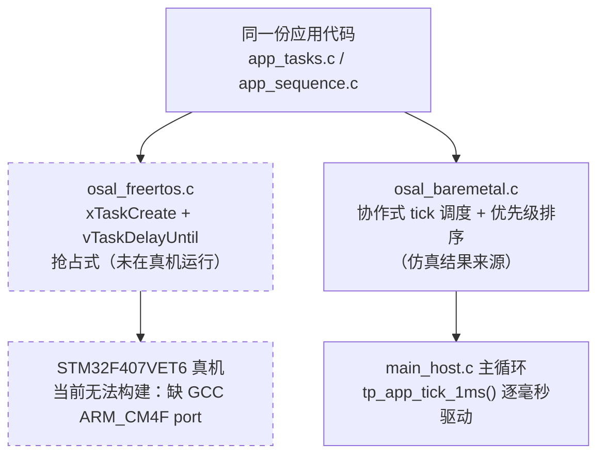
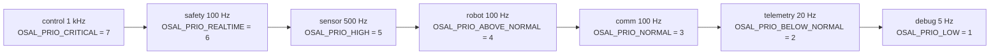
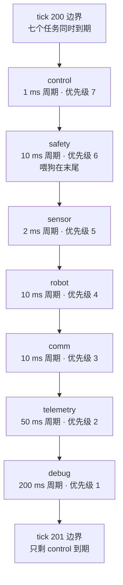
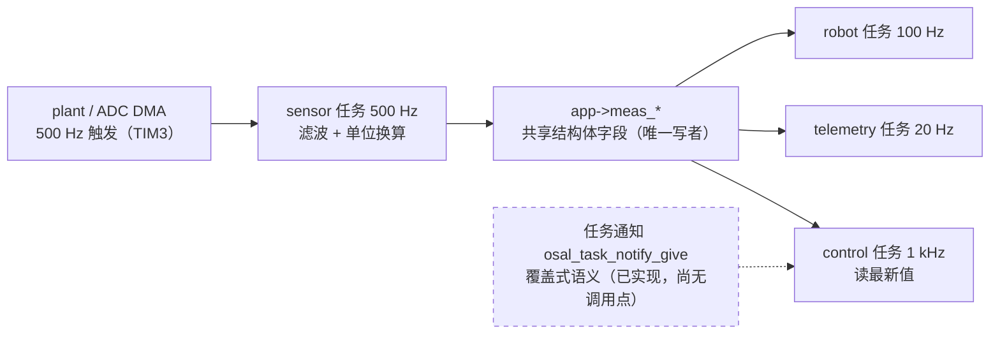
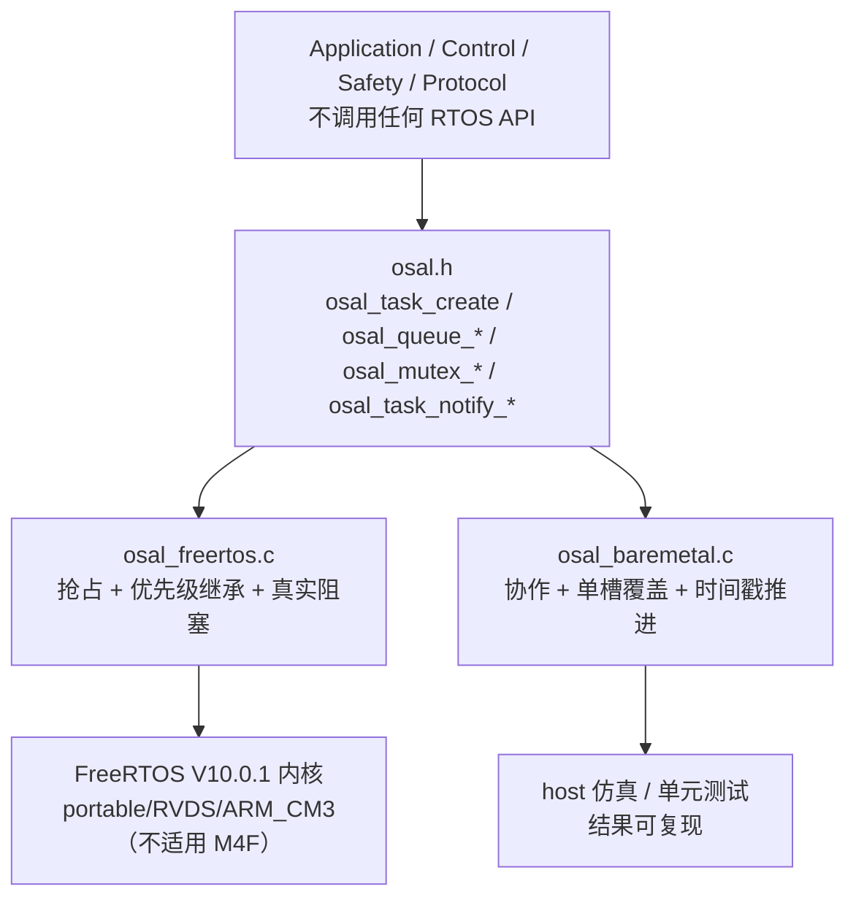

# 第 08 章 FreeRTOS 与任务/调度设计（第二代智能无人机采茶机器人系统）

## 摘要

本章说明本系统软件层的**多速率任务结构与调度设计**：七个周期任务的频率、周期、优先级、栈预算与职责，周期取值的物理依据，队列/互斥量/信号量/任务通知的选型，`vTaskDelayUntil` 相对 `vTaskDelay` 的必要性，栈深度预算的推导，看门狗单点喂狗策略，优先级反转风险与 mutex 优先级继承，ISR 设计规则，以及**双后端 OSAL**（FreeRTOS 抢占式 / 裸机协作式）的语义差异。

**必须先说清楚的三件事实，全文结论都受其约束：**

1. **本项目没有实物硬件。** FreeRTOS 路径**从未在任何真实板子上运行过**。仓库中 `make stm32 RTOS=freertos` 会在 Makefile 前置检查处**直接报错终止**（见第 15 节），因为需要的 GCC Cortex-M4F port 未随仓库提供。
2. 本文所有**运行证据**（周期计数、0 次截止期错失、节拍时间、夹持力）都来自 **host 构建的协作式确定性调度器**（`firmware/BSP/host/platform_host.c` + `firmware/Middleware/osal/osal_baremetal.c`，以及在仿真器主循环里直接驱动的 `tp_app_tick_1ms()`），**不是真实 RTOS 运行时**，一律标注 **仿真结果（Simulated）**。
3. 所有未实测的指标一律标注 **设计目标 / Target KPI（未实测）**；所有栈深度与队列深度一律标注 **纸面预算**。

> 阅读约定：本文只引用代码中真实存在的常量、函数名与注释。凡"文档里写了、代码里没有"的地方，都单列在 [第 14 节 与代码不一致之处](#十四与代码不一致之处必须如实指出) 与 [第 15 节 未验证清单](#十五未验证清单)。

## 目录

- [一、证据边界：真机、仿真与纸面](#一证据边界真机仿真与纸面)
- [二、七个任务总表](#二七个任务总表)
- [三、优先级分配理由](#三优先级分配理由)
- [四、周期为什么取这些值](#四周期为什么取这些值)
- [五、队列 / 互斥量 / 信号量 / 任务通知的选型](#五队列--互斥量--信号量--任务通知的选型)
- [六、为什么用 vTaskDelayUntil 而不是 vTaskDelay](#六为什么用-vtaskdelayuntil-而不是-vtaskdelay)
- [七、栈深度预算](#七栈深度预算)
- [八、看门狗为什么只从一处喂](#八看门狗为什么只从一处喂)
- [九、优先级反转风险与 mutex 优先级继承](#九优先级反转风险与-mutex-优先级继承)
- [十、ISR 设计规则](#十isr-设计规则)
- [十一、OSAL 双后端设计与语义差异](#十一osal-双后端设计与语义差异)
- [十二、任务时序示意](#十二任务时序示意)
- [十三、结果与设计指标](#十三结果与设计指标)
- [十四、与代码不一致之处](#十四与代码不一致之处必须如实指出)
- [十五、未验证清单](#十五未验证清单)
- [小结](#小结)
- [面试可能追问的问题](#面试可能追问的问题)

## 一、证据边界：真机、仿真与纸面

| 证据类别 | 来源 | 可信度 | 本文标记 |
|---|---|---|---|
| 配置常量、API 名、注释 | `firmware/Application/config.h`、`firmware/Middleware/osal/*`、`firmware/BSP/*` | 代码事实，可逐行核对 | 直接引用 |
| 周期执行次数、截止期错失、节拍、夹持力 | host 仿真运行（Scenario A） | **仅在协作式确定性调度器下成立** | **仿真结果（Simulated）** |
| 栈深度、队列深度 | 代码注释 + 本文推导 | **从未测量** | **纸面预算** |
| 破损率、效率、定位/力误差、通信延迟 | 项目需求 | **无实物硬件，未实测** | **设计目标（未实测）** |
| FreeRTOS 抢占式行为、优先级继承、栈溢出检测 | 内核源码 + `FreeRTOSConfig.h` | 设计正确性可审查，**未在真机验证** | **未实测** |

**无实物硬件的直接后果**：任何"控制环在 1 kHz 下没有错过截止期"的结论，都只是"在协作式调度器按声明周期依次调用任务体时，任务的**执行时间**没有超过其周期"，**不等于**"抢占式 RTOS 在真机上不会错过截止期"。后者还依赖中断延迟、tick 抖动、上下文切换开销、Cache/Flash 等待周期，这些在本项目中**从未被测过**。



## 二、七个任务总表

任务体与创建代码的真实位置：任务体在 `firmware/Core/app_sequence.c`，任务创建在 `firmware/Core/app_tasks.c::tp_app_create_tasks()`（第 550–600 行）。**栈参数 `TP_STACK_*` 的单位是 32 位字（word），不是字节**——`config.h` 第 106 行注释原文即："FreeRTOS task stack depths, in 32-bit words (not bytes)"，并被 `osal_task_create(..., stack_words, ...)` 原样传给 `xTaskCreate()`。

| 任务 | 任务体函数（`app_sequence.c`） | 频率 | 周期 | tick 数 | 实际传入优先级 | 栈（字） | 栈（字节） | 职责 |
|---|---|---|---|---|---|---|---|---|
| control | `tp_app_control_step` | `TP_CONTROL_FREQ_HZ = 1000u` | 1 ms | 1 | `OSAL_PRIO_CRITICAL` (7) | `TP_STACK_CONTROL = 512u` | **2048 B** | 串级 PID、PWM 更新、夹爪力环驱动 |
| safety | `tp_app_safety_step` | `TP_SAFETY_FREQ_HZ = 100u` | 10 ms | 10 | `OSAL_PRIO_REALTIME` (6) | `TP_STACK_SAFETY = 384u` | **1536 B** | 危害检测、`tp_platform_emergency_kill()`、**唯一喂狗点** |
| sensor | `tp_app_sensor_step` | `TP_SENSOR_FREQ_HZ = 500u` | 2 ms | 2 | `OSAL_PRIO_HIGH` (5) | `TP_STACK_SENSOR = 384u` | **1536 B** | ADC/力/编码器/限位采样，发布共享测量量 |
| robot | `tp_app_robot_step` | `TP_ROBOT_FREQ_HZ = 100u` | 10 ms | 10 | `OSAL_PRIO_ABOVE_NORMAL` (4) | `TP_STACK_ROBOT = 512u` | **2048 B** | 采摘状态机、轨迹推进、力控服务 |
| comm | `tp_app_comm_step` | `TP_COMM_FREQ_HZ = 100u` | 10 ms | 10 | `OSAL_PRIO_NORMAL` (3) | `TP_STACK_COMM = 512u` | **2048 B** | UART/CAN/RS485 服务与协议解析 |
| telemetry | `tp_app_telemetry_step` | `TP_TELEMETRY_FREQ_HZ = 20u` | 50 ms | 50 | `OSAL_PRIO_BELOW_NORMAL` (2) | `TP_STACK_TELEMETRY = 512u` | **2048 B** | 周期上报（尽力而为） |
| debug | `tp_app_debug_step` | `TP_DEBUG_FREQ_HZ = 5u` | 200 ms | 200 | `OSAL_PRIO_LOW` (1) | `TP_STACK_DEBUG = 384u` | **1536 B** | 日志刷出、任务统计与超期告警 |

**表中共 7 个条目。** 栈合计 `3200` 字 = **12800 B = 12.5 KiB**（自由 RTOS 内核另建 idle 任务 `configMINIMAL_STACK_SIZE = 128` 字 = 512 B，定时器任务 `configMINIMAL_STACK_SIZE * 2 = 256` 字 = 1024 B）。

**任务创建的真实调用点**（`app_tasks.c::tp_app_create_tasks()` 第 561–598 行，逐条与代码一致）——优先级参数用的是 `osal.h` 的 `OSAL_PRIO_*` 抽象枚举，**不是 `config.h` 的 `TP_PRIO_*` 数值**：

| 任务名 | 优先级参数 | 栈参数 | 周期参数 |
|---|---|---|---|
| `"control"` | `OSAL_PRIO_CRITICAL` | `TP_STACK_CONTROL` | `TP_CONTROL_PERIOD_MS` |
| `"safety"` | `OSAL_PRIO_REALTIME` | `TP_STACK_SAFETY` | `TP_SAFETY_PERIOD_MS` |
| `"sensor"` | `OSAL_PRIO_HIGH` | `TP_STACK_SENSOR` | `TP_SENSOR_PERIOD_MS` |
| `"robot"` | `OSAL_PRIO_ABOVE_NORMAL` | `TP_STACK_ROBOT` | `TP_ROBOT_PERIOD_MS` |
| `"comm"` | `OSAL_PRIO_NORMAL` | `TP_STACK_COMM` | `TP_COMM_PERIOD_MS` |
| `"telemetry"` | `OSAL_PRIO_BELOW_NORMAL` | `TP_STACK_TELEMETRY` | `TP_TELEMETRY_PERIOD_MS` |
| `"debug"` | `OSAL_PRIO_LOW` | `TP_STACK_DEBUG` | `TP_DEBUG_PERIOD_MS` |

注册顺序即上表顺序，代码注释原文："Registration order is irrelevant to the bare-metal scheduler, which sorts by priority, but it is kept in priority order anyway so that the two backends' logs can be diffed."

**⚠️ 死配置（dead configuration）发现**：`config.h` 第 117–123 行的 `TP_PRIO_CONTROL = 6u` … `TP_PRIO_DEBUG = 0u` **在整个仓库里只有它们自己的定义处被引用，没有任何代码使用**（全仓库 grep 验证）；任务的实际优先级全部来自 `osal.h` 第 84–91 行的 **8 级**枚举（`OSAL_PRIO_IDLE = 0` … `OSAL_PRIO_CRITICAL = 7`，应用层未用到 `IDLE`，该级留给内核 idle 任务）。两套数值**相对顺序一致，绝对数值整体相差 1**，极易在文档与答辩中被误报，应**统一或删除**——已列入第 15 节文档债。

**「它是什么」** 任务不是一个自带 `for(;;)` 的循环函数，而是一个**只跑一次的 STEP 函数**；循环与周期由 OSAL 拥有：FreeRTOS 后端用一个包装任务 `osal_task_wrapper()` 执行 `t->step(t->arg); vTaskDelayUntil(&last_wake, t->period_ticks);`。

**「为什么这么设计」** 因为"一次迭代"是**可测试单元**：单元测试可以直接调用 `tp_app_control_step()` 500 次并断言力已收敛，不需要线程、不需要 `sleep`、不会 flaky（`osal.h` 文件头对此有明确论证）；同时它让 host 仿真可以逐毫秒确定性重放，使 `data/results/` 的曲线可复现。

**「如果不用它会怎样」** 若把 `for(;;)` 放进任务体，测试就必须真的跑一个抢断式调度器，仿真结果将取决于宿主线程交错，**同一份脚本两次运行不再逐字节相同**；控制实验的上升时间与超调数字也就失去可复现性。

## 三、优先级分配理由

`config.h` 第 116–124 行给出的行内注释（原文引用）与**代码中实际传入 OSAL 的优先级**并列如下（左二列是**死配置**，仅作语义对照，代码不用）：

| 任务 | `config.h` 注释原文（`TP_PRIO_*`） | `TP_PRIO_*` 值 | 实际传入 OSAL 的枚举 | 枚举值 |
|---|---|---|---|---|
| control | `Hard real-time: must never miss a period.` | 6u | `OSAL_PRIO_CRITICAL` | **7** |
| safety | `Fault reaction, just below control.` | 5u | `OSAL_PRIO_REALTIME` | **6** |
| sensor | `Feeds the control loop.` | 4u | `OSAL_PRIO_HIGH` | **5** |
| robot | `FSM, soft real-time.` | 3u | `OSAL_PRIO_ABOVE_NORMAL` | **4** |
| comm | `UART/CAN/RS485, jitter tolerant.` | 2u | `OSAL_PRIO_NORMAL` | **3** |
| telemetry | `Uploads, best effort.` | 1u | `OSAL_PRIO_BELOW_NORMAL` | **2** |
| debug | `Logging, strictly lowest.` | 0u | `OSAL_PRIO_LOW` | **1** |

**逐条理由：**

1. **control 最高（7/CRITICAL）**：它是**时基**。控制器把采样周期当作真值使用（`TP_CONTROL_DT_S = 1.0f / TP_CONTROL_FREQ_HZ`），错过一个周期意味着速度估计除以了错误的时间、PID 的 `dt` 也错了——这不是"慢一点"，而是**控制器参数被静默改错**。注释："must never miss a period"。
2. **safety 只低一级（6/REALTIME）**：它的职责是"故障反应"（注释："Fault reaction, just below control"）。放在 control 之下而非之上，理由是：安全动作本身是**硬件级**的（`tp_platform_emergency_kill()` 清 enable 引脚、把 PWM 比较寄存器写 0，不经 CPU 调度），而 safety 只需要 100 Hz 去**发现**故障；若把它排到 control 之上，它会把每次 1 ms 周期都抢断一次，纯属浪费控制环的抖动预算。
3. **sensor 在 safety 之下（5/HIGH）**：这是一个**明确的取舍，必须如实说明**。sensor 负责给控制环喂数据（注释："Feeds the control loop"），看起来应该仅次于 control；但本项目的 safety 是"最后一道防线"，且其**输出**（锁存 kill）会直接决定机器能不能动，因此把 safety 排在 sensor 之上。代价是：极端负载下 500 Hz 采样可能被 100 Hz 的 safety 延迟几十微秒；由于控制环的反馈信号带宽只有约 8 Hz、力通道抗混叠拐点为 26.5 Hz（`TP_FILTER_FORCE_LPF_TAU_S = 0.006f`），一个周期的采样抖动**远小于**信号本身的时间尺度，所以可以接受。**注意：这个"可以接受"是设计论证，不是实测结论。**
4. **robot（4/ABOVE_NORMAL）**：状态机是软实时（注释："FSM, soft real-time"）。它只**观察**控制器（`app_sequence.c` 文件头："the FSM *observes* the controller"），最快的决策点——接触交接——由 1 kHz 力控自己完成，100 Hz 足够。
5. **comm（3/NORMAL）**：注释："UART/CAN/RS485, jitter tolerant"。10 ms 周期给命令延迟一个上界，同时把 CPU 留给控制。它低于 robot，因为"收到一条 START 命令"晚 10 ms 没有后果，而"状态机晚 10 ms"会拖慢整个节拍。
6. **telemetry（2/BELOW_NORMAL）**：注释："Uploads, best effort"。丢一条遥测没有后果，丢一条 STOP 命令有后果。
7. **debug（1/LOW，严格最低）**：注释："Logging, strictly lowest"。日志是唯一"少打一条不出事"的任务；这也与 `logger.h` 对 sink 非阻塞的要求一致——"一个能让 1 kHz 控制环停顿的日志器是一个实时性 bug"。



**「它是什么」** 一套"按错过截止期的后果排序"的数值优先级，通过 `osal_prio_t` 枚举（`OSAL_PRIO_IDLE = 0` 到 `OSAL_PRIO_CRITICAL = 7`）表达，由 `osal_freertos.c::osal_to_freertos_prio()` 恒等映射到 FreeRTOS 优先级，并用 `TP_STATIC_ASSERT((int)OSAL_PRIO_CRITICAL < configMAX_PRIORITIES, "configMAX_PRIORITIES is too small for the OSAL priority range")` 在编译期把"优先级被静默钳位、抢占系统退化成轮转"这种事故挡住。

**「为什么这么设计」** 用**语义级别**而不是裸数字表达策略，使"安全正好低于控制"这类判决在代码评审时是可读的；同时 `configMAX_PRIORITIES = 8` 恰好容纳 0..7，配合上面的静态断言，任何一侧改动都会在编译期报错而不是在负载下变成偶发超期。

**「如果不用它会怎样」** 若 `configMAX_PRIORITIES` 小于 8，FreeRTOS 会把超范围优先级钳到最高档，**七个任务会撞成同一个优先级**，系统退化为时间片轮转，1 kHz 控制环将与日志任务平等竞争 CPU——这正是 `osal_freertos.c` 第 137–139 行注释警告的场景。

## 四、周期为什么取这些值

`config.h` 把"慢任务必须与 1 kHz 成整数倍谐波"写成**编译期强制**（第 481–490 行），这是本项目对周期取值最硬的一条约束：

```c
TP_STATIC_ASSERT((TP_CONTROL_FREQ_HZ % TP_SENSOR_FREQ_HZ) == 0u,
                 "SENSOR_FREQ must divide CONTROL_FREQ");
TP_STATIC_ASSERT((TP_CONTROL_FREQ_HZ % TP_COMM_FREQ_HZ) == 0u,   "COMM_FREQ must divide CONTROL_FREQ");
TP_STATIC_ASSERT((TP_CONTROL_FREQ_HZ % TP_ROBOT_FREQ_HZ) == 0u,  "ROBOT_FREQ must divide CONTROL_FREQ");
TP_STATIC_ASSERT((TP_CONTROL_FREQ_HZ % TP_SAFETY_FREQ_HZ) == 0u, "SAFETY_FREQ must divide CONTROL_FREQ");
TP_STATIC_ASSERT((TP_CONTROL_FREQ_HZ % TP_TELEMETRY_FREQ_HZ) == 0u, "TELEMETRY_FREQ must divide CONTROL_FREQ");
TP_STATIC_ASSERT(TP_MS_PER_HZ(TP_CONTROL_FREQ_HZ) >= 1u, "CONTROL_FREQ is too high for a 1 ms tick");
```

**注意：`TP_DEBUG_FREQ_HZ = 5u` 没有对应的静态断言**（5 能整除 1000，只是没被断言覆盖）——这是配置中的一个缺口，列在第 15 节。

| 频率 | 周期 | 取值依据（来自代码注释与常量推导） |
|---|---|---|
| 1000 Hz | 1 ms | ① `configTICK_RATE_HZ = 1000`，控制周期恰好 1 个 tick（并有断言"CONTROL_FREQ is too high for a 1 ms tick"）；② 速度环带宽目标约 8 Hz，1 kHz 提供约 125 倍过采样；③ 与 PWM 周期匹配，力事件的最坏反应时间为 1 ms；④ **与 `TP_MAX_DUTY_RATE_PER_S` 联动的"5 ms 满量程"论证**：`200000 per-mille/s` 意味着从 0 到满量程 1000‰ 需要 **5 ms**（`config.h` 原文："full scale in 5 ms"），它必须远快于 `1/(2π·fc)`（8 Hz 时约 20 ms），否则这个"限幅器"就变成了速度环内部的**主导滞后**——注释记录了第一版的错误值 `4000 per-mille/s`（250 ms 满量程）导致真实振荡的事故。 |
| 500 Hz | 2 ms | ① **两倍于控制率**，使控制环拿到的样本最多 1 ms 旧（`app_tasks.h` 表格原文）；② ADC 以 DMA 块方式搬运（`TP_ADC_DMA_BUFFER_LEN = 16u`，目标端由 TIM3 触发 500 Hz 扫描），力通道抗混叠拐点 26.5 Hz，不需要更快；③ **为什么力环 1 kHz 而传感器 500 Hz**：力 PID 的 `dt` 用 `TP_CONTROL_DT_S`（1 ms），滤波链的 `dt` 用 `TP_SENSOR_DT_S`（2 ms），若把滤波放到 1 kHz，每个真实样本会被喂两次，**滤波器有效时间常数直接翻倍**，`config.h` 里的整定值就静默失效了（`app_sequence.c` 第 333–336 行明确写了这一点）。 |
| 100 Hz | 10 ms | 通信/状态机/安全三者的共同周期。通信侧：10 ms 把命令延迟上界钉在 10 ms，同时在 921600 baud 下最坏突发 1.2 kB ≈ 13 ms 链路时间，差额由环形缓冲吸收（`app_tasks.h` 表格）。安全侧："10 ms bounds the detection latency for every debounced check"；状态机侧：最快决策点是接触交接，而力控已在 1 kHz 做出判断。 |
| 20 Hz | 50 ms | 人可读监视器的刷新需求，50 ms 在感知阈值之内（`app_tasks.h`："well inside perception"）。 |
| 5 Hz | 200 ms | 日志刷出与统计打印；"200 ms of buffering is invisible to a human reading a trace"，且**必须最低优先级**。 |

**由此得到的调度事实（用于理解仿真数字）**：因 `LCM(1, 2, 10, 50, 200) = 200`，**每 200 ms（= 200 个 tick）七个任务会在同一个 tick 内全部到期**，这是系统的最坏调度点；而每 10 ms（tick 10、20、…）有四个 100 Hz 任务与 control/sensor 同时到期。

**「它是什么」** 一组互相成整数倍（谐波）的周期，以 1 kHz 为时基，其余频率必须整除它。

**「为什么这么设计」** ① 谐波关系让"同一 tick 内多个任务同时到期"的时刻**可枚举、可复现**（200 ms 一次），使最坏调度点能被显式分析而不是靠运气；② 它同时是 host 确定性仿真的前提——`tp_app_tick_1ms()` 用 `(tick_ms % period) == 0` 判定任务是否到期，这个取模判定只有在周期**整除**时才等价于真实调度；③ `configTICK_RATE_HZ = 1000` 保证控制周期不短于 1 tick，避免 `pdMS_TO_TICKS(1)` 退化成 0（`osal_freertos.c::osal_period_to_ticks()` 亦把 0 兜底为 1）。

**「如果不用它会怎样」** 若次任务频率不整除 1 kHz（例如 300 Hz），周期只能是 3 ms→无公共对齐点，抖动在长时间上累积成拍频，控制环拿到的采样年龄在 1~2 个周期之间来回摆；若控制率高于 tick 率，`pdMS_TO_TICKS(1)` 归一为 1 tick，**声明的 1 kHz 实际变成 1 kHz 以下的某个值，而 PID 的 `dt` 仍是 1 ms**——增益被静默改错。这正是那条静态断言存在的理由。

## 五、队列 / 互斥量 / 信号量 / 任务通知的选型

`config.h` 定义了四个队列深度常量：

| 常量 | 值 | 设计意图（`config.h` 行内注释） |
|---|---|---|
| `TP_QCMD_DEPTH` | 8u | Down-link command queue（下行命令） |
| `TP_QTELEM_DEPTH` | 16u | Up-link telemetry queue（上行遥测） |
| `TP_QEVENT_DEPTH` | 16u | FSM event queue（状态机事件） |
| `TP_QFAULT_DEPTH` | 8u | Fault-notification queue（故障通知） |

**但必须以代码为准：这四个常量在固件中没有任何引用点，全仓库（`firmware/` 下）也不存在任何一次 `osal_queue_create() / osal_mutex_create() / osal_sem_create() / osal_task_notify_give() / osal_task_notify_wait()` 调用。**它们只在 `osal.h`/`osal_freertos.c`/`osal_baremetal.c` 中作为实现被定义。当前实际的跨任务数据交换方式如下表：

| 数据通道 | 当前真实机制 | 生产者 → 消费者 | 并发依据 |
|---|---|---|---|
| 传感器测量量（`app->meas_position_mrad`、`meas_velocity_mrad_s`、`meas_force_n`、`meas_current_ma`、`meas_vbus_v`、`meas_tick_ms`） | **共享结构体字段直写**（无队列、无通知） | sensor 任务（唯一写者） → control/robot/telemetry 任务（读者） | `app_tasks.h` 第 202–213 行：32 位对齐 float 存储是原子的；**结构体整体不原子，但每个字段独立可用**，且反馈信号带宽只有 8 Hz，一个周期的旧值永远可接受 |
| FSM 事件 | **同任务内直接函数调用** `tp_fsm_handle_event()` | robot 任务 → FSM | 无跨任务传递，无需队列 |
| 下行命令 | **同任务内同步回调**（`tp_protocol_service()` 在 comm 任务里直接派发到 `on_*` 处理函数） | comm 任务 → 应用 | 无跨任务传递，无需队列 |
| 故障 | **直接函数调用** `tp_fault_raise()` | control/safety/robot 任务 → 故障表 | **无锁**，见第 9 节风险分析 |
| 串口字节流 | 环形缓冲 `tp_ring_buffer_t`（无动态内存，`volatile head/tail`） | ISR 写 / 任务读 | `ring_buffer.h` 的 SPSC 契约 |

**因此，任务通知在本项目中的定位必须如实说明：`osal.h` 把任务通知描述为"传感器 → 控制交接"的首选机制（原文："Used for the sensor -> control handoff because it is the cheapest synchronisation primitive FreeRTOS has…"），`osal_freertos.c` 也已用 `xTaskNotify(..., eSetValueWithOverwrite)` 实现；但当前应用代码尚未使用它——交接实际走的是共享测量结构体。**两者的取舍如下：

| 对比项 | 任务通知（覆盖式，已实现、未启用） | 共享结构体（当前实际使用） |
|---|---|---|
| 队列积压 | 无：`eSetValueWithOverwrite` 只保留最新值（`osal_freertos.c` 第 577–578 行注释） | 无：只有一个字段 |
| 动态内存 | 无：写目标 TCB，不创建内核对象 | 无：字段在 `.bss` 的上下文结构体里 |
| 最坏延迟 | 由内核调度语义决定，可分析 | 由任务优先级决定，**host 后端下两者在同一个 tick 内无抢占** |
| 数据一致性 | 值语义，天然无撕裂 | 依赖"32 位对齐存储原子"这一平台假设（**尚未在真机验证**） |
| 现状 | 代码就绪、无调用点 | 代码就绪、正在使用 |

**「它是什么」** 一组"什么时候用队列、什么时候用覆盖式通知、什么时候什么都不用"的判据。

**「为什么这么设计」** 判据是**消费者的语义**：如果消费者要的是"最新的一个值"（控制环要最新传感器样本），覆盖式语义正确——队列反而会引入积压与老化；如果消费者要"每一条都不能丢"（命令、事件），才需要队列。命令与事件因为在**同一个任务内**用同步函数调用完成，连队列都不需要，这同时消掉了动态内存与最坏延迟的分析负担。

**「如果不用它会怎样」** 若用队列做传感器→控制交接：控制环会拿到**排队中的旧样本**，在负载下产生随机的 1~N 个周期延迟（数据老化），相当于在反馈通道里插入一个可变滞后——这对力环的相位裕度是直接伤害；若用**无界队列或动态分配队列**，则引入"堆耗尽"这一在长时间运行后才出现的失效模式（`osal_freertos.c` 文件头对此的表述是："A robot firmware must not have a heap failure mode that appears only after a week of uptime"）。

## 六、为什么用 vTaskDelayUntil 而不是 vTaskDelay

`osal_freertos.c` 第 36–51 行给出了真实实现与理由（原文摘录）：

```c
for (;;) {
    t->step(t->arg);                          // one iteration
    vTaskDelayUntil(&last_wake, t->period_ticks); // exact period
}
```
> "`vTaskDelayUntil` rather than `vTaskDelay` is essential: `vTaskDelay` waits for a *relative* duration, so the period becomes 'execution time + delay' and drifts with the workload. The control loop's sample time is baked into the PID's `dt`, so a drifting period silently detunes every gain. `DelayUntil` makes the period absolute and the drift zero."

数值例子（**推导，非实测**）：若控制任务体执行耗时 200 µs，用 `vTaskDelay(1 tick)` 得到的实际周期是 1.2 ms 而非 1 ms，等效控制率降到约 833 Hz，而 PID 仍按 `TP_CONTROL_DT_S = 1 ms` 计算——积分增益被等效放大约 20 %，且**随负载变化而漂移**。

**host 后端的等价机制（必须写清，不能凭空说 host 也用 vTaskDelayUntil）：** host 构建根本没有 RTOS 延时可用，它用两套等价机制：

1. `osal_baremetal.c::bm_run_due_tasks()` 用**绝对到期时刻** `t->next_ms += t->period_ms` 推进（第 227 行），并在落后超过一整个周期时**重新同步**而不是追赶（第 228–233 行）——这就是"绝对时限"语义在协作式调度器里的对应物；
2. 仿真器主循环（`main_host.c` 第 556–564 行）**根本不走 OSAL 调度器**：它逐毫秒调用 `tp_host_platform_advance(1000u)` 再调用 `tp_app_tick_1ms(&app)`，而 `tp_app_tick_1ms()` 用 `(app->tick_ms % TP_CONTROL_PERIOD_MS) == 0u` 等取模判定**在"名义时间"上**决定谁来跑。

**语义差异（不是同一件事）：** FreeRTOS 后端里，任务的"周期"是**真实墙钟上的唤醒时刻**，它由内核保证、与执行时间解耦；host 后端里，"周期"只是**被调用的计数条件**，没有任何时间保证——若某个 `step()` 真的耗时 50 ms，host 侧不会"错过截止期"，它只会让仿真时间与真实时间脱钩。**所以"0 次截止期错失"这一数字只在该后端的语义下成立：它证明的是"每个任务体的执行没有超过自己的周期（按 OSAL 的超期计数器判定）"，不是"真实 RTOS 上的时限被满足"。**

**「它是什么」** 一个"以绝对时间基准唤醒"的周期等待原语（FreeRTOS 侧 `vTaskDelayUntil`）与它在协作式后端中的等价物（绝对到期时刻 + 落后重同步）。

**「为什么这么设计」** 因为控制器的 `dt` 是**常量**（`TP_CONTROL_DT_S`），而 `vTaskDelay` 会让"声明周期"与"实际周期"随执行时间漂移，等于**在运行时悄悄改增益**。

**「如果不用它会怎样」** 周期漂移会让整定值失去意义：积分项按错误的 `dt` 累积、离散化的相位裕度随负载变化，最终表现为"空载很稳、满载振荡"这类难以复现的故障。

## 七、栈深度预算

**以下全部是纸面预算。** 代码中**没有任何一次 `uxTaskGetStackHighWaterMark()` 调用**（全仓库 grep 只命中 FreeRTOS 内核自身与未被构建的 `cmsis_os2.c`）。`FreeRTOSConfig.h` 里 `INCLUDE_uxTaskGetStackHighWaterMark 1` 与 `configCHECK_FOR_STACK_OVERFLOW 2` 是**已经打开的能力**，但**尚未使用**——溢出检测会在越界时由钩子复位，却不能告诉你余量有多少。

| 任务 | 栈（字 / 字节） | 纸面预算依据 |
|---|---|---|
| control | 512 / 2048 | 调用深度最深：`tp_cascade_update → pid_update ×3 环 + 滤波器`，全程 `float`（CM4F 硬件浮点，**上下文切换需保存 s0–s15 与 s16–s31**）；无 `snprintf`、无日志格式化的可变参数路径。 |
| safety | 384 / 1536 | `tp_app_safety_step()` 内**栈上有 `char buf[128]`**（`app_sequence.c` 第 406 行，用于 `tp_fault_format_active()`）；再加故障表遍历与 `tp_fault_tick()`。**128 B 的格式化缓冲是这一档栈的主要依据。** |
| sensor | 384 / 1536 | `tp_encoder_update / tp_force_sensor_update / tp_adc_channel_push` 链条，全部 `float` 运算与定长缓冲；无格式化。 |
| robot | 512 / 2048 | `tp_app_robot_step()` 会调用轨迹生成、力控服务、`tp_gripper_*`、以及 `LOG_WARN` 格式化路径（`%s`/`%lu` 变参）；`tp_force_control_update()` 内部还有滤波器与状态机。 |
| comm | 512 / 2048 | 最大的一项：协议层需要**帧缓冲**（`TP_PROTO_MAX_FRAME = TP_PROTO_MAX_PAYLOAD + TP_PROTO_OVERHEAD = 64 + 7 = 71 B`，`config.h` static assert `"Frame buffer must stay small enough for the RX ring"` 限定它 ≤128），加上 CRC 计算、`tp_snprintf` 格式化与三个总线的服务调用。 |
| telemetry | 512 / 2048 | `tp_payload_telemetry_t` 的构造 + `tp_protocol_send_telemetry()` 的组帧路径（等同 comm 的组帧深度），但无解析分支。 |
| debug | 384 / 1536 | `osal_task_stats_t stats[8]` 在栈上（8 × (指针 + 4×uint32) = 8 × 20 B = **160 B**），加一次长格式化的 `LOG_DEBUG(...)` 变参路径与 `logger` 的格式化缓冲。 |

**「它是什么」** 一组按"调用深度 + 浮点上下文 + 最坏栈上缓冲"估算出来的每任务栈深度（单位是 32 位字）。

**「为什么这么设计」** FreeRTOS 每任务栈私有，不能像单栈裸机那样"取所有路径的最大值再留余量"，必须**逐任务**估；本项目按任务里最重的三条路径（控制链、格式化/日志、协议组帧缓冲）分档：纯计算任务 384 字、带格式化或协议缓冲的任务 512 字。

**「如果不用它会怎样」** 栈给少了的后果由 `configCHECK_FOR_STACK_OVERFLOW = 2`（**检查栈末尾 20 字节**，能抓到"擦边"而不只是"灾难性越界"）的钩子接住：`vApplicationStackOverflowHook` 会用**阻塞式**串口写入报出任务名（因为此时 DMA 环与日志限流器都不可信），随后 `tp_platform_emergency_kill()` 并复位。**换句话说：失败模式是"安全地复位"，而不是"带着被踩坏的控制量继续运动"。** 但**余量到底剩多少，本项目从未测量**。

## 八、看门狗为什么只从一处喂

`platform_api.h` 对 `tp_platform_watchdog_feed()` 的注释（原文）：

> "Called from exactly one place — the safety task — after every supervised task has reported in. Feeding it from several tasks would defeat the point: a hung control task would still be masked by a healthy logger."

真实喂狗代码在 `app_sequence.c::tp_app_safety_step()`（第 416–424 行），它**先检查四个被监督任务都真的跑过**，再喂：

```c
if ((app->control_cycles > 0u) && (app->sensor_cycles > 0u) &&
    (app->comm_cycles > 0u) && (app->robot_cycles > 0u)) {
    tp_platform_watchdog_feed();
}
```

配套事实：`TP_WDG_TIMEOUT_MS = 500u`（`config.h` 注释："Must exceed the slowest task period"，即必须大于 debug 的 200 ms），由 `tp_app_start_ctx()` 在启动调度器前调用 `tp_platform_watchdog_init(TP_WDG_TIMEOUT_MS)`（`app_tasks.c` 第 643 行）配置。

复位原因的使用：`tp_app_self_check()` 里 `tp_platform_watchdog_caused_reset() != 0` 会**raise `TP_FAULT_WATCHDOG` 并使自检判失败**，注释说明理由是"拒绝自动恢复：看门狗复位意味着有东西停止了喂狗，在不知道是什么的情况下开始运动，正是看门狗要防止的行为"。真机入口 `main_stm32.c`（第 129 行）在**任何东西清除该标志之前**先读一次并打印 `RCC_CSR`。**注意：`app_entry.c`（弱符号的台架心跳）里没有读该标志——那里只在 `app_tasks.c` 未链接时才生效，与看门狗策略无关。**

目标端的看门狗是 **IWDG，直接寄存器操作**（`firmware/BSP/stm32f407/platform_stm32f407.c`，因为该机器上不存在 `stm32f4xx_hal_iwdg.c`），预分频/重载值由 `tp_stm32_iwdg_timeout_ms()` 等访问器暴露以便测试；host 后端把"过期"建模成 `wdg_timeouts++` 与 `wdg_caused_reset = 1`，因此**故障路径在仿真中确实被走到过**（属仿真结果）。

**「它是什么」** 一个"只有当所有被监督任务都表现出进展时才允许喂"的独立看门狗（IWDG），喂狗点在 100 Hz 的 safety 任务里，且是**全系统唯一**的喂狗点。

**「为什么这么设计」** 因为看门狗要证明的是"**整个系统**还活着"，不是"某一个任务还活着"。注释明确指出多头喂狗的反例：一个挂死的控制任务会被健康的日志任务**掩盖**掉。放在 safety 里还顺带获得了两个性质：喂狗频率（100 Hz）远高于超时周期（500 ms，即 5 倍余量），且它的优先级高于除控制/安全之外的所有任务。

**「如果不用它会怎样」** 若让每个任务各自喂狗，看门狗就退化成"至少有一个任务在跑"的布尔量——控制环挂死时系统照样喂狗、照样不复位，机器会带着"冻结的 PWM 输出"停在某个非零占空比上。若让 idle 钩子喂狗，则更糟：idle 任务恰恰是在**其他一切都阻塞时**运行的，包括控制任务挂死时（`freertos_hooks.c` 明确写了这一点，并把 idle 钩子做成 `__WFI()` 而不喂狗）。

## 九、优先级反转风险与 mutex 优先级继承

**真实存在的共享资源与风险分析（按代码逐条列出）：**

| 共享资源 | 写者 | 读者 | 是否存在反转风险 | 依据 |
|---|---|---|---|---|
| `tp_app_context_t::meas_*`（测量量） | sensor（唯一） | control / robot / telemetry | **低**：单写者、无锁、32 位对齐原子 | `app_tasks.h` 第 202–213 行注释（"seqlock-free design"） |
| 协议 TX 环（`tp_uart_link_t` 内的 `tx_storage`） | comm 任务 + telemetry 任务（**两个不同优先级的生产者**） | UART 服务/ISR | **中**：两个优先级的生产者写入同一环形缓冲，靠 `volatile head/tail` 与 SPSC 假设；**telemetry 的 20 Hz 突发与 comm 的 10 ms 服务存在竞争窗口** | `ring_buffer.h` 的 SPSC 契约与"full ring drops the new byte"策略 |
| 故障登记表 `tp_fault_manager_t` | control（发散）、safety（周期检测）、robot（力控故障） | 全体 + FSM | **中高**：`fault_manager.c` 内**没有任何锁或临界区**（该文件 grep 无 `critical`/`lock`） | 逐文件核查结论 |
| 日志器（跨优先级共享） | 七个任务 | — | **中**：`osal_freertos.c` 的 mutex 注释正是为此写的 | mutex 创建点注释 |
| PWM 比较寄存器 / enable 引脚 | control、safety（kill）、robot | 硬件 | **低**：平台层用 `tp_platform_enter_critical()` 保护 | `platform_stm32f407.c` 第 2517–2560 行 |

**OSAL 的 mutex 是真实的、带优先级继承的互斥量**：`osal_freertos.c::osal_mutex_create()` 调用 `xSemaphoreCreateMutex()`（**不是**二进制信号量），注释原文说明了原因："only a mutex has priority inheritance, and without it the communication task holding this lock could be preempted by a lower-priority task and stall the 1 kHz control loop. That is textbook priority inversion"。`osal.h` 对该函数的描述同样是 "Create a mutex implementing priority inheritance on FreeRTOS"。

`FreeRTOSConfig.h` 中真实存在的相关配置：`configUSE_MUTEXES = 1`、`configUSE_RECURSIVE_MUTEXES = 1`、`configUSE_COUNTING_SEMAPHORES = 1`、`configUSE_TASK_NOTIFICATIONS = 1`。**不存在 `configUSE_PRIORITY_INHERITANCE` 这一配置项**——在本仓库使用的 FreeRTOS V10.0.1 内核中该宏名根本不存在（全内核 grep 无匹配）；**优先级继承在 `configUSE_MUTEXES = 1` 时是 mutex 的固有语义，不是一个开关**。这是本项目文档中容易被误写的点，此处以代码为准。

**同时要如实指出缺口**：`osal_mutex_*` 虽然实现完整（FreeRTOS 侧 4 个静态槽位、host 侧用 `owner_marker`/`lock_count` 做递归计数），**但当前没有任何调用点**。host 后端里不可能发生真正的反转（协作式调度，注释："a lock can only ever be contended by a task that was interrupted *within* a critical section, which cannot happen"），因此**"优先级继承在本项目中从未被真实触发过"**。

**「它是什么」** 优先级反转是"高优先级任务被一个持有共享资源的低优先级任务间接阻塞"；优先级继承是"持有者暂时继承等待者的优先级，使中间优先级的任务无法插队"。

**「为什么这么设计」** 本项目最现实的触发场景是**日志器**：debug 任务（优先级 1）持有日志锁去刷缓冲，同时 control（7）也要写一条日志——若用二进制信号量，一个 robot（4）任务可以无限期抢占 debug，从而把 control 阻塞任意长时间。用 mutex 后，debug 会临时升到 7，把中间的 robot/comm 挡在外面，阻塞时间上界变成"debug 完成这段临界区"。

**「如果不用它会怎样」** 用二进制信号量（或裸标志位）代替互斥量，则**阻塞时间不可界**：控制环的 1 ms 周期可以被一个低优先级任务的临界区延迟到数十毫秒量级，表现为"偶发、与负载相关、无法在台架上复现"的超期——正是 `osal_freertos.c` 注释里"silently, only under load"那一类失效。

## 十、ISR 设计规则

**先给出最重要的一条代码事实：本项目的任何中断处理程序都没有调用 `...FromISR()` 变体的 FreeRTOS API——一个都没有。** `FreeRTOSConfig.h` 文件头对此有明确说明：

> "The interrupt priorities this port actually assigns … **None of those handlers calls a FreeRTOS API**, which is what makes the low numeric values legal: `configMAX_SYSCALL_INTERRUPT_PRIORITY` restricts only interrupt service routines that call into the kernel."

与之呼应的是平台层的设计声明（`platform_stm32f407.c` 第 149–150 行）：

> "The FreeRTOS build still uses this timer; nothing in the platform calls an RTOS API, which is also what keeps every ISR here legal at any priority."

**分配给各外设的中断优先级（`FreeRTOSConfig.h` 文件头列出，`tp_platform_init()` 中设置）：**

| 数值优先级 | 中断源 | 说明 |
|---|---|---|
| 2 | ADC1 DMA（DMA2 Stream0） | 发布 1 kHz 环读取的样本 |
| 3 | USART1/2/3 及其 DMA | 字节搬运 |
| 4 | CAN1 RX0 / 状态变化 | 帧搬运 |
| 5 | TIM7 | RS485 驱动使能释放 |
| 15（`TICK_INT_PRIORITY`，来自 `stm32f4xx_hal_conf.h`） | HAL tick | 位于 `configLIBRARY_MAX_SYSCALL_INTERRUPT_PRIORITY = 5` 之下（数值更大），**因此允许调用内核 API**，并经 `vApplicationTickHook` 调用 `HAL_IncTick()` |

**ISR 只做最小工作**，逐条核对：

| ISR 规则 | 真实实现 |
|---|---|
| 先清标志、只读一次状态寄存器 | `tp_stm32_uart_irq_handler()`："Snapshot once: reading SR has side effects on the error flags, and a second read later could see a different set."（`sr = regs->SR; cr1 = regs->CR1;`） |
| 搬数据，不解析 | ISR 只把 DMA 已收字节搬进环形缓冲（`tp_ring_buffer_write`）；**帧解析、CRC 全部在任务里做**（`ring_buffer.h`："ISR : copy raw bytes into the ring … Task : parse frames out of the ring at its own pace"，并给出"921600 baud 下每 10.9 µs 一个字节"的量化理由） |
| 排空到硬件为空为止 | `tp_stm32_can_irq_handler()`："Drain everything pending: leaving messages in the FIFO would immediately re-assert the interrupt." |
| 不做浮点、不做日志、不做阻塞调用 | ISR 中无 `float` 运算、无 `LOG_*`；平台注释明确"Logging from handler mode would touch the rate limiter's state concurrently with the debug task, which the logger does not support"（`tp_platform_emergency_kill()` 只在 `__get_IPSR() == 0` 的线程上下文里打日志），需要从异常里说话的场合改用 `tp_stm32_debug_write_blocking()` |
| 中断只做转发 | `firmware/Core/stm32f4xx_it.c` 中每个外设向量都是**一行转发**（如 `USART2_IRQHandler → tp_stm32_uart_irq_handler(TP_STM32_UART_VISION)`），核心异常则"报告后复位"（`tp_stm32_fault_entry()`），原因是"a robot must not continue after a fault" |

**临界区语义（引用 `platform_api.h` 原文）**：`tp_platform_enter_critical()` —— "Enter a critical section (interrupts masked up to a priority). @return An opaque key that must be passed back to `tp_platform_exit_critical`. On the host backend it is the saved interrupt-enable state, which makes the same code correct in a threaded process." 目标端实现是 `__disable_irq()` + `__get_PRIMASK()` 保存旧状态，退出时 `__set_PRIMASK(key & 1)` **恢复**而不是无条件开中断（注释："a critical section nested inside an interrupt-disabled region must not re-enable interrupts on the way out"）。host 端只维护 `critical_depth` 与 `isr_state` 计数（单线程，用于把"忘记退出临界区"变成可检测的错误）。**当前只有平台层自己使用临界区**（`tp_platform_emergency_kill/release`、`tp_platform_watchdog_caused_reset`），应用层没有任何调用点。

**「它是什么」** ISR 侧的一组纪律：转发、清标志、搬字节、尽快返回；所有解析、浮点、格式化、可能阻塞的工作都搬到任务里。

**「为什么这么设计」** ① 因为中断延迟直接叠加在 1 kHz 控制环的最坏路径上；② 因为"ISR 不调用任何 RTOS API"使**中断优先级可以任意设置而不踩内核临界区**（`configMAX_SYSCALL_INTERRUPT_PRIORITY` 只约束"会进内核的 ISR"），这消掉了一整类"偶发丢 1 个控制周期"的静默故障；③ 因为解析放在任务里才可测试、可加断点。

**「如果不用它会怎样」** 若在 ISR 里解析帧或做浮点：921600 baud 下每 10.9 µs 一次中断，一次 71 字节帧的解析会持续占用 CPU 数十微秒，直接吃掉控制环的余量；若在 ISR 里调用非 `FromISR` 的阻塞 API 或在数值优先级高于 `configLIBRARY_MAX_SYSCALL_INTERRUPT_PRIORITY = 5` 的中断里调用 `...FromISR()`，则按 `FreeRTOSConfig.h` 的原文描述会**静默破坏内核临界区**——"no fault, no assert … just a robot that occasionally drops a control period"。

## 十一、OSAL 双后端设计与语义差异

`osal.h` 定义了同一套 API 的两个完整后端：

| | FreeRTOS 后端 `osal_freertos.c` | 裸机协作式后端 `osal_baremetal.c` |
|---|---|---|
| 使用方 | STM32F407 目标（`make stm32 RTOS=freertos`） | PC 测试与仿真器（host 构建） |
| 调度 | 抢占式，硬件 tick（`osal.h` 表格："preemptive, hardware tick"） | 确定性协作式（"deterministic cooperative"） |
| 任务 = | 真任务：`xTaskCreate()` + `osal_task_wrapper()` 包装循环 | **tick 函数**：注册进 `s_tasks[]` 表，由 `bm_run_due_tasks()` 按 `next_ms` 到期调用（`struct osal_task` 的 `period_ms`/`next_ms`/`prio` 字段） |
| 延时 = | **阻塞并让出 CPU**：`vTaskDelayUntil(&last_wake, t->period_ticks)`；`osal_delay_ms → vTaskDelay(pdMS_TO_TICKS(ms))` | **推进时间戳**：`osal_delay_ms()` 循环调用 tick hook 并把 `s_bm.time_ms += 1`；`osal_period_wait()` 类似，且有 `guard < 10000u` 防死循环 |
| 队列/通知 = | 真实内核对象：`xQueueCreate/xQueueSend/xQueueReceive`；`xTaskNotify(..., eSetValueWithOverwrite)` / `xTaskNotifyWait(0u, ...)` | **单槽覆盖式变量**：`struct osal_queue` 固定 `uint8_t storage[8][BM_MAX_ITEM]`（`BM_MAX_ITEM = 64`，深度上限 8）；通知只是 `notify_value` + `notify_pending` 字段（`osal_task_notify_give()` 注释："A notification that arrives while one is already pending *overwrites* the value rather than queueing"） |
| 互斥 = | `xSemaphoreCreateMutex()`，**优先级继承** | `owner_marker` + `lock_count` 递归计数，**无阻塞、无继承**（注释：协作式调度下锁不可能被真正争用） |
| 超时语义 | 真实的阻塞超时（`pdMS_TO_TICKS(timeout_ms)`、`portMAX_DELAY`） | **所有非零超时都立即返回**（`osal.h`："Any call with a non-zero timeout therefore returns immediately, and `osal_queue_recv` on an empty queue returns `TP_ERR_NOT_READY` instead of waiting"） |
| 停止 | `osal_request_stop()` 是**文档化的空实现**（"stopping an RTOS is a system reset"） | `s_bm.stop` 标志，`osal_start()` 循环退出后返回 |
| 时间 | `osal_time_ms() → xTaskGetTickCount() * (1000 / configTICK_RATE_HZ)` | `s_bm.time_ms`（模拟时钟） |
| tick hook | `osal_set_tick_hook()` 是**空实现**（"Real time advances by itself; there is nothing to hook."） | `osal_set_tick_hook()` 真正保存回调，`osal_start()` 每 tick 调用它推进物理模型 |

**必须强调的一点：裸机后端下"任务"之间没有抢占关系。** 它在**每个 1 ms tick 内**按优先级从高到低（`for (pass = OSAL_PRIO_CRITICAL; pass >= 0; --pass)`）、同优先级按声明顺序依次调用到期任务；一个任务**不可能在另一个任务执行中途被切换出去**（该文件"# What is deliberately not emulated"一节明确列出："Preemption *within* a task, priority inversion, and stack overflow"）。因此：

- 所有关于**抢占、优先级继承、栈溢出、临界区竞争**的结论，只在 FreeRTOS 后端成立（且**未在真机验证**）；
- 所有关于**周期执行次数、超期计数、节拍、控制精度**的结论，只在裸机/仿真后端成立；
- 两类结论**不能互相搬运**。

**「它是什么」** 一个把"任务/队列/互斥/时间"抽成同一套 API 的中间层，下面挂两个语义**并不等价**的实现。

**「为什么这么设计」** 因为本项目最有价值的性质是"**1 kHz 控制环、力控制器、状态机、安全监控能在 PC 上编译并执行**"：这要求它们不直接调用 `xTaskCreate`。OSAL 就是那道缝：模块分辨不出自己在哪个后端上跑，测试跑的是**生产代码路径**而不是它的重新实现；同时协作式后端让仿真逐字节可复现（`osal_baremetal.c` 文件头给出的三条理由：可复现性、物理模型与任务同步推进、确定性本身就是被测对象）。

**「如果不用它会怎样」** 直接调用 FreeRTOS API 会立刻产生两个后果：① host 测试必须链接一个真实（或高度仿真的）RTOS，测试从"确定性单元测试"退化为"跑一个调度器看看"，`data/results/` 的曲线也就不再可复现；② 领域代码与内核耦合，"同一份应用代码跑在 PC 与板子上"这一可验证性声明直接失效。

## 十二、任务时序示意

**（a）1 ms tick 内的调度顺序**——以 tick 200（= 200 ms，七个任务全部到期的时刻）为例：



**（b）200 ms 超帧对齐（数值结论）**：`LCM(1, 2, 10, 50, 200) = 200` ms，故每 200 ms 七个任务在同一个 tick 内全部到期——这是系统唯一的最坏调度点；每 10 ms（tick 10、20、…）则同时到期 control + sensor + safety + robot + comm 五个。

**（c）传感器 → 控制的数据交接（当前真实路径）**：



**（d）OSAL 双后端与代码复用边界**：



## 十三、结果与设计指标

**（1）Scenario A 仿真结果（Simulated）**——`scripts/run_scenarios.ps1` 驱动 host 构建，**运行在协作式确定性调度器语义下，不是真机 RTOS**：

| 项目 | 数值 | 备注 |
|---|---|---|
| 控制 / 传感器任务周期数 | **6000 / 3000** | 1 ms 与 2 ms 周期，对应 6000 ms 仿真时间 |
| 通信 / 状态机 / 安全任务周期数 | **600 / 600 / 600** | 各 10 ms 周期 |
| 截止期错失（deadline misses） | **0 次** | 按 OSAL 超期计数器判定，**仿真结果** |
| 节拍 CONTACT / GRIP / PICK / RELEASE / IDLE | **1.24 s / 2.57 s / 3.14 s / 3.39 s / 4.78 s** | 仿真结果 |
| 夹持力：稳态 / 超调 / 峰值 | **2.17 N（设定 2.20 N，误差 0.03 N）/ 0.00 N / 2.386 N** | 49 个控制周期内收敛；硬限幅 `TP_FORCE_MAX_N = 5.00f`；仿真结果 |
| 主机链路 | **2200 B / 100 帧 / 0 CRC 错误** | 仿真结果 |

**（2）七场景回归（仿真结果）**：**7/7 PASS**（`scripts/run_scenarios.ps1`）

| 场景 | 扰动 | 期望结果 | 结果 |
|---|---|---|---|
| A | 标称采摘 | 完成 | 完成 |
| B | 目标位置误差 | 拒绝目标 | `ERR_TARGET` |
| C | 力传感器噪声 σ = 80 mN | 完成 | 完成 |
| D | 夹持力过大 | 过载保护 | `ERR_FORCE_OVERLOAD` |
| E | 通信超时 | 链路丢失保护 | `ERR_COMM_TIMEOUT` |
| F | 电机堵转 | 过流/堵转保护 | 过流/堵转保护触发 |
| G | 急停 | 硬件 kill | `ERR_ESTOP` |

**（3）设计目标 / Target KPI（未实测）**：

| 指标 | 目标 | 数据来源 |
|---|---|---|
| 茶芽破损率 | **≤ 1 %** | 设计目标（无实物硬件，未实测） |
| 采摘效率 | **提升 40 %** | 设计目标（未实测；对照第一代机型） |
| 定位误差 | 目标值——**代码与配置中未给出量化指标** | **代码无据**；代码中唯一相关的量化数字是单关节小角度近似在工作区边缘约 2 % 的投影误差（≈1.2 mm，`TP_APP_MM_TO_MRAD` 注释），它是**机构限制**而不是定位指标 |
| 夹持力误差 | 目标值——**代码中未以指标形式给出**；可用的代码内代理是 `TP_FORCE_BAND_N = 0.10f`（±0.10 N 视为"到位"） | 设计目标（未实测） |
| 通信延迟 | 代码内可用上界为**命令延迟 ≤ 10 ms**（`TP_COMM_FREQ_HZ = 100u` 的周期）与链路超时 `TP_COMM_TIMEOUT_MS = 200u` | 设计目标（未实测） |

## 十四、与代码不一致之处（必须如实指出）

| # | 文档/注释中的说法 | 代码中的实际情况 | 影响 |
|---|---|---|---|
| 1 | `config.h` 定义 `TP_PRIO_CONTROL = 6u … TP_PRIO_DEBUG = 0u`（**死配置 / dead configuration**） | **这七个宏在整个仓库中只有定义处被引用，没有任何代码使用**（全仓库 grep 验证）；`tp_app_create_tasks()` 实际传的是 `osal.h` 的 `OSAL_PRIO_CRITICAL = 7 … OSAL_PRIO_LOW = 1`（8 级枚举，`IDLE = 0` 应用层未用） | 相对顺序完全一致，但**绝对数值整体 +1**；直接按 `TP_PRIO_*` 的数字描述"控制任务优先级 6"与代码事实不符。应**统一或删除**，见第 15 节第 13 条 |
| 2 | `config.h` 定义四个队列深度 `TP_QCMD_DEPTH / TP_QTELEM_DEPTH / TP_QEVENT_DEPTH / TP_QFAULT_DEPTH` | **四个宏无任何引用点**，且全仓库没有一次 `osal_queue_create()` 调用 | 队列深度是**未被使用的纸面参数**；当前命令/事件走同任务内同步调用 |
| 3 | `osal.h` 称任务通知用于"传感器 → 控制交接" | 实现完整（`xTaskNotify` + `eSetValueWithOverwrite`），但**应用代码零调用**；实际交接走 `app->meas_*` 共享字段 | "用任务通知做交接"目前是**设计意图**，不是运行事实 |
| 4 | `osal.h` 称 `osal_mutex_create` "implementing priority inheritance" | 实现正确（`xSemaphoreCreateMutex`），但**零调用点**，因此优先级继承从未被触发 | 不能声称"本项目通过优先级继承解决了反转问题"，只能说"机制已就位" |
| 5 | `osal_freertos.c` 表格把 `osal_period_wait` 映射为 `vTaskDelayUntil` | 任务循环里确实用 `vTaskDelayUntil`；但 `osal_period_wait()` 自身实现用的是 `vTaskDelay(deadline - now)` + `p->last_ms += p->period_ms` 的绝对时限重同步，**且该函数在全仓库没有任何调用点**（`app_tasks.c::init_periods()` 只调用了 `osal_period_init`） | 两种机制都存在，勿混为一谈 |
| 6 | `app_tasks.h` 的"七个任务"表格行序为 Control, Sensor, Comm, Robot, Safety, Telemetry, Debug | 表格与 `tp_app_create_tasks()` 的创建顺序（control, safety, sensor, robot, comm, telemetry, debug）**不一致** | 仅行序差异，优先级数值本身与代码一致 |
| 7 | `ring_buffer.h` 称"`tp_platform_enter_critical` is used only around multi-byte index snapshots on the target" | **`ring_buffer.c` 中没有任何 `enter_critical` 调用**（grep 无匹配） | 该防御是文档声明，未实现 |
| 8 | `platform_api.h` 称毫秒时基"Backed by the FreeRTOS tick on the target" | 目标端实际用**自由运行的 TIM5**（`platform_stm32f407.c` 第 137–150 行说明理由：2^32 ms 不丢、两种构建一致、中断屏蔽期间不会丢时间） | 时基来源与头文件注释不符（注释在文件内部已被更正说明） |
| 9 | `config.h` 对 sensor/comm/robot/safety/telemetry 五条谐波断言 | **没有 `TP_DEBUG_FREQ_HZ` 的断言** | 5 Hz 无编译期保护 |
| 10 | 既有 `docs/interview_guide.md` 称"本项目没有做超期检测（没有 deadline miss 计数）" | 代码**有**超期计数：`struct osal_task::overruns`、`osal_task_stats_t::overruns`、`app->deadline_misses`，且 5 Hz debug 任务会打印"task '%s' missed %lu deadline(s)" | 该处文档描述与代码不符；本文以代码为准（本文不修改该文件） |

## 十五、未验证清单

1. **FreeRTOS 路径从未在真机运行。** `make stm32 RTOS=freertos` 在 Makefile 前置检查处即 `$(error ...)` 终止：默认 `FREERTOS_PORT_DIR = .../portable/GCC/ARM_CM4F`，而 `port.c` 与 `portmacro.h` **都不存在**。
2. **port 目录：仓库里只有 CM3 port。** 实际存在的是 `firmware/Drivers/third_party/FreeRTOS/Source/portable/RVDS/ARM_CM3/port.c`（+ `portmacro.h`）。**Cortex-M4F 需要 `portable/GCC/ARM_CM4F`**；Makefile 的报错文本给出两条理由：① RVDS 的 `__asm` 块语法与 `#pragma` 形式 arm-none-eabi-gcc 不接受；② CM3 port **不保存浮点上下文**，而本目标用 `-mfpu=fpv4-sp-d16 -mfloat-abi=hard` 且全程 `float`，"a CM3 port would corrupt s0-s31 across every context switch - silently, and only under load"。
3. **栈深度未实测。** 第 7 节全部为纸面预算；代码中**没有 `uxTaskGetStackHighWaterMark()` 调用**（`INCLUDE_uxTaskGetStackHighWaterMark = 1` 已打开但未使用）。
4. **裸机的静态分配未做。** `configSUPPORT_STATIC_ALLOCATION = 1` 已打开，但 `osal_task_create()` 实测走的是 **`xTaskCreate()` 动态分配**，代码注释自陈原因："xTaskCreateStatic needs the stack array to be sized at compile time, and this OSAL creates tasks at run time from a table"，并把"改成静态表"记入 `docs/13_future_work.md`。
5. **`heap_4` 已选择但同样未经运行验证。** 内核源只纳入 `portable/MemMang/heap_4.c` 与顶层 `*.c`（Makefile `FREERTOS_SRCS`），`configTOTAL_HEAP_SIZE = 32 KiB`，注释称"Roughly 128 bytes of TCB plus the task stacks below, with headroom for queues"——这是一次**纸面核算**（7 个任务栈 12.5 KiB + idle 512 B + timer 1024 B + TCB ≈ 0.9 KiB ≈ 15 KiB，余量约 17 KiB），**从未在真机上验证过分配是否成功**。`heap_1.c`（仅分配不释放）虽在仓库中，但**未被选入构建**。
6. **抢占式行为、优先级继承、栈溢出钩子、`configASSERT` 陷阱**均未在真机触发/验证。`configCHECK_FOR_STACK_OVERFLOW = 2` 与 `vApplicationStackOverflowHook`、`vApplicationMallocFailedHook` 只经过代码审查。
7. **中断优先级数值与 `configLIBRARY_MAX_SYSCALL_INTERRUPT_PRIORITY = 5` 的搭配未经真机验证**；当前之所以合法，是因为**没有任何 ISR 调用 RTOS API**（无 `...FromISR()` 调用点）。一旦将来有 ISR 需要通知任务，这个前提就消失。
8. **`configTICK_RATE_HZ` 的实际抖动、上下文切换开销、FPU 惰性堆栈（lazy stacking）行为**均未测量。
9. **"0 次截止期错失"只在协作式语义下成立**：它来自 OSAL 的超期计数器（判定"任务体执行时间是否超过自己的周期"），**不等于**"真实 RTOS 上时限被满足"（中断延迟、tick 抖动、Cache/Flash 等待都未建模）。
10. **共享测量结构体的"32 位对齐 float 存储原子"假设未在真机验证**（`app_tasks.h` 的论证依赖该假设来免锁）。
11. **`tp_platform_enter_critical()` 在应用层的并发保护未被使用**：除平台层自身外没有调用点；`fault_manager` 无锁、协议 TX 环存在两个不同优先级的生产者（comm + telemetry），这些竞争**在协作式后端下不会暴露**，因此也**从未被测试覆盖**。
12. **真实硬件相关的时序说明未经实测**：`platform_api.h` 明确写"On the host it samples the physics model. Either way the call is non-blocking, which is what lets the sensor task stay at a fixed 500 Hz period"——500 Hz 是否真能在 1 kHz 控制环与 100 Hz 任务共存时守住，取决于真机执行时间，未测。
13. **文档债：`TP_PRIO_*` 死配置（dead configuration）应统一或删除。** `config.h` 第 117–123 行的 `TP_PRIO_CONTROL = 6u … TP_PRIO_DEBUG = 0u` 全仓库无引用（grep 仅命中定义处），任务优先级实际来自 `osal.h` 第 84–91 行的 8 级 `OSAL_PRIO_*`（7…1）；两套数值相对顺序相同、绝对值相差 1，**是最容易被文档/答辩误报的一处**。建议二选一：① 让 `tp_app_create_tasks()` 用 `TP_PRIO_*` 驱动一个显式映射（并在 `osal.h` 侧加静态断言把两套数值钉死）；② 直接删除 `TP_PRIO_*` 并在 `config.h` 处留一行"优先级见 `osal.h` 的 `OSAL_PRIO_*`"的指针。同一节第 2 条列出的四个 `TP_Q*_DEPTH` 属于同类文档债。

## 小结

- 系统是**七个周期任务**：1 kHz 控制、500 Hz 传感、100 Hz 通信/状态机/安全、20 Hz 遥测、5 Hz 日志；周期率互相整除（谐波），并由 `config.h` 的六条 `TP_STATIC_ASSERT` 在**编译期**强制（debug 的 5 Hz 缺一条断言）。
- 栈深度的单位是 **32 位字**：512 字 = 2048 B，七个任务合计 3200 字 = 12800 B；这些是**纸面预算**，从未用 high-water-mark 测量。
- 优先级按"错过截止期的后果"排序，`config.h` 的行内注释即判据；但**代码实际使用的是 `osal.h` 的 `OSAL_PRIO_*` 枚举（7…1，8 级）**，`config.h` 的 `TP_PRIO_*`（6…0）是**全仓库零引用的死配置（dead configuration）**，应统一或删除（第 15 节文档债）。
- 周期的两大依据：控制侧是 **1 ms 与 `TP_MAX_DUTY_RATE_PER_S` 的"5 ms 满量程"联动**；传感侧是 **滤波链必须以 2 ms 步长运行**，否则 `config.h` 里的整定值静默失效。
- 队列/互斥/信号量/通知在 OSAL 里**实现完整但当前无调用点**；传感器→控制交接实际走共享测量字段（唯一写者 + 32 位原子存储），任务是"设计意图已就绪、尚未启用"。
- FreeRTOS 侧用 `vTaskDelayUntil` 保证**绝对周期**；host 侧的等价物是 `next_ms += period` 的绝对到期时刻 + 落后重同步 + `(tick % period) == 0` 的名义时间判定——**两者语义不同，`vTaskDelayUntil` 不能被说成 host 的实现**。
- 看门狗只在安全任务里、且只在四个被监督任务都表现出进展后才喂一次（`TP_WDG_TIMEOUT_MS = 500u`）。
- **所有 FreeRTOS 运行证据都缺席**：真机从未跑过，port 目录只有 CM3（M4F 需要 CM4F），静态分配未做，栈未实测。本文所有数字要么是**仿真结果（Simulated）**，要么是**设计目标（未实测）**，要么是**纸面预算**。

## 面试可能追问的问题

1. **"你说七个任务 0 次截止期错失——是在真板上测的吗？"**
   不是。**本项目没有实物硬件，FreeRTOS 路径从未在真机运行过**（`make stm32 RTOS=freertos` 因缺 GCC ARM_CM4F port 直接报错终止）。6000/3000/600 这些周期数与 0 次错失，来自 **host 构建的协作式确定性调度器**（`platform_host.c` + `osal_baremetal.c`，由 `main_host.c` 逐毫秒驱动 `tp_app_tick_1ms()`）。它判定"错失"的依据是各任务的超期计数器（任务体执行时间是否超过自身周期），**既没有中断延迟，也没有 tick 抖动**。所以正确的说法是"**仿真结果（Simulated）**：该调度语义下没有任务体超期"。同类需要当场纠正的还有优先级：**任务实际用的是 `OSAL_PRIO_*`（7…1），`config.h` 的 `TP_PRIO_*`（6…0）是零引用的死配置**，若按 `TP_PRIO_*` 报数就会与代码差 1。
2. **"为什么安全任务不放在最高优先级？"**
   因为它的**反应**是硬件级的：`tp_platform_emergency_kill()` 清 enable 引脚并把 PWM 比较寄存器写 0，不依赖 CPU 调度；而它只需要 100 Hz 去**发现**故障。把它放到控制之上，会让它每个 1 ms 周期都抢占控制一次，纯粹增加抖动而不增加安全性。控制任务是**时基**（`TP_CONTROL_DT_S` 直接进 PID），它错一个周期的后果是"控制器参数被静默改错"，所以最高。
3. **"传感器喂控制环，为什么优先级反而低于安全？"**
   这是一个明确的取舍：safety 是最后一道防线，其输出决定机器能否运动。代价是极端负载下 500 Hz 采样可能被 100 Hz 的 safety 延迟几十微秒；由于反馈信号带宽约 8 Hz、力通道抗混叠拐点 26.5 Hz，这个抖动远小于信号时间尺度，因此接受。**但这是设计论证，不是实测结论。**
4. **"如果控制任务真的超期了会怎样？能测出来吗？"**
   能，且比"没有检测"要好：`osal_freertos.c::osal_task_wrapper()` 每轮比较执行前后的 tick 数并累加 `overruns`；`osal_get_task_stats()` 把它们汇总，5 Hz debug 任务算出 `app->deadline_misses` 并在超期时打印"task '%s' missed %lu deadline(s) (period %lu ms)"；host 仿真结束时会打印 `deadline misses`。**缺口在于**：这只能报告"执行时间超过了周期"，不提供超期的**原因**（没有运行时间统计，`configGENERATE_RUN_TIME_STATS = 0`），也没有把超期升级为故障或降级动作。
5. **"为什么为传感器→控制交接选了任务通知，代码里却找不到调用？"**
   前半句是 `osal.h` 里的**设计说明**，后半句是代码事实：`osal_task_notify_give/wait` 已用 `xTaskNotify(..., eSetValueWithOverwrite)` 实现（覆盖式语义恰好匹配"控制环只要最新样本"），但**当前没有任何调用点**；实际交接走的是 `app->meas_*` 共享结构体字段（sensor 唯一写、控制环读，`app_tasks.h` 论证 32 位对齐 float 存储原子故免锁）。选择覆盖式而非队列的理由是：队列会引入积压与样本老化，相当于在反馈通道里插入可变滞后；覆盖式没有动态内存、最坏延迟确定。
