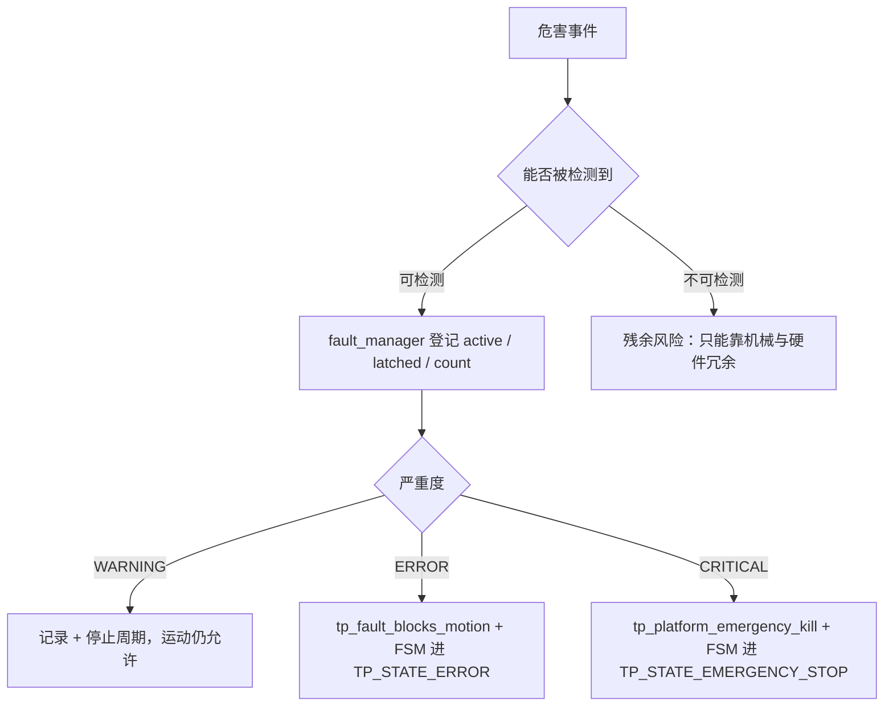
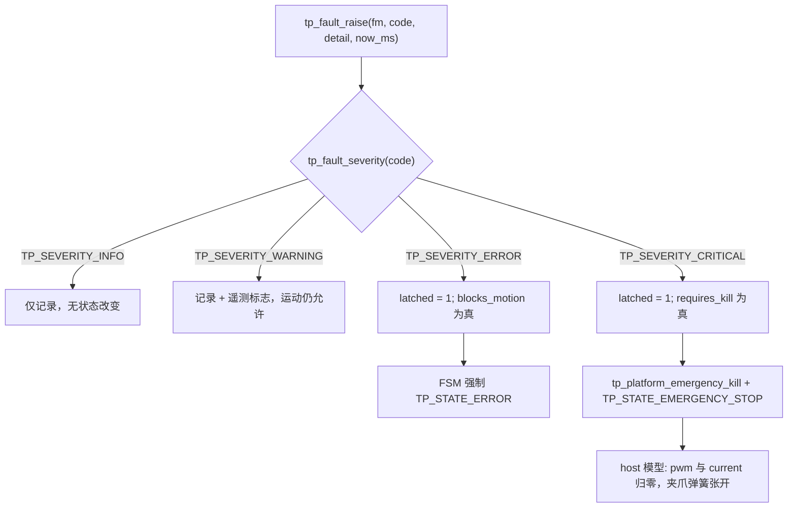
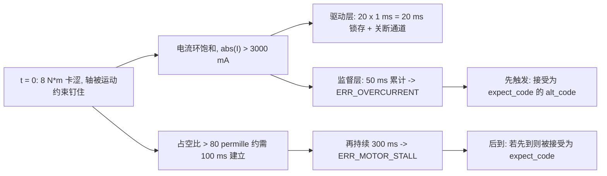
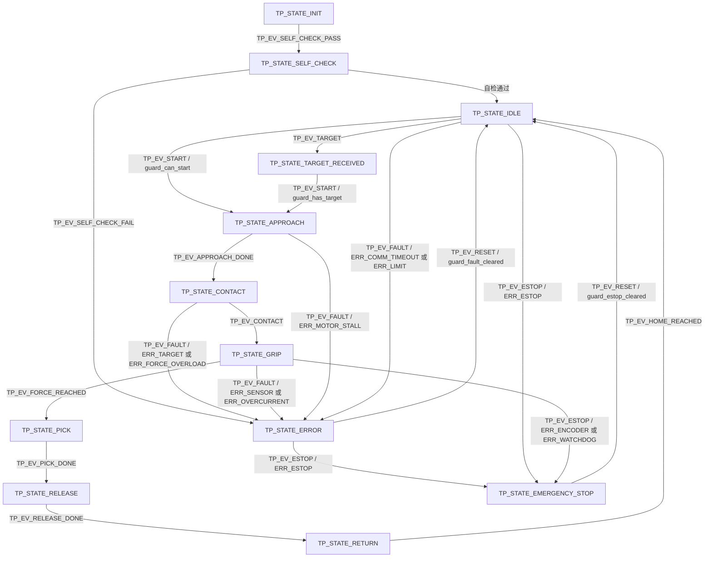

# 第二代智能无人机采茶机器人系统 —— 安全设计（Safety Design）

<!-- REVISION NOTICE - do not remove -->
> ### ⚠️ 参数修订说明（第三次校正，覆盖全文数值）
>
> 本文档写作期间，项目经历了三轮**更正**，因此正文中的部分**具体数字已经过期**。
> 保留原文是为了不掩盖修正过程，但读数时请以代码为准。
> **第三次更正的完整缺陷清单见 [`docs/12_results_analysis.md`](12_results_analysis.md) 的 §3.5。**
>
> | 常量 | 已废弃的值 | 当前值（权威） | 更正原因 |
> |---|---|---|---|
> | `TP_PLANT_MOTOR_KT_NM_PER_A` | 2.0 | **0.4** | SI 单位下 `Kt` 与 `Ke` 是同一物理量，原值相差 40 倍，违反能量守恒 |
> | `TP_PLANT_MOTOR_KE_VS_RAD` | 0.05 | **0.4** | 同上 |
> | `TP_VEL_PID_KP` | 0.005 | **0.026** | 被控对象 DC 增益由 480 变为 60 mrad/s/permille，必须重新整定 |
> | `TP_VEL_PID_KI` | 0.10 | **0.83** | 同上 |
> | `TP_POS_PID_KP` | 12.0 | **5.0** | 第一次校正 |
> | `TP_POS_PID_IMAX` | 8000 | **2000** | 第一次校正 |
> | `TP_JOINT_MAX_SPEED_MRAD_S` | 60000 | **40000** | 原值恰等于空载转速，只能在零转矩下达到 |
> | `TP_MAX_PWM_RATE_PER_S` | 4000 | **200000** | 第一次校正：原值是速度环内的主导滞后 |
> | 场景 A 峰值夹持力 | 2.493 N | **2.363 N** | 第三次校正：力背驱符号修正 |
> | 场景 A 达到目标力 | 2.26 N | **2.18 N** | 同上 |
> | 场景 A 接触间隙 | 5.688 mm | **5.682 mm** | 同上 |
> | 场景 A 主机链路解码 | 2200 B / 100 帧 | **2134 B / 97 帧** | 同上 |
> | `TP_PLANT_JAW_BACKDRIVE` 的作用方向 | 减去（`-=`） | **加上（`+=`）** | 符号错误使茎秆把空夹爪"吸"到机械硬限：力从 5.0 N 涨到 16.4 N，并误锁存传感器故障 |
> | 力环服务速率 | 100 Hz（与注释不符） | **1 kHz** | 力环搬入 1 kHz 控制任务，"N 个控制周期"从此等于 N ms |
>
> **唯一权威**：`firmware/Application/config.h` 与 `firmware/BSP/host/plant_model.h`。
> 二者的一致性由 `tests/test_config_agreement.py` 自动校验——它会解析这两个头文件并与
> Python 模型逐条比对，因此任何再次漂移都会变成失败的测试而不是过期的文档。
<!-- /REVISION NOTICE -->


> 文档对象：`firmware/Safety/{fault_codes,fault_manager,safety_monitor}.{h,c}`、`firmware/Control/force_control.c`、
> `firmware/Application/config.h`（第 7 节安全阈值）、`firmware/BSP/{platform_api.h,bsp_types.h,limit_switch.h,motor.h}`、
> `firmware/BSP/host/{platform_host.c,plant_model.c}`、`firmware/Core/{app_tasks.c,app_sequence.c,main_host.c}`、
> `firmware/Application/robot_fsm.c`、`firmware/Middleware/utils/robot_state.h`。
> 本文所有阈值、故障码、去抖时间与严重度**逐条来自上述源码**；所有结果数字只来自七场景仿真（`scripts/run_scenarios.ps1`，7/7 PASS）。

## 摘要

本文给出第二代智能无人机采茶机器人系统的安全设计，覆盖三个层面：**检测**（`safety_monitor` 与各驱动的本地保护）、**登记与反应**（`fault_manager` 的中心故障登记表 + 严重度驱动的反应策略）、**执行**（`tp_platform_emergency_kill()` 的硬件级断电锁存与 FSM 的 `TP_STATE_ERROR` / `TP_STATE_EMERGENCY_STOP`）。以代码为准，本系统实现 **14 条保护条目**：其中 **13 条会置位故障码**（合计只用到 11 个非 `TP_FAULT_NONE` 的故障码，因为过流被两条路径共用、编码器被两条检测共用），**1 条为纯降额保护**（力软限，只改设定点、不置码）。故障码是**封闭集合**：`TP_FAULT_CODE_COUNT = 12`（含 `TP_FAULT_NONE = 0`），严重度枚举为 `TP_SEVERITY_INFO / WARNING / ERROR / CRITICAL`。锁存规则由严重度唯一决定：`tp_fault_is_latching()` 返回 `sev >= TP_SEVERITY_ERROR`，因此 `ERR_COMM_TIMEOUT` 与 `ERR_LIMIT` 自清除，其余锁存至显式清除。

**证据等级声明（必须随本文档引用）**：本项目**没有实物硬件，没有电路板**。所有安全行为只在宿主机（host）仿真中验证过，从未做过真实 E-stop 拉线、真实堵转实验、真实过流实验或真实掉电实验；**未做任何功能安全认证，没有 SIL / ASIL / PL 等级，没有人身安全完整性等级结论**。七场景结果全部标注为**仿真结果（Simulated）**；设计指标（茶芽破损率 ≤ 1 %）标注为**设计目标 / Target KPI（未实测）**。

## 目录

1. [文档范围与证据分级](#1-文档范围与证据分级)
2. [危害分析与风险矩阵](#2-危害分析与风险矩阵)
3. [十四类保护逐条](#3-十四类保护逐条)
4. [严重度分级与反应策略](#4-严重度分级与反应策略)
5. [锁存 vs 自清除](#5-锁存-vs-自清除)
6. [失效安全极性（E-stop 常闭）](#6-失效安全极性e-stop-常闭)
7. [看门狗策略](#7-看门狗策略)
8. [保护之间的竞争：Scenario F](#8-保护之间的竞争scenario-f)
9. [损失位置 vs 继续驱动](#9-损失位置-vs-继续驱动)
10. [安全状态机](#10-安全状态机)
11. [安全设计的未验证项与局限](#11-安全设计的未验证项与局限)

## 1. 文档范围与证据分级

本文对每一条结论标注证据等级，全文只使用这四类标签：

| 标签 | 含义 |
|---|---|
| **代码事实** | 直接引自源码的常量、枚举、分支与注释，可逐行核对 |
| **仿真结果（Simulated）** | 宿主机仿真中测得的结果，来源仅限七场景 |
| **设计目标 / Target KPI（未实测）** | 设计意图中的指标，**没有任何实测值** |
| **参考设计（未验证）** | 硬件侧应在真实机器上成立、但本项目无实物可验证的设计意图 |

以下是几条**代码与注释不一致**的事实，本文按代码报告，并在此处集中披露，避免读者被注释误导：

| 位置 | 注释/文档说 | 代码实际做 |
|---|---|---|
| `config.h:346` | `TP_SENSOR_FAULT_DEBOUNCE (10u)` "连续坏样本数" | **全工程无任何调用点**，仅出现在 `safety_monitor.h` 的说明表格里。真实的力传感器去抖是 `force_sensor.c` 的 `FORCE_SPIKE_TRIP = 8u`（连续 8 次尖峰 > `FORCE_SPIKE_THRESHOLD_N = 3.0f` N） |
| `safety_monitor.h:19` | 八项检查含 "Soft force / `TP_FORCE_SOFT_LIMIT_N`" | `safety_monitor.c` **完全没有**软限检查，`TP_FORCE_SOFT_LIMIT_N` 只出现在 `force_control.c`（降额）与 `config.h` 的静态断言中 |
| `fault_codes.h:69` | 编码器故障含"两通道不一致" | 实现只有两条：不可能加速度（`safety_monitor.c`）与连续读失败 ≥ `ENCODER_ERROR_TRIP = 10u`（`encoder.c`）；**没有 A/B 一致性比较** |
| `config.h:317` | `TP_OVERCURRENT_TRIP_MS` 注释写 "consecutive control periods" | 变量以**毫秒**累加（`st->overcurrent_ms += elapsed_ms`，安全任务 100 Hz → 每周期 10 ms），50 ms = 5 个安全周期，不是 50 个控制周期 |
| `bsp_types.h:67` | `TP_IO_DRIVER_FAULT` 为驱动 nFAULT 输入 | `plant_model.c:495` 会产出该位（恒为"正常"），但**固件无任何代码读取它**，不存在 nFAULT 保护 |
| 任务书引用 | `brp_types.h` | 工程中**不存在**该文件，离散 IO 枚举在 `firmware/BSP/bsp_types.h` |
| `force_control.c:395` | 力环未收敛超时 | 置位的是 `TP_FAULT_FORCE_OVERLOAD`（语义偏差：栈里并非过力，而是"环不收敛"，本文如实报告） |

## 2. 危害分析与风险矩阵

**方法论声明**：下表是**工程分析（FMEA 风格）**，不是认证级 HARA。严重度、暴露频率、风险等级均为**工程判断**，**没有定量失效概率数据**（无 FMEA 定量数据、无失效率 λ、无 DC/CCF 分析、无安全完整性等级推导）。表中"现有防护"列逐条对应真实故障码与真实阈值常量。

| # | 危害 | 触发原因 | 后果 | 现有防护（真实故障码 / 阈值） | 严重度 | 暴露频率 | 风险等级 | 残余风险 |
|---|---|---|---|---|---|---|---|---|
| H1 | 茶芽破损（力过大） | 力反馈失效、纯位置控制闭合、目标位置错误 | 芽叶压碎，采净率下降 | 力硬限 `TP_FORCE_MAX_N = 5.00f` → `TP_FAULT_FORCE_OVERLOAD`；软限 `TP_FORCE_SOFT_LIMIT_N = 3.50f` 降额至 3.15 N；`TP_FAULT_TARGET`（接触超时 2500 ms） | ERROR | 每周期 | 中 | 设计目标破损率 ≤ 1 % **未实测**；`TP_FORCE_MAX_N` 是控制器量程上限而非芽叶损伤阈值 |
| H2 | 夹爪过力（无反馈路径） | 力传感器故障 / 读失败 | 继续按位置闭合至机械停止 | `tp_force_sensor_is_faulty()` → `TP_FAULT_SENSOR`（`-20.0f / 50.0f` N 窗口、ADC `5u / 4090u` 导轨、8 次尖峰）；`force_control.c` 在控制器之前先查硬限与传感器有效性 | ERROR | 每周期 | 中 | 传感器故障时**没有自动降级到安全的位置限幅**，只有整周期中止 |
| H3 | 人员被运动部件夹伤 | 关节运动中人员接近、E-stop 失效 | 人员伤害 | 急停常闭回路（`TP_IO_ESTOP`，`active_low = 1`）→ `TP_FAULT_ESTOP`（CRITICAL）→ `tp_platform_emergency_kill()`；限位开关 `TP_IO_LIMIT_JOINT_MIN/MAX` → `TP_FAULT_LIMIT`；软限位 `±90000.0f` mrad | CRITICAL | 每次运行 | **高** | **无实物 E-stop 验证**、无安全继电器、无 PL 等级；本项是本项目**最大的未验证残余风险** |
| H4 | 通信失控 | 主机进程崩溃、线缆脱落、总线饱和 | 采集继续用过期目标 | `TP_COMM_TIMEOUT_MS = 200u` → `TP_FAULT_COMM_TIMEOUT`（WARNING）；`on_link_lost` 在非 IDLE 态调用 `tp_app_stop`；主机心跳 `TP_COMM_HEARTBEAT_MS = 500u` | WARNING | 每次运行 | 中 | WARNING **不锁存、不阻断运动**（设计意图），故链路抖动期间运动仍被允许 |
| H5 | 堵转过热 / 烧驱动 | 关节被枝条卡住、机械卡涩 | 绕组过热、驱动损坏 | 过流 `TP_MAX_CURRENT_MA = 3000.0f` + `TP_OVERCURRENT_TRIP_MS = 50u` → `TP_FAULT_OVERCURRENT`；驱动层 `TP_MOTOR_OC_TRIP_SAMPLES = 20u`（1 kHz → 20 ms）；堵转 `TP_STALL_*` → `TP_FAULT_MOTOR_STALL` | ERROR | 偶发 | 中 | 驱动层 20 ms 锁存**不置位故障码**（只记录日志），登记表看到的是 50 ms 那一层 |
| H6 | 失控运动（发散） | 增益错误、反馈异常、控制器发散 | 高速撞击、结构损坏 | `tp_cascade_is_diverged()`（PID 非有限输入/输出 `tp_pid_is_diverged`）→ `TP_FAULT_INTERNAL` 并置零需求；`TP_MAX_DUTY_RATE_PER_S = 200000.0f` 斜率限制；`TP_JOINT_MAX_SPEED_MRAD_S = 40000.0f` | ERROR | 异常 | 低 | 发散判据只覆盖"非有限值"，不覆盖"有限但有界振荡" |
| H7 | 掉电时夹持物滞留 | 断电、急停、驱动断电 | 芽叶被夹住带离/掉落 | 仿真中 `plant_model.c` 建模为弹簧张开（`v_jaw = TP_GRIPPER_MAX_SPEED_MM_S`）；`TP_FAULT_ESTOP/ENCODER/WATCHDOG` 触发 `app_disable_drive()` | CRITICAL | 偶发 | 中 | **"夹爪断电弹性张开"仅为参考设计（未验证）**，真实硬件是否如此无法证实 |
| H8 | 编码器故障导致飞车 | 编码器断线、屏蔽不良、耦合松动 | 闭环驱动错向、失控 | 不可能加速度 `TP_ENCODER_MAX_ACCEL_MRAD_S2 = 4000000.0f`（连续 2 个周期）→ `TP_FAULT_ENCODER`（CRITICAL）→ 立即 `tp_platform_emergency_kill()`；读失败 ≥ 10 次同样置位 | CRITICAL | 偶发 | 中 | 无 A/B 通道一致性校验；飞车保护**未做过真实断线实验** |



## 3. 十四类保护逐条

以下 14 条**逐条对应代码里真实的检测逻辑**，阈值写成"真实常量名 = 数值"。

| # | 保护 | 触发条件 | 阈值常量 = 数值 | 去抖 / 时间窗 | 严重度 · 故障码 | 反应 | 恢复方式 |
|---|---|---|---|---|---|---|---|
| 1 | 力硬限 | `force > TP_FORCE_MAX_N` | `TP_FORCE_MAX_N = 5.00f` N | **无去抖**（`safety_monitor.h` 明示） | ERROR · `TP_FAULT_FORCE_OVERLOAD` | `safety_monitor` 置位；`force_control.c` 在控制器**之前**判定，`grip_trip` 张开夹爪并进 `TP_GRIP_FAULT` | `CLEAR_FAULT`，且 `tp_force_control_clear_fault` 要求力已 ≤ 软限 |
| 2 | 力软限降额 | `force > TP_FORCE_SOFT_LIMIT_N` | `TP_FORCE_SOFT_LIMIT_N = 3.50f` N；目标降为 `3.50f * 0.9f` = 3.15 N | 无（仅首次 `soft_limit_events == 0u` 时告警一次） | 不置码（`LOG_WARN` + `soft_limit_events++`） | 降额设定点，**不跳闸** | 力回落即自动恢复 |
| 3 | 力传感器合理性 | N 越窗 / ADC 顶轨或触底 / 连续尖峰 | `TP_SENSOR_FORCE_MIN_N = -20.0f`、`TP_SENSOR_FORCE_MAX_N = 50.0f`、`TP_SENSOR_ADC_MIN_COUNTS = 5u`、`TP_SENSOR_ADC_MAX_COUNTS = 4090u` | 尖峰链：`FORCE_SPIKE_TRIP = 8u`（注释中的 `TP_SENSOR_FAULT_DEBOUNCE = 10u` **代码未使用**） | ERROR · `TP_FAULT_SENSOR` | `safety_monitor` 置位；`force_control.c` 直接 `grip_trip` 中止 | `tp_force_sensor_clear_fault`（ADC 仍顶轨则拒绝，返回 `TP_ERR_FAULT_ACTIVE`） |
| 4 | 接触超时 | `FAST/SLOW_APPROACH` 内未检出接触 | `GRIP_CONTACT_TIMEOUT_MS = 2500u` ms；接触阈 `TP_FORCE_CONTACT_N = 0.15f` N | 接触确认 `GRIP_CONTACT_DEBOUNCE = 3u` 个样本 | ERROR · `TP_FAULT_TARGET` | 中止周期、张开夹爪，请求新目标 | `CLEAR_FAULT` |
| 5 | 力环未收敛超时 | `TP_GRIP_FORCE_CONTROL` 停留过久 | `GRIP_CONTACT_TIMEOUT_MS = 2500u` ms | 无 | ERROR · `TP_FAULT_FORCE_OVERLOAD`（代码如此，语义偏"不收敛"） | `grip_trip` 中止 | `CLEAR_FAULT` |
| 6 | 关节过流 | `\|I\| > TP_MAX_CURRENT_MA` 持续 | `TP_MAX_CURRENT_MA = 3000.0f` mA、`TP_OVERCURRENT_TRIP_MS = 50u` ms（峰值 `TP_PEAK_CURRENT_MA = 5000.0f` mA 为短时上限） | 50 ms 累计（安全任务 100 Hz → 5 个周期） | ERROR · `TP_FAULT_OVERCURRENT` | 置位 + `tp_motor_disable()`；驱动层另有 `TP_MOTOR_OC_TRIP_SAMPLES = 20u`（1 kHz = 20 ms）锁存并比例回卷（5 % 下限） | `tp_motor_clear_fault`（电流仍超限则拒绝）+ `CLEAR_FAULT` |
| 7 | 夹爪驱动过流 | `tp_motor_is_faulted(gm) != 0` | 同上（`current_limit_ma = TP_MAX_CURRENT_MA`） | 由驱动层 20 ms 决定 | ERROR · `TP_FAULT_OVERCURRENT` | 置位（`detail` = 电流/100 mA） | `CLEAR_FAULT` |
| 8 | 堵转 | `\|duty\| > 阈值` 且 `\|speed\| < 阈值` | `TP_STALL_PWM_THRESHOLD = 80.0f` ‰、`TP_STALL_SPEED_THRESHOLD_MRAD_S = 30.0f` mrad/s、`TP_STALL_TRIP_MS = 300u` ms | 300 ms 累计；**须先满足占空比条件**（`config.h` 注明 80 ‰ 约需 100 ms 建立） | ERROR · `TP_FAULT_MOTOR_STALL` | 置位 + `tp_motor_disable()` | `CLEAR_FAULT`；**夹爪不应用堵转检测**（合到机械停止是正常态） |
| 9 | 编码器异常 | 加速度不可信 / 读失败链 | `TP_ENCODER_MAX_ACCEL_MRAD_S2 = 4000000.0f` mrad/s²；`ENCODER_ERROR_TRIP = 10u` 次 | 加速度需**连续 2 个周期**（`encoder_bad_count >= 2u`） | CRITICAL · `TP_FAULT_ENCODER` | 置位 + **立即 `tp_platform_emergency_kill()`** | 需 `RESET`；`app_disable_drive()` 生效 |
| 10 | 通信超时 | 自最后有效帧起静默超时 | `TP_COMM_TIMEOUT_MS = 200u` ms（心跳 `TP_COMM_HEARTBEAT_MS = 500u`） | **超时本身即去抖**；仅在 `comm_seen != 0` 后武装 | WARNING · `TP_FAULT_COMM_TIMEOUT` | 记录 + 停止周期（`on_link_lost` → `tp_app_stop`） | 下一有效帧自动清除（`clear_condition` + `clear` 同调用） |
| 11 | 限位 | 限位压住且继续往该方向驱动 / 软限位越界 | `TP_IO_LIMIT_JOINT_MIN/MAX`；软限 `TP_JOINT_MIN_MRAD = -90000.0f`、`TP_JOINT_MAX_MRAD = 90000.0f`；方向判据同为 `TP_STALL_PWM_THRESHOLD = 80.0f` ‰ | 驱动内 `TP_LIMIT_DEBOUNCE_COUNT = 3u` 个样本 | WARNING · `TP_FAULT_LIMIT`（自检时两限位同时触发记 `detail = 2u` 接线故障） | 记录；软限位在 `cascade.c`/`app_sequence.c` 直接**拒绝设定点** | 反向命令退让；警告自清除 |
| 12 | 急停 | 常闭回路断开 / 软件命令 | `TP_IO_ESTOP`（`bsp_types.h`："NC loop, low = asserted"）；`active_low = 1` | **无去抖**（物理安全输入，永不过滤） | CRITICAL · `TP_FAULT_ESTOP` | 置位 + `tp_platform_emergency_kill()`；FSM 强制 `TP_STATE_EMERGENCY_STOP` | 释放 E-stop → `RESET` → `guard_estop_cleared` |
| 13 | 看门狗 | 超时未喂狗 / 上次复位原因为看门狗 | `TP_WDG_TIMEOUT_MS = 500u` ms | boot 时读一次 `tp_platform_watchdog_caused_reset()` | CRITICAL · `TP_FAULT_WATCHDOG` | 置位并**拒绝自动恢复运动**（`tp_app_self_check` 返回 0） | `RESET`（成功后仍建议断电重启） |
| 14 | 内部不变量与执行器约束 | PID 非有限输入/输出、级联发散、占空比/电流越限 | `TP_MAX_PWM_PERMILLE = 1000.0f`、`TP_MAX_DUTY_RATE_PER_S = 200000.0f` ‰/s、`TP_PEAK_CURRENT_MA = 5000.0f` | 无 | ERROR · `TP_FAULT_INTERNAL` | `tp_motor_stop(..., 0u)` + 置位；斜率限制与电流钳位在驱动/被控对象内 | `CLEAR_FAULT`；发散本身指示固件缺陷 |

**关于条数的诚实说明**：这 14 条中，**13 条会置位故障码**（表 1、3–14），**只有第 2 条（力软限）不置码**，它只写 `soft_limit_events`、打一次 `LOG_WARN` 并把设定点降到 3.15 N。这与任务书给出的"九类"线索不一致，**以代码为准报告 14 条**；差异来自：力限被拆成硬限/软限两条、编码器的两条检测（不可能加速度、连续读失败）合为一条、限位开关与软限位合为一条、夹爪过流单列一条、看门狗与"内部不变量 + 执行器约束"各占一条。

**关键机制三问**

**「它是什么」** 力硬限是"控制器之前执行"的绝对保护：`force_control.c` 的 `tp_force_control_update()` 在调用 `tp_pid_update()` **之前**先判 `force > TP_FORCE_MAX_N`，命中即 `grip_trip()` 并 `return TP_ERR_FAULT_ACTIVE`，同一控制周期内张开夹爪。

**「为什么这么设计」** 因为无论控制器处于哪个子状态、积分器充了多少，过力都必须在本周期被止住；把它放在控制器之后，本周期就会先输出一次基于过力误差计算的动作。

**「如果不用它会怎样」** 在 Scenario D 这类"纯位置控制 + 茎秆在 16 mm"的工况下，没有这一层保护，位置环会一路闭合到机械停止，`main_host.c` 注释给出的模型预测是 `0.30*12 + 0.06*144 = 12.2 N`，远超 5 N 硬限，也是唯一"控制器本身不设防"的路径。

**「它是什么」** 力软限是一个"降额不跳闸"的中间层：`force_control.c` 在 `force > TP_FORCE_SOFT_LIMIT_N` 时把 `force_target_n` 压到 `TP_FORCE_SOFT_LIMIT_N * 0.9f`，同时只记 `soft_limit_events` 与一次 `LOG_WARN`。

**「为什么这么设计」** 硬限是"保住芽叶不碎"的最后一道门，软限是"让环自己退回来"的调节手段；软限跳闸会把一次可自愈的轻微过冲变成整周期报废。

**「如果不用它会怎样」** 硬限会从"最后一道门"变成"唯一一道门"，任何一次接触瞬态都可能直接中止周期，可用性崩塌；反过来只有软限没有硬限，则软限降额也救不回来的快速过力会一路压碎芽叶。

**「它是什么」** 过流保护有**两层**：驱动层（`motor.c`）在 `|I| > current_limit_ma` 时比例回卷占空比，并在 `overcurrent_samples >= TP_MOTOR_OC_TRIP_SAMPLES = 20u`（控制周期 1 ms → 20 ms）时置 `motor->fault`、关断通道；监督层（`safety_monitor.c`）在 `|I| > TP_MAX_CURRENT_MA` 累计到 `TP_OVERCURRENT_TRIP_MS = 50u` ms 时置位 `TP_FAULT_OVERCURRENT` 并 `tp_motor_disable()`。

**「为什么这么设计」** 两层解决两个不同问题：驱动层要在电流环饱和的瞬间保住功率级；监督层要给出一个**进入登记表、能被主机看到并需要确认**的故障事件。因此 20 ms 保硬件、50 ms 保可追溯。

**「如果不用它会怎样」** 只有驱动层则故障只存在于 `motor->fault`，登记表为空、`CLEAR_FAULT` 无从谈起，机器"不动了但没人知道为什么"；只有监督层则 50 ms 内功率级没有任何本地保护。

**「它是什么」** 堵转判据是"占空比高于 `TP_STALL_PWM_THRESHOLD = 80.0f` ‰ **且** 转速低于 `TP_STALL_SPEED_THRESHOLD_MRAD_S = 30.0f` mrad/s，并持续 `TP_STALL_TRIP_MS = 300u` ms"，三者缺一不可。

**「为什么这么设计」** 只看转速无法区分"被命令停住"和"堵转"：命令零速且转速为零是正常停机。占空比条件把"正在要求力矩"编码进判据，这是自制堵转检测最常见的错误（`safety_monitor.h` 原文点明）。

**「如果不用它会怎样」** 去掉占空比条件，每次启动、每次到位都会置位 `ERR_MOTOR_STALL`，保护沦为噪声源并被操作员习惯性忽略。

**「它是什么」** 编码器异常有两条独立路径：`safety_monitor.c` 用相邻周期速度差算 `accel = |v - v_prev| / (elapsed_ms/1000)`，超过 `TP_ENCODER_MAX_ACCEL_MRAD_S2 = 4000000.0f` 且**连续 2 个周期**成立即置 CRITICAL；`encoder.c` 在读失败累计到 `ENCODER_ERROR_TRIP = 10u` 时置 `fault`。

**「为什么这么设计」** 不可能加速度意味着"反馈本身错了"，不是"机器动作异常"，没有等待价值，因此不等去抖窗口就走硬件断电。要求连续 2 个周期只是为了滤掉单次除零/时间戳毛刺。

**「如果不用它会怎样」** 反馈路径不可信时继续闭环驱动，等于用一个错误的位置误差去推力矩，方向可能是反向的——这就是"飞车"这一类危害的机理。

**「它是什么」** 通信超时是"唯一不锁存的安全相关故障"：`silent > TP_COMM_TIMEOUT_MS = 200u` 置位 `TP_FAULT_COMM_TIMEOUT`（WARNING）；下一个有效帧到达时 `safety_monitor.c` 连续调用 `tp_fault_clear_condition()` 与 `tp_fault_clear()`。

**「为什么这么设计」** 丢主机必须停周期（不能拿过期目标继续采），但不该要求断电重启——一次总线抖动就上电复位会让机器不可用。这就是"严重度决定反应"的存在理由。

**「如果不用它会怎样」** 若把链路丢失定为 ERROR，则每次线路接触不良都要人工 `RESET`，现场可用性下降；若完全不管，则机器人会按摄像头已经放弃的坐标继续采摘。

## 4. 严重度分级与反应策略

真实枚举（`fault_codes.h`）是 **`TP_SEVERITY_*` 而非 `TP_SEV_*`**：`TP_SEVERITY_INFO = 0`、`TP_SEVERITY_WARNING = 1`、`TP_SEVERITY_ERROR = 2`、`TP_SEVERITY_CRITICAL = 3`。未识别的码按 `TP_SEVERITY_ERROR` 处理（fail-safe，`fault_codes.c` 注释："Fail safe: an unrecognised code must not be treated as harmless"）。

真实故障码 → 严重度映射（`fault_codes.c` 的 `s_fault_table[TP_FAULT_CODE_COUNT]`，逐行抄录）：

| 码 | 名称 | 严重度 | 是否锁存 | detail 语义（检测器自定） |
|---|---|---|---|---|
| 0 | `ERR_NONE` | `TP_SEVERITY_INFO` | 否 | 无 |
| 1 | `ERR_FORCE_OVERLOAD` | `TP_SEVERITY_ERROR` | 是 | 力（cN，封顶 255） |
| 2 | `ERR_MOTOR_STALL` | `TP_SEVERITY_ERROR` | 是 | 占空比/10（‰） |
| 3 | `ERR_OVERCURRENT` | `TP_SEVERITY_ERROR` | 是 | 电流/100（mA） |
| 4 | `ERR_ENCODER` | `TP_SEVERITY_CRITICAL` | 是 | 错误计数 / 加速度坏样本数 |
| 5 | `ERR_COMM_TIMEOUT` | `TP_SEVERITY_WARNING` | 否 | 静默时间/100 ms |
| 6 | `ERR_SENSOR` | `TP_SEVERITY_ERROR` | 是 | 尖峰计数 |
| 7 | `ERR_LIMIT` | `TP_SEVERITY_WARNING` | 否 | 0 = 下限位，1 = 上限位，2 = 双限位接线故障 |
| 8 | `ERR_ESTOP` | `TP_SEVERITY_CRITICAL` | 是 | 0 = 硬件回路，1 = 主机命令 |
| 9 | `ERR_WATCHDOG` | `TP_SEVERITY_CRITICAL` | 是 | 无 |
| 10 | `ERR_TARGET` | `TP_SEVERITY_ERROR` | 是 | 无 |
| 11 | `ERR_INTERNAL` | `TP_SEVERITY_ERROR` | 是 | 无 |

反应策略由严重度**集中在一处**施加，不在各调用点各自实现：

| 严重度 | 登记表影响 | FSM 影响 | 执行器影响 | 清除方式 |
|---|---|---|---|---|
| `INFO` | 计数与历史 | 无 | 无 | 自动 |
| `WARNING` | `active`/`count` 更新，**不设置 `latched`** | 不强制转移 | 由具体逻辑决定（通信丢失会 `tp_app_stop`） | 条件消失即自动清除 |
| `ERROR` | `latched = 1`，`latch_ms` 记录首次锁存时刻 | `tp_fault_blocks_motion()` 为真 → `TP_STATE_ERROR` | 控制任务把 `duty` 强制置 0（`app_sequence.c`） | `CLEAR_FAULT` 且物理条件已消失 |
| `CRITICAL` | `latched = 1` | `TP_STATE_EMERGENCY_STOP` | `tp_fault_requires_kill()` 为真 → `tp_platform_emergency_kill()` | `RESET`（发布 kill 前须确认条件消失） |



## 5. 锁存 vs 自清除

`fault_manager.h` 的 `tp_fault_record_t` 把三个问题分开存放，这是本模块的核心设计决定：

| 问题 | 字段 | 清除者 | 语义 |
|---|---|---|---|
| 现在条件成立吗？ | `active` | 条件自己消失 | 过流毛刺结束后 `active = 0` 但 `latched` 可能仍为 1 |
| 锁存了吗？ | `latched` | 显式清除 | 需人工/主机确认 |
| 曾经发生过吗？ | `count`、`first_ms`、`last_ms`、`active_ms` | 只有 `tp_fault_clear` 会把 `count` 归零 | 间歇性故障的唯一证据 |

| 故障 | 是否锁存 | 依据 | 清除路径 |
|---|---|---|---|
| `ERR_FORCE_OVERLOAD`、`ERR_MOTOR_STALL`、`ERR_OVERCURRENT`、`ERR_SENSOR`、`ERR_TARGET`、`ERR_INTERNAL` | **锁存** | `sev == ERROR` | `CLEAR_FAULT` → `tp_fault_clear_all()`；条件仍在则返回 `TP_ERR_FAULT_ACTIVE` 拒绝 |
| `ERR_ENCODER`、`ERR_ESTOP`、`ERR_WATCHDOG` | **锁存（CRITICAL）** | `sev == CRITICAL` | `RESET`；`tp_app_reset` 先 `clear_all` 再 `tp_platform_emergency_release()` |
| `ERR_COMM_TIMEOUT`、`ERR_LIMIT` | **自清除** | `sev == WARNING` → `tp_fault_is_latching()` 返回 0 | 条件消失时 `tp_fault_clear_condition()` 直接把 `latched` 也置 0 |

真实语义 API：`tp_fault_is_active()`（当前条件）、`tp_fault_is_latched()`（是否需显式清除）、`tp_fault_any_latched()`（返回聚合字段 `fm->any_latched`）、`tp_fault_highest()`（返回 `fm->highest`，最严重**已锁存**码，无锁存时为 `TP_FAULT_NONE`）、`tp_fault_blocks_motion()`（`>= ERROR`）、`tp_fault_requires_kill()`（`>= CRITICAL`）。聚合字段由 `fault_recompute()` 统一重算，注释给出的理由很具体：分开更新会产生"主机显示无故障、机器人拒绝运动"这一类不一致。

**二次拒绝（真实的可见实现）**：`tp_force_control_clear_fault()` 在 `fc->force_feedback_n > TP_FORCE_SOFT_LIMIT_N` 时**拒绝清除**并返回 `TP_ERR_FAULT_ACTIVE`，日志为 `clear refused: force still %.3f N (soft limit %.2f N)`。`fault_manager.h` 对 `tp_fault_clear` 的说明同样明确："clearing an over-current latch while the current is still high would let the operator defeat the protection by pressing a button twice."

**「它是什么」** 锁存是"物理条件消失后仍拒绝运动，直到有人确认"的状态，由 `latched` 字段承载，`ERROR` 及以上自动设置。

**「为什么这么设计」** 因为"条件已消失"和"这台机器现在可以安全启动"是两件事。前者是传感器读数，后者需要人看过现场。把两者混为一谈会让一次过力事件在无人察觉的情况下被下一次自动周期继承。

**「如果不用它会怎样」** 没有锁存，`ERR_COMM_TIMEOUT` 恢复后状态机会直接回到 `IDLE` 等新目标（这是有意的），但 `ERR_FORCE_OVERLOAD` 也会同样"忘了"，于是一次被压碎的芽叶不会留下任何恢复动作要求，同一位置会再压一次。

## 6. 失效安全极性（E-stop 常闭）

**「它是什么」** E-stop 输入是**常闭回路**，`platform_api.h` 的原话是 "The E-stop input is wired as a **normally-closed** loop: a broken wire reads as 'asserted', which is the fail-safe polarity"，`bsp_types.h` 写 "`TP_IO_ESTOP = 0, /**< NC loop, low = asserted. */`"。极性由 `safety_monitor.c` 施加（`tp_limit_switch_init(&app->sw_estop, TP_IO_ESTOP, 1)`，`active_low = 1`），而不是在平台层反转，理由是让"接错线的原型机在日志里可见，而不是被悄悄反向"。

**「为什么这么设计」** 常闭极性把"断线"与"按下"映射成同一个安全状态，于是**任何**电气失效（按钮坏、插头松、线被剪断、供电丢失）都落到"已断言"，而不是"未断言"。这是失效安全（fail-safe）的基本形式。

**「如果不用它会怎样」** 采用常开回路时，一根断掉的信号线会在软件里表现为"急停已释放"，机器会在操作员以为受保护的情况下保持使能——这正是"安安静静的危险"。

急停反应链（`safety_monitor.c` 第 0 项、最先执行且短路后续检查）：

| 环节 | 真实实现 | 说明 |
|---|---|---|
| 检测 | `tp_safety_check_estop()` 读 `tp_limit_switch_is_active(in->estop)` | **无去抖**；注释："a 3-sample filter would add 30 ms to a signal whose entire purpose is to be immediate" |
| 置位 | 仅当 `tp_fault_is_latched(fm, TP_FAULT_ESTOP) == 0` 时 `tp_fault_raise(...)` | 幂等：已锁存则不重复记历史，`estop_events` 仍累加 |
| 断电 | `tp_platform_emergency_kill()` | "Kill in hardware, not in software: a software stop still depends on the control task running" |
| 锁存 | kill 置 `s_host.killed = 1` 并清零所有通道 PWM、`enabled[i] = 0` | 幂等，且"stray write cannot restart the drives" |
| 释放 | `tp_platform_emergency_release()` 只被 `RESET`/`CLEAR_FAULT` 路径调用，且先确认 `tp_fault_requires_kill() == 0` | 防"按下确认按钮就重新加电" |
| 查询 | `tp_platform_is_killed()` 返回 `s_host.killed` | `app_sequence.c` 用它决定 `app_disable_drive()` 而非 `app_hold_position()` |

**host 模型中急停如何生效**（`plant_model.c`，这是**仿真结果（Simulated）**层面的事实）：

| 被控对象行为 | 真实代码位置 | 效果 |
|---|---|---|
| 关节 | `if (p->estop_asserted != 0) { p->joint.pwm_permille = 0.0f; p->joint.current_a = 0.0f; }` | 注释："the driver's enable pin is low, so the winding is open and no torque is produced regardless of the commanded duty" |
| 夹爪 | `if (p->estop_asserted != 0) { v_jaw = TP_GRIPPER_MAX_SPEED_MM_S; }` | **弹簧张开**：断电后夹爪以最大张开速度打开，芽叶被释放 |
| 平台层 | `platform_host.c:149-150`：`killed != 0` 时 `pwm_joint`/`pwm_grip` 在进入被控对象前被强制为 0 | "mirroring what clearing the gate-driver enable pin does" |
| 场景 | Scenario G 在 1.2 s 置 `plant->estop_asserted = 1` | 判定要求：`expect_code = TP_FAULT_ESTOP`、`expect_state = TP_STATE_EMERGENCY_STOP` |

**明确声明**：**"夹爪断电弹性张开"只在 `plant_model.c` 里被建模，真实硬件是否如此属于参考设计（未验证）**——`plant_model.c:307-308` 的原注释把它指向 `hardware/interface_design.md`（该文件在本仓库中不存在，`hardware/` 下没有 md 文档），并且本项目没有实物，从未测过断电瞬间夹爪的实际动作。

## 7. 看门狗策略

| 项目 | 真实值 | 出处 |
|---|---|---|
| 超时 | `TP_WDG_TIMEOUT_MS = 500u` ms，注释 "Must exceed the slowest task period" | `config.h` 第 7 节 |
| 喂狗点 | **只有一处**：`app_sequence.c` 安全任务末尾，且需 `control_cycles`、`sensor_cycles`、`comm_cycles`、`robot_cycles` 全部 > 0 | `platform_api.h`："Called from exactly one place — the safety task — after every supervised task has reported in" |
| boot 检查 | `tp_app_self_check()` 调用 `tp_platform_watchdog_caused_reset()`，非零则 `tp_fault_raise(TP_FAULT_WATCHDOG)`、`ok = 0`，**拒绝自动恢复运动** | `app_tasks.c:459`（另 `main_stm32.c:129` 有同样检查） |
| 初始化 | `tp_platform_watchdog_init(TP_WDG_TIMEOUT_MS)`，失败只告警不致命 | `app_tasks.c:643` |

任务频率（`config.h` 第 2 节）：控制 1000 Hz（1 ms）、传感 500 Hz（2 ms）、通信/机器人/安全各 100 Hz（10 ms）、遥测 20 Hz（50 ms）、**调试 5 Hz（200 ms，最慢）**。

**余量核对（诚实结论：名义上够，边界上偏紧）**

- 名义余量：`500 ms / 200 ms = 2.5×`。按"必须大于最慢任务周期"这条判据，2.5 倍是**够用但不宽裕**：最慢的调试任务（`TP_PRIO_DEBUG = 0`，优先级最低，负责日志刷写）连续错过 2 个周期就是 400 ms，第 3 个周期开始就越过 500 ms。
- 喂狗路径的实际节奏：安全任务 100 Hz，即每 10 ms 喂一次，窗口内允许约 50 次喂狗失败——从喂狗路径看余量很大；余量真正紧张的地方在于**"最慢任务"这条判据本身**：调试任务只是最慢任务，并不参与喂狗条件（它不在 `control/sensor/comm/robot` 四个计数之中），因此"500 ms > 200 ms"这个论证与喂狗门控条件并不严格对应。
- 目标板（`platform_stm32f407.c`）的真实不确定性：IWDG 用 LSI 计时，`iwdg_solve()` 的注释给出 `PR = 0 (/4), RLR = 3999 → 0.5000 s`（精确，分辨率 0.125 ms），但同处注明 STM32F407 的 LSI **未做微调**，"500 ms nominal, **250..1000 ms over the whole LSI tolerance band**"，并明确"the real value should be *measured* on the bench"。**本项目没有实物板，这个测量从未做过。** 按最坏情况 250 ms 计，余量相对 200 ms 的最慢任务只剩 **1.25×**，这是我认为**偏紧**的地方。
- host 后端（`platform_host.c`）的看门狗是**记账模型而非真实复位**：`tp_host_platform_advance()` 在 `time_ms - wdg_last_feed_ms > wdg_timeout_ms` 时执行 `wdg_timeouts++`、`wdg_caused_reset = 1`、`wdg_enabled = 0` 并打一条 `LOG_ERROR`；它**不复位 MCU、不杀驱动、不置故障码**。因此"看门狗保护"在 host 侧只验证了喂狗调用与 boot 拒绝路径，**没有验证超时后的真实后果**；七场景中也没有任何场景触发看门狗（`TP_FAULT_WATCHDOG` 仅在 boot 由复位原因置位）。

**「它是什么」** 看门狗是一个"只有安全任务在确认所有受监督任务都跑过之后才被喂"的 500 ms 独立定时器，超时即复位。

**「为什么这么设计」** 喂狗动作被刻意设计成"证明调用者跑过"的最小操作：目标板实现只有一条 `IWDG->KR = 0xAAAAu;`，注释写明"No counter, no timestamp, no conditional: anything more here would be state that a hung caller could still be updating"。单一喂狗点保证控制任务挂死不会被健康的日志任务掩盖。

**「如果不用它会怎样」** 没有看门狗，一次控制任务的死锁会让机器保持在最后一帧 PWM 上——关节继续通电而无人监督，这比停机危险得多；而把看门狗超时后的恢复设成"自动继续"，则会把"未知原因的复位"变成"未知原因的继续运动"。

## 8. 保护之间的竞争：Scenario F

Scenario F 的注入（`main_host.c`，**仿真结果（Simulated）**）：t = 900 ms 调用 `tp_plant_set_jam(plant, 8.0f)`，t = 1200 ms 注入 300 mm → `TP_APP_MM_TO_MRAD` 换算为 1000 mrad 的长位移并 `START_PICK`。日志原文："clamping the joint (8.0 N\*m, above the drive's 6.0 N\*m capability)"。

**驱动能力 6.0 N·m 的来历（由被控对象常量推得）**：`TP_PLANT_MOTOR_KT_NM_PER_A = 2.0f` N·m/A，连续电流上限 `TP_MAX_CURRENT_MA = 3000.0f` mA，故连续转矩上限 = 2.0 × 3.0 = **6.0 N·m**；短时峰值 `TP_PEAK_CURRENT_MA = 5000.0f` mA 对应 10.0 N·m，但被控对象只把电流钳到峰值，并在注释中说明"the driver folds back rather than tripping, which is what the over-current detector then notices"。8 N·m 卡住意味着要 4.0 A 才能顶开，**超出 3.0 A 连续上限**。

**判定逻辑接受两者之一**（`main_host.c`）：场景表为 `{ 'F', "motor stall", 0, 1, TP_FAULT_OVERCURRENT, TP_FAULT_MOTOR_STALL, TP_STATE_COUNT }`，按结构体字段顺序即 `expect_code = TP_FAULT_MOTOR_STALL`、`alt_code = TP_FAULT_OVERCURRENT`；判定代码：

```c
int hit_primary = (tp_fault_is_active(...) != 0) || (tp_fault_is_latched(...) != 0) ||
                  (app.faults.record[(int)exp->expect_code].count > 0u);
int hit_alt = 0;
if (exp->alt_code != TP_FAULT_NONE) { /* 同样的三选一检查 */ }
code_ok = (hit_primary || hit_alt);
```

注释直言原因："Two codes may be acceptable: see scenario F, where the over-current and stall protections race and either outcome is correct."

**为什么过流先触发（时序论证）**

| 保护 | 阈值 | 需要的持续时间 | 命中的现实时点 |
|---|---|---|---|
| 驱动层过流 | `current_limit_ma = TP_MAX_CURRENT_MA = 3000.0f` mA | `TP_MOTOR_OC_TRIP_SAMPLES = 20u` 个 1 ms 控制周期 = **20 ms** | 堵转瞬间反电动势为零（转速被运动约束钉在 0），`i = v/R = 1.92/2.0 = 0.96 A`（80 ‰ 时）直到控制器把占空比推满；电流环饱和后立刻越限 |
| 监督层过流 | `TP_MAX_CURRENT_MA = 3000.0f` mA | `TP_OVERCURRENT_TRIP_MS = 50u` ms（100 Hz 安全任务 → 5 个周期） | 距事件 **50 ms** |
| 堵转 | 占空比 > `TP_STALL_PWM_THRESHOLD = 80.0f` ‰ **且** 转速 < `TP_STALL_SPEED_THRESHOLD_MRAD_S = 30.0f` mrad/s | 先要武装（`config.h` 原文："With `TP_VEL_PID_KI = 0.83` and a large position error ..., a demand of 80 per-mille is reached in roughly 100 ms"），再持续 `TP_STALL_TRIP_MS = 300u` ms | 最早约 **400 ms** |

结论：**过流先触发是正确行为，不是缺陷**。50 ms（甚至 20 ms）与约 400 ms 相差近一个数量级；而且两者保护的**危害不同**——过流保护的是"电流是否已经超出连续额定"（热危害已经发生），堵转保护的是"是否在要求力矩而轴不动"（热危害即将发生）。谁先满足，谁先动作。

**为什么两者都必须保留**：堵转检测覆盖"低速大扭矩但电流尚未超限"的窗口。用被控对象常量给出一个具体算例：占空比 80 ‰ → 端电压 0.08 × 24 V = 1.92 V，堵转时反电动势为 0，稳态电流 = 1.92 V / `TP_PLANT_MOTOR_R_OHM = 2.0f` Ω = 0.96 A = 960 mA，对应转矩 1.92 N·m——**低于 3000 mA 连续限**。若卡涩阻力在 1.92 N·m 量级（`plant_model.c` 的粘滑模型：`|torque| <= jam_torque` 时轴被"运动约束"钉住），则电流永远不越限，**只有堵转检测能够发现"在要求力矩而轴不动"**。反过来说，如果删掉过流保护只留堵转，那么在 8 N·m 这种硬堵转下，功率级要先承受约 400 ms 的持续过流。



## 9. 损失位置 vs 继续驱动

`app_sequence.c` 在 `TP_STATE_ERROR` / `TP_STATE_EMERGENCY_STOP` 里做了一次显式的二选一：

| 分支 | 条件 | 动作 | 后果 |
|---|---|---|---|
| `app_disable_drive()` | 已锁存 `TP_FAULT_ENCODER`、`TP_FAULT_OVERCURRENT`、`TP_FAULT_MOTOR_STALL`、`TP_FAULT_ESTOP` **或** `tp_platform_is_killed() != 0` | `TP_CASCADE_MODE_OFF`、`tp_cascade_reset()`、`duty = 0`、`tp_motor_disable()` | 失去位置保持，轴靠摩擦/重力停住 |
| `app_hold_position()` | 其余可恢复故障（例如 `ERR_TARGET`、`ERR_COMM_TIMEOUT`） | 位置环保持闭合、以**当前实测位置**重设参考、`tp_motor_stop(..., 200u)` | 保住位置，代价是继续通电 |

代码注释把判据写得很清楚："Losing the arm's position on every recoverable fault (a missed contact, a comms blip) would mean re-homing before every retry, which is a real cost; but continuing to drive with a corrupt encoder or a stalled motor is not defensible. The fault registry's severity already encodes exactly that distinction." `app_hold_position` 还有一条来自第一版**数值分析失败记录**的教训：早期 PC 仿真里"停止"被实现成"命令零占空比并开环"，结果关节在 20 mN·m 重力负载下以 148 mrad/s 匀速漂移（重力与库仑+反电动势制动在此速度平衡），因此现在的"停"是**主动闭环保持**。

**为什么 `tp_platform_emergency_kill` 选择"断电 + 锁存"而不是"保持位置"**

1. **保持位置本身是一个需要被信任的动作**：它要求功率级使能、电流环健康、反馈可信。触发 CRITICAL 的三类原因（编码器不可信、E-stop、看门狗）恰好都在否定这三件事，此时"保持位置"等价于"用一个可能错的位置误差持续施加力矩"。
2. **软件保持依赖软件在跑**：`safety_monitor.c` 对 E-stop 的注释直指此点——"a software stop still depends on the control task running, and the whole point of an E-stop is to work when nothing else does"。
3. **锁存阻止"自动恢复运动"**：kill 置 `killed = 1`，只有 `tp_platform_emergency_release()` 能清，而它只被 `RESET`/`CLEAR_FAULT` 调用且在 `tp_fault_requires_kill() == 0` 之前不会执行。

**是否清编码器零点 / 是否需要重新回零**（如实报告代码现状）：

- `tp_platform_emergency_kill()` **不清**编码器零点，也**不调用** `tp_platform_encoder_reset()`；`tp_app_reset()` 同样不动编码器（它清故障、`tp_cascade_reset()`、`tp_motor_clear_fault()`/`tp_motor_enable()`、`tp_safety_monitor_reset_stats()`、`tp_force_sensor_reset_tracking()`）。
- 因此**本次上电内**位置仍然有效：`RESET` 后 FSM 回到 `TP_STATE_IDLE`，下一个周期的 `TP_STATE_RETURN` 以 `TP_JOINT_HOME_MRAD = 0.0f` 为终点，轴回到同一个绝对坐标。
- **跨上电的位置有效性未解决**：`tp_platform_encoder_reset()` 在 `platform_api.h` 中被描述为"Clear an encoder's accumulated count (used after homing)"，但**固件中没有任何调用点**（`tp_encoder_set_zero()` 只在 `gripper.c` 的夹爪开/合机械停止处与单元测试中使用）。也就是说**本工程没有实现关节回零序列**，"断电后是否需要重新回零"在代码层面是**未定义行为**，本文不给出结论。

**堵转建模的教训（`plant_model.c` 原注释，真实的失败记录）**：前两版把卡涩建模为"一个与速度反向的阻力矩"，都因数值原因失败——8 N·m 阻力矩作用在 `TP_PLANT_JOINT_J_KGM2 = 2.5e-3f` kg·m² 的惯量上是 **3200 rad/s²**，1 ms 显式欧拉一步就把速度改变 3.2 rad/s，而"held"判据要求 `|omega| <= 1e-4 rad/s`，比单步能分辨的量级窄四个数量级，于是每个样本都在穿越该带，轴以数千 mrad/s 的幅度振荡而不是保持卡住。修正后的结论被写进注释："**A jam is not a torque, it is a *motion constraint***"——判据改为检查施加转矩（`|torque| <= jam_torque` 时 `omega = 0`），因为转矩是平滑有界的量。同处还指出"a jam *torque below the drive's capability* produces a slow, laboured motion rather than a stall - which is correct, and is why scenario F uses 8 N\*m against a 6 N\*m drive"。

**「它是什么」** 这里的权衡是：出现故障后，是"清掉零点、承认位置丢失、要求回零"，还是"保留零点、继续驱动/保持位置"。

**「为什么这么设计」** 因为编码器零点是**整机上电时唯一的位置真值来源**，而在本次上电内它并没有被破坏——断电的只是执行器，不是反馈。既然如此，清掉零点只会无条件地制造一次回零开销，而不换来任何安全性；真正需要"停止驱动"的是对**反馈与控制链可信度**的判断，这已经由严重度表达了。

**「如果不用它会怎样」** 若在每一次可恢复故障（一次接触超时、一次通信抖动）后都清零点并强制回零，机器会在正常作业中反复插入回零动作，可用性不可接受；反之若对 `ERR_ENCODER` 也采取"保持位置"，就是用不可信的反馈继续驱动，这正是 `app_disable_drive()` 注释所拒绝的"not defensible"。

## 10. 安全状态机

状态来自 `robot_state.h` 的真实枚举 `TP_STATE_*`（0 = INIT … 11 = EMERGENCY_STOP，`TP_STATE_COUNT = 12`），事件来自 `robot_fsm.h` 的 `TP_EV_*`，转移条件用真实故障码名。下表列出与安全直接相关的守卫与转移（`robot_fsm.c` 的表）+ 时间驱动兜底：

| 守卫 / 兜底 | 真实实现 | 安全含义 |
|---|---|---|
| `guard_can_start` | `fault_latched == 0 && estop_active == 0 && target_valid != 0` | 有锁存故障或有 E-stop 时**不能启动周期** |
| `guard_has_target` | `target_valid && !fault_latched && !estop_active` | 进入 `APPROACH` 前再查一次 |
| `guard_has_fault` / `guard_has_estop` | 分别要求 `fault_latched != 0` / `estop_active != 0` | 防止 `ERROR`/`EMERGENCY_STOP` 被虚假事件进入 |
| `guard_fault_cleared` / `guard_estop_cleared` | `fault_latched == 0` / `estop_active == 0` | `RESET` 必须满足真实条件 |
| 时间驱动兜底 | `tp_fsm_step()`：`estop_active && state != EMERGENCY_STOP` → `TP_EV_ESTOP`；`fault_latched && state 非 ERROR/EMERGENCY_STOP` → `TP_EV_FAULT` | "the FSM cannot be left in a state that claims motion is permitted while the hardware is killed" |
| 强制转移 | `tp_fsm_force_state()` 只用于应急路径（`tp_app_emergency_stop` 用它把状态钉到 `TP_STATE_EMERGENCY_STOP`） | 表不能说"不"的地方必须绕开表 |



说明：`robot_fsm.c` 的转移表对 `INIT / SELF_CHECK / IDLE / TARGET_RECEIVED / APPROACH / CONTACT / GRIP / PICK / RELEASE / RETURN / ERROR` 的**每一个**状态都各有一条 `TP_EV_FAULT → TP_STATE_ERROR` 与一条 `TP_EV_ESTOP → TP_STATE_EMERGENCY_STOP` 条目（共 11 + 11 条），上图只画了代表性子集。另外 `ERROR`/`EMERGENCY_STOP` 内的执行器策略见第 9 节：是否 `app_disable_drive()` 由**已锁存的故障码集合**与 `tp_platform_is_killed()` 决定，而不由状态名决定。

## 11. 安全设计的未验证项与局限

1. **没有实物硬件**：没有板子。全部安全行为只在 host 仿真中验证；**真实 E-stop 拉线从未做过**，真实堵转、真实过流、真实掉电、真实编码器断线均未做过。
2. **没有功能安全等级**：没有做功能安全认证，**没有 SIL / ASIL / PL 等级**，没有安全需求规格（SRD）、没有安全案例（safety case）、没有独立评估。本文的风险矩阵是**工程分析（FMEA 风格），不是认证级 HARA**。
3. **没有定量失效数据**：无失效率 λ、无诊断覆盖率 DC、无共因失效（CCF）分析、无 PFH/PFD 计算。所有"严重度/暴露频率/风险等级"都是工程判断。
4. **看门狗的真实后果未验证**：host 后端（`platform_host.c`）只做记账（`wdg_timeouts++`、`wdg_caused_reset = 1`、`wdg_enabled = 0` 与一条 `LOG_ERROR`），**不复位、不杀驱动、不置故障码**；目标是 STM32 IWDG，其 LSI 未微调，真实超时是 250..1000 ms（`iwdg_solve()` 注释自述），**"实测 LSI 并在台架上确认 IWDG 超时"从未做过**。七场景中没有一个场景触发看门狗。
5. **"夹爪断电弹性张开"是参考设计（未验证）**：只在 `plant_model.c` 中被建模（`v_jaw = TP_GRIPPER_MAX_SPEED_MM_S`），其依据指向 `hardware/interface_design.md`，**该文件不存在**；真实硬件的断电动作未知。
6. **`TP_IO_DRIVER_FAULT`（nFAULT）无保护实现**：该位由被控对象产出（且恒为"正常"），固件中**没有任何读取点**，因此"驱动故障"这一类危害的软件防护是空的。
7. **代码与注释存在已披露的不一致**（见第 1 节表）：`TP_SENSOR_FAULT_DEBOUNCE = 10u` 未使用、软限在 `safety_monitor.h` 被列为检查项但实现不在该模块、编码器"通道不一致"检测未实现、`TP_OVERCURRENT_TRIP_MS` 的注释单位与用法不符、`brp_types.h` 不存在（实为 `bsp_types.h`）、力环不收敛复用了 `ERR_FORCE_OVERLOAD` 码。
8. **关节回零序列不存在**：`tp_platform_encoder_reset()` 无调用点，跨上电的位置有效性属未定义行为。
9. **性能类声明限于仿真**：Scenario A 的收敛与实时性结论（力达 2.26 N，设定 2.20 N、band ±0.10 N；**超调 0.00 N**；49 个控制周期收敛；峰值夹持力 2.493 N，硬限 5.00 N；6000 控制周期 **0 次截止期错失**）全部是**仿真结果（Simulated）**，未在硬件上验证。七场景整体为 **7/7 PASS（仿真结果）**：A 2.493 N、B 中止 `ERR_TARGET` 0.167 N、C 2.426 N、D 中止 `ERR_FORCE_OVERLOAD`（从未达到峰值力）、E `ERR_COMM_TIMEOUT`、F 过流/堵转保护触发、G `EMERGENCY_STOP` + `ERR_ESTOP`。
10. **设计指标无实测值**：**茶芽破损率 ≤ 1 %（设计目标 / Target KPI，未实测）**。没有一个真实茶芽在本项目中受到过任何载荷。
11. **仓库中 `data/logs/host_scenario_*.csv` 与本文结论不一致，故未引用**：例如 `host_scenario_B.csv` 显示 `cycle=1`、`fault=0`，`host_scenario_C.csv` 与 `host_scenario_F.csv` 全程停留在 `state=2 (IDLE)`、`fault=0`，与"B/C/F 中止并置位故障"的结论矛盾；`host_scenario_G.csv` 则与结论一致（`fault=8`、`state=11`）。这批 CSV 的行数也不统一（A/D 5020、B 6450、E/G 9000），判断为早期版本（`main_host.c` 注释自述"第一版依赖 default 分支提供目标，使 C/E/F 在 IDLE 空转九秒"）遗留的陈旧产物。**本文所有结果数字只取七场景 7/7 PASS 的结论**，`data/logs/` 目录的数值一律未使用；若要作为报告附图，需重跑 `scripts/run_scenarios.ps1 -Csv` 后再核对。

## 小结

本项目实现了一套**分层、严重度驱动、可追溯**的软件安全体系：检测层分散（力控、驱动、编码器、限位、链路各自最优频率）、登记层集中（`fault_manager` 用 `active`/`latched`/`count` 分离三个问题）、执行层最硬（CRITICAL 走 `tp_platform_emergency_kill()` 的断电锁存，而非软件停止）。以代码为准共 **14 条保护**，11 个可用故障码分属 4 级严重度，锁存规则由 `sev >= TP_SEVERITY_ERROR` 唯一决定。两个设计决定值得单独记住：**保护之间的竞争由危害的物理时间常数决定**（Scenario F 中 50 ms 的过流保护先于约 400 ms 的堵转保护触发，这是正确行为而非缺陷）；**"断电"与"保持位置"的取舍由反馈可信度决定**，而不是由故障的可恢复性决定。

同时必须重申：这一切**只在 host 仿真中成立**。没有实物、没有 E-stop 实测、没有功能安全等级、没有定量 FMEA 数据、没有看门狗超时的真实后果、没有关节回零序列，茶芽破损率 ≤ 1 % 是**设计目标 / Target KPI（未实测）**。这份文档可以支撑开题/中期报告与答辩，但**不能作为任何安全性结论的依据**。

## 面试可能追问的问题

1. **过流和堵转两个保护里，你们实测到哪个先触发？如果先触发的是过流，堵转检测是不是就是多余的？**
   参考回答要点：Scenario F（8 N·m 硬堵转、驱动连续能力 6 N·m）中两者竞争，判定表同时接受 `TP_FAULT_MOTOR_STALL`（`expect_code`）与 `TP_FAULT_OVERCURRENT`（`alt_code`，`hit_alt` 分支）。过流先触发是因为时间尺度差一个数量级：过流是 50 ms 累计（驱动层更快，20 个 1 ms 周期），而堵转要先把占空比推过 `TP_STALL_PWM_THRESHOLD = 80.0f` ‰（约 100 ms）再持续 `TP_STALL_TRIP_MS = 300u` ms。堵转不可删：当卡涩阻力低于驱动能力时（算例：80 ‰ → 1.92 V / 2.0 Ω = 960 mA，对应 1.92 N·m，远低于 3000 mA 连续限），电流可能永远不越限，只有堵转检测能发现"要求力矩而轴不动"。两者防止的危害不同：一个防"热危害已发生"，一个防"热危害即将发生"。

2. **E-stop 为什么用常闭回路？为什么这个信号不做去抖？**
   参考回答要点：`bsp_types.h` 写 `TP_IO_ESTOP` 是 "NC loop, low = asserted"，`platform_api.h` 注明"a broken wire reads as asserted"——断线、插头脱落、按钮损坏全都落到"已断言"这一安全侧。极性在 `safety_monitor.c` 施加而**不在平台层反转**，是为了让接错线的原型机在日志里可见。不去抖的理由写在同一处注释里：3 样本滤波会给一个"全部意义就是立刻"的信号加上 30 ms。

3. **一次通信超时和一次力过载，为什么一个会自动恢复、一个必须人工确认？**
   参考回答要点：严重的映射是数据表而非散落的 `if`（`fault_codes.c` 的 `s_fault_table`）：`ERR_COMM_TIMEOUT` 是 WARNING，`ERR_FORCE_OVERLOAD` 是 ERROR。`tp_fault_is_latching()` 直接返回 `sev >= TP_SEVERITY_ERROR`，所以前者永不锁存、条件消失即清（`clear_condition` + `clear` 同时调用），后者必须 `CLEAR_FAULT`；而且 `tp_fault_clear()` 在条件仍成立时返回 `TP_ERR_FAULT_ACTIVE`，防止操作员连按两次按钮就把保护"按掉"。理由是安全性（过力造成的损伤不可逆）与可用性（总线抖动不该要求断电重启）必须分开定价。

4. **急停时夹爪里的芽叶会怎样？你们验证过吗？**
   参考回答要点：host 被控对象里 `estop_asserted` 时关节 `pwm_permille`/`current_a` 归零、夹爪 `v_jaw = TP_GRIPPER_MAX_SPEED_MM_S` 即建模为"断电弹簧张开"，芽叶被释放。但**这属于参考设计（未验证）**：模型依据指向的 `hardware/interface_design.md` 在本仓库中不存在，项目没有实物，从未测过真实断电动作；同理，"掉电时夹持物滞留"这条危害的残余风险在本文档中被明确保留。

5. **看门狗 500 ms 是够还是不够？你怎么算的？**
   参考回答要点：判据是"必须大于最慢任务周期"。任务表里最慢是调试任务 `TP_DEBUG_FREQ_HZ = 5u` → 200 ms，`500 / 200 = 2.5×`，名义上够但偏紧（连续错过 2 个周期就是 400 ms）；而且调试任务并不在喂狗门控条件里（门控只看 `control/sensor/comm/robot` 四个计数），说明这条论证与实现并不严格对应。目标板用 IWDG + 未微调的 LSI，`iwdg_solve()` 注释自述真实超时是 **250..1000 ms**（标称 500 ms，`PR = 0`、`RLR = 3999`，分辨率 0.125 ms），最坏 250 ms 相对 200 ms 只剩 1.25× 余量——所以我给"偏紧"的结论，并指出正确做法是在台架上用 TIM5 输入捕获测 LSI（**本项目无硬件，未做**）。另外 host 后端的看门狗只记账不复位，超时后的真实后果也没有在仿真里验证过。
