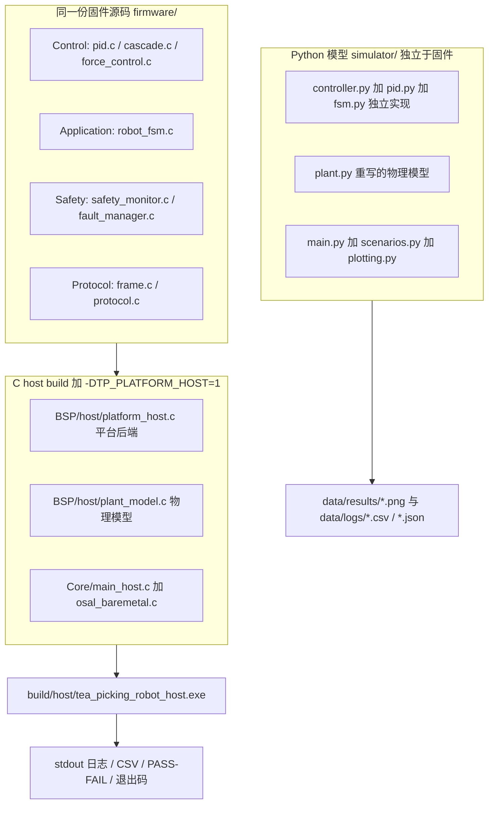
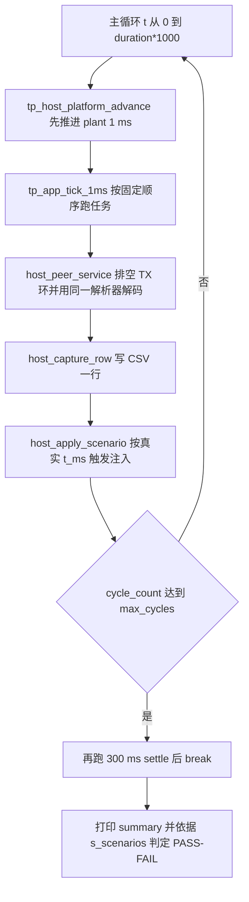
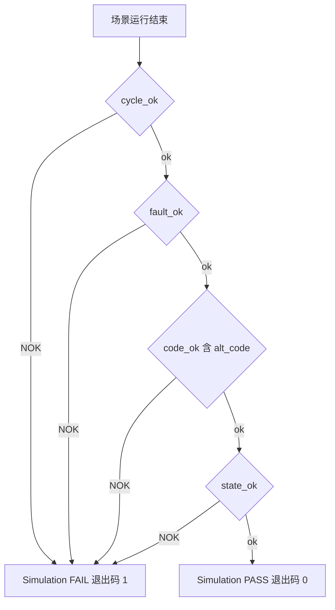
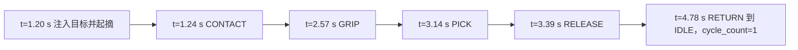

# 第二代智能无人机采茶机器人系统 —— 仿真体系与仿真验证

> 文件：`docs/10_simulation.md`。本文的方程、参数名、文件路径、API 与判据均逐条取自仓库真实代码（`firmware/BSP/host/plant_model.h` 与 `plant_model.c`、`platform_host.c`、`firmware/Core/main_host.c`、`firmware/Middleware/osal/osal_baremetal.c`、`scripts/*`、`simulator/*`、`tools/analyze_log.py`）。
> **本项目没有实物硬件**：没有板子，没有在任何物理机器上做过测量。

## 摘要

本文说明第二代智能无人机采茶机器人系统的**两套仿真体系**：一套是**固件自身的 PC 构建**（`TP_PLATFORM_HOST`，被测对象是固件代码本身），另一套是**独立于固件的 Python 模型**（`simulator/` 包，用于参数扫描、可视化与教学）。全文给出两套体系的分工、物理模型的完整方程与参数、电流环采用一阶滞后而非直接积分 `L·di/dt` 的数值稳定性理由、确定性协作式调度带来的可复现性、七个故障注入场景的注入点与判据、运行与分析方式，以及**仿真不能替代实物验证**的具体清单。

本文引用的全部量化结果均标注为 **仿真结果（Simulated）**；所有对外宣称指标一律标注为 **设计目标 / Target KPI（未实测）**。仿真能支撑的是"控制律稳定性、状态机逻辑、协议编解码、保护触发顺序"这类结论，**不能**支撑破损率、采摘效率与可靠性。

## 目录

- [1. 仿真体系：两套模型](#1-仿真体系两套模型) → [2. 为什么两套都要](#2-为什么两套都要代码事实) → [3. 物理模型方程与参数](#3-物理模型方程与参数) → [4. 电流环为什么用一阶滞后](#4-电流环为什么用一阶滞后) → [5. 确定性协作式调度](#5-确定性协作式调度与可复现性) → [6. 七个场景的设计意图与判据](#6-七个场景的设计意图与判据)
- [7. 如何运行与如何分析](#7-如何运行与如何分析) → [8. 仿真结果（Simulated）](#8-仿真结果simulated) → [9. 仿真的局限：不能替代实物验证的地方](#9-仿真的局限不能替代实物验证的地方) → [10. 仿真保真度的诚实分级](#10-仿真保真度的诚实分级) → [小结](#小结) → [面试可能追问的问题](#面试可能追问的问题)

## 1. 仿真体系：两套模型

### 1.1 对比表

| 维度 | (a) C 固件 host build | (b) Python 模型 |
|---|---|---|
| 目的 | 在 PC 上运行**同一份固件源码**，验证固件本身（控制律、状态机、协议、保护） | 快速参数扫描、可视化、教学，并与 C 侧结果交叉对照 |
| 被测对象 | `firmware/Control/pid.c`、`cascade.c`、`force_control.c`、`firmware/Application/robot_fsm.c`、`firmware/Safety/safety_monitor.c`、`fault_manager.c`、`firmware/Protocol/frame.c`、`protocol.c` 等固件源码 | Python 重写的控制器与状态机：`simulator/controller.py`、`pid.py`、`fsm.py`（**不是**固件） |
| 语言 / 工具链 | C11，gcc（`-std=c11 -Wall -Wextra -Werror -O2 -g`，定义 `-DTP_PLATFORM_HOST=1`，链接 `-lm`） | Python 3.8+，numpy + matplotlib |
| 物理模型位置 | `firmware/BSP/host/plant_model.h` / `plant_model.c` | `simulator/plant.py`（独立重写） |
| 保真度 | 固件代码 100 % 真实；被控对象为 1 kHz 显式欧拉确定性模型；传感器含量化、标定误差与可复现噪声 | `simulator/config.py` 顶部声明与 `firmware/Application/config.h` **逐值镜像**；但控制器是独立实现，电流环用闭式指数解。**需注意**：个别常量实际并不一致——`FORCE_CAL_SCALE_N_PER_COUNT` 为 `0.0012` 而 C 侧计算值约 `0.00802`，`MAX_DUTY_RATE_PER_S` 为 `4000.0` 而 C 侧为 `200000.0f`（后者恰是 `config.h` 注释中记明的"第一版错误值"），`DAMAGE_FORCE_N` 为 `3.8` 而 C 侧为 `4.0f`（此条已在 `config.py` 注释中说明理由） |
| 入口 / 构建 / 运行方式 | 入口 `firmware/Core/main_host.c`（`main()`）；构建 `scripts/build_host.ps1` → `gcc ... -o build/host/tea_picking_robot_host.exe -lm`（`CMakeLists.txt` 是等价路径，但自述 "THIS FILE HAS NEVER BEEN RUN"，权威构建是 Makefile）；运行 `build/host/tea_picking_robot_host.exe --scenario A..G` | 入口 `simulator/main.py`（`main()`）；无需构建，用解释器直接运行；`python simulator/main.py --scenario A..G\|all` |
| 输出产物 | stdout 日志（与目标机 debug UART 同格式）、每控制周期一行 CSV、每循环摘要、末行 `Simulation: PASS/FAIL`、退出码 | `data/results/*.png`（每场景 5 张曲线 + 2×2 汇总面板 + 对照图）、`data/logs/scenario_X_log.csv`、`scenario_X_metrics.json` |
| 调度 | `osal_baremetal.c`：协作式、固定顺序、无抢占、1 ms tick | `simulation.py` 的单一共享 1 kHz 循环（七个场景共用） |
| 局限 | **不是硬件**：无实时性证据、无 EMC/电源/线束效应、plant 参数非实测辨识值 | **不能作为固件回归证据**（控制器是另一份实现） |



### 1.2 C 固件 host build（固件在环仿真）

**「它是什么」** 把固件中所有硬件无关源码用 `-DTP_PLATFORM_HOST=1` 编译到 PC，链接 `firmware/BSP/host/platform_host.c` 与 `plant_model.c`，入口 `firmware/Core/main_host.c`，产物 `build/host/tea_picking_robot_host.exe`。`main_host.c` 顶部自我定义："It is not a re-implementation and not a mock"。

**「为什么这么设计」** 因为要验证的是固件而不是模型。`main_host.c` 原文："That property is the whole reason the STM32 port is trustworthy. A separate PC model would validate the *model*; this validates the *firmware*." 同一份 `pid.c`、`cascade.c`、`force_control.c`、`robot_fsm.c`、`safety_monitor.c`、`protocol.c` 在 PC 与 STM32 上运行，移植风险才被压住。`plant_model.h` 也说明了为什么它不是 mock：mock 会让控制环"无论多错都成功"，而本模型有真实惯量、电流限、库仑摩擦、量化编码器与非线性茎秆刚度，"so a badly tuned PID overshoots *in simulation* exactly as it would on the bench"。

**「如果不用它会怎样」** 没有台架时连一次控制循环都跑不起来；固件里的状态机分支、故障码路径、协议编解码处于**零执行**状态，上板第一天才会暴露；也失去 `scripts/run_scenarios.ps1` 这种可自动判定的回归能力。

### 1.3 Python 模型（`simulator/` 包）

**「它是什么」** 一个独立于固件的 Python 仿真包：`plant.py` 重写电机-关节与茶茎夹持动力学，`controller.py` / `pid.py` 重写串级控制与 PID，`fsm.py` 表驱动重写状态机，`simulation.py` 把 plant、控制器、状态机、安全监视器与记录器接成 1 kHz 闭环，`scenarios.py` 提供七个场景。

**「为什么这么设计」** `simulation.py` 顶部把自己定义为 "Closed-loop simulation loop shared by all seven scenarios."，并解释为什么共享一个循环："Seven hand-written loops would drift ... With one loop, the *only* difference between scenarios is the contents of `ScenarioSpec`, so a difference in outcome is attributable to the injected condition and nothing else." `plant.py` 则把定位写成纯模型层："Plant models: motor-joint dynamics and the flexible tea-stem gripper."，并声明按固件控制率 1 kHz 积分。它换来的是**速度**：一次运行即产出曲线与指标 JSON，适合参数扫描与答辩演示（`plotting.py` 明确把 PNG 写进 `data/results/`）。

**「如果不用它会怎样」** 调一个增益要改代码、重编译、重跑，参数扫描与图形对比的成本高到没人做，答辩也就没有曲线可讲。但**它不是固件的回归证据**：两份实现可能同时错同一个符号约定而不互相报警，只有把同一场景喂给两套模型才能发现。

## 2. 为什么两套都要：代码事实

| 问题 | C host build | Python 模型 |
|---|---|---|
| 固件的控制律、状态机、协议、保护是否自洽 | ✅ 同一份源码被执行 | ❌ 是另一份实现 |
| 快速参数扫描与可视化 | ⚠️ 需改代码重编译 | ✅ 命令行一行（`profiles.py` 提供 trapezoid / scurve / step） |
| 与 `config.h` 常量是否一致 | ✅ 直接包含 `config.h`（含 `TP_STATIC_ASSERT`） | ✅ `simulator/config.py` 逐值镜像 + `validate()` 复检 |
| 移植到 STM32 后行为是否不变 | ⚠️ 只能说明硬件无关层正确 | ❌ 完全不涉及 |

#### 三问：两套并存的分工

**「它是什么」** 一套分工：C 侧负责"固件正确性"，Python 侧负责"快速探索与表达"。

**「为什么这么设计」** 因为二者失败模式互补。C 侧能抓"符号约定反了""故障码路径没走到"这类**逻辑**缺陷（`plant_model.c` 记录过真实教训：夹爪占空比符号约定搞反时，"no contact within timeout"看起来像控制问题，实际是约定不一致）；Python 侧能低成本回答"换 S 曲线会不会更好""噪声 80 mN 下力环还稳不稳"这类**设计**问题。

**「如果不用它会怎样」** 只留 C 侧 → 每次扫描都要重编译，实际结果是没人扫描；只留 Python 侧 → "固件已验证"这句话不成立，答辩时无法回答"你验证的是代码还是模型"。

## 3. 物理模型：方程与参数

以下全部来自 `firmware/BSP/host/plant_model.h`（模型说明与参数）与 `plant_model.c`（实现）。

### 3.1 关节轴（joint axis）

`plant_model.h` 的方程块逐字如下：

```text
V        = pwm_permille / 1000 * V_bus                     (slew limited)
i_cmd    = (V - Ke * omega) / R                            (Ohm + back-EMF)
di/dt    = (i_cmd - i) / tau_e          with tau_e = L / R
T_motor  = Kt * i
T_fric   = Tc * tanh(omega / omega_eps) + b * omega
J * domega/dt = T_motor - T_fric - T_load - T_jam
dtheta/dt     = omega
```

实现补充（`tp_plant_step`）：PWM 先做**斜率限制**（`max_step = TP_MAX_DUTY_RATE_PER_S * dt_s`，注释理由：真实栅极驱动加 1.5 mH 绕组不可能瞬时跳变电压，否则速度环 D 项能在相邻两拍命令满量程跳变）；`estop_asserted != 0` 时 PWM 与电流强制置 0（对应使能脚拉低、绕组开路）；`i_cmd` 与实际电流都被 `±TP_PEAK_CURRENT_MA/1000` 限幅（再生被钳位，注释自述是简化）；摩擦用 tanh 平滑（实现为 Pade 近似 `x*(27+x²)/(27+9x²)`，注释说这是为了避免零速不连续在 1 kHz 下抖动积分器）；角度有软限位 `[TP_JOINT_MIN_MRAD, TP_JOINT_MAX_MRAD]`，撞限位时角度夹紧并清零同向速度；`tick_ms` 按 `dt_s*1000+0.5` 累加，是仿真时间的唯一来源。

### 3.2 关节参数表（逐条来自 `plant_model.h`）

| 宏 | 值 | 含义 |
|---|---|---|
| `TP_PLANT_MOTOR_R_OHM` | `2.0f` | 绕组电阻（折算到关节输出的等效值），Ω |
| `TP_PLANT_MOTOR_L_H` | `1.5e-3f` | 绕组电感，H |
| `TP_PLANT_MOTOR_TAU_E_S` | `L/R` = **0.75 ms** | 电气时间常数 |
| `TP_PLANT_MOTOR_KT_NM_PER_A` | `2.0f` | 转矩常数（折算到关节输出），N·m/A |
| `TP_PLANT_MOTOR_KE_VS_RAD` | `0.05f` | 反电势常数（折算到关节输出），V·s/rad |
| `TP_PLANT_JOINT_J_KGM2` | `2.5e-3f` | 关节空间惯量，kg·m² |
| `TP_PLANT_JOINT_B_NMS_RAD` | `3.0e-5f` | 黏性摩擦系数，N·m·s/rad |
| `TP_PLANT_JOINT_TC_NM` | `0.02f` | 库仑摩擦力矩幅值，N·m |
| `TP_PLANT_JOINT_OMEGA_EPS_RAD_S` | `0.2f` | 库仑摩擦 tanh 平滑的速度尺度，rad/s |

`tp_plant_init` 中的初值（非宏）：`joint.load_torque_nm = 0.02f`、`p->vbus_v = 24.0f`、`p->noise_seed = 12345u`，关节角取 `TP_JOINT_HOME_MRAD`、速度/电流/PWM 为 0、夹爪全开（`TP_GRIPPER_MAX_MM`）、`stem_gap_mm = TP_PLANT_STEM_GAP_MM`。`load_torque_nm` 的注释原文："A small constant load stands in for gravity on the arm. It is what makes the integral term of the position loop observable: with a pure P controller and a perfect inner loop there would be no steady-state error to reject, and Experiment 01 would prove nothing."（重力代理的作用是让位置环**积分项可观测**）。

模型依赖的外部常量（`firmware/Application/config.h`、`firmware/BSP/bsp_types.h`）：

| 常量 | 值 | 在模型中的作用 |
|---|---|---|
| `TP_MAX_PWM_PERMILLE` | `1000.0f` | 占空比归一化与限幅 |
| `TP_MAX_DUTY_RATE_PER_S` | `200000.0f` | PWM 斜率限制（注释：满量程 5 ms） |
| `TP_PEAK_CURRENT_MA` | `5000.0f` | 电流命令与实际电流的限幅 |
| `TP_JOINT_MIN_MRAD` / `TP_JOINT_MAX_MRAD` | `-90000.0f` / `90000.0f` | 关节软限位（±90°） |
| `TP_JOINT_HOME_MRAD` | `0.0f` | 编码器计数零点 |
| `TP_GRIPPER_MAX_MM` / `TP_GRIPPER_MIN_MM` | `40.0f` / `0.0f` | 夹爪行程 |
| `TP_GRIPPER_MAX_SPEED_MM_S` | `120.0f` | 占空比与夹爪速度的换算基准 |
| `TP_MRAD_PER_COUNT` | `2π·1000/4096` ≈ **1.5340 mrad/count** | 编码器量化 |
| `TP_GRIPPER_COUNTS_PER_MM` | `512.0f` | 夹爪线性编码器分辨率 |
| `TP_FORCE_CAL_ZERO_COUNTS` | `2048.0f` | 力 ADC 零点 |
| `TP_FORCE_CAL_SCALE_N_PER_COUNT` | `0.8057 mV/count ÷ 100.5 mV/N` ≈ **0.00802 N/count** | 力 ADC 标定（`config.h` 由前端设计**计算**得到） |
| `TP_ADC_FULL_SCALE` / `TP_ADC_VREF_V` | `4095.0f` / `3.300f` | 12 位 ADC 建模 |
| `TP_FORCE_MAX_N` | `5.00f` | 夹持力硬限 |

### 3.3 夹爪与茶茎（gripper axis and tea stem）

```text
v_jaw    += (v_cmd - v_jaw) * dt / (tau_jaw + dt)         (servo lag)
v_jaw    -= F / K_backdrive                               (force back-drive)
gap      += v_jaw * dt,  clamped to [0, gap_max]
d         = max(0, stem_gap - gap)                        (penetration, mm)
F         = k1 * d + k2 * d^2 + c * max(0, -v_jaw)        (N)
```

实现补充：符号约定为**正占空比使夹爪闭合**（`v_cmd = -(pwm_gripper/1000)*TP_GRIPPER_MAX_SPEED_MM_S`），代码注释指出符号搞反时表现为"超时未接触"、看起来像控制问题，因此有单元测试断言 `tp_plant_gripper_velocity_to_pwm` 与驱动内部映射一致；`estop_asserted != 0` 时夹爪以 `TP_GRIPPER_MAX_SPEED_MM_S` 张开（断电弹开，失效安全）；间隙夹在 `[TP_PLANT_JAW_HARD_STOP_MM, TP_GRIPPER_MAX_MM]`；阻尼项只在闭合时为非负（`max(0, -v_jaw)`）；`peak_force_n` 记录峰值，`F > TP_PLANT_STEM_DAMAGE_N` 时 `damage_index += (F-4.0)*dt` 且 `damaged = 1`（**锁存**），注释说明用积分而非裸标志是为了区分"短时超载"与"长时间轻度超载"；二次项使茎秆**越压越硬**，注释原文称这正是"a fixed-position gripper is unsafe"的原因。

| 宏 | 值 | 含义 |
|---|---|---|
| `TP_PLANT_JAW_TAU_S` | `8.0e-3f` | 夹爪伺服速度环时间常数，s |
| `TP_PLANT_JAW_BACKDRIVE` | `20.0f` | 力反驱系数，N·s/mm |
| `TP_PLANT_JAW_HARD_STOP_MM` | `1.0f` | 机械止点（间隙下界），mm |
| `TP_PLANT_STEM_GAP_MM` | `6.0f` | 默认茎秆表面位置（首次接触间隙），mm |
| `TP_PLANT_STEM_K1_N_PER_MM` | `0.30f` | 线性刚度，N/mm |
| `TP_PLANT_STEM_K2_N_PER_MM2` | `0.06f` | 二次（硬化）刚度，N/mm² |
| `TP_PLANT_STEM_DAMP_N_S_MM` | `0.015f` | 茎秆阻尼（Kelvin-Voigt），N·s/mm |
| `TP_PLANT_STEM_DAMAGE_N` | `4.0f` | 损伤阈值，N（锁存） |

### 3.4 阻尼项取值：代码里的真实论证（原文复述）

`TP_PLANT_STEM_DAMP_N_S_MM` 的注释记录了**一次真实误报**，值得逐字保留：

> "This is the Kelvin-Voigt damping term of the contact model, and it is what makes the force *step* at the instant of contact rather than rising smoothly from zero: at the 40 mm/s fast-approach speed a coefficient of 0.05 N*s/mm would add 2.0 N of force in a single sample. That is physically real (it is why impacts damage soft objects) but it is larger than a tea stem warrants, so the value is set to give 0.6 N at the fast-approach speed and 0.09 N at the slow-approach speed. Getting this number wrong is also what false-tripped the force-sensor spike detector in the first revision."

即：40 mm/s 快接近下 `0.05 N·s/mm` 会在**单个采样**内产生 2.0 N；实取 `0.015f` 给出快接近 0.6 N、慢接近 0.09 N；这个数取错正是**第一版力传感器尖峰检测误报的原因**。它说明该值是"物理合理且不误报"的工程选择，**不是实测辨识值**。

### 3.5 堵转（jam）模型：不是力矩，而是运动约束

`plant_model.c` 的注释记录了两版失败尝试：把堵转建模成"与速度反向的大力矩"时，8 N·m 作用在 `2.5e-3 kg·m²` 上等于 3200 rad/s²，1 ms 显式欧拉一步就把速度改变 3.2 rad/s，而原判定条件要求 `|omega| <= 1e-4 rad/s`（比一步能分辨的范围窄四个数量级），于是每拍穿过该带并以数千 mrad/s 振荡。结论原文："A jam is not a torque, it is a *motion constraint*"。现在改为**在施加力矩上判条件**：`|T_motor| <= jam_torque_nm` 时轴被抱住（力矩/摩擦/负载清零、速度置 0），否则正常运动并附加反向阻转矩。由此得到的重要性质：**低于驱动能力的堵转力矩只会让运动吃力，而不是堵转**——这正是场景 F 用 8 N·m 对撞驱动能力的原因。

### 3.6 传感器模型

| 通道 | 模型（`plant_model.c`） | 关键细节 |
|---|---|---|
| 关节编码器 | `counts = (theta - TP_JOINT_HOME_MRAD) / TP_MRAD_PER_COUNT` | **向零截断**（C 强制转换），注释原文："Truncation towards zero is what a hardware quadrature counter does."；`encoder_fault` 时叠加 `+30000 + (tick%500)*7`，供 `safety_monitor.c` 的可信性检查发现 |
| 力 ADC | `counts = 2048 + F / N_per_count`，再做 `(c-2048)*gain + 2048 + offset`，再加 `noise/N_per_count` | 是 `config.h` 标定的**精确逆变换**；增益/偏置误差"施加在模拟域，好让标定程序有真东西可校正"；最后经 `plant_adc_saturate` 饱和到 `0..4095`（非有限值或 ≤0 返回 0，其余 `+0.5` 取整） |
| 电流 ADC | `counts = 2048 + (I/5.0)*1000` | 双向分流放大器：2048 counts = 0 A，±1000 counts ≈ ±5 A（0.2 count/mA、5 mA/count）；夹爪通道无电流状态，模型用 `(v_jaw/120)*0.5` 映射为 ±0.5 A 等效值 |
| 母线 ADC | `(vbus/10)/TP_ADC_VREF_V*(4095+1)` | 10:1 分压，注释："24 V appears as 2.4 V at the pin"（由公式推得 ≈2979 counts） |
| 离散 IO | 由角度/间隙**导出** | E-stop 为常闭回路（完好读高、按下或断线读低）；关节最小/最大限位由 `theta` 与 `MIN+200 mrad` / `MAX-200 mrad` 比较得出；夹爪张开限位 `gap >= 40-0.2`、闭合限位 `gap <= 1.0+0.2`；`nFAULT` 低有效故正常读高。注释说明导出的目的："so a limit fault can actually be provoked in simulation" |

### 3.7 噪声发生器与可复现性

LCG：`*state = (*state * 1664525u) + 1013904223u`（Numerical Recipes 常数）；均匀样本 `(x >> 8) * (1.0f/16777216.0f)` 落在 `[0,1)`；近似高斯为 6 个均匀样本求和后 `(sum - 3.0f) * 1.4142136f`（注释：6 项均值 3、方差 0.5，截断在 ±2.45σ 对注入用途无关）；默认种子 `p->noise_seed = 12345u`，`tp_plant_set_seed` 把 0 替换为 1 以避免 LCG 全零退化态；`tp_plant_reset` 保留当前种子（为 0 时回落 12345u），其余状态回上电值。不用 `rand()` 的理由是注释原话："cheap, adequate for noise injection and, crucially, reproducible across machines — unlike `rand()`."，即**跨机器可复现**，这是"两次运行结果一致"这一断言的前提。

#### 三问：物理模型本身

**「它是什么」** 一个 1 kHz、确定性的机电-接触联合模型：电气侧一阶电流滞后；机械侧惯量 + 库仑/黏性摩擦 + 重力代理负载 + 堵转约束；接触侧非线性硬化弹簧加阻尼；传感侧量化、标定误差与可复现噪声。

**「为什么这么设计」** 它存在的唯一理由是"让错误的控制器在仿真里也错"。`plant_model.h` 把这点写成设计准则："real inertia, real current limits, real Coulomb friction, a quantised encoder and a nonlinear stem stiffness, so a badly tuned PID overshoots *in simulation* exactly as it would on the bench."

**「如果不用它会怎样」** 控制器面对的是一根"总是返回 0"的桩，任何增益都能"稳定"；保护阈值（4 N 损伤、5 N 硬限）永远触发不到，`--scenario D/F` 会变成永远通过的空测试。

## 4. 电流环为什么用一阶滞后

### 4.1 代码里的真实论证（原文复述）

`plant_model.h`：

> "The electrical time constant is modelled as a first-order lag on the current rather than by integrating `L di/dt = V - R i - Ke w` directly. With `L = 1.5 mH` and `R = 2 ohm` the electrical pole sits at 1/(0.75 ms), so an explicit Euler step of 1 ms would be marginally unstable and would produce a numerical oscillation that has nothing to do with the machine. Collapsing the fast pole into `di/dt = (i_ss - i)/tau_e` is the standard singular perturbation and it keeps the *physical* time constant visible while staying stable at the 1 ms control period."

`simulator/plant.py` 给出同一结论的量化形式：显式欧拉放大因子 `1 - dt/tau_e = 1 - 1.333 = -0.333`，稳定性要求 `dt < 2*tau_e`，这里已处在 `1.33*tau_e`（**稳定边缘**）；并直言该失败模式 "is a property of the *integrator*, not of the machine"——用减小步长把它藏起来是不诚实的。

| 项 | C 模型（`plant_model.c`） | Python 模型（`plant.py`） |
|---|---|---|
| 形式 | `i += (i_cmd - i) * alpha_e`，`alpha_e = dt/(tau_e + dt)` | `i = i_cmd + (i - i_cmd) * exp(-dt/tau_e)` |
| 数值含义 / dt = 1 ms 时 | 隐式（后向）欧拉，极点 `tau_e/(tau_e+dt)`；`alpha_e = 0.5714`，极点 `0.4286` | 精确闭式解，极点 `exp(-dt/tau_e)` = `0.2636` |
| 稳定性 | **无条件稳定** | 无条件稳定 |

两点值得强调：其一，C 侧的 `alpha_e = dt/(tau_e+dt)` 与 `firmware/Control/pid.c` 微分低通用的是**同一手法**（`pid.c` 原文 `alpha = pid->dt_s / (pid->tau_d_s + pid->dt_s)`，注释说明这是为了 "dt > tau, where the 'textbook' alpha = dt/tau would blow up"）；其二，一阶滞后**保留了物理时间常数**（0.75 ms 仍由 `TP_PLANT_MOTOR_TAU_E_S` 可见），反电势项仍通过 `i_cmd = (V - Ke*omega)/R` 起作用，因此"高速时电压余量不足"在模型里仍然存在。

#### 三问：一阶滞后（奇异摄动）

**「它是什么」** 把电气快极点从显式积分状态里消掉、改写成 `di/dt = (i_ss - i)/tau_e`，使 1 ms 步长下电流行为仍带 0.75 ms 物理时间常数且绝对稳定。

**「为什么这么设计」** 因为 `L/R = 0.75 ms` 比控制周期 1 ms 还短。直接积分 `L di/dt = V - R i - Ke w` 时 1 ms 显式欧拉处在稳定边缘，会产生与电机无关的数值振荡，污染力矩并经编码器污染整条串级回路，使**所有**控制实验结论失效。

**「如果不用它会怎样」** 几十到几百拍内电流开始交替发散，速度与位置随之振荡，`--scenario A` 也无法通过；若被误读成"控制器不稳"，就会去改 PID 增益，把数值问题变成永久的调参陷阱。

## 5. 确定性协作式调度与可复现性

### 5.1 事实清单

| 事实 | 代码依据 |
|---|---|
| 时间由仿真时钟推进，**没有真实时钟、没有 sleep** | `tp_platform_time_ms()` 返回 `s_host.time_ms`；`tp_platform_delay_ms()` 直接 `tp_host_platform_advance(ms*1000)`，注释："In simulation, 'waiting' is free" |
| 1 ms tick，plant 每 tick 只推进一步 | `HOST_TICK_US 1000u`；`tp_host_platform_advance()` 的 `while (remaining_us >= HOST_TICK_US)` 中调用 `tp_plant_step(&s_plant, ..., dt_s)`，`dt_s = 1e-3` |
| 任务按**固定顺序**调用、无抢占 | `bm_run_due_tasks()`：外层按优先级 `OSAL_PRIO_CRITICAL → 0`，内层按注册序扫描 |
| 无动态内存 / 临界区语义 | 任务、队列、互斥量、信号量均为静态数组（`s_tasks[12]`、`s_queues[6]`、`s_mutexes[4]`、`s_sems[4]`，队列存储 `storage[8][64]`）；`tp_platform_enter_critical()` 注释："The host build is single-threaded ... the only thing a critical section has to do is be re-entrant and observable" |
| 噪声来自固定种子 LCG | `noise_seed = 12345u`，见 3.7 |
| 明确不模拟的部分 | `osal_baremetal.c`："Preemption *within* a task, priority inversion, and stack overflow." |
| 超期上报而非隐藏 | 任务体若让 hook 推进了时间则 `t->overruns++`；下次激活按 **deadline**（`t->next_ms += t->period_ms`）排，避免持续轻微迟到永不上报 |

### 5.2 先推 plant、再跑任务（真实理由）

`main_host.c` 主循环注释原文：

> "Advance simulated time and the plant *before* running the tasks, in the same order the bare-metal scheduler uses. Doing it the other way round would make every task observe a clock that lags its own inputs by one period, which shows up as a one-sample delay in the loop transfer function and a small but real phase-margin difference from the target."

即顺序反过来会让每个任务看到滞后一拍的时钟，等价于环传递函数多一个采样延迟，与目标机的相位裕度不同。`osal_baremetal.c` 的 `osal_start()` 同序：先 `s_bm.hook(elapsed_us)`（tick hook = plant），再 `bm_run_due_tasks()`，最后 `s_bm.time_ms += 1u`。



#### 三问：确定性协作式调度

**「它是什么」** 1 ms tick 驱动的协作式调度器：每 tick 先经 tick hook 推进物理模型，再按"优先级 → 注册序"运行到期任务，最后递增仿真时钟；任务间不抢占，阻塞由 overrun 计数捕获并上报。

**「为什么这么设计」** `osal_baremetal.c` 顶部给出三条原文理由：(1) **Reproducibility**——"threaded simulation produces a different trace on every run"，否则 `data/results/` 的图与由它得到的上升时间、超调量都不可复现；(2) 物理必须与任务同步推进，否则有效采样时间漂移，而采样时间正是控制实验要测的量；(3) "**Determinism is the property being tested.** A control loop that only works when its timing is lucky is not a control loop."

**「如果不用它会怎样」** 换成多线程加真实时钟，同一脚本两次运行的 CSV 不同，论文数字失去可追溯性；plant 与任务各自计时会漂移，测出来的是"这次机器调度得怎么样"，而不是"控制器怎么样"。

## 6. 七个场景的设计意图与判据

### 6.1 注入点与期望（逐条来自 `main_host.c`）

| 场景 | 标题 | 注入什么（真实 API） | 注入时刻 | `expect_cycle` | `expect_fault` | `expect_code` / `alt_code` | `expect_state` |
|---|---|---|---|---|---|---|---|
| A | nominal pick | `tp_app_inject_target(app, 0, 15, 185, 95u, 1u)` + `tp_app_start_pick(app)` | 1200 ms | 1 | 0 | `TP_FAULT_NONE` / – | `TP_STATE_IDLE` |
| B | target position error | `tp_app_inject_target(app, 8, 20, 190, 95u, 2u)` + 起摘 | 1200 ms | 0 | 1 | `TP_FAULT_TARGET` / – | `TP_STATE_COUNT`（不约束） |
| C | force sensor noise | `tp_plant_set_force_noise(plant, 0.08f)` | 100 ms | 1 | 0 | `TP_FAULT_NONE` / – | `TP_STATE_IDLE` |
| C | 同上（继续） | `tp_app_inject_target(app, 0, 15, 185, 95u, 3u)` + 起摘 | 1200 ms | 同上 | 同上 | 同上 | 同上 |
| D | excessive grip force | `tp_plant_set_stem_gap(plant, 16.0f)` + `tp_app_set_grip_mode(app, 1)`（纯位置控制）+ `tp_app_inject_target(app, 0, 15, 185, 95u, 4u)` + 起摘 | 1100 ms | 0 | 1 | `TP_FAULT_FORCE_OVERLOAD` / – | `TP_STATE_COUNT` |
| E | communication timeout | `tp_frame_encode(...TP_CMD_HEARTBEAT...)` 后 `tp_host_platform_inject_rx(TP_BUS_VISION_UART, frame, len)` | 200 ms | 0 | 1 | `TP_FAULT_COMM_TIMEOUT` / – | `TP_STATE_COUNT` |
| E | 同上（继续） | `tp_app_inject_target(app, 0, 15, 185, 95u, 5u)` + 起摘，之后链路静默 | 400 ms | 同上 | 同上 | 同上 | 同上 |
| F | motor stall | `tp_plant_set_jam(plant, 8.0f)` | 900 ms | 0 | 1 | `TP_FAULT_MOTOR_STALL` / `TP_FAULT_OVERCURRENT` | `TP_STATE_COUNT` |
| F | 同上（继续） | `tp_app_inject_target(app, 0, 300, 185, 95u, 6u)` + 起摘 | 1200 ms | 同上 | 同上 | 同上 | 同上 |
| G | emergency stop | `plant->estop_asserted = 1` | 1200 ms | 0 | 1 | `TP_FAULT_ESTOP` / – | `TP_STATE_EMERGENCY_STOP` |

判据逻辑（`main_host.c`）：`cycle_ok` 在 `expect_cycle != 0` 时要求 `cycle_count >= 1`，否则要求 `== 0`；`fault_ok` 在 `expect_fault == 0` 时要求最高优先级故障为 `TP_FAULT_NONE`，`== 1` 时检查**历史**（`tp_fault_any_latched` 或 `raise_total > 0`，注释说明"已清除但曾锁存的故障也算正确结果"），`== -1` 表示两者皆可；`code_ok` 在 active / latched / `record[code].count > 0` 三处任一命中即算命中，`alt_code` 是为场景 F 留的第二可选码（注释原文："Two codes may be acceptable: see scenario F, where the over-current and stall protections race and either outcome is correct."）；`state_ok` 中 `TP_STATE_COUNT` 表示不约束。



### 6.2 场景 D：真实发现（原文复述）

> "The first attempt at this scenario simply made the stem stiffer while force control was active, and the cycle completed normally with a peak of 3.2 N. That is not a bug in the scenario, it is the central result of the whole project: **a force-controlled gripper does not care how stiff the bud is.** To demonstrate the over-force protection you have to remove the force feedback, which is exactly what the first-generation machine did."

即第一次尝试只把茎秆变硬，力控**正常完成**、峰值 3.2 N，说明"力控不关心茶芽多硬"；要演示过力保护必须**移除力反馈**（切到纯位置控制）。于是 D 最终这样构造：茎秆表面移到 16 mm、夹爪按纯位置控制驱动到固定 4 mm 间隙，模型预测 `0.30*12 + 0.06*144 = 12.2 N`，远超 5 N 硬限与 4 N 损伤阈值；安全监视器全程在线，因此该场景同时度量"监督能真正阻止多少损伤、以及它有多晚"。

### 6.3 场景 F、E、G 的真实细节

- **F（堵转）**：jam 在**移动之前**施加（900 ms），注释原文："a stall detector that only looks at speed cannot distinguish 'stopped' from 'stalled' — the commanded duty has to be high for the condition to mean anything."；目标是**长行程** 57°，即 `tp_app_inject_target(app, 0, 300, ...)`，注释说明 `y = 300 mm` 经 `TP_APP_MM_TO_MRAD`（`3.333f`）映射为 **1000 mrad**（≈57.3°）。代码给的堵转力矩是 `8.0f` N·m，注释称其 "above the drive's 6.0 N·m capability"，`plant_model.h` 中 `jam_torque_nm` 的注释同样写作 "a value above the drive's capability (6 N*m at the peak current limit)"。**说明**：项目对外汇总把该场景记为"8 N·m 堵转，驱动限 800 mA"，但代码中不存在 800 mA 这一常量，本文以代码表述（6 N·m / 峰值电流限）为准。
- **E（通信超时）**：必须先让链路监督 **arm** 再静默。注释原文："The link supervision has to be *armed* before it can time out: a robot that has never heard from a host must not report a link loss, because at boot there is nothing to lose." 因此 200 ms 先注入一帧**真实**的 `TP_CMD_HEARTBEAT`（由同一编码器 `tp_frame_encode` 生成，"the same frame a real host would send"），之后静默，超时经由生产代码路径触发，等价于"拔掉网线"；目标在 400 ms 注入并起摘。
- **G（急停）**：1200 ms 时 `plant->estop_asserted = 1`（对应常闭回路的物理拉低），模型随即使 PWM 与电流归零、夹爪断电弹开，期望最终状态 `TP_STATE_EMERGENCY_STOP`。

#### 三问：场景注入方式与数据化判据

**「它是什么」** 把扰动注入 **plant 或链路**，而不是注入控制器：改噪声 σ、改茎秆位置、加堵转、断链、拉急停；控制器代码一行不改。期望写在 `s_scenarios[]` 表里（`{字母, 标题, expect_cycle, expect_fault, alt_code, expect_code, expect_state}`），运行后用 `cycle_ok / fault_ok / code_ok / state_ok` 四项判定。

**「为什么这么设计」** `main_host.c` 原文："Each is implemented by manipulating the **plant** or the **link**, never the controller: injecting a disturbance into the control law would test nothing." 并且判据必须是数据而不是 `if`：**"for the fault-injection scenarios a completed pick cycle is a failure"**，因为整件事的目的就是让保护把机器人停下来；把"0 个循环完成"报成失败，等于把正确行为报成 bug。该文件还记录了第一版的真实缺陷：早期依赖 `default` 分支提供目标，导致 C/E/F 三个场景"无事可做"，在 `IDLE` 里跑了九秒后因与本场景无关的原因"失败"；因此现在每个要跑循环的场景都注入自己的目标，场景彼此独立。

**「如果不用它会怎样」** 扰动注入控制器内部时，被测对象与激励源混在一起，通过与否无法归因；判据写成"跑完循环才算成功"时，场景 D 的正确中止会被报成缺陷；场景之间还会经默认分支相互耦合，改一个场景会悄悄改变另一个的结论。

## 7. 如何运行与如何分析

### 7.1 C 侧（固件 host build）

```powershell
./scripts/build_host.ps1                       # 只构建 host（默认）
./scripts/build_host.ps1 -Target both          # 同时构建并运行 C 单元测试
./scripts/build_host.ps1 -Run -RunArgs '--scenario','A','--duration','8'
./scripts/run_scenarios.ps1                    # 七个场景 + 判定表
./scripts/run_scenarios.ps1 -Duration 12 -Csv  # 同时写 data/logs/host_scenario_X.csv
./scripts/build.ps1 host                       # Makefile 包装脚本：make host
```

`build_host.ps1` 的真实行为：包含目录为 `firmware/{Core,Application,Middleware/utils,Middleware/osal,Debug,BSP,BSP/host,Control,Safety,Protocol}`，定义 `-DTP_PLATFORM_HOST=1`，编译 `-std=c11 -Wall -Wextra -Werror -O2 -g`，链接 `-lm`，并**按名字排除**三个只在目标机存在的编译单元：`main_stm32.c`、`stm32f4xx_it.c`、`freertos_hooks.c`（注释理由：它们包含 STM32 HAL 与 FreeRTOS 头文件，host build 里不存在）。产物为 `build/host/tea_picking_robot_host.exe`。命令行接口（`host_usage` 的真实输出）：

```text
Tea-picking robot firmware - host simulation build

Usage: build/host/tea_picking_robot_host [options]

  --duration S     simulated seconds to run (1..120, default 8)
  --cycles N       pick cycles to attempt (1..20, default 1)
  --scenario X     A..G (default A)
                     A nominal pick        B target position error
                     C sensor noise        D excessive grip force
                     E communication loss  F motor stall
                     G emergency stop
  --csv PATH       write a per-period trace
  --quiet          suppress the periodic status lines
  --help           this message
```

CSV 列名（逐字来自 `host_write_csv_header`）：

```text
t_ms,ref_mrad,pos_mrad,vel_mrad_s,force_n,gap_mm,duty_permille,current_ma,state,grip_state,fault,cycle
```

`main_host.c` 说明该布局的**意图**是与 `tools/analyze_log.py` 及 Python 记录器共用列布局，"so the three can be plotted against each other without a conversion step"。

### 7.2 Python 侧（真读 `simulator/main.py`）

```bash
python simulator/main.py                                  # 默认场景 A，6 s
python simulator/main.py --scenario all --verbose          # 七场景 + 汇总表 + 指标
python simulator/main.py --scenario C --duration 8 --profile scurve
python simulator/main.py --scenario D --no-plot --logdir data/logs
```

| 参数 | 默认 | 含义 |
|---|---|---|
| `--scenario` | `A` | `A..G` 或 `all`（七场景全跑并打印汇总表） |
| `--duration` | `6.0`（`C.DEFAULT_DURATION_S`） | 运行时长，秒 |
| `--no-plot` / `--outdir` / `--logdir` | 关 / `data/results` / `data/logs` | 跳过出图（批量更快，日志仍写）；图与日志目录 |
| `--seed` | `20240517`（`C.DEFAULT_SEED`） | 随机种子，同种子结果相同 |
| `--verbose` | 关 | 打印指标表与 FSM 事件/告警 |
| `--profile` | `trapezoid` | `trapezoid` / `scurve` / `step` |

退出码：`0` 场景 A 完成全流程；`1` A 未完成或运行抛异常；`2` 参数非法或 `simulator/config.py::validate()` 发现配置矛盾。产物为 `data/logs/scenario_X_log.csv`、`data/logs/scenario_X_metrics.json` 与 `data/results/*.png`。CSV 列名逐字来自 `simulator/telemetry.py` 的 `CHANNELS`：

```text
t,ref,pos,vel,force,pwm,current,state,fault,adc_raw,vjaw,gap
```

### 7.3 日志分析工具（`tools/analyze_log.py`）

```bash
python tools/analyze_log.py data/logs/monitor_selftest.csv
python tools/analyze_log.py raw_hex.log --json
python tools/analyze_log.py data/logs/monitor.csv --setpoint 30000 --settle-band 0.02 --csv out.json
python tools/analyze_log.py --selftest
```

真读其 `__main__` / `argparse`：位置参数 `path`（遥测 CSV 或原始 hex 帧日志，`load_any` 自动判别）；`--json` 输出机器可读 JSON；`--setpoint MM` 给定位移设定值以计算稳态误差；`--settle-band` 默认 `0.02`（±2%，必须落在 0..1）；`--csv PATH` 把指标写为 JSON；`--selftest` 在临时目录生成合成数据并校验分析。报告内容：时长、样本数、有效采样率、四个信号（`pos_mrad` / `vel_mrad_s` / `force_mN` / `pwm_permille`）的 min/max/mean/std、阶跃响应指标（10→90 % 上升时间、超调、±2 % 调节时间、稳态误差、残余纹波）、峰值力、故障区间（含起止时刻与状态）、状态驻留时间直方图；hex 模式还会统计各类帧数与 CRC 错误数。

> **工具链衔接的真实缺口（代码事实）**：`analyze_log.py` 顶部文档给出的输入 schema 是**7 列** `t_ms,pos_mrad,vel_mrad_s,force_mN,pwm_permille,state,fault`（与 `host/robot_monitor.py` 的 `HEADER` 一致），而 host build 输出的是**12 列**且列名不同；`load_csv()` 是**按位置**取前 7 列解析的，因此把 host CSV 直接喂给它会发生列错位。正确做法是分析 `robot_monitor.py --csv` 的 7 列遥测，或对 host CSV 使用 12 列读取器（`simulator` 侧或 pandas）。这是文档与工具间待补的列名映射，**不是**仿真结论。

> **为什么要有这三条入口**：`build_host.ps1` 的注释说明它存在的理由——项目在**没有 make 的 Windows 机器**上开发，所以需要一个只依赖 PowerShell 与 gcc 的构建入口；`run_scenarios.ps1` 的注释说明它存在的理由——"so that `scripts/run_demo.py` and the documentation can call one command and get a machine-readable summary, rather than each reader re-deriving the pass/fail rules."（把判据集中在一处，避免每个读者各自重算，也让判据不会出现"人肉版本"并与代码漂移）。

## 8. 仿真结果（Simulated）

> **本节全部数字均为 仿真结果（Simulated）**，来自 `build/host/tea_picking_robot_host.exe --scenario A` 与 `scripts/run_scenarios.ps1` 的七场景扫描，**没有一项是实测量**。

### 8.1 Scene A：正常采摘（仿真结果 Simulated）

| 指标 | 数值（Simulated） | 说明 |
|---|---|---|
| 目标注入 / 检测 | t = 1.20 s | `tp_app_inject_target(app, 0, 15, 185, 95u, 1u)` |
| 接触判定 | 间隙 5.824 mm、F = 0.148 N | 与接触阈值 0.15 N 同量级 |
| 力达到 | 2.17 N（设定 2.20 N，带内 ±0.10 N） | 落在 `TP_FORCE_BAND_N = 0.10` 带内 |
| 超调 / 收敛时间 | **0.00 N** / **49 个控制周期**（49 ms） | |
| 受控阶段平均保持力 / 峰值夹持力 | 2.26 N / 2.386 N（硬限 5.00 N） | 峰值约为硬限的一半 |
| 节拍：APPROACH→CONTACT / GRIP / PICK / RELEASE / RETURN→IDLE | 1.24 s / 2.57 s / 3.14 s / 3.39 s / 4.78 s | `cycle_count = 1` |
| 任务计数 | 控制 6000、传感器 3000、通信 600、机器人 600、安全 600 | 比值 10:5:1:1:1，与 `config.h` 的 1000/500/100/100/100 Hz 任务周期一致 |
| 截止期错失 | **0 次** | 仅代表虚拟节拍下无 overrun（见第 9 章第 7 条） |
| 主机链路解码 | 2200 B、100 帧、**0 CRC 错误** | 编解码用同一 `tp_frame_parser_feed` 对打 |



### 8.2 七场景扫描：7/7 PASS（仿真结果 Simulated）

| 场景 | 结果（Simulated） | 峰值夹持力（Simulated） |
|---|---|---|
| A nominal pick | 周期完成 | 2.386 N |
| B target position error（+8 mm 横向） | 周期中止，`ERR_TARGET`（接触超时） | 0.167 N |
| C force sensor noise（σ = 80 mN） | 周期完成 | 2.426 N |
| D excessive grip force（纯位置控制，茎秆在 16 mm） | 中止，`ERR_FORCE_OVERLOAD` | （从未达到） |
| E communication timeout | 周期停止，`ERR_COMM_TIMEOUT` | – |
| F motor stall（8 N·m 堵转，驱动限见 6.3 说明） | 中止，过流/堵转保护 | – |
| G emergency stop | `EMERGENCY_STOP`，`ERR_ESTOP` | – |

三点解读：**其一**，B 的"中止"是正确结果而非缺陷——期望表里 `expect_cycle = 0`、`expect_code = TP_FAULT_TARGET`，因为横向 8 mm 误差经 `tp_app_target_to_motion` 的 `approach_gap = TP_APP_NOMINAL_STEM_GAP_MM + x_mm` 改变了预期接触间隙，使夹爪在错误距离减速而接触超时；峰值力仅 0.167 N，说明保护在产生任何有效夹持力之前就中止了。**其二**，C 的峰值 2.426 N 略高于 A 的 2.386 N，是 80 mN RMS 噪声下力环的正常散布，且仍在 3.50 N 软限与 5.00 N 硬限之下；本仿真**不给**出破损率结论。**其三**，D/F/G 的"未完成循环"是保护生效的证据，依据 6.4 所引判据原则。

### 8.3 设计目标 / Target KPI（未实测）

| 指标 | 目标值 | 本文的诚实状态 |
|---|---|---|
| 茶芽破损率 | ≤ 1 % | **设计目标（未实测）**：仓库中不存在该数据；本仿真也**无法**给出定量证据（见 9.5） |
| 采摘效率提升 | 40 % | **设计目标（未实测）**：无基线、无对照实验、无样本 |
| 定位误差 | ≤ 5°（≈87.3 mrad） | **设计目标（未实测）** |
| 夹持力误差 | 2.2 N ± 0.1 N 带内、力环稳定时间 80 ms | **设计目标（未实测）**；仿真侧观测到 49 个控制周期收敛、超调 0.00 N（Simulated） |
| 通信延迟 | 设计指标（本仿真未给出实测） | **设计目标（未实测）**：host 链路瞬时投递，无法代表真实 UART 时延（见 9.6） |

上述措辞与 `docs/resume_project.md`、`docs/interview_guide.md` 的既有表述一致：破损率与效率提升在仓库中**没有来源**，只能作为设计目标陈述。

## 9. 仿真的局限：不能替代实物验证的地方

**本节是全文最需要认真阅读的部分：本项目没有实物硬件，所有数字都来自模型。**

1. **参数是纸面/文献/设计值，不是实测辨识值。** `TP_PLANT_MOTOR_R_OHM = 2.0f`、`TP_PLANT_MOTOR_L_H = 1.5e-3f`、`TP_PLANT_MOTOR_KT_NM_PER_A = 2.0f`、`TP_PLANT_JOINT_J_KGM2 = 2.5e-3f`、`TP_PLANT_JOINT_TC_NM = 0.02f` 全部是假定值；`config.h` 亦自述力前端参数是 "a **reference design** derived from datasheet figures, not measurements taken on a built board"。**不能替代**真机惯量、库仑摩擦与母线跌落的辨识实验（频响/阶跃/自由衰减）。
2. **没有摩擦滞回、齿隙、结构柔性、温漂建模。** 摩擦只有 `Tc*tanh(ω/ω_eps) + b*ω`，没有 Stribeck 负斜率与预滑移，也没有减速箱齿隙与碳纤维臂柔性（`simulator/profiles.py` 只在注释里提到 S 曲线的动机是"激励柔性"，plant 中**没有**柔性模态）。**不能替代**低速爬行、换向死区与真机谐振点的实测。
3. **没有真实驱动的死区、死时间、电流环带宽。** 驱动器被简化成"占空比 → 一阶电流滞后"，无 MOSFET 死区、无电流环采样延迟、无母线纹波，`plant_model.c` 连再生电流都做了钳位简化。**不能替代**电流环带宽与死区引起的低速转矩纹波的实测。
4. **茎秆阻尼系数 `TP_PLANT_STEM_DAMP_N_S_MM = 0.015f` 是为避免误报而选定的工程值。** 其注释明确目标是"快接近 0.6 N、慢接近 0.09 N"，并承认 "Getting this number wrong is also what false-tripped the force-sensor spike detector in the first revision."（见 3.4）。**不能替代**接触瞬间力尖峰的实测标定。
5. **没有真实茶芽力学测试，也没有损伤评定方法。** `TP_PLANT_STEM_K1/K2` 与 `TP_PLANT_STEM_DAMAGE_N = 4.0f` 是模型参数；`damage_index` 只是"超过阈值的力的时间积分"这一**内部代理量**，`damaged` 只是一个锁存标志。**不能替代**真实"夹持力—破损率"实验（并需同时测滑脱率）；用模型里的 4 N 去"验证"破损率是循环论证。
6. **没有真实视觉噪声，目标是注入的。** `tp_app_inject_target(app, x_mm, y_mm, z_mm, confidence, id)` 由场景代码直接给出坐标与置信度，`tools/vision_mock.py` 也只是模拟；`tp_app_target_to_motion` 的注释还说明单关节机构只能做 y→角度投影、x 仅用于偏置预期接触间隙。**不能替代**真实视觉定位误差分布与光照/遮挡影响的实测统计。
7. **没有实时性证据。** host build 是**协作式仿真**：时钟来自 `s_host.time_ms`，没有中断、没有优先级反转、没有栈溢出，`osal_baremetal.c` 明确写出这些"deliberately not emulated"。因此 **"0 次截止期错失"只说明软件在 1 ms 虚拟节拍下没有超期计数，完全不代表 Cortex-M4（STM32F407）上的 WCET 满足截止期**。**不能替代**上板用 DWT 计数或 GPIO 翻转加逻辑分析仪测最坏执行时间。
8. **没有 EMC、电源跌落、线束与接插件效应、温度效应。** 母线恒为 `p->vbus_v = 24.0f`（`tp_host_platform_set_vbus` 只在测试中被调），没有共模干扰、地弹、线束压降与温升导致的电阻变化。**不能替代** EMC/电源完整性与环境试验。
9. **仿真"保护生效"不等于"真机安全"。** 场景 D/F/G 通过只说明**软件逻辑路径**被走到并正确中止；真实安全等级还取决于硬件急停回路、驱动器使能、机械止点与失效模式分析。**不能替代**安全链路的实物验证（例如真实断开急停线、真实堵转电机）。
10. **工具链并非全自动对接**：如 7.3 所述，host CSV（12 列）与 `analyze_log.py` 的输入 schema（7 列）列名不同且按位置解析，直接互喂会错位。这是文档/脚本层待补的映射，**不是**仿真结果。

#### 三问：诚实标注纪律本身

**「它是什么」** 一条写作纪律：凡仿真没做到的事必须明确写出"不能替代实物验证"，仿真数字标注 Simulated，对外宣称标注"设计目标（未实测）"。

**「为什么这么设计」** 因为混淆这两类陈述会在答辩现场直接崩掉：一旦把"仿真峰值 2.386 N"说成"实测夹持力"，或把"破损率 ≤ 1 %"说成本项目结果，后续每个追问都会暴露仓库里没有对应数据（`docs/interview_guide.md` 已把这两个数字列为"仓库中不存在"的对外口径）。

**「如果不用它会怎样」** 项目会失去可信度：审阅者无法区分"代码验证过的"与"设想的"，而仿真恰恰只对前者有证明力（见第 10 章分级）。

## 10. 仿真保真度的诚实分级

| 结论类别 | 仿真能**支持**（可作证据） | 只能**提示**（需实物确认） | **完全不能**（无证据力） |
|---|---|---|---|
| 控制律 | 串级 PID 在 1 kHz 下的稳定性；力环按非线性刚度收敛（49 周期、0.00 N 超调，Simulated）；σ = 80 mN 噪声下仍完成循环 | 真机超调量与调节时间的具体数值 | – |
| 状态机 | APPROACH→CONTACT→GRIP→PICK→RELEASE→RETURN→IDLE 的可达性与事件顺序；场景 G 到 `EMERGENCY_STOP` | 真实机构完成各阶段的时间预算 | – |
| 协议 | 帧编解码自洽（2200 B / 100 帧 / 0 CRC，Simulated）；状态与故障码映射 | – | 真实 UART/CAN 的误码率、时延、总线负载 |
| 保护触发顺序 | 过力、超时、堵转、急停的触发与中止顺序；`ERR_TARGET`/`ERR_FORCE_OVERLOAD`/`ERR_COMM_TIMEOUT`/`ERR_MOTOR_STALL`/`ERR_ESTOP` 路径被走到 | 真机触发时刻与阈值裕度 | 真实安全等级（需硬件急停回路与 FMEA） |
| 时序 | 任务周期比例；虚拟节拍下无 overrun | 节拍 1.24 / 2.57 / 3.14 / 3.39 / 4.78 s（Simulated）在真机上的可达性 | **WCET / 实时性**：协作式 host 仿真不能证明 Cortex-M4 满足截止期 |
| 力精度 | 力环在模型刚度下的稳态误差与稳定性 | 峰值力 2.386 N / 2.426 N 的量级 | 真实夹持力、接触力尖峰、标定后的绝对精度 |
| 破损与效率 | – | – | **破损率（目标 ≤1 %）、效率提升（目标 40 %）、可靠性/MTBF**：无模型与实物数据支撑 |

## 小结

1. 两套仿真缺一不可：C 固件 host build（`TP_PLATFORM_HOST` + `firmware/BSP/host/plant_model.c` + `firmware/Core/main_host.c`）验证的是**固件本身**；Python 模型（`simulator/`）用于**快速参数扫描、可视化与教学**。`main_host.c` 的原话是 "A separate PC model would validate the *model*; this validates the *firmware*."
2. 物理模型的全部方程与 17 个 `plant_model.h` 参数、16 个外部常量、3 个初值均逐条取自代码；电流环用奇异摄动（`di/dt = (i_ss - i)/tau_e`，`alpha_e = dt/(tau_e+dt)`）而非直接积分 `L·di/dt`，原因是 `L/R = 0.75 ms < 1 ms` 会让显式欧拉处在稳定边缘。
3. 确定性协作式调度（1 ms tick、固定顺序、无抢占、无动态内存、固定种子 LCG）让"两次运行一致"成为可断言的性质；`main_host.c` 先推 plant 再跑任务，是为了避免环传递函数多出一个采样延迟而改变相位裕度。
4. 七个场景通过**向 plant/链路注入扰动**验证保护路径，判据以数据表声明，原则是"**对故障注入场景，跑完一个采摘循环才算失败**"。仿真结果 **7/7 PASS（Simulated）**，场景 A 超调 0.00 N、49 个控制周期收敛、峰值 2.386 N、0 次截止期错失、链路 0 CRC 错误（均 Simulated）。
5. 这些结果**不能替代实物验证**：参数非实测辨识值、无摩擦滞回/柔性/温漂、无驱动死区与电流环带宽、茎秆阻尼是为避免误报而选的工程值、无真实视觉噪声、**无实时性证据（0 次截止期错失 ≠ Cortex-M4 WCET 达标）**、无 EMC/电源效应，而**破损率与效率提升完全无法由本仿真给出定量证据**。

## 面试可能追问的问题

1. **"你说仿真验证了控制器，那 Python 模型和 C host build 的区别在哪？两个结果不一致时你信谁？"** C host build 跑的是**同一份固件源码**（`pid.c`/`cascade.c`/`force_control.c`/`robot_fsm.c`/`safety_monitor.c`/`protocol.c`），Python 是**另一份实现**（`simulator/controller.py`、`plant.py`），不一致时以 C 侧为准，因为被验证对象就是固件。可引用 `main_host.c`："A separate PC model would validate the model; this validates the firmware."
2. **"为什么电流不用直接的 `L·di/dt` 积分？不怕丢掉高频信息？"** `L = 1.5 mH`、`R = 2 Ω` → 极点 1/(0.75 ms)，比 1 ms 控制周期更快；1 ms 显式欧拉的放大因子 `1 - dt/tau_e = -0.333` 已在稳定边缘，任何更快的回路或更小的 L 都会让仿真以 Nyquist 频率发散，那是**积分器的性质而不是电机的性质**。一阶滞后（奇异摄动）保留 0.75 ms 的**物理**时间常数且无条件稳定，`alpha_e = dt/(tau_e+dt)` 与 `pid.c` 微分低通的 `dt/(tau_d+dt)` 是同一手法；丢掉的只是被快极点掩盖的瞬态，对 1 kHz 下关心的力学带宽无影响。
3. **"场景 F 是 8 N·m 堵转，可驱动能力只有 6 N·m——为什么不是随便加个大扭矩？"** jam 不是扭矩而是**运动约束**：代码中 `|T_motor| <= jam_torque_nm` 时轴被抱住。第一版把它建模成反向力矩，8 N·m / 2.5e-3 kg·m² = 3200 rad/s²，一步 1 ms 就把速度改变 3.2 rad/s，而"停住"的判定带只有 1e-4 rad/s，于是每拍穿过该带并振荡；改为在**施加力矩**上判条件后 chatter 完全消失。另外 jam 必须在移动**之前**施加，否则"停住"与"堵转"无法区分；行程取 57°（`y = 300 mm` 经 `TP_APP_MM_TO_MRAD = 3.333` 映射为 1000 mrad）是为了让位置环持续要力矩。
4. **"七个场景都通过了，能不能说这台机器的破损率满足 ≤ 1 %？"** **不能。** 7/7 是 Simulated，验证的是保护**逻辑路径**；`damage_index` 只是模型内部的积分代理量（`F > 4.0 N` 时累加 `(F-4)*dt`），`TP_PLANT_STEM_DAMP_N_S_MM = 0.015f` 本身就是为避免误报而选的工程值，4 N 阈值也不是实测。真正的破损率必须用真实茶芽做"夹持力—破损率"实验，并同时测滑脱率（力太小会掉芽），这也解释了为什么"破损率 ≤1 %"只能写作设计目标。
5. **"你说 0 次截止期错失，实时性是不是就有保证了？"** **没有。** host build 是协作式仿真：时钟来自 `s_host.time_ms`，`osal_baremetal.c` 明确不模拟任务内抢占、优先级反转与栈溢出；"0 次截止期错失"只说明在 1 ms **虚拟**节拍下没有 overrun 计数，与 Cortex-M4 上的 WCET 无关。要证据必须上板测最坏执行时间（DWT 计数或 GPIO 翻转加逻辑分析仪），并覆盖最坏分支（例如故障上报与遥测发送同拍发生的那一拍）。
