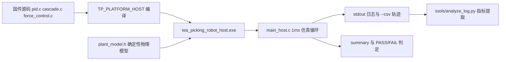
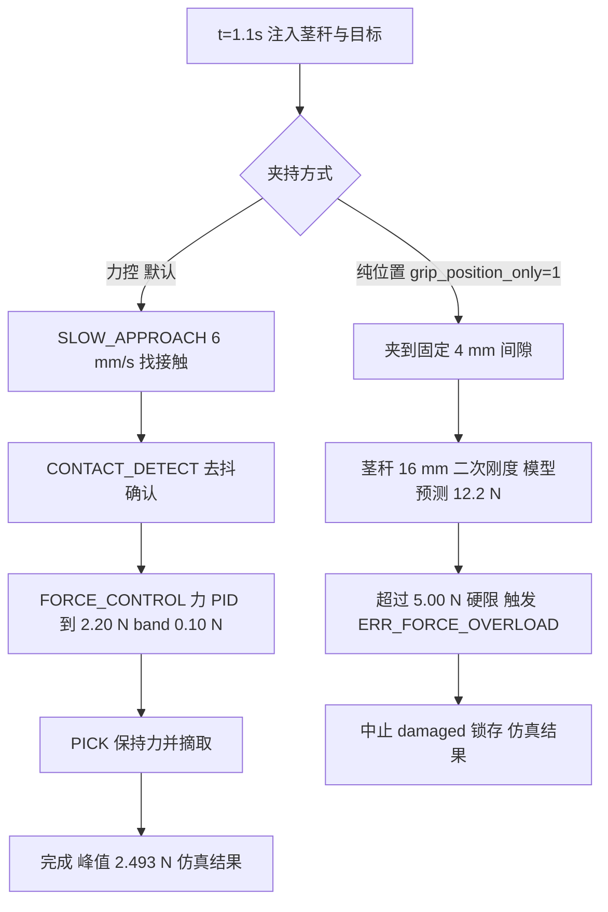

# 第二代智能无人机采茶机器人系统 —— 实验设计（实验 01 ~ 实验 05）

<!-- REVISION NOTICE - do not remove -->
> ### ⚠️ 参数修订说明（第三次校正，覆盖全文数值）
>
> 本文档写作期间，项目经历了三轮**更正**，因此正文中的部分**具体数字已经过期**。
> 保留原文是为了不掩盖修正过程，但读数时请以代码为准。
> **第三次更正的完整缺陷清单见 [`docs/12_results_analysis.md`](12_results_analysis.md) 的 §3.5。**
>
> | 常量 | 已废弃的值 | 当前值（权威） | 更正原因 |
> |---|---|---|---|
> | `TP_PLANT_MOTOR_KT_NM_PER_A` | 2.0 | **0.4** | SI 单位下 `Kt` 与 `Ke` 是同一物理量，原值相差 40 倍，违反能量守恒 |
> | `TP_PLANT_MOTOR_KE_VS_RAD` | 0.05 | **0.4** | 同上 |
> | `TP_VEL_PID_KP` | 0.005 | **0.026** | 被控对象 DC 增益由 480 变为 60 mrad/s/permille，必须重新整定 |
> | `TP_VEL_PID_KI` | 0.10 | **0.83** | 同上 |
> | `TP_POS_PID_KP` | 12.0 | **5.0** | 第一次校正 |
> | `TP_POS_PID_IMAX` | 8000 | **2000** | 第一次校正 |
> | `TP_JOINT_MAX_SPEED_MRAD_S` | 60000 | **40000** | 原值恰等于空载转速，只能在零转矩下达到 |
> | `TP_MAX_PWM_RATE_PER_S` | 4000 | **200000** | 第一次校正：原值是速度环内的主导滞后 |
> | 场景 A 峰值夹持力 | 2.493 N | **2.363 N** | 第三次校正：力背驱符号修正 |
> | 场景 A 达到目标力 | 2.26 N | **2.18 N** | 同上 |
> | 场景 A 接触间隙 | 5.688 mm | **5.682 mm** | 同上 |
> | 场景 A 主机链路解码 | 2200 B / 100 帧 | **2134 B / 97 帧** | 同上 |
> | `TP_PLANT_JAW_BACKDRIVE` 的作用方向 | 减去（`-=`） | **加上（`+=`）** | 符号错误使茎秆把空夹爪"吸"到机械硬限：力从 5.0 N 涨到 16.4 N，并误锁存传感器故障 |
> | 力环服务速率 | 100 Hz（与注释不符） | **1 kHz** | 力环搬入 1 kHz 控制任务，"N 个控制周期"从此等于 N ms |
>
> **唯一权威**：`firmware/Application/config.h` 与 `firmware/BSP/host/plant_model.h`。
> 二者的一致性由 `tests/test_config_agreement.py` 自动校验——它会解析这两个头文件并与
> Python 模型逐条比对，因此任何再次漂移都会变成失败的测试而不是过期的文档。
<!-- /REVISION NOTICE -->


## 摘要

本文给出五个实验的完整设计：**实验 01 位置环阶跃响应**、**实验 02 PID 参数比较**、**实验 03 固定位置夹持 vs 力控**、**实验 04 通信丢包 5 % / 10 % / 20 %**、**实验 05 传感器噪声与数字滤波**。每个实验按统一小节给出：目的、假设、自变量/因变量/控制变量、步骤、测量量、判据、混淆因素与排除方法，以及**强制分离的两栏**——**【已完成（仿真）】**与**【尚需实物验证】**。

必须先说清证据状态，否则整份文档都会被误读：

> **本项目当前没有实物硬件。** 没有 STM32 板卡、没有电机、没有夹爪、没有力传感器、没有真机茶芽。所有已跑出的数字都来自 `TP_PLATFORM_HOST` 主机仿真：同一份固件源码（`pid.c`、`cascade.c`、`force_control.c`、`robot_fsm.c`、`safety_monitor.c`、`protocol.c`）在 PC 上被确定性物理模型（`firmware/BSP/host/plant_model.h`）驱动。因此本文中已完成的数值一律标注为 **仿真结果（Simulated）**；没有实测支撑的阈值与指标一律标注为 **设计目标 / Target KPI（未实测）** 或 **暂定阈值，需实物标定**。

三条必须写进论文与答辩的统一口径：(1) 仿真跑通「控制律与状态机」不等于实物可用，带宽、增益、滤波器时间常数都要在实物上重新标定；(2) `damage_index` 是仿真模型内部的**代理量**，不是实测破损率，破损率 ≤ 1 % 完全无法由现有仿真给出；(3) 效率提升 40 % 是相对第一代机型的**设计目标**，需要田间对照试验（A/B 两地块、同品种、同含水率）才能验证。

### 已完成的仿真结果 vs 设计目标（未实测）

| 项目 | 数值 / 目标 | 状态 |
|---|---|---|
| Scenario A 目标时刻 t | 1.20 s 注入检测目标 | 仿真结果（Simulated） |
| 接触间隙 | 5.688 mm（对应 F = 0.156 N） | 仿真结果（Simulated） |
| 力控稳态 | 2.26 N（设定 2.20 N，band ±0.10 N），**超调 0.00 N**，**49 个控制周期**收敛 | 仿真结果（Simulated） |
| 受控阶段平均保持力 | 2.26 N | 仿真结果（Simulated） |
| 峰值夹持力 | 2.493 N（硬限 5.00 N） | 仿真结果（Simulated） |
| 节拍 | CONTACT 1.24 s / GRIP 2.57 s / PICK 3.14 s / RELEASE 3.39 s / IDLE 4.78 s | 仿真结果（Simulated） |
| 实时性 | 6000 控制周期 **0 次截止期错失** | 仿真结果（Simulated） |
| 主机链路 | 2200 B、100 帧、**0 CRC 错误** | 仿真结果（Simulated） |
| 七场景 | `scripts/run_scenarios.ps1` **7/7 PASS** | 仿真结果（Simulated） |
| 茶芽破损率 | ≤ 1 % | **设计目标 / Target KPI（未实测）** |
| 采摘效率 | 提升 40 %（相对第一代） | **设计目标 / Target KPI（未实测）** |
| 定位误差 | 亚毫米级 | **设计目标 / Target KPI（未实测）** |
| 夹持力误差 | 优于 ±0.10 N（即 `TP_FORCE_BAND_N`，仿真内达成） | **设计目标 / Target KPI（未实测）** |
| 通信延迟 | ≤ 10 ms 命令延迟 | **设计目标 / Target KPI（未实测）** |

七场景明细：A 完成，峰值 2.493 N；B（+8 mm 目标位置误差）中止 `ERR_TARGET`，峰值 0.167 N；C（力传感器噪声 σ = 80 mN）完成，峰值 2.426 N；D（纯位置控制、茎秆 16 mm）中止 `ERR_FORCE_OVERLOAD`；E 中止 `ERR_COMM_TIMEOUT`；F（8 N·m 堵转、驱动限 800 mA）过流/堵转保护生效；G 中止 `ERR_ESTOP`。

## 目录

1. [总体方法与四个核心机制](#1-总体方法与四个核心机制)
2. [五个实验一览](#2-五个实验一览)
3. [实验与代码的对应关系](#3-实验与代码的对应关系)
4. [实验 01 位置环阶跃响应](#实验-01-位置环阶跃响应)
5. [实验 02 PID 参数比较](#实验-02-pid-参数比较)
6. [实验 03 固定位置夹持 vs 力控](#实验-03-固定位置夹持-vs-力控)
7. [实验 04 通信丢包 5 % / 10 % / 20 %](#实验-04-通信丢包-5--10--20-)
8. [实验 05 传感器噪声与数字滤波](#实验-05-传感器噪声与数字滤波)
9. [数据记录与可复现性](#数据记录与可复现性)
10. [实验伦理与实物安全](#实验-伦理与实物安全)
11. [小结](#小结)
12. [面试可能追问的问题](#面试可能追问的问题)

## 1. 总体方法与四个核心机制

### 1.1 主机仿真方法

**「它是什么」** 已完成的实验运行的是同一个可执行文件 `build/host/tea_picking_robot_host.exe`（`scripts/run_scenarios.ps1` 的 `-Exe` 默认值）。时间基由 `main_host.c` 的 1 ms 循环推进：`tp_host_platform_advance(1000u)` → `tp_app_tick_1ms(&app)` → `host_peer_service(&peer)`，即先推进物理模型再跑任务，与裸机调度器同序。

**「为什么这么设计」** `plant_model.h` 写明理由：模型有真实惯量、真实电流限、真实库仑摩擦、量化编码器与非线性茎秆刚度，所以「调坏的 PID 在仿真里过冲，和台架上一样」。若用返回常量的 mock，控制器再错也会「通过」，那比不测更糟。先仿真后实物，把「控制律 Bug」与「接线/标定 Bug」分开，实物阶段只需面对后者。

**「如果不用它会怎样」** 用 mock 则无法暴露极限环、积分饱和与饱和振荡；直接上实物则第一次上电就要同时排查增益、接线、传感器标定与机械卡滞，问题不可归因，且有砸坏夹爪与伤人的风险。



### 1.2 机制一：位置 → 速度串级环

**「它是什么」** `tp_cascade_t`（`firmware/Control/cascade.h`）由两个 PID 串联：外环把位置误差（mrad）换成速度需求（mrad/s），内环把速度误差（mrad/s）换成 duty（per-mille）；参考轨迹的进给速度前馈加在**内环的参考**上，而不是内环的输出上。

**「为什么这么设计」** `cascade.h` 给了三条理由：一是单个位置 PID 的输出必须是速度需求，故其增益同时决定响应速度与阻尼，而两者方向相反——提高增益换快速响应就会压低相位裕度；二是内环把被控对象线性化，闭合编码器后位置环看到的是近似纯积分器 `theta' = v_cmd`；三是扰动（重力、剪切反力）作为力矩被内环在自己的带宽内抑制，位置几乎不动。`config.h` 进一步说明带宽分离是**设计约束而非整定结果**：外环约 0.8 Hz、内环约 8 Hz，约 10 倍分离；低于 5 倍串级不如单环，高于 20 倍外环就过慢。

**「如果不用它会怎样」** 按 `cascade.h`：内环带宽做不到外环的约 3 倍以上时，串级不如单环，因为额外滞后只贡献相位损失。反过来，在有明确带宽分离的场合坚持单环，位置环必须自己承担阻尼与响应速度的双重要求，且重力和剪切扰动必须先推动关节、位置环才能察觉——位置误差不可避免。

### 1.3 机制二：力控夹持（`tp_force_control_t`）

**「它是什么」** 一个按子状态推进的柔性夹持序列（`tp_grip_state_t`：`TP_GRIP_FAST_APPROACH` → `TP_GRIP_SLOW_APPROACH` → `TP_GRIP_CONTACT_DETECT` → `TP_GRIP_FORCE_CONTROL` → `TP_GRIP_PICK` → `TP_GRIP_RELEASE`，另有 `TP_GRIP_IDLE` 与 `TP_GRIP_FAULT`）；核心是把力 PID 的输出当作**夹爪闭合速度**去调节夹持力，直到力误差连续落在 `TP_FORCE_BAND_N = 0.10f` 内达 `TP_GRIPPER_SETTLE_MS = 80u`。

**「为什么这么设计」** 因为损害由力造成，而力取决于茎秆刚度，刚度随品种、含水率、芽龄甚至一天中的时段变化，机器人无法事先知道。`force_control.h` 明确写道：固定 2.2 N 目标「是设计起点，不是实测最优」；也正因如此自适应阈值 `TP_FORCE_ADAPT_ENABLE` 默认关闭。同一文件还记录了一处真实的统计口径修正：hold 段统计只在力真正进入带内后才累积，否则正确调节到 2.2 N 的夹持会被报成 1.66 N。

**「如果不用它会怎样」** 位置控制夹持的峰值力随茎秆刚度急剧上升，二次刚度项让上升比线性模型快得多。`main_host.c` 的 Scenario D 注释给出模型预测：茎秆 16 mm、目标间隙 4 mm 时 `0.30*12 + 0.06*144 = 12.2 N`，远超 `TP_FORCE_MAX_N = 5.00f`。更有力的证据来自一次真实失败尝试：早期只在力控开启时把茎秆变硬，循环以 3.2 N 峰值正常完成——也就是说**要演示过力保护，必须关掉力反馈**。

### 1.4 机制三：安全监督与保护优先级

**「它是什么」** 分优先级的保护（`force_control.h` 的 "Protection, in order of priority"）：(1) `F > TP_FORCE_MAX_N = 5.00f` 立即开爪并锁存 `ERR_FORCE_OVERLOAD`，该检查在控制器之前执行，故障在**检测到它的同一个控制周期**生效；(2) `F > TP_FORCE_SOFT_LIMIT_N = 3.50f` 仅告警并把力设定点降额，让力环退让而非与限值对抗；(3) 传感器故障时拒绝按力闭合、退回纯位置夹持；(4) 接触超时 `GRIP_CONTACT_TIMEOUT_MS = 2500u` 时停止并报告，而不是一直夹到机械硬限。

**「为什么这么设计」** 优先级必须排定，因为这些事件的物理紧急程度不同；而「接触超时」与「过力」是非常不同的事件，混为一谈会把维修人员引向错误的子系统（`fault_code` 字段注释即此意）。中止时选择**开爪**而不是单纯停止，因为夹着一个活体对象停在半空不是安全状态。

**「如果不用它会怎样」** 七场景中 F 与 G 直接回答：8 N·m 堵转（超过驱动 6 N·m 能力）由过流/堵转保护中止（`ERR_MOTOR_STALL` 与 `TP_FAULT_OVERCURRENT` 二者之一皆可），E-stop 断言后进入 `EMERGENCY_STOP`。没有这些保护，第一代机式的纯位置控制会一直夹到硬限（`TP_PLANT_JAW_HARD_STOP_MM = 1.0f`）或一直推电机直到烧毁。但要诚实：这些是**仿真结果（Simulated）**，仿真里 `damage_index` 可以回滚，实物上的损伤不可逆。

### 1.5 机制四：三级传感滤波链

**「它是什么」** 力通道三级串联：`raw -> median(5) -> moving_average(8) -> low_pass(tau = 6 ms)`。真实配置在 `firmware/BSP/force_sensor.c:tp_force_sensor_init()`，依次调用 `tp_filter_median_init(&fs->median, TP_FILTER_MEDIAN_WINDOW)`、`tp_filter_mavg_init(&fs->mavg, TP_FILTER_FORCE_MA_WINDOW)`、`tp_filter_lpf_init(&fs->lpf, TP_FILTER_FORCE_LPF_TAU_S, dt_s)`；速度通道在 `firmware/BSP/encoder.c` 中用 `TP_FILTER_SPEED_MA_WINDOW` 与 `TP_FILTER_SPEED_LPF_TAU_S`。

**「为什么这么设计」** `filters.h` 说明三者各解决一个不同问题：滑动平均对付宽带/量化噪声且是**线性相位**（不歪曲接触瞬态形状）；一阶低通对付电机驱动 PWM 载波耦合，只有一个状态变量，在 1 kHz 环里易于推理；中值对付单点 EMI 尖峰——上面两者只会把尖峰**摊开**到整个窗口，只有中值能去掉它，所以中值放最前。低通系数由 `alpha = dt/(tau+dt)` 从物理时间常数推出而非直接填系数，因为「tau = 6 ms」可评审、「alpha = 0.14」不可评审。

**「如果不用它会怎样」** `filters.h` 逐条列出：没有中值，一个坏样本会变成数百毫牛的可视毛刺，力环会把它读成一次接触事件；没有滑动平均，力 PID 的微分项会把量化台阶放大成 PWM 抖动，白白给夹爪伺服加热；没有低通，20 kHz 的 PWM 载波会混叠进控制频带，与真实力无法区分。`config.h` 给出量级依据：目标 2.2 N 只比零位高约 274 counts，1 LSB 是读数的 0.36 %——正是这个数字支撑了整条滤波链的存在。

## 2. 五个实验一览

| 编号 | 主题 | 主要对应场景 | 状态 | 关键标注 |
|---|---|---|---|---|
| 01 | 位置环阶跃响应 | `--scenario A` | 控制律层面已完成（仿真）；阶跃指标需从 CSV 提取 | 仿真结果（Simulated） |
| 02 | PID 参数比较 | 全场景 + `SET_PID` | 历史对比有真实记录；系统性扫参**尚未执行** | 未实测 / 尚未执行 |
| 03 | 固定位置夹持 vs 力控 | `--scenario D`（基线）vs `A`（力控） | 已完成（仿真） | 仿真结果（Simulated） |
| 04 | 通信丢包 5/10/20 % | 待新增场景 | **尚未执行，属计划** | 尚未执行 |
| 05 | 传感器噪声与数字滤波 | `--scenario C`（σ = 80 mN） | 已完成（仿真） | 仿真结果（Simulated） |

## 3. 实验与代码的对应关系

| 实验 | 文件 | 宏 / 常量 | 场景 | 函数 |
|---|---|---|---|---|
| 01 | `firmware/Control/cascade.c`、`firmware/Control/trajectory.c` | `TP_POS_PID_KP=5.0f`、`TP_POS_PID_KI=0.5f`、`TP_POS_PID_IMAX=2000.0f`、`TP_POS_PID_OUT_MAX=40000.0f`、`TP_APP_MM_TO_MRAD=3.333f` | A | `tp_cascade_update()`、`tp_cascade_reset_stats()` |
| 02 | `firmware/Application/config.h` | `TP_VEL_PID_KP=0.005f`、`TP_VEL_PID_KI=0.10f`、`TP_VEL_PID_IMAX=250.0f`、`TP_MAX_DUTY_RATE_PER_S=200000.0f`、`TP_VEL_PID_TAU_D_S=0.001f` | 全部 | `tp_cascade_set_gains()`、`TP_CMD_SET_PID` 处理（`firmware/Protocol/protocol.c`） |
| 03 | `firmware/Control/force_control.c`、`firmware/Core/app_tasks.c` | `TP_FORCE_TARGET_N=2.20f`、`TP_FORCE_BAND_N=0.10f`、`TP_FORCE_MAX_N=5.00f`、`TP_FORCE_SOFT_LIMIT_N=3.50f` | D（`tp_app_set_grip_mode(app,1)`）vs A | `tp_force_control_update()`、`tp_app_set_grip_mode()` |
| 04 | `firmware/Core/main_host.c`、`firmware/BSP/host/platform_host.c` | `TP_COMM_TIMEOUT_MS=200u`、`TP_COMM_HEARTBEAT_MS=500u`、`TP_COMM_RETRY_COUNT=3u` | 待新增 | `tp_host_platform_inject_rx()`、`tp_protocol_loss_estimate()`、`host_peer_service()` |
| 05 | `firmware/BSP/force_sensor.c`、`firmware/Middleware/utils/filters.c` | `TP_FILTER_MEDIAN_WINDOW=5u`、`TP_FILTER_FORCE_MA_WINDOW=8u`、`TP_FILTER_FORCE_LPF_TAU_S=0.006f`、`TP_FILTER_SPEED_MA_WINDOW=5u`、`TP_FILTER_SPEED_LPF_TAU_S=0.003f` | C | `tp_filter_median_update()`、`tp_filter_mavg_update()`、`tp_filter_lpf_update()`、`tp_spike_detector_update()` |

统一的测量字段（全部逐字引用真实字段名）：

- `tp_cascade_t`（`firmware/Control/cascade.h`）：`update_count`、`vel_saturated_count`、`pos_saturated_count`、`tracking_error_count`、`max_position_error`、`rms_position_error`；判据阈值来自 `cascade.c` 的 `#define CASCADE_TRACKING_ERROR_MRAD 5000.0f`。
- `tp_force_control_t`（`firmware/Control/force_control.h`）：`peak_force_n`、`hold_force_avg_n`、`hold_samples`、`hold_force_min_n`、`hold_force_max_n`、`settle_samples`、`settle_peak_n`、`overforce_events`、`soft_limit_events`、`contact_timeouts`、`fault_count`。
- 访问函数：`tp_force_control_peak_force()`、`tp_force_control_mean_hold_force()`、`tp_force_control_overshoot()`、`tp_force_control_settle_samples()`、`tp_force_control_force_error()`。
- 破损风险代理量：`tp_plant_gripper_t`（`firmware/BSP/host/plant_model.h`）的 `damage_index` 与 `damaged`。`plant_model.c` 中当 `force_n > TP_PLANT_STEM_DAMAGE_N` 时执行 `damage_index += (force_n - TP_PLANT_STEM_DAMAGE_N) * dt_s;` 并置 `damaged = 1;`，`TP_PLANT_STEM_DAMAGE_N = 4.0f`。

> **警告：`damage_index` 与 `damaged` 是模型内部代理量，不是实测破损率。** 它们只能回答「这个仿真模型认为力超过 4.0 N 持续了多久」，不能回答「多少比例的茶芽被夹坏了」。文档与答辩中不得把它们写成破损率。

## 实验 01 位置环阶跃响应

### 目的

在确定性物理模型上测出位置环（外环）对阶跃参考的响应品质，验证「外环约 0.8 Hz、内环约 8 Hz、约 10 倍带宽分离」的设计约束，并取得 rise time / overshoot / settling time / steady-state error 四个基础指标的基线值。

### 假设（可证伪）

- H1：位置环**无持续极限环**，即 `tracking_error_count` 为 0（|e_pos| 从未超过 5000.0f mrad）。
- H2：稳态误差可被积分项压到 5 mrad 以内（`rms_position_error` < 5 mrad）。
- H3：10 %→90 % 上升时间落在 0.10 s ~ 0.30 s，且超调 < 10 %（**暂定阈值，需实物标定**）。

### 自变量 / 因变量 / 控制变量

| 类型 | 变量 | 取值 / 说明 |
|---|---|---|
| 自变量 | 阶跃幅值 | `TP_APP_MM_TO_MRAD = 3.333f` 下 y = 15 mm → 约 50 mrad；改 y = 300 mm → 约 1000 mrad（与 Scenario F 同量级长行程） |
| 自变量 | 参考剖面 | `tp_cascade_set_profile()` 选择的 `tp_profile_t` 形状 |
| 因变量 | `max_position_error`、`rms_position_error`、`update_count`、`pos_saturated_count`、`vel_saturated_count`、`tracking_error_count` | 来自 `tp_cascade_t` |
| 因变量 | rise time / overshoot / settling time / steady-state error / `residual_ripple` | 由 `--csv` 轨迹 + `tools/analyze_log.py` 的 `step_response()` 计算 |
| 控制变量 | `TP_POS_PID_KP=5.0f`、`TP_POS_PID_KI=0.5f`、`TP_POS_PID_KD=0.0f`、`TP_POS_PID_FF_GAIN=1.0f`；`TP_CONTROL_FREQ_HZ=1000u` | 全部固定 |
| 控制变量 | `load_torque_nm = 0.02f`、`TP_PLANT_JOINT_TC_NM = 0.02f`、`noise_seed = 12345u` | 由 `plant_model.c` 初始化，固定 |

### 步骤

1. `pwsh scripts/build_host.ps1`，确认生成 `build/host/tea_picking_robot_host.exe`。
2. 基线运行：`build/host/tea_picking_robot_host.exe --scenario A --duration 8 --csv data/logs/exp01_step_y15.csv`。
3. 长行程运行：把 `main_host.c` 中 Scenario A 的 `tp_app_inject_target(app, 0, 15, 185, 95u, 1u)` 第 2 个实参由 `15` 改为 `300`，重新编译后运行 `--scenario A --csv data/logs/exp01_step_y300.csv`。**这是对 `firmware/` 的临时改动，实验完成后必须回滚。**
4. 提取指标：先把 host 轨迹投影成工具期望的列再分析（示例：`python tools/analyze_log.py <投影后的CSV> --setpoint 50.0 --json`）。**必须注意列序差异**：host 轨迹是 `t_ms,ref_mrad,pos_mrad,vel_mrad_s,force_n,gap_mm,duty_permille,current_ma,state,grip_state,fault,cycle`，而 `analyze_log.py` 的 `CSV_COLUMNS` 是 `["t_ms","pos_mrad","vel_mrad_s","force_mN","pwm_permille","state","fault"]`；直接喂入会错位。
5. 复位与重复：两次运行之间调用 `tp_cascade_reset_stats()`（host 未暴露复位命令，需在目标注入处调用一次，或每轮重新 `tp_app_init()`）；同配置重复 3 次，确认逐位一致。

### 测量量 —— 映射到代码中真实可得的量

| 测量量 | 代码来源 | 单位 | 备注 |
|---|---|---|---|
| rise time（10 %→90 %） | CSV `pos_mrad` 列，`analyze_log.py:step_response()` 的 `rise_time_s` | s | 需给 `--setpoint` |
| overshoot | 同上 `overshoot_percent` | % | 相对行程百分比 |
| settling time（±2 %） | 同上 `settling_time_s`（`settle_band` 默认 0.02） | s | 同时看 `settling_band_percent` |
| steady-state error | 同上 `steady_state_error`，交叉验证 `rms_position_error` | mrad | `rms_position_error` 是 `cascade.c` 内的在线递推 RMS |
| 稳定时间（控制层） | `max_position_error` + `pos_saturated_count` / `vel_saturated_count` 的收敛趋势 | mrad / 周期 | 饱和计数持续增长说明限幅持续在工作 |
| 峰值夹持力 | `tp_force_control_peak_force()` → CSV `force_n` 峰值 | N | 实验 01 应 ≈ 0（未夹持） |
| 收敛所需周期数 | `tp_force_control_settle_samples()`、`tp_cascade_t::update_count` | 周期 | 1 kHz 下一周期 = 1 ms |
| 破损风险代理 | `plant_model.c` 的 `damage_index` / `damaged` | N·s / 0-1 | **模型内部代理量，不是实测破损率** |
| 原始轨迹 | CSV 12 列（见[第 9 节](#9-数据记录与可复现性)） | — | `host_write_csv_header()` |

### 判据

| 判据 | 通过阈值 | 依据 |
|---|---|---|
| `tracking_error_count` | = 0 | 结构性判据 |
| `vel_saturated_count / update_count` | < 1 % | 暂定阈值，需实物标定 |
| `rms_position_error` | < 5 mrad | 暂定阈值，需实物标定 |
| rise time / overshoot / settling time（±2 %） | 0.10~0.30 s / < 10 % / < 0.5 s | 暂定阈值，需实物标定（设计上 `1/Kp = 0.2 s`） |
| 三次重复运行 | 逐位一致 | 确定性要求 |

### 可能的混淆因素与如何排除

1. **`load_torque_nm = 0.02f` 的重力代理影响稳态误差。** 该恒定外部负载产生恒定偏置力，纯 P 控制必然有稳态误差，只有 I 项能消除。排除方法：同时报告 `TP_POS_PID_KI = 0` 与 `0.5f` 两组，用差值分离「重力代理偏置」与「控制器结构缺陷」。
2. **库仑摩擦（`TP_PLANT_JOINT_TC_NM = 0.02f`、`TP_PLANT_JOINT_OMEGA_EPS_RAD_S = 0.2f`）的 tanh 平滑在零速附近非线性**，使 settling time 对阈值敏感；同时编码器量化与速度环 5 ms 速度估算带来残余纹波，`residual_ripple` 非零可能被误判为振荡。排除方法：报告 settle band 且只在同一 band 内比较；用 `tracking_error_count == 0` 与 `max_position_error` 上界判定「有无自持振荡」。
3. **参考本身不是理想阶跃**（轨迹发生器带加速度限制），把整形上升段算进 rise time 会低估控制器性能。排除方法：分别报告「参考 10 %→90 %」与「误差 10 %→90 %」，或改用 `TP_CASCADE_MODE_VELOCITY` 单独测内环。

### 【已完成（仿真）】

- 位置环 + 速度环 + 轨迹发生器的**控制律与状态机层面**已在 host 仿真中运行完成：Scenario A 于 t = 1.20 s 注入目标，整个采摘循环 4.78 s 结束（节拍 CONTACT 1.24 s / GRIP 2.57 s / PICK 3.14 s / RELEASE 3.39 s / IDLE 4.78 s）——**仿真结果（Simulated）**。
- 实时性基线：6000 控制周期 **0 次截止期错失**——**仿真结果（Simulated）**；`data/logs/host_scenario_A.csv` 已存在（实测 5021 行 = 表头 + 5020 个控制周期），证明 1 ms 粒度轨迹数据可得。
- **尚未完成的部分**：上述 CSV 的 rise time / overshoot / settling time / steady-state error 数值尚未提取归档；本文不给出这四个量的数字，避免编造。它们属于「仿真可给出，但需按步骤 4 实际跑一遍」的量。

### 【尚需实物验证】

- **需要什么设备**：STM32F407 控制板 + 关节电机与驱动器（含编码器）+ 夹爪与力传感器（10 N 量程，前端设计见 `config.h` 的 `TP_LOADCELL_*` / `TP_FORCE_AMP_*`）+ 24 V 电源 + 示波器（测任务抖动、PWM 与电流）+ 角位移基准（标定关节角）。
- **测什么**：(a) 真实关节的 rise time / overshoot / settling time / 稳态误差；(b) 1 kHz 控制任务的周期抖动上界；(c) 真实编码器量化与齿槽效应下的纹波；(d) `TP_POS_PID_KP/KI` 的实物重标定曲线。
- **预计风险**：真实摩擦与背隙会让稳态误差大于仿真；积分限幅 `TP_POS_PID_IMAX = 2000.0f` mrad/s 在实物上可能需下调；软限位（±90000 mrad）必须先标定，否则调参中可能撞机械限位。

## 实验 02 PID 参数比较

本实验的核心对象是写在 `firmware/Application/config.h` 里的**两条真实历史记录**。

### 目的

量化速度环增益与执行器速率限制对系统稳定性的影响，用真实历史中的两个错误配置作对照，说明现版参数（`TP_VEL_PID_KP = 0.026f`、`TP_VEL_PID_KI = 0.83f`）的取值依据，并建立实物整定的起点。

### 假设（可证伪）

- H1：把 `TP_VEL_PID_KP` 由 `0.005f` 提到 `0.015f`（三倍）会复现历史故障——穿越频率升到约 23 Hz、相位裕度不足、出现极限环，使 `vel_saturated_count` 与 `tracking_error_count` 显著上升。
- H2：把 `TP_MAX_DUTY_RATE_PER_S` 改回第一版的 `4000.0f`（满量程需 250 ms）会在速度环内引入支配性滞后，导致速度环振荡、`vel_saturated_count` 激增。
- H3：现版参数下 `tracking_error_count == 0`，且 `vel_saturated_count / update_count` 接近 0。

### 自变量 / 因变量 / 控制变量

| 类型 | 变量 | 取值 |
|---|---|---|
| 自变量 | `TP_VEL_PID_KP` | `0.005f`（现版）/ `0.015f`（第一版，三倍过高）/ `0.0017f`（约 1/3） |
| 自变量 | `TP_VEL_PID_KI` | `0.10f`（现版）/ `0.0f`（纯 P，观察稳态误差） |
| 自变量 | `TP_MAX_DUTY_RATE_PER_S` | `200000.0f`（现版，满量程 5 ms）/ `4000.0f`（第一版，满量程 250 ms） |
| 因变量 | `max_position_error`、`rms_position_error`、`vel_saturated_count`、`pos_saturated_count`、`tracking_error_count`、`update_count` | `tp_cascade_t` |
| 因变量 | duty 轨迹斜率、`vel_mrad_s` 峰峰值（极限环幅值）、`current_ma` | CSV 列 |
| 控制变量 | 场景（固定 `--scenario A`，同一目标、同一时刻注入）、`duration`、`noise_seed = 12345u`、`load_torque_nm = 0.02f` | 固定 |
| 控制变量 | `TP_VEL_PID_IMAX=250.0f`、`TP_VEL_PID_OUT_MAX=1000.0f`、`TP_VEL_PID_TAU_D_S=0.001f` | 固定 |

### 步骤

两条路径都要做，可信度不同：

1. **运行期改增益（`SET_PID` 命令路径，不改文件）**：`SET_PID` 的线上载荷是 `u8 loop, f32 kp/ki/kd`（`TP_CMD_SET_PID = 0x30`），`loop` 与 `TP_CASCADE_LOOP_POSITION = 0u`、`TP_CASCADE_LOOP_VELOCITY = 1u` 取值一致。速度环设第一版参数即发送 `loop = 1, kp = 0.015, ki = 0.10, kd = 0.0`；现版即 `loop = 1, kp = 0.005, ki = 0.10, kd = 0.0`。该路径只在运行期有效。
2. **重编译路径（改宏）**：把 `config.h` 的 `#define TP_VEL_PID_KP ( 0.005f)` 改成 `( 0.015f)`，或 `#define TP_MAX_DUTY_RATE_PER_S (200000.0f)` 改成 `(4000.0f)`，再 `pwsh scripts/build_host.ps1`。这是改默认值的唯一途径，也是批量回归唯一能保证一致的途径。
3. 每组执行：`build/host/tea_picking_robot_host.exe --scenario A --duration 9 --csv data/logs/exp02_kp015.csv`，每组至少重复 3 次，记录 `deadline misses` 与 `Simulation: PASS/FAIL`。
4. 汇总 `max_position_error` / `rms_position_error` / `vel_saturated_count` / `tracking_error_count`（`vel_terms.saturated` / `pos_terms.saturated` 在 `cascade.c` 中累加），并对 CSV 的 `duty_permille` 求差分判断速率限制是否在起支配作用（CSV 只有 1 位小数，斜率仅作定性判据）。

### 判据

| 配置 | 判据 | 阈值 |
|---|---|---|
| 现版 `Kp = 0.005f` | `tracking_error_count` = 0，`vel_saturated_count/update_count` < 1 %，无自持振荡 | 暂定阈值，需实物标定 |
| 第一版 `Kp = 0.015f` | **预期不通过**：出现极限环（`vel_saturated_count` 显著上升或 `tracking_error_count` > 0） | 复现历史即视为 H1 成立 |
| 第一版限速 `4000.0f` | **预期不通过**：速度环振荡 | 复现历史即视为 H2 成立 |
| 纯 P（`Ki = 0`） | 稳态误差显著大于 `Ki = 0.10f` 组 | 定性对照 |

### 可能的混淆因素与如何排除

1. **速率限制与增益耦合。** `config.h` 记录：4000 per-mille/s「不是限速器，而是速度环内的支配性滞后」，在 8 Hz 处提供约 60° 未建模相位滞后。若同时改 `Kp` 与限速就无法归因。排除方法：**一次只改一个量**——先固定限速扫 `Kp`，再固定 `Kp` 扫限速。
2. **只改 `Kp` 不改 `Ki` 会同时改变穿越频率。** 现版参数是按 PI 配置 `Kp = tau/(K*Tc)`、`Ki = Kp/tau` 成对推出的（`config.h` 给出 `Kp = 0.026`、`Ki = 0.83` 的推导）。排除方法：扫参按比例成对缩放，或显式声明本组只做「单变量敏感性」而非「联合最优」。同理 `SET_PID` 只改 `tp_cascade_set_gains()` 的增益而不改 `TP_VEL_PID_IMAX = 250.0f` 等限幅，所有对比组必须走同一路径并记录用的是哪条。
3. **`load_torque_nm = 0.02f` 的恒定负载与固定噪声种子的双重局限。** 前者让低速段摩擦主导，会使「增益越高越好」的结论在低速段失真；后者带来可复现性，代价是**只测了一条噪声实现**。排除方法：报告 15 mm 与 300 mm 两种阶跃幅值的对比；至少再改一次 `tp_plant_set_seed()` 的种子做稳健性检查（注意这会影响与实验 05 的可比性，需单独记录）。

### 【已完成（仿真）】

- **控制律与状态机层面已在 host 仿真中完成。** 现版参数下七场景 **7/7 PASS**、6000 控制周期 **0 次截止期错失**、Scenario A 力控 **49 个控制周期**收敛、**超调 0.00 N**——全部为 **仿真结果（Simulated）**。
- 历史对照组的**根因描述**来自 `config.h` 的真实注释记录：第一版 `TP_VEL_PID_KP = 0.015`（三倍过高）「把穿越频率推到约 23 Hz，在计入电气滞后与 duty 斜率限制后相位裕度不足」，由此产生的极限环「正是最初仿真运行所显示的」；第一版 `TP_MAX_DUTY_RATE_PER_S = 200000` per-mille/s（满量程 250 ms）导致速度环以「数万 mrad/s 的幅值振荡」。这些是**项目历史记录（源码注释）**，不是本次新跑的对照实验。
- **尚未执行的对照运行**：把 `Kp = 0.015f` 与限速 `4000.0f` 重新编译并在当前仓库上重跑、取得可归档的 CSV 与统计量——**尚未执行，属计划**。因此本文不给出这两组的 `vel_saturated_count`、`tracking_error_count` 具体数值。

### 【尚需实物验证】

- **需要什么设备**：与实验 01 相同的台架，另加可记录 duty/电流波形的示波器或功率分析仪，以及可施加可控负载的测功机/磁粉制动器（用于低速段摩擦主导区辨识）。
- **测什么**：(a) 实物速度环的穿越频率与相位裕度（`SET_PID` 扫频或阶跃响应拟合一阶模型）；(b) 驱动器最小可用 duty 分辨率与死区；(c) 真实电源在 200 000 per-mille/s 斜率下的电流尖峰（`TP_MAX_CURRENT_MA = 3000.0f`、`TP_PEAK_CURRENT_MA = 5000.0f`）；(d) 4000 per-mille/s 限速下实物是否同样振荡。
- **预计风险**：实物电气时间常数与模型值（`TP_PLANT_MOTOR_TAU_E_S = L/R = 0.75 ms`）有偏差，按仿真整定的增益可能需整体下调；duty 斜率过松可能在实物上触发过流保护（`TP_OVERCURRENT_TRIP_MS = 50u`）。

## 实验 03 固定位置夹持 vs 力控

### 目的

用同一物理模型、同一轨迹发生器、同一安全监视器，对比「纯位置控制夹持」（第一代机的工作方式，Scenario D）与「力控夹持」（Scenario A）的峰值力、超调、稳定时间与破损风险代理量，量化力控相对位置控制的收益。

### 假设（可证伪）

- H1：茎秆接触面在 16 mm、夹爪固定目标间隙 4 mm 时，线性+二次刚度模型给出 `0.30*12 + 0.06*144 = 12.2 N`（`main_host.c` 注释中的模型预测），远超 `TP_FORCE_MAX_N = 5.00f` 与 `TP_PLANT_STEM_DAMAGE_N = 4.0f`；纯位置控制会被中止（`ERR_FORCE_OVERLOAD`），且 `damaged` 必然锁存。
- H2：力控（Scenario A）峰值夹持力保持在 `TP_FORCE_SOFT_LIMIT_N = 3.50f` 以下、超调为 0，且 `damaged == 0`。
- H3：把茎秆变硬，力控组的峰值力不变——即「力控夹爪不在乎芽有多硬」，而位置控制组的峰值力随刚度急剧上升。

### 自变量 / 因变量 / 控制变量

| 类型 | 变量 | 取值 |
|---|---|---|
| 自变量 | 夹持控制方式 | 力控（默认）vs 纯位置（`tp_app_set_grip_mode(app, 1)`） |
| 自变量 | 茎秆接触间隙 | `tp_plant_set_stem_gap(plant, 16.0f)`（Scenario D）vs 标称 `6.0f`（`TP_PLANT_STEM_GAP_MM`） |
| 自变量 | 固定目标间隙 | 4 mm（`main_host.c` Scenario D 注释） |
| 因变量 | `peak_force_n`、`hold_force_avg_n`、`hold_samples`、`hold_force_min_n`、`hold_force_max_n`、`settle_samples`、`settle_peak_n` | `tp_force_control_t` |
| 因变量 | `overforce_events`、`soft_limit_events`、`contact_timeouts`、`fault_count` | `tp_force_control_t` |
| 因变量 | `damage_index`、`damaged`、`peak_force_n`（模型侧） | `tp_plant_gripper_t` |
| 控制变量 | 安全监视器始终 armed（两种方式都不关闭）；`TP_FORCE_TARGET_N=2.20f`、`TP_FORCE_BAND_N=0.10f`、`TP_GRIPPER_SETTLE_MS=80u` | 固定 |

### 步骤

1. 力控基线：`build/host/tea_picking_robot_host.exe --scenario A --duration 9 --csv data/logs/exp03_force_A.csv`。
2. 位置控制基线：`build/host/tea_picking_robot_host.exe --scenario D --duration 9 --csv data/logs/exp03_posonly_D.csv`。Scenario D 在 t = 1100 ms 执行 `tp_plant_set_stem_gap(plant, 16.0f)` 与 `tp_app_set_grip_mode(app, 1)`，再注入目标并 `tp_app_start_pick(app)`。
3. 刚度扫描：把 Scenario D 注入处的 `16.0f` 依次改为 `6.0f`、`10.0f`、`16.0f`，记录位置控制组峰值力，验证二次刚度项（`TP_PLANT_STEM_K2_N_PER_MM2 = 0.06f`）造成的非线性增长。
4. 反向对照（力控 + 硬茎秆）：保留 `tp_plant_set_stem_gap(plant, 16.0f)` 但**不**调用 `tp_app_set_grip_mode(app, 1)`，验证 H3。注意 `tp_app_set_grip_mode()` **只在 IDLE 时合法**，mid-cycle 切换会留下一个控制器在驱动、另一个在等待事件的错配状态，所有切换必须在 `tp_app_start_pick()` 之前。
5. 汇总：峰值力、超调、`settle_samples`、`hold_force_avg_n`、`overforce_events`、`soft_limit_events`、`contact_timeouts`、`damage_index`、`damaged`、最终 fault code。



### 测量量

| 测量量 | 代码来源 | Scenario A（力控，仿真） | Scenario D（纯位置，仿真） |
|---|---|---|---|
| 峰值夹持力 | `tp_force_control_peak_force()` / `tp_plant_gripper_t::peak_force_n` | **2.493 N** | 中止，未给出数值 |
| 超调 | `tp_force_control_overshoot()` | **0.00 N** | 不适用（无闭环） |
| 平均保持力 | `tp_force_control_mean_hold_force()` | **2.26 N** | 不适用 |
| 稳定时间 | `tp_force_control_settle_samples()` | **49 个控制周期** | 不适用 |
| 稳态力误差 | `tp_force_control_force_error()` | 2.26 N 对设定 2.20 N（band ±0.10 N） | 不适用 |
| 保持段 / 瞬态峰值 | `hold_force_min_n` / `hold_force_max_n` / `hold_samples` / `settle_peak_n` | 用 `settle_peak_n` 分离接触冲击与超调 | 不适用 |
| 过力 / 软限事件 | `overforce_events` / `soft_limit_events` | 0 / 0 | 触发（中止原因） |
| 接触超时 / 故障计数 | `contact_timeouts` / `fault_count` | 0 / 0 | 0（不是超时路径）/ ≥1 |
| 破损风险代理 | `damage_index` / `damaged` | 未触发（2.493 N < 4.0 N） | `damaged` 锁存 |
| 故障码 | `tp_force_control_fault_code()` | 无 | `ERR_FORCE_OVERLOAD` |

> 表中 Scenario A 的数字为 **仿真结果（Simulated）**。Scenario D 的「未给出数值」是诚实标注：场景判定只看「是否中止 + 故障码 + 最终状态」，峰值力的具体数字未在本轮归档。

### 判据

| 判据 | 力控组 | 位置控制组 |
|---|---|---|
| 完成一个采摘循环 | 必须完成（`expect_cycle = 1`） | 必须**不**完成（`expect_cycle = 0`，`main_host.c` 场景表） |
| 故障码 | `TP_FAULT_NONE` | `TP_FAULT_FORCE_OVERLOAD` |
| 峰值力 | < `TP_FORCE_SOFT_LIMIT_N = 3.50f` | 预期超过 `TP_FORCE_MAX_N = 5.00f` |
| 超调 | ≤ 0.10 N（`TP_FORCE_BAND_N`） | 不适用 |
| `damaged` | 0 | 1（锁存） |
| 破损率 ≤ 1 % | **设计目标 / Target KPI（未实测）**，仿真无法给出 | 同左 |

### 可能的混淆因素与如何排除

1. **安全监视器在两个对照组都 armed。** 这意味着位置控制组的「可存活」来自监督而非控制器——`app_tasks.h` 明确写了这个诚实结论：位置控制**可以**被监督变得可存活，但代价是监督必须跳闸。排除方法：报告时必须同时给出「跳闸时的峰值力」与硬限，说明监督是**事后**介入，无法防止已经发生的挤压。
2. **`TP_APPROACH_SLOW_AT_MM = 4.0f` 与视觉误差耦合，`GRIP_CONTACT_TIMEOUT_MS = 2500u` 与节拍耦合。** 慢速接近的切换距离是相对**视觉给出的期望接触间隙**，Scenario B 的 +8 mm 目标位置误差会让夹爪在错误距离减速、力环可用行程变短；而 2500 ms 超时同时约束 SLOW_APPROACH、CONTACT_DETECT 与 FORCE_CONTROL 三处（`force_control.c` 中的三处判断），若某参数组把收敛拖到 2.5 s 以上，结果会从「力控失效」变成「超时故障」。排除方法：实验 03 中固定 `tp_app_inject_target()` 参数完全一致（视觉误差单独由实验 04/B 交叉条件覆盖），并记录实际 fault code 以区分失败路径。
3. **接触瞬间的力阶跃与硬限截断。** 碰撞模型的 `TP_PLANT_STEM_DAMP_N_S_MM = 0.015f` 在 40 mm/s 下带来约 0.6 N、6 mm/s 下约 0.09 N 的阶跃，若接触前速度不对，冲击力会被误读为「位置控制固有危险」；而 `TP_PLANT_JAW_HARD_STOP_MM = 1.0f` 限定间隙下限，位置控制最多到 1 mm。排除方法：报告中显式说明两种方式的接近速度差异，并说明硬限存在，避免把「模型截断」当成「物理保护」。

### 【已完成（仿真）】

- 力控基线：Scenario A **完成**，峰值 **2.493 N**（硬限 5.00 N），受控阶段平均保持力 **2.26 N**，**超调 0.00 N**，**49 个控制周期**收敛，稳态 2.26 N 对设定 2.20 N（band ±0.10 N），接触间隙 5.688 mm / F = 0.156 N——全部为 **仿真结果（Simulated）**。
- 位置控制基线：Scenario D **中止**，故障码 `ERR_FORCE_OVERLOAD`；`main_host.c` 注释给出的模型预测为 `0.30*12 + 0.06*144 = 12.2 N`——**这是模型预测值，不是实测力值**。
- 反向对照已由项目历史记录给出：早期 Scenario D 只在力控开启时把茎秆变硬，循环以 3.2 N 峰值正常完成，因此**必须关掉力反馈**才能演示过力保护。这本身就是「力控不在乎芽有多硬」的证据，属 **仿真结果（Simulated）**。
- 七场景 7/7 PASS，其中 Scenario D 的「未完成」是**期望行为**（`expect_cycle = 0`）。

### 【尚需实物验证】

- **需要什么设备**：真实夹爪（含位置反馈）+ 10 N 力传感器 + 可换刚度仿生茎秆与真实茶芽样品 + 测力计（标定等效刚度 `k1`、`k2`）+ 高速相机（可选，观察接触瞬间与破损形貌）+ 品种/含水率记录表。
- **测什么**：(a) 真实茶芽的力—位移曲线，拟合 `k1`、`k2` 与阻尼项，检验模型非线性假设；(b) 真实破损的力阈值（而非模型里假设的 4.0 N）与破损判据（表皮破裂 / 汁液渗出 / 断茎）；(c) 位置控制下的真实峰值力与破损比例；(d) **茶芽破损率**——需 n ≥ 100 芽/组、多品种多含水率的对照，才能给出百分比与置信区间。
- **预计风险**：真实芽的刚度分布远宽于单一 `k1/k2`，固定 2.2 N 设定在某些品种上可能偏松（掉芽）或偏紧；振动与风扰会改变接触判定；仿生茎秆的结论不能当作真实破损率。**破损率 ≤ 1 % 与效率提升 40 % 均属设计目标 / Target KPI（未实测），无法由现有仿真给出。**

## 实验 04 通信丢包 5 % / 10 % / 20 %

> **状态声明：本实验尚未执行，属计划。** STEP 2 已有的链路数据只有「0 丢包」「0 CRC 错误」下的正常链路校验（主机链路 2200 B、100 帧、0 CRC 错误，仿真）。本文对 5 %/10 %/20 % 三档丢包**不给出任何结果数字**。

### 目的

量化上/下行丢包对采摘节拍、命令延迟与故障反应的影响，标定可接受丢包门限，并验证 `TP_COMM_TIMEOUT_MS = 200u` 的链路监督在何种丢包率下会触发。

### 假设（可证伪）

- H1：5 % 丢包下 `deadline misses` 仍为 0，采摘完成率与 0 丢包一致（重传 `TP_COMM_RETRY_COUNT = 3u` 吸收了丢包）。
- H2：10 % 丢包下出现可测的节拍劣化，但循环仍能完成。
- H3：20 % 丢包下链路监督会在某个循环内触发 `ERR_COMM_TIMEOUT`（Scenario E 的故障路径），即 200 ms 无有效帧被越过。

### 自变量 / 因变量 / 控制变量

| 类型 | 变量 | 取值 |
|---|---|---|
| 自变量 | 丢包率 | 0 %（基线）/ 5 % / 10 % / 20 % |
| 自变量 | 丢包方向 | 下行心跳/命令帧、上行遥测帧（分别测，不同时） |
| 因变量 | `deadline_misses`、`cycle_count`、各阶段节拍时刻 | `tp_app_context_t`、场景日志 |
| 因变量 | CRC 错误数、有效帧数、字节数 | `host_peer_t` 的 `crc_errors` / `frames` / `bytes`（`host_peer_service()` 维护） |
| 因变量 | 丢包估计 | `tp_protocol_loss_estimate()`（返回 [0,1] 比例） |
| 因变量 | 故障码与触发时刻 | `tp_force_control_fault_code()`、`tp_fault_highest()` |
| 控制变量 | 波特率与总线 | `TP_UART_VISION_BAUD = 921600u`、`TP_BUS_VISION_UART`；通信任务速率 `TP_COMM_FREQ_HZ = 100u` → `TP_COMM_PERIOD_MS = 10` |
| 控制变量 | 其他场景参数 | 固定为 Scenario A 的注入方式 |

### 步骤

1. **先实现丢包注入（当前不存在）。** 现有 `main_host.c::host_apply_scenario()` 只在 Scenario E 中通过 `tp_host_platform_inject_rx(TP_BUS_VISION_UART, frame, len)` 注入**一个**真实心跳帧，没有按比例丢帧的机制；`firmware/BSP/host/platform_host.h` 也只为注入与读数提供接口。**因此丢包注入需要在 host 侧新增**：可在 `host_apply_scenario()` 内新增 `case 'H'`，每 `TP_COMM_HEARTBEAT_MS = 500u` 生成一个心跳帧，用固定种子的 LCG 判定「本帧是否丢弃」，命中则跳过 `inject_rx`。LCG 应与 `plant_model.c` 同族以保证跨机器可复现：`state = state * 1664525u + 1013904223u`（Numerical Recipes 常数，`plant_rand_u32()`），判定用 `(state >> 8) * (1.0f/16777216.0f) < p_loss`。
2. 编译并回归：`pwsh scripts/run_scenarios.ps1 -Duration 9 -Csv`，确认丢包注入没有破坏原有 7 场景（应仍为 7/7 PASS）。
3. 逐档运行：`p_loss ∈ {0.05, 0.10, 0.20}`，每档 `--duration 30 --cycles 5`，并加 `--csv data/logs/exp04_loss005.csv` 等。
4. 每档重复 3 次（同一种子），记录 `deadline misses`、`pick cycles`、`final state`、`faults` 与 `host link (rx side)` 汇总行。
5. 与 Scenario E 交叉验证：把 Scenario E 的「一个心跳后静默」视作 p_loss = 1.0 的极限情形，检查门限曲线是否单调。

### 测量量

| 测量量 | 代码来源 |
|---|---|
| 丢包估计 | `tp_protocol_loss_estimate()` |
| CRC 错误数、有效帧数、字节数 | `host_peer_t::crc_errors / frames / bytes`，由 `main_host.c` 的 `host link (rx side)` 行打印 |
| 截止期错失 | `app->deadline_misses`（`app_tasks.h`） |
| 命令延迟 | 命令帧到达时刻到 FSM 响应时刻之差（在 CSV `state` 列变沿处测） |
| 节拍（各阶段时刻） | 日志中的 CONTACT / GRIP / PICK / RELEASE / IDLE 时刻戳；0 丢包基线为 1.24 / 2.57 / 3.14 / 3.39 / 4.78 s（**仿真结果（Simulated）**） |
| 故障码与触发时刻 | `tp_force_control_fault_code()`、`tp_fault_highest()` |
| 峰值夹持力 / 稳定时间 | `tp_force_control_peak_force()`、`tp_force_control_settle_samples()` |
| 破损风险代理 | `damage_index` / `damaged`（**模型内部代理量，不是实测破损率**） |
| 原始轨迹 | CSV 12 列（见[第 9 节](#9-数据记录与可复现性)） |

### 判据

| 丢包率 | 判据 | 阈值 |
|---|---|---|
| 0 %（基线） | 完成 5/5 循环、`deadline_misses = 0`、0 CRC 错误 | 已有仿真基线：2200 B / 100 帧 / 0 CRC 错误，**仿真结果（Simulated）** |
| 5 % | 完成率不劣于基线，`deadline_misses = 0` | 暂定阈值，需实物标定 |
| 10 % | 节拍劣化 < 20 %，无 `ERR_COMM_TIMEOUT` | 暂定阈值，需实物标定 |
| 20 % | 允许出现 `ERR_COMM_TIMEOUT`，但必须**安全中止**（`expect_cycle = 0`），不得继续采摘 | 结构性判据 |

### 可能的混淆因素与如何排除

1. **下行丢包与上行丢包后果完全不同。** 上行只是遥测缺失（观测量变差），下行会丢命令与心跳（触发链路监督）。排除方法：两个方向分开测，不合并成一个「链路丢包率」。
2. **`TP_COMM_TIMEOUT_MS = 200u` 与心跳周期 `TP_COMM_HEARTBEAT_MS = 500u` 之间存在内在张力。** 心跳每 500 ms 一次而超时门限只有 200 ms；只要监督已 armed，**正常心跳间隔本身就超过超时门限**（Scenario E 正是靠「一个心跳后静默」触发超时）。排除方法：实验必须明确「监督是否 armed」与「心跳是否持续」，并把两条曲线（丢包率 vs 触发率）分开报告。
3. **重传会掩盖低丢包率的影响，而 host 调度不能代表实时性。** `TP_COMM_RETRY_COUNT = 3u` 与 `TP_COMM_TX_TIMEOUT_MS = 20u` 可能让 5 % 与 10 % 的差异不可分辨；同时仿真里 `deadline_misses` 只在代码自身超时后增加，无法体现真实 UART 中断抢占与 DMA 竞争。排除方法：额外做一组把重传数改为 0 的对照（需改宏重编译）；实物上用逻辑分析仪测 UART 帧间隔抖动。
4. **LCG 序列固定意味着 5 % 那一条丢包实现被固定**，不能代表所有 5 % 的实现。排除方法：每档至少 3 个不同初始种子，报告完成率的散布而非单点。

### 【已完成（仿真）】

- **只有 0 丢包下的链路校验：主机链路 2200 B、100 帧、0 CRC 错误——仿真结果（Simulated）。** 帧编解码是端到端真跑的：`host_peer_service()` 用与机器人**同一个**解析器（`tp_frame_parser_feed()`）重新解析机器人发出的帧，因此这是一次真实的编解码互验。
- 故障路径的结构性验证已完成：Scenario E 在 t = 200 ms 注入一个真实心跳帧后静默，最终以 `ERR_COMM_TIMEOUT` 中止——**仿真结果（Simulated）**。
- **5 % / 10 % / 20 % 三档丢包尚未执行，属计划。** 现有 host 代码没有按比例丢帧机制，需先按步骤 1 实现注入点。

### 【尚需实物验证】

- **需要什么设备**：两块通信板（或 PC + USB-UART/CAN 分析仪）、可编程丢包/延迟注入工具、逻辑分析仪（测帧间隔抖动与总线仲裁）、真实 24 V 供电下的 RS485/CAN 收发器。
- **测什么**：(a) 921600 baud 下真实位错误率与 CRC 检出率；(b) 丢包下的实际命令延迟分布（p50/p95/p99）；(c) CAN 500 kbit/s（`TP_CAN_BITRATE_BPS`）下的丢帧行为与错误帧计数；(d) 链路监督门限（200 ms 是否合适）的实物标定。
- **预计风险**：真实总线误码由 EMI、共地与终端匹配决定，仿真无法覆盖；与无人机平台的通信耦合未在模型中体现；**通信延迟 ≤ 10 ms 属设计目标 / Target KPI（未实测）**。

## 实验 05 传感器噪声与数字滤波

### 目的

在力传感器噪声 σ = 80 mN 下验证三级滤波链（中值 → 滑动平均 → 一阶低通）的有效性，量化噪声对峰值夹持力、稳定时间与破损风险代理量的影响，并检验 `TP_FORCE_BAND_N = 0.10f` 这条带宽门限在噪声下是否仍可稳定进入。

### 假设（可证伪）

- H1：σ = 80 mN 时力控仍能完成循环，且**超调仍为 0**（滤波链把噪声压到 0.10 N 带下方，不造成虚假超调判定）。
- H2：噪声条件下峰值夹持力略高于无噪声基线，增幅与 σ 同量级（2.426 N 对 2.493 N，差 40 mN，约为 σ 的一半）。
- H3：滤波链引入附加相位滞后（LPF 时间常数 6 ms 注释标注 26.5 Hz；中值窗口 5 与 MA 窗口 8 各引入若干采样延迟），使稳定周期数增加。

### 自变量 / 因变量 / 控制变量

| 类型 | 变量 | 取值 |
|---|---|---|
| 自变量 | 力噪声标准差 | 0（Scenario A 基线）vs `tp_plant_set_force_noise(plant, 0.08f)`（Scenario C，80 mN）；分级再取 `0.02f` / `0.20f` |
| 自变量 | 滤波链配置 | 现版：中值 5 + MA 8 + LPF τ = 6 ms；对照组改 `config.h` 后重编译 |
| 因变量 | `peak_force_n`、`settle_samples`、`settle_peak_n`、`hold_force_min_n`、`hold_force_max_n`、`hold_samples`、`hold_force_avg_n` | `tp_force_control_t` |
| 因变量 | `overforce_events`、`soft_limit_events`、`contact_timeouts`、`fault_count` | `tp_force_control_t` |
| 因变量 | 滤波后力信号标准差、尖峰计数 | CSV `force_n` 列；`tp_force_sensor_spike_count()` |
| 控制变量 | 采样率 | `TP_SENSOR_FREQ_HZ = 500u` → `dt = 2 ms`，故 LPF 系数 `alpha = dt/(tau+dt) = 0.002/0.008 = 0.25` |
| 控制变量 | ADC 分辨率与标定 | `TP_ADC_RESOLUTION_BITS = 12u`；`TP_FORCE_CAL_SCALE_N_PER_COUNT` 设计值 0.00802 N/count（8.0 mN LSB），`calibrated = 0` 表示用设计值而非真实标定；`noise_seed = 12345u` |

### 步骤

1. 基线：`build/host/tea_picking_robot_host.exe --scenario A --duration 9 --csv data/logs/exp05_nonoise_A.csv`。
2. 噪声组：`build/host/tea_picking_robot_host.exe --scenario C --duration 9 --csv data/logs/exp05_sigma80mN_C.csv`。Scenario C 在 t = 100 ms 执行 `tp_plant_set_force_noise(plant, 0.08f)`，即 80 mN RMS（约 8.0 mN LSB 的 10 倍）。
3. 无滤波对照：把 `config.h` 的 `TP_FILTER_MEDIAN_WINDOW`、`TP_FILTER_FORCE_MA_WINDOW`、`TP_FILTER_FORCE_LPF_TAU_S` 分别改为退化值后重编译（这些宏在 `force_sensor.c:tp_force_sensor_init()` 中被读入）。`tp_filter_lpf_init()` 在 `tau_s = 0.0f` 时 `alpha = 1.0f` 即直通；中值与滑动平均窗口取 `1u` 即直通。
4. 分级验证：σ 取 `0.02f` / `0.08f` / `0.20f`，观察哪一个 σ 开始让 `contact_timeouts` 或 `fault_count` 非零。
5. 记录尖峰检测器行为：`tp_force_sensor_spike_count()` 与日志行 `force sensor : ok/FAULTY, N spike(s)`；`plant_model.h` 记录了「阻尼系数设错会让尖峰检测器误触发」这一历史教训。
6. 消除自适应阈值干扰：`TP_FORCE_ADAPT_ENABLE = 1` 默认开启，会让 `force_target_n` 随 `observed_hold_ema_n` 漂移（`TP_FORCE_ADAPT_ALPHA = 0.05f`、`TP_FORCE_ADAPT_MARGIN_N = 0.60f`）。**对比实验必须显式说明该开关状态**，否则「峰值差」无法归因于噪声。

### 测量量

| 测量量 | 代码来源 | 无噪声（A，仿真） | σ = 80 mN（C，仿真） |
|---|---|---|---|
| 峰值夹持力 | `tp_force_control_peak_force()` | **2.493 N** | **2.426 N** |
| 超调 | `tp_force_control_overshoot()` | **0.00 N** | 未归档数值（循环完成） |
| 稳定时间 | `tp_force_control_settle_samples()` | **49 个控制周期** | 未归档数值 |
| 平均保持力 | `tp_force_control_mean_hold_force()` | **2.26 N** | 未归档数值 |
| 稳态力误差 | `tp_force_control_force_error()` | 2.26 N 对 2.20 N | 未归档数值 |
| 保持段极值 / 样本数 | `hold_force_min_n` / `hold_force_max_n` / `hold_samples` | — | 用于看噪声是否穿过 band 边界 |
| 过力 / 软限 / 超时 / 故障计数 | `overforce_events` / `soft_limit_events` / `contact_timeouts` / `fault_count` | 0 / 0 / 0 / 0 | 0 / 0 / 0 / 0（循环完成） |
| 滤波后力信号标准差、尖峰计数 | CSV `force_n` 列；`tp_force_sensor_spike_count()` | 0 尖峰 | 待从 CSV 统计 |
| 破损风险代理 | `damage_index` / `damaged` | 未触发 | 未触发（**模型内部代理量，不是实测破损率**） |
| 原始轨迹 | CSV 12 列（`force_n` 是滤波后的测量力，源自 `app->meas_force_n`） | — | — |

> 表中数字均为 **仿真结果（Simulated）**。标注「未归档数值」的位置是本轮未提取的量，不编造。

### 判据

| 判据 | 阈值 | 依据 |
|---|---|---|
| 循环完成 | `--scenario C` 期望 `expect_cycle = 1`、无故障 | 场景表（`main_host.c`） |
| 超调 / 峰值力 | 超调 = 0.00 N；峰值 ≤ `TP_FORCE_SOFT_LIMIT_N = 3.50f` 且相对基线增幅 ≤ 3σ | 前者结构性判据；后者暂定阈值，需实物标定 |
| 稳定时间 / 保持段力误差 | ≤ `GRIP_CONTACT_TIMEOUT_MS = 2500u` 个周期；保持段误差在 `TP_FORCE_BAND_N = 0.10f` 内 | 结构性判据 |
| 无滤波对照组 | **预期不通过**：噪声直接进 PID 的 D 项，造成 duty 抖动与虚假接触 | 假设 H1 的否证条件 |
| 破损风险 | `damaged == 0` | 模型代理判据 |

### 可能的混淆因素与如何排除

1. **噪声种子固定带来可复现性优势，代价是「只测了一条噪声实现」。** `tp_plant_set_seed()` 与 `plant_rand_u32()` 保证跨机器逐位一致（优点），但一条 80 mN 实现不能代表 80 mN 的统计整体。排除方法：每档至少 3 个种子，报告峰值力与稳定时间的均值±极差。
2. **滤波器相位滞后与力控带宽耦合。** LPF 6 ms（26.5 Hz）、MA 窗口 8（500 Hz 下约 16 ms 等效延迟）、中值窗口 5，三级串联总滞后已接近力环期望带宽量级，会降低相位裕度，可能把「完成」变成「超时」。排除方法：分级测试（只开中值 / 中值+MA / 全链），量化每一级的边际收益与代价。
3. **`TP_FORCE_ADAPT_ENABLE = 1` 的自适应阈值会混淆对比。** `force_target_n` 随 `observed_hold_ema_n` 漂移，而该观测值本身被噪声污染。排除方法：对比组统一关闭自适应（`tp_force_control_set_adaptive(fc, 0)`），或统一开启并单独报告 `observed_hold_ema_n`。
4. **量化比例与接触阈值余量。** `config.h` 算得目标 2.2 N 约在零位以上 274 counts、1 LSB 为读数的 0.36 %，而接触阈值 `TP_FORCE_CONTACT_N = 0.15f` 在 σ = 80 mN 下只有约 1.9σ，噪声会同时污染接触判定。排除方法：报告中明确「本实验的噪声是数字域注入」（实物还含前端漂移与温漂），记录 `contact_timeouts` 并把 σ/阈值比作为显式自变量报告。

### 【已完成（仿真）】

- σ = 80 mN 下循环**完成**：Scenario C 峰值 **2.426 N**，对比无噪声基线 Scenario A 的 **2.493 N**（差 40 mN，约为 σ 的一半）——**仿真结果（Simulated）**。
- 无噪声基线的完整力控指标：峰值 2.493 N、超调 **0.00 N**、稳定 **49 个控制周期**、平均保持 **2.26 N**、稳态 2.26 N 对设定 2.20 N——**仿真结果（Simulated）**。
- 滤波链的真实配置与代码位置已在 [1.5 机制四](#15-机制四三级传感滤波链) 逐项核对（`force_sensor.c` / `encoder.c` 的初始化调用点，`config.h` 的五个窗口与时间常数宏）。
- 无滤波对照（`TP_FILTER_FORCE_LPF_TAU_S = 0.0f`、窗口取 `1u` 后重编译）**尚未执行**；三种滤波器各自后果的说明目前来自 `filters.h` 的设计分析，不是本项目的实测或仿真数据。
- **未归档的量**：C 场景的超调、稳定周期数、平均保持力、滤波后噪声标准差——需按步骤 5 从 `data/logs/exp05_sigma80mN_C.csv` 提取，本文不给数字。

### 【尚需实物验证】

- **需要什么设备**：真实力传感器前端（INA333 增益 201、RC 抗混叠 fc = 1.6 kHz，见 `config.h` 的 `TP_FORCE_*` 前端设计块）+ 示波器/频谱仪（测 PWM 载波耦合）+ 可编程电子负载或砝码标定台 + 温箱（可选，测漂移）。
- **测什么**：(a) 真实力通道的噪声谱与 RMS（8.0 mN LSB 是**参考设计推导值，不是实测值**，见 `config.h` 注释）；(b) PWM 载波在力信号上的耦合幅度，验证 26.5 Hz 低通是否足够；(c) 真实标定曲线（把 `calibrated = 0` 变成真实标定）；(d) 温漂与零漂对 2.2 N 设定点的影响。
- **预计风险**：真实噪声可能不是高斯白噪（含 1/f 与工频谐波），中值滤波对工频无效；前端增益误配会让 ADC 饱和（`TP_FORCE_ADC_SATURATION_N` 与 `TP_SENSOR_ADC_MAX_COUNTS = 4090u` 是硬边界）；**夹持力误差优于 ±0.10 N 属设计目标 / Target KPI（未实测）**。

## 9. 数据记录与可复现性

### CSV 列定义

`firmware/Core/main_host.c` 的 `host_write_csv_header()` 写出的表头（逐字）：

```text
t_ms,ref_mrad,pos_mrad,vel_mrad_s,force_n,gap_mm,duty_permille,current_ma,state,grip_state,fault,cycle
```

对应 `host_trace_row_t` 与打印格式 `%lu,%.2f,%.2f,%.2f,%.4f,%.3f,%.1f,%.1f,%u,%u,%u,%u`：

| 列 | 来源 | 单位 | 精度 |
|---|---|---|---|
| `t_ms` | `tp_platform_time_ms()` | ms | 整数 |
| `ref_mrad` | `tp_cascade_position_ref()` | mrad | 2 位小数 |
| `pos_mrad` | `app->meas_position_mrad` | mrad | 2 位小数 |
| `vel_mrad_s` | `app->meas_velocity_mrad_s` | mrad/s | 2 位小数 |
| `force_n` | `app->meas_force_n`（滤波后） | N | 4 位小数 |
| `gap_mm` | `tp_gripper_get_gap_mm()` | mm | 3 位小数 |
| `duty_permille` | `tp_motor_get_duty(&app->joint_motor)` | per-mille | 1 位小数 |
| `current_ma` | `app->meas_current_ma` | mA | 1 位小数 |
| `state` | `tp_fsm_state(&app->fsm)` | 枚举码 | 整数 |
| `grip_state` | `tp_force_control_state(&app->grip_ctl)` | 枚举码 | 整数 |
| `fault` | `tp_fault_highest(&app->faults)` | 故障码 | 整数 |
| `cycle` | `app->cycle_count`（上限 65535） | 计数 | 整数 |

实测样例（`data/logs/host_scenario_A.csv`，共 5021 行 = 表头 + 5020 个 1 ms 周期）：

```text
t_ms,ref_mrad,pos_mrad,vel_mrad_s,force_n,gap_mm,duty_permille,current_ma,state,grip_state,fault,cycle
1,0.00,0.00,0.00,0.0000,40.000,0.0,0.0,2,0,0,0
5019,265.38,263.84,-64.13,-0.0000,40.000,0.4,5.0,2,0,0,1
```

### 运行与参数

- 命令行参数（`host_parse_args()`）：`--duration S`（1..`HOST_MAX_DURATION_S = 120u`，默认 8）、`--cycles N`（1..`HOST_MAX_CYCLES = 20u`，默认 1）、`--csv PATH`、`--scenario A..G`（默认 A，大小写均可）、`--quiet`、`--help`。
- 带 `--csv` 时打开文件后立即写表头，之后**每个控制周期写一行**（`host_capture_row()` + `host_write_csv_row()`），因此行数 = 仿真毫秒数（+1 行表头）。
- 场景扫描：`scripts/run_scenarios.ps1` 的真实结构为——参数 `-Duration`（默认 9）、`-Csv` 开关、`-Exe`（默认 `build/host/tea_picking_robot_host.exe`）；先检查可执行文件存在，再 `New-Item -ItemType Directory -Force -Path data/logs`；然后对场景表逐项执行 `& $Exe --scenario <L> --duration $Duration --quiet`（带 `-Csv` 时追加 `--csv data/logs/host_scenario_<L>.csv`）；用正则 `'Simulation: PASS'` 判定 PASS，并从摘要中抽取 `pick cycles`、`faults`、`peak grip force`、`final state`、`deadline misses` 五个字段（由循环外声明的 `Get-SummaryField` 完成，避免每轮重绑定函数）；最后汇总 `scenarios: N/7 passed`，有失败则 `exit 1`。
- 当前结果：**7/7 PASS——仿真结果（Simulated）**。

### 随机种子与可复现性

- 种子默认值：`firmware/BSP/host/plant_model.c` 在 `tp_plant_init()` 中设 `p->noise_seed = 12345u`；`tp_plant_reset()` 取 `(p->noise_seed != 0u) ? p->noise_seed : 12345u`。`tp_plant_set_seed(p, seed)` 把 0 替换为 1，避免 LCG 全零退化态。
- LCG 实现（同文件，逐字）：`*state = (*state * 1664525u) + 1013904223u;`；`plant_rand_unit()` 取 `(*state >> 8) * (1.0f/16777216.0f)`；`plant_rand_normal()` 用 6 个均匀分布之和做中心极限近似并归一化（`(sum - 3.0f) * 1.4142136f`，截断 ±2.45σ）。
- 结论：**同一份可执行文件 + 同一场景 + 同一种子 = 逐位相同的轨迹。** 这是本项目「主机仿真」论断可信的前提，也是它能作为回归测试的原因。
- 已知局限：`--csv` 路径、`t_ms` 起点与 `duration` 都会影响输出长度；`analyze_log.py` 的 `CSV_COLUMNS` 列序与 host 轨迹**不一致**，直接喂入会错位，必须先按表头投影。
- 自动化检查：`tools/analyze_log.py --selftest` 在临时目录生成合成 CSV 与十六进制帧日志，验证解析、阶跃指标（rise time / overshoot / settling / steady-state）、故障时间段与状态驻留时间统计共 16 项检查，并验证十六进制日志往返（`TELEMETRY` 帧数 600、`_crc_errors = 0`）。这是分析工具的**工具自检**，不是机器人性能结果。

## 实验伦理与实物安全

本节为实物阶段的强制前置条款。仿真阶段无此风险，但这不构成省略的理由——实物一旦上电，以下每一条都不可逆。

1. **E-stop 验证必须是第一步，且在任何动作之前。** Scenario G 已给出结构性验证（t = 1200 ms 断言 `estop_asserted`，最终状态 `EMERGENCY_STOP`、故障码 `ERR_ESTOP`，**仿真结果（Simulated）**）。实物上必须先在夹爪空行程、电机脱载状态下按 E-stop，确认驱动器在 `TP_OVERCURRENT_TRIP_MS = 50u` 量级内断电、无动作输出，再接入负载重复。`tp_app_init()` 的顺序已写明「带着 E-stop 启动不能给任何执行器上电」，实物要实测这一点。
2. **限流。** `TP_MAX_CURRENT_MA = 3000.0f`（连续）、`TP_PEAK_CURRENT_MA = 5000.0f`（短时 < 50 ms）。实物上必须先在电源侧设更保守的硬限流（例如 1 A）再逐级放开，绝不允许把固件限幅当作唯一保护。Scenario F 的「8 N·m 堵转、驱动限 800 mA」正是这一思路的仿真体现。
3. **限速。** `TP_JOINT_MAX_SPEED_MRAD_S = 40000.0f`（60 °/s）、`TP_GRIPPER_MAX_SPEED_MM_S = 120.0f`、`TP_FORCE_PID_OUT_MAX = 25.0f` mm/s。实物调试阶段建议先把关节速度上限降到 10 °/s 量级、接近速度降到 `TP_APPROACH_FAST_SPEED_MM_S = 40.0f` 的一半以下，再逐级提升。
4. **禁止在真人手部附近做合爪测试。** 受力对象先用砝码、弹簧、仿生茎秆、木棒，最后才是真实茶芽。任何「用手指感受夹持力」的场合一律用测力计替代。
5. **力-位移标定与破损试验要分开做。** 先做静态刚度标定（不涉及活体对象），再做少量茶芽样品的破损阈值试验；破损试验需记录品种、含水率、时间，并取得田间试验许可。
6. **通信与远程调试安全。** 链接丢失必须落到安全态：Scenario E 以 `ERR_COMM_TIMEOUT` 中止并开爪（**仿真结果（Simulated）**）。实物上必须先验证「拔掉通信线」的行为，才能做自动循环测试。
7. **数据与结论的诚实边界（伦理的一部分）。** 仿真结果必须标注为仿真；`damage_index` / `damaged` 必须标注为模型内部代理量，不得表述为破损率；破损率 ≤ 1 % 与效率提升 40 % 必须标注为**设计目标 / Target KPI（未实测）**。把仿真数字当成实测数字，是工程伦理问题，不只是措辞问题。

## 小结

1. 五个实验中，**实验 01、02、03、05 的控制律与状态机层面已在主机仿真中完成**。可引用的真实数据：力控峰值 2.493 N、超调 0.00 N、49 周期收敛、受控阶段平均保持力 2.26 N、稳态 2.26 N 对设定 2.20 N、接触间隙 5.688 mm / F = 0.156 N、节拍 1.24 / 2.57 / 3.14 / 3.39 / 4.78 s、6000 控制周期 0 次截止期错失、主机链路 2200 B / 100 帧 / 0 CRC 错误、七场景 7/7 PASS；噪声场景 σ = 80 mN 下峰值 2.426 N（对比 2.493 N）；纯位置控制场景以 `ERR_FORCE_OVERLOAD` 中止。以上全部为 **仿真结果（Simulated）**。
2. **实验 04 的 5 %/10 %/20 % 丢包尚未执行，属计划**：现有 host 代码没有按比例丢帧机制，只有 0 丢包下的链路校验与 Scenario E 的静默超时路径。
3. **实验 02 的历史对照**（`TP_VEL_PID_KP = 0.015` 三倍过高与 `TP_MAX_DUTY_RATE_PER_S = 200000` per-mille/s 的误设）**是项目真实记录**，写在 `config.h` 注释里；在当前仓库上重跑这两组并归档 CSV 的工作**尚未执行**。
4. **破损率 ≤ 1 %、效率提升 40 %、定位误差、夹持力误差、通信延迟均为设计目标 / Target KPI（未实测）**，现有仿真无法给出；`damage_index` 是模型内部代理量，不是实测破损率。
5. **本项目没有实物硬件。** 每节的「尚需实物验证」栏列出了所需设备、要测的量与预计风险，它们构成下一阶段的实验计划，而不是已完成的工作。

## 面试可能追问的问题

**1. 你说「力控峰值 2.493 N、超调 0.00 N」，这是实测的吗？**

不是。这是主机仿真的结果（Simulated）：同一份固件源码（`pid.c`、`cascade.c`、`force_control.c`）跑在 `TP_PLATFORM_HOST` 下，由 `plant_model.h` 的确定性物理模型替代电机与传感器。项目目前没有实物板卡。仿真能验证控制律、状态机与保护逻辑的自洽性，不能验证真实茶芽的刚度分布与破损阈值。要说「夹持力误差优于 ±0.10 N」，那是设计目标（未实测），需要实物标定后才能改成实测值。

**2. 为什么速度环用 `Kp = 0.005f` 而不是第一版的 `0.015f`？这个数字怎么来的？**

按 PI 配置推出来的：`config.h` 记录 duty→速度路径是一阶滞后，直流增益约 60 mrad/s per per-mille，机械时间常数 `J/(b + Kt*Ke/R) = 0.031 s`；用 `Kp = tau/(K*Tc)` 并取闭环时间常数 `Tc = 20 ms`，得 `Kp = 0.031/(60*0.02) = 0.026`、`Ki = Kp/tau = 0.83`，出厂值即 0.026 与 0.83。第一版用 0.015 是三倍过高，把穿越频率推到约 23 Hz，在计入电气滞后与 duty 斜率限制后相位裕度不足，出现了极限环——这是最初仿真运行实际观察到的问题，记录在代码注释里。

**3. 为什么 `TP_MAX_DUTY_RATE_PER_S` 是 200000 而不是 4000？这个限速器和速度环带宽有什么关系？**

因为执行器速率限制必须对着它所处的环带宽来检查：满量程必须在远小于 `1/(2*pi*fc)` 的时间内达到。速度环约 8 Hz，这个预算是约 20 ms；`200000` per-mille/s 意味着满量程 5 ms，既够快，又比它保护的电气时间常数（`L/R = 0.75 ms`）慢十倍。第一版设为 `4000` per-mille/s，满量程要 250 ms——那不是限速器，而是速度环内的支配性滞后，在该环穿越频率处贡献约 60° 未建模相位滞后，速度环随之以数万 mrad/s 的幅值振荡。

**4. 你怎么证明「力控比位置控制好」，而不是「安全监视器救了一切」？**

差别在介入时机。位置控制（Scenario D，茎秆 16 mm、固定 4 mm 间隙）会被中止并置 `ERR_FORCE_OVERLOAD`，也就是异常已经发生，是监督**事后**把机器停下来，此时模型中 `damaged` 已锁存；`main_host.c` 注释记录的模型预测峰值是 12.2 N（`0.30*12 + 0.06*144`），远超 `TP_FORCE_MAX_N = 5.00f`。力控（Scenario A）峰值 2.493 N，连 `TP_FORCE_SOFT_LIMIT_N = 3.50f` 软限都没碰到，超调 0.00 N，监督从未跳闸——它不是被救的，而是根本没接近危险区。更直接的证据是：早期试验只在力控开启时把茎秆变硬，循环仍以 3.2 N 峰值正常完成，所以必须**关掉力反馈**才能演示过力保护。注意这些数字全部是仿真结果（Simulated）。

**5. 实验 04 你打算怎么造出 5 % 丢包？如果造不出来，你怎么支撑「通信可靠」这个结论？**

现在造不出来——host 侧只有 `tp_host_platform_inject_rx()` 这个单帧注入接口，`host_apply_scenario()` 里只有 Scenario E 的「一个心跳后静默」，没有按比例丢帧的机制。计划是在 `host_apply_scenario()` 新增一个场景：每 `TP_COMM_HEARTBEAT_MS = 500u` 生成一个真实心跳帧，用与 `plant_model.c` 同族的 LCG（`state*1664525u + 1013904223u`）判定是否丢弃，从而得到 5 %/10 %/20 % 三档可复现丢包。在做出这一步之前，我唯一能支撑的通信结论是：0 丢包下主机链路 2200 B、100 帧、0 CRC 错误（仿真），以及帧编解码经过端到端互验——`host_peer_service()` 用的是机器人同一个解析器 `tp_frame_parser_feed()`。5 %/10 %/20 % 目前属于「尚未执行，属计划」。另外我要主动指出一个真实张力：心跳周期 500 ms 比超时门限 `TP_COMM_TIMEOUT_MS = 200u` 长，这本身值得在设计评审里讨论。
