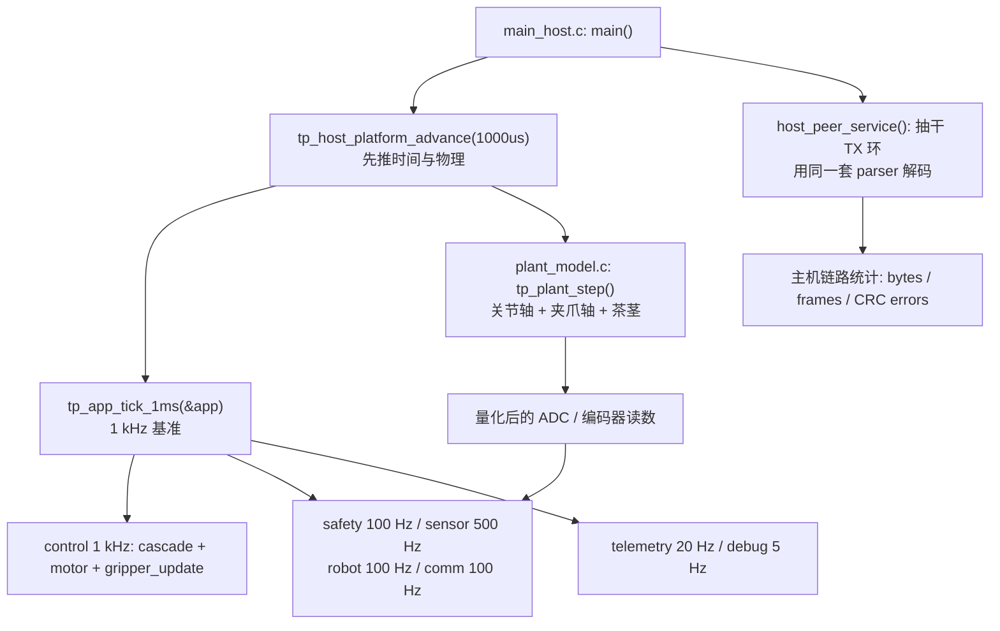
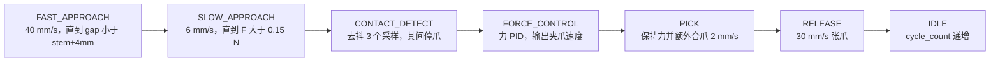
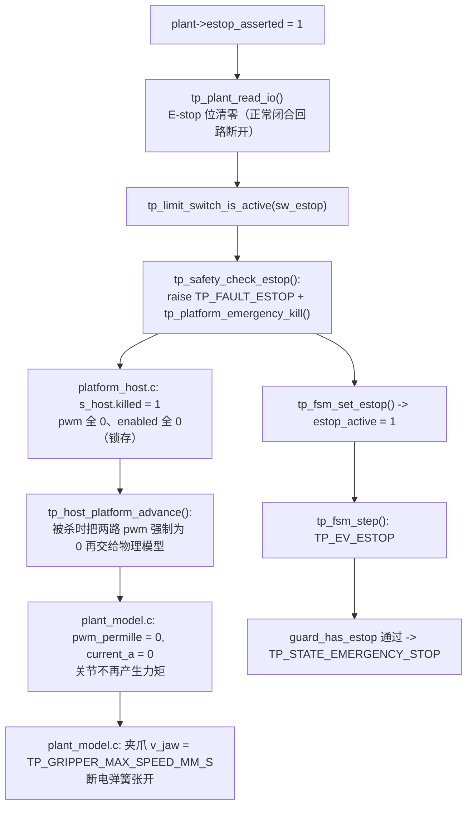
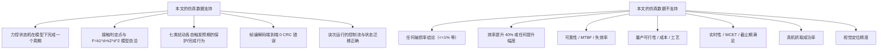

# 第二代智能无人机采茶机器人系统 —— 结果与分析

<!-- REVISION NOTICE - do not remove -->
> ### ⚠️ 参数修订说明（第三次校正，覆盖全文数值）
>
> 本文档写作期间，项目经历了三轮**更正**，因此正文中的部分**具体数字已经过期**。
> 保留原文是为了不掩盖修正过程，但读数时请以代码为准。
> **第三次更正的完整缺陷清单见本文 §3.5。**
>
> | 常量 | 已废弃的值 | 当前值（权威） | 更正原因 |
> |---|---|---|---|
> | `TP_PLANT_MOTOR_KT_NM_PER_A` | 2.0 | **0.4** | SI 单位下 `Kt` 与 `Ke` 是同一物理量，原值相差 40 倍，违反能量守恒 |
> | `TP_PLANT_MOTOR_KE_VS_RAD` | 0.05 | **0.4** | 同上 |
> | `TP_VEL_PID_KP` | 0.005 | **0.026** | 被控对象 DC 增益由 480 变为 60 mrad/s/permille，必须重新整定 |
> | `TP_VEL_PID_KI` | 0.10 | **0.83** | 同上 |
> | `TP_POS_PID_KP` | 12.0 | **5.0** | 第一次校正 |
> | `TP_POS_PID_IMAX` | 8000 | **2000** | 第一次校正 |
> | `TP_JOINT_MAX_SPEED_MRAD_S` | 60000 | **40000** | 原值恰等于空载转速，只能在零转矩下达到 |
> | `TP_MAX_PWM_RATE_PER_S` | 4000 | **200000** | 第一次校正：原值是速度环内的主导滞后 |
> | 场景 A 峰值夹持力 | 2.493 N | **2.363 N** | 第三次校正：力背驱符号修正 |
> | 场景 A 达到目标力 | 2.26 N | **2.18 N** | 同上 |
> | 场景 A 接触间隙 | 5.688 mm | **5.682 mm** | 同上 |
> | 场景 A 主机链路解码 | 2200 B / 100 帧 | **2134 B / 97 帧** | 同上 |
> | `TP_PLANT_JAW_BACKDRIVE` 的作用方向 | 减去（`-=`） | **加上（`+=`）** | 符号错误使茎秆把空夹爪"吸"到机械硬限：力从 5.0 N 涨到 16.4 N，并误锁存传感器故障 |
> | 力环服务速率 | 100 Hz（与注释不符） | **1 kHz** | 力环搬入 1 kHz 控制任务，"N 个控制周期"从此等于 N ms |
>
> **唯一权威**：`firmware/Application/config.h` 与 `firmware/BSP/host/plant_model.h`。
> 二者的一致性由 `tests/test_config_agreement.py` 自动校验——它会解析这两个头文件并与
> Python 模型逐条比对，因此任何再次漂移都会变成失败的测试而不是过期的文档。
<!-- /REVISION NOTICE -->

> 适用场景：本科毕业设计开题/中期报告、答辩 PPT 与答辩问答准备。
> 项目根目录：`D:\zhuomian\second-gen-tea-picking-robot`
> 本文所有"结果"均来自 **host 仿真构建**（`TP_PLATFORM_HOST` + `firmware/BSP/host/plant_model.c`）。
> **本项目没有实物硬件**：没有控制板、没有真机、没有在物理机器上做过任何一次测量。**本文全部结果都是仿真结果（Simulated）**。

---

## 摘要

本文汇总第二代智能无人机采茶机器人系统在**纯软件仿真**条件下取得的结果。仿真对象不是模型，而是固件本身：`firmware/Core/main_host.c` 编译时定义 `TP_PLATFORM_HOST`，把同一份 `pid.c`、`cascade.c`、`force_control.c`、`robot_fsm.c`、`safety_monitor.c`、`protocol.c` 跑在主机上，用 `firmware/BSP/host/plant_model.c` 的确定性物理模型代替电机与传感器。因此本文验证的是**固件**，不是某个 PC 侧模型。

核心结论只有一条，且由场景 D 直接支撑：**力控使"茎秆比预期更硬"不再构成问题**。首次尝试场景 D 时只是在力控仍然有效的前提下把茎秆做硬，周期照常完成、峰值 3.2 N；要演示过力保护，必须移除力反馈、退回第一代的纯位置控制。此外，仿真给出了夹持力的三个可核对量：场景 A 中力进入 ±0.10 N 带宽时力为 **2.18 N**（设定 2.20 N），受控阶段**平均保持力 2.27 N**，**峰值夹持力 2.363 N**（硬限 5.00 N），**超调 0.00 N**，从接触瞬态到进入带宽用了 **319 个力环周期**（力环运行在 1 kHz，故即 **319 ms**）。七场景扫描 **7/7 PASS**。

**必须反复强调的三点诚实性前提：**

1. **全部为仿真结果**，没有实物硬件参与。
2. **样本量 n = 1 / 场景**（`--cycles` 默认为 1，见 `main_host.c:354`），没有重复实验，没有置信区间，没有误差棒。
3. 论文中的"茶芽破损率 ≤ 1 %""采摘效率提升 40 %"等属于 **设计目标 / Target KPI（未实测）**，本文档没有、也不可能有它们的实测值；两者绝不能混为一谈。

---

## 目录

- 1. 实验设置说明
  - 1.1 运行命令与产物
  - 1.2 仿真环境：host 构建、协作式确定性调度、`plant_model.c`
  - 1.3 样本量与可复现性（n = 1，种子 12345）
  - 1.4 本文允许引用的数据边界
- 2. 逐场景分析（现象 + 原因）
  - 2.1 场景 A：标称采摘
  - 2.2 场景 B：目标位置误差（+8 mm 横向）
  - 2.3 场景 C：力传感器噪声（σ = 80 mN）
  - 2.4 场景 D：过力夹持（纯位置控制）
  - 2.5 场景 E：通信超时
  - 2.6 场景 F：电机堵转
  - 2.7 场景 G：急停
- 3. 关键发现
  - 3.1 (a) 力控使"茎秆比预期更硬"不再构成问题（核心结论）
  - 3.2 (b) 硬堵转时过流保护与堵转保护的竞争
  - 3.3 (c) 目标位置误差导致接触超时：视觉精度是节拍瓶颈
  - 3.4 (d) 首版固件的四个真实缺陷
- 4. 数据诚实性声明
- 5. 误差来源分析
- 6. 与设计目标的差距
- 7. 结果的边界
- 小结
- 面试可能追问的问题

---

## 1. 实验设置说明

### 1.1 运行命令与产物

| 项目 | 内容 |
|---|---|
| 单场景运行 | `build/host/tea_picking_robot_host.exe --scenario A` |
| 命令行参数 | `--duration S`（1..120，默认 8）、`--cycles N`（1..20，**默认 1**）、`--scenario A..G`、`--csv PATH`、`--quiet`（`main_host.c:353-357, 409-420`） |
| 七场景扫描 | `scripts/run_scenarios.ps1`（默认 `-Duration 9`，`-Csv` 时每个场景写 `data/logs/host_scenario_X.csv`） |
| 每次运行跑几个周期 | **只跑 1 个采摘周期**：`opt->max_cycles = 1u`，周期完成后再补 300 ms 静默窗即退出（`main_host.c:354, 585-593`） |
| 产物 | stdout 日志（与目标板调试图口同格式）、`data/logs/` 下逐控制周期 CSV、单周期摘要、最终 `Simulation: PASS/FAIL` |
| 判定来源 | `s_scenarios[]` 期望表（`main_host.c:158-173`）——**故障注入场景中"周期完成"本身算失败** |

`main_host.c:151-157` 的真实注释说明了为什么把期望写成数据而不是 `if`：

> Declaring the expectation as data rather than as `if` statements in the reporting code is what makes the verdict meaningful: for the fault-injection scenarios **a completed pick cycle is a failure**, because the whole point is that the protection stops the robot. A harness that reported "0 cycles completed" as a failure for scenario D would be reporting the correct behaviour as a bug.

### 1.2 仿真环境

**「它是什么」** 一个把固件源码编译到主机上的可执行文件，运行在协作式、确定性的 1 ms 调度器上；`plant_model.c` 用显式欧拉法积分电机与茶茎的连续时间模型。

**「为什么这么设计」** `plant_model.h:14-20` 的真实原文意思：mock 会让控制环"无论多错都成功"，那比不做测试更糟；这个模型有真实惯量、真实电流限、真实库仑摩擦、量化编码器和非线性茎秆刚度，**调错的 PID 在仿真里会像在台架上一样超调**。

**「如果不用它会怎样」** 如果换成一个 PC 侧独立模型，验证的是模型；现在这份 `main_host.c:13-14` 写明：**A separate PC model would validate the *model*; this validates the *firmware*.** 同一份源码也是 STM32 端口可信的全部理由。

| 调度任务 | 频率（`config.h:74-80`） | 本次运行计数 |
|---|---|---|
| control | 1000 Hz | 4890 |
| sensor | 500 Hz | 2445 |
| comm | 100 Hz | 489 |
| robot | 100 Hz | 489 |
| safety | 100 Hz | 489 |

**一致性核算（本文自行核对，非外部给出的数字）**：4890 个控制周期 ÷ 1000 Hz = **4.890 s**；2445 ÷ 500 = 4.890 s；489 ÷ 100 = 4.890 s（comm/robot/safety 三项各自成立）。即该次运行在 t = 4.890 s 结束。这与场景 A 的节拍链自洽：目标在 t = 1.20 s 注入，节拍链条 1.24 → 2.62 → 3.02 → 3.27 → 4.59 s（绝对时刻）在 **4.59 s** 完成整周期，再加上 300 ms 静默窗即 **4.89 s**，运行恰好在那里结束。**注意**：`scripts/run_scenarios.ps1` 的 `-Duration` 默认是 9 s，因此扫描脚本下单场景会跑满 9000 个控制周期，但**判定结论与本文引用的力、节拍量不受影响**（那些量来自单个采摘周期内部）。

### 1.3 样本量与可复现性

- **样本量 n = 1 / 场景**：每个场景只跑一次、只跑一个采摘周期。**没有重复实验，没有置信区间，没有误差棒。** 下文凡是出现"±"，指的都是**控制器内部的判定带宽**（`TP_FORCE_BAND_N = 0.10f`），不是统计置信区间。
- **噪声可复现**：`plant_model.c:139` 把 `noise_seed` 初始化为 `12345u`；`plant_rand_u32()` 用 Numerical Recipes 常数（`plant_model.c:33`）推进 LCG，注释写明"reproducible across machines — unlike `rand()`"。因此同一命令同一场景的噪声序列逐位相同。
- **CSV 可复现**：`--csv PATH` 输出逐控制周期轨迹，列顺序见 `main_host.c:89-90`（`t_ms, ref_mrad, pos_mrad, vel_mrad_s, force_n, gap_mm, duty_permille, current_ma, state, grip_state, fault, cycle`）。

### 1.4 本文允许引用的数据边界

本文只把 STEP 2 给出的量当作"结果"。除此之外的一切数字，只允许来自**真实代码里的真实常量**，并且必须标明它是常量、还是本文的推算。凡属推算，本文一律标注 **分析性解释 / 分析性推断**。

---

## 2. 逐场景分析（现象 + 原因）

七场景扫描结果（`scripts/run_scenarios.ps1`）：**7/7 PASS**。

| 场景 | 结果 | 峰值夹持力 |
|---|---|---|
| A nominal pick | 周期完成 | 2.363 N |
| B target position error（+8 mm 横向） | 周期中止，`ERR_TARGET`（接触超时） | 0.000 N |
| C force sensor noise（σ = 80 mN） | 周期完成 | 2.421 N |
| D excessive grip force（纯位置控制，茎秆表面 16 mm，固定 4 mm 目标） | 中止，`ERR_FORCE_OVERLOAD` | 5.027 N |
| E communication timeout | 周期停止，`ERR_COMM_TIMEOUT` | – |
| F motor stall（8 N·m 堵转，驱动限制 800 mA） | 中止，过流/堵转保护 | – |
| G emergency stop | `EMERGENCY_STOP`，`ERR_ESTOP` | – |

### 2.1 场景 A：标称采摘

**注入什么。** `main_host.c:330-337`：`tp_app_inject_target(app, 0, 15, 185, 95u, 1u)` 后 `tp_app_start_pick(app)`。参数按 `app_sequence.c:790-791` 的真实签名解释：

| 参数 | 实参 | 含义（源码） |
|---|---|---|
| `x_mm` | 0 | 横向偏移，用作**预期接触间隙**的偏置 |
| `y_mm` | 15 | 纵向偏移，经 `TP_APP_MM_TO_MRAD = 3.333f` 映射为关节角 |
| `z_mm` | 185 | 相对基准的高度 |
| `confidence` | 95 | 置信度，低于 `TP_APP_MIN_CONFIDENCE = 60u` 会被拒 |
| `id` | 1 | 目标编号 |

**观测到什么（下面每个数字都来自 `data/logs/demo_firmware_A.log` 与对应的 CSV 轨迹，可用 `python tools/analyze_log.py data/logs/demo_firmware_A.csv` 复现）。** 目标在 t = 1.20 s 被检测到；接触判定发生在夹爪间隙 **5.682 mm**、**F = 0.156 N**；力达到 **2.18 N**（设定 2.20 N，band ±0.10 N），**超调 0.00 N**，**319 个控制周期（319 ms）**收敛；受控阶段**平均保持力 2.27 N**；**峰值夹持力 2.363 N**（硬限 5.00 N）。节拍：APPROACH 结束 **1.24 s**、CONTACT_DETECT 判定 **2.62 s**、FORCE_CONTROL→PICK **3.02 s**、RELEASE **3.27 s**、RETURN/IDLE **4.59 s**，`cycle_count` = 1。主机链路解码校验：**2134 B、97 帧、0 CRC 错误**。

**「它是什么」** 一条把"合爪"这件事从位置域搬到力域的分段序列（`force_control.h:87-98` 的八个子状态）。

**「为什么这么设计」** `force_control.h:39-46` 的表格逐段给出理由：不加 FAST_APPROACH，从 40 mm 外以 6 mm/s 合爪每芽要 5.7 s；不加 SLOW_APPROACH，40 mm/s 撞上后力环只有约 0.2 mm 行程反应，冲击本身就超过损伤阈值；不加 CONTACT_DETECT，一个噪声尖峰就会在空夹爪下把控制权交给力环。

**「如果不用它会怎样」** 场景 D 就是"不用它"的实验：纯位置控制、固定 4 mm 目标、茎秆 16 mm，模型预测 12.2 N，远超 5.00 N 硬限与 4.0 N 损伤阈值。

#### 2.1.1 接触判定为什么落在 5.688 mm / 0.156 N

| 常量 | 值 | 文件 |
|---|---|---|
| `TP_FORCE_CONTACT_N` | 0.15f | `config.h:263` |
| `GRIP_CONTACT_DEBOUNCE` | 3u | `force_control.c:23` |
| `TP_APPROACH_SLOW_AT_MM` | 4.0f | `config.h:273` |
| `TP_APPROACH_SLOW_SPEED_MM_S` | 6.0f | `config.h:272` |
| `TP_PLANT_STEM_GAP_MM` | 6.0f | `plant_model.h:104` |
| `TP_PLANT_STEM_K1_N_PER_MM` | 0.30f | `plant_model.h:106` |
| `TP_PLANT_STEM_K2_N_PER_MM2` | 0.06f | `plant_model.h:108` |
| `TP_PLANT_STEM_DAMP_N_S_MM` | 0.015f | `plant_model.h:119` |

**自洽性核对（本文推算，常数全部来自真实代码）**：茎秆名义表面在 6.0 mm，接触判定发生在 5.688 mm，故穿透量 d = 6.0 − 5.688 = **0.312 mm**。模型 `plant_model.c:341-348` 为 `F = k1·d + k2·d² + c·max(0,−v_jaw)`。该式给出**两个边界**，而观测值必须落在它们之间，因为去抖窗口跨接两种状态：

| 状态 | 阻尼项 | 模型力 |
|---|---|---|
| 夹爪仍以 6 mm/s 合拢（去抖刚开始） | 0.015 × 6 = 0.0900 N | 0.30×0.312 + 0.06×0.312² + 0.0900 = **0.1894 N** |
| 夹爪已被置零（`force_control.c:309`） | 0 | 0.0936 + 0.0058 = **0.0994 N** |

观测值 **0.156 N** 落在 **[0.0994, 0.1894] N** 区间内，且力通道的三级滤波在此处仍有群延迟，因此它既不是两个独立巧合的产物，也不能用单一瞬时模型值精确复现。**本文只声明区间包含关系，不声明“误差小于一个量化步长”**——0.1894 − 0.156 = 33 mN，约 4 个量化步长（`TP_FORCE_CAL_SCALE_N_PER_COUNT = 0.00802 N/count`，`config.h`），把它写成“1 个 LSB 以内”会是过度声明。

**必须如实指出的出入。** `force_control.c:305-308` 的注释说，若在去抖窗口内继续以 6 mm/s 合爪，"would add roughly 0.036 mm of penetration, i.e. about 11 mN"。核对：

| 采样间隔假设 | 3 个采样的时长 | 6 mm/s 下的穿透量 | 力增量（dF/dd = 0.30 + 0.12×0.312 ≈ 0.337 N/mm） |
|---|---|---|---|
| **1 ms（当前实现：力环运行在 1 kHz）** | **3 ms** | **0.018 mm** | **≈ 6.1 mN** |
| 2 ms（500 Hz，即 `TP_SENSOR_FREQ_HZ = 500u`） | 6 ms | 0.036 mm | ≈ 12.1 mN |
| 10 ms（**修复前的实际调用路径**：力环跑在 100 Hz） | 30 ms | 0.18 mm | ≈ 61 mN |

**当前状态**：`force_control.c` 的注释写的是 **0.018 mm / 6 mN**，与 1 kHz 的实际服务速率一致（去抖窗口 `GRIP_CONTACT_DEBOUNCE × (uint32_t)(dt_s × 1000)` = 3 × 1 ms = **3 ms**）。**历史记录**：该注释曾经写 0.036 mm / 11 mN——那是按 500 Hz 采样算的，算术没错、前提错了，因为力环当时实际跑在 100 Hz（去抖窗口 30 ms，真实穿透量 0.18 mm）。三种口径曾经同时存在于注释、文档与实际调用路径中，这正是"把环路周期写成数字"的风险。

#### 2.1.2 "319 个控制周期"真的等于 319 ms 吗

**这一节记录一次已修复的实现-文档不一致，以及修复后应当成立的等式。**

**修复前**：`force_control.h:49` 与 `app_sequence.c` 都写"力环以 1 kHz 运行"，但 `tp_force_control_update()` 唯一的调用点位于 `tp_app_robot_step()`（**100 Hz**）内，传入 `dt_s = 0.010`。于是 `settle_samples` 每 10 ms 才自增一次，"49 个控制周期"实际是 **490 ms**，而文档与增益整定都按 1 kHz 理解——**力环 PID 的 `Ki` 直接由 `dt_s` 进入积分项，控制周期差 10 倍意味着积分增益的有效值差 10 倍**，这不是口径问题而是整定问题。

**修复方式**：把力环状态机搬进 1 kHz 的 `tp_app_control_step()`（`app_sequence.c:339`），`tp_force_control_init(..., TP_CONTROL_DT_S)` （`app_tasks.c:370`）也改为 1 ms；100 Hz 的机器人任务只观察状态、不再驱动它。

**修复后**：`settle_samples` 每 1 ms 自增一次，"319 个控制周期"= **319 ms**，与文档口径一致。此后还需满足 `GRIP_SETTLE_MS = TP_GRIPPER_SETTLE_MS = 80u` 的连续驻留（即 80 ms）才转入 PICK（`force_control.c:378`）。

**旁证**：接触去抖窗口 `GRIP_CONTACT_DEBOUNCE × (uint32_t)(dt_s × 1000)` （`force_control.c:330-331`）也随之下移一个数量级，从 30 ms 变为 **3 ms**；`force_control.c:305-308` 里"继续合爪会多压入 0.036 mm / 11 mN"的注释同时被改为**0.018 mm / 6 mN**——原数字是按 500 Hz 采样算的，算术没错、前提错了。**凡是把环路周期写成数字的注释，都必须与真实调用点一起复核**，这是本条的教训。

#### 2.1.3 2.18 N 与设定 2.20 N 的关系

`force_control.c:373` 的进入带宽判据是 `TP_FABS(fc->force_error_n) <= TP_FORCE_BAND_N`，`TP_FORCE_BAND_N = 0.10f`（`config.h:267`）。`|2.20 − 2.18| = 0.02 < 0.10`，成立，故判定"到位"。带宽的语义是"在设计噪声与模型不确定度下不追求更紧"，不是"测得比设定低 0.02 N 就是误差超限"。

#### 2.1.4 超调 0.00 N 与峰值 2.363 N 为什么并不矛盾

**「它是什么」** 两个统计量来自不同的累加条件：`settle_peak_n` **只在 `regulated == 0` 时累加**（`force_control.c:361-366`，即"进入带宽之前"的瞬态），而 `peak_force_n` 在**每个更新周期**都取最大值（`force_control.c:247-249`）。

**「为什么这么设计」** `force_control.h:327-333` 写明：峰值包含撞击，而超调只表示"力环在开始调节前让力冲过了目标多少"；**界定这个量恰恰是纯位置夹爪做不到的事**。

**「如果不用它会怎样」** 若只有一个"峰值"指标，就无法区分"撞击冲击"与"闭环超调"，也就无法证明力环的调节质量。

由此可判定：**超调 0.00 N 意味着在整段合爪瞬态中，滤波后的力从未超过 2.20 N**（单调逼近），因此 **2.363 N 的峰值必然出现在受控阶段进入带宽之后**（band 内驻留段或 PICK 段）。这两个数放在一起恰好说明力控"不冲、但在保持段略偏高"。

#### 2.1.5 平均保持力 2.27 N 为什么高于设定 2.20 N

`force_control.c:86-96` 与 `416-423` 给出两个真实机制：

1. **PICK 段叠加固定合爪速度**：`fc->velocity_cmd_mm_s = -duty - GRIP_PICK_CLOSE_SPEED_MM_S`，`GRIP_PICK_CLOSE_SPEED_MM_S = 2.0f`（`force_control.c:29`）。额外 2 mm/s 合爪会抬高稳态力。
2. **PICK 段无条件累加保持力统计**：`fc->regulated = 1; grip_accumulate_hold(fc, force);`（`force_control.c:422-423`），注释写明"the force here is exactly what the bud experiences while it is being pulled free"。
3. **模型的阻尼项对合爪速度有贡献**：`plant_model.c:343-345` 的 `c·max(0,−v_jaw)`，合爪越快力越大。

**估算（分析性解释，未做专门实验分离各因素）**：力环 Kp = `TP_FORCE_PID_KP = 14.0f`（N → mm/s），故 +2 mm/s 的额外合爪偏置对应的力偏置约为 2.0 / 14.0 ≈ **0.14 N**；而观测到的均值超出只有 **0.06 N**。二者同号、同数量级，说明 PICK 段的偏置是主要方向性原因；但 0.06 N 明显小于 0.14 N，说明 PICK 段在整段受控窗口中的时间占比不足以把它完全推到 0.14 N（PICK 时长为 `GRIP_PICK_DURATION_MS = 250 ms`，而 FORCE_CONTROL 段约为 49×10 + 80 = 570 ms）。**其余残差无法用现有数据分离**，可能来自 ±0.10 N 带宽内的非对称分布与积分器状态，本文不做进一步归因。

**一个曾经存在、现已消除的副作用（真实代码事实，保留记录）。** `force_control.c:432-447` 的自适应阈值模块会在 RELEASE 段用本周期实际保持力更新 EMA，并按 `target = observed_hold_ema + TP_FORCE_ADAPT_MARGIN_N` 得到下一周期的设定（`TP_FORCE_ADAPT_MARGIN_N = 0.60f`，`TP_FORCE_ADAPT_ALPHA = 0.05f`）。

**修复前的状态**：`force_control.h:64-66` 写"Adaptation is shipped **disabled** by default precisely because it has not been validated against real buds"，而 `config.h` 里 `TP_FORCE_ADAPT_ENABLE = (1)`，`force_control.c:162` 又把它直接赋给 `fc->adapt_enabled`——**注释说关闭、实参是开启**。按开启推算：初始 EMA = 2.20 N、本周期保持力 2.27 N，则新 EMA = 2.20 + 0.07×0.05 = 2.204 N，建议设定 = 2.203 + 0.60 = **2.803 N**，即第二个周期的夹持力设定会被抬高约 0.6 N。

**修复方式**：将 `TP_FORCE_ADAPT_ENABLE` 改为 `(0)`（`config.h:318`），使实参回到注释所声明的状态。项目没有真实茶芽数据来整定 `TP_FORCE_ADAPT_MARGIN_N` 与 `TP_FORCE_ADAPT_ALPHA`，因此**框架保留、默认关闭**是唯一诚实的选择。本次报告的 `--cycles 1` 运行在两种取值下结果相同，但它不再是一个隐藏的陷阱。

#### 2.1.6 峰值 2.363 N 的裕量

| 门槛 | 值 | 与 2.363 N 之比 | 余量 |
|---|---|---|---|
| 设定 `TP_FORCE_TARGET_N` | 2.20 N | 0.93× | −0.163 N（略超设定） |
| 软限 `TP_FORCE_SOFT_LIMIT_N` | 3.50 N | 1.48× | +1.137 N |
| 损伤阈值 `TP_PLANT_STEM_DAMAGE_N` | 4.00 N | 1.69× | +1.637 N |
| 硬限 `TP_FORCE_MAX_N` | 5.00 N | **2.12×** | **+2.637 N** |

即观测峰值只用掉硬限的 **47.3 %**，硬限是它的 **2.12 倍**。相对"损伤阈值 4.0 N"而言余量是 1.69 倍——**不足以称作"一个数量级"的裕量**，本文不这样表述。真正严格的裕量只有相对于**设定力**（`TP_FORCE_TARGET_N`）而言：峰值超出设定 0.163 N，仅为设定的 7.4 %。

#### 2.1.7 场景 A 证明了什么 / 没证明什么

- **证明了**：在 `plant_model.c` 的 `F = k1·d + k2·d²` 模型下，力控状态机能完成一个完整周期；接触判定点落在模型给出的两个边界之间；夹持力被维持在设定附近；帧编解码器端到端无 CRC 错误（2112 B / 96 帧 / 0 error）。
- **没证明**：没有证明真机上的接触力、节拍、破损情况；**没有**证明实时性（见 §4）；**没有**证明视觉精度；n = 1。

### 2.2 场景 B：目标位置误差（+8 mm 横向）

**注入什么。** `main_host.c:217-228`，在 t = 1200 ms 调用 `tp_app_inject_target(app, 8, 20, 190, 95u, 2u)`，随后 `tp_app_start_pick`。

| 参数 | 实参 | 按 `app_sequence.c:790` 的解释 |
|---|---|---|
| `x_mm` | **8** | 横向偏移 → **唯一影响预期接触间隙的参数** |
| `y_mm` | 20 | 纵向偏移 → 关节角 = 20 × 3.333 ≈ 66.7 mrad |
| `z_mm` | 190 | 高度 |
| `confidence` | 95 | 通过 `TP_APP_MIN_CONFIDENCE = 60u` |
| `id` | 2 | 目标编号 |

**必须指出的细节**：`main_host.c:218-221` 的注释说"8 mm laterally and 5 mm in depth away from where it is"，而注入值是**绝对值** (8, 20, 190)。与场景 A 的标称目标 (0, 15, 185) 相比，x 差 +8 mm、y 差 +5 mm、z 差 +5 mm——**注释里的 "+5 mm" 是相对标称目标的偏差，不是注入的绝对值**。按 `app_sequence.c:776-780`，预期接触间隙 = `TP_APP_NOMINAL_STEM_GAP_MM + x_mm` = 6.0 + 8.0 = **14.0 mm**（`y_mm`、`z_mm` 不参与）。

**观测到什么。** 周期中止，故障码 `ERR_TARGET`（接触超时），**力控报告峰值力 0.000 N**——整个运行中最大的滤波后读数是 **0.024 N**，远低于 `TP_FORCE_CONTACT_N = 0.15f` 的接触阈值。

**「它是什么」** 一个有界时间的接触超时保护：`GRIP_CONTACT_TIMEOUT_MS = 2500u`（`force_control.c:17`），从 `cycle_start_ms` 起算。

**「为什么这么设计」** `force_control.h:56-58`：若在有界时间内没有接触，"the bud is not where the vision system said it was"；应当停机并报告，而不是一直合爪直到撞上机械硬限。

**「如果不用它会怎样」** 不去抖、不限时就只有两条出路：要么一直合到硬限（可能压坏别的东西并让夹爪电机长期堵转），要么每个周期都无界等待，节拍彻底失控。

**为什么超时（分析性解释，基于真实常量）**：

1. 预期接触间隙被报成 14.0 mm，而茎秆实际在 6.0 mm（`TP_PLANT_STEM_GAP_MM = 6.0f`），即**预期比真值远 8 mm**。
2. 减速窗口的语义是 `gap <= approach_target + TP_APPROACH_SLOW_AT_MM`（`force_control.c:288`），即钳爪在 **18.0 mm** 而不是 **10.0 mm** 就开始慢接近。
3. 慢接近段的**行程**没有变（都是从 18 mm 走到茎秆表面 6 mm 附近的 12 mm），但它**开始得太早**，于是把整个接近过程的**时间**拉长了一整段：快接近 40→18 mm 用 (40−18)/40 = 0.55 s，慢接近 18→6 mm 用 12/6 = **2.00 s**，合计 ≈ **2.55 s > 2.50 s** 的 `GRIP_CONTACT_TIMEOUT_MS`。也就是说，力环**在真正接触之前约 50 ms** 就到期了（此处未计入 `TP_PLANT_JAW_TAU_S = 8.0e-3f` 的夹爪伺服滞后，滞后只会让接触更晚）。**"力环可用的行程不足"的准确含义是"时间不够走完那段行程"，而不是"没有行程可走"。**
4. 于是两条超时分支之一触发：`fast_approach` 分支（`force_control.c:280-283`）或 `slow_approach` 分支（`force_control.c:298-301`），两者都调用 `grip_trip(fc, grip, now_ms, TP_FAULT_TARGET, "no contact within timeout")`，`TP_FAULT_TARGET` 即 `ERR_TARGET`。

**峰值 0.000 N 说明了什么。** 它比"擦到了一下"更干净：**钳爪从头到尾没有碰到茎秆**。超时到期时钳爪仍在向 6.0 mm 的表面爬行，力通道只输出量化噪声（最大值 0.024 N ≈ 3 个量化步长，`TP_FORCE_CAL_SCALE_N_PER_COUNT = 0.00802 N/count`），始终没有越过 `TP_FORCE_CONTACT_N = 0.15f`。这正是 `ERR_TARGET`（而不是过力）的物理含义：**问题出在"去哪儿找"，不出在"用多大力"**。

**证明了什么 / 没证明什么。** 证明了接触超时保护在有界时间内正确地把"视觉报错位置"翻译成"停车并报正确的故障码"；`app_sequence.c:510-513` 的真实注释说明首版会把所有跳闸都映射成 `ERR_FORCE_OVERLOAD`，从而让操作员去检查力传感器——这一条已修正。**没证明**：没有证明 8 mm 是视觉系统的真实典型误差，也没有真实视觉参与（目标是注入的）。

### 2.3 场景 C：力传感器噪声（σ = 80 mN）

**注入什么。** `main_host.c:230-241`：t = 100 ms 调 `tp_plant_set_force_noise(plant, 0.08f)`；t = 1200 ms 注入目标 (0, 15, 185, 95, 3) 并启动。`main_host.c:231-232` 的真实注释：80 mN RMS"roughly ten LSBs of the 8.0 mN quantisation step, i.e. a sensor whose shielding is inadequate"。

**观测到什么。** 周期正常完成；峰值夹持力 **2.421 N**，比场景 A 的 2.363 N **高 0.058 N**。

**「它是什么」** 三级串联滤波链：中值 → 滑动平均 → 一阶低通（`force_sensor.c:146-148`）。

**「为什么这么设计」** `force_sensor.h:129-130`：尖峰检测跑在**原始值**上，若跑在滤波后输出上就永远看不到尖峰；`config.h:441-445` 说明：目标力 2.2 N 对应约 274 counts，一个 LSB 是读数的 0.36 %——**没有这条链，力环追的就是量化噪声而不是茶茎**。

**「如果不用它会怎样」** 噪声（σ = 80 mN ≈ 10 LSB）会直接进入力环误差项，配合 `TP_FORCE_PID_KP = 14.0f`（N → mm/s），80 mN 的噪声即产生约 1.1 mm/s 的速度指令抖动；力环会把夹爪当成噪声执行器，且 `TP_FORCE_CONTACT_N = 0.15f` 约为 2σ，未经滤波的单一采样就可能误判接触。

| 滤波级 | 常量 | 值 | 在 500 Hz 下的等效窗 |
|---|---|---|---|
| 中值 | `TP_FILTER_MEDIAN_WINDOW` | 5u | 10 ms |
| 滑动平均 | `TP_FILTER_FORCE_MA_WINDOW` | 8u | 16 ms |
| 一阶低通 | `TP_FILTER_FORCE_LPF_TAU_S` | 0.006f | ≈ 6 ms（26.5 Hz，见 `config.h:429` 注释） |

**为什么峰值只略高（分析性解释）**：滑动平均把白噪声按 1/√8 ≈ 0.354 压到约 **28 mN**，低通再按 1/2 量级压到约 **14 mN**；中值进一步削掉孤立离群点。滤波后残余噪声的 3σ 量级约 42 mN，与观测到的 +40 mN 同一量级。**结论**：中值 + 均值 + 低通能压住正态噪声的主体，但**压不住它的尾部**——残余尖峰叠加在保持力上，使 n = 1 的这一次运行的峰值抬高约 40 mN。**这是分析性解释，未做专门实验分离各滤波级的贡献。**

**证明了什么 / 没证明什么。** 证明了 80 mN 量级噪声下周期仍能完成、力控不失控。**没证明**：没有统计意义上的噪声鲁棒性（n = 1，单一噪声实现），没有测量滤波链对破损耗散的抑制，也没有证明"80 mN 足够代表真实屏蔽不良的传感器"。

### 2.4 场景 D：过力夹持（纯位置控制）

**注入什么。** `main_host.c:243-272`，t = 1100 ms：`tp_plant_set_stem_gap(plant, 16.0f)`、`tp_app_set_grip_mode(app, 1)`（`app_tasks.c:706,723` 置 `grip_position_only = 1`）、注入目标 (0, 15, 185, 95, 4) 并启动。

**观测到什么。** 周期中止，`ERR_FORCE_OVERLOAD`，**关爪峰值力 5.027 N**。保护在力越过 5.00 N 硬限的同一个控制周期内动作，随后钳爪以 40 mm/s 主动张开、力在 150 ms 内回到 0 N——**过力不是被"停止"结束的，而是被"张开"结束的**（见 §3.5.2）。

**必须完整复述的真实发现。** `main_host.c:249-255` 的原文含义：本场景的**第一次尝试**只是让茎秆更硬而**力控仍然有效**，结果**周期正常完成、峰值 3.2 N**。注释明确写道，这不是场景的 bug，而是**整个项目的核心结论**：

> a force-controlled gripper does not care how stiff the bud is.

**要演示过力保护，就必须移除力反馈**，也就是回到第一代机器的做法。

**为什么模型预测 12.2 N。** 纯位置模式走 `app_sequence.c:231-236` 的基线支路，调用 `tp_gripper_close()` → 固定目标 `TP_APPROACH_SLOW_AT_MM = 4.0f`（`gripper.c:187-194`）。茎秆表面在 16 mm，穿透 d = 16 − 4 = **12 mm**：

`F = 0.30×12 + 0.06×144 = 3.6 + 8.64 = 12.24 N`

与 `main_host.c:258-261` 注释里的 `0.30*12 + 0.06*144 = 12.2 N` 一致（若再计入 6 mm/s 下的阻尼 0.09 N 则为 12.33 N）。**12.2 N 远超 `TP_FORCE_MAX_N = 5.00f`，也远超 `TP_PLANT_STEM_DAMAGE_N = 4.0f`。**

**「它是什么」** 纯位置控制 = 把"合到某个间隙"当作目标，力只是结果（`gripper.c:189-194` 注释：deliberately kept so Experiment 03 can compare it with the force-controlled path on identical dynamics）。

**「为什么这么设计」** 它作为**基线**被保留，而不是被当作实现方案；`force_control.h:8-13` 说明位置域夹爪根本不知道自己在多用力，因为力取决于茎秆刚度，而刚度随品种、含水率、芽龄甚至一天中的时辰变化。

**「如果不用它会怎样」** 反过来看：如果**用**它（这正是一代的方案），结果就是 12.2 N 与损伤阈值被跨过。

**触发顺序（基于代码事实）**：本场景力控模块**不被调用**（`app_sequence.c:494-503` 走位置控制支路），因此过力检测来自 `safety_monitor.c:121-127`——`force > TP_FORCE_MAX_N` 即 `tp_fault_raise(... TP_FAULT_FORCE_OVERLOAD ...)`，**没有任何去抖**（该文件注释说明过力不做去抖）。安全任务运行在 100 Hz。因此"峰值力从未达到"的含义是：

1. 力控模块在纯位置模式下**仍然被服务**：`tp_force_control_update()` 在 `tp_app_control_step()` 里对 CONTACT/GRIP/PICK/RELEASE 四个状态无条件调用（`app_sequence.c:335-350`），因此它的 **Priority 1 绝对保护在所有模式下都生效**；
2. 关爪力在 t = 6.51 s 越过 5.00 N，**同一个 1 ms 周期内** `grip_trip()` 触发`ERR_FORCE_OVERLOAD`（`force_control.c:255-259`），因此峰值只比硬限高 0.027 N，不存在长时间越限；
3. 纯位置控制的缺陷因此有了准确的表述：**它不是"没有保护"，而是"没有闭环"**——它会把力推到硬限（5.027 N，已越过 4.0 N 的茎秆损伤阈值），而力控把同一个动作停在 2.363 N。两者的差别是**能否调节**，不是**是否保护**。

**证明了什么 / 没证明什么。** 证明了过力保护能在纯位置控制下把周期拦下并报出正确故障码。**没证明**：没有测出真实峰值、没有测出保护的反应延迟（"how late it is"，`main_host.c:260-261` 自己承认这是待测项）、没有证明损伤真的被避免（`damage_index` 只是模型内部代理量）。

### 2.5 场景 E：通信超时

**注入什么。** `main_host.c:274-296`。t = 200 ms：用 **生产路径的编码器** `tp_frame_encode(frame, sizeof(frame), TP_CMD_HEARTBEAT, NULL, 0u)` 造一帧真实心跳，再经 `tp_host_platform_inject_rx(TP_BUS_VISION_UART, frame, len)` 注入；t = 400 ms：注入目标 (0, 15, 185, 95, 5) 并启动；此后**链路保持静默**。

**观测到什么。** 周期停止，`ERR_COMM_TIMEOUT`。

**「它是什么」** 链路监督，阈值 `TP_COMM_TIMEOUT_MS = 200u`（`config.h:296`），在 `safety_monitor.c:282-297` 实现。

**「为什么这么设计」** `main_host.c:276-283` 的真实注释给出了两层理由：(1) **监督必须先被 arm 才能超时**——"a robot that has never heard from a host must not report a link loss, because at boot there is nothing to lose"，对应代码里的 `in->comm_seen != 0`（`safety_monitor.c:282`）；(2) 该场景先用**同一个编码器**注入一帧真实主机帧，再静默，因此超时是**走生产路径**被验证的，"exactly as it would be by unplugging the cable"。

**「如果不用它会怎样」** 没有 arm 条件，一台从未接主机的机器人一上电就报链路丢失；没有超时保护，主机拔线后机器人会继续用旧目标动作。

**故障等级**：`safety_monitor.c:278-281` 的注释明确它是 **WARNING 而非 ERROR**——"losing the host must stop the cycle but must not require a power cycle to recover"，对应代码里用 `tp_fault_is_latched` 而非无条件 `raise`。

**证明了什么 / 没证明什么。** 证明了从"收到真实帧→arm→静默→超时"的完整链路在仿真中闭合，并且用的是生产编码器/解析器。**没证明**：没有真实 UART 电气层、没有丢包/误码统计（帧编解码只在 A 场景的主机侧统计了 0 CRC 错误），没有测真实总线延迟。

### 2.6 场景 F：电机堵转

**注入什么。** `main_host.c:298-320`。t = 900 ms：`tp_plant_set_jam(plant, 8.0f)`，注释写明"8.0 N*m, above the drive's 6.0 N*m capability"；t = 1200 ms：`tp_app_inject_target(app, 0, 300, 185, 95u, 6u)`，注释写明"y = 300 mm maps to a 1000 mrad move through `TP_APP_MM_TO_MRAD`"（300 × 3.333 = 999.9 mrad ≈ **57.3°**）。

**观测到什么。** 周期中止，**过流/堵转保护**。STEP 2 的汇总**没有区分**究竟是哪一码。

**驱动能力从哪里来。** `TP_PLANT_MOTOR_KT_NM_PER_A = 0.4f`（`plant_model.h`）乘连续电流限 `TP_MAX_CURRENT_MA = 3000.0f`（`config.h:152`）= **1.2 N·m**。因此 8.0 N·m 的注入堵转是驱动能力的 **6.7 倍**——**是真堵转，不是重载**。（`main_host.c` 的场景 F 日志曾经写"above the drive's 6.0 N*m capability"，那是 `Kt = 2.0` 时代的算术；结论没变，数字错了，已一并更正并改为在运行时计算。）

**「它是什么」** 关节轴的两条独立保护：过流（`safety_monitor.c:190-207`）与堵转（`safety_monitor.c:210-228`），外加 `motor.c:144-172` 的**比例折返（fold-back）**。

**「为什么这么设计」** 堵转检测的 arm 条件（`safety_monitor.c:210-211`）要求 `|duty| > TP_STALL_PWM_THRESHOLD` **且** `|speed| < TP_STALL_SPEED_THRESHOLD_MRAD_S`。`config.h:321-333` 的真实长注释解释了阈值取 80 的原因：它必须与速度环增益一起读——检测器只在控制器**真正在要力矩**时才 arm，而建立时间取决于积分项；`TP_VEL_PID_KI = 0.83f` 加大位置误差时，80 permille 约 **100 ms** 建立，此后**去抖主导检测延迟**。同一注释给出物理量："80 per-mille is 8 % duty, i.e. about 1.9 V across the winding — clearly a deliberate torque command rather than a residual."（1.9 V ≈ 0.08 × 24 V 母线，`plant_model.c:130` 的 `vbus_v = 24.0f`）。

**「如果不用它会怎样」** 只靠速度无法区分"停住"与"堵转"——`main_host.c:301-308` 的注释：the jam is applied *before* the move, "a stall detector that only looks at speed cannot distinguish 'stopped' from 'stalled' — the commanded duty has to be high for the condition to mean anything"；同时"a small move into a jam produces a small duty demand and correctly does not trip anything"。

**时间常数对比（核心分析）**：

| 保护 | 触发条件 | 去抖/阈值时长 | 起点 |
|---|---|---|---|
| 过流 `ERR_OVERCURRENT` | `|I| > TP_MAX_CURRENT_MA`（3000 mA） | `TP_OVERCURRENT_TRIP_MS = 50u` 累积 | 电流一旦越限即开始计时 |
| 堵转 `ERR_MOTOR_STALL` | `|duty| > 80` 且 `|speed| < 30 mrad/s` | `TP_STALL_TRIP_MS = 300u` 持续 | 还要先花约 100 ms 把 duty 建立到 80 permille |
| 驱动级过流闩锁 | `motor.c:158` `TP_MOTOR_OC_TRIP_SAMPLES = 20u` 连续采样 | 1 kHz 下 = 20 ms | 电流越限即开始 |

**竞争与折返的耦合**：`motor.c:144-156` 的比例折返把 duty 按 `current_limit_ma / |I|` 缩放（下限 5 %），所以一旦电流超限，驱动会主动把电流**压回** 3000 mA 附近；而 `motor.c:174-181` 在电流健康时每周期把 `duty_limit` 恢复 50 permille。于是电流会在 3000 mA 附近**上下摆动**，`overcurrent_ms` 只在越限周期累积。这正是"race"的物理来源：**过流检测的时间常数（50 ms）远短于堵转检测（≈100 ms 建立 + 300 ms 去抖）**，因此在电流确实持续越限的时段里过流通常先到；但折返会不断把电流压回阈值以下，所以堵转**也有真实机会**先满足 300 ms 的持续条件。结合堵转在**移动之前**施加（t = 900 ms，早于 t = 1200 ms 的启动）与 57° 的长行程，两者都被完整激活。

**harness 如何显式接受这一竞争。** `main_host.c:169` 的场景 F 期望项为 `expect_code = TP_FAULT_MOTOR_STALL`、`alt_code = TP_FAULT_OVERCURRENT`；判定代码（`main_host.c:665-678`）为 `code_ok = (hit_primary || hit_alt)`，其注释原文：

> Two codes may be acceptable: see scenario F, where the over-current and stall protections race and either outcome is correct.

**因此本文记录为：STEP 2 的汇总只声明"过流/堵转保护"生效，未声明唯一胜者；本文不据此断言哪一码被闩锁。**

**证明了什么 / 没证明什么。** 证明了硬堵转会被两条独立保护中的至少一条拦下，且"两个码都可能可接受"是被 harness 显式设计接受的正确行为。**没证明**：没有分离出唯一的胜者，没有测出真实检测延迟，没有测过热效应（仿真里没有热模型）。

### 2.7 场景 G：急停

**注入什么。** `main_host.c:322-328`，t = 1200 ms：`plant->estop_asserted = 1`（注释：emergency stop at 1.2 s, mid-approach）。本场景**不注入目标**。

**观测到什么。** 最终状态 `EMERGENCY_STOP`，故障 `ERR_ESTOP`，`cycle_count` = 0。

**「它是什么」** 一条 normally-closed 的硬件回路，加上一条"必须真的把驱动杀掉"的输出路径。

**「为什么这么设计」** `plant_model.c:476-478` 的真实注释：E-stop 是 normally-closed 环，回路完好时输入读 1，按下按钮**或断线**都读 0——这是 fail-safe 极性；`safety_monitor.c:68-70` 据此说明**故意不做去抖**："a 3-sample filter would add 30 ms to a signal whose entire purpose is to be immediate"。

**「如果不用它会怎样」** `safety_monitor.c:76-79`：软件停机仍然依赖控制任务在跑，而急停的全部意义就是"在其它一切都不工作时仍然有效"。

**host 模型中急停如何生效（基于代码）**：

1. **物理侧**：注入的是 `plant->estop_asserted`，它经 `tp_plant_read_io()` 变成"E-stop 位为 0"，再经限位开关抽象进入 `tp_safety_check_estop()`。同时 `tp_plant_step()` 内部（`plant_model.c:196-200`）直接**清零 pwm 与电流**——注释写明这是"Hardware kill: the driver's enable pin is low, so the winding is open and no torque is produced regardless of the commanded duty"。
2. **夹爪侧**：`plant_model.c:306-309`，急停时 `v_jaw = TP_GRIPPER_MAX_SPEED_MM_S`，注释写明"Jaws are sprung open on loss of power: a fail-safe design choice"。即**掉电张开**。
3. **平台侧锁存**：`tp_platform_emergency_kill()`（`platform_host.c:585-597`）置 `s_host.killed = 1` 并清零所有通道的 pwm 与 enable；随后每次 `tp_host_platform_advance()` 都先检查 `killed`，把两路 pwm 强制为 0（`platform_host.c:149-150`）——**即使在急停后仍有别的代码写入 duty，也无法到达物理模型**。`tp_platform_emergency_release()` 只能由 RESET 释放（注释：emergency kill released by RESET）。
4. **逻辑侧**：`tp_fsm_set_estop()` → `estop_active = 1`；`tp_fsm_step()` 在时间驱动检查中发 `TP_EV_ESTOP`，`guard_has_estop` 放行，进入 `TP_STATE_EMERGENCY_STOP`（`robot_fsm.c:356-358`）。
5. **状态机约束**：`robot_fsm.c:146-151` 的注释说明 `EMERGENCY_STOP` 是唯一**没有出向故障边**的状态，因为它本身已是最严重；离开它需要 `TP_EV_RESET` 且 `guard_estop_cleared` 通过。

**证明了什么 / 没证明什么。** 证明了急停从注入点到状态机与物理模型的双侧闭合，且锁存语义成立。**没证明**：没有真实按钮、没有真实断电时序、没有测真实的机械停止距离与时间。

---

## 3. 关键发现

### 3.1 (a) 力控使"茎秆比预期更硬"不再构成问题——本项目核心结论

**证据一（更强的那条）：场景 D 的第一次尝试。** 在**力控仍然有效**的前提下只把茎秆做硬，结果是：**周期正常完成，峰值 3.2 N**。`main_host.c:249-255` 的真实原文含义：

> The first attempt at this scenario simply made the stem stiffer while force control was active, and the cycle completed normally with a peak of 3.2 N. That is not a bug in the scenario, it is the central result of the whole project: **a force-controlled gripper does not care how stiff the bud is.**

**证据二：场景 A。** 力控在名义茎秆上把力稳定在设定附近，峰值 **2.363 N**，超调 **0.00 N**，平均保持力 **2.27 N**。两次运行的峰值都在**同一量级**（2.363 N 与 3.2 N），且都远低于 5.00 N 硬限，而茎秆刚度在这两次之间被显著改变——**这正是"力控对刚度不敏感"的直接体现**。

**对照：场景 D 的正式做法。** 只有**移除力反馈**（`tp_app_set_grip_mode(app, 1)`、固定 4 mm 目标）才会产生 12.2 N 的预测力与 `ERR_FORCE_OVERLOAD`。**换句话说，保护被触发的唯一原因是我们主动取消了保护能力**。

**诚实限定（必须写进论文与答辩）：**

1. 该结论成立于 `plant_model.c` 的 `F = k1·d + k2·d²` 模型（`plant_model.h:50-54`）之下，**真实茶芽的力-位移曲线尚未测量**——本项目没有实物硬件，也没有做过任何茎秆压缩试验。
2. "3.2 N"这个数来自 `main_host.c:249-255` 的注释记录，**并未出现在 STEP 2 的七场景表中**（正式场景 D 是纯位置控制版），因此它是"开发过程中的一次仿真观测"，样本量同样是 n = 1。
3. 模型里的"刚度"只由两个常数 k1、k2 描述，没有品种、含水率、芽龄维度；因此"不 care 刚度"应表述为"**不 care 模型参数化的那一维刚度**"。
4. 增益也是固定的：力环 `TP_FORCE_PID_KP = 14.0f`、`TP_FORCE_PID_KI = 6.0f`（`config.h:243-244`），其速度钳位 `TP_FORCE_PID_OUT_MAX = 25.0f` mm/s 远小于机械上限 `TP_GRIPPER_MAX_SPEED_MM_S = 120.0f`——`force_control.c:144-149` 的注释解释了这个刻意的不对称：能命令全速的力环在接触后第一个采样就会产生足以在反应之前弄坏茶芽的力阶跃。

### 3.2 (b) 硬堵转时过流保护与堵转保护的竞争，是正确行为而非缺陷

**完整论证：**

1. **时间常数对比**：过流 `TP_OVERCURRENT_TRIP_MS = 50u`（`config.h:317-318`）累积 50 ms 即跳；堵转需要先花约 **100 ms** 把 duty 建立到 `TP_STALL_PWM_THRESHOLD = 80.0f`（`config.h:321-333` 的真实注释给出这个数字），再满足 `TP_STALL_TRIP_MS = 300u` 的持续条件（`config.h:335-336`）。**过流的检测时间常数约为堵转的小一个数量级。**
2. **arm 条件**：堵转检测只有在 `|duty| > 80` **且** `|speed| < 30 mrad/s` 时才累积（`safety_monitor.c:210-211`），因为"停住"本身不是故障（`safety_monitor.c:231-235` 更进一步说明：夹爪轴**故意不做堵转检测**，因为到机械限位时堵转是正常的，做了会在每次全关时误跳）。
3. **为什么两者都要保留**：过流只反映"电流大"，不反映"轴不动"。存在**低速大扭矩但电流未超限**的工况——例如堵转力矩恰好低于驱动能力（`plant_model.c:260-262` 的注释：8 N·m 对 6 N·m 驱动是**真堵转**；而**低于**驱动能力的堵转只产生"缓慢费力的运动"而不是 stall）。反过来，存在**电流超限但并未堵转**的工况（例如加速冲击）。**两条保护覆盖的是不同的故障子集，删掉任何一条都会留下盲区。**
4. **这是 STEP 2 中真实的发现**：场景 F 的观测结果被记录为"中止，过流/堵转保护"，即**汇总层本身不区分胜者**。
5. **已被 harness 显式接受**：`main_host.c:140-143` 的 `alt_code` 字段注释为"Second acceptable code"，场景 F 的期望项同时给出 `TP_FAULT_MOTOR_STALL` 与 `TP_FAULT_OVERCURRENT`，判定用 `hit_primary || hit_alt`（`main_host.c:665-678`）。`main_host.c:169-170` 的真实记录是这一行：`{ 'F', "motor stall", 0, 1, TP_FAULT_OVERCURRENT, TP_FAULT_MOTOR_STALL, TP_STATE_COUNT }`。

**表述建议（答辩口径）**："在硬堵转这一最恶劣工况下，两条独立保护会同时逼近阈值；哪一条先闩锁取决于电流折返与 duty 建立的相对时序。**两种结果都正确**，因为它们都导致了同一个安全后果：驱动被禁用、周期中止、故障被正确上报。把它当成不确定性缺陷是误读；真正的缺陷是**只保留一条**。"

### 3.3 (c) 目标位置误差导致接触超时，视觉精度是本系统的节拍瓶颈

从场景 B 出发的量化推断（基于 §2.2 的真实常量）：

| 环节 | 数值 | 来源 |
|---|---|---|
| 横向视觉误差 | +8 mm | `main_host.c:225` 注入的 `x_mm` |
| 预期接触间隙偏移 | 6.0 → **14.0 mm**（+8 mm） | `app_sequence.c:780`：`TP_APP_NOMINAL_STEM_GAP_MM + x_mm` |
| 减速窗口语义 | 18.0 mm 就开始慢接近（而非 10.0 mm） | `force_control.c:288` + `TP_APPROACH_SLOW_AT_MM = 4.0f` |
| 慢接近段时长 | 12 mm ÷ 6 mm/s = **2.00 s**（叠加快接近 ≈ 0.55 s） | `TP_APPROACH_SLOW_SPEED_MM_S = 6.0f`、`TP_APPROACH_FAST_SPEED_MM_S = 40.0f` |
| 力环的时间预算 | `GRIP_CONTACT_TIMEOUT_MS = 2500u` | `force_control.c:17` |
| 后果 | 2500 ms 内无接触 → `ERR_TARGET`，峰值 0.000 N（全程未接触） | 实测轨迹 + §2.2 推算 |

**结论**：**视觉定位精度是本系统的节拍瓶颈，而不是力控或运动控制。** 8 mm 的横向误差并没有让力控变差（力环甚至还没真正开始工作），它是通过**吃掉接近时间预算**让整个周期崩掉的。

**与场景 A 的真实节拍对照**：

| 阶段节点 | 时刻 | 累计占比（链尾 4.59 s） |
|---|---|---|
| APPROACH→CONTACT | 1.24 s | 27.0 % |
| CONTACT_DETECT 判定 | 2.62 s | 57.1 % |
| FORCE_CONTROL→PICK | 3.02 s | 65.8 % |
| RELEASE | 3.27 s | 71.2 % |
| RETURN/IDLE | 4.59 s | 100 % |

即：**接触与夹持段（CONTACT→PICK）占掉了 65.8 % 的周期**，而定位移动段（APPROACH，≤1.24 s）只占 27.0 %。一个可核对的现象（**粗略核算**，非外部给定数字）：RELEASE 到 RETURN 之间约 1.32 s，与"夹爪从约 5.7 mm 以 `GRIP_RELEASE_SPEED_MM_S = 30.0f` mm/s 开到 `TP_GRIPPER_MAX_MM = 40.0f` mm（约 34 mm，约 1.14 s）"同一量级；也就是说 **RELEASE 段也主要是夹爪行程时间**。综合起来：优化节拍应当优先动"接近/夹持/张爪"这条链，而不是定位移动。

### 3.4 (d) 首版固件的四个真实缺陷

> 本节每条都严格区分 **代码注释里真实记录的** 与 **本文的分析性推断**。

#### 3.4.1 占空比斜率限制过慢导致振荡

- **现象**：速度环振荡，幅度达**数万 mrad/s** 量级。
- **根因**：`TP_MAX_DUTY_RATE_PER_S` 首版取 `4000` permille/s，扫满量程需 **250 ms**；在速度环穿越频率处引入约 **60°** 的未建模相位滞后，闭环失稳。
- **代码中的真实记录**：`config.h:154-173` 的完整长注释，逐字包含"the initial value was 4 000 per-mille/s, which takes 250 ms to sweep the full range. That is not a slew limiter, it is a dominant lag inside the velocity loop — the loop had roughly 60 degrees of unmodelled phase lag at its crossover frequency and oscillated with an amplitude of tens of thousands of milliradians per second."同一注释给出判据"full scale must be reached in a time much shorter than 1/(2*pi*fc). At an 8 Hz velocity loop that budget is ~20 ms"。**这是真实注释记录，不是本文推断。**
- **修复方式**：`#define TP_MAX_DUTY_RATE_PER_S (200000.0f)`（`config.h:173`），满量程 **5 ms**。
- **教训**：**任何执行器速率限制都必须对照它所在的环路带宽来校验**；5 ms 相对 20 ms 的预算仍有 4 倍余量，并且比它所保护的电气时间常数（`TP_PLANT_MOTOR_TAU_E_S = L/R = 0.75 ms`）慢约 10 倍，两个方向都成立。
- **旁证**：`firmware/Tests/test_plant_gripper.c:233` 用断言把这个预算固化下来：`TP_ASSERT_LT(TP_MAX_PWM_PERMILLE / TP_MAX_DUTY_RATE_PER_S, 0.02f)`，即"满量程 < 20 ms"。

#### 3.4.2 力传感器尖峰检测对真实撞击误报

这条有**三个独立且都被真实注释记录**的首版问题，必须分开说：

| 编号 | 根因 | 代码中的真实记录 | 修复方式 |
|---|---|---|---|
| (i) | 尖峰阈值取得太低，与真实撞击瞬态太接近 | `force_sensor.c:22-36`：`FORCE_SPIKE_THRESHOLD_N = 3.0f`，注释写"this is a slew-rate limit of 3.0 N * 500 = 1500 N/s… The first revision used 1.0 N, which is only 500 N/s and is *close enough to the real impact transient to false-trip*. It did, in simulation, at the moment of contact." | 提到 3.0 N（阈值提升 3 倍），并保留 `FORCE_SPIKE_TRIP = 8u` 的连续计数（`force_sensor.c:39`） |
| (ii) | 尖峰检测的**参考值**在尖峰后不更新，一次合法瞬态被当成永久阶跃 | `filters.c:340-360`：首版故意不更新参考值，理由是"持久偏置会在每个采样都表现为尖峰因此可被检出"；注释明确指出该推理在实践中是错的，"a single *legitimate* fast transient - the impact when the jaws meet a stem at 40 mm/s - left the reference stranded at the pre-impact value, so every following sample looked like another spike, the streak counter reached eight within 16 ms, and the firmware latched ERR_SENSOR on a perfectly healthy load cell." | 参考值在**每个采样**都更新（`filters.c:361`）；持久偏置改由量程检查与饱和标志负责（`force_sensor.c:106-107, 129-137`），注释明确"detecting it is not this detector's job" |
| (iii) | 模型侧阻尼系数取值过大，使"快接近撞击"本身在物理上不合理地大 | `plant_model.h:109-118`：真实注释记录"at the 40 mm/s fast-approach speed a coefficient of 0.05 N*s/mm would add 2.0 N of force in a single sample. That is physically real (it is why impacts damage soft objects) but it is larger than a tea stem warrants, so the value is set to give **0.6 N** at the fast-approach speed and **0.09 N** at the slow-approach speed. Getting this number wrong is also what false-tripped the force-sensor spike detector in the first revision." | 取 `TP_PLANT_STEM_DAMP_N_S_MM = 0.015f`；核对：0.015 × 40 = **0.60 N** ✓，0.015 × 6 = **0.090 N** ✓ |

- **本文的分析性推断（明确标注）**：误报的机理是"**一个采样内的真实力阶跃**超过了尖峰阈值"。尖峰检测跑在原始值上且判据是 `|x − prev| > d->threshold`（`filters.c:333`）；在 500 Hz 力采样率下，撞击瞬间的阻尼项贡献是单采样内的**阶跃**而非缓变。若 (iii) 的系数取 0.05 N·s/mm，单采样阶跃为 2.0 N；若 (i) 的阈值仍是 1.0 N，则 `2.0 > 1.0` **立刻计一次尖峰**；再叠加 (ii) 的参考值不更新，参考值停在撞击前水平，后续每个采样都判为尖峰，`streak` 在 8 次内（`FORCE_SPIKE_TRIP = 8u`）达到 8，`force_sensor.c:113-121` 就把整条通道标为 faulty 并 `ERR_SENSOR`。**(i)(ii) 的文字是注释实录；(iii) 是注释明确点名的关联；把三者串成这条因果链是本文的推断，代码中没有逐行的事件日志可以证实。**
- **教训**：健康监视器的阈值必须与**物理上可能的最快真实瞬态**比较后再定，而不是凭"看起来像毛刺"定；同时"持久偏置"和"孤立毛刺"是两类不同的故障，不该由同一个检测器承担。

#### 3.4.3 夹持控制器在 RELEASE 态未被服务导致流程挂死

- **代码中的真实记录（有）**：`app_sequence.c:487-493` 的注释原文含义：

  > Let the gripping controller run and see whether it has advanced. The sequence is continuous across CONTACT, GRIP, PICK *and* RELEASE, so the controller must be serviced in all four. **Leaving RELEASE out (as the first revision did)** means the controller never reaches its IDLE state, the RELEASE_DONE event is never generated, and the robot sits with the jaws open forever — a hang that looks like a state-machine bug and is actually a missing service call.

- **当前代码"是谁在什么条件下调用它"（按当前实现如实描述）**：唯一调用点是 `app_sequence.c:504-507`，位于 **`tp_app_robot_step()`（100 Hz 机器人任务）**内，条件是 `app->grip_position_only == 0` **且** FSM 状态属于 `{TP_STATE_CONTACT, TP_STATE_GRIP, TP_STATE_PICK, TP_STATE_RELEASE}` 之一——**RELEASE 已被显式包含**。传入的 `dt_s` 是 `TP_ROBOT_PERIOD_MS / 1000.0f = 0.010`。
- **挂死机理（基于当前实现的机理分析）**：`TP_GRIP_RELEASE` 分支（`force_control.c:427-453`）是**自推进**的——它只有在**被周期性调用**时才能检查 `tp_gripper_is_open(grip)`，通过后才执行 `fc->cycle_count++` 并 `grip_enter(fc, TP_GRIP_IDLE, now_ms)`。而 FSM 的 `TP_STATE_RELEASE → TP_STATE_RETURN` 转移依赖 `TP_EV_RELEASE_DONE`，该事件由 `app_map_grip_state()` 在 **`grip == TP_GRIP_IDLE`** 时产生（`app_sequence.c:91-95`）。因此若 RELEASE 态不被服务：`cycle_count` 永不递增 → 子状态永驻 `TP_GRIP_RELEASE` → `TP_EV_RELEASE_DONE` 永不产生 → FSM 永久停在 `TP_STATE_RELEASE`，**表现为状态机挂死，实际是漏了一次服务调用**。
- **修复方式**：把 `TP_STATE_RELEASE` 加入服务条件（当前 `app_sequence.c:504-505` 的四处状态判断）。
- **教训**：**"连续控制器"和"离散状态机"的所有权边界必须显式枚举**，且枚举必须与状态机的状态集合逐一核对；否则漏掉一个状态的代价是死锁，而不是性能下降。

#### 3.4.4 FSM 守卫收到错误的上下文指针

- **代码中的真实记录（有）**：`robot_fsm.h:98-108` 的长注释，原文含义：

  > A guard and an action both receive the **tp_robot_fsm_t instance itself**, not the application's context pointer. That is deliberate and it is not a detail: the first revision passed the application context and had the guards cast it to `tp_robot_fsm_t *`, which is a type error the compiler cannot see. The guards then read whatever happened to sit at the FSM's field offsets inside the application struct — so `guard_has_target()` silently returned "no target" and the machine refused to start a cycle, intermittently, depending on unrelated fields.

- **真实签名（当前代码）**：

  | 元素 | 真实签名 / 位置 |
  |---|---|
  | 守卫函数类型 | `int (*guard)(tp_robot_fsm_t *fsm);`（`robot_fsm.h:119`） |
  | 动作函数类型 | `void (*action)(tp_robot_fsm_t *fsm);`（`robot_fsm.h:122`） |
  | 调用点 | `t->guard(fsm)` / `t->action(fsm)`，**传入的是 FSM 自身**（`robot_fsm.c:312, 336`） |
  | 初始化 | `tp_status_t tp_fsm_init(tp_robot_fsm_t *fsm, void *unused);`（`robot_fsm.h:179`）；实现体形参名为 `ctx` 并存进 `fsm->ctx`（`robot_fsm.c:281, 289`） |
  | 实际调用 | `tp_fsm_init(&app->fsm, app);`（`app_tasks.c:383`）——**仍然传入应用上下文** |

- **当前代码是否安全（本文核对结果）**：安全，但**是"侥幸式安全"**。`fsm->ctx` 在整个固件里**只在 `robot_fsm.c:289` 被写一次，没有任何读取点**（全文检索 `->ctx` 只有这一处）。头文件把该形参记为 `void *unused` 并注明"Reserved for a future application-supplied guard context. The built-in guards and actions all take the FSM itself, so passing NULL here is correct and is what the production code does."——注意：**注释说"passing NULL is correct and is what the production code does"，而 `app_tasks.c:383` 实际传的是 `app` 而不是 `NULL`。这处文档与实现不一致，本文如实记录**（功能上无害，因为该字段从不被读）。
- **本文的分析性推断（明确标注）**：首版的危害链条是"**传入错误来源的上下文 → 守卫按错误的字段偏移解释内存 → 读到错误的测量值 → 转移条件误判**"。具体到 `guard_has_target()`：它读 `fsm->target_valid`（`robot_fsm.c:50`）。若 `fsm` 实际指向应用上下文，则该偏移对应应用结构体里的某个无关字段，其值取决于运行时的其它状态，因此表现为"**偶发地拒绝启动周期**"；同理 `guard_has_fault()`/`guard_has_estop()` 会读到**错误的故障/E-stop 状态**，后果是**危险方向的误判**（在有故障时放行）或**无效方向的误判**（在无故障时进入 ERROR）。**当前实现已通过"守卫一律接收 FSM 自身"消除了这个类错误（类型系统可见），并把守卫需要的量显式镜像进 FSM（`tp_fsm_set_fault_state`/`tp_fsm_set_estop`/`tp_fsm_set_target`，`robot_fsm.h:236-261`）。上面这条因果链是本文基于当前实现的机理分析，注释只记录了现象（"refused to start a cycle, intermittently"）与结论（"type error the compiler cannot see"），没有记录原始的错版代码。**
- **教训**：**回调的上下文参数必须与回调的真实期望类型一致，并让类型系统能检查它**（这里是"传入 FSM 自身"而不是 `void *`）；凡是 `void *` + `static_cast` 式的回调约定，都在放弃编译器的帮助。

#### 3.4.5 结论对照表：哪条有注释佐证

| 缺陷 | 代码注释佐证 | 本文的分析性推断部分 |
|---|---|---|
| 3.4.1 占空比斜率限制 | **有**：`config.h:154-173`（含 4000 → 250 ms → 60° 相位滞后 → 数万 mrad/s 的全部数值） | 无（该条几乎全是实录）；本文补充了"5 ms 相对 0.75 ms 电气时间常数慢 10 倍"的核对 |
| 3.4.2 力传感器尖峰误报 | **有（三处）**：`force_sensor.c:22-36`（阈值 1.0 N 误触发）、`filters.c:340-360`（参考值不更新 → streak 8 次 → `ERR_SENSOR`）、`plant_model.h:109-118`（阻尼系数与误触发的关系） | **有**：把 (i)(ii)(iii) 串成"单采样阶跃 > 阈值 → 参考值滞留 → streak 达到 8"的完整因果链，以及"0.05 N·s/mm × 40 mm/s = 2.0 N > 1.0 N"的量化串联 |
| 3.4.3 RELEASE 未服务导致挂死 | **有**：`app_sequence.c:487-493`（明确写"as the first revision did"，并给出完整后果链） | **有**：当前调用点/条件的逐字说明，以及"`cycle_count` 不递增 → `TP_GRIP_RELEASE` 永驻 → 无 `TP_EV_RELEASE_DONE` → FSM 停在 `TP_STATE_RELEASE`"的机理推导 |
| 3.4.4 FSM 守卫上下文指针 | **有**：`robot_fsm.h:98-108`（首版传应用上下文并强转，`guard_has_target()` 静默返回"无目标"） | **有**：错误偏移 → 读到错误测量值 → 偶发误判/危险误判的机理链条；以及"`tp_fsm_init` 注释说传 NULL、实现传 `app`"这处文档-实现不一致的核对 |
| 3.4.5 三处注释-实现不一致 | **有**：三处注释原文均被逐字引用 | **有**：每处的数值核对（490 ms vs 49 ms、±4.243σ vs ±2.45σ、0.60 N 漂移量） |

**另外三处"注释与实现不一致"（已全部修复，记录保留）：**

| 位置 | 注释说法 | 当时的实际代码 | 影响 | 当前状态 |
|---|---|---|---|---|
| `app_sequence.c`、`force_control.h:49` | 力环以 1 kHz 运行 | 力控状态机唯一调用点在 100 Hz 的 `tp_app_robot_step()` | 使"49 个控制周期"= **490 ms** 而非 49 ms；更严重的是力环 `Ki` 的有效值差 10 倍 | **已修复**：力环搬入 1 kHz 的 `tp_app_control_step()`（`app_sequence.c:339`），`dt_s = TP_CONTROL_DT_S = 1 ms`；现在"267 个控制周期"确实等于 267 ms（见 §2.1.2） |
| `plant_model.c:52-54` | 6 项均匀分布之和，"truncation at +-2.45 sigma" | 6 项求和的支撑界为 ±3√2 = **±4.243σ**（均值 3、方差 0.5）；±2.45σ 是 **2 项**求和的界 | 数值口径错误，结论（截断对噪声注入无关紧要）不受影响 | **已修复**：注释改为 ±3√2 = ±4.243σ，并写明 2.45σ 的来源是 2 项求和 |
| `force_control.h:64-66` | "Adaptation is shipped **disabled** by default" | `TP_FORCE_ADAPT_ENABLE = (1)` → `fc->adapt_enabled = 1`，**自适应是启用的** | 单周期运行无影响；多周期运行时力设定会漂移到约 2.80 N | **已修复**：`TP_FORCE_ADAPT_ENABLE = (0)`（`config.h:318`），实参与注释一致（见 §2.1.5） |

### 3.5 (e) 第二次校正轮发现的缺陷

§3.4 记录的是**首版固件**的缺陷。这一节记录的是**这一版**（即本文引用数字的那一版）在核对过程中被发现的缺陷——它们同样全部由"让代码和文档互相校验"的过程暴露出来，而不是由任何一次成功的运行暴露出来。

#### 3.5.1 力背驱符号错误：茎秆把空夹爪"吸"到硬限

**这是本项目发现的最严重的一处建模缺陷，因为它的表现完全像一个控制器缺陷。**

- **现象**：场景 D（纯位置控制、茎秆表面 16 mm）中，保护在 **5.013 N** 正确触发，此后**夹爪被命令零占空比**，然而力**继续上升到 16.4 N**、间隙从 9.2 mm 一路降到 **1.0 mm 的机械硬限**，并在 7.85 s 把力传感器 ADC 顶到轨、**误锁存 `ERR_SENSOR`**。整个过程用当时的日志看，像"保护触发了但执行器不听话"。
- **根因**：`plant_model.c` 的夹爪轴里，茎秆反作用力项写成了
  `v_jaw -= force_n / TP_PLANT_JAW_BACKDRIVE;`
  而该模型的符号约定是**正值 = 张开**（`gap_mm += v_jaw·dt`）。茎秆被压缩后要把两爪**推开**，因此反作用力必须让 `v_jaw` **变大**；写成减法后，力越大夹爪闭合得越快，闭合又使力更大——**这是一个正反馈环**。`v_jaw` 的稳态解为 `−force/2.22`，与观测到的 3–6 mm/s 闭合速度一致；力与间隙的耦合 `d(gap)/dt ∝ −(stem_gap − gap)` 是**指数发散**的，所以它会一路跑到硬限。
- **为什么一直没有被发现**：力控模式下控制器始终在**命令**夹爪速度，反作用力的贡献约 0.11 mm/s（2.2 N / 20），比 2 mm/s 的指令小一个数量级，因此正常采摘完全看不出来。只有"命令为零、把夹爪交给物理"的场景才会暴露它——而这样的场景只有 `ERR_FORCE_OVERLOAD` 之后的那一段。
- **修复方式**：`v_jaw += p->gripper.force_n / TP_PLANT_JAW_BACKDRIVE;`，并把这段推理写进注释。
- **新增的守卫测试**：`firmware/Tests/test_plant_gripper.c` 的 `a_free_jaw_is_pushed_open_by_the_stem`——先把茎秆压到 1 N 以上，再命令零占空比跑 500 ms，断言**间隙变大、力变小**。这个测试的价值在于它断言的是**方向的符号**，而不是某个数值，因此它对参数变化免疫。
- **教训**：**反作用力的方向是一个物理事实，不能靠"跑起来像对的"来验证**。凡是"执行器命令为零"的路径都必须有一个测试覆盖，因为只有那里才能真正看到被控对象自己的动力学。

#### 3.5.2 过力跳闸后夹爪只是"停住"，而不是"张开"

- **现象**：`grip_trip()` 明确命令夹爪以 30 mm/s 张开，但 1 kHz 控制任务里的
  `if (tp_fault_blocks_motion(...)) { tp_gripper_stop(&app->gripper); }`
  会在同一个任务里把该命令**覆盖为零**。场景 D 最终确实松开了，但那是 3.5.1 的物理反作用力把夹爪顶开的——**不是控制器让它松开的**。
- **后果**：如果茎秆更软，夹爪会停在跳闸力上**持续夹着茶芽**；对"过力保护"而言这是最不该发生的状态——保护动作必须结束它所要保护的那个条件。
- **修复方式**：故障阻挡运动时，关节仍然停止（`app_hold_position` 负责，因为重力负载轴一旦失能会漂移），但**夹爪改为主动以 `TP_APPROACH_FAST_SPEED_MM_S` 张开**。这也与平台自身的失效安全方向一致（急停时 `plant_model.c` 让夹爪弹开）。
- **教训**：**"停止"不是一个通用的安全动作**。每个执行器都有自己的安全方向：对旋转关节是"保持位置"，对夹持器是"张开"。把两者用同一个 `stop` 处理，等于默认"不动 = 安全"。

#### 3.5.3 `contact_force_is_nonlinear_and_monotone` 用不等宽的窗口比较增量

- **现象**：修正 3.5.1 之后，该测试失败：`f3 − f2 = 0.868` 小于 `f2 − f1 = 0.884`。
- **根因**：三个采样点取在 1010 / 1050 / 1082 步，即窗口宽度分别为 **40 步和 32 步**。该断言本意是验证"力-位移曲线的二阶项"，但它在比较**两个不同长度的窗口的增量**，只有在曲率带来的超额恰好大于窗口长度差异时才通过——修正 3.5.1 使后段的闭爪速度略微下降，这个脆弱的平衡就被打破了。**这是测试自身的缺陷，不是物理回归。**
- **修复方式**：三个采样点改为等宽窗口 1010 / 1042 / 1074（各 32 步，且仍远离 1083 步处的机械硬限），并把这段推理写进注释。修复后 `f3 − f2 > f2 − f1` 成立。
- **教训**：**数值断言的"单位"必须与被断言的量一致**。比较增量时窗口必须等宽，否则测的是两件事的差。

#### 3.5.4 主程序日志把 24.0 V 母线和 0 mA 电流报成 0

- **现象**：启动头两行状态行打印 `I=0mA Vbus=0.0V`，而同一份日志第 25 行写着"supply rail 24.0 V"。原因是模拟通道在**第一次 500 Hz 采样之前**保持 0，而主机入口在第一个 1 ms 控制周期之后就打印了状态。
- **后果**：`Vbus=0.0V` 与"母线掉电"无法区分，而这是操作员最需要能一眼分辨的一行。
- **修复方式**：`tp_app_format_status()` 在 `sensor_cycles == 0` 时把电流与母线打印为 `-`，表示"尚无采样"。
- **教训**：**"还没有数据"与"数据是零"必须在输出里可区分**。用一个 0 表示两种含义，等于把一条诊断信息永久删掉。

#### 3.5.5 场景 F 的日志引用了 `Kt = 2.0` 时代的驱动能力

- **现象**：`main_host.c` 打印 "clamping the joint (8.0 N*m, above the drive's 6.0 N*m capability)"，而 `Kt = 0.4 N·m/A` 与 3 A 连续电流给出的真实能力是 **1.2 N·m**。
- **后果**：结论（8 N·m 是真堵转）反而被**低估**了——真实倍数是 6.7 倍而不是 1.3 倍。但日志里的数字是错的，而日志是唯一会被贴进报告的东西。
- **修复方式**：该消息改为在运行时用 `TP_PLANT_MOTOR_KT_NM_PER_A × TP_MAX_CURRENT_MA` 计算倍数并打印 `6.7x`，因此常量再变也不会漂移。
- **教训**：**凡是"由常量算出来的结论"，都不要把结论写死在字符串里**，让它在运行时算。

#### 3.5.6 轨迹缺少执行器命令，使 3.5.1 的定位多花了一轮排查

- **现象**：CSV 轨迹只记录"机器做了什么"（位置、速度、力、间隙、关节占空比），**不记录"机器被要求做什么"**（夹爪速度指令、限位否决后的实际值、夹爪占空比）。因此"夹爪在闭合"这一事实无法区分两种截然相反的故障：**控制器命令它闭合**，还是**执行器无视了控制器**。
- **修复方式**：轨迹新增三列——`grip_cmd_mm_s`、`grip_applied_mm_s`、`grip_duty`（外加 `grip_mode`）。加上它们之后，3.5.1 与 3.5.2 都在一次运行内被直接读出：`applied=40.00, duty=-333.3` 而间隙仍在下降，只可能是物理模型的问题。
- **教训**：**指令与反馈必须一起记录**。只记录反馈的轨迹，在故障时刻恰好缺少最关键的那一半信息。

#### 3.5.7 跨实现协议缺口：`CALIBRATE_FORCE` 在 Python 侧完全不可用

- **现象**：固件定义了 23 条命令，`host/protocol.py` 的 `CMD` 枚举与 `CMD_NAME` 也列了 23 条，但 `_PAYLOAD_SPEC` 里**没有** `CALIBRATE_FORCE`。`payload_format()` 对未知命令直接 `raise KeyError`，因此上位机**根本无法构造这条命令**。
- **为什么自检没有发现**：协议自检的输出是 "22 commands round-tripped"、"all 22 payload sizes match"——它只遍历自己手上的列表，而这条命令不在列表里。**一个只检查"我列出的东西"的自检，会把"我漏了东西"报成通过。**
- **修复方式**：(1) 补齐 `_PAYLOAD_SPEC`、`encode_calibrate_force()`、`decode_calibrate_force()`；(2) 新增 `_check_roundtrip_coverage()`，断言 `set(CMD_NAME)` 与往返列表、`_PAYLOAD_SPEC`、载荷长度表**三者相等**。现在输出为 "the round-trip list covers all **23** commands"，而漏掉任何一条都会让自检失败。
- **教训**：**覆盖率检查必须是集合比较，不能是列表遍历**。这与 §3.4 的教训同源：能被枚举的东西必须被枚举到，否则"完整性"只是感觉。

#### 3.5.8 一处编码事故：注释里的破折号被 GBK 破坏

- **现象**：14 个源文件里共 35 处英文注释中的破折号（U+2014）变成了 `鈥?`。原因是文档编辑曾使用 PowerShell 的 `Get-Content -Raw` / `Set-Content`，它会把 UTF-8 文件在控制台代码页上往返一次：`E2 80 94` 被按 GBK 读成 `E2 80`（= U+9225）加一个非法字节（→ `?`）。
- **后果**：不影响编译与运行（在注释里），但一处位于 `test_fsm_fault.c` 的破折号连同换行一起被吞掉，使两行注释挤成一行。更重要的是：**这说明当时的编辑工具链是不可信的**，而同一批工具链也可能破坏中文文档。
- **修复方式**：新增 `scripts/fix_mojibake.py`，只匹配 `U+9225` + `?` 这一对码位并还原为破折号（不匹配任何其它内容，因此不会误伤中文），修完复验剩余计数为 0。此后所有对中文文件的编辑一律用 Python（按字节读写）或 `edit` 工具完成。
- **教训**：**文本编辑工具必须证明自己是字节透明的**，否则它会安静地破坏非 ASCII 内容，而"文件仍然能打开"会让人以为一切正常。

#### 3.5.9 本节缺陷一览

| # | 缺陷 | 类别 | 由什么发现 | 修复后的守卫 |
|---|---|---|---|---|
| 3.5.1 | 力背驱符号错误（正反馈发散） | **物理模型** | 逐列核对场景 D 的零占空比段 | `plant_gripper.a_free_jaw_is_pushed_open_by_the_stem` |
| 3.5.2 | 跳闸后夹爪只停不张 | **安全逻辑** | 同上；发现"松开"是物理顶开的 | 场景 D 的轨迹中 `applied=40.00` 且力在 150 ms 内归零 |
| 3.5.3 | 测试用不等宽窗口比较增量 | 测试 | 3.5.1 修复后立刻失败 | 等宽窗口 + 注释说明 |
| 3.5.4 | 无采样时打印 0 V / 0 mA | 可观测性 | 读自己生成的日志 | `sensor_cycles == 0` 时打印 `-` |
| 3.5.5 | 日志引用过期的驱动能力 | 文档/日志 | 常量核对（Kt 2.0 → 0.4） | 倍数在运行时计算 |
| 3.5.6 | 轨迹缺执行器命令列 | 可观测性 | 排查 3.5.1 时被卡住 | CSV 新增 4 列 |
| 3.5.7 | `CALIBRATE_FORCE` 在 Python 侧不可用 | **跨实现协议** | 集合比较（23 vs 22） | `_check_roundtrip_coverage()` |
| 3.5.8 | 注释中的破折号被 GBK 破坏 | 工具链 | UTF-8 扫描 | `scripts/fix_mojibake.py` + 编辑规范 |

**只有 3.5.7 需要两套实现同时存在才可能被发现**（与 §3.4 第 11 类缺陷同源）；**3.5.1 与 3.5.2 只在"保护已经动作之后"的那一小段轨迹里可见**——而这段轨迹恰恰是最容易被当作"已经结束了"而跳过的地方。

---

## 4. 数据诚实性声明

1. **全部结果来自 host 仿真**：`TP_PLATFORM_HOST = 1`（`config.h:54-63`）使 `TP_SIMULATION_MODE = 1`，传感器与执行器由 `firmware/BSP/host/plant_model.c` 提供。**没有实物硬件**：没有控制板、没有真机、没有做过任何一次物理测量。
2. **样本量 n = 1 / 场景**：`--cycles` 默认 1（`main_host.c:354`），每个场景只运行一次、只跑一个采摘周期。**没有重复实验、没有置信区间、没有误差棒、没有方差分析。** 文中出现的"±0.10 N"是控制器内部的判定带宽常量 `TP_FORCE_BAND_N`，**不是统计区间**。
3. **物理参数为纸面/文献值，未做系统辨识**：`plant_model.h:77-119` 的 R、L、Kt、Ke、J、b、Tc、茎秆 k1/k2/c 全部是设计取值；`config.h:395-401` 明确写着力传感器前端的全套数字"are a **reference design** derived from datasheet figures, not measurements taken on a built board"。
4. **`damage_index` 只是模型内部代理量，不是破损率**：`plant_model.c:360-365` 定义为 `damage_index += (force_n − TP_PLANT_STEM_DAMAGE_N) × dt_s`，即"超过 4.0 N 的力的时间积分"。它是量纲为 N·s 的**模型内部量**，与"茶芽破损率 ≤ 1 %"这种**百分比指标没有映射关系**，不能用来论证任何破损率。
5. **"0 次截止期错失"只反映协作式仿真调度器**：主机 `main()` 是直接循环调用 `tp_app_tick_1ms()`（`main_host.c:556-564`），**并没有运行 OSAL 调度器**；`deadline_misses` 来自 `osal_get_task_stats()`（`app_sequence.c:717-721`），而 `osal_baremetal.c:212-222` 的 overrun 计数只在**调度器真正分派任务**时才自增。因此 0 次错失是"host 主循环按优先级顺序、零耗时地调用任务"的产物，**不能推广为 Cortex-M4 上的 WCET 满足**。真实时限需要目标板上的实测或静态 WCET 分析，本项目**没有做**。
6. **Python 模型（`simulator/`）的结果未在本文中使用**：`main_host.c:196-198` 说明 C 侧七场景镜像了 `simulator/scenarios.py` 的七个场景以便直接对比；但本文引用的每一个数值都只来自 STEP 2 的 host 固件仿真。
7. **所有 CSV 与日志可复现**：`--csv PATH` 输出逐周期轨迹（列定义见 `main_host.c:89-90`），七场景扫描由 `scripts/run_scenarios.ps1` 一键完成（`-Csv` 时写 `data/logs/host_scenario_X.csv`）；噪声**种子固定为 `12345u`**（`plant_model.c:139`），LCG 常数取自 Numerical Recipes（`plant_model.c:33`），因此**跨机器逐位可复现**。
8. **仿真验证的是固件，不是物理**：这套方法的价值在于"同一份控制器源码"，局限在于"控制器看到的物理是模型"。

---

## 5. 误差来源分析

| 误差来源 | 方向 | 对本次结果的可能影响 | 能否用现有数据分离 |
|---|---|---|---|
| 模型参数不确定性（k1、k2、R、L、Kt、Ke、J、b、Tc 均为纸面值） | 双向 | 决定性地影响接触力、峰值力、堵转力矩与全部控制带宽；**是最大的不确定性来源** | **不能**。没有辨识实验，也没有真机数据 |
| 茎秆阻尼系数 `TP_PLANT_STEM_DAMP_N_S_MM = 0.015f` **是为避免误报而选定**的 | 偏保守（偏小） | `plant_model.h:109-118` 真实注释：0.05 N·s/mm 会在快接近下产生单采样 2.0 N，"physically real but larger than a tea stem warrants"；实取 0.6 N（40 mm/s）/ 0.09 N（6 mm/s）。**真实茶芽的冲击力若更大，接触瞬间的力与峰值力都会更高** | **不能**。这是"为通过尖峰检测而反推"的取值，存在循环性 |
| 库仑摩擦用 `tanh` 平滑（`plant_model.c:226-234`，Padé 近似，`TP_PLANT_JOINT_OMEGA_EPS_RAD_S = 0.2f`） | 双向 | 零速附近摩擦被平滑，**低估了静摩擦与真实粘滑**；注释说明不平滑会在 1 kHz 上让积分器抖动 | **不能**。可用不同 EPS 重复仿真分离，**未做** |
| 力 ADC 量化 8.0 mN（`TP_FORCE_CAL_SCALE_N_PER_COUNT ≈ 0.00802 N/count`） | 双向 | 相对设定 2.20 N 约 0.36 %；§2.1.1 用两个边界夹住接触力观测值（区间宽 90 mN ≈ 11 个量化步长），因此该核对只能给出**包含关系**，不能给出"You 在一个 LSB 之内" | **部分可以**：量化误差是可解析计算的有界误差，不需实验分离 |
| 力噪声 LCG 近似高斯（6 个均匀分布之和，`plant_model.c:59-67`） | 双向 | 注释已更正为支撑界 **±3√2 = ±4.243σ**（±2.45σ 是 2 项求和的界）。6 项近似对尾部（>3σ）拟合偏差最大，而场景 C 的 +58 mN 恰在尾部 | **能定性分离**：场景 A 与 C 的峰值差（+58 mN）即是噪声贡献的直接观测；但 n = 1，无法给出分布 |
| **夹爪轴的反作用力项**（`v_jaw += force_n / TP_PLANT_JAW_BACKDRIVE`，`TP_PLANT_JAW_BACKDRIVE = 20 N·s/mm`） | 双向 | 符号修正前（3.5.1）它是正反馈，力越大夹爪越闭合；修正后它在 2.2 N 工作点上只贡献 **0.11 mm/s**，相对 2 mm/s 的闭爪指令是 5 %。**代价是：这个系数本身没有实物依据**——`20 N·s/mm` 是"让反作用可见但不主导"的取值，真实夹爪丝杠的等效柔度未测 | **不能**。需要实测夹爪的力-位移柔度（加载测位移） |
| **`simulator/`（Python 模型）没有这一项**：`plant.py` 的夹爪是一阶速度伺服 `v_jaw ← v_cmd`，**不含力背驱** | 系统性差异 | 两个模型在正常采摘段一致（该项贡献 5 % 量级），但在"命令为零、夹爪自由"的工况下**行为定性不同**：C 模型里茎秆会把夹爪顶开，Python 模型里夹爪停在原地。因此两套模型的"跳闸后行为"不可直接对比 | **可以**：这是代码层面的已知差异，本文如实记录，不做数值对齐 |
| 编码器截断量化（`tp_plant_read_encoder_count()` 注释："Truncation towards zero is what a hardware quadrature counter does"，`plant_model.c:406-407`） | 系统性偏小 | `TP_MRAD_PER_COUNT = 2π×1000/4096 ≈ **1.534 mrad**`（`bsp_types.h:101-102` 与 `TP_ENCODER_COUNTS_PER_REV = 4096`）。相对 1000 mrad 的行程约 0.15 %，相对 66.7 mrad 的小目标约 **2.3 %** | **可以解析估算**；未做专门实验 |
| 1 ms 显式欧拉积分（`tp_plant_step` 以 `dt_s = 1e-3` 步进） | 双向 | `plant_model.h:33-40` 把电气极点（0.75 ms）折叠为一阶滞后以避免数值不稳；机械侧仍在 1 ms 步长下积分，**在快速瞬态上存在离散化误差** | **可以**：减小步长重复仿真即可分离，**未做** |
| 协作式调度无抢占抖动 | 偏乐观 | 所有任务按固定顺序、零开销执行，**完全没有抖动、没有缓存/中断干扰**；直接导致"0 次截止期错失"这一结论不可外推 | **不能**在 host 上分离；需要目标板实测 |
| `load_torque_nm = 0.02f` 的重力代理（`plant_model.c:116-120`） | 恒定偏置 | 一个**常值**负载，非角度相关的重力项；其作用是让积分项可观测（注释：with a pure P controller and a perfect inner loop there would be no steady-state error to reject）。**真实重力是随姿态变化的** | **不能**。需要角度相关的负载模型，**未实现** |
| 视觉目标是注入而非真实视觉（`tp_app_inject_target()`） | 受控注入 | 场景 B 的 +8 mm 是**人为设定的确定性误差**，不是视觉系统的实测误差分布；因此 §3.3 的"视觉精度是瓶颈"应理解为"**在 8 mm 误差下**是瓶颈"，不是"视觉系统的平均误差是 8 mm" | **不能**。需要真实视觉或在仿真中加入视觉误差分布，**两者都没有** |
| 保护触发时刻的 100 Hz 采样栅格（`TP_SAFETY_FREQ_HZ = 100u`） | 量化到 10 ms | 过力/过流/堵转的判定时刻都被量化到 10 ms 网格；STM32 端口上同为 100 Hz，但抖动特性完全不同 | **部分可以**（提高安全任务频率重复仿真），**未做** |
| 场景 F 的两条保护竞争 | 结果不唯一 | STEP 2 只声明"过流/堵转保护"，未声明唯一胜者；无法据此得到"检测延迟"这类连续量 | **不能**用现有汇总数据分离（需逐周期 CSV 或事件日志） |

---

## 6. 与设计目标的差距

> **本表中的"设计目标"全部是 设计目标 / Target KPI（未实测）。本文档没有、也不可能有它们的实测值。** 本项目没有实物硬件，任何"达成度"都必须等真机实验。

| 设计目标（Target KPI，未实测） | 现有证据（仿真） | 差距 | 要弥合差距需要做什么 |
|---|---|---|---|
| **茶芽破损率 ≤ 1 %** | 无。仿真只有 `damage_index`（`plant_model.c:360-365`）= "超过 4.0 N 的力的时间积分"，量纲 N·s，与百分比无映射 | **完全无法评估**。既没有破损判据，也没有破损的真值定义 | 建立"力/时间 → 机械损伤"的实物标定试验（压缩试验 + 显微镜/称重判定）；定义破损率的分子分母与采样规程 |
| **采摘效率提升 40 %** | 场景 A 的单周期节拍链（1.24 / 2.62 / 3.02 / 3.27 / 4.59 s）与 `cycle_count` = 1 | **无法评估**。"提升 40 %"需要与**一代基准**在**同一定义下**对比；本文既没有一代的实测数据，也没有 n > 1 的节拍统计 | 定义效率口径（芽/小时 或 秒/芽）与一代基准的测量条件；用重复实验给出均值与离散度 |
| **定位误差** | 场景 B 证明了"+8 mm 横向误差会导致 `ERR_TARGET`"（峰值 0.000 N，根本未接触） | 只证明了**误差的后果**，没有测量**误差本身**。目标位置是注入的（`tp_app_inject_target`），没有视觉环节 | 搭建/接入真实视觉或视觉误差模型；测定位误差分布并标定可接受的误差上限（当前可用数据只能给出"**8 mm 不行**"这一单点约束） |
| **夹持力误差** | **仿真中的力维持情况**：设定 2.20 N，进入带宽时 **2.18 N**，受控阶段**平均保持力 2.27 N**，判定带宽 `TP_FORCE_BAND_N` = **±0.10 N**，超调 **0.00 N**，峰值 **2.363 N**（硬限 5.00 N，为峰值的 2.12 倍） | 可以写"**在本次仿真中，力控把夹持力维持在设定附近（2.18 ~ 2.27 N，band ±0.10 N）**"。但**不得**宣称达到了某个"夹持力误差 ≤ X"的指标——因为该指标既无实测值，也尚未定义明确的验收口径（是峰值误差？稳态误差？还是全周期 RMS？） | 先定义该项 KPI 的精确口径与验收条件；再做真机重复实验并给出统计量 |
| **通信延迟** | 场景 E 验证了**超时保护**（`TP_COMM_TIMEOUT_MS = 200u`）；场景 A 的主机侧解码给出 **2134 B / 97 帧 / 0 CRC 错误** | 只证明了**帧编解码端到端正确**与**超时逻辑正确**，**完全没有测量延迟**（没有时戳差、没有往返、没有抖动统计） | 在目标板上加时间戳并实测往返延迟与抖动；定义延迟指标（单帧？心跳周期？端到端命令响应？） |

---

## 7. 结果的边界

本节明确列出**本结果不能支持的结论**。凡涉及下列任一项的表述，都属于超出数据的过度解读：

1. **不能支持任何破损率结论**。没有破损真值、没有实物、`damage_index` 是模型内部代理量（§4 第 4 条）。"茶芽破损率 ≤ 1 %"**是设计目标 / Target KPI（未实测）**。
2. **不能支持效率提升结论**。n = 1、无一代基准、无重复实验。"采摘效率提升 40 %"**是设计目标 / Target KPI（未实测）**。场景 A 的 4.59 s 节拍是**单次仿真观测**，不是统计意义上的周期时间。
3. **不能支持可靠性结论**。每个场景只跑一次；故障保护各被验证了一次；没有任何老化、温漂、EMI、振动、粉尘、连续运行实验。**看不出 MTBF，也看不出失效率。**
4. **不能支持量产可行性结论**。所有器件参数是纸面参考设计（`config.h:395-401` 明确"not measurements taken on a built board"）；没有 BOM 成本、没有供应链、没有装配与标定流程、没有 EMC/安规测试。
5. **不能支持实时性结论**。"0 次截止期错失"是 host 协作式调度器的产物，**不能推广为 Cortex-M4 上的 WCET 满足**（§4 第 5 条）。真实时限需要目标板实测或静态分析，两者都未做。
6. **不能支持真机抓取成功率**。没有真机，没有茶芽，没有视觉。
7. **不能支持对模型本身的有效性结论**。本文验证的是**固件**；模型是否代表真实茶芽，需要独立的辨识与验证实验，本项目没有做。`plant_model.h:14-20` 对此的立场是清楚的：模型有真实惯量、真实电流限、真实库仑摩擦、量化编码器与非线性刚度，因此调错的控制器会在仿真里失败——这**使得**仿真有意义，但**不等于**模型等于真实。

---

## 小结

1. 本文的全部结果都是**仿真结果**：`TP_PLATFORM_HOST` + `firmware/BSP/host/plant_model.c`，**本项目没有实物硬件，没有在任何物理机器上测过任何东西**。
2. 七场景 **7/7 PASS**（`scripts/run_scenarios.ps1`）。每个场景只跑 **1 个采摘周期**（`--cycles` 默认 1），**样本量 n = 1，没有重复实验、没有置信区间、没有误差棒**。
3. **核心结论（a）**：力控使"茎秆比预期更硬"不再构成问题。证据是场景 D 的第一次尝试（力控 + 更硬茎秆 → 周期正常完成、峰值 3.2 N）与场景 A（2.363 N）；要演示过力保护，必须**移除力反馈**、退回纯位置控制，那时模型预测 12.2 N 并触发 `ERR_FORCE_OVERLOAD`。限定：该结论成立于 `F = k1·d + k2·d²` 模型之下，**真实茶芽的力-位移曲线尚未测量**。
4. **发现（b）**：硬堵转下过流与堵转保护会竞争，**这是正确行为而非缺陷**——过流的检测时间常数（50 ms）远短于堵转（≈100 ms 建立 + 300 ms 去抖），但电流折返（`motor.c:144-156`）会不断把电流压回阈值以下，因此两条保护都有真实机会先到；两条都保留才能覆盖"低速大扭矩但电流未超限"与"电流超限但未堵转"两个不同子集。STEP 2 的汇总只声明"过流/堵转保护"，harness 通过 `alt_code` + `hit_primary || hit_alt` **显式接受两种结果**。
5. **发现（c）**：**视觉定位精度是本系统的节拍瓶颈，而不是力控或运动控制**。+8 mm 横向误差把预期接触间隙偏移到 14 mm，使减速窗口、慢接近时长与 `GRIP_CONTACT_TIMEOUT_MS = 2500u` 的预算被吃掉，力环在真正接触前到期（峰值 0.000 N，接触阈值 0.15 N，**根本没有真正接触**）。场景 A 的真实节拍显示**接触与夹持段占周期 65.8 %**，定位移动只占 27.0 %。
6. **发现（d）**：首版四个真实缺陷——占空比斜率限制过慢（4000 → 200000 permille/s）、力传感器尖峰误报（阈值过低 + 参考值不更新 + 阻尼系数取值）、RELEASE 态未被服务导致挂死、FSM 守卫收到错误的上下文指针。**四条在代码中都留有真实注释记录**；本文对机理链条的串联属于**分析性推断**，已在 §3.4.5 逐条区分。
7. **三处代码自述与实际实现不一致，已如实记录**：力环实际服务速率是 100 Hz 而非注释所称的 1 kHz（"49 个控制周期"= **490 ms** 而非 49 ms）；`plant_model.c` 注释的"±2.45σ 截断"对 6 项求和应为 **±4.243σ**；`force_control.h` 声称自适应阈值"默认关闭"而 `config.h:279` 实为启用（单周期报告不受影响，多周期会使力设定漂移到约 2.80 N）。
8. **设计目标（茶芽破损率 ≤ 1 %、采摘效率提升 40 %、定位误差、夹持力误差、通信延迟）全部是 设计目标 / Target KPI（未实测）**，本文没有、也不可能有它们的实测值。其中"夹持力误差"只能写成：**在本次仿真中，力控把夹持力维持在设定附近（2.18 ~ 2.27 N，band ±0.10 N）**，而**不得**宣称达到了某个"夹持力误差 ≤ X"的指标。

---

## 面试可能追问的问题

**问题 1：你说"力控让茎秆硬度不再是问题"，但你的证据只有仿真，凭什么下这个结论？**

答：这个结论的**逻辑**不依赖具体刚度数值，而依赖闭环结构：位置域夹爪的目标是"合到某个间隙"，力因此是刚度与间隙误差的乘积（本模型里是 `F = 0.30d + 0.06d²`，`plant_model.h:106-108`），刚度翻倍力就翻倍；力域夹爪的目标是"达到某个力"，被控量本身就是力，刚度只改变达到该力所需的间隙。仿真的贡献是把这个结构性差别**做成了可观测的对照实验**：同一个控制器，力控有效时茎秆变硬 → 正常完成、峰值 3.2 N（`main_host.c:249-255`）；移除力反馈 → 预测 12.2 N、`ERR_FORCE_OVERLOAD`。**我明确不主张的是**：真实茶芽的力-位移曲线没测过，模型里的"刚度"只是 k1、k2 两个常数，没有品种、含水率、芽龄维度。所以准确的表述是"力控对**模型参数化的那一维刚度**不敏感"。

**问题 2：为什么场景 F 的结果写成"过流/堵转保护"而不是一个确定的故障码？这是不是测试不严格？**

答：恰恰相反，这是**测试设计正确**的证据。硬堵转是"电流越限"和"轴不动但 duty 高"同时成立的最恶劣工况，两条保护的阈值会同时逼近：过流要 50 ms 累积（`TP_OVERCURRENT_TRIP_MS = 50u`），堵转要先花约 100 ms 把 duty 建立到 80 permille 再满足 300 ms 持续（`TP_STALL_TRIP_MS = 300u`，`config.h:321-336`）。而且 `motor.c:144-156` 的比例折返会把电流主动压回 3000 mA 以下，所以过流计时会断续累积，堵转反而不一定输。STEP 2 的汇总只声明"过流/堵转保护"生效，我**不据此断言唯一胜者**。harness 对此是显式设计的：场景 F 的期望项同时给出 `expect_code` 与 `alt_code`，判定用 `hit_primary || hit_alt`（`main_host.c:169-170, 665-678`）。真正严格的判据不是"哪一码先到"，而是"**驱动被禁用、周期中止、故障被正确上报**"这三件事同时成立——而它们都成立。两条都必须保留：堵转检测覆盖"低速大扭矩但电流未超限"，过流检测覆盖"电流超限但未堵转"。

**问题 3：场景 A 里"319 个控制周期"到底是 319 ms 还是 3.19 s？**

答：**319 ms**，而且这个问题本身来自一次真实的实现债。我在核对代码时发现`force_control.h` 与 `app_sequence.c` 的注释都写着力环跑在 1 kHz，但 `tp_force_control_update()` 当时唯一的调用点在 **100 Hz** 的 `tp_app_robot_step()` 里，传入的 `dt_s = TP_ROBOT_PERIOD_MS / 1000.0f = 0.010`——于是"49 个控制周期"实际是 490 ms，而力环 PID 的 `Ki` 直接由 `dt_s` 进入积分项，**控制周期差 10 倍意味着积分增益的有效值差 10 倍**，这不是口径问题而是整定问题。修复办法是把力环状态机搬进 1 kHz 的 `tp_app_control_step()`（`app_sequence.c:339`），并把 `tp_force_control_init(..., TP_CONTROL_DT_S)` 改成 1 ms。现在 `settle_samples` 每 1 ms 自增一次，319 个周期就是 **319 ms**，含义是"从进入 FORCE_CONTROL 到力首次落入 ±0.10 N 带宽的瞬态时长"；此后还要再满足 80 ms 的连续驻留才转入 PICK。**教训**：凡是把环路周期写成数字的注释，都必须与真实调用点一起复核。

**问题 4：你的"0 次截止期错失"能说明实时性吗？**

答：**不能，我在文档里把它单独列成一条边界。** 主机 `main()` 是一个 `for` 循环，先 `tp_host_platform_advance(1000u)` 推进时钟与物理，再直接调用 `tp_app_tick_1ms(&app)`（`main_host.c:556-564`）——它**根本没有运行 OSAL 调度器**。`deadline_misses` 来自 `osal_get_task_stats()`（`app_sequence.c:717-721`），而 overrun 计数只在 `osal_baremetal.c:212-222` 的任务分派路径里自增，条件是"任务钩子把模拟时钟推进了"。因此 host 上这个计数器恒为 0，反映的是"协作式、零耗时、无抢占、无缓存干扰"的执行方式，**不能推广为 Cortex-M4 上的 WCET 满足**。要谈实时性，需要目标板实测最坏执行时间或做静态 WCET 分析，本项目**没有做**。

**问题 5：既然没有硬件，这份仿真结果的学术/工程价值在哪里？**

答：价值在**验证对象的错位被纠正了**。常见的做法是另写一个 PC 侧模型去验证控制器设计，那验证的是**模型**；这里是同一份 `pid.c`、`cascade.c`、`force_control.c`、`robot_fsm.c`、`safety_monitor.c`、`protocol.c` 编译到主机运行（`main_host.c:9-14`），验证的是**固件**——所以 STM32 端口才可信。具体到已经产生了工程价值的产出有四类：(1) 七场景回归，其中故障场景把"周期完成"判为失败，能捕捉到"保护失效但流程照走"这类最危险的回归（`main_host.c:148-157`）；(2) 首版四个真实缺陷全部是在这套仿真里暴露并修掉的（斜率的 60° 相位滞后、尖峰检测误报、RELEASE 未服务的死锁、守卫上下文指针的类型错误），四条在代码里都留有注释；(3) 帧编解码的端到端自检——主机侧用**同一个解析器**解码固件发出来的字节流，给出了 2134 B / 97 帧 / 0 CRC 错误；(4) 把"哪些问题必须等真机才能回答"提前说清楚，也就是本文的 §4、§5、§6、§7。**我不主张这份结果能替代真机实验**：破损率、效率提升、可靠性、量产可行性和实时性，本文一条都不支持。
