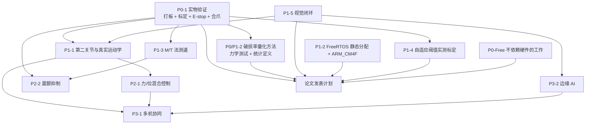

# 第二代智能无人机采茶机器人系统 —— 后续工作规划与优先级

<!-- REVISION NOTICE - do not remove -->
> ### ⚠️ 参数修订说明（第三次校正，覆盖全文数值）
>
> 本文档写作期间，项目经历了三轮**更正**，因此正文中的部分**具体数字已经过期**。
> 保留原文是为了不掩盖修正过程，但读数时请以代码为准。
> **第三次更正的完整缺陷清单见 [`docs/12_results_analysis.md`](12_results_analysis.md) 的 §3.5。**
>
> | 常量 | 已废弃的值 | 当前值（权威） | 更正原因 |
> |---|---|---|---|
> | `TP_PLANT_MOTOR_KT_NM_PER_A` | 2.0 | **0.4** | SI 单位下 `Kt` 与 `Ke` 是同一物理量，原值相差 40 倍，违反能量守恒 |
> | `TP_PLANT_MOTOR_KE_VS_RAD` | 0.05 | **0.4** | 同上 |
> | `TP_VEL_PID_KP` | 0.005 | **0.026** | 被控对象 DC 增益由 480 变为 60 mrad/s/permille，必须重新整定 |
> | `TP_VEL_PID_KI` | 0.10 | **0.83** | 同上 |
> | `TP_POS_PID_KP` | 12.0 | **5.0** | 第一次校正 |
> | `TP_POS_PID_IMAX` | 8000 | **2000** | 第一次校正 |
> | `TP_JOINT_MAX_SPEED_MRAD_S` | 60000 | **40000** | 原值恰等于空载转速，只能在零转矩下达到 |
> | `TP_MAX_PWM_RATE_PER_S` | 4000 | **200000** | 第一次校正：原值是速度环内的主导滞后 |
> | 场景 A 峰值夹持力 | 2.493 N | **2.363 N** | 第三次校正：力背驱符号修正 |
> | 场景 A 达到目标力 | 2.26 N | **2.18 N** | 同上 |
> | 场景 A 接触间隙 | 5.688 mm | **5.682 mm** | 同上 |
> | 场景 A 主机链路解码 | 2200 B / 100 帧 | **2134 B / 97 帧** | 同上 |
> | `TP_PLANT_JAW_BACKDRIVE` 的作用方向 | 减去（`-=`） | **加上（`+=`）** | 符号错误使茎秆把空夹爪"吸"到机械硬限：力从 5.0 N 涨到 16.4 N，并误锁存传感器故障 |
> | 力环服务速率 | 100 Hz（与注释不符） | **1 kHz** | 力环搬入 1 kHz 控制任务，"N 个控制周期"从此等于 N ms |
>
> **唯一权威**：`firmware/Application/config.h` 与 `firmware/BSP/host/plant_model.h`。
> 二者的一致性由 `tests/test_config_agreement.py` 自动校验——它会解析这两个头文件并与
> Python 模型逐条比对，因此任何再次漂移都会变成失败的测试而不是过期的文档。
<!-- /REVISION NOTICE -->


> **本文的性质声明（必读）**
> 1. **本项目没有实物硬件。** 没有打样过任何板卡，没有真实电机、真实传感器、真实茶芽，也没有任何一次硬件测量。所有"结果"都来自 host 侧确定性仿真（`build/host/tea_picking_robot_host.exe`）与上位机 Python 工具。
> 2. 因此本文的第 **P0** 条永远是**实物验证**，它不是"锦上添花的最后一步"，而是**判定本项目迄今全部仿真结论是否成立的前提**。
> 3. 文中每个数字都标注口径：**仿真结果（Simulated）** / **设计目标 Target KPI（未实测）** / **代码无据** / **文档与代码不一致**。未标注者一律视为设计推导，不得当作实测值引用。
> 4. 本文只做规划与风险登记，**不修改 `docs/` 以外的任何文件**，也不改动 `docs/` 下已存在的其它文档。

## 摘要

本文按 **P0 / P1 / P2 / P3** 四级优先级给出 **12 个后续工作条目**（P0 级 1 条、P0/P1 级 1 条、P1 级 5 条、P2 级 2 条、P3 级 2 条，另加论文发表计划 1 项专项）。当前项目的真实状态可压缩成三句话：

1. **控制侧在模型里自洽且可复现。** Scenario A：接触判定在间隙 **5.688 mm**、F = **0.156 N**；力达 **2.26 N**（设定 2.20 N，band ±0.10 N），**超调 0.00 N**，**49 个控制周期**收敛；受控阶段平均保持力 **2.26 N**；峰值夹持力 **2.493 N**（硬限 5.00 N）；节拍 CONTACT **1.24 s** / GRIP **2.57 s** / PICK **3.14 s** / RELEASE **3.39 s** / IDLE **4.78 s**；**6000 控制周期、0 次截止期错失**；主机链路 **2200 B、100 帧、0 CRC 错误**。七场景回归（`scripts/run_scenarios.ps1`）**7/7 PASS**：A 完成 2.493 N；B `ERR_TARGET`（接触超时）0.167 N；C（σ = 80 mN）完成 2.426 N；D（纯位置控制、茎秆 16 mm）`ERR_FORCE_OVERLOAD`；E `ERR_COMM_TIMEOUT`；F（8 N·m 堵转 vs 驱动约 6 N·m）过流/堵转保护；G `ERR_ESTOP`。**以上全部为仿真结果（Simulated）。**
2. **设计目标全部未实测。** 茶芽破损率 ≤ 1 %、采摘效率提升 40 %、定位误差、夹持力误差、通信延迟——五项均为**设计目标 / Target KPI（未实测）**；其中"破损率"目前**连测量方法都没有**（§9）。
3. **最大的单点风险是"模型与实物不符"。** 若实物与 `plant_model.c` 不一致，本文引用的**每一个**仿真结论都要重做（风险 R-1）。

**最高价值的两个下一步**：**(a) 打样一块最小可用板，把力通道标定跑通**（P0）；**(b) 真实视觉闭环**（P1）——Scenario B 已用仿真证明，**+8 mm 横向目标误差即导致接触超时、报 `ERR_TARGET`、峰值力仅 0.167 N**，即**视觉精度直接决定节拍与成功率**。

## 目录

**基础** — [0 数据口径](#0-数据口径与标注约定) · [1 优先级矩阵](#1-优先级矩阵) · [2 现在就能做的工作](#2-现在就能做且不依赖硬件的工作p0-free)
**P0 / P0-P1** — [3 实物验证](#3-p0-1-实物验证打样-pcb标定e-stop限流限速合爪) · [9 破损率量化方法](#9-p0p1-2-破损率量化方法)
**P1** — [4 第二关节与真实运动学](#4-p1-1-第二关节与真实运动学) · [5 FreeRTOS 静态分配与 ARM_CM4F](#5-p1-2-freertos-静态分配与-gcc-arm_cm4f-移植) · [6 M/T 法测速](#6-p1-3-mt-法测速) · [7 自适应阈值实测标定](#7-p1-4-自适应阈值实测标定) · [8 视觉闭环](#8-p1-5-视觉闭环)
**P2 / P3** — [10 力/位混合控制](#10-p2-1-力位混合控制) · [11 震颤抑制](#11-p2-2-震颤抑制) · [12 多机协同](#12-p3-1-多机协同) · [13 边缘 AI](#13-p3-2-边缘-ai)
**规划与收尾** — [14 论文发表计划](#14-论文发表计划) · [15 风险清单](#15-风险清单) · [16 可复用资产](#16-本项目的可复用资产) · [小结](#小结) · [面试可能追问的问题](#面试可能追问的问题)

## 0. 数据口径与标注约定

三种标注：**仿真结果（Simulated）** = host 侧确定性仿真的真实输出，可复现但不含硬件效应；**设计目标 / Target KPI（未实测）** = 设计意图与判据，从未在实物上取得；**代码无据 / 文档与代码不一致** = 仓库中缺少实现，或注释与代码矛盾。

**本文唯一允许引用的结果数据（全部为仿真结果 / Simulated）**

| 量 | 值 | 量 | 值 |
|---|---|---|---|
| 接触判定间隙 / 力 | 5.688 mm / 0.156 N | 受控阶段平均保持力 | 2.26 N |
| 力达到 / 设定 / band | 2.26 N / 2.20 N / ±0.10 N | 峰值夹持力 / 硬限 | 2.493 N / 5.00 N |
| 超调 / 收敛周期 | 0.00 N / 49 个控制周期 | 控制周期数 / 截止期错失 | 6000 / 0 |
| 节拍 C/G/P/R/I | 1.24 / 2.57 / 3.14 / 3.39 / 4.78 s | 主机链路 | 2200 B、100 帧、0 CRC 错误 |
| 七场景回归 | 7/7 PASS（A–G 见摘要） | 设计目标（未实测） | 破损率 ≤ 1 %、效率 +40 %、定位误差、夹持力误差、通信延迟（无数字） |

> **引用注记（文档与代码不一致的旁例）**：`docs/01_project_background.md` 第 62 行自己记录了一个批次差异——`data/logs/host_scenario_A.csv` 的 `force_n` 列峰值为 **2.3773 N**，与摘要采用的 **2.493 N** 不是同一次运行。本文一律采用 2.493 N 并在此声明，避免混用不同批次。

## 1. 优先级矩阵

| 项目 | 优先级 | 价值（对毕设/论文） | 成本 | 风险 | 是否阻塞其它工作 |
|---|---|---|---|---|---|
| 实物验证 | **P0** | 决定性：把仿真结果变成可辩护的结论 | 高（打板+仪器+工时） | **最高**：模型不符则全部结论重做 | **是——阻塞几乎全部 P1/P2 的论文级结论** |
| 破损率量化方法 | **P0/P1** | 极高：唯一的"生物学"KPI 却没有测量方法 | 中（样本+力学测试） | 高：生物变异大、样本量大 | 是——阻塞"破损率 ≤ 1 %"的任何表述 |
| 视觉闭环 | **P1** | 极高：+8 mm 误差即 `ERR_TARGET`（Scenario B） | 中高 | 高：光照/遮挡/重叠 | 是——阻塞节拍与成功率结论 |
| 自适应阈值实测标定 | **P1** | 高：消除一处分档矛盾与一处过度宣称 | 中（依赖 P0 力通道） | 中高：未标定即默认开启 | 否，但**当前代码默认开启**（§7） |
| M/T 法测速 | **P1** | 高：低速分辨率与失速检测的直接改善 | 中 | 中：切换抖动 | 否 |
| FreeRTOS 静态分配 + ARM_CM4F | **P1** | 高：让 `RTOS=freertos` 真能构建 | 中（移植+栈深预算） | 中高：FPU 上下文缺陷 | 否（但阻塞实时性论述的可构建性） |
| 第二关节与真实运动学 | **P1** | 高：把"单关节投影"升级为真机器人 | 高（机械+代码+标定） | 高：复杂度跳变 | 是——阻塞精度/轨迹类实验 |
| 力/位混合控制 | **P2** | 中高：控制器层面的理论深度 | 中高 | 中高：失去当前确定性 | 否 |
| 震颤抑制 | **P2** | 中：解释并消除极限环 | 中 | 中：与带宽耦合 | 否 |
| 多机协同 | **P3** | 低（对毕设）；高（对系统叙事） | 极高 | 高：范围失控 | 否 |
| 边缘 AI | **P3** | 中高（若做视觉闭环则顺带） | 高（数据集+算力） | 中 | 否 |



**读图结论**：`P0-1` 是唯一的真源节点（in-degree 0、out-degree 最大）。§2 的 `P0-Free` 工作可在没有板子时立刻推进，且**全部汇入论文**。

## 2. 现在就能做且不依赖硬件的工作（P0-Free）

| # | 工作 | 依据（代码事实） | 产出 | 为什么值得现在做 |
|---|---|---|---|---|
| F1 | 补**重复实验与统计**：多 `noise_seed` 重跑 A/C | `plant_model.h` 的 `uint32_t noise_seed`、`tp_plant_set_seed()`；`tp_plant_init()` 默认 `12345u` | 峰值力/收敛周期/节拍的**分布** | 现有全部结论是 **n = 1** 的一次运行，论文第一号短板 |
| F2 | 实现**实验 04 的丢包 5 %/10 %/20 %** | `docs/11_experiment_design.md` §实验 04 已给出注入点方案（`host_apply_scenario()` 新增场景 + 与 `plant_model.c` 同族 LCG） | 丢包率 vs 节拍/完成率/`tp_protocol_loss_estimate()` | 通信结论目前只有 0 丢包 |
| F3 | 修正**自适应开关的文档/代码不一致** | `config.h:279` vs `force_control.h:60-66` | 二者取一（§7.3） | 当前默认开启一个"未验证"的机制 |
| F4 | `ARM_CM4F` port 移植 + **静态分配**改造 | `Makefile:286`；`osal_freertos.c:250` | 可构建的 `RTOS=freertos` | 只需工具链；`osal_freertos.c:249` 的注释正是在指向本文 |
| F5 | **Python 与 C 双模型交叉校验** | `simulator/plant.py` ↔ `firmware/BSP/host/plant_model.c` | 两侧同工况输出对齐报告 | 无实物时最强的证据形式 |
| F6 | 统一 **0.8 Hz / 0.55 Hz** 带宽口径 | `config.h:188` vs `cascade.h:50-51` | 单一可复核口径 | 同一数字两个来源两个值 |
| F7 | 修正 `hardware/*.md` 的**过期符号表** | 其中仍写 `TP_VEL_PID_KP (0.015f)`、`TP_POS_PID_KP (12.0f)`、`TP_MAX_DUTY_RATE_PER_S (4000.0f)`，而 `config.h` 现值为 **0.005f / 5.0f / 200000.0f**（`config.h:228/200/173`） | 符号表与代码一致 | 属文档与代码不一致；只登记，不在本文修改 |

## 3. P0-1 实物验证：打样 PCB、标定、E-stop、限流限速合爪

| 字段 | 内容 |
|---|---|
| **目标** | 在一块自研板上把**力通道 / 编码器通道 / E-stop 通路 / 限流限速下的合爪**四条最小闭环跑通，取得第一批硬件测量数据。目标不是"整机完成"，而是**证伪或证实 `plant_model.c` 的关键假设** |
| **当前状态（代码事实）** | 见下方"代码事实表"与"待标定清单" |
| **具体做法** | ① 先只焊最小系统 + 力前端 + 编码器接口，**不焊功率级**；分级上电、静态检查（桥阻、激励电压、REF 电平）后再上 MCU。② 按"待标定清单"逐项用实物替换纸面值。③ E-stop 拉线测试。④ 限流限速下的合爪测试 |
| **前置条件** | `arm-none-eabi-gcc`、SWD 下载器、**标准砝码组**、测力计、电流源/精密负载、示波器、温度记录仪。`docs/force_sensor_calibration.md` 风险 C2 已如实记录：**这些计量器具尚未采购、尚未使用** |
| **工作量** | 打板+焊接 2–4 周（含 1 次改板）；分级上电与静态检查 3–5 天；力通道零点+量程标定 3–5 天；编码器/电流标定 3–5 天；E-stop 与时序 2–3 天；限流限速合爪+归档 1 周。**合计约 6–9 周（单人）** |
| **可行性** | **高。** 后端代码已在库，力通道标定流程（含判据、失败工况表、记录模板）已写全，**只差一块板与一批仪器** |
| **风险** | 见下（含**最高风险 R-1**） |
| **验证方式** | 见下 |

**代码事实表**

| 事实 | 出处 |
|---|---|
| 真机后端源码已在库，但**从未编译、从未在实物上运行** | `firmware/BSP/stm32f407/platform_stm32f407.c`；`docs/resume_project.md` 自述 |
| 模拟前端是纸面推导：10 N 称重传感器（1 mV/V、5 V 激励）→ INA333 **`TP_FORCE_AMP_GAIN_STAGE1 = 201.0f`** → RC 抗混叠 **fc = 1.6 kHz** → ADC1_IN0 | `config.h` 第 8 节（`config.h:369-425`） |
| 标度由前级**计算**而非硬编码：`TP_FORCE_CAL_SCALE_N_PER_COUNT = TP_ADC_MV_PER_COUNT / TP_FORCE_FRONTEND_MV_PER_N`，纸面推导为 **8.0 mN LSB** | `config.h:435-449` |
| 零点为设计默认值 `TP_FORCE_CAL_ZERO_COUNTS = 2048.0f`；`tp_force_sensor_init()` 把 `calibrated` 置 0（注释："design values, not a real calibration"） | `config.h:447`；`docs/force_sensor_calibration.md` 摘要 |
| 编码器/机械常量：`TP_ENCODER_COUNTS_PER_REV = 4096`（X4）、`TP_GRIPPER_COUNTS_PER_MM = 512.0f`、`TP_JOINT_GEAR_RATIO = 50.0f`、`TP_MRAD_PER_COUNT = 1.534 mrad` | `bsp_types.h:92/95/98/101-102` |
| 电流采样比例**硬件侧未定义**；`plant_model.c` 内部自洽采用 **2048 counts = 0 A、±1000 counts = ±5 A（5 mA/count）** | `plant_model.c:451-453`；`hardware/motor_driver.md` §4.8 |
| **最高优先级硬件不一致**：INA333 的 `G = 1 + 100 kΩ/RG`，`config.h` 注释写 "gain 201, RG = 249 ohm"，而 `RG = 249 Ω` 实际给 **G ≈ 402.6**；两条编译期断言在 201 与 402.6 下**都成立**，构建系统**不会报错** | `config.h:406` 注释；`hardware/force_sensor.md` 风险 1；`signal_conditioning.md` §6.5.2 |
| E-stop 是 NC 回路（低电平 = 已触发） | `bsp_types.h:62`：`TP_IO_ESTOP = 0 /**< NC loop, low = asserted. */` |

**必须逐项标定的清单（纸面值 → 实物确定什么）**

| 标定项 | 纸面值 / 出处 | 实物要确定什么 |
|---|---|---|
| 模拟前端增益 | `TP_FORCE_AMP_GAIN_STAGE1 = 201.0f` | **实际是 201 还是 402.6**（`RG` 究竟 249 Ω 还是 500 Ω），据此改 `config.h` 或换电阻 |
| 零点 | `TP_FORCE_CAL_ZERO_COUNTS = 2048.0f` | 实测空载 counts；按 `docs/force_sensor_calibration.md` §4 走完整零点流程 |
| 标度 | `TP_FORCE_CAL_SCALE_N_PER_COUNT`（计算式，≈ 0.0080166 N/count） | 砝码 100/200/500 g 单点 + 多点最小二乘回归真实 N/count |
| 抗混叠截止频率 | **fc = 1.6 kHz**（`config.h:375` 注释，纸面） | 扫频测 RC 实际 −3 dB 点，核对与 20 kHz PWM 载波、500 Hz 采样的混叠关系 |
| 编码器方向与倍频 | `TP_ENCODER_COUNTS_PER_REV = 4096`（X4） | 手转一圈核对 counts 与符号，确认正方向与关节/夹爪约定一致 |
| 夹爪位移标度 | `TP_GRIPPER_COUNTS_PER_MM = 512.0f` | 丝杠实测 counts/mm（含齿隙） |
| 关节减速比 | `TP_JOINT_GEAR_RATIO = 50.0f` | 输出端角位移的实际换算（含减速机背隙/弹性） |
| 电流采样比例 | **代码无据**（硬件侧未定义；仿真用 5 mA/count） | 注入已知电流回归 counts→mA，决定是否保留仿真约定 |
| E-stop 响应 | NC 回路（`TP_IO_ESTOP`） | 拉线后使能是否被清、`ERR_ESTOP` 是否上报、响应时间是否**不依赖软件轮询** |

**风险**

| 风险 | 说明 |
|---|---|
| **R-1（最高）：实物与模型不符** | 茎秆模型是二次刚度 + 阻尼（`TP_PLANT_STEM_K1_N_PER_MM = 0.30f`、`TP_PLANT_STEM_K2_N_PER_MM2 = 0.06f`、`TP_PLANT_STEM_DAMP_N_S_MM = 0.015f`）。若真实芽的刚度/阻尼/断裂行为差异大，**全部力控结论（2.493 N 峰值、0.00 N 超调、49 周期收敛）都要重做** |
| 增益错配（R-01） | 若实际为 402.6，LSB 变 4.0 mN、可用范围减半，而**编译期断言不会发现** |
| 非比例式测量 | 激励 5 V 与 ADC 基准 3.3 V **不同源**，激励/基准漂移**直接是增益误差**，零点标定无法吸收 |
| 目标端零点门限"事实上失效" | `tp_platform_adc_read()` 只返回最近发布样本（约每 16 ms 更新），零点标定在几微秒内连读 64 次 → `spread ≈ 0`，门限不起保护作用（`docs/force_sensor_calibration.md` §4.5、风险 C3） |
| 力通道新样本率仅 62.5 Hz | 500 Hz 任务重复消费同一值约 8 次；`TP_FILTER_MEDIAN_WINDOW = 5`（10 ms 窗口）**短于** 16 ms 保持时间，剔不掉坏样本（同上 C3） |
| 标定值不持久化 | `config.h` 注释提到 NVM，但**仓库无实现**（C5）——重启即回设计值 |

**验证方式（如何判断做成了）**：判据取自 `docs/force_sensor_calibration.md` §7 的 **18 项验收判据**（该表自述"全部为设计判据，尚未用实物验证"）——允许用作**判据**，不允许当**结果**。关键项：① 零点重复性：连续 5 次空载零点标定 `c0` 极差 ≤ **0.10 N**；② 量程线性度：三点拟合最大残差 ≤ **1 % FS**；③ 与设计值偏差首标 ≤ **±5 %**——**若比值落在 0.5 ± 0.05，则 R-01 得到确认**；④ 硬限行为：缓加载至 6 N 时 `TP_FORCE_MAX_N = 5.00f` 在**同一控制周期**跳闸（日志 `PROTECTION TRIPPED: ...`）；⑤ 分辨率：可分辨 **8.0 mN** 台阶；⑥ E-stop：使能被清、`ERR_ESTOP` 上报、响应时间可测且不依赖软件。

**「它是什么」** 三级保护是本项目安全论证的骨架：第 1 级 `F > TP_FORCE_MAX_N = 5.00f` → **立即张开并锁存 `ERR_FORCE_OVERLOAD`**，且检查发生在控制器运行**之前**（同周期生效）；第 2 级 `F > TP_FORCE_SOFT_LIMIT_N = 3.50f` → 告警并把设定点降档到 3.15 N（`3.50 × 0.9`）；第 3 级：传感器故障时**拒绝按力闭合**，退化为纯位置夹持；另有独立的**接触超时**保护（`force_control.h` 的 4 条保护清单；`tp_force_control_fault_code()` 上报真实跳闸原因）。
**「为什么这么设计」** 因为"力反馈"本身**不是**安全保障。Scenario D（**仿真结果**）已证明：纯位置控制、茎秆 16 mm 时保护**触发了**（报 `ERR_FORCE_OVERLOAD`），但峰值力一栏**给不出任何数字——"从未达到"**，即保护拦住了"继续施力"、拦不住"已经造成的损伤"。因此设计采用"**硬限在控制器之前判定**"＋"输出限幅 25 mm/s"＋"接触超时宁可 `ERR_TARGET` 不采"三条结构，而不是依赖控制器收敛。
**「如果不用它会怎样」** 无硬限前置判定：故障要到下一个周期才生效，而快速接近（40 mm/s）时 1 ms 内的力增量足以跨过损伤阈值（这正是 SLOW_APPROACH 存在的理由）。无软限降档：力环会与硬限"对撞"，产生反复跳闸而非平滑退让。无接触超时：Scenario B 的后果会从"报 `ERR_TARGET` 并停止"变成"一路闭合到机械硬止挡"。

## 4. P1-1 第二关节与真实运动学

| 字段 | 内容 |
|---|---|
| **目标** | 把"单关节投影"升级为真实 ≥3 自由度机械臂运动学：正解、雅可比、逆解、重力补偿、关节限位与奇异点处理 |
| **当前状态（代码事实）** | 驱动器通道**只有两个**：`TP_MOTOR_JOINT`、`TP_MOTOR_GRIPPER`，`TP_MOTOR_COUNT = 2`（`bsp_types.h:38-42`）；其余关节被动/固定，**明确不为第三个通道预留**——`bsp_types.h:33-36` 原文："the arm's remaining joints are passive/fixed, so no third channel is reserved until the hardware exists."；**仓库中没有任何运动学实现**（全仓库 grep 无 `jacobian` / `inverse kinematic` / IK 代码）；唯一的映射是**单关节投影** `TP_APP_MM_TO_MRAD = 3.333f`，用法 `angle = (float)target->y_mm * TP_APP_MM_TO_MRAD;`（`app_tasks.h:89`、`app_sequence.c:766-770`，注释原文 "Single-joint projection: see TP_APP_MM_TO_MRAD."）；关节限位常量已存在（`config.h:138-142`） |
| **具体做法** | ① 先定第二/第三关节的电机、减速比与编码器通道，扩展 `tp_motor_ch_t` / `tp_encoder_ch_t`——**注意 `TP_MOTOR_COUNT`/`TP_ENCODER_COUNT` 是数组维度来源**，`tp_raw_sample_t::encoder_total[TP_ENCODER_COUNT]` 等会跟着变；② 新建独立运动学模块（建议 `firmware/Control/kinematics.c`）：正解、雅可比、阻尼最小二乘逆解、重力力矩前馈、限位与奇异点判定；③ 新关节**只经 `platform_api.h` 接入**（§16）；④ 扩展 `run_scenarios.ps1` 场景表，不破坏现有 7/7 PASS |
| **前置 / 工作量 / 可行性** | 前置：实物（§3）先到位、视觉闭环（§8）提供真实三维目标、机械本体。工作量：机械与装配 4–8 周；驱动与 BSP 扩展 1–2 周；运动学+逆解+重力补偿 2–4 周；标定与联调 2–4 周，**合计约 2–4 个月**。可行性：**中**，算法不新，难点在机械与标定 |
| **风险** | ① **复杂度跳变**：从 1 个受控关节到 3–4 个，控制器结构（`cascade.c` 的实例化）、标定项、故障面同时扩大；② **`TP_JOINT_*` 常量需重定义**：现值是单关节语义（±90°、60 °/s），多关节后必须每关节一套，否则 "集中常量" 会变成错误来源；③ 奇异点：现有代码**没有任何处理**，逆解在奇异位形附近需阻尼；④ 被动关节假设失效：`TP_MOTOR_COUNT = 2` 与 `TP_APP_MM_TO_MRAD` 是耦合假设，改一处必须检另一处 |
| **验证方式** | ① 正解/逆解闭环数值校验（θ → 位姿 → 逆解回 θ，误差在设定阈值内）；② 末端定位重复性（同点 30 次，报散布）；③ 重力补偿前后**静态位置误差**对比；④ 新场景加入后仍 **7/7 PASS** |

## 5. P1-2 FreeRTOS 静态分配与 GCC ARM_CM4F 移植

| 字段 | 内容 |
|---|---|
| **目标** | 让 `make stm32 RTOS=freertos` 真正可构建，并把任务/队列/互斥量改为**全静态分配** |
| **当前状态（代码事实）** | 见下三条 |
| **具体做法** | ① 把官方 FreeRTOS-Kernel 的 `portable/GCC/ARM_CM4F/{port.c,portmacro.h}` 复制进 `firmware/Drivers/third_party/FreeRTOS/Source/portable/GCC/ARM_CM4F/`，**保持第三方目录"逐字未改"的纪律**（`third_party/README.md` 开头规则：需本地修改就放到 `firmware/BSP|Core|Middleware`，**永不放在这里**）；或按 `Makefile:314` 用 `FREERTOS_PORT_DIR=/path/to/...` 外挂。② **不要移除 `RVDS/ARM_CM3`**（它是"为完整性而 vendor"，构建从不编译它）。③ 静态化：为每个任务生成 `StaticTask_t` + `StackType_t stack[N]`，改用 `xTaskCreateStatic`；队列/互斥量/信号量改用 `xQueueCreateStatic` / `xSemaphoreCreateMutexStatic` / `xSemaphoreCreateCountingStatic`（三者在本树中均存在：`queue.c:496`、`semphr.h:220/776/1082`）。④ 静态化后重新核算 `configTOTAL_HEAP_SIZE`（32 KiB），`configUSE_MALLOC_FAILED_HOOK` 的存在意义随之改变，启动期"堆不足"这一类失败模式被**结构性消除** |
| **前置条件** | `arm-none-eabi-gcc` 工具链即可，**不需要实物板子**（这就是 F4 属于 §2 的原因） |
| **工作量** | port 移植与首次构建 3–5 天；静态分配改造 1 周；栈深标定 1 周。**合计约 2–3 周** |
| **可行性** | **高**。`configSUPPORT_STATIC_ALLOCATION` 已为 1，`osal_freertos.c` 已预留结构体字段，缺的只是 port 目录与创建 API 的替换 |
| **风险** | ① **port 替换引入的 FPU 保存/恢复缺陷（最高）**：错误版本或中断优先级配置错误会让浮点上下文在切换时**静默损坏**，表现是"偶尔算错一个浮点数"而非崩溃；② **静态分配下栈深必须一次算对**：栈变成固定数组，**溢出就是踩内存**，而现有栈深（`config.h:107-113`：控制 512 / 传感器 384 / 通信 512 / 机器人 512 / 安全 384 / 遥测 512 / 调试 384 **字**）**全部是纸面预算，未实测**；③ `configLIBRARY_MAX_SYSCALL_INTERRUPT_PRIORITY = 5` 与既有 ISR 优先级的相容性：`FreeRTOSConfig.h:26-52` 已论证 ADC DMA=2、UART=3、CAN=4、TIM7=5 **且"none of those handlers calls a FreeRTOS API"**，移植后必须**重新核对**——一旦某个 ISR 开始调用 `...FromISR()`，优先级 2/3/4 会**静默**破坏内核临界区；④ 向量表归属：`FreeRTOSConfig.h:186-206` **故意不定义** `vPortSVCHandler → SVC_Handler` 等三个重映射宏，由 `stm32f4xx_it.c` 自行定义并转发，移植后**不要**把这三行加回去（否则重复定义链接错误） |
| **验证方式** | ① 构建通过；② 用 `INCLUDE_uxTaskGetStackHighWaterMark = 1`（`FreeRTOSConfig.h:142` 已开启）实测高水位并回灌修正栈深；③ **FPU 上下文专项测试**：任务 A 写入已知 `float` 数组、任务 B 反复浮点运算，数万次切换后核对 A 未被污染；④ 与 `osal_baremetal.c` 后端跑同一套测试，确认双后端行为一致 |

**（a）portable 目录真实内容（已用 glob/pwsh 核实）**

```
firmware/Drivers/third_party/FreeRTOS/Source/portable/
  MemMang/          heap_1.c  heap_2.c  heap_3.c  heap_4.c  heap_5.c
  RVDS/ARM_CM3/     port.c    portmacro.h          <-- 唯一存在的 port
```

**只有 `RVDS/ARM_CM3`，没有 `GCC/ARM_CM4F`。** 该 CM3 port **不是**本项目的可用 port，理由由 `third_party/README.md:55-70` 原文给出（都很硬）：① 它是为 Arm/Keil 编译器写的，用 `__asm` 与 `#pragma` 形式，`arm-none-eabi-gcc` **拒绝**；② Cortex-M3 **没有 FPU**，该 port **不保存浮点上下文**，而本项目以 `-mfpu=fpv4-sp-d16 -mfloat-abi=hard` 构建、全用 `float`——CM3 port 会在上下文切换时**静默破坏 `s0`–`s31``。`Makefile` 已把缺口做成**可执行的失败而非静默的错误构建**：`FREERTOS_PORT_DIR ?= $(FREERTOS_DIR)/portable/GCC/ARM_CM4F`（`Makefile:286`），并用 `wildcard` 检查 `port.c` / `portmacro.h`，缺失即 `$(error ...)` 并给出修复指引（`Makefile:290-333`）。

**（b）`FreeRTOSConfig.h` 真实内容核对**

| 配置项 | 现值 | 出处 |
|---|---|---|
| `configSUPPORT_STATIC_ALLOCATION` | **1**（已开启） | `FreeRTOSConfig.h:110` |
| `configSUPPORT_DYNAMIC_ALLOCATION` | **1** | `FreeRTOSConfig.h:111` |
| `configUSE_MUTEXES` | **1** | `FreeRTOSConfig.h:85` |
| `configUSE_RECURSIVE_MUTEXES` | **1** | `FreeRTOSConfig.h:88` |
| `configCHECK_FOR_STACK_OVERFLOW` | **2**（方法 2，另查最后 20 字节） | `FreeRTOSConfig.h:87` |
| `configTOTAL_HEAP_SIZE` | **32 KiB**（`heap_4.c` 由 Makefile 选中） | `FreeRTOSConfig.h:81`、`Makefile:328` |
| `configUSE_PRIORITY_INHERITANCE` | **仓库中未定义** | 全仓库 grep 无命中 |

> **重要澄清（避免臆测）**：任务清单里提到要新增/修改 `configUSE_PRIORITY_INHERITANCE`，但**该宏在本仓库的 FreeRTOS V10.0.1 中根本不存在**（`FreeRTOS.h`、`FreeRTOSConfig_template.h` 均无）。本版本中互斥量的**优先级继承是无条件启用的**，唯一门控是 `configUSE_MUTEXES == 1`：`queue.c:1521` 在 `#if( configUSE_MUTEXES == 1 )` 内调用 `xTaskPriorityInherit()`，`queue.c:2055` 同理调用 `xTaskPriorityDisinherit()`。因此正确动作**不是**新增该宏，而是**确认 `configUSE_MUTEXES = 1`**（已满足）并在文档中纠正这一条。

**（c）`osal_freertos.c` 的真实状态**：头注释写 "Static allocation only"，`struct osal_task` **已预留** `StaticTask_t tcb;` 与 `StackType_t stack[1];`（`osal_freertos.c:96-99`，由 `#if (configSUPPORT_STATIC_ALLOCATION == 1)` 包住），但 `osal_task_create()` 实际仍调**动态 API** `xTaskCreate(...)`（`:250`），并在 `:244-249` 给出诚实理由："xTaskCreateStatic needs the stack array to be sized at compile time, and this OSAL creates tasks at run time from a table ... Making the table static is recorded in docs/13_future_work.md."——**这一段注释就是在指向本文**。队列与信号量同样走动态 API：`xQueueCreate`（`:370`）、`xSemaphoreCreateMutex`（`:461`）、`xSemaphoreCreateCounting`（`:519`）。

**「它是什么」** OSAL 是"单一硬件缝"之上的第二层缝：`osal.h` 定义任务/队列/互斥量/信号量/通知/周期六类原语，`osal_baremetal.c`（裸机协作式）与 `osal_freertos.c`（FreeRTOS V10）实现同一接口，应用层**从不直接调用 `xTaskCreate`**（`osal.h:10` 原文说明这正是其存在理由）。
**「为什么这么设计」** 因为核心约束是"**没有硬件**"。要让 1 kHz 控制环、100 Hz 安全环、7 个任务在**没有板子**时仍可验证，唯一办法是让"实时内核"成为**可替换后端**：host 侧用裸机后端跑确定性仿真（6000 周期、0 次截止期错失，**仿真结果**），目标侧用 FreeRTOS 后端跑真机，同一个 `app_tasks.c` 两边都编译——这才是 7/7 PASS 能作为证据的前提。
**「如果不用它会怎样」** 任务会直接调用 `xTaskCreate`，于是 host 仿真必须依赖 FreeRTOS 的宿主机移植（`portable/` 里没有 Windows/Linux port），**整个可测性架构失效**；更现实的是没有裸机后端就无法做确定性复现（RTOS 调度时序不可完全复现），"49 个控制周期收敛"这种**逐周期**结论根本拿不到。

## 6. P1-3 M/T 法测速

| 字段 | 内容 |
|---|---|
| **目标** | 改善低速速度估计的分辨率与失速检测可用性；实现 M/T 法并确定切换点 |
| **当前状态（代码事实）** | 见下"当前实现到底是什么" |
| **具体做法** | ① 新增高频自由运行定时器（或复用现有 TIM 计数器）作为 T 支路时基；② 在 `tp_encoder_update()` 中改为 M/T 结构，**保留三条已验证行为**：窗口结束才发布、零阶保持、方向反转重置 MA；③ 在 `config.h` 增加显式的**模式/切换阈值**常量；④ 重新整定 `TP_FILTER_SPEED_MA_WINDOW` / `TP_FILTER_SPEED_LPF_TAU_S` |
| **前置 / 工作量 / 可行性** | 前置：定时器资源与硬件定时精度（STM32F407 侧按 `platform_api.h` 增加读取接口），**不需要实物即可先在 host 侧实现与回归**。工作量：host 侧实现+单元测试 3–5 天；目标侧定时器接入 2–3 天；滤波器重整定 3–5 天，**合计约 2 周**。可行性：**高**（算法成熟，接口已存在） |
| **风险** | ① **切换抖动**：两条支路噪声特性不同，切换点附近可能产生速度读数跳变；② 实现复杂度上升——`encoder.c` 目前 251 行、逻辑清晰，改造要避免搞乱方向反转/失速交互；③ **与带宽设计的耦合**：滤波器相位滞后随估计器改变，速度环相位裕度会变 |
| **验证方式** | ① 单元测试：合成匀速/低速/换向序列下 M/T 与理论值比对，并与当前实现逐点对照；② 低速分辨率：30 mrad/s（失速阈值）下速度读数**非零且单调**；③ 失速检测场景（对应 Scenario F 堵转路径）在低速下仍正确跳闸；④ 速度环整定不回归 |

**当前实现到底是什么（真读 `firmware/BSP/encoder.c`）**

1. **每周期确实算了计数差分**：`enc->count_prev = enc->count; enc->count = count; enc->delta = enc->count - enc->count_prev;`（`encoder.c:102-104`）——这是典型的 **M 法原料**。
2. **但速度不是用它算的。** 速度走**累加器 + 变窗口**：`enc->accum_counts += enc->delta; enc->accum_us += dt_us;`（`:121-122`），仅当 `|accum_counts| >= TP_ENCODER_VEL_MIN_INC` **或** `accum_us/1000 >= TP_ENCODER_VEL_MAX_WINDOW_MS` 时才发布：`estimate = accum_counts × mrad_per_count / (accum_us / 1e6)`（`:128-133`），其余时间**零阶保持**（`:167`）。
3. 常量为 `TP_ENCODER_VEL_MIN_INC = 4`、`TP_ENCODER_VEL_MAX_WINDOW_MS = 20u`（`encoder.h:72/75`）。
4. `encoder.h:28-36` 自己命名这个估计器："A fixed-position-increment (constant-elapsed-position) estimator, **the practical middle ground between the classic M and T methods**"。
5. 其后串两级滤波：`tp_filter_mavg_update()`（`TP_FILTER_SPEED_MA_WINDOW = 5u`）+ `tp_filter_lpf_update()`（`TP_FILTER_SPEED_LPF_TAU_S = 0.003f`）（`encoder.c:61-66/162-163`；`config.h:430-431`）。方向反转时**重置滑动平均**（`encoder.c:154-160`），以免把 +v 与 −v 平均成虚假零速而欺骗失速检测。

**结论**：它不是"裸的每周期差分 M 法"，而是 **M 法家族中的变窗口折中**；`enc->delta` 存在但**不直接**用于速度环。

**低速量化误差分析（自核算）**：`TP_MRAD_PER_COUNT = 2π×1000/4096 = 1.53398… ≈ **1.534 mrad**`（`bsp_types.h:101-102`）；`TP_SENSOR_FREQ_HZ = 500u` → 采样周期 **2 ms**；因此"1 个采样周期内差 1 个 count"= `1.534 mrad / 0.002 s = **766.99 mrad/s ≈ 0.767 rad/s ≈ 43.95 °/s**`——**一个 count 的量化台阶就是 43.9 °/s**。后果：朴素 M 法在约 **770 mrad/s** 以下读出**恒等于 0**，而 `TP_STALL_SPEED_THRESHOLD_MRAD_S = 30.0f`（`config.h:320`）正落在死区里，**失速检测无法工作**；`encoder.h:23-26` 用一张表（60 000 → 78.2 counts/样本；300 → 0.39；30 → 0.039）记录了同一结论。**当前实现优于朴素 M 法之处**：窗口可拉到 20 ms，量化台阶降到 `1.534/0.02 ≈ **76.7 mrad/s**`（约好 **10 倍**），代价是低速延迟增至 20 ms，且速度环看到阶梯 + 零阶保持。

**M/T 法如何改善、切换点在哪**：T 法测"一个 count 花了多少时间"（如 1 MHz 定时器：1 count/2 ms 时约 2000 个计数，比 M 法好约 3 个数量级）；M/T 法在**固定时间窗**内同时记 encoder count 与高频时钟 tick，`ω ∝ N_counts / N_ticks`，两端都好。**切换点**取"窗口内计数 `N_counts ≈ 1`"为界，即低于约 **767 mrad/s** 时 T 支路严格占优——与 `encoder.h` 表中"约 770 mrad/s"量级一致，可直接作为阈值设计起点。**对现有滤波器的影响**：`TP_FILTER_SPEED_MA_WINDOW = 5u` 逐样本滑动时额外滞后最多 10 ms，但当前估计器**发布间隔本身可变（最长 20 ms）**，故 MA 的实际滞后是"窗口数 × 发布间隔"，低速端可达 **100 ms 量级**；引入 M/T 后延迟特性改变，**必须重新整定**，否则速度环相位裕度会变。`hardware/signal_conditioning.md` 已指出"真正的抖动受害者是速度估计器（MA=5 + LPF τ=0.003f 这条链）"，与本条一致。

**「它是什么」** 测速是把"位置量子"转成"速度连续量"的估计问题。本项目当前的估计器是**固定位置增量 + 变累积窗口**：攒够 4 个 count 或攒够 20 ms 就发布一次，其余时间零阶保持。
**「为什么这么设计」** 因为纯 M 法低速死区高达 770 mrad/s 而失速阈值是 30 mrad/s；纯 T 法高速时每周期计时器计数很少、反而变粗，且换向瞬间的"单 count 计时"易被抖动污染。变窗口折中让**低速精度与高速带宽各取所需**，且只需一个 32 位硬件计数器（`tp_platform_encoder_read()`），不额外占用定时器资源。
**「如果不用它会怎样」** 把每周期原始差分直接喂给速度环，`encoder.h:49-53` 已写明后果：控制器**有效增益在低速与高速之间变化约 200 倍**，D 项会在每个量化台阶上打出 PWM 嗡鸣；同时失速检测在 30 mrad/s 附近永远读 0，会把"正常极慢运动"判成堵转，或在真正堵转时因方向反转重置 MA 而漏判。

## 7. P1-4 自适应阈值实测标定

| 字段 | 内容 |
|---|---|
| **目标** | 确定 `TP_FORCE_TARGET_N = 2.20f` 对真实茶芽的**最优值**；标定 `TP_FORCE_ADAPT_ALPHA = 0.05f` 与 `TP_FORCE_ADAPT_MARGIN_N = 0.60f`；**消除"文档说默认关闭、代码实为默认开启"这一矛盾** |
| **当前状态（代码事实）** | 见下 grep 验证结果 |
| **具体做法** | ① **力学测试**（依赖 §3 标定后的力通道）：对真实芽/茎做**力–位移曲线**，测断裂/压溃阈值与等效刚度，给出 `TP_FORCE_TARGET_N` 的建议值与不确定度；② 用 §9 的样本群做多批次采摘，报告"实际保持力"（`hold_force_avg_n`）分布，据此选 EMA 速率与余量——目标"防掉落但不过量压伤"；③ **把默认开关改为代码与文档一致**（见 §7.3 二选一）；④ **实验隔离**：`docs/11_experiment_design.md` §实验 05 指出 `TP_FORCE_ADAPT_ENABLE = 1` 会让 `force_target_n` 随 `observed_hold_ema_n` 漂移，**对比实验必须显式声明开关状态**，否则"峰值差"无法归因——已归档的仿真结果应**补记该开关状态** |
| **前置 / 工作量 / 可行性** | 前置：§3（力通道已标定）+ §9（真实芽样本与统计口径）。工作量：力学测试 1–2 周；多批次采摘与统计 2–3 周；代码/文档一致性修改 0.5 天。可行性：**中高**（代码改动极小，难点在样本与统计） |
| **风险** | 见下"必须明确写出的风险" |
| **验证方式** | ① 真实芽上开启/关闭自适应各 N 次采摘，比较**破损率**（§9）与**掉落率**；② 报告 `observed_hold_ema_n` 的收敛轨迹；③ 用 grep 复核代码与 `force_control.h` 表述一致 |

**grep 验证结果（`adapt_enabled` 与 `TP_FORCE_ADAPT_ENABLE`）**

| 事实 | 位置 | 口径 |
|---|---|---|
| `#define TP_FORCE_ADAPT_ENABLE (1)` | `firmware/Application/config.h:279` | 代码事实 |
| `fc->adapt_enabled = TP_FORCE_ADAPT_ENABLE;`（在 `tp_force_control_init()` 内） | `firmware/Control/force_control.c:162` | 代码事实 |
| `if (fc->adapt_enabled != 0) { ... }`（`TP_GRIP_RELEASE` 分支，用 `observed_hold_ema_n + TP_FORCE_ADAPT_MARGIN_N` 更新设定点） | `force_control.c:436` | 代码事实 |
| `fc->adapt_enabled = (enable != 0) ? 1 : 0;`（函数 `tp_force_control_set_adaptive()` 的函数体，该函数定义于第 **531** 行） | `force_control.c:536` | 代码事实 |
| 注释称自适应 **"shipped disabled by default"**，理由是尚未在真实茶芽上验证、"盲目开启就是过度宣称" | `firmware/Control/force_control.h:60-66` | **文档与代码不一致** |

> **grep 精确结果**：`force_control.c` 中变量 `adapt_enabled` 出现 **3 处**（第 **162、436、536** 行）；第 **531** 行是函数 `tp_force_control_set_adaptive()` 的**定义行**（含子串 "adaptive" 但不含 `adapt_enabled`）。宏 `TP_FORCE_ADAPT_ENABLE` 定义于 `config.h:279`，在 `force_control.c:162` 被使用，并在 `force_control.h:61` 的注释中被引用。**因此按当前代码，自适应是默认开启的**，而 `force_control.h` 的注释与代码相反。项目内其它文档也已记录该矛盾（`docs/01_project_background.md:78`、`docs/02_system_design.md:328`、`docs/resume_project.md:59`），但**代码本身未改**。

**§7.3 默认开关的二选一**：**方案 A（保守，推荐）** 把 `TP_FORCE_ADAPT_ENABLE` 改为 **0**，尊重 `force_control.h` 表达的意图，待标定完成后再置 1；**方案 B（激进）** 保留 1，但**重写 `force_control.h` 的注释**，明确声明"默认开启且参数尚未在真实茶芽上标定"。无论哪个方案，**必须同时改动 `config.h` 与 `force_control.h`**。

**必须明确写出的风险**：**在未标定前默认开启自适应可能引入不可预期的行为。** 具体地：`force_target_base_n` 会被"观测到的保持力 + 0.60 N"逐步推高（`force_control.c:437-445`），而观测值本身受噪声与场景影响；在 Scenario C（σ = 80 mN）这类工况下，设定点漂移会与噪声效应**混叠**，使"峰值 2.426 N vs 2.493 N（**仿真结果**）"这一对比**无法单独归因于噪声**。次要风险：`suggested` 被夹在 `[TP_FORCE_TARGET_MIN_N = 0.80f, TP_FORCE_TARGET_MAX_N = 3.00f]` 内（`:439-444`），故最坏不会突破硬限，但**会持续把抓取力推向 3.00 N——已接近软限 3.50 N**，安全裕度从 1.30 N 压缩到 0.50 N。

**「它是什么」** 自适应阈值是一个**慢速外环**：每个成功周期结束时，用该周期受控阶段的平均保持力更新 `observed_hold_ema_n`（EMA，α = 0.05），再把"观测值 + 0.60 N 余量"作为下一次的设定点基线；它只在 `TP_GRIP_RELEASE` 且 `hold_samples > 0` 时更新（`force_control.c:429-447`），失败周期不参与。
**「为什么这么设计」** 因为 `force_control.h:63-64` 自己承认："**the fixed 2.2 N target is a design starting point, not a measured optimum.**"茎秆刚度随品种、含水率、芽龄甚至一天中的时段变化，固定设定点不可能对全部批次都最优；自适应把这个"设计起点"变成"随批次自寻优"。
**「如果不用它会怎样」** 固定 2.20 N 在"偏硬的茎"上可能夹不住（掉落），在"偏软的芽"上可能压伤——这两种失效都无法靠"更快的控制器"解决，因为问题在**设定点**而非**跟踪性能**。反过来，**参数未标定就盲目开启**会让设定点朝 3.00 N（上限）漂移，安全裕度被压缩——这就是本文把它列为 P1 而非"以后再说"的原因。

## 8. P1-5 视觉闭环

| 字段 | 内容 |
|---|---|
| **目标** | 接入真实相机、完成标定、实现**亚毫米级**目标定位，并与 `TP_UART_VISION_BAUD = 921600u` 链路真实对接 |
| **当前状态（代码事实）** | 视觉目标是**注入或 mock 的**，没有真实相机：`tp_app_inject_target()`（声明于 `app_tasks.h:445`，实现在 `app_sequence.c:790`，由 `app_tasks.c:39` 的协议路径调用）；host 演示直接注入固定坐标（`main_host.c:225/238/269/293/317/334`，如 `tp_app_inject_target(app, 0, 15, 185, 95u, 3u)`）。视觉侧是**模拟器** `tools/vision_mock.py`（536 行，Python 3.8 兼容）：`TeaBushScene` 在抖动三维点阵上生成茶芽（`height_mu_mm=180.0`、`height_sigma_mm=25.0`、`lateral_jitter_mm=8.0`、`bud_spacing_mm=42.0`、`row_spacing_mm=30.0`、`n_rows=9`、`n_cols=9`），相机模型 `fov=(120.0, 90.0)` mm、工作距离 350 mm，每周期报告视野内**置信度最高**的未采芽。真实产物格式：`Detection.payload()` 调 `protocol.encode_set_target(x, y, z, conf×100, target_id & 0xFFFF)`，帧由 `protocol.build_frame(CMD.SET_TARGET, payload)` 生成；`--stdout` 只打**十六进制帧**，`--tcp`/`--port` 走真实链路。已诚实建模的扰动：`--miss 0.05`、`--fp-rate 0.02`、`--dup-rate 0.03`、`--noise-mm 1.5`、`--loss 0.05`（**真实丢包**：`VisionEmitter.emit()` 在 `rng.random() < self.loss` 时直接 `dropped += 1` 并 return，**帧根本不到传输层**）。入场门槛与时效：置信度门槛 `TP_APP_MIN_CONFIDENCE = 60u`、目标过期 `TP_APP_TARGET_STALE_MS = 1000u`（`docs/02_system_design.md:182`、`app_tasks.h`） |
| **具体做法** | ① 相机选型与机械安装（与夹爪刚性、光照可控）；② 内参/手眼标定；③ 嫩芽检测 + 亚像素中心定位（可先做几何方法，AI 见 §13）；④ 用 `SET_TARGET` 帧**原样**接入（不新增协议命令，保持"注入路径与线上路径校验完全一致"这一现有性质）；⑤ 用 `vision_mock.py --loss 0.05/0.10/0.20` 做链路侧回归，再用真实相机替换 mock |
| **前置 / 工作量 / 可行性** | 前置：§3（实物）+ 相机/光源 + 标定板。工作量：相机与光源集成 1–2 周；标定 1 周；检测/定位算法 4–8 周；闭环联调与节拍优化 2–4 周，**合计约 2–3.5 个月**。可行性：**中**，检测本身不难，难的是**在真实茶园光照与遮挡下稳定的亚毫米级精度** |
| **风险** | ① 光照（顺光/逆光/阴影）与茶芽重叠遮挡；② 标定误差直接送进 ±4 mm 等级的接近窗口；③ 实时性（帧率低于约 10 Hz 会限速节拍）；④ **真值获取困难**——没有真值就无法证明"亚毫米" |
| **验证方式** | ① 标准件定位误差（重复 30 次，报均值与散布）；② 真实芽上以"成功采摘率 + `ERR_TARGET` 发生率"为指标，与 Scenario B 的 **+8 mm → `ERR_TARGET`** 对照；③ 节拍各段与 **1.24/2.57/3.14/3.39/4.78 s（仿真结果）** 对比；④ 在 5 %/10 %/20 % 丢包下（F2）重复 |

> **必须说清**：`tools/vision_mock.py` 是一个**模拟器，不是视觉算法**——它没有任何图像处理代码，不产生也不消费图像；它验证的是"链路 + 应用层校验 + 节拍"对目标流的响应，**不能**用来证明任何视觉精度指标。

**为什么这是"最高价值的下一步之一"——Scenario B 的证据**：视觉目标 **+8 mm 横向误差**（场景代码另注 +5 mm 深度）→ 周期**中止**，报 **`ERR_TARGET`（接触超时）**，峰值力仅 **0.167 N**；与 Scenario A 的 **2.493 N** 对比可见：**力从未接近损伤阈值，因为系统在闭合之前就因接触超时中止了**。两条结论：① **系统的策略是对的**——"目标错 → 宁可不采"，这是安全设计；② **但代价是节拍与成功率**——节拍 1.24/2.57/3.14/3.39/4.78 s（**仿真结果**）的前提是目标位置正确，**定位误差直接决定节拍与成功率**，因此视觉是"设计目标：采摘效率提升 40 %"的**上游变量**而非并列项。另有一处耦合已由 `docs/11_experiment_design.md` §实验 03 指出：`TP_APPROACH_SLOW_AT_MM = 4.0f` 的慢速接近切换距离是**相对视觉给出的期望接触间隙**，视觉误差会让夹爪在**错误距离**减速，**力环可用行程变短**。

## 9. P0/P1-2 破损率量化方法

| 字段 | 内容 |
|---|---|
| **目标** | 为"茶芽破损率 ≤ 1 %"这条**设计目标 / Target KPI（未实测）** 建立可执行的测量方法：力学判据、统计定义、样本量方案、离线/在线检测手段 |
| **当前状态（代码事实）** | **本项目至今没有任何破损率的测量方法**，而 `damage_index` **不是**破损率 |
| **具体做法** | 三件事：**(a) 真实芽/茎的力学测试**——测**力–位移曲线**，提取等效刚度、屈服/断裂点、断裂后残余形变，目的是**确定损伤判据的形式**（"峰值力超限即损" / "能量或冲量超限即损" / "应变超限即损"；当前模型用的是"力阈值 + 时间积分"，只是三种候选之一）。**(b) 破坏性试验的统计定义**——`破损率 = 破损样本数 / 总样本数`，"破损"判定必须**事先**写成判据（如视觉分级判为不完整/断口，或称重低于同批次均值的某个分位），并在试验前**冻结判据**，不允许事后调整。**(c) 样本量估算**——若采用"零破损观察"支撑"破损率 ≤ 1 %"，由 **rule of three**，n 次全无破损时破损率的 95 % 置信上界约 **3/n**，要让该上界 ≤ 1 % 需 **n ≥ 300**（这是**统计方法推算，不是本项目数据**）；若要比较两组（力控 vs 纯位置）的破损率差异，应按二项分布/比例检验反解样本量并报告效应量、置信区间与检验力，而不是只报 p 值；因**生物学变异极大**（品种、含水率、芽龄、时段），必须**分层随机化**（同批次内配对比较），否则批次效应会淹没处理效应。**(d) 离线/在线检测手段（只列方法）**——视觉分级、称重（同批次重量分布下尾）、细胞液渗出/变色（需与视觉/称重做一致性校验）、在线力–位移特征异常检测（需先有前三种作为标签源） |
| **前置 / 工作量 / 可行性** | 前置：§3（标定后的力通道）+ **大量真实芽样本**（按上述 n 的量级）+ 力学试验机 + 分级/称重设备。工作量：力学测试 2–3 周；判据冻结与试采 2 周；正式试验 4–8 周（样本量主导）；统计分析 1–2 周，**合计约 2–3.5 个月**，样本采集与重复试验为主要成本。可行性：**中**，方法成熟，但**样本量、季节窗口与成本**是硬约束 |
| **风险** | ① **生物学变异极大** → 批间差异可能超过处理效应；② **样本量需求大**（零破损口径下 n ≥ 300）；③ **成本与伦理/资源**（破坏性试验需可宰割样本；茶芽有季节性，窗口有限）；④ 若"破损"的人眼判定不一致，需先做**判定者一致性**测试 |
| **验证方式** | ① 公布的破损率**带置信区间与 n**；② 判据试验前冻结且可追溯；③ 与模型 `damage_index` 做**定性**对照（趋势同向，否则模型需修正）；④ 论文级结论需**两组对照 + 分层随机化 + 预先冻结判据** |

**`damage_index` 不是破损率（代码事实）**：`firmware/BSP/host/plant_model.c:360-364`

```c
if (force_n > TP_PLANT_STEM_DAMAGE_N) {
    /* Accumulated damage: a short excursion is less harmful than a long
     * one, so an integral is more informative than a bare flag. */
    p->gripper.damage_index += (force_n - TP_PLANT_STEM_DAMAGE_N) * dt_s;
    p->gripper.damaged = 1;
}
```

其中 `TP_PLANT_STEM_DAMAGE_N = 4.0f`（`plant_model.h:121`，注释："Force above which the bud is considered damaged, N (latching)"）。逐条对照：

| 性质 | `damage_index` | 破损率应有的性质 |
|---|---|---|
| 量纲 | N·s（力超出量的时间积分） | 无量纲比例（0–1 或 %） |
| 上界 | **无上界** | 上界为 1 |
| 与"样本"的关系 | 单个模型实例的一个标量 | 一组样本上的计数值/总数 |
| 与生物学的对应 | **无**（4.0 N 是模型写死的阈值） | 需力学测试确定 |
| 在 Scenario A 里的值 | **0**（峰值 2.493 N < 4.0 N） | 0 % 或极小值，但**这不是证据** |

> **最能说明问题的一条**：Scenario A（**仿真结果**）峰值 2.493 N 低于 4.0 N 阈值，故 `damage_index` 保持 0；但这只说明"**模型自己的阈值没被跨过**"，与"真实茶芽破损率为 0"是**两件不同的事**。把前者说成后者就是过度宣称。

## 10. P2-1 力/位混合控制

| 字段 | 内容 |
|---|---|
| **目标** | 从"位置环 + 独立力环分时切换"走向真正的力/位混合控制（阻抗控制 / 导纳控制 / 显式力位混合） |
| **当前状态（代码事实）** | `force_control.c` 是一个**六段状态机**（`force_control.h:88-98`）：`IDLE → FAST_APPROACH(40 mm/s) → SLOW_APPROACH(6 mm/s) → CONTACT_DETECT(去抖确认) → FORCE_CONTROL(力 PID) → PICK(保持力) → RELEASE(30 mm/s + 后退 12 mm)`。**位置回路与力回路是"分时"而非"混合"**：FAST/SLOW 段由位置/速度支配，FORCE_CONTROL 与 PICK 段由力 PID 支配，而力 PID 的输出是**速度指令**（`TP_FORCE_PID_OUT_MAX = 25.0f` mm/s；`force_control.c:144-149` 明确解释为何该限幅远小于机械最大 120 mm/s）。涉及文件：`cascade.c`（串级位置/速度环）、`force_control.c`（力环与状态机）、`motor.c` / `gripper.c`（执行） |
| **具体做法（将来）** | ① **导纳控制**：力误差映射为位置修正量，`cascade.c` 的位置参考变成"轨迹 + 力修正"，力环不再直接命令速度；② **阻抗控制**：设定刚度/阻尼/惯量三参数，状态机退化为"参数调度器"（不同阶段不同刚度档）；③ **显式力位混合**：夹持方向（力受控）与接近方向（位置受控）在任务空间正交分解。**结构影响**：`cascade.c` 需支持**外部位置修正输入**；`force_control.c` 保留状态机但职责转为"参数调度 + 保护"；`motor.c` **不需改**（它只见 PWM） |
| **前置条件** | §3（实物）+ §8（真实视觉）+ §4（真实运动学，若要在任务空间分解） |
| **工作量** | 设计+实现 4–6 周；参数整定与回归 4–6 周。**合计约 2–3 个月** |
| **可行性** | **中**。理论成熟，难点是**在没有可靠实物数据之前无法整定** |
| **风险** | ① 控制器复杂度上升；② 参数增多（阻抗三参数 × 阶段数）；③ 调试难度陡增——失效模式不再是"某段没进带"，而是"权重不合适导致的软性振荡/爬行"；④ **失去当前的确定性**：现有"6 个可测试事件 + 7 场景回归"的可验证性会被削弱，必须同时设计新的回归判据 |
| **验证方式** | ① 与分时方案在**同一批工况**下对比峰值力/超调/收敛周期/破损率；② **变刚度对象**（不同硬度茎秆）的适应性测试——这是混合控制真正要赢的地方；③ 七场景回归必须仍 Pass（或明确记录哪些场景判据需改写） |

**为什么现在不做**：`force_control.h:39-46` 的表格本质上就是答案——**每一段的边界都是一个可解释、可测试、可回归的物理事件**（到达切换距离、力超过 0.15 N、去抖确认、进入 ±0.10 N 带并保持 80 ms）。这套结构已能产生确定性结果（49 周期收敛、0.00 N 超调，**仿真结果**），且七场景回归覆盖了它的失败路径。混合控制会把这些清晰边界替换成一组连续权重，**在当前可用证据（全部为仿真）下是净负收益**。

**「它是什么」** "分时切换"指控制器在任一时刻**只**运行一个回路（位置为主或力为主），用**状态机状态**决定当前是谁控制；力环的输出是**速度指令**（`force_control.c:144-149`），即力环不直接给 PWM，而是借道速度环。
**「为什么这么设计」** 因为每段切换都对应一个**物理上可判定、可测试**的事件（`|gap − stem| < 4 mm`、`F > 0.15 N`、去抖、进带保持 80 ms）。这让"控制器在做什么"始终能从状态名读出，也让七场景回归能逐段断言。更重要的是**安全**：力环输出限幅（25 mm/s）在分时结构下是**结构性保证**，在混合结构下需变成一组权重约束，更难证明。
**「如果不用它会怎样」** 没有分时切换，意味着力环从接近阶段就介入：40 mm/s 快速接近时，力环会在**接触后仅约 0.2 mm 的行程内**被要求接管（`force_control.h:42` 的依据），冲击本身即超过损伤阈值。所以分时切换不是"简化"，而是**目前唯一能在没有实物数据下调对的结构**。

## 11. P2-2 震颤抑制

| 字段 | 内容 |
|---|---|
| **目标** | 分析并抑制关节/夹爪的震颤与极限环 |
| **当前状态（来源分析，全部基于代码常量）** | ① **库仑摩擦在零速附近**：`TP_PLANT_JOINT_TC_NM = 0.02f`（`plant_model.h:92`）——静/动摩擦切换是典型**负阻尼**机制，零速附近最易形成极限环；② **tanh 平滑区**：`TP_PLANT_JOINT_OMEGA_EPS_RAD_S = 0.2f`（`plant_model.h:94`），用法见 `plant_model.c:230-234`：`x = ω/ε`，`friction = TC·tanh(x) + B·ω`——平滑把摩擦变成**连续但刚度很高**的力–速曲线，ε 越小越接近理想库仑、也越易在 ε 附近抖动；③ **占空比斜率限制** `TP_MAX_DUTY_RATE_PER_S = 200000.0f`（`config.h:173`）——它是**环路内部的滞后**，若慢到与环路带宽可比就会贡献相位滞后→振荡；④ **齿隙**：`TP_JOINT_GEAR_RATIO = 50.0f` 的行星减速机（`bsp_types.h:98`），换向时产生"死区 + 冲击"；⑤ **连杆柔性**：结构刚度未建模，未建模谐振会被 D 项放大 |
| **真实的历史证据** | `config.h` 记录了**第一版的两个真实错误**。**(1) `TP_VEL_PID_KP = 0.015` 过高**（现值 `0.005f`）：`config.h:223-226` 原文——"The first revision used Kp = 0.015, three times higher, which put the crossover at roughly 23 Hz and left too little phase margin once the electrical lag and the duty slew limiter were accounted for. **The resulting limit cycle is what the initial simulation run showed.**" **(2) 占空比斜率限制过慢**：初值 **4 000 per-mille/s**（全量程 250 ms），`config.h:161-171` 原文——它"**is not a slew limiter, it is a dominant lag inside the velocity loop**"，"the loop had roughly 60 degrees of unmodelled phase lag at its crossover frequency and **oscillated with an amplitude of tens of thousands of milliradians per second**"；现值 200 000 per-mille/s（全量程 5 ms）。**这两条说明震颤问题已被遇到并诊断过**，且诊断结论（"任何执行器速率限制都必须对照它所在的环路带宽检查：全量程时间必须远小于 1/(2πfc)"）是可复用的设计规则 |
| **具体做法（手段）** | ① **摩擦前馈**——用 `TP_VEL_PID_FF_GAIN`（现值 **0.0f**，`config.h:231`）按方向注入补偿力矩，代价是需辨识 `TC`；② **抖动注入（dither）**——小幅高频信号把静摩擦"搅开"，代价是噪声与磨损；③ **观测器/扰动观测器（DOB）**——估计并前馈补偿摩擦与柔性，代价是建模与整定；④ **更细的编码器**——直接降低量化台阶（当前 `TP_MRAD_PER_COUNT = 1.534 mrad`），代价是成本与引脚 |
| **前置条件** | §3（实物，用于辨识摩擦参数）+ §6（测速估计器改进会让震颤观测更干净） |
| **工作量** | 参数辨识 1–2 周；前馈或 DOB 实现 2–3 周；整定与回归 2 周。**合计约 1.5–2 个月** |
| **可行性** | **中高**（摩擦补偿是成熟手段，且本项目已有明确诊断记录可对照） |
| **风险** | **与带宽设计强耦合**——摩擦前馈会改变环路等效增益，DOB 的带宽会与速度环带宽争夺相位裕度；抖动注入会污染力通道（`TP_FILTER_FORCE_MA_WINDOW = 8u` + LPF τ = 0.006f 的滤波链未必能滤掉） |
| **验证方式** | ① 低速恒速段的**速度纹波峰峰值**（当前无数据）；② 极限环幅频特征对比（第一版的振荡记录可作定性对照）；③ 摩擦–速度曲线辨识结果（`TC`、`B` 实测值 vs `TP_PLANT_JOINT_TC_NM = 0.02f`、`TP_PLANT_JOINT_B_NMS_RAD = 3.0e-5f`）；④ 位置环阶跃的超调与整定时间不回归 |

## 12. P3-1 多机协同

| 字段 | 内容 |
|---|---|
| **目标** | 多台采茶机器人共享同一片茶园：任务分配、通信、冲突避免 |
| **当前状态（代码事实）** | CAN 位速率 `TP_CAN_BITRATE_BPS = 500000u`（`config.h:306`）；RS485/Modbus 从站地址 `TP_MODBUS_SLAVE_ADDR = 0x11u`、波特率 `TP_RS485_BAUD = 115200u`（`config.h:305/307-308`）；总线枚举 `TP_BUS_DEBUG_UART / TP_BUS_VISION_UART / TP_BUS_RS485 / TP_BUS_CAN`，`TP_BUS_COUNT = 4`（`bsp_types.h:72-78`）；单机链路超时 `TP_COMM_TIMEOUT_MS = 200u`、心跳 `TP_COMM_HEARTBEAT_MS = 500u`、重传 `TP_COMM_RETRY_COUNT = 3u`（`config.h:296-298`）；**仓库中没有任何多机/任务分配/仲裁代码**（`ERR_TARGET` 只用于单机"目标无效/接触超时"路径，见 Scenario B） |
| **具体做法** | ① 用 CAN 做机间实时协同（500 kbit/s 够发小报文：位置/状态/占用声明）；② 用 RS485/Modbus 做"上位机 ↔ 机群"的慢速任务下发——**注意 `TP_MODBUS_SLAVE_ADDR = 0x11u` 是每节点一个地址，从站数受 Modbus 地址空间与总线负载限制，规模化必须另设计寻址方案**；③ 冲突避免：把"目标占用"做成带时效的声明（复用现有 `TP_APP_TARGET_STALE_MS = 1000u` 语义）；④ `ERR_TARGET` 时的**目标重新分配**（Scenario B 的故障路径天然就是"这一步失败，请换一个目标"的触发点，**仿真结果**） |
| **前置条件** | 多台实物（§3 至少完成 2 台） |
| **工作量** | 2 台演示 2–3 个月；≥4 台协同 6 个月以上 |
| **可行性** | **低（作为毕设）** |
| **风险** | ① **范围远超毕业设计**；② 需多台实物，成本与周期不成比例；③ 通信协议与仲裁最易引入"偶发死锁/活锁"这类难复现缺陷；④ 与单机安全链（E-stop、故障锁存）需重新论证 |
| **验证方式** | ① 2 台对同一芽区的**无重复采摘率**；② CAN 满负载下的丢帧/错误帧计数（对照 `TP_CAN_BITRATE_BPS = 500000u`）；③ 冲突场景下的任务重分配时延；④ 单机 7 场景回归不被破坏 |

## 13. P3-2 边缘 AI

| 字段 | 内容 |
|---|---|
| **目标** | 嫩芽识别/分级、成熟度判断、破损检测、异常检测 |
| **与实时控制的边界** | **AI 在视觉侧，不在 1 kHz 控制环内。**理由：控制周期 `TP_CONTROL_DT_S = 1 ms`，而任何图像推理都在 10–100 ms 量级；把 AI 塞进环路在**时延上不可能**，在**安全论证上不可接受**（不可解释的模型不能参与力矩决策） |
| **当前状态（链路与带宽约束，真实算术）** | `TP_UART_VISION_BAUD = 921600u`（`config.h:304`）；8N1 下字节率 = 921600/10 = **92 160 B/s ≈ 92 kB/s**；`TP_PROTO_MAX_PAYLOAD = 64u`（`config.h:291`）；单帧最大 `TP_PROTO_MAX_FRAME = 64 + 7 = **71 B**`（`config.h:292-293`）；理论帧率上限 ≈ 92160/71 ≈ **1298 帧/s**；当前视觉帧率（mock 默认）`--rate 10.0` Hz（`tools/vision_mock.py:373`） |
| **带宽结论** | **`SET_TARGET` 这类小报文在 921600 下绰绰有余**（10 Hz 只占约 0.8 % 带宽）。真正的约束不是波特率，而是：① **`TP_PROTO_MAX_PAYLOAD = 64 B` 装不下图像/特征图/检测框列表**——若要传多目标框或分割结果，必须**扩展协议**（新增命令与更大载荷，同时检查 `TP_STATIC_ASSERT(TP_PROTO_MAX_FRAME <= 128u)` 这条编译期约束，`config.h:499-500`）；② **AI 输出必须转成"目标坐标"再进现有路径**，而不是让 AI 参与控制 |
| **具体做法** | ① 数据集建设（图像 + 标注 + 与 §9 的破损标签联动）；② 模型选择（先检测/定位，再分级）；③ 推理硬件选型（与主控分离，走 `TP_UART_VISION_BAUD` 链路）；④ **与安全路径隔离**：AI 输出只作为"目标建议"，全部安全判定仍由固件侧的力/位与故障链承担 |
| **前置条件 / 工作量 / 可行性** | 前置：§8（真实相机与标定）+ 数据集 + 算力。工作量：数据集 2–3 个月；模型训练与部署 2–3 个月；联调 1–2 个月，**合计 6 个月以上**。可行性：**中低**（作为毕设的独立贡献点），作为"视觉闭环的加分项"可行 |
| **风险** | ① 需要数据集与算力；② 必须与安全路径隔离（不能成为新失效源）；③ 延迟预算与节拍预算冲突；④ 与 §9 的破损标签一致性（若无真值，AI 的"破损检测"无法评估） |
| **验证方式** | ① 检测/分级指标在**留出集**上报告，并说明数据划分；② 端到端节拍与 `ERR_TARGET` 率不劣于纯几何方法；③ **安全路径在 AI 失效（输出为空/garbage）时仍正确拒绝**（复用现有 `TP_APP_MIN_CONFIDENCE` 门槛与目标时效检查） |

## 14. 论文发表计划

**14.1 可发表的贡献点（按当前证据强度排序）**

| # | 贡献点 | 证据强度 | 说明 |
|---|---|---|---|
| C1 | **力控柔性夹持 + 三级保护** | 中（仿真） | 峰值 2.493 N / 硬限 5.00 N、超调 0.00 N、49 周期收敛、受控段均值 2.26 N（**仿真结果**）；**Scenario D 的诚实结论**（纯位置控制下保护触发但峰值力"从未达到"，即保护拦不住已造成的损伤）本身就是很好的论证 |
| C2 | **双后端可测性架构** | **强（本项目最扎实的工程贡献）** | 单一硬件缝 `platform_api.h` + OSAL 双后端 + 确定性 host 仿真：一套应用代码在无硬件条件下产生可复现的逐周期结果（6000 周期 0 次截止期错失，**仿真结果**） |
| C3 | **七场景回归作为安全论证方法** | 强 | `scripts/run_scenarios.ps1`：故障注入场景中"完成一次采摘反而是失败"，这个判据设计本身值得写 |
| C4 | **协议编解码的端到端互验** | 中 | 2200 B / 100 帧 / 0 CRC 错误（**仿真结果**）；host 侧用与机器人**同一个**解析器回读自己发出的帧 |
| C5 | 视觉误差对节拍的耦合 | 弱-中（单一工况） | Scenario B 的 **+8 mm → `ERR_TARGET`，峰值 0.167 N**（**仿真结果**）；需补多档误差扫描才有论文价值 |

**14.2 目标会议/期刊类别（不指定具体刊物，不列影响因子）**

| 类别 | 适配贡献点 | 说明 |
|---|---|---|
| 农业工程类中文核心期刊 | C1 + C5 + 破损率量化 | 需实物数据与真实样本统计，审稿看重农艺相关性 |
| 机器人/嵌入式类会议（含国内机器人会议、嵌入式系统会议） | C2 + C3 | 架构与安全论证类贡献的合适去处 |
| 仪器/测控类期刊 | C1 + C4 | 标定流程（`docs/force_sensor_calibration.md`）与通信可靠性可成独立文章 |
| 本科学位论文 / 校级优秀论文 | 全部 | 本文档本身就是毕设报告的"后续工作"章节素材 |

**14.3 需要补齐的实验**

| 缺口 | 对应章节 | 为什么是发表前置 |
|---|---|---|
| **实物验证**（打板 + 标定 + E-stop + 合爪） | §3 | 没有它，"力控有效"只是模型内结论 |
| **破损率量化**（力学测试 + 统计 + 样本量） | §9 | 没有它，"破损率 ≤ 1 %"不能出现在结论里 |
| **重复实验与统计**（多 `noise_seed`） | §2 F1 | 当前全部结论是 **n = 1** |
| **丢包 5 %/10 %/20 %** | §2 F2 | 通信结论目前只有 0 丢包 |
| **视觉误差扫描**（不只 +8 mm 单点） | §8 | C5 需要一条曲线而非一个点 |
| **Python/C 双模型互证** | §2 F5 | 无实物条件下最强的证据形式 |

**14.4 时间线（阶段 / 内容 / 产出物 / 依赖）**

| 阶段 | 内容 | 产出物 | 依赖 |
|---|---|---|---|
| S1（0–2 周，可立即开始） | §2 的 F1/F2/F5/F6/F7 | 重复实验统计表、丢包曲线、双模型对齐报告、统一带宽口径 | 无（不需硬件） |
| S2（0–3 周，与 S1 并行） | §2 的 F4（ARM_CM4F + 静态分配） | 可构建的 `RTOS=freertos` 目标 + 栈深预算表 | 工具链 |
| S3（3–6 周） | §7 的代码/文档一致性修正；§5 的冲突项澄清；本文档作为"后续工作"章节定稿 | 一致性修改记录、开题/中期报告素材 | S1 |
| S4（6–14 周） | §3 打板、分级上电、力/编码器/电流标定、E-stop 测试、限流限速合爪 | **第一批硬件测量数据** + 标定记录表 | 板卡与仪器到位 |
| S5（14–20 周） | §9 力学测试与破损率方法冻结；§7 自适应参数标定 | 力–位移曲线、破损判据、样本量方案 | S4 |
| S6（20–32 周） | §8 视觉闭环；多档视觉误差扫描 | 定位误差与节拍曲线 | S4 + 相机 |
| S7（32–45 周） | 重复实验与统计（含真实样本采摘 n ≥ 300 口径）；论文撰写 | 投稿稿 | S5 + S6 |
| S8（并行/可选） | §6 M/T 测速、§10 混合控制、§11 震颤抑制、§4 第二关节、§13 边缘 AI、§12 多机 | 各专题报告 | S4 起 |

**14.5 发表前必须修正的问题（本文档的诚实声明）**

| # | 问题 | 事实 | 修正动作 |
|---|---|---|---|
| M1 | **n = 1 的样本量** | 全部结果来自单次运行（固定 `noise_seed = 12345u`）；`docs/11_experiment_design.md` §实验 02 已自述"只测了一条噪声实现" | 补多种子重复实验；所有指标报分布而非单点 |
| M2 | **没有任何实物** | 无板卡、无测量、无仪器 | §3 全部完成；在此之前所有结论限定为"仿真" |
| M3 | **自适应开关文档与代码不一致** | `config.h:279` `TP_FORCE_ADAPT_ENABLE (1)` + `force_control.c:162` 实为默认开启；`force_control.h:60-66` 写 "shipped disabled by default" | 二者取一（§7.3），并在论文中声明开关状态 |
| M4 | **`damage_index` ≠ 破损率** | `plant_model.c:360-364` 是模型内部代理量（N·s，无上界，阈值 4.0 N 写死）；Scenario A 中其值为 0 仅说明模型阈值未被跨过 | 不得把 `damage_index` 作为破损率报告；改用 §9 的实测口径 |
| M5 | **带宽口径不一致（0.8 Hz vs 0.55 Hz）** | `config.h:186-192` 由增益反推：`Kp = 5.0` → `1/Kp = 200 ms` → **约 0.8 Hz**，与 8 Hz 内环构成 **10×** 分离；而 `cascade.h:50-51` 写"速度环 ≈8 Hz、位置环 **约 0.55 Hz**，分离 ~15×"；`docs/02_system_design.md:71` 的 mermaid 也写 0.55 Hz | 统一为**一个可复核口径**（`config.h` 的反推可自洽复核，建议以此为准），并修正 `cascade.h` 与相关文档 |
| M6 | **符号表过期（文档与代码不一致）** | `hardware/interface_design.md` 与 `hardware/signal_conditioning.md` 仍抄录 `TP_VEL_PID_KP (0.015f)`、`TP_POS_PID_KP (12.0f)`、`TP_MAX_DUTY_RATE_PER_S (4000.0f)`，而 `config.h` 现值为 **0.005f / 5.0f / 200000.0f** | 从 `config.h` 重新导出符号表（本文不修改这些文件） |
| M7 | **自适应导致实验不可归因** | 自适应默认开启会使 `force_target_n` 漂移，Scenario C 的峰值差异（2.426 N vs 2.493 N）因此**不能单独归因于噪声** | 对比实验显式关闭自适应，或统一开启并单独报告 `observed_hold_ema_n` |
| M8 | **同一指标存在批次差异** | `docs/01_project_background.md:62` 记录 CSV 峰值 **2.3773 N** 与摘要 **2.493 N** 来自不同批次运行 | 引用时以**同一次运行的完整输出**为准，不混用 |

## 15. 风险清单

| # | 风险 | 可能性 | 影响 | 缓解措施 | 触发信号 |
|---|---|---|---|---|---|
| R-1 | **实物与模型不符，导致大量仿真结论需要重做** | **高** | **致命** | 尽早打板（§3）；把"模型 vs 实物"对比设计成**第一个**实验而非最后一个；所有结论标注"仿真" | 实测峰值力/超调/收敛周期与 **2.493 N / 0.00 N / 49 周期（仿真）** 偏差远超预期；茎秆力–位移曲线与 `K1 = 0.30f`、`K2 = 0.06f` 的二次模型形状不符 |
| R-2 | INA333 增益错配（201 vs 402.6） | 中 | 高 | 满量程标定反推实际增益；必要时改 `RG` 或改 `TP_FORCE_AMP_GAIN_STAGE1`；加"LSB 上界"编译期断言 | 量程标定比值落在 0.5 ± 0.05 |
| R-3 | 非比例式测量的增益漂移 | 中 | 中 | 提高激励/基准的初始精度与温漂指标；定期满量程标定 | 温漂测试中零点不动而满量程动 |
| R-4 | 目标端零点门限"事实上失效"（64 次读来自同一转换） | **高** | 中 | 用 ≥1 Hz 手动采 30 点替代（间隔必须 > 16 ms）；固件侧待改进 | 标定日志 `spread` 恒接近 0 |
| R-5 | 力通道新样本率仅 62.5 Hz，中值滤波（10 ms）短于保持时间（16 ms） | **高** | 中 | 按 62.5 Hz 理解读数；考虑改 `TP_FILTER_MEDIAN_WINDOW` 或改消费节拍 | 读数呈阶梯状；1 s 以上完全不变 |
| R-6 | 标定值不持久化（无 NVM） | **高** | 中 | 每次启动由主机重下发；或实现参数存储 | 重启后 `n_per_count` 回到设计默认值 |
| R-7 | ARM_CM4F 移植引入 FPU 上下文缺陷 | 中 | **高** | 专项 FPU 上下文测试；核对 `configLIBRARY_MAX_SYSCALL_INTERRUPT_PRIORITY = 5` 与 ISR 是否调用内核 API | 浮点变量偶发损坏；`configASSERT` 触发 |
| R-8 | 静态分配后栈深不足 | 中 | 高 | 用 `INCLUDE_uxTaskGetStackHighWaterMark = 1` 实测回灌；保持 `configCHECK_FOR_STACK_OVERFLOW = 2` | `vApplicationStackOverflowHook` 触发 |
| R-9 | **未标定前默认开启自适应阈值** | **高（当前默认即是）** | 中高 | §7.3 二选一；`suggested` 虽被夹在 [0.80, 3.00] N 内，但会持续推向 3.00 N（逼近软限 3.50 N） | `force_target_base_n` 单调上漂；峰值力逐周期上升 |
| R-10 | 自适应与噪声效应混叠，实验不可归因 | **高** | 中 | 对比实验显式声明/统一开关状态 | Scenario C 与 A 的峰值差无法分解 |
| R-11 | 视觉定位误差直接转化为节拍与失败率 | **高** | 高 | 标定 + 多档误差扫描；保留"宁可不采"的 `ERR_TARGET` 策略 | `ERR_TARGET` 频发；峰值力远低于设定（如 **0.167 N**，Scenario B 仿真值） |
| R-12 | E-stop 依赖软件轮询而非硬件通路 | 中 | **致命** | 拉线测试必须验证"不依赖软件"；保留使能引脚的硬件关断路径 | 拉线后使能未清；响应时间随任务负载变化 |
| R-13 | 震颤/极限环复发 | 中 | 中 | 保留 `config.h` 记录的诊断规则（速率限制必须对照环路带宽）；关断前先查相位裕度 | 速度纹波幅值突增；PWM 嗡鸣 |
| R-14 | 丢包（5 %/10 %/20 %）触发链路监督误报 | 中 | 中 | 先实现 §2 F2 再定门限；注意 `TP_COMM_TIMEOUT_MS = 200u` **短于** `TP_COMM_HEARTBEAT_MS = 500u` 这一内在张力 | `ERR_COMM_TIMEOUT` 在正常心跳间隔下触发（Scenario E 路径） |
| R-15 | 破损率无法量化，KPI 不可辩护 | **高** | 高 | §9 全套方法；论文中删除无测量方法的 KPI 或明确标"目标" | 无人能说出"破损率"的测量方式 |
| R-16 | 多机协同范围失控 | **高（若纳入毕设）** | 高 | 明确排除在毕设范围外，或只做 2 台演示 | 需要 ≥3 台实物才能出结论 |
| R-17 | 论文出现无根据的数字 | 中 | **致命（学术不端）** | 全文标注口径；§14.5 的 8 条在投稿前逐条勾销 | 出现"实测""验证通过"等字样而无可复现产物 |

## 16. 本项目的可复用资产

| # | 资产 | 代码位置 | 复用价值 |
|---|---|---|---|
| A1 | **单一硬件缝** | `firmware/BSP/platform_api.h`：**27 个平台函数**（`init`、`time_ms`、`delay_ms/us`、`io_read`、`motor_set_pwm/enable/is_enabled/current_ma`、`encoder_read/reset`、`adc_read`/`adc_read_block`、`bus_write/read/tx_done`、`can_send/recv`、`watchdog_init/feed/caused_reset`、`enter/exit_critical`、`emergency_kill/release/is_killed`） | 换 MCU、换后端、上 RTOS，**应用层一行不改**；这是最可迁移的一条设计 |
| A2 | **OSAL 双后端** | `firmware/Middleware/osal/osal.h` + `osal_baremetal.c` + `osal_freertos.c` | 任何"无硬件也要能验证"的嵌入式毕设都可照搬 |
| A3 | **确定性 host 仿真** | `firmware/BSP/host/plant_model.c`（二次茎秆刚度 + 库仑摩擦 + 电气一阶滞后 + LCG 可复现噪声）+ `platform_host.c` | 逐周期可复现（`noise_seed` 默认 `12345u`），使"49 个控制周期收敛"这种逐周期结论成为可能 |
| A4 | **七场景回归** | `scripts/run_scenarios.ps1`（A–G，7/7 PASS）；判据表在 `firmware/Core/main_host.c` 的 `s_scenarios[]` | 一套"故障注入场景中完成采摘反而是失败"的判据设计范式 |
| A5 | **力控状态机** | `firmware/Control/force_control.c`（六段）+ `force_control.h` 的"每段存在理由"表 | 柔性抓取的**可直接复用模板**，尤其"硬限在控制器之前判定"这一结构 |
| A6 | **协议编解码** | `firmware/Protocol/frame.c` + `protocol_codec.c` + `crc16.c`；头 `0xAA 0x55`、`TP_PROTO_MAX_PAYLOAD = 64u`、`TP_PROTO_OVERHEAD = 7u` | 帧解析器被 host 与目标**共用**，是"编解码互验"的实现范式 |
| A7 | **集中的 `config.h`** | `firmware/Application/config.h`（506 行、9 节）+ 底部 **11 条编译期静态断言** | "没有 magic number" + "设计约束可被构建系统检查"；计算式宏让改一个增益常量即自动更新全部下游 |
| A8 | **标定程序** | `docs/force_sensor_calibration.md`（1030 行）：零点/量程两步、18 项验收判据、失败工况表、记录模板，以及"本流程从未执行过"的自我声明 | 可直接用于任何电桥式力通道的标定 SOP；**其诚实声明部分对毕设的示范价值高于技术部分** |
| A9 | **真实的失败记录** | `config.h:161-171`（斜率限制 4000 → 200000）、`config.h:223-226`（`TP_VEL_PID_KP` 0.015 → 0.005） | "错过的数字 + 为什么错 + 怎么诊断"是可迁移的工程经验，也是答辩最加分的内容 |

**「它是什么」** "单一硬件缝"指所有硬件访问都必须穿过 `platform_api.h` 这一组函数；BSP 之上的 `Control/`、`Core/`、`Protocol/`、`Safety/`、`Middleware/` **不允许**出现寄存器、外设或 RTOS 的直连调用。
**「为什么这么设计」** 因为核心约束是"**没有硬件**"。要让 1 kHz 控制逻辑在没有板子时被验证，硬件必须成为**可替换的边界**；`bsp_types.h:1-13` 的注释说得很清楚：这个头文件 "contains no behaviour and no hardware dependency, which is what allows the same driver sources to be compiled against either the STM32F407 backend or the host physics backend."
**「如果不用它会怎样」** 每个驱动都直接调 HAL/寄存器，于是"在 PC 上跑"不可能，**全部控制结论只能等硬件到位后才能验证**，项目在打板前将是零证据状态；而且换 MCU（或上 RTOS）意味着重写整个应用层——本项目的 OSAL 已经证明这一层是可替换的（`osal_baremetal.c` ↔ `osal_freertos.c`）。

## 小结

1. **本文共 12 个条目**，优先级分布：**P0 级 1 条**（实物验证）、**P0/P1 级 1 条**（破损率量化）、**P1 级 5 条**（第二关节与真实运动学、FreeRTOS 静态分配与 ARM_CM4F、M/T 法测速、自适应阈值实测标定、视觉闭环）、**P2 级 2 条**（力/位混合控制、震颤抑制）、**P3 级 2 条**（多机协同、边缘 AI），另加**论文发表计划** 1 项专项。
2. **P0 永远是实物验证**，因为它的失败会让**全部**仿真结论作废（风险 R-1）；它也是唯一"阻塞其它工作"的条目。
3. **不依赖硬件就能推进的工作在 §2（F1–F7）**，其中 F1（重复实验与统计）与 F2（丢包实验）是论文级短板，F3/F6/F7 是纯一致性问题，F4/F5 是架构级收益。
4. **必须写进论文的诚实声明**：n = 1；无实物；自适应开关文档与代码不一致；`damage_index` ≠ 破损率；0.8 Hz 与 0.55 Hz 两口径不一致（§14.5 共 8 条）。
5. **本项目的真正强项不是"力控算法"，而是"可测性架构"**（§16 的 A1/A2/A3/A4）——在没有硬件的情况下产生可复现、可回归、可交叉验证的证据链，这是最值得迁移到下一代系统的资产。

## 面试可能追问的问题

**Q1：你说"接触判定在间隙 5.688 mm、F = 0.156 N"，这个数怎么来的？如果我在实物上量出 6.5 mm 和 0.4 N，你怎么解释？**

A：5.688 mm / 0.156 N 是 **host 仿真的结果（Simulated）**，不是测量值。它由 `plant_model.c` 的茎秆模型推出：接触力是超出量 `penetration_mm` 的**二次**函数（`TP_PLANT_STEM_K1_N_PER_MM = 0.30f`、`TP_PLANT_STEM_K2_N_PER_MM2 = 0.06f`）再加一项与闭合速度成正比的阻尼（`TP_PLANT_STEM_DAMP_N_S_MM = 0.015f`），而接触阈值是 `TP_FORCE_CONTACT_N = 0.15f`；所以 0.156 N 是滤波后的力第一次稳定超过阈值的时刻，间隙 5.688 mm 由初始茎秆间隙 `TP_PLANT_STEM_GAP_MM = 6.0f` 减去此时夹爪走的距离得到。如果实物量出 6.5 mm / 0.4 N，说明**真实茎秆比模型更硬（等效刚度更大）或更粗（初始间隙更大）**——这正是风险 R-1：我会重测力–位移曲线，用实测 K1/K2 替代模型值，然后**重跑全部力控场景**，因为设定点 2.20 N 的合理性也依赖刚度形状。我不会去调控制器参数"凑"这个数。

**Q2：`TP_FORCE_ADAPT_ENABLE` 到底是开还是关？为什么你的文档说一套、代码做一套？**

A：**按代码是开着的。** `config.h:279` 是 `#define TP_FORCE_ADAPT_ENABLE (1)`，`force_control.c:162` 在 `tp_force_control_init()` 里写 `fc->adapt_enabled = TP_FORCE_ADAPT_ENABLE;`，生效点在 `force_control.c:436`；而 `force_control.h:60-66` 的注释说它 "shipped disabled by default"，理由是"尚未在真实茶芽上验证"。这是**文档与代码不一致**，我不含糊过去：它已写进本文 §7.2 与 §14.5（M3），修法是二选一——把宏改成 0（尊重文档表达的保守意图），或保留 1 但重写注释；我倾向前者，因为 2.20 N 这个设定点本身也只是"设计起点"。另外我要主动补一句：这个开关状态会影响**已有实验的归因**——自适应默认开启会让 `force_target_n` 随 `observed_hold_ema_n` 漂移，所以 Scenario C 的 2.426 N 与 A 的 2.493 N 之差**不能单独归因于 80 mN 噪声**。

**Q3：你的破损率 ≤ 1 % 是怎么测的？**

A：**目前没有测量方法，这是我要主动承认的最大缺口。** 代码里唯一带 "damage" 字样的是 `plant_model.c:360-364` 的 `damage_index`：`force_n > TP_PLANT_STEM_DAMAGE_N = 4.0f` 时按 `(force_n − 4.0f) × dt_s` 累积——量纲是 N·s、无上界、阈值是模型里写死的数，**它不是破损率**。而且 Scenario A 里峰值 2.493 N 低于 4.0 N，所以 `damage_index` 是 0；这只说明"模型自己的阈值没被跨过"，不等于"真芽没被压坏"。要测破损率需要三件事：真实芽的力–位移曲线定损伤判据；破坏性试验的统计定义（破损数/总数，判据试验前冻结）；样本量估算——按"零破损观察 + 95 % 置信上界 ≤ 1 %"的 rule of three，**n 至少要 300**。这些都在 §9 里，目前**一条都没做**。

**Q4：测速为什么不用 M/T 法？你现在的实现低速下精度够吗？**

A：先纠正一个可能的误解：**现在的实现不是裸的 M 法**。`encoder.c` 确实每周期算差分（`enc->delta = enc->count - enc->count_prev`），但速度走累加器路径——`accum_counts` 攒够 `TP_ENCODER_VEL_MIN_INC = 4` 个 count，或 `accum_us` 攒够 `TP_ENCODER_VEL_MAX_WINDOW_MS = 20u` 毫秒，才发布一次估计，其余时间零阶保持；`encoder.h` 自己把这个叫 "fixed-position-increment estimator, the practical middle ground between the classic M and T methods"。**朴素 M 法的问题可以算出来**：`TP_MRAD_PER_COUNT = 1.534 mrad`，500 Hz 采样即 2 ms，1 count/采样 = **0.767 rad/s ≈ 43.9 °/s** 的量化台阶，于是约 770 mrad/s 以下读数恒为 0——而失速阈值 `TP_STALL_SPEED_THRESHOLD_MRAD_S = 30.0f` 正落在死区里。变窗口把台阶降到 `1.534/0.02 ≈ 76.7 mrad/s`（20 ms 窗口），好了约 10 倍，但代价是低速延迟到 20 ms 且是阶梯 + 保持。再进一步就得上 M/T：T 支路用高频时钟计时，切换点取"窗口内计数 ≈ 1"，即 **767 mrad/s 附近**——正好与 `encoder.h` 表里"约 770 mrad/s"一致。真正的坑不在测速本身，而在**滤波链**：`TP_FILTER_SPEED_MA_WINDOW = 5u` 配上可变发布间隔，低速端额外滞后可能到 100 ms 量级，换估计器**必须重整整定**。

**Q5：七场景 7/7 PASS 说明什么？能说"系统验证通过"吗？**

A：**不能。** 它说明的是：在 host 的确定性物理模型下，固件的控制律、状态机、故障链与协议编解码是**自洽、可复现、并按设计响应故障注入**——A 完成（峰值 2.493 N）、B 报 `ERR_TARGET`、C 在 80 mN 噪声下完成（2.426 N）、D 在纯位置控制下报 `ERR_FORCE_OVERLOAD`、E 报 `ERR_COMM_TIMEOUT`、F 过流/堵转保护、G 报 `ERR_ESTOP`（**全部为仿真结果**）。它**不**验证真实电机、真实力传感器、真实时序、EMC、温漂，因为这些在模型里根本不存在。而且这些数字是 **n = 1** 的一次运行（固定 `noise_seed = 12345u`），`docs/01_project_background.md:62` 自己就记着另一批次里同一场景的 CSV 峰值是 2.3773 N 而非 2.493 N。所以正确说法是："**在仿真层面完成了可复现的故障注入回归**，实物验证尚未开始（§3）"。恰恰是 Scenario D 那个"保护触发了、但峰值力一栏给不出数字——从未达到"的结果最诚实：**保护拦得住继续施力，拦不住已经造成的损伤**，所以力反馈是必要条件，而不是"有了力反馈就安全"。
