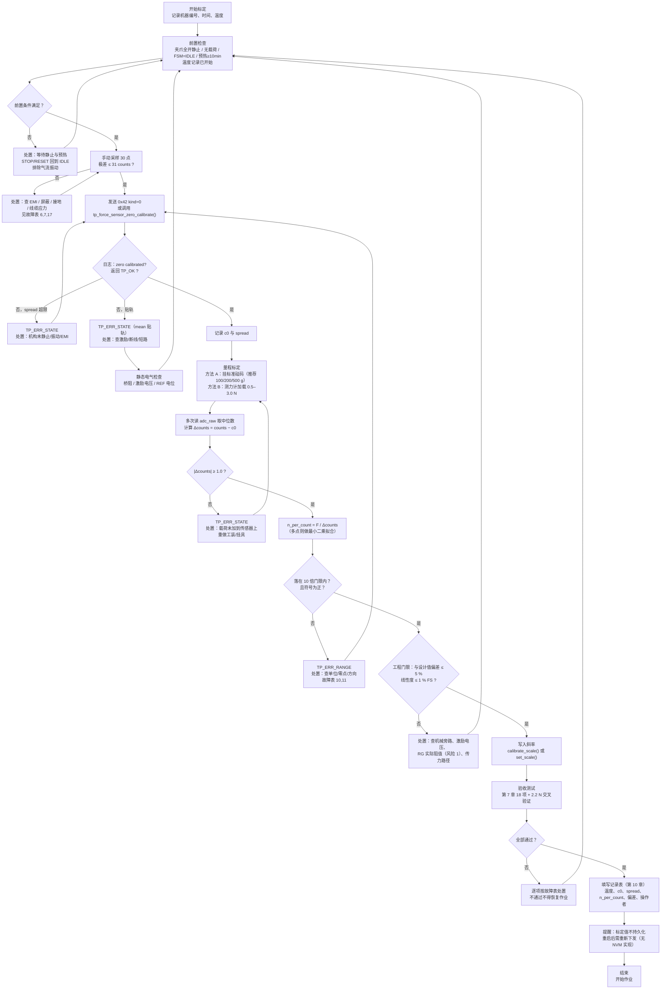

# 夹持力传感器标定程序（零点标定 / 量程标定 / 验收测试）

> ## ⚠️ 文档性质声明（必读）
>
> **本文档是设计文档 / 参考设计（Reference Design），所描述的标定流程"已设计完成，但尚未在实物硬件上执行过"。**
>
> 1. **本项目没有任何实物板卡被制造、装配或测量过。** 本文中出现的每一个 counts 读数、每一个 N/count 数值、每一条"判据"与"允许偏差"，都是基于 `firmware/Application/config.h` 的**设计常量**与数据手册参数推算出来的**设计预期值 / 验收判据**，**不是标定结果，也不是测量数据**。文中不含任何测量结果。
> 2. **本文描述的标定流程从未在任何实物上执行过**，包括零点标定、量程标定、温度循环、过载恢复。第 9 章的"数值算例"是**用于交叉验证的期望值**（即"若设计成立、则读数应当接近这些数字"），不表示这些读数曾经出现过。
> 3. 流程所需的计量器具（标准砝码组、测力计、恒温箱、温度记录仪等）**尚未采购、尚未使用**（见第 3 章）。在这些器具到位之前，本流程**无法执行**。
> 4. 所有器件型号一律标注为 **参考设计 / Recommended Implementation**；所有放大器指标均为**数据手册典型值量级**，不得作为验收依据。
> 5. 凡引用固件符号，均为仓库中**真实存在**的符号，写法为 `名称 = 数值`（出处文件）。本文不引用任何不存在的宏、函数或文件名。

---

## 摘要

本文给出第二代采茶机器人**夹持力通道**的完整标定与验收程序，面向现场操作者与测试工程师。它回答四个问题：**为什么只需标两个参数**、**用什么工具**、**每一步怎么做并且怎么判断成败**、**做完之后是否可接受**。

**核心结论一：这条通道由两个参数完整描述。** 固件里 counts 到牛顿的换算只有一行（`firmware/BSP/force_sensor.c` 的 `tp_force_sensor_counts_to_n()`）：

```
force_n = (counts − adc_zero_counts) × n_per_count
```

因此标定就是确定 `adc_zero_counts`（**零点**，单位为 counts）与 `n_per_count`（**斜率**，单位为 N/count）两个数。它们分别由 `tp_force_sensor_zero_calibrate()` 与 `tp_force_sensor_calibrate_scale()` 计算，也可以由 `tp_force_sensor_set_zero()` / `tp_force_sensor_set_scale()` 直接写入。设计默认值是 `TP_FORCE_CAL_ZERO_COUNTS = 2048.0f` 与 `TP_FORCE_CAL_SCALE_N_PER_COUNT ≈ 0.0080166 N/count`（`config.h` 第 8 节），也就是说**未标定的机器人也能读数，只是不准**——固件用一个显式标志表明这一点：`tp_force_sensor_init()` 把 `fs->calibrated` 置 0，注释写着 "design values, not a real calibration"。

**核心结论二：零点标定不是可选项。** 零点会随温度、机械预载与蠕变缓慢变化；`firmware/BSP/force_sensor.h` 用一段温漂论证说明"每次作业前零点标定不是可选的"（原文给出的是"20 K 摆幅约 0.1 mV → 0.13 N，占 2.2 N 目标的 6 %"）。**本文如实记录**：该论证的**定性结论成立**，但其中"0.1 mV → 0.13 N"这一步无法由 `config.h` 的常量复现（按输出端口径是 1.0 mN，按桥路输入端口径是 201 mN，见第 6.1 节的逐步算式）。因此本文**不依赖那个数字**来要求复零，而是依赖两个更强的理由：(a) 零点漂移的物理来源客观存在（电桥零点温漂、放大器失调漂移、机械预载/蠕变）；(b) **零点标定的门限 `TP_FORCE_ZERO_CAL_MAX_SPREAD_N = 0.25f` 只能发现"标定窗口内的运动与噪声"，无法发现"两次标定之间的缓慢漂移"**——门限管不了的事，只能靠纪律管。

**核心结论三：量程标定这条"现场通路"目前不完整。** 协议里 `TP_CMD_CALIBRATE_FORCE = 0x42` 的 `kind = 0` 是零点标定（`kind = 1` 在 `firmware/Core/app_tasks.c` 的 `on_calibrate_force()` 里直接返回 `TP_ERR_UNSUPPORTED`，注释说明量程标定"driven from the monitor tool with the mass already hanging"）；而 `tp_force_sensor_set_scale()` 的注释说它由"a host-side calibration file"调用，**该文件在仓库中不存在**。所以现状是：**量程标定必须通过固件内部路径（`tp_force_sensor_calibrate_scale()`）或尚未实现的主机标定文件路径完成**。本文给出两条可行路线（现场单点法 + 离线多点最小二乘法），并把这条缺口列入第 12 章。

**核心结论四：还有两个必须知道的行为细节**（均已在本文中写入操作步骤）：

- `tp_force_sensor_zero_calibrate()` 连续读 `TP_FORCE_ZERO_CAL_SAMPLES = 64u` 次 ADC，但 STM32F407 后端（`firmware/BSP/stm32f407/platform_stm32f407.c`）的 `tp_platform_adc_read()` **只返回最近一次发布的样本（约每 16 ms 更新一次），不触发新转换**。因此**在目标板上这 64 次读极可能来自同一个转换结果**，"64 次平均"退化为"1 次采样"，`spread` 会接近 0，**该门限事实上不起保护作用**。操作者必须在流程之外自行评估零点稳定性（第 4、9 章给出方法，注意**采样间隔必须大于 16 ms**）。
- **力通道的不同样本率只有 62.5 Hz**：`firmware/Core/app_sequence.c` 的 500 Hz 传感器任务 `tp_app_sensor_step()` 每 2 ms 读一次"最近发布"的样本，因此同一值会被重复送入滤波链约 8 次（`TP_ADC_DMA_BUFFER_LEN/2 = 8` 个扫描 × 2 ms = 16 ms）。其后果是：读数呈**阶梯状**（正常现象）、`TP_FILTER_MEDIAN_WINDOW = 5` 的 10 ms 中值窗口**短于保持时间因而剔不掉被保持的坏样本**；但尖峰检测**不会**因此锁存故障（`filters.c` 的参考值每样本更新，详见 `hardware/force_sensor.md` 第 6.3 节与本文第 4.5 节）。
- 通过 `0x42`（`kind = 0`）触发时，`on_calibrate_force()` 会**先调用 `tp_gripper_open()` 再立即采样**，中间没有等待机构停稳的时间。因此**必须在夹爪已经张开且静止之后再发这条命令**（第 4 章把它列为硬性前置条件）。

---

## 目录

1. [文档范围、读者与前置知识](#1-文档范围读者与前置知识)
2. [标定原理](#2-标定原理)
   - 2.1 [为什么两个参数就够了](#21-为什么两个参数就够了)
   - 2.2 [零点漂移的物理来源](#22-零点漂移的物理来源)
   - 2.3 [为什么必须在每次作业前做零点标定](#23-为什么必须在每次作业前做零点标定)
   - 2.4 [量程（斜率）的物理含义与非线性](#24-量程斜率的物理含义与非线性)
   - 2.5 [方向的约定与符号陷阱](#25-方向的约定与符号陷阱)
3. [所需工具](#3-所需工具)
4. [零点标定步骤](#4-零点标定步骤)
5. [量程 / 斜率标定步骤](#5-量程--斜率标定步骤)
   - 5.1 [方法 A：标准砝码法](#51-方法-a标准砝码法)
   - 5.2 [方法 B：已知力法（测力计 / 已标定参考传感器）](#52-方法-b已知力法测力计--已标定参考传感器)
   - 5.3 [多点标定与最小二乘拟合](#53-多点标定与最小二乘拟合)
   - 5.4 [两种方法的误差来源对比](#54-两种方法的误差来源对比)
   - 5.5 [固件门限与工程门限](#55-固件门限与工程门限)
6. [温度漂移与复查周期](#6-温度漂移与复查周期)
   - 6.1 [温漂的逐步算式（含不一致的如实说明）](#61-温漂的逐步算式含不一致的如实说明)
   - 6.2 [复查周期建议表](#62-复查周期建议表)
   - 6.3 [温度补偿的两种做法与本设计的现状](#63-温度补偿的两种做法与本设计的现状)
7. [验收判据](#7-验收判据)
8. [常见故障与排查表](#8-常见故障与排查表)
9. [完整数值算例](#9-完整数值算例)
10. [标定记录表模板](#10-标定记录表模板)
11. [标定流程总图](#11-标定流程总图)
12. [已知风险与未验证项（本文档专属）](#12-已知风险与未验证项本文档专属)
13. [附录 A：本文引用的固件符号速查](#13-附录-a本文引用的固件符号速查)

---

## 1. 文档范围、读者与前置知识

### 1.1 范围

| 在范围内 | 不在范围内 |
|---|---|
| 零点标定的前置条件、步骤、判据、失败含义 | 硬件电路设计与选型（见 `hardware/force_sensor.md`） |
| 量程标定的两种方法、算例、拟合方法 | 力环 PID 整定 |
| 温度漂移的评估与复查周期 | 夹爪机械机构设计 |
| 验收判据、故障排查、记录表 | 上位机软件的开发（缺失的主机标定文件属待办） |
| 这些流程依赖的固件符号与协议命令 | 修改任何固件源码 |

### 1.2 读者与前置知识

| 读者 | 前置知识 | 需要的章节 |
|---|---|---|
| 现场操作者 | 会用上位机监控工具、会读日志 | 3、4、7、8、9、10、11 |
| 测试工程师 | 会用万用表、示波器、天平、测力计 | 全部 |
| 固件/控制工程师 | 懂 counts/N 换算与状态机 | 2、5、6、12 |

### 1.3 操作者必须知道的四个"事实基线"

1. **本机器人目前没有实物板卡，也没有任何硬件测量数据**，本文所有数字都是设计推算；因此本文同时也是**首次实际标定时要拿来对照的期望值清单**。仓库中已存在的 `data/logs/host_scenario_A.csv`（1 kHz 逐周期仿真遥测）、`data/logs/pick_cycle.csv`、`data/logs/monitor_selftest.csv`、`build/host/tea_picking_robot_host.exe` 都是**仿真/上位机产物，不是硬件测量**，不能用来证明前端的精度、温漂或 EMC 表现。
2. **未标定的机器人仍会读数**：`tp_force_sensor_init()` 会加载设计值并打日志
   `"channel ready: zero %.1f counts, %.5f N/count (%.2f mN LSB), range +-%.1f N"`（`force_sensor.c`），
   即形如 `zero 2048.0 counts, 0.00802 N/count (8.02 mN LSB), range +-16.4 N`。**见到这条日志不代表已经标定**——判断是否标定过要看 `tp_force_sensor_t::calibrated`（由零点标定或量程标定置 1）。
3. **标定值不持久化**：`config.h` 第 8 节注释写标定默认值 "overwritten by NVM / host at runtime"，但**仓库中不存在 NVM/参数存储的实现**；因此复位或重新上电后，标定值会回到设计默认值，除非主机在启动后重新写入。这是操作者最容易踩的坑（见第 8 章最后一行）。
4. **力通道的采样节拍不是 500 Hz，而是"任务 500 Hz、新样本 62.5 Hz"**：`firmware/Core/app_sequence.c` 的 `tp_app_sensor_step()`（500 Hz 传感器任务）每个周期读一次 `tp_platform_adc_read(TP_ADC_FORCE, &counts)`，但目标端 `s_adc_latest[]` 只在每个 DMA 半缓冲结束时更新一次（`TP_ADC_DMA_BUFFER_LEN/2 = 8` 个扫描 × `TP_SENSOR_PERIOD_MS = 2 ms` = **16 ms**）。因此**同一个转换结果会被重复送入 `tp_force_sensor_update()` 约 8 次**，且 `TP_FILTER_MEDIAN_WINDOW = 5`（10 ms 窗口）**短于 16 ms 的保持时间**——中值滤波剔不掉"被硬件保持的坏样本"。这一条对操作者的含义很直接：**看到的 counts 是阶梯状的，不能按 500 Hz 去解读它**（详见 4.5 与第 12 章 C3）。

---

## 2. 标定原理

### 2.1 为什么两个参数就够了

`force_sensor.c` 里的换算函数是整条通道**唯一**的 counts→N 路径（标定例程与运行路径共用它，注释明确说这是刻意的，避免"重新实现一遍换算"）：

```c
float tp_force_sensor_counts_to_n(const tp_force_sensor_t *fs, uint16_t counts)
{
    if (fs == NULL) {
        return 0.0f;
    }
    return ((float)counts - fs->adc_zero_counts) * fs->n_per_count;
}
```

把它写成数学形式：

```
F[counts] = (counts − c0) × n_pc
其中 c0  = tp_force_sensor_t::adc_zero_counts  （零点，counts）
     n_pc = tp_force_sensor_t::n_per_count     （斜率，N/count）
```

这是一条**直线**：*两点确定一条直线*，所以"零点 + 斜率"两个参数就是完整描述。物理上这两点分别对应：

| 参数 | 物理含义 | 由什么决定 | 标定方式 |
|---|---|---|---|
| `c0` | 零载荷时的 ADC 读数（含桥路零点失调、放大器失调、REF 偏置，以及**机械预载**） | 电桥零点、放大器失调、中点参考电压、机构预紧 | **零点标定**（空载取均值） |
| `n_pc` | 单位 counts 对应多少牛顿（等效于 `1 / (k_fe_output × ...)`，即增益的倒数） | 传感器灵敏度、激励电压、放大器增益、ADC 参考、机械传力路径的刚度分配 | **量程标定**（已知载荷求斜率） |

> **重要推论**：任何**乘法性**误差（增益误差、激励漂移的静态部分、`RG` 容差、安装旁路造成的传力比损失）都只会体现为 `n_pc` 偏离设计值；任何**加法性**误差（失调、零点漂移、预载）都只会体现为 `c0` 偏离 2048 counts。这个二分法是排查问题的第一把钥匙：**"零点不对"和"量程不对"是两类完全不同的故障**。

### 2.2 零点漂移的物理来源

| 来源 | 机理 | 表现 | 是否被零点标定清除 |
|---|---|---|---|
| 电桥零点温漂 | 应变片栅格电阻与弹性体热膨胀失配 → 随温度产生虚假差模电压 | 零点随温度缓变（分钟级） | **是**（标定当时清除） |
| 放大器失调及其漂移 | 输入失调电压（数据手册典型值量级 25 µV）与其温度漂移（典型值量级 0.1 µV/°C） | 上电后随时间/温度缓变；**存在上电热平衡过程** | **是** |
| 中点参考（REF）漂移与噪声 | 1.65 V 参考的失调/漂移直接加到输出 | 缓变，与温度相关 | **是**（但随温度继续漂） |
| 机械预载 / 装配应力 | 螺栓扭矩、支架装配应力把力"焊"进传感器 | 换装/维修后跳变 | **是** |
| 粘接层蠕变与滞后 | 应变片粘接层在持续载荷下缓慢变形 | 加载/卸载后零点不完全回位（回零误差） | 部分（复零可清，但滞后本身不可清） |
| 电缆与机构应力 | 线缆拉力、机构热膨胀 | 随姿态/温度变化 | 否（会持续变化，必须消除机械原因） |
| PCB 漏电、热电动势 | 表面漏电（1 nA ≈ 2 mN）、接点温差（1 µV ≈ 2 mN） | 与湿度、温度梯度相关 | 部分 |

**操作者要记住的一句话**：识别到"零点随温度或姿态缓慢变化"是正常物理现象，用复零处理；识别到"零点跳变不回来"或"零点随姿态/线缆显著变化"则是**机械或电气故障**，要用第 8 章排查，不要用反复复零掩盖。

### 2.3 为什么必须在每次作业前做零点标定

`force_sensor.h` 给出的论证（原文）：

> "A 5 ppm/K mismatch on a 1005 mV full-scale signal is ~5 µV/K, which over a 20 K swing is about 0.1 mV -> 0.13 N. That is 6 % of the 2.2 N target, i.e. larger than the control loop's steady-state error budget, so a zero calibration at the start of each session is not optional."

**本文如实标注两件事**：

1. **该论证是设计估算，不是测量结果**。5 ppm/K 与 20 K 都是假设值；`TP_FORCE_FULLSCALE_MV = 1005 mV` 是设计值。
2. **该论证的最后一步（0.1 mV → 0.13 N，6 %）无法由 `config.h` 的常量复现**（详见第 6.1 节的逐步算式：输出端口径为 1.0 mN，桥路输入端口径为 201 mN）。这属于文档级算术缺陷，已列入 `hardware/force_sensor.md` 的风险 4。

**那么，"每次作业前复零"这个要求还站得住吗？站得住，理由换成更硬的两条：**

- **理由 A（物理）**：零点漂移的来源客观存在（2.2 表），其中"上电热平衡"与"机构装配应力"两类与温漂假设无关，**只要换了班次、动了机构、重新上电，零点就可能不同**。
- **理由 B（工程）**：零点标定的门限 `TP_FORCE_ZERO_CAL_MAX_SPREAD_N = 0.25f` 是**峰峰值**判据，它只能发现"标定窗口内信号在动"，**发现不了"两次标定之间的缓慢漂移"**。既然自动门限管不了慢漂移，唯一的经济对策就是**在每次作业开始时主动把零点重置到一个已知状态**。

**复零的收益（设计口径）**：复零把 2.2 表里所有"加法性"项清零，只留下"标定后残余"（见 `hardware/force_sensor.md` 第 9.10 节的误差预算，标定后残余约 21 mN RSS，其中热电动势项主导）。

### 2.4 量程（斜率）的物理含义与非线性

设计斜率：

```
TP_FORCE_CAL_SCALE_N_PER_COUNT = TP_ADC_MV_PER_COUNT / TP_FORCE_FRONTEND_MV_PER_N
                               = 0.805664 mV / 100.5 mV/N
                               = 0.0080166 N/count  （即 8.0166 mN/count）
```

`n_pc` 的**倒数**就是"每牛顿多少 counts"：`1 / 0.0080166 = 124.74 counts/N`。这个数在标定中非常好用：**任何一次载荷都能用它快速估算应看到的 counts**（见第 9 章算例）。

**非线性与滞后的来源**（这些是"单点标定"无法覆盖的，也是多点标定存在的理由）：

| 来源 | 量级（设计判据） | 检查方法 |
|---|---|---|
| 传感器自身非线性 | ≤ 0.1 % FS（目录典型值量级，须以数据手册为准） | 多点标定残差 |
| 机械传力路径的刚度非线性（支架、铰接、摩擦力） | 未知，可能大于传感器本身 | 上行/下行曲线对比（滞回） |
| 粘接层蠕变/滞后 | ≤ 0.1 % FS（判据） | 加卸载循环 |
| 夹爪机构摩擦（静/动摩擦切换） | 未知，可能造成 10–50 mN 级台阶 | 正反向加载对比 |

**结论**：在 2.2 N 目标处，总允许偏差按"读数的 ±5 %"（±110 mN）作为工程门限（第 5.5 节），而固件的 10 倍合理性门限只用于拦截单位错误之类的粗错。

### 2.5 方向的约定与符号陷阱

`tp_force_sensor_calibrate_scale()` 的注释写："Known load currently applied, in newtons. **Must be non-zero; the sign sets the direction.**" 也就是说：

```
n_pc = known_force_n / (counts − adc_zero_counts)
```

- 若**夹紧（压缩）方向使 counts 增大**（本设计的约定），则用**正**的 `known_force_n` 标定，得到**正**的 `n_pc`；
- 若用**拉伸方向**的载荷标定（例如把夹爪反向拉开），则会得到**负**的 `n_pc`。

**符号陷阱（必须知道）**：

| 函数 | 对符号的处理 | 后果 |
|---|---|---|
| `tp_force_sensor_calibrate_scale()` | 只用绝对值做合理性检查（`TP_FABS(new_scale)` 与 `FORCE_SCALE_DESIGN / FORCE_SCALE_PLAUSIBLE_FACTOR = 10.0f` 比较），随后**直接赋值** `fs->n_per_count = new_scale;` | **负斜率会被接受** |
| `tp_force_sensor_set_scale()` | 明确要求 `n_per_count > 0.0f`，否则返回 `TP_ERR_RANGE`，并打日志 `"scale %.6f rejected as implausible (design %.6f)"` | **负斜率会被拒绝** |

**后果**：如果误用一个拉伸方向的载荷做了量程标定，`calibrate_scale()` 会"成功"地写入一个负斜率，此后力环的符号就是反的（夹得越紧读数越小），力环会表现出**正反馈**特征。因此**验收时必须检查 `n_per_count` 的符号是否为正**（第 7 章验收判据第 6 行）。

**操作规则**：

1. 标定载荷**必须与工作载荷同向**（夹持 = 压缩方向）；
2. 记录里必须写下"标定方向"，不要只写"200 g"；
3. 标定完成后，用另一次**同向**的独立载荷复核（第 9 章算例 3）。

---

## 3. 所需工具

> **截至本文撰写时，下列工具全部"尚未采购、尚未使用"。** 撰写时仓库内**没有任何 BOM 或现货清单文件**可供核对（仅存在 `docs/interview_guide.md` 与 `firmware/Drivers/third_party/README.md` 两个 Markdown 文件），因此本文不假设任何器具已在库。

| # | 工具 | 规格建议（参考设计） | 用途 | 是否必须 |
|---|---|---|---|---|
| 1 | **标准砝码组** | 100 g / 200 g / 500 g；等级 **F2（推荐）或 M1（下限）**；带出厂检定证书 | 量程标定的"已知力"来源（方法 A） | **必须** |
| 2 | **砝码挂具 / 夹具** | 轻质、刚性、可平稳挂在夹爪力路径上；**自重必须已知或可去皮** | 把砝码的力按正确方向引入传感器；避免偏载 | **必须** |
| 3 | **测力计 / 已标定参考传感器** | 量程 0–20 N，精度优于 ±0.5 % 读数；带峰值保持 | 量程标定的第二独立通路（方法 B）；交叉验证 | 推荐（强） |
| 4 | **万用表** | 4.5 位以上，可测 mV 级直流 | 静态检查（桥阻、激励电压、REF 电位、放大器输出） | **必须** |
| 5 | **水平仪** | 气泡式，0.5 mm/m 级 | 保证砝码力方向与传感器主轴一致（消除偏载系统误差） | **必须** |
| 6 | **恒温箱 / 可编程温箱** | 5–50 °C，波动 ≤ ±1 K | 温度漂移测试（第 6 章、第 7 章） | 推荐（温度验收需要） |
| 7 | **温度记录仪** | ≥ 2 通道，分辨率 0.1 K，带记录 | 同步记录环境/机架温度与零点 counts | **必须**（否则温漂无法归因） |
| 8 | **防静电与清洁用品** | 防静电手环、离子风机、异丙醇、无绒布、防静电袋 | 保护 µV 级前端；清除导致漏电的助焊剂残留 | **必须** |
| 9 | **上位机监控工具（现有）** | 仓库中的 `host/robot_monitor.py`（可读 `SENSOR_RPT` 的 `adc_raw` 与 `force_mN`） | 读 counts、发命令、记录日志 | **必须** |
| 10 | **示波器** | ≥ 2 通道，≥ 20 MHz | 观察 PWM 载波与 ADC 触发相位、噪声形态 | 推荐（排查用） |
| 11 | **标定记录表** | 第 10 章的模板打印版或电子表格 | 可追溯性 | **必须** |
| 12 | **小砝码（约 5–20 g）** | 用于挂具去皮校验 | 验证挂具自重是否被正确计入 | 推荐 |

> **关于第 7 项（温度记录仪）为什么是"必须"**：本设计的**硬件上没有板温传感器**——`tp_adc_ch_t` 只有四路（无温度项）、后端 `s_adc_channel[]` 同样只有四路、`platform_stm32f407.h` 也不导出温度接口，协议字段 `temp_c_x10` 恒为哨兵 `TP_SENSOR_TEMP_UNAVAILABLE = 32767`（`config.h` 注释原话："参考设计没有板温传感器……一个把它渲染成 '0.0 C' 的上位机工具会主动误导"）。因此**软件温度补偿在当前硬件形态下不可能实现**，温度只能靠外部记录仪人工采集；没有温度记录，温漂既无法判据、也无法归因（详见 6.3）。

### 3.1 砝码与力的换算（g = 9.80665 m/s²）

```
F[mN] = m[g] / 1000 × 9.80665 × 1000 = m[g] × 9.80665   （因为 1 g = 0.001 kg）

100 g：F = 0.100 kg × 9.80665 m/s² = 0.980665 N
200 g：F = 0.200 kg × 9.80665 m/s² = 1.961330 N
500 g：F = 0.500 kg × 9.80665 m/s² = 4.903325 N
```

| 砝码 | 力 F | 占额定载荷（`TP_LOADCELL_RATED_N = 10.0f`） | 设计预期 counts（相对零点，用 124.74 counts/N） |
|---|---|---|---|
| 100 g | 0.980665 N | 9.8 % | 122.3 counts |
| 200 g | 1.961330 N | 19.6 % | 244.7 counts |
| 500 g | 4.903325 N | 49.0 % | 611.7 counts |
| 1000 g（**不推荐**） | 9.806650 N | **98.1 %** | 1223.4 counts（接近额定，且留给过载的裕量不足） |

**为什么不用 1 kg**：`9.807 N` 已达额定 10 N 的 98 %，任何挂具自重或偏载都可能把载荷推过额定点；且此处的目的在于**确定斜率**，不需要接近满量程（多点拟合用 100/200/500 g 三点的跨度已经足够）。

**g 的取值风险**：9.80665 m/s² 是**标准重力加速度**。实际当地的 g 与它相差可达 ±0.3 %（赤道约 9.7803，极地约 9.8322，纬度 45° 附近约 9.806）。若不做修正，0.3 % 的 g 误差直接变成 0.3 % 的斜率误差：

```
在 2.2 N 处的力误差 = 2.20 N × 0.003 = 6.6 mN   （小于 1 个 LSB，可接受）
```

**处理建议**：优先用**当地重力加速度**（可由测力计比对得到），或至少在记录表上写明所用的 g 值；若使用测力计做方法 B，则 g 的影响被完全绕开。

**砝码等级的作用**：对 200 g 砝码而言，只要其质量相对允差 ≤ 0.05 %（= 100 mg），它对斜率标定的贡献就 ≤ 1 mN。F2/M1 等级的实际允差远优于此（具体数值请按 OIML R111 或砝码的检定证书查取；**本文不引用具体允差数字以免误引**）。

### 3.2 挂具自重的处理（最容易出错的一步）

**问题**：挂具本身有质量 `m_h`。若先做零点标定（此时挂具**已经挂在**夹爪上），那么 `m_h` 就被算进了零点，后续加砝码得到的 Δcounts 只对应砝码质量——这**在数学上是正确的**（零点吸收了挂具）。但若**先零后挂**（零点时无挂具，之后才挂上挂具 + 砝码），则必须把挂具计入：

```
F_total = (m_hanger + m_weight) × g
```

**两种正确做法（二选一，并在记录表上写明用了哪一种）**：

| 做法 | 步骤 | 优点 | 风险 |
|---|---|---|---|
| **甲：挂具参与零点** | 先把挂具挂好 → 静止 → 零点标定 → 再加砝码 | 挂具自重被零点吸收，之后的 Δcounts 只对应砝码质量，计算最简单 | 零点里"含着一个 0.05 N 量级的载荷"，若挂具会蠕变/晃动则污染零点 |
| **乙：挂具计入载荷** | 先空载零点标定 → 挂上挂具与砝码 → 用 `F_total = (m_h + m_w)·g` | 零点更"干净" | 必须**准确知道挂具质量**（用天平称），否则引入系统误差 |

**量化示例**：若挂具 5 g（= 49 mN，6.1 counts），而 200 g 砝码的 Δcounts 是 244.7 counts，**忽略挂具会造成 49/1961 ≈ 2.5 % 的斜率误差**——这是本流程中最容易发生的量级错误之一。

---

## 4. 零点标定步骤

### 4.1 触发方式

| 方式 | 入口 | 说明 |
|---|---|---|
| 协议命令 | `TP_CMD_CALIBRATE_FORCE = 0x42`，payload `u8 kind`，`kind = 0` | 由 `firmware/Core/app_tasks.c` 的 `on_calibrate_force()` 处理：先检查 FSM 状态，再 `tp_gripper_open()`，然后调用 `tp_force_sensor_zero_calibrate()` |
| 固件内部 | `tp_force_sensor_zero_calibrate(fs)` | 由单元测试或应用内部调用 |
| `kind = 1` | **不可用** | `on_calibrate_force()` 对 `kind = 1` 返回 `TP_ERR_UNSUPPORTED`（注释：量程标定由监控工具在"质量已经挂上"的状态下驱动） |

### 4.2 前置条件（硬性）

| # | 条件 | 判据 / 检查方法 | 不满足的后果 |
|---|---|---|---|
| P1 | **夹爪完全张开且机构静止** | `tp_gripper_is_open()` 为真；目视无运动；编码器读数稳定 | 固件会先 `tp_gripper_open()` 再**立即**采样，机构若还在动，采样就落在运动中 |
| P2 | **无任何负载**（无茶芽、无砝码、无人手接触、无挂具或已按 3.2 处理） | 目视 + 轻触确认 | 零点被"烧进"一个载荷，之后所有读数继承该误差（`force_sensor.c` 的注释正是为此） |
| P3 | FSM 处于 `TP_STATE_IDLE` | 固件检查；否则打日志 `"zero calibration refused: robot is in %s"` 并返回 `TP_ERR_STATE` | 命令被拒 |
| P4 | **预热完成** | 建议 ≥ 10 min（若完成过热漂移测试，采用该测试给出的平台时间） | 上电热平衡未完成时标定，零点会在之后继续漂走 |
| P5 | 环境稳定：远离气流、振动、阳光直射、大功率设备启停 | 目视；温度记录仪读数稳定 | 峰峰值超限 → 标定被拒（或更糟：勉强通过但零点不准） |
| P6 | 传感器与线缆无外力（不拉、不压、不压线） | 目视检查应力释放 | 线缆应力成为零点的一部分 |
| P7 | 温度已记录（记录起始时间与温度） | 记录表 | 无法做温漂归因 |
| P8 | **不要依赖 `TP_MODE_CALIBRATE` 来禁止运动** | 注意：`tp_app_start()` 只在 `app->mode == TP_MODE_IDLE` 时拒绝启动（`firmware/Core/app_sequence.c`），因此 `TP_MODE_CALIBRATE = 3` **并不会**阻止一次开始采茶周期；真正的保护是 P3 的 FSM 检查 + 不要在此期间发 `START_PICK`（`0x11`） | 若误发 `START_PICK`，周期会启动，机构开始运动 |

### 4.3 步骤

| 步 | 动作 | 判据 / 期望输出 |
|---|---|---|
| 1 | 完成 P1–P8，把温度、时间、机器人标识记入记录表 | 记录表已开始填写 |
| 2 | 确认机体静止 ≥ 10 s（无振动源） | 目视；可用示波器/日志观察 counts 是否稳定 |
| 3 | （可选，推荐）用监控工具**手动采样**：以 1 Hz 读取 `SENSOR_RPT` 的 `adc_raw` 共 30 次，计算极差与标准差 | 极差 ≤ **31 counts**（= `TP_FORCE_ZERO_CAL_MAX_SPREAD_N = 0.25f` N ÷ 8.0166 mN）；标准差 ≤ 6 counts。**这一步是弥补固件门限失效的关键**（见 1.3 与 4.5） |
| 4 | 发送 `TP_CMD_CALIBRATE_FORCE = 0x42`，`kind = 0` | 收到 ACK（`TP_CMD_ACK = 0x80`）或 NACK（`TP_CMD_NACK = 0xE0`，`err_code` 为 `tp_status_t` 的取负值） |
| 5 | 读成功日志 | 期望日志文本（`force_sensor.c`）：<br/>`zero calibrated: %.1f counts from %lu samples, spread %.3f N`<br/>即形如：`zero calibrated: 2051.3 counts from 64 samples, spread 0.096 N` |
| 6 | 核对返回状态与日志一致性 | 成功 = `TP_OK`；被拒 = `TP_ERR_STATE`；ADC 读失败 = `TP_ERR_IO` |
| 7 | 读 `SENSOR_RPT`（`0x21`）的 `force_mN` | 应接近 **0 mN**（零点刚被设为当前均值，因此残差只有滤波链的过渡） |
| 8 | 确认状态标志：`calibrated = 1`、故障被清、跟踪被复位 | 固件在成功路径上依次设置 `fs->calibrated = 1`、`fs->last_zero_cal_ms`、`fs->fault = 0`，并调用 `tp_force_sensor_reset_tracking(fs)`（清滤波历史与统计） |
| 9 | 等待 ≥ 2 s，再读一次 `force_mN` 与 `adc_raw` | 读数应稳定在 ±0.05 N 内（设计判据，未验证） |
| 10 | 记录：零点 counts、`spread`、时间、温度、操作者 | 见第 10 章模板 |

### 4.4 失败工况与含义

| 日志 / 返回值 | 触发条件（源码事实） | 含义 | 处置 |
|---|---|---|---|
| `zero calibration rejected: spread %.3f N > %.3f N (signal moving?)` → `TP_ERR_STATE` | `spread_n = (max_counts − min_counts) × fs->n_per_count` 超过 `TP_FORCE_ZERO_CAL_MAX_SPREAD_N = 0.25f` | **信号在 64 个采样窗口内还在动**：夹爪未停稳、有人碰设备、有气流/振动、砝码还在晃、PWM 干扰尖峰 | 等待静止、排除干扰后重试；连续 3 次失败按第 8 章排查 |
| `zero calibration rejected: mean %.1f counts is at a rail` → `TP_ERR_STATE` | 均值 ≤ `TP_SENSOR_ADC_MIN_COUNTS = 5u` 或 ≥ `TP_SENSOR_ADC_MAX_COUNTS = 4090u` | **贴轨**：几乎确定是电气故障（激励断线、信号断线、短路、供电缺失） | 断电做第 1 章式的静态检查（桥阻、激励、连线），不要反复重试 |
| `zero calibration aborted: ADC read failed` → `TP_ERR_IO` | `tp_platform_adc_read(TP_ADC_FORCE, &counts)` 返回非 `TP_OK` | 硬件后端没有有效样本（目标端 `s_adc_valid[TP_ADC_FORCE] == 0`，即 ADC/DMA 尚未发布过样本） | 检查平台初始化与 DMA 是否在跑（`tp_platform_init()` 是否成功、ADC 中断优先级配置） |
| 返回 `TP_ERR_PARAM` | `fs == NULL` 或 `initialised == 0` | 通道未初始化 | 检查启动顺序 |
| `zero calibration refused: robot is in %s` | `on_calibrate_force()` 里 FSM 状态不是 `TP_STATE_IDLE` | 周期进行中或处于故障态 | 先 `STOP`（`0x12`）/`RESET`（`0x13`）回到 IDLE |

### 4.5 关于"64 个样本"的实际含义（操作者必读）

| 环境 | 采样行为 | `spread` 判据是否有效 |
|---|---|---|
| **STM32F407 目标端** | `tp_platform_adc_read()` 返回 `s_adc_latest[TP_ADC_FORCE]`（`platform_stm32f407.c`），由 `adc_publish_half()` 在 DMA 半缓冲中断里更新，周期 = `TP_ADC_DMA_BUFFER_LEN/2 × TP_SENSOR_PERIOD_MS = 8 × 2 ms = 16 ms`；而 `tp_force_sensor_zero_calibrate()` 的 64 次背靠背读发生在**几微秒**内 | **基本无效**：64 个值极可能来自同一个转换结果 → `spread ≈ 0` → 门限不会报警 |
| **host 后端（仿真）** | `tp_platform_adc_read()` 每次调用都向物理模型取样（`tp_plant_read_force_counts()`）；当通过 `tp_plant_set_force_noise()` 打开噪声后，每次调用都重新抽取噪声 | **有效**：64 个样本相互独立 |

**同一机制在运行期的三个连带后果**（由代码语义推得，**尚未在实物上验证**）：

| # | 后果 | 依据 |
|---|---|---|
| 1 | 力通道的**不同样本率只有 62.5 Hz**（16 ms），而任务节拍是 500 Hz → 消费到的 `counts` 是**阶梯状**的：同一值连续出现约 8 次 | `app_sequence.c` 的 `tp_app_sensor_step()` + `platform_stm32f407.c` 的 `adc_publish_half()` |
| 2 | **中值滤波对"被保持"的坏样本失效**：`TP_FILTER_MEDIAN_WINDOW = 5` 对应 10 ms 窗口，短于 16 ms 的保持时间，坏值在窗口内占多数 | `config.h` 的 `TP_FILTER_MEDIAN_WINDOW`；`filters.c` 的 `tp_filter_median_update()` |
| 3 | **但尖峰检测不会因此锁存故障**：`filters.c` 的 `tp_spike_detector_update()` 让参考值在**每个**样本上更新（含尖峰），故一次坏转换只产生"上跳 + 回落"两次计数，`streak` 到不了 `FORCE_SPIKE_TRIP = 8u`；因此**它只增加 `tp_force_sensor_spike_count()`，不会把通道标成 faulty** | `filters.c` 的 `tp_spike_detector_update()` 及其注释；`force_sensor.c` 的 `FORCE_SPIKE_TRIP = 8u` |

**操作结论**：

- 在目标板上，**不要指望固件替你判断零点稳定性**。必须按 4.3 第 3 步"用监控工具以 ≥1 Hz 采样 30 点并计算极差"来获得同等保护——**采样间隔必须大于 16 ms 才有意义**（例如 1 Hz 或 10 Hz），否则你只是在重复读同一个数。
- 判读力数据时按 **62.5 Hz 的新样本率**去理解：两帧 `SENSOR_RPT` 之间读数完全不变是正常现象，不代表"传感器卡住"；连续 1 s 以上完全不变才可疑（见第 8 章）。
- 这一条已列入第 12 章 C3（并已列入 `hardware/force_sensor.md` 的风险 3 与 6.3 节）。

---

## 5. 量程 / 斜率标定步骤

> **前提：先完成零点标定。** `tp_force_sensor_calibrate_scale()` 使用的是当前 `fs->adc_zero_counts`；若零点还是设计默认值 2048，则斜率里会混入零点误差（202.5 counts 误差 = 1.6 N 的力误差）。固件**不会**替你检查这一点。

### 5.1 方法 A：标准砝码法

**原理**：

```
已知载荷 F（由砝码质量与 g 算出）在传感器上产生一个 counts 偏转 Δcounts
    Δcounts = counts_loaded − adc_zero_counts
    n_per_count = F / Δcounts
```

**步骤**：

| 步 | 动作 | 判据 |
|---|---|---|
| A1 | 确认零点标定已完成（`calibrated = 1`），记录 `c0` | 记录表有 `c0` |
| A2 | 按 3.2 选定"挂具处理方式"（甲/乙）并记录 | 记录表已写明 |
| A3 | 挂上 200 g（或按多点方案挂 100/200/500 g），静置 ≥ 5 s | 读数稳定 |
| A4 | 读取 `SENSOR_RPT.adc_raw` 多次（**≥ 10 次，取中位数**） | 中位数用于抑制单次噪声 |
| A5 | 计算 `Δcounts` 与 `n_per_count = F / Δcounts` | 见第 9 章算例 2 |
| A6 | 检查 `|Δcounts| ≥ 1.0`（固件门限） | 小于 1 count 会被拒（`scale calibration rejected: deflection %.1f counts` → `TP_ERR_STATE`） |
| A7 | 检查与设计值的偏差是否在 `FORCE_SCALE_PLAUSIBLE_FACTOR = 10.0f` 倍以内 | 超出会被拒（`TP_ERR_RANGE`） |
| A8 | 写入：调用 `tp_force_sensor_calibrate_scale(fs, F)`；或离线算出后调用 `tp_force_sensor_set_scale(fs, n_pc)` | 见 5.5 的门限说明 |
| A9 | 检查 `n_per_count` **符号为正** | 负值说明标定方向反了（2.5 节） |
| A10 | 用**另一次独立载荷**复核（例如 500 g），预期 counts = F / n_pc | 与设计预期相差 ≤ 5 %（工程门限） |

**固件门限的精确语义**（`force_sensor.c`）：

```c
#define FORCE_SCALE_DESIGN TP_FORCE_CAL_SCALE_N_PER_COUNT     /* ≈ 0.0080166 */
#define FORCE_SCALE_PLAUSIBLE_FACTOR 10.0f

接受区间（两处检查，同为 10 倍）：
    FORCE_SCALE_DESIGN / 10.0f  ≤  |new_scale|  ≤  FORCE_SCALE_DESIGN × 10.0f
    即约 [0.00080166, 0.080166] N/count
```

**这个区间极宽（两个数量级）**，它只能拦住"把 mN 当 N 传"这类粗错，**不能用作精度判据**；精度判据见 5.5 与第 7 章。

### 5.2 方法 B：已知力法（测力计 / 已标定参考传感器）

**原理**：用一台**独立的力参考**（测力计或已标定的参考力传感器）施加已知力，同时读被测通道的 counts，同样用 `n_pc = F / Δcounts` 求解。

**实施要点**：

| 要点 | 说明 |
|---|---|
| 力的方向 | 必须与工作方向一致（夹持 = 压缩）；若测力计只能推不能拉，需做工装 |
| 加载位置 | 必须与砝码法/实际工况的受力点一致，否则偏载会改变斜率 |
| 读数同步 | 测力计读数与被测通道读数应**同时**采集；慢加载时取同一时刻的稳态值 |
| 逐级加载 | 建议 0.5 / 1.0 / 1.5 / 2.0 / 3.0 N 五级，既做斜率也看线性 |
| 参考精度 | 参考的不确定度直接进入 `n_pc`；建议优于 ±0.5 % 读数 |

### 5.3 多点标定与最小二乘拟合

即使固件只提供**单点** `tp_force_sensor_calibrate_scale()`，也建议按多点采集、离线拟合，然后用 `tp_force_sensor_set_scale()` 把拟合斜率写回。

**采集表（示例结构）**：

| 序号 i | 载荷 F_i（N） | 读数 counts_i | Δcounts_i = counts_i − c0 |
|---|---|---|---|
| 1 | 0.980665 | （待填） | |
| 2 | 1.961330 | （待填） | |
| 3 | 4.903325 | （待填） | |

**最小二乘拟合**（x = Δcounts，y = F，拟合 y = m·x + b）：

```
n = 数据点数
m = (n·Σ(x_i y_i) − Σx_i·Σy_i) / (n·Σx_i² − (Σx_i)²)        ← 斜率（N/count），即 n_per_count
b = (Σy_i − m·Σx_i) / n                                     ← 截距（N），理论上应接近 0
线性度（相对满量程）：
    残差 r_i = y_i − (m·x_i + b)
    最大残差 max|r_i|
    线性度 = max|r_i| / F_满量程 × 100 %
    其中 F_满量程 可取 TP_FORCE_MAX_N = 5.00f（工程口径）或 TP_LOADCELL_RATED_N = 10.0f（传感器口径）
决定系数：
    R² = 1 − Σr_i² / Σ(y_i − ȳ)²
不确定度（斜率的标准误，n 点）：
    s_m = sqrt( Σr_i² / (n − 2) / Σ(x_i − x̄)² )
```

**把拟合结果写回固件**：

```
tp_force_sensor_set_scale(fs, m)        /* m 必须 > 0，且在 10 倍门限内 */
```

**为什么要多点而不是单点**：

1. 单点标定把"该点的随机误差"直接当成了斜率误差——`calibrate_scale()` **只读一次 ADC**（源码：`tp_platform_adc_read(TP_ADC_FORCE, &adc)` 一次），因此 1 count 的读数噪声（≈ 8 mN）就会造成 `1/244.7 = 0.41 %` 的斜率误差；两点、三点拟合可把随机分量压下来；
2. 多点拟合同时给出**线性度**与**截距 b**。若 `b` 显著不为 0（例如超过 0.02 N），说明存在**非线性或零点未标定**，这在单点标定里完全看不出来；
3. 斜率是乘法性参数，一旦错就**在大载荷处误差最大**（2.2 N 处 1 % 的斜率误差 = 22 mN，5 N 处 = 50 mN）。

**建议的拟合点选择**：三点（100 g / 200 g / 500 g）覆盖 0.98–4.90 N，跨越目标点 2.2 N 的两侧，是最经济的选择。若只做单点，**请选择 200 g（1.961 N）**——它与 2.2 N 目标最接近，该点误差对工作点的传导最小。

### 5.4 两种方法的误差来源对比

| 误差源 | 方法 A（砝码法） | 方法 B（已知力法） | 量级 / 处置 |
|---|---|---|---|
| **重力加速度 g 的取值** | **是**（用 9.80665 而当地 g 不同 → 最大 ±0.3 %） | 否（测力计直接给力） | A：使用当地 g 或与测力计比对改正；0.3 % → 2.2 N 处 6.6 mN |
| 砝码质量等级 | **是**（等级越低允差越大；只要 ≤ 0.05 % 即 ≤ 1 mN） | 否 | A：用 F2/M1 |
| **挂具自重未计入** | **是**（5 g 挂具忽略即 2.5 % 斜率误差） | 是（工装自重同样要计入/去皮） | 两法都必须按 3.2 处理 |
| 加载方向不垂直（与主轴成角 θ） | **是**：有效分量 = F·cosθ，θ = 5° → −0.38 % | **是** | 用水平仪 + 万向挂点；0.38 % → 2.2 N 处 8.4 mN |
| 偏载（力作用点偏离主轴） | **是** | **是** | 用与工况一致的受力点；验收判据见第 7 章 |
| 参考传感器精度 | 不适用 | **是**：建议优于 ±0.5 % | B：0.5 % → 2.2 N 处 11 mN |
| 读数同步 | 否（静态载荷） | **是**（慢加载时两路读数时刻差 → 滞后/蠕变） | B：稳态取值、逐级停稳后读 |
| 单次 ADC 采样噪声 | **是**（`calibrate_scale()` 只读一次） | **是** | 两法都建议多次读取取中位数、或多点拟合 |
| 机构摩擦/滞回 | **是** | **是** | 正向加载后再反向卸载对比（第 7 章） |
| 温度 | 是（若两次读数间温度变化） | 是 | 记录温度；同一温区完成标定 |

### 5.5 固件门限与工程门限

| 层次 | 门限 | 值 | 作用 |
|---|---|---|---|
| 固件（防御性） | `FORCE_SCALE_PLAUSIBLE_FACTOR = 10.0f` | `[0.00080166, 0.080166] N/count` | 拦截单位错误、零点错误等粗错；**不是精度判据** |
| 固件（防除零） | `|Δcounts| ≥ 1.0` | 偏转小于 1 count 即拒绝 | 拦截"载荷没加到传感器上" |
| **工程（本流程）** | 与设计值偏差 | **≤ ±5 %**（推荐首标）；后续复标 ≤ ±2 % | 精度判据：5 % → 2.2 N 处 110 mN |
| **工程（本流程）** | 线性度 | **≤ 1 % FS**（FS 取 5 N） | 多点拟合残差 |
| **工程（本流程）** | 截距 | **|b| ≤ 0.02 N** | 检查是否遗漏零点标定或存在非线性 |

> **必须写清的对比**：固件的 10 倍门限（两个数量级）与工程的 ±5 % 门限（一个百分点级）**相差约 20 倍**。因此"固件接受了"绝不等于"标定合格"。所有验收都按第 7 章的工程判据执行。

---

## 6. 温度漂移与复查周期

### 6.1 温漂的逐步算式（含不一致的如实说明）

**照 `force_sensor.h` 的写法逐步展开**：

```
第 1 步：桥路满量程信号（设计值）
    TP_FORCE_FULLSCALE_MV = 100.5 mV/N × 10 N = 1005 mV

第 2 步：5 ppm/K 的失配折算成电压漂移
    5 ppm/K × 1005 mV = 5.025 µV/K ≈ 5 µV/K

第 3 步：20 K 摆幅内的累计漂移
    5.025 µV/K × 20 K = 100.5 µV ≈ 0.1 mV

第 4 步：换算成力（关键，存在两种口径）
    输出端口径：0.1005 mV ÷ TP_FORCE_FRONTEND_MV_PER_N (100.5 mV/N) = 1.0 mN
    桥路输入端口径：0.1005 mV ÷ TP_LOADCELL_MV_PER_N (0.5 mV/N) = 201 mN
    占 2.2 N 的比例：1.0 mN → 0.046 %；201 mN → 9.1 %
```

**如实说明**：`force_sensor.h` 给出的结论是 **0.13 N（占 2.2 N 的 6 %）**，而**这个数字用上述任何一种口径都无法复现**（输出端差 130 倍，输入端差 1.5 倍）。这里记录的是**文档级算术缺陷**，不是测量分歧。

**它对本流程的影响**：无实质影响，因为**复零要求在两种口径下都成立**（1.0 mN 与 LSB 同量级；201 mN 则是"必须复零"的最强论据），而且复零的真正理由已在 2.3 节换成与温漂数字无关的两条。但**必须在实物阶段测量**（第 7 章验收判据的"零点漂移"一行、第 4 章的 P4 预热判据都依赖它）。

**另一项可独立计算的温漂（放大器失调漂移）**，用于交叉核对：

```
失调漂移（数据手册典型值 0.1 µV/°C）× 20 K = 2 µV（输入参考）
折算力：2 µV ÷ 0.5 mV/N = 4.0 mN
输出端口径复核：2 µV × 201 = 402 µV；402 µV ÷ 100.5 mV/N = 4.0 mN   ✅ 两口径一致
占 2.2 N 的比例：0.18 %
```

**结论**：按设计口径，**桥路零点温漂与放大器失调漂移都在 1–4 mN 量级（若采用保守的桥路输入端口径则为 201 mN）**，因此温漂本身不是主要矛盾；**主要矛盾是"零点会缓慢变化这一事实"与"门限发现不了它"**——后者才是每班次复零的纪律依据。

### 6.2 复查周期建议表

> 下表所有判据都是**设计判据，尚未用实物验证**。

| 周期 | 项目 | 触发条件 | 判据（设计） | 失败处置 |
|---|---|---|---|---|
| **每次开机** | 预热 | 上电 | ≥ 10 min（或采用在实物上测得的平台时间）后再标定 | 延长预热 |
| **每次开机** | 零点标定 | 上电完成、机构静止 | `spread ≤ 0.25 N`（固件门限）+ 手动 30 点极差 ≤ 31 counts | 见 4.4 |
| **每次开机** | 自检读数 | 零点标定后 | `force_mN` 在 ±50 mN 内、`adc_raw` 不在贴轨区 | 见第 8 章 |
| **每班次** | 零点复标 | 作业开始前、换机构后、环境温度变化 > 5 K 后 | 同上；并与上一班次零点比较：**差异 ≤ 0.10 N**（12.5 counts） | 差异大 → 查温度记录与机械；若随温度单调，记录并考虑缩短复标间隔 |
| **每班次** | 单点量程复核 | 每班次至少一次用 200 g 复核 | 读数与预期（244.7 counts）相差 ≤ 5 % | 超差 → 做完整量程标定（第 5 章） |
| **每周** | 量程复标（单点） | 每周首班 | `n_per_count` 与前次相差 ≤ 2 % | 超差 → 多点标定 + 查机械 |
| **每周** | 噪声与尖峰 | 静置 10 min | 原始 pk-pk ≤ 0.25 N；`tp_force_sensor_spike_count()` 无增长 | 见第 8 章 |
| **每月** | 偏载与滞回 | 按第 7 章 | 偏载 ≤ 1 % 读数；滞回 ≤ 1 % FS | 查力引入件与安装 |
| **每季度** | 完整标定（多点 + 温度） | 按第 5、6、7 章 | 全部验收项通过 | 逐项排查 |
| **每季度** | 温漂评估 | 恒温箱 5/25/45 °C | 零点漂移 ≤ 0.20 N；量程漂移 ≤ 0.2 % | 缩短复标间隔或引入温度补偿 |
| **维修/换件后** | 完整标定 + 过载恢复测试 | 拆装传感器、换线缆、换放大器件、换机械件 | 按第 7 章全部项 | 不通过不得恢复作业 |
| **任何故障跳闸后** | 故障清除 + 零点复标 + 量程复核 | `force_control.c` 跳闸（`TP_GRIP_FAULT`）后 | `tp_force_control_clear_fault()` 需先满足 `force_feedback_n ≤ TP_FORCE_SOFT_LIMIT_N = 3.50f`；`tp_force_sensor_clear_fault()` 需先脱离贴轨区 | 若 `clear_fault` 返回 `TP_ERR_FAULT_ACTIVE`，说明仍贴轨 → 电气故障 |

### 6.3 温度补偿的两种做法与本设计的现状

| 做法 | 原理 | 优点 | 缺点 | 本设计现状 |
|---|---|---|---|---|
| **软件查表 / 多项式补偿** | 用温度传感器读温度，按预先标定的"零点漂移–温度"曲线修正 `c0` | 灵活、可迭代、无需改硬件 | 需要温度数据与实物测量曲线；需要可靠的板温测量；补偿本身有不确定度 | **未实现**（且没有温度采样代码） |
| **硬件零漂补偿** | 用与工作片同批的**补偿片（dummy gauge）**接在桥路的相邻臂上，使其对温度敏感而与应变不敏感；或用热敏电阻网络向 REF 注入补偿电压 | 快、无需软件 | 需要选片匹配；补偿范围有限；会增加桥路功耗 | **未实现** |
| 恒温 | 把前端置于恒温（加热/温控） | 从根上消除温漂 | 功耗、体积、复杂度 | 不考虑 |

**本设计的温度相关现状（已核实，逐条给出出处）**：

- 协议里**有**温度字段：`tp_payload_sensor_t` 的 `int16_t temp_c_x10`（单位 0.1 °C，`protocol_types.h`）；
- `config.h` 第 7 节定义了哨兵值并在注释里写明了理由（原文逐字引用）：

  ```c
  /**
   * @brief Sentinel reported in the `temp_c_x10` field when no sensor is fitted.
   *
   * The reference design has no board-temperature sensor, so the field reports
   * this value rather than a plausible-looking zero.  A host tool that renders
   * "0.0 C" would be actively misleading; "3276.7 C" is obviously a sentinel.
   */
  #define TP_SENSOR_TEMP_UNAVAILABLE (32767)
  ```

  译文：**参考设计没有板温传感器，所以该字段上报这个值，而不是一个"看起来合理的 0"。一个把它渲染成 "0.0 C" 的上位机工具会主动误导使用者；而 "3276.7 C" 显然是一个哨兵值。**
- `firmware/Core/app_tasks.c` 的 `on_get_sensor()` 明确把 `out->temp_c_x10` 赋成 `(int16_t)TP_SENSOR_TEMP_UNAVAILABLE`，注释同样说明"参考设计上没有板温传感器，报告一个编造的值比报告哨兵更糟"；
- **仓库中不存在任何温度采样或温度补偿代码**：`tp_adc_ch_t`（`bsp_types.h`）只有四路（`TP_ADC_FORCE`、`TP_ADC_CURRENT_JOINT`、`TP_ADC_CURRENT_GRIPPER`、`TP_ADC_VBUS`），**没有温度通道**；STM32F407 后端的 `s_adc_channel[]` 同样只有这四路；`platform_stm32f407.h` 也不导出任何温度读取接口。

**因此，得出本文的一条硬结论**：

> **本设计没有板温传感器，所以在当前硬件形态下，软件温度补偿是不可能的。**
>
> 理由不是"没写代码"，而是"**没有温度输入**"：无论软件查表法还是多项式补偿法，都必须先有一个可读的温度量；而当前硬件既没有传感器、也没有温度 ADC 通道、也没有对外接口。**在硬件形态改变（增加温度传感通道）之前，任何形式的自动温度补偿都无从实现。**

**由此产生的操作约束（本流程据此设计）**：

| 约束 | 具体做法 | 出处/判据 |
|---|---|---|
| 温度只能**人工记录** | 每次标定与每次复零，都必须用**外部温度记录仪**记录环境/机架温度，并写入第 10 章记录表 | 第 3 章工具表第 7 项（**尚未采购**） |
| 温度相关判据只能**靠定期重标** | 温度引起的零点漂移靠"每班次复零 + 温度变化 > 5 K 时立即复零"来消除，而不是靠补偿 | 6.2 复查周期表 |
| 上位机不应把 `temp_c_x10` 当作真实温度 | 该字段恒为 `32767`（= 3276.7 °C 的哨兵），监控工具必须识别并显示为"未安装/不可用"；否则会误导操作者 | `config.h` 的 `TP_SENSOR_TEMP_UNAVAILABLE` 注释 |
| 若将来引入温度通道 | 补偿的正确落点是把修正量加到 `adc_zero_counts`（**加法性**项），而**不要**去动 `n_per_count`（除非确实要补偿灵敏度温漂，那是另一个标定维度） | 2.1 的两参数模型 |
| 温度数据同时是**归因工具** | 当零点 counts 与温度记录同步变化时，可判定为"正常温漂"；若与温度无关地跳变，则应查机械/线缆/电气（第 8 章） | 2.2 零点漂移来源表 |

---

## 7. 验收判据

> **本表全部判据均为"设计判据，尚未用实物验证"。** 所有 counts 数值按 `TP_FORCE_CAL_SCALE_N_PER_COUNT ≈ 0.0080166 N/count`（即 124.74 counts/N）折算。

| # | 项目 | 判据（设计） | 测量方法 | 失败处置 |
|---|---|---|---|---|
| 1 | **零点重复性** | 连续 5 次"空载→零点标定"的 `c0` 极差 ≤ **0.10 N**（12.5 counts） | 重复 4.3 步骤 5 次，记录 `c0` | 查机械预载/线缆应力/热平衡；超差则查 10 章（热电动势） |
| 2 | **零点漂移（同一温区，60 min）** | 漂移 ≤ **0.05 N**（6.2 counts） | 静置 60 min，每 1 min 记 `adc_raw` | 查热平衡、气流、PWM 干扰 |
| 3 | **零点漂移（20 K 温区）** | ≤ **0.20 N**（按保守口径设计；取得实物数据后收紧） | 恒温箱 5/25/45 °C 各 30 min | 缩短复标间隔；考虑温度补偿（6.3） |
| 4 | **量程线性度** | 三点拟合最大残差 ≤ **1 % FS**（FS 取 `TP_FORCE_MAX_N = 5.00f` → ≤ 50 mN） | 100/200/500 g 多点拟合（5.3） | 查机械摩擦/传力路径；查传感器 |
| 5 | **与设计值的偏差** | **固件门限**：`FORCE_SCALE_PLAUSIBLE_FACTOR = 10.0f` 倍（≈ 两个数量级，仅供粗错拦截）<br/>**工程门限**：首标 ≤ **±5 %**；复标 ≤ **±2 %** | 比较 `n_per_count` 与 `TP_FORCE_CAL_SCALE_N_PER_COUNT ≈ 0.0080166` | 超 5 %：查机械旁路、激励电压、`RG` 实际阻值（见风险 1）、ADC 参考 |
| 6 | **斜率符号** | `n_per_count > 0`（夹紧方向为正） | 读回标定值或看量程标定日志 | 负值：标定方向反了（2.5 节），必须重标 |
| 7 | **噪声峰峰值（原始）** | ≤ **0.25 N**（31 counts）——与 `TP_FORCE_ZERO_CAL_MAX_SPREAD_N = 0.25f` 对齐 | 500 Hz × 60 s 采 `adc_raw` 求极差 | 查屏蔽/接地/保护环/漏电；查 PWM 注入（硬件文档 11.5） |
| 8 | **单样本跳变（尖峰）** | 任何单样本跳变 > `FORCE_SPIKE_THRESHOLD_N = 3.0f` N 均应被计数（该阈值在 500 Hz 下等效斜率限制 1500 N/s，高于本机最硬接触的 12 N/s 两个数量级，因此**正常接触不会被误判**）；**不得出现连续 8 次**（`FORCE_SPIKE_TRIP = 8u`），否则 `fs->fault` 置位 | 读 `tp_force_sensor_spike_count()`；观察是否出现日志 `"channel declared faulty: %lu consecutive spikes > %.2f N"` | 有尖峰 → 查 EMI 源；出现故障 → `tp_force_sensor_clear_fault()`（若仍贴轨会返回 `TP_ERR_FAULT_ACTIVE`） |
| 9 | **分辨率（LSB 可分辨性）** | 能分辨 **8.0 mN** 的台阶（理论 LSB）；在 2.2 N 附近能分辨 **0.01 N**（= 1.25 counts，需靠滤波/平均） | 逐级加载 10 mN 台阶，观察 `force_mN` 是否单调变化 | 分辨不出 → 噪声过大（回到第 7 项）；检查是否被量化卡死 |
| 10 | **目标点精度（2.2 N）** | 实际读数与期望 counts（见算例 3：**2051.3 + 274.5 = 2325.8 counts**）相差 ≤ **5 %**（≈ 12 counts） | 用测力计加载到 2.2 N，读 `adc_raw` | 偏差大且≈设计值的 2 倍 → **增益错配**（风险 1：`RG = 249 Ω` 会让期望 counts 变成约 550，见算例 4） |
| 11 | **回零误差** | 卸载后静置 5 min 的读数 ≤ **0.05 N**（6.2 counts） | 加载 → 卸载 → 静置 → 读 | 超差：查粘接层蠕变/机械滞后/热 |
| 12 | **偏载误差** | ≤ **1 % 读数**（2.2 N 处 ≤ 22 mN） | 同一载荷在中心 / 偏 +5 mm / 偏 −5 mm 三处 | 查力引入件与安装面 |
| 13 | **滞回** | ≤ **1 % FS**（50 mN） | 加载至 4 N 再卸载，比较同载荷点上行/下行读数 | 超差：查摩擦、粘接层、结构松动 |
| 14 | **过载后恢复** | 6 N 保持 2 s 后卸载：零点变化 ≤ **0.05 N**，`n_per_count` 变化 ≤ **0.5 %** | 硬件文档 11.7 | 超差：传感器可能已过载损伤 → 更换 |
| 15 | **硬限行为** | 加载超过 `TP_FORCE_MAX_N = 5.00f` 时，固件在同一控制周期跳闸（日志格式串 `"PROTECTION TRIPPED: %s [%s] (F=%.3f N, peak %.3f N)"`，例如 `PROTECTION TRIPPED: force above hard limit [TP_FAULT_FORCE_OVERLOAD] (...)`) | 缓加载至 6 N | 未跳闸 → 检查力控制是否在运行、`fs->fault` 是否为 0 |
| 16 | **软限行为** | 超过 `TP_FORCE_SOFT_LIMIT_N = 3.50f` 时设定点被降到 `3.50 × 0.9 = 3.15 N`（日志 `force %.3f N above soft limit %.2f N, derating setpoint`） | 加载至 3.6 N | 未降档 → 查 `force_control.c` 的优先级顺序 |
| 17 | **标定可重复性** | 同一天内重复量程标定 3 次，`n_per_count` 极差 ≤ **1 %** | 重复 5.1 | 超差：单次采样噪声（5.3）或机械不稳定 |
| 18 | **标定持久性** | 复位/重新上电后标定值**仍有效** | 标定 → 重启 → 读回 | **会失败**：仓库中没有 NVM 实现（1.3 第 3 条），必须由主机重新写入 |

---

## 8. 常见故障与排查表

> 表中每一行都引用了**真实存在**的符号。所有"期望值"都是设计值。

| # | 现象 | 可能原因 | 验证方法 | 处置 |
|---|---|---|---|---|
| 1 | **读数恒为 0 或贴 4095** | 激励断线 / 信号断线 / 桥路短路 / 放大器无供电 / ADC 通道未初始化 | 读 `SENSOR_RPT.adc_raw`；若 ≤ `TP_SENSOR_ADC_MIN_COUNTS = 5u` 或 ≥ `TP_SENSOR_ADC_MAX_COUNTS = 4090u`；`tp_force_sensor_clear_fault()` 会返回 `TP_ERR_FAULT_ACTIVE`（源码注释："Still pinned at a rail: the wire is probably still broken."） | 断电测桥阻与激励电压；不要反复 `clear_fault` |
| 2 | **零点标定被拒（spread 过大）** | 机构未静止、有人触碰、气流/振动、砝码晃动、EMI 尖峰；**或目标端 64 次读实际是同一个样本时不会出现该错误，反而掩盖了问题** | 日志 `zero calibration rejected: spread %.3f N > %.3f N (signal moving?)`；手动 30 点采样的极差 | 静置后重试；按硬件文档第 10 章查 EMI；连续 3 次失败转第 3 行 |
| 3 | **零点标定被拒（贴轨）** | 与第 1 行同源 | 日志 `zero calibration rejected: mean %.1f counts is at a rail` | 同第 1 行 |
| 4 | **零点标定命令被拒（状态）** | FSM 不在 `TP_STATE_IDLE`（周期进行中/故障态） | 日志 `zero calibration refused: robot is in %s`；返回 `TP_ERR_STATE` | 先 `STOP`（`0x12`）或 `RESET`（`0x13`） |
| 5 | **零点标定报 ADC 读失败** | 后端没有有效样本（DMA 未跑、ADC 未初始化） | 日志 `zero calibration aborted: ADC read failed`；返回 `TP_ERR_IO` | 检查 `tp_platform_init()` 是否成功、ADC/DMA 中断是否使能 |
| 6 | **读数随夹爪开合单调漂移（即使无载荷）** | 线缆应力未释放、机械旁路/预载、机构热胀、线缆与结构耦合 | 空载下命令 `tp_gripper_set_velocity_mm_s()` 扫速，观察 `force_mN` | 重新做线缆固定与应力释放（硬件文档 7.6）；确认传感器不在结构旁路中 |
| 7 | **PWM 一开启读数就跳（几 mN 到数十 mN）** | 20 kHz 载波耦合；`20 kHz / 500 Hz = 40` 为整数 → 混叠到直流；RC 衰减不足；接地/屏蔽不当 | 关节电机以 10/30/50/80/100 % 占空比空转，记录 `force_mN` 均值变化；示波器看 TIM1 与 TIM3 相位 | 加强 RC（硬件文档 7.4）、改屏蔽/单点接地、考虑二阶滤波或调整载波频率 |
| 8 | **力值恒为常数、不随载荷变化** | 在目标端 `tp_platform_adc_read()` 只返回"最近一次发布"的样本（约 16 ms 更新一次），若 ADC/DMA 停住则永远同一个值；或传感器已失效；或机械旁路使力不经过传感器 | 加卸载并观察 `adc_raw` 是否变化。**注意区分正常与异常**：新样本率只有 62.5 Hz，因此相邻两帧 `SENSOR_RPT` 完全相同是**正常**的；连续 1 s 以上完全不变才可疑 | 检查 DMA（`s_adc_dma_errors`、ADC1 DMA 中断——**注意 `platform_stm32f407.h` 中没有 ADC 诊断访问器，这两个计数器目前无法从板上读出**）；检查传力路径 |
| 8b | **开机自检就报传感器故障** | 后端尚无有效样本，或读数贴轨（`≤ TP_SENSOR_ADC_MIN_COUNTS = 5u` / `≥ TP_SENSOR_ADC_MAX_COUNTS = 4090u`） | `tp_app_self_check()`（`firmware/Core/app_tasks.c`）会抬 `TP_FAULT_SENSOR`（读失败 detail = 0；贴轨 detail = 1）并打印 `"force ADC pinned at %u counts: check the load cell wiring"`，随后打印 `"self-check FAILED: %s"` | 断电做静态检查（桥阻、激励、REF）；确认 `tp_platform_init()` 已成功 |
| 9 | **量程标定被拒（偏转 < 1 count）** | 载荷没有真正加到传感器上（挂具顶住、夹具旁路、砝码未真正受力） | 日志 `scale calibration rejected: deflection %.1f counts`；返回 `TP_ERR_STATE` | 重做工装；确认挂具确实悬挂在力路径上 |
| 10 | **量程标定被拒（10 倍合理性）** | 单位错误（把 N 当 mN 传入，或反之）、`adc_zero_counts` 严重错误、读数方向错误 | 日志 `scale calibration rejected: %.6f N/count is %.1fx the design value`；返回 `TP_ERR_RANGE` | 先做零点标定；检查调用方单位；确认方向（2.5 节） |
| 11 | **`set_scale` 被拒** | 传入值为 0/负/非有限，或落在 10 倍门限之外 | 日志 `scale %.6f rejected as implausible (design %.6f)`；返回 `TP_ERR_RANGE` | 传入正的、且在门限内的值；负斜率说明标定方向反了 |
| 12 | **标定后立刻"失效"（重启就回设计值）** | **没有 NVM 实现**：`config.h` 注释说标定值 "overwritten by NVM / host at runtime"，但仓库中无参数存储代码；`tp_force_sensor_set_scale()` 的注释所说的 "host-side calibration file" 也不存在 | 标定 → 重启 → 读回 `n_per_count`（回到 `TP_FORCE_CAL_SCALE_N_PER_COUNT ≈ 0.00802`） | 由主机在每次启动后重新下发标定值；或（源码改动，超出本文范围）实现参数存储 |
| 13 | **温漂超标（零点随温度单调漂移）** | 桥路零点温漂、放大器失调漂移、参考/激励漂移、热电动势、PCB 漏电 | 温度记录仪 + 零点 counts 同步记录（第 6 章） | 缩短复零间隔；清洗板面；改善等温设计；考虑温度补偿（6.3，当前未实现） |
| 14 | **重复性差（同一载荷读数散布大）** | 噪声（第 7 章第 7 项）、机械松动、线缆应力、单点采样（`calibrate_scale()` 只读一次） | 同一载荷重复加载 10 次，算极差 | 改用多点/多次取中位数；紧固机械；查线缆 |
| 15 | **滞后大（加载与卸载曲线分离）** | 粘接层蠕变、机构摩擦、结构松动、曾经过载 | 加载到 4 N 再卸载，比较同载荷点 | 更换传感器或做机械整治；若曾过载，按第 7 章第 14 项评估 |
| 16 | **偏载敏感（力的作用点一变读数就变）** | 力未沿主轴引入、力引入件缺失、安装面不平 | 三处挂载对比（第 7 章第 12 项） | 加球面/刃口力引入件；重做安装面 |
| 17 | **读数噪声大** | 屏蔽/接地不当、漏电、无保护环、放大器去耦不足、PWM 干扰 | 比较屏蔽悬空/单端接地/屏蔽驱动三态；清洗前后对比 | 按硬件文档第 10 章整改 |
| 18 | **尖峰计数持续增长并锁存故障** | EMI 突发（电弧、继电器、电机换向）、DMA 撕裂/溢出、接触不良。**注意**：单次坏转换**不会**锁存故障——`filters.c` 的 `tp_spike_detector_update()` 让参考值在每个样本上更新，一次"上跳+回落"只产生 2 次计数、`streak` 到不了 8；只有**连续 8 次**单样本跳变超过 `FORCE_SPIKE_THRESHOLD_N = 3.0f`（等效 1500 N/s）才会置 `fs->fault`（`FORCE_SPIKE_TRIP = 8u`）。该阈值已从第一版的 `1.0f` 提高，原因是源码注释记录的仿真结论：`1.0f`（500 N/s）在接触瞬间误触发 | 读 `tp_force_sensor_spike_count()`；日志 `channel declared faulty: %lu consecutive spikes > %.2f N` | 消除干扰源；确认 `adc_publish_half()` 只读取"已完成"的半缓冲（后端已如此实现）；`tp_force_sensor_clear_fault()`（仍贴轨时返回 `TP_ERR_FAULT_ACTIVE`） |
| 18b | **读数呈"阶梯状"（同一值重复若干次）** | **正常现象**：`tp_app_sensor_step()` 500 Hz 读同一份"最近发布"样本，而发布周期为 16 ms → 同一值被重复送入滤波链约 8 次（见 4.5） | 以 ≥10 Hz 采样 `adc_raw` 并观察变化节拍 | 不是故障；但要知道中值滤波（10 ms 窗口）**无法**剔除被保持 16 ms 的坏样本（见 12 章 C3） |
| 19 | **读数超出合理窗口并锁存故障**（**先读右列的说明：在设计标定下这条检查不会触发**） | 增益错配（风险 1）、零点严重偏移、传感器损伤 | 日志 `reading %.3f N outside plausible [%.1f, %.1f] N`（窗口 `TP_SENSOR_FORCE_MIN_N = -20.0f` ~ `TP_SENSOR_FORCE_MAX_N = 50.0f`）。**算术事实**：`raw_n = (counts − 2048) × 0.0080166` 在 counts ∈ [0, 4095] 下只能给出 `[−16.418, +16.410] N`，**完全落在窗口内**，因此只有把斜率标到设计值的约 1.22 倍（负侧）或 3.05 倍（正侧）以上，这条检查才可能生效；**贴轨故障由 `TP_SENSOR_ADC_MIN_COUNTS = 5u` / `TP_SENSOR_ADC_MAX_COUNTS = 4090u` 与 `saturated` 标志负责** | 复核 `RG` 实际阻值与 `n_per_count`；重做零点/量程标定；**若怀疑断线/开裂，看贴轨检查与开机自检日志，而不是等这条日志** |
| 20 | **力环不收敛 / 反复超时跳闸** | 传感器故障（`force_control.c` 的 `"force sensor faulty"`）、标定错误、机械卡滞、增益不合适 | 日志 `PROTECTION TRIPPED: ...` 与 `"force loop failed to settle within timeout"`；查看 `tp_force_control_is_faulted()` | **先确认传感器与标定**（本流程），再谈 PID；`tp_force_control_clear_fault()` 需要 `force_feedback_n ≤ TP_FORCE_SOFT_LIMIT_N`，否则返回 `TP_ERR_FAULT_ACTIVE` |

---

## 9. 完整数值算例

> **这四组算例是"设计预期值"，用于标定完成后做交叉验证。它们不是标定结果，也没有在任何实物上出现过。** 所有常量取自 `firmware/Application/config.h`。

### 算例 1：零点标定（应被接受）

**输入**：

```
TP_FORCE_ZERO_CAL_SAMPLES      = 64u        （force_sensor.h）
TP_FORCE_ZERO_CAL_MAX_SPREAD_N = 0.25f      （force_sensor.h）
TP_SENSOR_ADC_MIN_COUNTS       = 5u         （config.h 第 7 节）
TP_SENSOR_ADC_MAX_COUNTS       = 4090u      （config.h 第 7 节）
n_per_count（标定前使用设计值） = 0.0080166 N/count
假定：64 个样本的均值 = 2051.3 counts，最大值 = 2057 counts，最小值 = 2045 counts
```

**逐步判断**：

```
第 1 步：均值
    mean_counts = Σ counts / 64 = 2051.3 counts

第 2 步：峰峰值（counts → N）
    spread_n = (max_counts − min_counts) × n_per_count
             = (2057 − 2045) × 0.0080166
             = 12 × 0.0080166
             = 0.0961992 N ≈ 0.0962 N

第 3 步：门限比较（force_sensor.c）
    spread_n (0.0962 N) > TP_FORCE_ZERO_CAL_MAX_SPREAD_N (0.25 N) ?  →  否
    ⇒ 不触发 "zero calibration rejected: spread ..." 分支  ✅

第 4 步：贴轨检查（force_sensor.c）
    mean_counts ≤ TP_SENSOR_ADC_MIN_COUNTS (5) ?     →  否（2051.3 > 5）
    mean_counts ≥ TP_SENSOR_ADC_MAX_COUNTS (4090) ?  →  否（2051.3 < 4090）
    ⇒ 不触发 "zero calibration rejected: mean ... is at a rail" 分支  ✅

第 5 步：接受，并写入
    fs->adc_zero_counts = 2051.3
    fs->calibrated      = 1
    fs->last_zero_cal_ms = tp_platform_time_ms()
    fs->fault           = 0
    调用 tp_force_sensor_reset_tracking(fs)（清滤波历史与统计）

第 6 步：日志（force_sensor.c 的真实格式串）
    "zero calibrated: %.1f counts from %lu samples, spread %.3f N"
    → "zero calibrated: 2051.3 counts from 64 samples, spread 0.096 N"

第 7 步：与设计默认值的比较
    2051.3 counts 与 TP_FORCE_CAL_ZERO_COUNTS = 2048.0f 相差 3.3 counts
    = 3.3 × 0.0080166 = 0.0264 N ≈ 26 mN，属于正常范围（远端偏置、装配应力）
```

**结论**：接受，零点记 2051.3 counts。

### 算例 2：量程标定（砝码法，应通过）

**输入**：

```
砝码质量 = 200 g
g        = 9.80665 m/s²
零点      = 2051.3 counts（来自算例 1）
观测      = 挂上砝码后 ADC 读数 = 2296 counts
FORCE_SCALE_DESIGN            = TP_FORCE_CAL_SCALE_N_PER_COUNT ≈ 0.0080166 N/count
FORCE_SCALE_PLAUSIBLE_FACTOR  = 10.0f
```

**逐步算式**：

```
第 1 步：把质量换成力
    F = m × g = 0.200 kg × 9.80665 m/s² = 1.961330 N

第 2 步：偏转 counts
    delta_counts = counts_loaded − adc_zero_counts
                 = 2296 − 2051.3
                 = 244.7 counts

第 3 步：固件的最小偏转门限（force_sensor.c）
    |delta_counts| = 244.7 ≥ 1.0  ⇒ 不被拒  ✅
    （若 < 1.0 会打印 "scale calibration rejected: deflection %.1f counts"）

第 4 步：求斜率
    new_scale = known_force_n / delta_counts
              = 1.961330 / 244.7
              = 0.00801524 N/count
              （≈ 0.0080152 N/count；写成第 7 位小数四舍五入则为 0.0080153）

第 5 步：与设计值比较
    设计值       = 0.00801656 N/count
    相对偏差     = (0.00801524 − 0.00801656) / 0.00801656
                 = −0.00000132 / 0.00801656
                 = −1.646 × 10^-4
                 = −0.0165 % ≈ 0.016 %
    ⇒ 远优于工程门限 ±5 %  ✅

第 6 步：固件合理性门限（10 倍）
    接受区间 = [FORCE_SCALE_DESIGN / 10, FORCE_SCALE_DESIGN × 10]
             = [0.00080166, 0.080166] N/count
    0.00801524 落在区间内  ⇒ 不被拒  ✅
    日志（force_sensor.c 的真实格式串）：
        "scale calibrated: %.5f N/count from %.3f N over %.1f counts"
        → "scale calibrated: 0.00802 N/count from 1.961 N over 244.7 counts"

第 7 步：写入后的等效分辨率
    每牛顿 counts = 1 / 0.00801524 = 124.76 counts/N
    与设计值的 124.74 counts/N 相差 0.016 %，可忽略
```

**结论**：通过；写入 `n_per_count = 0.0080152 N/count`（或离线多点拟合后的斜率）。

### 算例 3：把目标力换算回 counts（交叉验证期望值）

**目的**：标定完成后，用这个期望值去**独立验证**"标定 + 增益"这条链是否自洽。

```
已知：零点 c0 = 2051.3 counts，标定斜率 n_pc = 0.00801524 N/count
目标力 F* = TP_FORCE_TARGET_N = 2.20f N

第 1 步：目标力对应的 counts（相对零点）
    Δcounts* = F* / n_pc = 2.20 / 0.00801524 = 274.48 counts ≈ 274.5 counts

第 2 步：期望的 ADC 绝对读数
    counts* = c0 + Δcounts* = 2051.3 + 274.5 = 2325.8 counts

第 3 步：物理解释
    274.5 counts × 0.805664 mV/count = 221.2 mV（放大器输出相对零点）
    221.2 mV ÷ TP_FORCE_FRONTEND_MV_PER_N (100.5 mV/N) = 2.201 N  ✅ 自洽

第 4 步：用设计常量复核（不依赖标定值）
    设计 counts = 2.20 / 0.0080166 = 274.43 counts（config.h 注释写 "~274 counts" ✅）
```

**这组数字怎么用**：用测力计把夹持力稳定在 2.20 N，读 `SENSOR_RPT.adc_raw`：

| 观测到的 counts | 解释 | 处置 |
|---|---|---|
| ≈ **2325.8**（±12 counts，即 ±5 %） | 标定与增益自洽 | 接受 |
| ≈ **2600**（`2051.3 + 549.7`） | **增益约为设计值的 2 倍**——高度怀疑 `RG = 249 Ω` 的真实装配（见算例 4 与风险 1） | 万用表测 `RG`；按硬件文档 7.5 决策 |
| 明显偏离且不呈 2 倍关系 | 零点/斜率/机械旁路存在其它问题 | 按第 8 章排查 |

### 算例 4：若实际增益为 402.6 会怎样

**前提**：装配的是 `RG = 249 Ω`，器件属"内部 100 kΩ"家族（INA333 类），即 `G = 1 + 100 kΩ/249 Ω = 402.606`，而 `TP_FORCE_AMP_GAIN_STAGE1 = 201.0f`（`config.h`）不变。

```
第 1 步：前端灵敏度
    k_fe = TP_LOADCELL_MV_PER_N × 402.606
         = 0.5 mV/N × 402.606 = 201.303 mV/N

第 2 步：新的 LSB
    n_pc' = TP_ADC_MV_PER_COUNT / k_fe = 0.805664 / 201.303 = 0.0040023 N/count
          = 4.0023 mN ≈ 4.0 mN      （约设计值 8.0166 mN 的一半）

第 3 步：2.2 N 对应的 counts
    Δcounts* = 2.20 / 0.0040023 = 549.68 counts ≈ 550 counts
    （对照算例 3 的 274.5 counts，正好约 2 倍）

第 4 步：可用范围
    正侧顶轨力 = (3300 − 1650) mV / 201.303 mV/N = 8.195 N ≈ +8.2 N
    负侧顶轨力 = −1650 mV / 201.303 mV/N = −8.195 N ≈ −8.2 N
    可用范围 = (TP_ADC_FULL_SCALE / 2) × n_pc' = 2047.5 × 0.0040023 = 8.195 N ≈ ±8.2 N
    （对照设计的 ±16.41 N，缩小一半）
    硬限裕量 = 8.195 / TP_FORCE_MAX_N (5.00) = 1.64 倍（设计为 3.28 倍）

第 5 步：额定载荷处的绝对输出
    V_out(10 N) = 1650 mV + 201.303 mV/N × 10 N = 1650 + 2013 = 3663 mV > 3300 mV
    ⇒ 10 N 处已削顶（设计中 10 N 处为 2655 mV，未削顶）

第 6 步：为什么编译期断言不报警
    TP_STATIC_ASSERT(TP_FORCE_FULLSCALE_MV < 3300 mV, ...)：
        检查的是"摆幅" TP_FORCE_FULLSCALE_MV = 1005 mV（由 G = 201 推出，编译期常量不变），
        而不是"含 1.65 V 偏置的绝对输出"。1005 < 3300 ⇒ 通过。
    TP_STATIC_ASSERT(TP_FORCE_USABLE_RANGE_N > TP_FORCE_MAX_N, ...)：
        左值 = (4095/2) × TP_FORCE_CAL_SCALE_N_PER_COUNT = 16.414 N（同样是按 G = 201 推出的编译期常量）
        16.414 > 5.00 ⇒ 通过。
    ⇒ 两条断言的输入都是 config.h 里的宏，而不是实物电阻值；因此增益错配**不可能**在构建期暴露。
```

**结论**：

- 若在实物上测得 2.2 N 处 counts 约为 550（而非 274），**首要怀疑就是 `RG` 的实际阻值**；
- 该情形下 LSB 更细（4.0 mN，看起来"更好"），但**可用范围减半、噪声与漂移按增益同倍放大、10 N 处削顶**，风险是升高的；
- 处置见 `hardware/force_sensor.md` 第 7.5 节（改电阻 / 换器件族 / 认下 402.6 并同步修改 `config.h` 与注释）。

---

## 10. 标定记录表模板

> 每条记录必须可追溯到"哪台机器、哪一刻、哪个温度、谁做的"。**没有温度记录的标定记录无法用于温漂归因，视为无效记录。**

### 10.1 零点标定记录

| 日期 | 时间 | 机器人编号 | 环境温度（°C） | 预热时长（min） | 零点 `c0`（counts） | `spread`（N） | 是否被拒（原因） | 与上次 `c0` 之差（counts / N） | 操作者 | 结论 |
|---|---|---|---|---|---|---|---|---|---|---|
| | | | | | | | | | | |

### 10.2 量程标定记录

| 日期 | 零点 `c0`（counts） | 方法（A 砝码 / B 测力计） | 是否含挂具（甲/乙） | 挂具质量（g） | 载荷（g 或 N） | 温度（°C） | 读数（counts） | Δcounts | `n_per_count`（N/count） | 与设计值偏差（%） | 符号检查（+） | 操作者 | 结论 |
|---|---|---|---|---|---|---|---|---|---|---|---|---|---|
| | | | | | | | | | | | | | |

### 10.3 多点拟合记录

| 点 | 载荷 F（N） | 读数（counts） | Δcounts | 拟合值 F̂（N） | 残差（N） |
|---|---|---|---|---|---|
| 1 | 0.980665 | | | | |
| 2 | 1.961330 | | | | |
| 3 | 4.903325 | | | | |

| 结果 | 值 |
|---|---|
| 斜率 m（N/count） | |
| 截距 b（N） | |
| 线性度（max\|r\| / 5.00 N） | |
| R² | |
| 斜率标准误 `s_m` | |
| 写入方式 | `tp_force_sensor_set_scale()` / `tp_force_sensor_calibrate_scale()` |
| 写入是否被拒（日志） | |

### 10.4 验收记录（对应第 7 章）

| 判据 # | 项目 | 判据 | 测量值 | 通过？ | 备注 |
|---|---|---|---|---|---|
| 1 | 零点重复性 | ≤ 0.10 N | | | |
| 2 | 零点漂移（60 min） | ≤ 0.05 N | | | |
| 3 | 零点漂移（20 K） | ≤ 0.20 N | | | |
| 4 | 量程线性度 | ≤ 1 % FS | | | |
| 5 | 与设计值偏差 | ≤ ±5 %（首标） | | | |
| 6 | 斜率符号 | > 0 | | | |
| 7 | 噪声峰峰值（原始） | ≤ 0.25 N | | | |
| 8 | 尖峰 | 无连续 8 次 | | | |
| 9 | 分辨率 | 8.0 mN / 0.01 N@2.2N | | | |
| 10 | 2.2 N 交叉验证 | 2325.8 counts ±5 % | | | |
| 11 | 回零误差 | ≤ 0.05 N | | | |
| 12 | 偏载 | ≤ 1 % 读数 | | | |
| 13 | 滞回 | ≤ 1 % FS | | | |
| 14 | 过载后恢复 | 零点 ≤ 0.05 N、斜率 ≤ 0.5 % | | | |
| 15 | 硬限跳闸 | 5 N 处跳闸 | | | |
| 16 | 软限降档 | 3.5 N 处降档至 3.15 N | | | |
| 17 | 标定可重复性 | ≤ 1 % | | | |
| 18 | 标定持久性 | 重启后仍有效 | | | |

**总评**：□ 通过　□ 有条件通过（附条件：\_\_\_\_\_）　□ 不通过　　**签字/日期**：\_\_\_\_\_

---

## 11. 标定流程总图



---

## 12. 已知风险与未验证项（本文档专属）

> 硬件侧的风险（增益错配、温漂算式不一致、EMC 缺失等）见 `hardware/force_sensor.md` 第 12 章。本节只列**标定程序本身**的风险。

| # | 风险 / 未验证项 | 内容 | 影响 | 处置 |
|---|---|---|---|---|
| C1 | **本流程从未执行过** | 本流程是设计出来的，**尚未在实物硬件上执行过**；所有判据都是设计判据 | 首次执行时可能遇到本文未预见的问题 | 首次执行时逐项记录偏差并修订本文档 |
| C2 | **工具未到位** | 标准砝码组、测力计、恒温箱、温度记录仪**尚未采购、尚未使用** | 第 4–7 章无法执行 | 采购/借用后执行；等级与量程见第 3 章 |
| C3 | **目标端零点门限事实上失效，且新样本率只有 62.5 Hz** | (a) `tp_platform_adc_read()` 只返回最新发布样本（`adc_publish_half()` 每 16 ms 更新），而零点标定在几微秒内连读 64 次 → 实际只有 1 个样本，`spread ≈ 0`；(b) `tp_app_sensor_step()`（500 Hz）因此把同一值重复送入滤波链约 8 次 → 通道的**不同样本率仅 62.5 Hz**；(c) `TP_FILTER_MEDIAN_WINDOW = 5`（10 ms）短于 16 ms 保持时间 → **中值滤波剔不掉被保持的坏样本** | 固件无法替操作者判断零点稳定性；带载/运动中的复零**不会被拒绝**，会把错误烧进偏置；单次坏转换不再被中值滤除 | 用 4.3 第 3 步的手动采样替代（**间隔必须 > 16 ms**）；固件待改进（两次读之间等待 ≥ 2 ms、或改用 `tp_platform_adc_read_block()` 取整块、或让任务按新样本节拍消费）。**这是代码语义推断，需在实物上核实** |
| C4 | **量程标定无现场通路** | `0x42` 的 `kind = 1` 在 `on_calibrate_force()` 返回 `TP_ERR_UNSUPPORTED`；`tp_force_sensor_set_scale()` 注释提到的 "host-side calibration file" 在仓库中不存在 | 无法仅用现有上位机工具完成量程标定 | 路线一：通过固件内部/测试路径调用 `tp_force_sensor_calibrate_scale()`；路线二：用 `SENSOR_RPT.adc_raw` 离线算好斜率，再由主机调用 `set_scale()`（需要主机侧实现） |
| C5 | **标定值不持久化** | `config.h` 注释提到 NVM，但仓库无实现 | 重启后回到设计默认值，读数"看起来还在工作"但实际上未标定 | 每次启动后由主机重新下发；或实现参数存储（源码改动） |
| C6 | **`TP_MODE_CALIBRATE` 不禁止运动** | `tp_app_start()`（`firmware/Core/app_sequence.c`）只在 `app->mode == TP_MODE_IDLE` 时拒绝启动，因此 `TP_MODE_CALIBRATE = 3` 并不阻止一次采茶周期启动（与 `protocol_types.h` 中 "motion inhibited" 的注释不符） | 标定期间若主机误发 `START_PICK`，机构会动，破坏标定甚至损坏设备 | 标定期间不要发 `0x11`；真正保护来自 `on_calibrate_force()` 的 FSM 检查 |
| C7 | **`calibrate_scale()` 只读一次 ADC 且接受负斜率** | 单次采样噪声（±1 count ≈ 8 mN）直接进入斜率（≈ 0.41 % 相对误差）；且它用绝对值做门限后直接赋值，负斜率被接受（`set_scale()` 则拒绝） | 标定重复性差；方向反了会产生正反馈特征 | 多点/多次取中位数；写入后**必须检查符号**（验收第 6 项） |
| C8 | **温漂算式在源码注释中不自洽** | `force_sensor.h` 的 0.13 N / 6 % 无法由 `config.h` 常量复现（1.0 mN 或 201 mN） | 若按错误数字设定预期，温漂测试判据会失准 | 本文第 6.1 节给出两种口径；实物阶段以测量结果为准（验收第 3 项） |
| C9 | **无温度传感器 ⇒ 软件温度补偿在当前硬件形态下不可能** | `tp_adc_ch_t` 无温度项、后端 `s_adc_channel[]` 只有四路、`platform_stm32f407.h` 无温度接口；`temp_c_x10` 恒为哨兵 `TP_SENSOR_TEMP_UNAVAILABLE = 32767`（`config.h` 注释："参考设计没有板温传感器……一个把它渲染成 '0.0 C' 的上位机工具会主动误导"） | **补偿不是"没实现"，而是"没有温度输入"**：查表法与多项式法都需要一个可读温度量。温度引起的零点漂移只能靠"复零 + 人工记录 + 定期重标"应对 | 用外部温度记录仪人工记录（第 3 章第 7 项，**尚未采购**）；温度变化 > 5 K 立即复零（6.2）；上位机必须把 `temp_c_x10 = 32767` 显示为"未安装/不可用" |
| C10 | **零点门限 (0.25 N) > 接触阈值 (0.15 N)** | `TP_FORCE_ZERO_CAL_MAX_SPREAD_N = 0.25f` 大于 `TP_FORCE_CONTACT_N = 0.15f`；两者比较的分别是"原始峰峰值"与"滤波后值"，因此不矛盾，但该衰减比未经验证 | 若滤波衰减不足，接触判定会被噪声触发 | 验收第 7/9 项（噪声峰峰值、分辨率）；必要时收紧门限（源码改动） |
| C11 | **首次无参考基准** | 首次标定时没有任何历史数据可对比，只能与设计值比较 | 无法区分"设计偏差"与"个体差异" | 首标记录全部字段；后续复标以首标为基准 |
| C12 | **均未验证的判据数值** | 第 7 章 18 项判据中的具体数值（0.10 N、0.05 N、1 % FS、0.02 N 截距等）都是**设计判据**，其选取依据是"远大于噪声、远小于损伤阈"的工程判断 | 首次执行后可能需要调整 | 首次执行后按测得的噪声与重复性重设 |
| C13 | **仓库中的"日志证据"是仿真产物，不是硬件测量** | `data/logs/host_scenario_A.csv`（本次复核 5022 逻辑行 / 282,463 字节，1 kHz 逐周期仿真遥测）、`data/logs/pick_cycle.csv`、`data/logs/monitor_selftest.csv`（67 逻辑行）、`build/host/tea_picking_robot_host.exe` 全部来自**主机仿真或上位机**，其 ADC 由理想量化器产生（`simulator/plant.py`），**不含噪声、温漂、增益误差与 EMC** | 若把它们当作"标定成绩"或"传感精度证据"，会得出错误结论 | 明确标注来源；本流程的有效性判据只能在实物板上取得（本文全部判据目前均未取得） |
| C14 | **ADC 诊断量在板上无法读出** | `tp_platform_adc_read_block()` 的唯一调用者 `tp_adc_channel_service()`（`adc_driver.c`）**在应用代码中从未被调用**；`platform_stm32f407.h` 中也**未定义** `s_adc_blocks` / `s_adc_dma_errors` 的访问器；此外 `tp_adc_channel_init()` 传入了 `dma_rate_hz = 1000u`，而每通道实际产率为 500 样本/s（`decimation` 因此为 2 而非 1） | 无法在板上观察是否丢块/溢出；标定时若遇到"读数不动"，缺少第一手依据 | 临时用调试器观察 `s_adc_blocks`（应每 16 ms +1）；或补访问器（源码改动，超出本文范围） |
| C15 | **量程合理性窗口在设计标定下不可达** | `TP_SENSOR_FORCE_MIN_N = -20.0f` / `TP_SENSOR_FORCE_MAX_N = 50.0f` 完全包住了可达区间 `[−16.418, +16.410] N`（由 `counts ∈ [0,4095]` 与 `n_pc = 0.0080166` 推出） | 第 8 章第 19 行的"超出合理窗口"日志**不会出现**，不能用作断线/开裂的判据 | 断线/开裂一律看**贴轨**判据（`TP_SENSOR_ADC_MIN_COUNTS = 5u` / `TP_SENSOR_ADC_MAX_COUNTS = 4090u`、开机自检日志）而不等该日志；若要让它生效需改常量（超出本文范围） |

---

## 13. 附录 A：本文引用的固件符号速查

| 符号 | 值 | 出处 | 本文用在哪 |
|---|---|---|---|
| `TP_FORCE_ZERO_CAL_SAMPLES` | `64u` | `firmware/BSP/force_sensor.h` | 4.3、4.5、算例 1 |
| `TP_FORCE_ZERO_CAL_MAX_SPREAD_N` | `0.25f` N | `firmware/BSP/force_sensor.h` | 摘要、2.3、4.4、7、8、算例 1 |
| `TP_SENSOR_ADC_MIN_COUNTS` | `5u` counts | `config.h` 第 7 节 | 4.4、7、8、算例 1 |
| `TP_SENSOR_ADC_MAX_COUNTS` | `4090u` counts | `config.h` 第 7 节 | 4.4、7、8、算例 1 |
| `TP_SENSOR_FORCE_MIN_N` / `TP_SENSOR_FORCE_MAX_N` | `-20.0f` / `50.0f` N | `config.h` 第 7 节 | 8（第 19 行） |
| `TP_FORCE_CAL_ZERO_COUNTS` | `2048.0f` counts | `config.h` 第 8 节 | 2.1、5、算例 1 |
| `TP_FORCE_CAL_SCALE_N_PER_COUNT` | `≈ 0.0080166 N/count` | `config.h` 第 8 节 | 全文 |
| `TP_ADC_MV_PER_COUNT` | `0.805664 mV` | `config.h` 第 8 节 | 算例 3、4 |
| `TP_FORCE_FRONTEND_MV_PER_N` | `100.5 mV/N` | `config.h` 第 8 节 | 6.1、算例 3、4 |
| `TP_LOADCELL_MV_PER_N` | `0.5 mV/N` | `config.h` 第 8 节 | 6.1、算例 4 |
| `TP_FORCE_FULLSCALE_MV` | `1005 mV` | `config.h` 第 8 节 | 6.1、算例 4 |
| `TP_LOADCELL_RATED_N` | `10.0f` N | `config.h` 第 8 节 | 3.1 |
| `TP_ADC_FULL_SCALE` | `4095.0f` | `config.h` 第 8 节 | 算例 4 |
| `TP_ADC_VREF_V` | `3.300f` V | `config.h` 第 8 节 | 6.1、算例 4 |
| `FORCE_SCALE_DESIGN` | `TP_FORCE_CAL_SCALE_N_PER_COUNT` | `firmware/BSP/force_sensor.c` | 5.1、5.5、算例 2 |
| `FORCE_SCALE_PLAUSIBLE_FACTOR` | `10.0f` | `firmware/BSP/force_sensor.c` | 5.1、5.5、7、算例 2、4 |
| `FORCE_SPIKE_THRESHOLD_N` | `3.0f` N（500 Hz 下等效 1500 N/s；第一版 `1.0f` 因仿真中接触瞬间误触发而提高） | `firmware/BSP/force_sensor.c` | 7、8 |
| `FORCE_SPIKE_TRIP` | `8u` | `firmware/BSP/force_sensor.c` | 7、8 |
| `TP_FORCE_TARGET_N` | `2.20f` N | `config.h` 第 5 节 | 算例 3 |
| `TP_FORCE_SOFT_LIMIT_N` | `3.50f` N | `config.h` 第 5 节 | 6.2、7、8 |
| `TP_FORCE_MAX_N` | `5.00f` N | `config.h` 第 5 节 | 7、算例 4 |
| `TP_FORCE_CONTACT_N` | `0.15f` N | `config.h` 第 5 节 | 12（C10） |
| `TP_FORCE_BAND_N` | `0.10f` N | `config.h` 第 5 节 | 6.2（参考） |
| `TP_SENSOR_FREQ_HZ` | `500u` | `config.h` 第 2 节 | 6.3、7（第 7 项） |
| `TP_ADC_DMA_BUFFER_LEN` | `16u` | `config.h` 第 8 节 | 4.5 |
| `TP_ADC_FORCE` | `0` | `firmware/BSP/bsp_types.h` | 4.3、4.5 |
| `TP_CMD_CALIBRATE_FORCE` | `0x42`（payload `u8 kind`） | `firmware/Protocol/protocol_types.h` | 4.1、5、12（C4） |
| `TP_CMD_ACK` / `TP_CMD_NACK` | `0x80` / `0xE0` | `firmware/Protocol/protocol_types.h` | 4.3 |
| `TP_CMD_GET_SENSOR` | `0x21` | `firmware/Protocol/protocol_types.h` | 3、4.3 |
| `TP_CMD_STOP` / `TP_CMD_RESET` | `0x12` / `0x13` | `firmware/Protocol/protocol_types.h` | 4.4、8 |
| `TP_CMD_START_PICK` | `0x11` | `firmware/Protocol/protocol_types.h` | 12（C6） |
| `tp_force_sensor_counts_to_n()` | `(counts − adc_zero_counts) × n_per_count` | `firmware/BSP/force_sensor.c` | 2.1 |
| `tp_force_sensor_zero_calibrate()` | 64 样本均值 + 峰峰门限 + 贴轨门限 | `firmware/BSP/force_sensor.c` | 4 |
| `tp_force_sensor_calibrate_scale()` | `known_force_n / (counts − adc_zero_counts)`，单次读 ADC | `firmware/BSP/force_sensor.c` | 5、12（C7） |
| `tp_force_sensor_set_scale()` | 要求 `n_per_count > 0` 且 10 倍门限内 | `firmware/BSP/force_sensor.c` | 5.5、2.5 |
| `tp_force_sensor_set_zero()` | 要求 `0 ≤ zero_counts ≤ TP_ADC_FULL_SCALE` | `firmware/BSP/force_sensor.c` | 5.3（写回零点） |
| `tp_force_sensor_reset_tracking()` | 清滤波历史与统计 | `firmware/BSP/force_sensor.c` | 4.3 |
| `tp_force_sensor_clear_fault()` | 仍贴轨时返回 `TP_ERR_FAULT_ACTIVE` | `firmware/BSP/force_sensor.c` | 6.2、7、8 |
| `tp_force_sensor_spike_count()` | 尖峰计数 | `firmware/BSP/force_sensor.c` | 6.2、7、8 |
| `tp_force_sensor_get_counts()` / `tp_force_sensor_get_force_n()` | 供 `SENSOR_RPT` 上报 | `firmware/BSP/force_sensor.c`、`firmware/Core/app_tasks.c` | 4.3、5.1 |
| `tp_platform_adc_read()` | 返回最近发布的样本（目标端由 DMA 半缓冲中断每 16 ms 更新一次），失败不写出参 | `firmware/BSP/platform_api.h`、`firmware/BSP/stm32f407/platform_stm32f407.c` | 4.5、12（C3） |
| `tp_platform_adc_read_block()` | 取已完成 DMA 半缓冲（最多 `TP_ADC_DMA_BUFFER_LEN/2 = 8` 样本），取走后标志清零 | 同上 | 4.5、12（C3/C14） |
| **`tp_app_sensor_step()`** | **500 Hz 传感器任务**：每周期读一次 `tp_platform_adc_read(TP_ADC_FORCE, ...)`，送入 `tp_force_sensor_update()` 与 `tp_adc_channel_push()` | `firmware/Core/app_sequence.c` | 1.3、4.5、8（18b）、12（C3） |
| `tp_app_init()` | 初始化力通道：`tp_force_sensor_init(&app->force, 1.0f / (float)TP_SENSOR_FREQ_HZ)`、`tp_adc_channel_init(&app->adc_force, TP_ADC_FORCE, TP_SENSOR_DT_S, 1.0f, 1000u)` | `firmware/Core/app_tasks.c` | 1.3、C14 |
| `tp_app_self_check()` | 读 `TP_ADC_FORCE`；读失败或贴轨时抬 `TP_FAULT_SENSOR`，日志 `"force ADC pinned at %u counts: check the load cell wiring"` | `firmware/Core/app_tasks.c` | 8（第 8b 行） |
| `tp_adc_channel_push()` / `tp_adc_channel_init()` | 驱动层衰减/平均路径（`decimation`、`overruns`、`clamped`）；力通道靠 `push()` 供数 | `firmware/BSP/adc_driver.c` | 1.3、C14 |
| `tp_adc_channel_service()` | **当前无人调用**（因此 `tp_platform_adc_read_block()` 在应用中未被使用） | `firmware/BSP/adc_driver.c` | C14 |
| `adc_publish_half()` / `s_adc_latest[]` / `s_adc_dma[]` | 半缓冲发布实现（发布该半缓冲的**最后一个完整扫描**） | `firmware/BSP/stm32f407/platform_stm32f407.c` | 4.5 |
| `TP_SENSOR_DT_S` | `1.0f / (float)TP_SENSOR_FREQ_HZ = 0.002f` s | `config.h` 第 2 节 | 1.3、4.5 |
| `TP_FILTER_MEDIAN_WINDOW` | `5u`（10 ms 窗口，短于 16 ms 保持时间） | `config.h` 第 8 节 | 4.5、C3 |
| `TP_FAULT_SENSOR` | `6`（力传感器故障码） | `firmware/Safety/fault_codes.h`（`TP_FAULT_SENSOR = 6`） | 8（第 8b 行）、12（C14） |
| `TP_FAULT_SENSOR` 的 detail 语义 | 自检：**0** = ADC 读失败、**1** = 贴轨；运行期：**2** = `tp_force_sensor_is_faulty()` 为真（`app_sequence.c`）；安全监视器抬故障时 detail = `tp_force_sensor_spike_count()` 的截断值（`safety_monitor.c`） | 见左列三处 | 8（第 8b 行） |
| `tp_force_control_fault_code()` | 力控跳闸的**真实**原因码（避免把超时误报为过载） | `firmware/Control/force_control.h`（`app_sequence.c` 使用） | 8（第 20 行） |
| `tp_gripper_open()` / `tp_gripper_is_open()` | 张开夹爪 / 判断是否全开 | `firmware/BSP/gripper.h` | 4.2 |
| `tp_gripper_set_velocity_mm_s()` | 命令夹爪速度（负值闭合） | `firmware/BSP/gripper.h` | 8（第 6 行） |
| `tp_force_control_clear_fault()` | 力反馈仍 > 软限时返回 `TP_ERR_FAULT_ACTIVE` | `firmware/Control/force_control.c` | 6.2、8（第 20 行） |
| `TP_MODE_CALIBRATE` | `3`（注释称 "motion inhibited"，但见 C6） | `firmware/Protocol/protocol_types.h` | 4.2、12（C6） |
| `tp_payload_sensor_t::adc_raw` | 原始 ADC counts，标定工作用 | `firmware/Protocol/protocol_types.h` | 3、4、5、算例 3 |
| `tp_payload_sensor_t::temp_c_x10` | 板温（0.1 °C） | `firmware/Protocol/protocol_types.h` | 6.3 |
| `TP_SENSOR_TEMP_UNAVAILABLE` | `32767`（未装温度传感器的哨兵） | `config.h` 第 7 节、`firmware/Core/app_tasks.c` | 6.3 |
| `tp_status_t` 关键取值 | `TP_OK = 0`、`TP_ERR_PARAM = -1`、`TP_ERR_STATE = -2`、`TP_ERR_RANGE = -5`、`TP_ERR_NOT_READY = -7`、`TP_ERR_UNSUPPORTED = -8`、`TP_ERR_IO = -9`、`TP_ERR_FAULT_ACTIVE = -10` | `firmware/Middleware/utils/status.h` | 4.3、4.4、5、8 |

---

**文档结束。本标定流程"已设计完成，但尚未在实物硬件上执行过"；文中所有 counts、N/count 与判据数值都是设计推算与验收判据，不是标定结果。本项目尚无实物板卡、无测量数据。**
