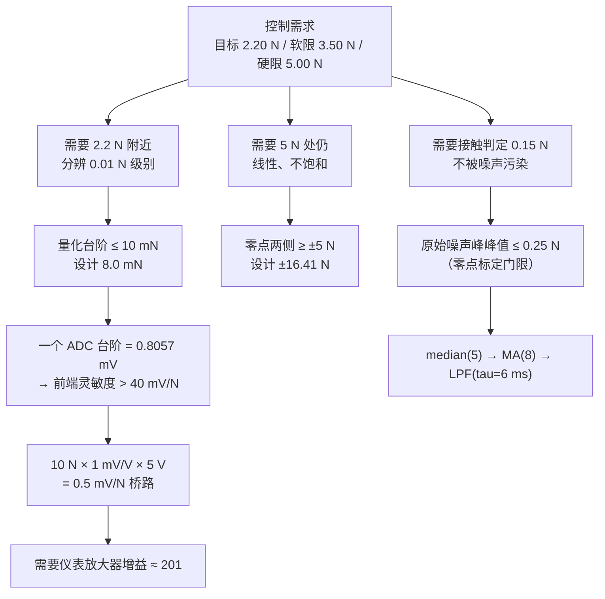
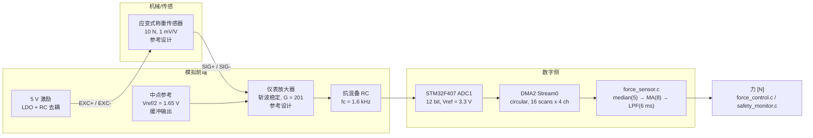
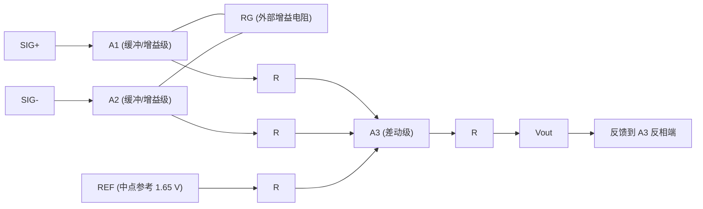
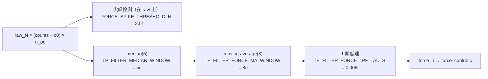
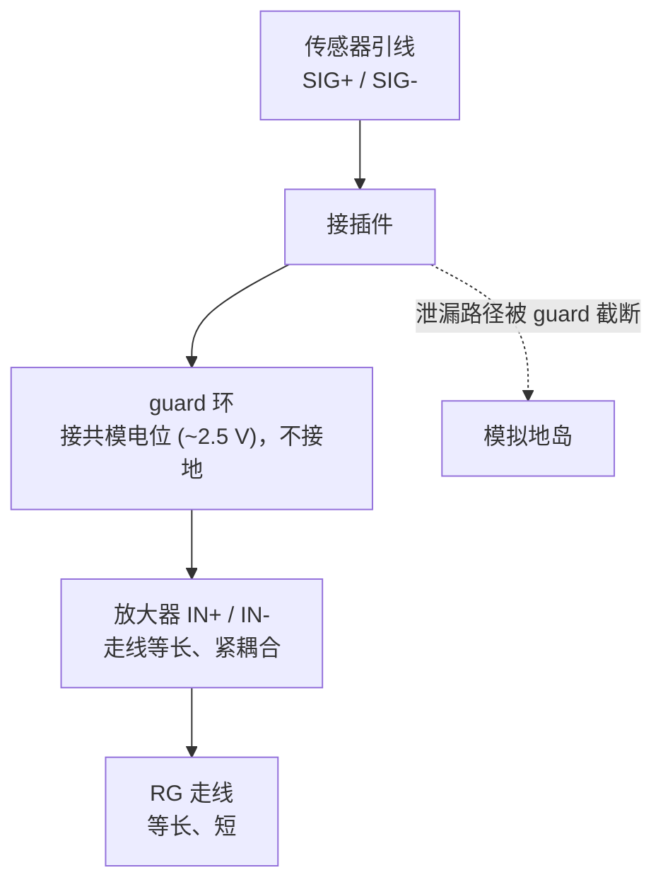

# 采茶机器人第二代 —— 夹持力传感前端硬件设计文档（力传感通道）

> ## ⚠️ 文档性质声明（必读）
>
> **本文档是设计文档 / 参考设计（Reference Design / Recommended Implementation），不是测量报告。**
>
> 1. **本项目没有任何实物板卡被制造、装配或测量过。** 本文中出现的每一个器件型号、每一个电阻电容取值、每一个增益与电压数字，都是从**数据手册参数**出发的**设计计算值**与**设计选型建议**，**不是测量结果**。文中不含任何测量数据。
> 2. 所有器件型号一律标注为 **参考设计 / Recommended Implementation**：它们代表"按此参数选型即可满足指标"的**一类器件**，不构成采购指定。落地时必须用最终选定器件的**正式数据手册修订版**重新核对 min/max 限值。
> 3. 本文引用的**数据手册典型值（typical）**仅用于架构选型比较，**不得作为验收判据**。凡标注"数据手册典型值"的数字，均需在实物阶段以数据手册限值或第三方计量结果替代。
> 4. 文中所有与固件行为相关的结论，均以仓库中**真实存在的符号**为依据，写法为 `名称 = 数值`，并在括号内给出出处文件（必要时给出小节）。**本文不引用任何不存在的宏、函数或文件名。**
> 5. 力通道的**标定流程**见 `docs/force_sensor_calibration.md`（该文件由本设计任务一并创建，用于闭合 `firmware/BSP/force_sensor.h` 中的引用）。标定流程目前状态是：**已设计完成，但尚未在实物硬件上执行过**。
> 6. **未验证项**（无实物、无测量、无 EMC 数据、无温漂数据）集中在第 12 章逐条列出，请勿把本文任何数字当作已验证事实。

---

## 摘要

本文给出第二代采茶机器人**夹持力传感通道**的完整硬件参考设计：从惠斯通电桥式称重传感器，经斩波稳定（zero-drift / chopper-stabilized）仪表放大器、抗混叠 RC，到 STM32F407 的 12 位 ADC，并给出全部关键量的**逐步算式**、器件选型对比、布局与 EMC 注意事项、测试与验证方法，以及已知风险与未验证项。

设计的出发点是一个明确的控制需求：夹持力目标 `TP_FORCE_TARGET_N = 2.20f` N（`firmware/Application/config.h` 第 5 节），硬限 `TP_FORCE_MAX_N = 5.00f` N，软限 `TP_FORCE_SOFT_LIMIT_N = 3.50f` N。要在 2.2 N 附近做闭环，量化台阶必须远小于 20 mN，否则力环 `TP_FORCE_PID_KP = 14.0f`、`TP_FORCE_PID_KI = 6.0f`、`TP_FORCE_PID_KD = 0.05f` 会把量化噪声当作真实力去追。由 `TP_ADC_VREF_V = 3.300f` V 与 `TP_ADC_FULL_SCALE = 4095.0f` 得一个 ADC 台阶为 `0.805664 mV`；要求台阶小于 20 mN，就要求前端灵敏度高于 `40 mV/N`。

本设计选择的组合是：**10 N 量程、1 mV/V 灵敏度的应变式称重传感器**（`TP_LOADCELL_RATED_N = 10.0f`、`TP_LOADCELL_SENSITIVITY_MV_V = 1.0f`）+ **5 V 桥路激励**（`TP_LOADCELL_EXCITATION_V = 5.0f`）→ 桥路输出 `TP_LOADCELL_MV_PER_N = 0.5 mV/N`；再经**增益 `TP_FORCE_AMP_GAIN_STAGE1 = 201.0f` 的斩波稳定仪表放大器**（第二级 `TP_FORCE_AMP_GAIN_STAGE2 = 1.0f`，总增益 `TP_FORCE_AMP_GAIN = 201.0f`）→ 前端灵敏度 `TP_FORCE_FRONTEND_MV_PER_N = 100.5 mV/N`；最终 LSB `TP_FORCE_CAL_SCALE_N_PER_COUNT ≈ 0.0080166 N/count ≈ 8.0 mN`，满量程输出 `TP_FORCE_FULLSCALE_MV = 1005 mV`，可用范围 `TP_FORCE_USABLE_RANGE_N ≈ ±16.41 N`，ADC 满摆幅对应 `TP_FORCE_ADC_SATURATION_N ≈ 32.84 N`。

**必须首先说清的三个事实**：

- 上述全部数字都是**设计推算**，由 `config.h` 的宏在编译期推导；`config.h` 自己就写明这些量是 "a **reference design** derived from datasheet figures, not measurements taken on a built board"。
- **本轮设计存在一处必须核实的增益设定电阻不一致**：`config.h` 注释写 INA333 增益 201 配 `RG = 249 Ω`，而 INA333 的传递函数 `G = 1 + 100 kΩ / RG` 在 `RG = 249 Ω` 时给出 `G ≈ 402.6`（详见第 7.5 节与第 12 章风险 1）。下游所有数字（8.0 mN LSB、±16.41 N 可用范围）都是按 `G = 201` 推出的。
- **标定流程已设计但未执行**；ADC 的触发源、采样时间与 DMA 配置已由 `firmware/BSP/stm32f407/platform_stm32f407.c` 实现并确定（见第 6.3 节），力通道的 500 Hz 采样点已由 `firmware/Core/app_sequence.c` 的 `tp_app_sensor_step()` 实现；但整个系统**仍无实物、无硬件测量数据**。

**本文的核心结论**：8.0 mN 的 LSB、±16.4 N 的可用范围、以及相对 5 N 硬限的 3.3 倍裕量，在**纸面上**是成立的、并且由两条编译期断言（`TP_STATIC_ASSERT(TP_FORCE_FULLSCALE_MV < (TP_ADC_VREF_V * 1000.0f), ...)`、`TP_STATIC_ASSERT(TP_FORCE_USABLE_RANGE_N > TP_FORCE_MAX_N, ...)`，见 `config.h` 文件末尾）在构建时守护；但这三条断言的**语义边界**（它们检查"摆幅"而不是"含 REF 偏置的绝对输出"）必须被理解，否则会在实物测量阶段产生"构建通过、板上饱和"的意外（详见第 9.9 与第 12 章风险 7）。

---

## 目录

1. [文档范围、读者与事实基线](#1-文档范围读者与事实基线)
2. [设计目标与需求分解](#2-设计目标与需求分解)
3. [术语、单位与符号约定](#3-术语单位与符号约定)
4. [系统总览与信号链](#4-系统总览与信号链)
5. [传感元件选型与理由](#5-传感元件选型与理由)
   - 5.1 [五类力/应变感知原理对比](#51-五类力应变感知原理对比)
   - 5.2 [量程选择：10 N / 20 N / 50 N / 100 N](#52-量程选择10-n--20-n--50-n--100-n)
   - 5.3 [为什么 `config.h` 选 10 N（逐句核验）](#53-为什么-configh-选-10-n逐句核验)
6. [前端放大器与 ADC 链路选型](#6-前端放大器与-adc-链路选型)
   - 6.1 [四类前端架构对比](#61-四类前端架构对比)
   - 6.2 [为什么必须是斩波稳定（zero-drift）架构](#62-为什么必须是斩波稳定zero-drift架构)
   - 6.3 [ADC 侧已实现的硬件后端事实](#63-adc-侧已实现的硬件后端事实)
7. [器件选型与理由（细部）](#7-器件选型与理由细部)
   - 7.1 [激励与参考方案：比例式 vs 非比例式](#71-激励与参考方案比例式-vs-非比例式)
   - 7.2 [参考/激励去耦与缓冲](#72-参考激励去耦与缓冲)
   - 7.3 [增益设定电阻 `RG` 的选型与容差](#73-增益设定电阻-rg-的选型与容差)
   - 7.4 [抗混叠 RC：一阶 vs 二阶 vs ADC 内置开关电容](#74-抗混叠-rc一阶-vs-二阶-vs-adc-内置开关电容)
   - 7.5 [增益设定不一致的诊断与决策](#75-增益设定不一致的诊断与决策)
   - 7.6 [机械接口、安装刚度与偏载](#76-机械接口安装刚度与偏载)
   - 7.7 [防过载机械止挡](#77-防过载机械止挡)
8. [原理说明](#8-原理说明)
   - 8.1 [惠斯通电桥](#81-惠斯通电桥)
   - 8.2 [三运放仪表放大器结构](#82-三运放仪表放大器结构)
   - 8.3 [共模、差模与 CMRR 误差](#83-共模差模与-cmrr-误差)
   - 8.4 [屏蔽驱动（guard / shield drive）](#84-屏蔽驱动guard--shield-drive)
   - 8.5 [为什么要单点接地](#85-为什么要单点接地)
9. [关键计算（逐步算式）](#9-关键计算逐步算式)
   - 9.1 [桥路灵敏度](#91-桥路灵敏度)
   - 9.2 [前端灵敏度](#92-前端灵敏度)
   - 9.3 [ADC 台阶](#93-adc-台阶)
   - 9.4 [每 count 的牛顿数（LSB）](#94-每-count-的牛顿数lsb)
   - 9.5 [额定载荷下的前端输出](#95-额定载荷下的前端输出)
   - 9.6 [ADC 饱和点与硬限裕量](#96-adc-饱和点与硬限裕量)
   - 9.7 [可用范围](#97-可用范围)
   - 9.8 [2.2 N 目标 ↔ counts 与相对分辨率](#98-22-n-目标--counts-与相对分辨率)
   - 9.9 [编译期断言语义核验（含中置零点的陷阱）](#99-编译期断言语义核验含中置零点的陷阱)
   - 9.10 [噪声与误差预算（RSS）](#910-噪声与误差预算rss)
   - 9.11 [若实际增益为 402.6：整条链如何变化](#911-若实际增益为-4026整条链如何变化)
   - 9.12 [数字滤波链的延迟、带宽与量纲](#912-数字滤波链的延迟带宽与量纲)
   - 9.13 [与宿主物理模型的交叉核对（仿真量，非实物量）](#913-与宿主物理模型的交叉核对仿真量非实物量)
10. [电源、布局、走线与 EMC 注意事项](#10-电源布局走线与-emc-注意事项)
11. [测试与验证方法](#11-测试与验证方法)
12. [已知风险与未验证项](#12-已知风险与未验证项)
13. [附录 A：符号索引](#13-附录-a符号索引)
14. [附录 B：参考文档与出处](#14-附录-b参考文档与出处)

---

## 1. 文档范围、读者与事实基线

### 1.1 范围

本文覆盖：

- 力传感通道的**模拟前端电路**（传感器、激励、仪表放大器、参考、抗混叠滤波、ADC 输入接口）；
- 与之相关的**机械接口**（安装刚度、偏载、防过载止挡、线缆应力释放）；
- 与该前端一一对应的**固件常量与断言**（只做核对与推导，不修改任何源码）；
- **设计验证方法**（把"该怎么测、判据是什么"写清楚，而不是声称测过）。

本文**不覆盖**：电机驱动功率级、编码器通道、通信物理层、夹爪机械本体设计、植物力学模型（后者属于宿主仿真模型 `firmware/BSP/host/plant_model.h`）。

### 1.2 读者

| 读者 | 需要的章节 |
|---|---|
| 硬件工程师（选型/画板） | 5、6、7、8、10 |
| 固件工程师（标定/驱动） | 9、11、12 |
| 测试/标定操作者 | 11，以及 `docs/force_sensor_calibration.md` 全文 |
| 评审/复核者 | 2、9.9、9.10、12 |

### 1.3 事实基线（撰写时点的仓库状态）

本文引用的固件事实，全部来自下列文件在**本次复核时点**的内容。资料库在本次任务期间被并行扩充：`firmware/BSP/stm32f407/` 下的后端实现、`firmware/Core/` 下的启动与任务体、`firmware/Middleware/osal/`、以及 `docs/`、`hardware/`、`tests/`、`scripts/` 下的其它文件都是在同一时间窗口内出现的。因此本文的复核规则是：

- 本文一律**按符号名引用**（`名称 = 数值`（出处文件）），不按行号引用，避免行号漂移导致引用失效；
- 凡结论依赖"仓库中存在/不存在某文件"的，都在 1.4 / 1.5 节给出**逐项的存在性核查结果**，供复核者当场重查；
- 凡依赖"某个量在源码中没有定义"的结论，都在正文中明确写出"**该文件中未定义**"以及被检查的文件名。

#### 1.3.1 已实现的完整可执行链路（已核实存在）

本设计所依赖的硬件访问路径**已经全部实现**，不再是"只有接口没有实现"的状态：

| 环节 | 文件 | 关键内容 |
|---|---|---|
| 平台装配与自检 | `firmware/Core/app_tasks.c` / `.h` | `tp_app_init()` 依次初始化编码器/电机/**力通道**（`tp_force_sensor_init(&app->force, 1.0f / (float)TP_SENSOR_FREQ_HZ)`）/夹爪/控制器/协议；`tp_app_self_check()` 读 `tp_platform_adc_read(TP_ADC_FORCE, ...)` 并在贴轨时报 `TP_FAULT_SENSOR` |
| 应用入口与任务体 | `firmware/Core/app_entry.c` / `.h`、`app_sequence.c`、`freertos_hooks.c` | `tp_app_sensor_step()`（**500 Hz 传感器任务**）在 `app_sequence.c` 中实现，是力通道唯一的采样入口 |
| 目标启动 | `firmware/Core/main_stm32.c`、`stm32f4xx_it.c` / `.h` | 裸机入口、中断向量转发（转发到 `platform_stm32f407.h` 声明的 `tp_stm32_*_irq_handler()`） |
| 主机启动 | `firmware/Core/main_host.c` | `-DTP_PLATFORM_HOST` 构建的入口（配 `firmware/BSP/host/platform_host.c` + `plant_model.c`） |
| 平台后端 | `firmware/BSP/stm32f407/platform_stm32f407.c` / `.h`、`syscalls_stm32f407.c` | 唯一的寄存器访问文件；ADC 触发/时钟/采样时间/DMA/引脚映射见 6.3 |
| OS 抽象 | `firmware/Middleware/osal/osal_freertos.c`（另有 `osal_baremetal.c`） | 任务/延时抽象，传感器任务的节拍来源 |
| ADC 驱动层 | `firmware/BSP/adc_driver.c` / `.h` | `tp_adc_channel_init/push/service/get_raw/get_volts`、`decimation`、`overruns` |
| 数字滤波 | `firmware/Middleware/utils/filters.c` / `.h` | 中值/滑动平均/一阶低通/尖峰检测器的**实现**（语义见 9.12 与 6.3） |
| 构建脚本 | `scripts/build_host.ps1` | 主机侧构建入口 |
| 测试与目录 | `tests/`、`scripts/`、`images/` 三个目录 | 已存在（仅作为目录存在性事实，内容不在本文范围内） |

#### 1.3.2 仓库中仍然不存在的文件（截至本次复核）

| 文件 | 状态 | 与本文的关系 |
|---|---|---|
| `README.md`、`LICENSE` | **不存在** | 不影响本文；仅说明"仓库根目录尚无这两个文件" |
| `docs/05_control_algorithm.md`、`docs/06_force_control.md`、`docs/07_communication_protocol.md` | **不存在** | 被 `app_sequence.c` 的注释引用（例如 1 kHz 力环的理由指向 `docs/06_force_control.md`）；属于"被引用但缺失" |
| `docs/11_experiment_design.md`、`docs/12_results_analysis.md`、`docs/13_future_work.md` | **不存在** | `force_sensor.h` 的 `tp_force_sensor_get_force_raw_n()` 注释引用了 `docs/11_experiment_design.md`（见风险 2） |
| `docs/units_convention.md` | **不存在** | 被 `config.h` 文件头与第 8 节引用（见风险 2） |
| `scripts/gen_fsm_diagram.py`、`scripts/check_layering.py` | **不存在** | 分层/图生成脚本尚未落地 |

#### 1.3.3 可复现佐证：仿真与上位机产物（**不是硬件测量**）

仓库中存在下列可复现的**仿真/上位机**产物。它们可以复现控制律与量化/滤波链路的行为，但**完全不包含任何硬件测量**——前端的失调、温漂、增益误差、EMC 表现都不在其中：

| 产物 | 本次复核到的规模 | 内容 | 能证明什么 / 不能证明什么 |
|---|---|---|---|
| `data/logs/host_scenario_A.csv` | **5022 逻辑行（含表头）、282,463 字节**（本次复核统计所得；若重新生成则会变化） | 1 kHz 逐周期仿真遥测，列为 `t_ms, ref_mrad, pos_mrad, vel_mrad_s, force_n, gap_mm, duty_permille, current_ma, state, grip_state, fault, cycle`；`t_ms` 自 1 起以 1 ms 递增 | 能证明"仿真中控制律 + 量化 + 滤波链可运行"；**不能**证明前端分辨率、温漂、EMC |
| `data/logs/pick_cycle.csv` | 114 逻辑行（含表头） | 上位机侧抓取的采茶周期记录：`t_ms, pos_mrad, vel_mrad_s, force_mN, pwm_permille, state, fault` | 同上（且为上位机产物） |
| `data/logs/monitor_selftest.csv` | **67 逻辑行（含表头）** | 上位机监控工具自检输出 | 证明链路连通性；与前端精度无关 |
| `build/host/tea_picking_robot_host.exe` | 已存在（667,007 字节） | 主机侧可执行文件（`-DTP_PLATFORM_HOST` 构建） | 可复现仿真，**不是固件二进制、更不是硬件** |

| 事实 | 出处 |
|---|---|
| 力前端全部设计常量 | `firmware/Application/config.h` 第 8 节（`TP_LOADCELL_*`、`TP_FORCE_AMP_*`、`TP_ADC_*`、`TP_FORCE_CAL_*`、`TP_FORCE_FULLSCALE_MV`、`TP_FORCE_ADC_SATURATION_N`、`TP_FORCE_USABLE_RANGE_N`） |
| 两条编译期断言 | `firmware/Application/config.h` 文件末尾（`TP_STATIC_ASSERT`） |
| 力通道采集/滤波/标定/健康逻辑 | `firmware/BSP/force_sensor.c`、`firmware/BSP/force_sensor.h` |
| ADC 通道枚举与引脚（文档值） | `firmware/BSP/bsp_types.h`（`tp_adc_ch_t`） |
| ADC 语义（读写接口、失败不写输出） | `firmware/BSP/platform_api.h`（`tp_platform_adc_read`、`tp_platform_adc_read_block`） |
| STM32F407 后端实际配置（触发/采样时间/DMA/引脚） | `firmware/BSP/stm32f407/platform_stm32f407.c`（文件头引脚表、`adc_trigger_init()`、`adc_init()`、`tp_platform_adc_read()`） |
| 数字滤波器语义与**实现** | `firmware/Middleware/utils/filters.h`、`firmware/Middleware/utils/filters.c`（尖峰检测器"参考值每样本更新"的语义在 `filters.c` 的 `tp_spike_detector_update()` 注释中给出） |
| 力通道的**采样点**（谁在读 ADC、多久读一次） | `firmware/Core/app_sequence.c` 的 `tp_app_sensor_step()`（500 Hz 传感器任务） |
| 力通道的初始化与启动自检 | `firmware/Core/app_tasks.c`（`tp_app_init()`、`tp_app_self_check()`）、`firmware/Core/app_tasks.h` |
| ADC 驱动层（衰减/平均/溢出计数） | `firmware/BSP/adc_driver.c` / `.h`（`tp_adc_channel_init/push/service`、`decimation`、`overruns`） |
| 应用入口与中断转发 | `firmware/Core/app_entry.c` / `.h`、`main_stm32.c`、`main_host.c`、`freertos_hooks.c`、`stm32f4xx_it.c` |
| OS 抽象 | `firmware/Middleware/osal/osal_freertos.c`（另有 `osal_baremetal.c`） |
| 构建脚本 | `scripts/build_host.ps1` |
| 力控制语义与安全阈值 | `firmware/Control/force_control.c`、`firmware/Control/force_control.h` |
| 协议命令位与 payload | `firmware/Protocol/protocol_types.h`（`TP_CMD_CALIBRATE_FORCE = 0x42`、`tp_payload_sensor_t`） |
| 宿主物理模型（仿真专用） | `firmware/BSP/host/plant_model.h`、`firmware/BSP/host/plant_model.c` |
| 状态码 | `firmware/Middleware/utils/status.h`（`tp_status_t`） |

> **重要**：`firmware/BSP/host/plant_model.h` 中的 `TP_PLANT_*` 常量属于**宿主仿真后端**，只在 `-DTP_PLATFORM_HOST` 构建中存在。它们描述的是**模型**，不是实物植物、也不是实物传感器。凡引用它们的地方，本文一律显式标注"仿真模型量"。

---

## 2. 设计目标与需求分解

### 2.1 目标（Design Goals）

| 编号 | 目标 | 量化指标 | 依据/出处 |
|---|---|---|---|
| G1 | **分辨率** | 量化台阶（LSB）≤ 10 mN，设计值 **8.0 mN** | `TP_FORCE_CAL_SCALE_N_PER_COUNT ≈ 0.0080166 N/count`（`config.h` 第 8 节） |
| G2 | **可用范围** | 零点两侧至少 ±5 N 可测且不饱和，设计值 **±16.41 N** | `TP_FORCE_USABLE_RANGE_N ≈ 16.41 N` > `TP_FORCE_MAX_N = 5.00f`（编译期断言保证） |
| G3 | **过载不停机** | 硬限 `TP_FORCE_MAX_N = 5.00f` N 必须在 ADC 饱和**之前**被固件识别，从而"靠固件跳闸而不是靠削顶" | `TP_FORCE_ADC_SATURATION_N ≈ 32.84 N`（理论满摆幅）、实际中置零点正侧饱和 `≈ +16.42 N` |
| G4 | **温漂可控** | 由温度引起的零点漂移与班次内漂移有明确预算，并且每次作业前可通过零点标定清除 | `firmware/BSP/force_sensor.h` 的温漂论证；`tp_force_sensor_zero_calibrate()` |
| G5 | **抗 PWM 干扰** | 20 kHz PWM 载波耦合不得在力读数上产生可被力环误判为接触的扰动 | `filters.h` 第 2 条；`force_control.c` 的 `TP_FORCE_CONTACT_N = 0.15f` |
| G6 | **故障可诊断** | 断线（贴轨）、开裂应变片（大偏置）、EMI（尖峰）三种失效模式必须可区分并可上报 | `TP_SENSOR_ADC_MIN_COUNTS = 5u`、`TP_SENSOR_ADC_MAX_COUNTS = 4090u`、`FORCE_SPIKE_THRESHOLD_N = 3.0f`、`FORCE_SPIKE_TRIP = 8u` |
| G7 | **可标定** | 只需 offset（零点 counts）+ scale（N/count）两个参数即可完整描述通道，且两者均可在运行期重算 | `tp_force_sensor_counts_to_n()`；`docs/force_sensor_calibration.md` |
| G8 | **单一事实来源** | 前端灵敏度改动必须自动传导到 LSB、可用范围、饱和点，不留下陈旧的魔数 | `TP_FORCE_CAL_SCALE_N_PER_COUNT` 由宏计算而非手写（`config.h` 第 8 节注释） |

### 2.2 需求分解（从控制需求反推到硬件指标）



分解出的硬件指标可以写成一页"设计规格书"：

| 指标 | 目标值 | 由谁保证 |
|---|---|---|
| 桥路灵敏度 | `0.5 mV/N` | 传感器量程 + 激励电压 |
| 前端灵敏度 | `100.5 mV/N` | 仪表放大器增益 201 |
| 量化台阶 | `8.0166 mN/count` | `TP_ADC_MV_PER_COUNT / TP_FORCE_FRONTEND_MV_PER_N` |
| 额定载荷输出 | `1005 mV`（相对零点） | `100.5 mV/N × 10 N` |
| 零点位置 | `2048 counts`（中置） | `TP_FORCE_CAL_ZERO_COUNTS = 2048.0f` |
| ADC 满摆幅（从 0 V 计） | `32.84 N` | `TP_FORCE_ADC_SATURATION_N` |
| 可用范围（相对零点） | `±16.41 N` | `TP_FORCE_USABLE_RANGE_N` |
| 相对硬限裕量 | `16.41 / 5.00 = 3.28 倍` | 编译期断言 + 本设计 |
| 原始噪声峰峰值门限 | `0.25 N` | `TP_FORCE_ZERO_CAL_MAX_SPREAD_N = 0.25f` |

---

## 3. 术语、单位与符号约定

| 符号 | 含义 | 单位 | 固件中的名字 |
|---|---|---|---|
| `S` | 传感器额定输出（灵敏度） | mV/V | `TP_LOADCELL_SENSITIVITY_MV_V` |
| `F_rated` | 传感器额定容量 | N | `TP_LOADCELL_RATED_N` |
| `V_exc` | 桥路激励电压 | V | `TP_LOADCELL_EXCITATION_V` |
| `k_bridge` | 桥路输出灵敏度 | mV/N | `TP_LOADCELL_MV_PER_N` |
| `G` | 前端总增益 | — | `TP_FORCE_AMP_GAIN` |
| `k_fe` | 前端输出灵敏度 | mV/N | `TP_FORCE_FRONTEND_MV_PER_N` |
| `q` | ADC 一个台阶的电压 | mV/count | `TP_ADC_MV_PER_COUNT` |
| `n_pc` | 一个 count 对应的牛顿数（LSB） | N/count | `TP_FORCE_CAL_SCALE_N_PER_COUNT` |
| `V_ref` | ADC 参考电压 | V | `TP_ADC_VREF_V` |
| `N_fs` | ADC 满码值 | counts | `TP_ADC_FULL_SCALE` |
| `c0` | 零点 counts | counts | `force_sensor_t::adc_zero_counts`（默认 `TP_FORCE_CAL_ZERO_COUNTS`） |
| `F` | 力 | N | force / force_n |

单位约定（与 `config.h` 文件头表格一致）：固件内部用工程单位浮点（力 = N），总线上力的线格式是 **mN（int16）**（`protocol_types.h` 的 `TP_WIRE_N_TO_MN = 1000.0f`；`tp_payload_status_t::force_mn`、`tp_payload_sensor_t::force_mn`、`tp_payload_telemetry_t::force_mn`）。因此**每一个 mN 的线格式分辨率都对应大约 1/8 个硬件 LSB**——线格式比硬件分辨率更细，这一点在标定记录中很重要：不能把"总线读数变了 1 mN"当作硬件真的分辨出了 1 mN。

---

## 4. 系统总览与信号链

### 4.1 硬件链路



### 4.2 固件侧的对应关系

| 硬件节点 | 固件对应 | 出处 |
|---|---|---|
| ADC 通道选择 | `TP_ADC_FORCE = 0` | `bsp_types.h` 的 `tp_adc_ch_t` |
| 采样率 | `TP_SENSOR_FREQ_HZ = 500u`（周期 `TP_SENSOR_DT_S = 1/500 = 0.002f` s） | `config.h` 第 2 节 |
| **采样点（谁读、多久读）** | `tp_app_sensor_step()`（`Core/app_sequence.c`，500 Hz 传感器任务）每周期调用一次 `tp_platform_adc_read(TP_ADC_FORCE, ...)`，并同时送入 `tp_force_sensor_update()` 与 `tp_adc_channel_push()` | `Core/app_sequence.c` |
| 触发源与 DMA | TIM3 TRGO 500 Hz → ADC1 扫描 → DMA2 Stream0 circular（发布周期 16 ms） | `BSP/stm32f407/platform_stm32f407.c`（见 6.3） |
| ADC 缓冲区深度 | `TP_ADC_DMA_BUFFER_LEN = 16u` | `config.h` 第 8 节 |
| counts → N | `tp_force_sensor_counts_to_n()` = `(counts − adc_zero_counts) × n_per_count` | `force_sensor.c` |
| 滤波链 | `TP_FILTER_MEDIAN_WINDOW = 5u` → `TP_FILTER_FORCE_MA_WINDOW = 8u` → `TP_FILTER_FORCE_LPF_TAU_S = 0.006f` | `config.h` 第 8 节 / `filters.h` |
| 尖峰检测（跑在**原始**值上） | `FORCE_SPIKE_THRESHOLD_N = 3.0f`、`FORCE_SPIKE_TRIP = 8u`（阈值语义：在 500 Hz 下等效斜率限制 `3.0 N × 500 = 1500 N/s`） | `force_sensor.c`（`tp_force_sensor_update()` 的注释与宏定义）、`force_sensor.h` |
| 量程合理性窗口 | `TP_SENSOR_FORCE_MIN_N = -20.0f` ~ `TP_SENSOR_FORCE_MAX_N = 50.0f`（**注意**：在设计标定下这两个界都落在 ADC 可达区间之外，见本节末尾的说明） | `config.h` 第 7 节 |

> **设计意图说明**：`TP_SENSOR_FORCE_MIN_N / MAX_N` 的窗口（−20 N ~ +50 N）比硬限（5 N）宽得多，这是**故意**的：它的用途是判断"读数是否物理上可能"（用于发现断线、开裂应变片、增益错配），而不是安全限。安全限由 `force_control.c` 的 `TP_FORCE_MAX_N` 逻辑承担。两者不要混用。
>
> **但必须指出一个算术事实（本次复核新增）**：`force_sensor.c` 的范围检查跑在 `raw_n = (counts − adc_zero_counts) × n_per_count` 上，而 counts ∈ [0, 4095]。在设计标定（`c0 = 2048`、`n_pc = 0.0080166`）下可达区间是
>
> ```
> counts = 0    → F = (0 − 2048) × 0.0080166    = −16.418 N
> counts = 4095 → F = (4095 − 2048) × 0.0080166 = +16.410 N
> ```
>
> 也就是说可达区间 `[−16.418, +16.410] N` **完全落在窗口 `[−20, +50] N` 之内**，因此**在出厂/设计标定下这段范围检查永远不会触发**（它是"死代码"，只有 `saturated` 标志与 `TP_SENSOR_ADC_MIN/MAX_COUNTS` 的贴轨检查在起作用）。只有当运行期标定把斜率放大到设计值的约 **1.22 倍**（负侧：`4096 × n_pc ≥ 20 N`）或约 **3.05 倍**（正侧：`2047 × n_pc ≥ 50 N`）时，该检查才可能生效。
>
> **对本设计的含义**：(a) 不要指望这条检查去发现断线或开裂——那两类故障由**贴轨**（counts ≤ `TP_SENSOR_ADC_MIN_COUNTS = 5u` 或 ≥ `TP_SENSOR_ADC_MAX_COUNTS = 4090u`，见 `app_tasks.c` 的自检与 `force_sensor.c` 的 `saturated`）负责；(b) 它真正的用途是拦截**灾难性的标定错误**（斜率被放大数倍）；(c) 若希望它成为有效的健康检查，应把窗口收进可达区间（例如 ±16 N 或更贴近工况的 ±10 N）——**那属于源码/常量改动，本次任务不做**。

---

## 5. 传感元件选型与理由

### 5.1 五类力/应变感知原理对比

| 方案 | 典型输出量级 | 直流/静态响应 | 零点温漂 | EMI 敏感度 | 与 10 N 量程的适配 | 结论 |
|---|---|---|---|---|---|---|
| **应变式（箔式/半导体应变片，惠斯通电桥）** | 1–3 mV/V @ 额定载荷 | **好**（真正的直流响应，可保持静态读数） | 中等，主要来自桥路零点与应变片失配 | 中等（低电平、易受共模干扰，需仪表放大器） | **很好**，商用 10 N 量程常见 | **选用** |
| 压电式（PZT） | 电荷，pC/N 级 | **差**（电荷泄漏，静态力会衰减；必须用电荷放大器+高阻） | 漂移主导，静态不可用 | 好（高电平、低阻） | 不适合"保持 2.2 N 数百毫秒"的场景 | 不选 |
| 电容式 | 频率/电容变化，需专用 ASIC | 好 | 好 | 好 | 需自研极板机械与屏蔽，量程与量程一致性难保证；更适合微牛级 | 不选（非目录化方案） |
| 光学式（FBG 光纤光栅 / 光弹） | 波长漂移，pm/µε | 好 | 很好 | **免疫**（本征绝缘） | 需解调仪，成本与体积远超需求 | 不选 |
| 霍尔/磁弹性 | 磁场/位移，需配弹性体 | 好 | 磁体温度系数明显 | 好 | 必须"弹簧 + 位移传感"间接测力，引入弹性体滞回 | 不选 |

**为什么在"力保持"场景里直流响应是硬指标**：本机器人要在夹住茶芽后**保持**力（`force_control.c` 的 `TP_GRIP_PICK` 状态持续 `GRIP_PICK_DURATION_MS = 250u` 毫秒并继续调力），并在 `TP_GRIP_FORCE_CONTROL` 里等力稳定在 `TP_FORCE_BAND_N = 0.10f` N 带内 `TP_GRIPPER_SETTLE_MS = 80u` 毫秒。任何"只对动态响应好、静态会掉"的原理（压电）在这里都会把真实的保持力读成 0。

### 5.2 量程选择：10 N / 20 N / 50 N / 100 N

下表按"1 mV/V 灵敏度 + 5 V 激励"的同一类传感器，比较四个量程。**衡量口径统一为两种**：

- (a) **达到 8.0 mN 级 LSB 所需增益**：`G_needed = q / (LSB × k_bridge)`；
- (b) **在给定的 3.3 V 轨内能用的最大增益**：要求额定载荷输出 `F_rated × k_bridge × G < 3300 mV`。

| 量程 | 桥路灵敏度 `k_bridge` = 5 V/量程 | 达到 8.0 mN LSB 所需增益 (a) | 该增益下额定输出 | 3.3 V 轨是否够用 | LSB | 可用范围（±半摆幅） | 优点 | 缺点 |
|---|---|---|---|---|---|---|---|---|
| **10 N** | **0.5 mV/N** | **201** | **1005 mV** | **够（30.4 % 轨）** | **8.0 mN** | **±16.41 N** | 增益低、噪声与漂移放大最小、裕量充足 | 过载能力低，机械止挡必须做足 |
| 20 N | 0.25 mV/N | 402 | 2010 mV | 够（60.9 % 轨） | 8.0 mN | ±16.41 N | 抗过载更好 | 增益翻倍，放大器漂移/噪声同倍放大 |
| 50 N | 0.1 mV/N | 1005（不可用：额定输出 5025 mV **超轨**） | — | **不够** | 需降到 ~19.9 mN（G = 402 时） | ±41 N（G = 402） | 过载强、适合粗力 | 分辨率掉到 ~20 mN，不满足 G1 |
| 100 N | 0.05 mV/N | 2010（不可用） | — | **不够** | 需降到 ~26.9 mN（G = 600 时） | ±55 N | 过载最强 | 分辨率最差，且 G=600 已进入漂移主导区 |

**由表格得出的硬结论**：在 3.3 V 单极性 ADC 与"前端灵敏度需 > 40 mV/N"这两个约束下，

```
额定载荷输出 = F_rated × k_bridge × G = F_rated × (5 V / F_rated) × G
             = 5 V × G / 1000 mV/V ... 化简为：
额定载荷输出(mV) = 40 × F_rated(N)     ← 当且仅当 k_bridge × G = 40 mV/N
```

即：**"灵敏度 ≥ 40 mV/N"这条要求本身就把量程上限锁在 ~80 N**（`40 mV/N × 100 N = 4000 mV > 3300 mV`）。也就是说，`config.h` 第 8 节注释里那句"50 N 的传感器需要 400 倍增益"是**对的**，但值得补一句：400 倍恰好给出 `40 mV/N`，即 LSB ≈ `0.8057/40 = 20.1 mN`，**刚好卡在 20 mN 要求线上**，没有余量；再往上提增益就会在额定载荷处把 ADC 顶到轨。这正是"选小量程传感器让电子学保持简单"的量化依据。

### 5.3 为什么 `config.h` 选 10 N（逐句核验）

`config.h` 第 8 节的论证链，逐句复核如下（左列是注释原意，右列是本文的独立复算）：

| `config.h` 的论断 | 独立复算 | 结论 |
|---|---|---|
| "One ADC step is `3.3 V / 4096 = 0.806 mV`" | `3300/4096 = 0.805664 mV` ✅ | 成立 |
| "`0.806 mV / LSB < 20 mN` requires sensitivity above `40 mV/N`" | `0.805664 mV / 20 mN = 40.28 mV/N` ✅ | 成立（严格地说门槛是 40.28 mV/N） |
| "a 10 N cell at 1 mV/V with 5 V excitation gives `5 mV / 10 N = 0.5 mV/N`" | `1.0 × 5.0 / 10.0 = 0.5 mV/N` ✅ | 成立 |
| "so a gain of 201 is enough (`100.5 mV/N`, i.e. an **8.0 mN LSB**)" | `0.5 × 201 = 100.5 mV/N`；`0.805664/100.5 = 8.0166 mN` ✅ | 成立 |
| "a 50 N cell would only give `0.1 mV/N` and would need a gain of 400" | `5/50 = 0.1 mV/N`；`40/0.1 = 400` ✅ | 成立，但见 5.2 的边界说明 |
| "at which point the amplifier's own offset drift and the bridge's thermal drift dominate" | 见 9.10 的预算表：桥路零点温漂在"输入参考"解释下可达 0.2 N/20 K，确实在 2.2 N 尺度上不可忽略 ✅ | 成立（但该论述的数值一致性有问题，见 9.10 与风险 4） |
| "`100.5 mV/N × 10 N = 1005 mV` at rated load, comfortably under the 3.3 V reference" | `1005 mV` 是**相对零点的摆幅**，`< 3300 mV` ✅；但绝对输出 = 零点电压 + 摆幅，见 9.9 | 有条件成立 |
| "the ADC reaches full scale at 32.8 N" | `3300/100.5 = 32.836 N` ✅ 数值成立；**语义**见 9.9（以中置零点 2048 counts 为基准时，正侧在 +16.42 N 就顶轨） | 数值成立、语义需澄清 |

---

## 6. 前端放大器与 ADC 链路选型

### 6.1 四类前端架构对比

> 下表中"数据手册典型值"一列全部是**典型值量级**，用于架构比较；**不得用于验收**。落地时必须回到最终选定型号的正式数据手册修订版核对 min/max。

| 项目 | **INA333 类（斩波稳定 / zero-drift）** | INA128 / INA129 类（通用三运放） | 分立三运放（自搭） | 24 位 ΣΔ ADC + 内置 PGA（如 ADS1220 类） |
|---|---|---|---|---|
| 失调电压 `V_os`（典型值） | **≈ 25 µV** | ≈ 50 µV | 由所选运放决定（用零漂运放可到 ~10 µV） | 前端 PGA 失调 ≈ 数 µV 级 |
| 失调漂移（典型值） | **≈ 0.1 µV/°C** | ≈ 0.5 µV/°C | 由运放决定，零漂型可 ≈ 0.05 µV/°C | ≈ 0.02–0.1 µV/°C 级 |
| CMRR（G ≈ 100–200） | ≈ 100 dB | ≈ 120 dB（高增益） | 取决于电阻匹配（0.1 % 电阻 → ≈ 60–70 dB） | ≈ 100 dB 级 |
| 电压噪声密度 | ≈ 50 nV/√Hz | ≈ 8 nV/√Hz | 取决于运放 | ≈ 10–20 nV/√Hz（含 1/f） |
| 增益设定方式 | 单只外部 `RG`：`G = 1 + 100 kΩ/RG` | 单只外部 `RG`（INA128：`G = 1 + 50 kΩ/RG`；**INA129：`G = 1 + 49.4 kΩ/RG`**） | 需 3 只运放 + 4 只匹配电阻（匹配决定 CMRR） | 数字寄存器设定（SPI） |
| 是否需要外部基准 | 否（本设计仍需独立的**中点参考**，见 7.1/7.2） | 否 | 否 | **是**（ΣΔ 的绝对精度直接取决于外部基准） |
| 静态电流（典型值） | **≈ 50 µA** | ≈ 700 µA | ≈ 3 × 单运放静态电流 | ≈ 100 µA – 数 mA |
| 器件数 / 板面积 | 1 | 1 | 4+ | 1（但需基准 + 数字隔离/滤波） |
| 成本（相对） | 中 | 低 | 低（BOM 但面积/调试成本高） | 高 |
| 架构主要风险 | 斩波带来的**输出纹波/斩波频率杂散**（需靠 RC 抑制） | **失调漂移大 5 倍**，与"每班次复零"的运维成本直接挂钩 | 电阻匹配温漂直接变成增益/CMRR 漂移；调试量大 | 需要更复杂的时序、数字滤波与基准设计；系统复杂度外移 |
| 与 8 mN LSB 的匹配 | ✅ 噪声折算 ≈ 25 µN rms（见 9.10），量化才是主导 | ⚠️ 噪声更好，但漂移更差 | ⚠️ 取决于电阻匹配 | ✅ 若直接用 24 位，LSB 可远小于 8 mN，但**增益与量程重新设计**，且 `config.h` 的整条推导链需要重写 |

**选型结论（参考设计）**：**INA333 类斩波稳定仪表放大器 + 外部单电阻设定 `G ≈ 201` + 外部 RC + STM32 内部 12 位 ADC**。

理由一句话：**把"精度"这件事交给架构（斩波稳定）而不是交给校准（频繁复零）**。在本项目里，每多一次零点复零，就多一次"带载复零把错误烧进偏置"的运维风险——`tp_force_sensor_zero_calibrate()` 的注释正是为此写的（"averaging a moving or loaded signal into the offset bakes in an error that every later reading inherits"）。

### 6.2 为什么必须是斩波稳定（zero-drift）架构

**先把预算算清楚，再选架构。** 三个输入量：

1. 前端灵敏度 `k_fe = 100.5 mV/N`（设计值）；
2. 桥路零点温漂假设：**5 ppm/K 失配**（`force_sensor.h` 的假设值）；
3. 作业环境温度摆幅假设：**20 K**（`force_sensor.h` 的假设值）。

**逐步算式（严格照 `force_sensor.h` 的说法复算）**：

```
第 1 步：满量程信号幅度
    V_fullscale = TP_FORCE_FULLSCALE_MV = 100.5 mV/N × 10 N = 1005 mV

第 2 步：5 ppm/K 失配折算成电压漂移
    dV/dT = 5 ppm/K × 1005 mV = 5 × 10^-6 × 1005 mV = 5.025 µV/K ≈ 5 µV/K

第 3 步：20 K 摆幅内的累计漂移
    ΔV = 5.025 µV/K × 20 K = 100.5 µV ≈ 0.1 mV

第 4 步：换成力（这一步是关键，也是文档不一致所在）
    解释 A（把 0.1 mV 当作"放大器输出端"的漂移）：
        ΔF = 0.1 mV / k_fe = 0.1005 mV / 100.5 mV/N = 0.0010 N = 1.0 mN   … 占 2.2 N 的 0.046 %
    解释 B（把 0.1 mV 当作"桥路输入端"的漂移，保守）：
        ΔF = 0.1005 mV / k_bridge = 0.1005 mV / 0.5 mV/N = 0.201 N ≈ 0.20 N … 占 2.2 N 的 9.1 %
    force_sensor.h 给出的数字是 0.13 N / 6 %，位于两者之间，
    用 100.5 mV/N 或 0.5 mV/N **都无法复现**（详见 9.10 与风险 4）。
```

**结论与架构含义**：

- 无论采用哪种解释，**桥路零点温漂都是量级 1 mN ~ 200 mN 的项，而放大器自身的失调漂移只有 4 mN 量级**：

```
放大器输入失调漂移（数据手册典型值 0.1 µV/°C）× 20 K
    = 0.1 µV/°C × 20 K = 2 µV（输入参考）
    → 折算力：2 µV / 0.5 mV/N = 4 mN
    → 用输出端口径复核：2 µV × 201 = 402 µV；402 µV / 100.5 mV/N = 4.0 mN ✅ 两种口径一致
```

- 也就是说：**桥路（传感器）的温漂比放大器本身的漂移大 1~50 倍**。既然如此，为什么还要选斩波稳定？

  三个理由（这是本设计的真实工程判断，不含夸大）：

  1. **失调漂移虽小，但它不是随机的而是"缓慢单调"的**：`tp_force_sensor_zero_calibrate()` 用一次平均把它吸收掉，因此"标定当时的绝对失调"并不重要——**重要的是它在这一个班次内是否稳定**。0.1 µV/°C 的漂移意味着 20 K 内只有 4 mN 的"标定后残余"，与 8 mN 的 LSB 同量级，尚可接受；若换成 0.5 µV/°C 的通用器件，标定后残余立刻变成 20 mN，是 LSB 的 2.5 倍。
  2. **1/f 噪声（漂移）比失调漂移更贴近控制带宽**：力环带宽约 1.8 Hz（见 9.12），落在任何运放的 1/f 拐点以下。斩波/自稳零架构把 1/f 拐点推到毫赫兹量级，这意味着**0.1–10 Hz 频段的噪声不会随温度与时间缓慢爬升**，而这正是力环容易误判为"接触"或"载荷变化"的频段。
  3. **它能降低对"频繁复零"的依赖**：既然零点可以在每次作业前重算，一个有把握的架构可以把"最坏情况"从"每 10 分钟复零一次"降到"每班次一次"，从而减少人为操作失误面——而人为操作失误（带载复零、机构未停稳复零）恰恰是本通道最现实的失效来源之一。

- **代价（必须写清）**：斩波稳定放大器会在输出上叠加**斩波频率的残余纹波**与开关杂散（数据手册典型值量级为几十 µV~数百 µV 的谱线，具体幅度须以数据手册为准）。这些谱线位于数百 kHz 量级，落在 RC 抗混叠滤波的通带**之外**（`fc = 1.6 kHz`），因此被抑制；但它们仍要求 7.4 的 RC 与 10 章的布局严格执行，否则会在 ADC 采样瞬间混入采样保持电容。

### 6.3 ADC 侧已实现的硬件后端事实

> 这一节记录的是**仓库中已存在的实现事实**（`firmware/BSP/stm32f407/platform_stm32f407.c`，约 105 KB），而不是建议。力通道的 ADC 触发源、时钟、采样时间、DMA 与引脚映射在仓库中**已有明确定义**，因此本文按它的实际取值描述通道；凡"该文件中未定义"的项（例如 ADC 的诊断读出接口）也逐项标出。

| 项目 | 实现事实 | 出处 |
|---|---|---|
| 力通道引脚 | **PA4 / ADC1_IN4** | `platform_stm32f407.c` 文件头引脚表、`s_adc_channel[]` |
| 引脚与 `bsp_types.h` 的差异 | `bsp_types.h` 写 `TP_ADC_FORCE = 0` 对应 "PA0, ADC1_IN0"，后端把力通道移到 PA4/IN4，因为 PA0/PA1 必须留给 TIM2 编码器 A/B；该冲突在后端文件头"Conflict 1"中显式记录 | `bsp_types.h` vs `platform_stm32f407.c` 文件头 |
| 采样触发源 | **TIM3 TRGO，500 Hz**（`Prescaler` 令 TIM3 计数 1 MHz，`Period = 1000000/TP_SENSOR_FREQ_HZ − 1`），`ADC_EXTERNALTRIGCONV_T3_TRGO`、上升沿 | `adc_trigger_init()`、`adc_init()` |
| ADC 时钟 | **PCLK2/4 = 21 MHz**（84 MHz 的 1/4；文件注释指出 /2 会到 42 MHz，超 F407 的 36 MHz 上限） | `adc_init()` |
| 分辨率 / 对齐 | `ADC_RESOLUTION_12B`、右对齐 | `adc_init()` |
| **采样时间** | **`ADC_SAMPLETIME_84CYCLES` = 84 个 ADC 周期 = 4 µs @ 21 MHz**（文件注释说明该时长是为配合前端的 RC 源阻抗） | `adc_init()` |
| 单次转换总时长 | 采样 84 + 逐次逼近 12 = 96 周期 = **4.571 µs**；4 通道扫描 ≈ **18.3 µs** | 由 84 周期与 12 位分辨率推出 |
| DMA | **DMA2 Stream0，channel 0，circular，半字宽，长度为 `TP_ADC_DMA_BUFFER_LEN × TP_ADC_COUNT = 16 × 4 = 64`**，使能 HT/TC/TE/DME 中断，`ADC_CR2` 置 `DMA \| DDS` | `adc_init()`、`dma_stream_config()` |
| 发布语义 | 半缓冲完成时由 `adc_publish_half()` 取该半缓冲的最后一个完整扫描写入 `s_adc_latest[]` 并置 `s_adc_valid[]`；`tp_platform_adc_read()` **只返回最近一次发布的样本**（若尚未有有效样本则返回 `TP_ERR_NOT_READY`），**不会触发新的转换** | `adc_publish_half()`、`tp_platform_adc_read()` |
| 块读取 | `tp_platform_adc_read_block()` 在临界区内取出已完成的半缓冲（每次最多 `TP_ADC_DMA_BUFFER_LEN/2 = 8` 个样本），并把 `s_adc_block_ready` 清 0（**一次块只能被取走一次**） | `tp_platform_adc_read_block()` |
| **消费侧（谁在读、多久读一次）** | `tp_app_sensor_step()`（`app_sequence.c`，注释标为 "500 Hz sensor task"）每个传感器周期调用**一次** `tp_platform_adc_read(TP_ADC_FORCE, &counts)`，把结果同时送给 `tp_force_sensor_update()` 与 `tp_adc_channel_push(&app->adc_force, counts)`；该任务由 `tp_app_create_tasks()`（`app_tasks.c`）以 `osal_task_create(NULL, "sensor", tp_app_sensor_step, app, OSAL_PRIO_HIGH, TP_STACK_SENSOR, TP_SENSOR_PERIOD_MS)` 创建，因此节拍 = `TP_SENSOR_PERIOD_MS = 2 ms`、栈深 `TP_STACK_SENSOR = 384u` | `app_sequence.c`、`app_tasks.c`、`config.h` 第 2 节 |
| **发布/消费速率比（重要）** | 发布周期 = `TP_ADC_DMA_BUFFER_LEN/2 = 8` 个扫描 × `TP_SENSOR_PERIOD_MS = 2 ms` = **16 ms**（即**不同样本仅 62.5 Hz**）；消费周期 = 2 ms → **同一个样本被重复送入滤波链约 8 次**（零阶保持阶梯） | 由 `adc_publish_half()`、`TP_ADC_DMA_BUFFER_LEN`、`TP_SENSOR_PERIOD_MS` 推出 |
| ADC 诊断读出接口 | **该文件中未定义**：`platform_stm32f407.h` 只导出 UART/CAN/IWDG/DWT 的诊断函数，`s_adc_blocks`、`s_adc_dma_errors` 只在本文件内累加，**没有任何对外读取的访问器** | `platform_stm32f407.h` 全文核对 |
| 块路径的使用情况 | `tp_platform_adc_read_block()` 的唯一调用者是 `firmware/BSP/adc_driver.c` 的 `tp_adc_channel_service()`，而**应用代码从未调用 `tp_adc_channel_service()`**（全仓库检索只有定义与内部调用）：块路径为"已实现但当前未被应用使用" | `adc_driver.c`、`app_tasks.c`、`app_sequence.c` 检索 |
| ADC 驱动层的衰减设置 | `tp_app_init()` 调用 `tp_adc_channel_init(&app->adc_force, TP_ADC_FORCE, TP_SENSOR_DT_S, 1.0f, 1000u)` → `decimation = round(1000 Hz × 0.002 s) = 2`；但 TIM3 每次触发只产生**一个 4 通道扫描**，每通道实际产率为 **500 样本/s** → 传入的 `dma_rate_hz = 1000u` 与实际不符，`decimation` 取 2 而非 1。该通道的输出仅用于诊断（`app_tasks.h` 注释："Force ADC (for raw diagnostics)"），力控制使用的是 `tp_force_sensor_get_force_n()` | `app_tasks.c`、`app_tasks.h`、`adc_driver.c` |
| 中断优先级 | ADC 的 DMA 中断优先级设为 2（高于各 UART 的 3） | `tp_platform_init()` 第 9 步 |
| 时间戳基准 | TIM5 自由运行 1 kHz、32 位（`tp_platform_time_ms()` 的来源） | 文件头引脚表 |

**这份事实对硬件设计与验收的三个直接约束**：

1. **采样窗口 4 µs，源阻抗必须能让 ADC 的采样保持电容在 4 µs 内充满。** 用 STM32 的经典估算式 `t_s ≥ (R_ADC + R_source) × C_ADC × ln(2^(N+2))`，取 `R_ADC = 6 kΩ`、`C_ADC = 4 pF`、N = 12：

```
t_s,min = (6 kΩ + 1 kΩ) × 4 pF × ln(2^14)
        = 7 × 10^3 × 4 × 10^-12 × 9.704
        = 2.717 × 10^-7 s = 272 ns
```

而实现给出 4 µs，**约 15 倍余量**。反过来说，这允许把 RC 的串联电阻取得更大（更好的抗混叠）：`t_s = 272 ns` 反解 `R_source` 上限：

```
R_source,max = t_s / (C_ADC × ln(2^14)) − R_ADC
             = 4 µs / (4 pF × 9.704) − 6 kΩ
             = 103.0 kΩ − 6 kΩ ≈ 97 kΩ
```

**结论**：从采样时间看，RC 的电阻取到 kΩ 级是毫无压力的（本设计取 1 kΩ，见 7.4）。但**"采样时间够"不等于"精度够"**：源阻抗还决定了 ADC 采样保持电容的**电荷注入/回踢（charge injection / kickback）**对前级的扰动，这属于 7.4 与 10 章的范畴。

2. **`tp_platform_adc_read()` 不触发转换的语义会影响标定。** `tp_force_sensor_zero_calibrate()` 通过 `tp_platform_adc_read(TP_ADC_FORCE, &counts)` **连续读 64 次**（`TP_FORCE_ZERO_CAL_SAMPLES = 64u`）来取平均与峰峰值。在 STM32F407 后端下，这 64 次读发生在几微秒之内，而 `s_adc_latest[]` **每半个 DMA 缓冲（8 个扫描 ≈ 16 ms）才更新一次**，因此：

   - **这 64 个样本在实机上极可能来自同一个转换结果**，"64 次平均"退化为"1 次采样"，`spread` 会接近 0（0 counts），零点标定的**抗运动/抗噪声门限事实上失效**；
   - 在 host 后端下，`tp_platform_adc_read()` 每次调用都会向物理模型取样（`tp_plant_read_force_counts()`），并且在 `tp_plant_set_force_noise()` 打开噪声后每次调用都重新抽取噪声，因此 64 次读**确实是 64 个不同样本**，门限在该后端下正常工作。

   这是**两个后端的语义差异**，必须作为标定流程的前置条件写进 `docs/force_sensor_calibration.md`（已写入），并作为固件待改进项列入风险 3。

3. **消费速率比带来的三个连带效应（由代码语义推得，尚未在实物上验证）。** 目标端每 16 ms 才产生一个新样本，而滤波链以 2 ms 的节拍被喂入**重复值**，因此：

   - **中值滤波对"平台保持型"离群值失效**：`TP_FILTER_MEDIAN_WINDOW = 5` 对应 10 ms 窗口，**短于 16 ms 的保持时间**；一个被保持的坏转换在窗口内占多数（≥3/5），中值输出就是它——中值滤波只能剔除"单样本"离群值，剔不掉"被硬件保持的 8 连续样本"。
   - **尖峰检测器不会因此锁存故障**：`filters.c` 的 `tp_spike_detector_update()` 明确"参考值 `prev` 在**每个**样本上更新（含尖峰）"，注释还记录了第一版"保持旧参考值"的写法为何被否决（仿真的结果是：40 mm/s 接触这类**合法快速瞬变**会让后续每个样本都被判为尖峰，8 次后误锁存 `ERR_SENSOR`）。因此一次被保持的坏转换只产生"上跳 + 回落"两次尖峰计数，`streak` 到不了 `FORCE_SPIKE_TRIP = 8u`，**只增加 `tp_force_sensor_spike_count()`，不会置 `fs->fault`**。
   - **同一问题在阈值上也有第二次修正**：`force_sensor.c` 的 `FORCE_SPIKE_THRESHOLD_N` 现为 **`3.0f`**（第一版为 `1.0f`）。源码注释写明理由：在 500 Hz 下 `3.0 N` 等效斜率限制 **1500 N/s**，而本机最"硬"的接触（夹爪以 40 mm/s 快速接近撞上 0.30 N/mm 的茎）只有 **12 N/s**，低两个数量级；而 EMI 毛刺在 100.5 mV/N 下是"伏级"跳变、等效数十牛顿。注释同时记录了第一版 `1.0f`（等效 500 N/s）"is *close enough to the real impact transient to false-trip*. It did, in simulation, at the moment of contact."（**这是源码引用的仿真结论，不是硬件测量**）。两次修正合起来的含义是：**阈值只管"物理上不可能的跳变"，通道健康由下面的量程/贴轨检查负责**。
   - **力数据的"新鲜度"上限是 16 ms**：控制环以 `TP_CONTROL_FREQ_HZ = 1000u` 运行，但反馈量的更新率是 62.5 Hz。这与 9.12 的群延迟估算（≈17 ms）叠加，构成力环的全部测量延迟。
   - **对硬件的含义**：这三个效应都不是前端电路问题，但它们是"前端噪声必须足够小、且不得有可被硬件保持的坏转换"的量化理由——因此 11.4 的尖峰/噪声判据必须按"**尖峰计数应为 0**"来验收，而不是按"尖峰不影响控制"来验收。

---

## 7. 器件选型与理由（细部）

### 7.1 激励与参考方案：比例式 vs 非比例式

本设计的核心现实是：**`TP_LOADCELL_EXCITATION_V = 5.0f` 激励 + `TP_ADC_VREF_V = 3.300f` 基准 = 非比例式（non-ratiometric）**。非比例式意味着**激励的任何漂移都直接变成增益误差**：

```
增益误差 = 桥路输出偏差比例 = ΔV_exc / V_exc      （因为 k_bridge ∝ V_exc）
力读数误差 = F × (ΔV_exc / V_exc)
```

举例：5 V 激励若因 LDO 温漂或负载调整率变化 0.2 %，则在 2.2 N 处产生
`2.2 N × 0.002 = 4.4 mN` 的**增益型**误差（零点不动，满量程动）。

| 方案 | 激励源 | 对 ADC 参考的关系 | 激励漂移是否被抵消 | 优点 | 缺点 | 本设计 |
|---|---|---|---|---|---|---|
| **A. 5 V LDO 激励 + 独立 3.3 V 基准** | 普通 LDO | **非比例式** | **否**，漂移全量变增益误差 | 桥路灵敏度最高（0.5 mV/N），增益只需 201；桥路功耗与自热可控 | 需要更紧的 LDO（低温度系数、低负载调整率）；需要独立基准 | **当前方案**（`TP_LOADCELL_EXCITATION_V = 5.0f`） |
| B. 精密基准激励（如 5.000 V 基准缓冲后驱动桥路） | 精密基准 | 非比例式 | 否，但激励本身漂移极小（ppm 级） | 激励漂移项可压到忽略；桥路灵敏度不变 | 基准必须能供桥路电流（350 Ω 桥 = 14.3 mA），需要大电流基准或基准 + 缓冲 | 备选（成本上升） |
| **C. 3.3 V 激励，与 ADC 同源（比例式）** | 与 `TP_ADC_VREF_V` 同一路 | **比例式** | **是**，`V_exc` 与 `V_ref` 同比例变化，ADC counts 不变 | 激励漂移项**完全消失**；桥路功耗最低（350 Ω 桥 9.4 mA / 31 mW） | 桥路灵敏度降到 `0.33 mV/N`，要维持 8 mN LSB 需 `G ≈ 305`；`config.h` 的 `TP_LOADCELL_EXCITATION_V`、`TP_FORCE_AMP_GAIN_STAGE1` 都要改 | 不采用（会改变 `config.h` 已核准的常量） |

**与中点参考的配合（本设计的关键技巧）**：`TP_FORCE_CAL_ZERO_COUNTS = 2048.0f` 意味着**零载荷时 ADC 读数应落在中置 2048 counts**（≈ 1.650 V）。这要求放大器 REF 引脚被偏置到 `V_ref/2`。如果这个 1.65 V 是**从同一个 3.3 V 基准分压得到的**，那么当基准漂移时，零点在 counts 域**保持不变**：

```
零点 counts = (V_ref/2) / (V_ref/4096) = 2048 counts   ← 与 V_ref 无关
```

也就是说：**用"基准分压 + 缓冲"做中点参考，可以把参考漂移这一项从误差预算里几乎消掉**（只剩缓冲器自身的失调与漂移），而激励漂移仍然是全量误差（非比例式）。这是本设计在"不改 `config.h` 常量"的前提下能做的最优折中。若缓冲器自身漂移为 100 µV/°C（普通运放典型值量级），20 K 内为 2 mV → 折算 `2 mV / 100.5 mV/N = 20 mN`，**这一项必须用低失调漂移的运放做缓冲**，否则会抵消掉分压带来的好处。

### 7.2 参考/激励去耦与缓冲

| 节点 | 要求 | 理由 |
|---|---|---|
| 放大器 REF 引脚 | **必须低阻驱动**（数据手册通常要求欧姆级源阻抗），建议用运放跟随器 + 100 nF 就近去耦 | REF 引脚的源阻抗直接进入差模/共模误差项；电阻分压直接驱动会引入增益误差与 CMRR 退化 |
| 桥路激励 EXC+/EXC- | 每腿 10 µF 钽/陶瓷 + 100 nF；星形走线到桥 | 桥路电流随载荷变化极小，但激励上的任何交流纹波都会**与信号同相**（比例进入），因此必须低阻大容 |
| 放大器电源 | 每电源脚 100 nF（紧贴引脚）+ 1–10 µF；模拟电源与数字电源分开走，单点汇合 | 斩波级对电源纹波敏感；20 kHz 载波会通过电源耦合 |
| ADC 参考（3.3 V） | 若用 MCU 内部 VREF+，需 VDDA/VREF+ 独立去耦 + 磁珠隔离；若用外部基准，按基准数据手册要求加缓冲与去耦 | ADC 的增益直接由参考决定，参考上的纹波就是**乘法性**误差 |
| 输入保护 | 放大器由 5 V 供电时其输出可达 ~4.9 V，**超过 ADC 的 VDDA 绝对最大额定**，必须在 RC 之后加钳位（肖特基到 VDDA/GND）或改用 3.3 V 供电并确认共模范围 | 过载/上电时序都可能把放大器输出顶到 5 V 侧；这是会**损坏引脚**的项，不是精度项 |

> **必须点明的取舍**：桥路激励 5 V 时共模电压为 2.5 V。若把仪表放大器也供电 3.3 V，其输入共模范围（以及高增益下的内部节点摆幅）通常不允许 2.5 V 这么靠近正轨的共模，**因此本方案的放大器应供 5 V（与激励同轨或更高）**，代价就是上面那条"输出可能超过 ADC 绝对最大额定"的保护要求。若改用 3.3 V 激励（方案 C），共模自然落在 1.65 V = 3.3 V 供电的中点，**这一整类问题消失**——这是方案 C 在架构上更干净的第二个理由。

### 7.3 增益设定电阻 `RG` 的选型与容差

**传递函数**（INA333 类，`G = 1 + 100 kΩ / RG`）：

```
RG = 100 kΩ / (G − 1)
G = 201  →  RG = 100 kΩ / 200 = 500 Ω
```

**容差对增益的贡献**（逐步推导）：

```
G − 1 = 100 kΩ / RG
两边取对数微分：d(G−1)/(G−1) = −dRG/RG
⇒ ΔG = −(G − 1) × (ΔRG/RG)
对 G = 201、RG = 500 Ω、0.1 % 电阻（ΔRG/RG = 0.001）：
    ΔG = −200 × 0.001 = −0.200
    相对增益误差 = ΔG/G = −0.200/201 = −9.95 × 10^-4 = −0.0995 % ≈ −0.1 %
力误差（相对读数，乘法性）：
    在 2.2 N 处：2.20 N × 9.95 × 10^-4 = 2.19 mN
    在 10 N 处：10.0 N × 9.95 × 10^-4 = 9.95 mN
```

| 误差源 | 假设值 | 对增益的贡献 | 折算力误差（2.2 N 处） | 是否被标定吸收 |
|---|---|---|---|---|
| `RG` 初值容差（0.1 %） | 0.1 % | 0.0995 % | 2.19 mN | **是**（量程标定吸收静态增益误差） |
| `RG` 温漂（25 ppm/°C 薄膜电阻，20 K） | 500 ppm | `500 ppm × 200/201 = 497 ppm` ≈ 0.0497 % | 1.09 mN | 否（漂移项） |
| 放大器内部电阻比温漂（数据手册典型值量级 ~5 ppm/°C，20 K） | 100 ppm | 0.01 % | 0.22 mN | 否 |
| `RG` 自热（功率极小：输出端无电流，功耗 ≈ 0） | — | 可忽略 | — | — |

**选型建议（参考设计）**：

- 阻值：**500 Ω**。工程上优先取 **499 Ω（E96，0.1 %）** → `G = 1 + 100000/499 = 201.40`，前端灵敏度 `100.70 mV/N`，LSB `8.000 mN`；或用两只 `1.00 kΩ` 并联得到精确 500 Ω → `G = 201.00`，LSB `8.0166 mN`。两者差异 < 0.2 %，都在可标定范围内。
- 类型：**薄膜、0.1 %、≤ 25 ppm/°C**，封装尺寸以不自热为准（该电阻上压降与电流都接近零，主要考虑机械与焊接应力）。
- 位置：紧贴放大器 `RG` 引脚，走线尽量短且对称（两条 `RG` 走线长度相等，避免把共模噪声转成差模）。
- **不要用可调电位器**：电位器的温漂（数百 ppm/°C）与机械蠕变会让"增益"随时间漂移，而增益漂移**不会被零点标定吸收**，只会在量程标定里被吸收一次。若确需现场微调，应在标定完成后用固定电阻替换。

### 7.4 抗混叠 RC：一阶 vs 二阶 vs ADC 内置开关电容

**目标截止频率**：`fc = 1.6 kHz`（`config.h` 第 8 节信号链注释给出）。

**取值算式（一阶 RC）**：

```
fc = 1 / (2π R C)   ⇒   R C = 1 / (2π fc)
R C = 1 / (2π × 1600 Hz) = 9.947 × 10^-5 s
取 C = 100 nF ⇒ R = 9.947 × 10^-5 / 100 × 10^-9 = 994.7 Ω ≈ 1.0 kΩ
复核（取 E24 的 1.0 kΩ / 100 nF）：
    fc = 1 / (2π × 1000 Ω × 100 nF) = 1591.5 Hz   （比设计目标低 0.53 %，可接受）
```

**为什么只需要一阶（但必须与采样率一起想）**：

```
在 500 Hz 采样率下，f_nyquist = 250 Hz。
20 kHz 的 PWM 载波相对于 500 Hz 采样率的混叠位置：
    f_alias = 20000 mod 500 = 0 Hz
```

**这是一个必须处理的巧合**：`20 kHz / 500 Hz = 40` 恰好是整数，**载波会直接混叠到直流（0 Hz）**，而直流分量是任何数字滤波器都去不掉的。因此 RC 的衰减量直接决定 PWM 干扰最终表现为多大的"假零点/假载荷偏移"：

```
一阶 RC 在 20 kHz 的衰减：
    |H| = 1 / sqrt(1 + (f/fc)^2) = 1 / sqrt(1 + (20000/1591.5)^2)
        = 1 / sqrt(1 + 157.9) = 1/12.61 = 0.0793  →  −22.0 dB
若采样窗口内看到的载波纹波峰值为 10 mV，则混叠到直流的分量最坏约
    10 mV × 0.0793 = 0.79 mV  →  0.79 mV / 100.5 mV/N = 7.9 mN ≈ 1 个 LSB
若纹波为 50 mV，则 ≈ 40 mN ≈ 5 个 LSB（会直接进入力环的稳态误差）
```

| 方案 | 20 kHz 衰减 | 元件数 | 相位/延迟 | 与 ADC 采样保持的相容性 | 结论 |
|---|---|---|---|---|---|
| **一阶 RC（R = 1.0 kΩ, C = 100 nF）** | −22.0 dB | 2 | 在 fc 处 −45°；对环路只贡献很小的延迟 | 源阻抗 1 kΩ，远低于由 `t_s = 4 µs` 反解出的 ~97 kΩ 上限 | **采用**（配合 10 章的布局与驱动侧措施） |
| 二阶 Sallen-Key（如两节 R = 1 kΩ / C = 100 nF，fc ≈ 1.6 kHz） | 约 −44 dB | 4 + 1 运放 | 在 fc 处 −90°；若 fc 附近仍低于力环带宽则影响可忽略（力环带宽约 1.8 Hz） | 需注意运放的输出驱动能力与容性负载 | 备选（当 EMI 环境比预期差时升级；代价是 BOM 与调试量） |
| 依赖 ADC 内置采样电容 + 高采样率平均 | 无（只是平均） | 0 | 无 | **不安全**：20 kHz 混叠到 DC 的问题不因平均而消失 | 不可单独使用 |
| 数字滤波（`filters.h` 的 median/MA/LPF） | — | 0 | 见 9.12 | 只能处理**已混叠**的后果，且对 DC 分量无效 | **必要但不足**：不能替代模拟抗混叠 |

**其他必须一起做的措施**（否则 RC 再强也救不了）：

1. **让采样点相对载波的相位固定或不同步**：TIM3（500 Hz 采样触发）与 TIM1（20 kHz PWM）同源于定时器内核时钟。若两者相位关系固定，载波纹波就变成一个**与占空比相关的确定性偏移**（可被零点标定吸收，只要占空比不变）；若相位随机游走，则表现为低频噪声。**此项必须在实物阶段用示波器同时观察 TIM1 载波与 ADC 触发沿来确认**（见 11 章）。
2. **物理隔离**：负载线不与 PWM 功率回路并行（见 10 章）。
3. **差分走线 + 屏蔽**：见 10 章。

### 7.5 增益设定不一致的诊断与决策

**问题陈述**：`config.h` 第 8 节注释写 "INA333 instrumentation amp, gain 201 (**RG = 249 ohm**)`，而 `TP_FORCE_AMP_GAIN_STAGE1 = 201.0f`。按 INA333 类的 `G = 1 + 100 kΩ/RG`：

```
RG = 249 Ω  ⇒  G = 1 + 100 000/249 = 1 + 401.61 = 402.61
```

**249 Ω 从哪来的？** 它精确对应**内部 49.4 kΩ 的仪表放大器家族**（INA129 / AD620 类）的增益公式：

```
INA129 类：G = 1 + 49.4 kΩ / RG
    RG = 249 Ω  ⇒  G = 1 + 49 400/249 = 1 + 198.39 = 199.39 ≈ 200
```

即：**`RG = 249 Ω` 是"49.4 kΩ 家族 + G ≈ 200"的正确答案**，被误配到"100 kΩ 家族（INA333）"的注释里。这解释了不一致的来源，也给出了三种一致的修法：

| 方案 | 器件 | `RG` | 实际 `G` | 前端灵敏度 | LSB | 代价 |
|---|---|---|---|---|---|---|
| **① 改电阻（推荐）** | INA333 类（100 kΩ 家族） | **499 Ω（E96, 0.1 %）** | 201.40 | 100.70 mV/N | **8.000 mN** | 无（`config.h` 注释需同步修正为 499 Ω） |
| ② 改注释与器件族 | INA129 / AD620 类（49.4 kΩ 家族） | 249 Ω | 199.39 | 99.70 mV/N | 8.080 mN | 失去斩波稳定（失调漂移 ≈ 5 倍），与 6.2 的架构结论冲突 |
| ③ 认下 402.6 | INA333 类 | 249 Ω | 402.61 | 201.30 mV/N | 4.002 mN | 必须把 `TP_FORCE_AMP_GAIN_STAGE1` 改成 402.6；可用范围降到 ±8.2 N（仍 > 5 N 硬限，见 9.11） |

**数字上的影响面（方案 ③）**：LSB 反而更细（4.0 mN），但可用范围减半、噪声与漂移按增益放大、且**编译期断言不会报警**（见 9.11）。因此若实物确为 402.6，"指标看起来更好了、风险却更大了"——这正是必须把该不一致列为**最高优先级待办**的原因。

> **结论**：本文档的其余全部计算都按 `TP_FORCE_AMP_GAIN_STAGE1 = 201.0f` 进行（与 `config.h` 一致），并在风险 1 中挂起该待办。**在实物装配前必须先测量 `RG` 的实际阻值并据此决定采用①②③中的哪一个，然后让 `config.h`、注释、实物三者一致。**

### 7.6 机械接口、安装刚度与偏载

| 项目 | 要求 | 理由与量化 |
|---|---|---|
| **传力路径** | 传感器必须串在**夹爪的力路径**上（一个夹爪爪片装在传感器上，或者传感器夹在爪片与驱动之间），不得让任何结构件**并联旁路**传感器 | 并联旁路会让一部分夹持力绕过传感器，直接表现为**增益偏低**（可被量程标定吸收一部分，但旁路刚度随温度/装配变化时无法吸收） |
| **串联刚度** | 传感器自身刚度与安装件刚度应显著高于"茎的等效刚度" | 用宿主模型量做数量级参考（**仿真模型量，非实物量**：`TP_PLANT_STEM_K1_N_PER_MM = 0.30f`、`TP_PLANT_STEM_K2_N_PER_MM2 = 0.06f`）：2.2 N 处茎的等效刚度 ≈ `0.79 N/mm`（见 9.13）。10 N 量程传感器的额定挠度通常在 0.1–0.5 mm 量级 → 自身刚度 ≈ 20–100 N/mm，是茎的 25–125 倍，可忽略；但**安装支架的刚度必须 ≥ 300 N/mm 量级**（≥ 茎刚度的 10 倍以上）才不致显著改变力环增益。支架刚度**尚无实物数据**，列为未验证项 |
| **偏载 / 力矩** | 力必须沿传感器的主轴引入；用球面/刃口/柔性铰等"力引入件"消除侧向力与弯矩 | 偏载误差在称重传感器上表现为零点/量程变化；本设计**要求偏载误差 ≤ 1 % 读数**（设计判据，未验证） |
| **线缆** | 从传感器引出的 4/6 根线必须**先固定到机架**（线夹固定在传感器本体以外的固定件上），再走线到电路板；留服务环；绝不允许线缆张力落在传感器上 | 电缆刚度与蠕动会形成**虚假应变**：一根较硬的线缆被拉紧时，其反力可轻易达到 0.1–1 N 量级，足以吞掉 2.2 N 目标的一部分 |
| **安装面** | 安装面平面度/螺栓扭矩均匀；避免用螺钉把应变区"夹"住 | 安装应力会永久改变零点（"假零点"），且随扭矩与温度变化 |
| **防松** | 螺纹紧固件用螺纹胶/防松垫 | 松动等于刚度变化 → 增益变化 + 零点跳变 |
| **屏蔽层** | 屏蔽层**只在一端**接地（放大器端），或用 8.4 的屏蔽驱动 | 两端接地会形成地环流，把 50 Hz 与 PWM 谐波注入信号回路 |

### 7.7 防过载机械止挡

**为什么必须有**：本设计的**可用范围是 ±16.41 N，而传感器额定只有 10 N**。也就是说，**先坏的是传感器，不是 ADC**：

```
ADC 饱和（中置零点，正侧） ≈ +16.42 N        （见 9.9）
传感器额定容量              = 10 N
传感器安全过载（典型 150 % FS 量级，须以数据手册为准） ≈ 15 N
固件硬限                                       5.00 N
固件软限                                       3.50 N
```

**设计措施（参考设计）**：

1. **机械止挡设在 12 N 量级**（即 120 % FS，低于典型 150 % FS 的安全过载，更远高于 5 N 硬限）。止挡必须由**刚性限位面**承受，不能由传感器承受。
2. **止挡间隙的计算基准**不是力，而是"力 → 变形"：止挡位置的公差必须保证在最坏装配下，达到止挡时力不超过 12 N。这需要传感器的载荷–挠度曲线（**尚无数据**，列未验证项）。
3. **软件侧三重保护**（已存在于固件，无需硬件改动）：
   - `force_control.c` 在**控制器之前**判断 `force > TP_FORCE_MAX_N`（5.0 N）→ 立即张开 + 锁存故障；
   - `force > TP_FORCE_SOFT_LIMIT_N`（3.5 N）→ 把设定点降到 `3.50 × 0.9 = 3.15 N`，反向着退让；
   - `tp_platform_motor_current_ma()`/失速检测（`TP_STALL_TRIP_MS = 300u`）等电机侧保护。
4. **注意硬限与仿真损坏阈值的次序**：宿主模型里 `TP_PLANT_STEM_DAMAGE_N = 4.0f`（**仿真模型量**）低于 `TP_FORCE_MAX_N = 5.00f`。也就是说，在仿真里 4.0 N 就已经判为损坏，而固件的硬跳闸点在其之上。这属于"模型阈值"与"设备阈值"的固有差异（模型阈值是标称值、设备阈值要考虑传感误差与惯性），但**必须列入评审议题**：如果实物茶芽的损伤阈值确实在 4 N 量级，那么 5 N 的硬限就只是"设备保护"而非"作物保护"，作物保护靠的是 3.5 N 软限与 2.2 N 目标。

---

## 8. 原理说明

### 8.1 惠斯通电桥

应变式称重传感器把弹性体的应变转为**电阻的相对变化**，再由惠斯通电桥转成电压：

```
                 EXC+
                  |
          +-------+-------+
          |               |
        R1(+ε)         R3(-ε)     ← 应变片：受拉 +ε / 受压 -ε
          |               |
    SIG+--+               +--SIG-
          |               |
        R4(-ε)         R2(+ε)
          |               |
          +-------+-------+
                  |
                 EXC-
```

**差模输出（近似，忽略高阶项）**：

```
V_out ≈ V_exc × (ΔR/R) × (全部有效片数 / 4)
对于全桥（4 片全有效）且 gf·ε = ΔR/R：
V_out ≈ V_exc × gf × ε
```

**额定输出（灵敏度）的定义**就是把上式在额定载荷处归一化到"每伏激励"：

```
S = V_out(rated) / V_exc   [mV/V]
本设计：S = TP_LOADCELL_SENSITIVITY_MV_V = 1.0f mV/V
```

**为什么用全桥而不是 1/4 桥**：
- 全桥的共模几乎不变（两臂同时变化），CMRR 的压力小；
- 全桥输出是 1/4 桥的 4 倍（灵敏度）；
- 全桥对**温度引起的电阻同向漂移**有天然的一阶抵消（应变片同向漂移在桥路里抵消），而 1/4 桥没有；
- 全桥对**激励引线电阻**的敏感度较低（但仍存在，见 10 章的开尔文/四线激励讨论）。

**零点漂移的物理来源**（对应 G4 与 8.5）：
1. 应变片与弹性体的**热膨胀系数失配** → 随温度产生虚假应变；
2. 应变片**栅格电阻的温度系数**（同向漂移，一阶被桥路抵消，残差来自匹配误差，即 `force_sensor.h` 假设的 5 ppm/K）；
3. 弹性体材料的弹性模量随温度变化 → **灵敏度（span）**随温度变化，属于增益型误差；
4. 粘接层的**蠕变与滞后** → 加/卸载后零点不能完全回到原位（回零误差）。

### 8.2 三运放仪表放大器结构



结构要点（这些正是"为什么仪表放大器而不是普通运放差分"的答案）：

| 结构特征 | 作用 |
|---|---|
| 输入级 A1/A2 为**同相跟随**结构 | 输入阻抗极高（GΩ 级），不加载电桥；电桥输出阻抗即使有几百欧也不影响 |
| 增益只由 **`RG` 一只电阻**决定（`G = 1 + 100 kΩ/RG`） | 匹配由芯片内部激光修调的电阻保证，而不是由外部电阻匹配保证——这是分立三运放做不好的根本原因 |
| A3 是**单位增益差动级**，其 4 只电阻在片内匹配 | 片内电阻比匹配可做到 ppm 级，直接决定 CMRR |
| **REF 引脚相加**：`Vout = G×(V+ − V−) + V_REF` | 使单电源下可以把"零力"映射到中点（本设计的 1.65 V）；REF 必须低阻驱动 |
| 输入级把共模"搬"到 RG 上，差模才被放大 | 共模只在 A1/A2 的输出上以**单位增益**出现，因此不会在增益级被放大——这是高 CMRR 的来源 |

### 8.3 共模、差模与 CMRR 误差

**共模的产生**：电桥被 5 V 激励，中点电位约 2.5 V，因此放大器的两个输入端都坐在 2.5 V 上，差模只有 0~5 mV（10 N 时 5 mV）。也就是说输入信号里**共模/差模比 ≈ 500:1**。放大器的任务就是在 2.5 V 的共模台阶上把 5 mV 的差模取出来——这要求 CMRR 足够高。

**CMRR 误差算式**：

```
共模误差（折算到输入）= V_cm / 10^(CMRR_dB/20)
以 V_cm = 2.5 V、CMRR = 100 dB（数据手册典型值）为例：
    10^(100/20) = 10^5
    误差 = 2.5 V / 10^5 = 25 µV（输入参考）
折算力：25 µV / 0.5 mV/N = 50 µN = 0.05 mN   ← 完全可忽略
若 CMRR 只有 80 dB：误差 = 250 µV → 0.5 mN（仍可忽略）
若 CMRR 只有 60 dB（劣质分立方案）：误差 = 2.5 mV → 5.0 mN（开始与 LSB 同量级）
```

**结论**：CMRR 的 DC 值在本设计里不是瓶颈；真正危险的是**CMRR 随频率下降**、以及**共模端的交流干扰**（PWM 载波通过电缆电容耦合到 2.5 V 共模上）。所以 8.4（屏蔽驱动）与 10 章（布局）比"挑更高 CMRR 的型号"更有效。

**差模与"引线电阻"的交互**：桥路的 4 根引线电阻若不对称，会把一部分共模变成差模（共模→差模转换，CMRR 的实际限制）。因此要求：

```
引线电阻不对称 ΔR_lead 造成的等效差模电压 ≈ I_bridge × ΔR_lead / 2
以 I_bridge = 5 V / 350 Ω = 14.3 mA、ΔR_lead = 0.1 Ω 为例：
    ≈ 14.3 mA × 0.05 Ω = 0.71 mV → 0.71 mV × 201 = 143 mV??（注意：这里必须分清参考点）
```

> **口径纠正**：上式若按"引线电阻直接串在信号回路"计算，会得到明显偏大的数字，这是因为它把"激励引线"与"信号引线"混为一谈。更严谨的处理是把两件事分开：
> - **激励引线电阻** → 使桥路实际激励下降，属于**增益误差**：`ΔG/G ≈ −2R_lead/R_bridge`。`R_lead = 0.5 Ω`、`R_bridge = 350 Ω` → `−0.286 %` → 在 2.2 N 处 `−6.3 mN`。
> - **信号引线电阻** → 在输入阻抗 GΩ 级的前端上可忽略（无电流流过）。
>
> 因此**推荐使用 4 线（开尔文）激励**：把激励的检测端（Sense）与电流端（Force）分开引到桥路，使激励引线电阻被反馈环吸收。若只用 2 线，则必须把引线电阻纳入标定并注意其**温度效应**：铜的温度系数约 3930 ppm/°C，1 Ω 引线电阻在 20 K 内的变化为 `1 Ω × 3930e-6 × 20 = 0.0786 Ω`，相对 350 Ω 桥为 `0.0225 %` → 在 2.2 N 处仅 0.5 mN。**结论：2 线在恒温机柜内可接受；跨温区布线时用 4 线。**

### 8.4 屏蔽驱动（guard / shield drive）

**问题**：电缆屏蔽层与信号线之间的电容 `C_shield`，在屏蔽层接地而共模在 2.5 V 上摆动（甚至叠加 PWM 载波）时，会通过 `C_shield` 向信号线注入位移电流 `i = C_shield × dV_cm/dt`，直接进入高阻输入。

**做法**：把屏蔽层**驱动到共模电位**（而不是接地），使屏蔽层与信号线之间的电位差接近 0，注入电流趋零。

```
屏蔽驱动的来源：桥路的共模 = 激励中点电位 = 2.5 V
实现：从 EXC+ / EXC- 的中点（或等值电阻分压）经低输出阻抗缓冲器
      （如单只运放跟随器）驱动屏蔽层
效果：C_shield 两端的共模差从 2.5 V 降到接近 0，
      注入电流按同一比例下降；同时把电缆的分布电容"主动中和"
```

**替代做法（成本更低）**：屏蔽层只在**放大器端单点接地**，并尽量缩短传感器到前端的电缆。这不能消除位移电流，但避免了地环流。**本设计接受"单端接地"作为最低要求，把屏蔽驱动列为"若 EMI 环境恶劣则升级"的备选。**

**输入保护环（guard ring）**：在 PCB 上，用一条接**共模电位**（不是地）的走线环绕放大器两个输入引脚及其走线，切断 PCB 表面漏电流路径。若板面有助焊剂残留或湿度，漏电流可达 nA 量级：

```
以 1 nA 漏电流注入 1 kΩ 有效源阻抗 → 1 µV 误差 → 2 mN（见 9.10 的换算率）
即：漏电流每 1 nA 相当于 2 mN 的假载荷 → 清洗 + 保护环是必要措施，不是"讲究"
```

### 8.5 为什么要单点接地

模拟前端的接地目标是：**让"信号回流"不流经任何数字/功率电流的路径**。

- **地环流的量化例子**：若 1 A 的电机电流在公共地路径上产生 10 mΩ 的共地阻抗压降，就是 10 mV 的地弹；即便它只把 0.1 % 耦合进差模，也是 10 µV → **20 mN**（按 2 mN/µV 的换算率）。因此功率地与模拟地必须在**一个点**汇合。
- **单点接地的具体规则**（本设计要求，见 10 章）：
  1. 模拟前端（放大器、RC、参考缓冲）下方铺**独立模拟地岛**；
  2. 桥路激励的回流直接回到该岛，不绕经数字区；
  3. ADC 的 VSSA / VREF− 与模拟地岛连接；
  4. 模拟地岛与数字地**只在 MCU 的 VSSA/VSS 处或电源入口处用一个 0 Ω/磁珠/铜桥连接**（单点）；
  5. 屏蔽层按 8.4 处理，不与地岛形成第二个回路。

---

## 9. 关键计算（逐步算式）

> 本节把所有由宏推导的数字**从定义出发重算一遍**。所有输入常量都注明出处；所有中间量都给出代数式与数值。凡与 `config.h` 注释里的数值有差异，本文都显式指出差异量级与原因。

### 9.1 桥路灵敏度

```
TP_LOADCELL_MV_PER_N = (TP_LOADCELL_SENSITIVITY_MV_V × TP_LOADCELL_EXCITATION_V)
                       / TP_LOADCELL_RATED_N
                     = (1.0 mV/V × 5.0 V) / 10.0 N
                     = 5.0 mV / 10.0 N
                     = 0.5 mV/N
```

### 9.2 前端灵敏度

```
TP_FORCE_AMP_GAIN = TP_FORCE_AMP_GAIN_STAGE1 × TP_FORCE_AMP_GAIN_STAGE2
                  = 201.0 × 1.0 = 201.0

TP_FORCE_FRONTEND_MV_PER_N = TP_LOADCELL_MV_PER_N × TP_FORCE_AMP_GAIN
                           = 0.5 mV/N × 201.0
                           = 100.5 mV/N
```

### 9.3 ADC 台阶

```
TP_ADC_MV_PER_COUNT = (TP_ADC_VREF_V × 1000.0) / (TP_ADC_FULL_SCALE + 1.0)
                    = (3.300 V × 1000) / (4095 + 1)
                    = 3300 / 4096
                    = 0.8056640625 mV ≈ 0.80566 mV
```

> 注意分母是 `TP_ADC_FULL_SCALE + 1 = 4096`，即**用 4096 个台阶覆盖 0~Vref**（这是"LSB 尺寸"的正确口径）；而 `TP_ADC_FULL_SCALE = 4095` 是**满码值**，用于 counts 域的量程计算。`config.h` 注释里"3.3 V / 4096 = 0.806 mV"与此一致。

### 9.4 每 count 的牛顿数（LSB）

```
TP_FORCE_CAL_SCALE_N_PER_COUNT = TP_ADC_MV_PER_COUNT / TP_FORCE_FRONTEND_MV_PER_N
                               = 0.8056640625 mV / 100.5 mV/N
                               = 0.0080165578... N/count
                               ≈ 0.0080166 N/count
                               = 8.0166 mN/count
```

**敏感性（"改一处、传导一处"的验证）**：把 `TP_FORCE_AMP_GAIN_STAGE1` 改成 402.6，则 LSB 立刻变成 4.002 mN；把 `TP_LOADCELL_RATED_N` 改成 50，则 LSB 变成 40.1 mN。这正是 `config.h` 坚持让 `TP_FORCE_CAL_SCALE_N_PER_COUNT` **由宏计算**的原因。

### 9.5 额定载荷下的前端输出

```
TP_FORCE_FULLSCALE_MV = TP_FORCE_FRONTEND_MV_PER_N × TP_LOADCELL_RATED_N
                      = 100.5 mV/N × 10.0 N
                      = 1005 mV
占参考电压的比例 = 1005 / 3300 = 30.45 %
```

### 9.6 ADC 饱和点与硬限裕量

```
TP_FORCE_ADC_SATURATION_N = (TP_ADC_VREF_V × 1000.0) / TP_FORCE_FRONTEND_MV_PER_N
                          = 3300 / 100.5
                          = 32.836 N ≈ 32.84 N

裕量（相对硬限）：
    32.836 / 5.00  = 6.57 倍
裕量（相对软限）：
    32.836 / 3.50  = 9.38 倍
裕量（相对目标）：
    32.836 / 2.20  = 14.93 倍
```

**但请务必读完 9.9**：32.84 N 是"从 0 V 到 3.3 V 的整个正摆幅"，而本设计的零点在中置（2048 counts）。以中置零点为基准时，正侧在 `(3300 − 1650)/100.5 = 16.42 N` 就顶轨，负侧在 `−1650/100.5 = −16.42 N`。**物理上正确的"读数开始削顶的力"是 ±16.42 N，不是 32.84 N。** 两者都远高于 5 N 硬限，因此 G3 成立，但 6.57 倍这个数字会误导评审（正确口径是 3.28 倍）。

### 9.7 可用范围

```
TP_FORCE_USABLE_RANGE_N = (TP_ADC_FULL_SCALE / 2.0) × TP_FORCE_CAL_SCALE_N_PER_COUNT
                        = (4095 / 2) × 0.0080165578
                        = 2047.5 × 0.0080165578
                        = 16.4139 N ≈ ±16.41 N

交叉复核（与 9.6 的半摆幅口径一致）：
    (3300 − 1650) mV / 100.5 mV/N = 16.418 N ≈ ±16.42 N
    与 16.414 N 的相对差异 = 0.025 %（来自 2047.5 与 2048 的取整差）
```

### 9.8 2.2 N 目标 ↔ counts 与相对分辨率

```
2.2 N 对应的 counts（相对零点）：
    N_counts = TP_FORCE_TARGET_N / TP_FORCE_CAL_SCALE_N_PER_COUNT
             = 2.20 / 0.0080166
             = 274.43 counts ≈ 274 counts
（`config.h` 第 8 节注释写 "the target sits at ~274 counts above zero" ✅ 一致）

LSB 相对读数：
    0.0080166 / 2.20 = 3.644 × 10^-3 = 0.364 % ≈ 0.36 %
（`config.h` 注释写 "one LSB is 0.36 % of the reading" ✅ 一致）

反向：0.01 N 的变化对应多少 counts？
    0.01 / 0.0080166 = 1.247 counts   ← 即"分辨 0.01 N"需要亚 LSB 的插值/平均
    这解释了为什么必须做滤波：单样本无法分辨 0.01 N，N 次平均可以（噪声按 1/sqrt(N) 下降）
```

**其他 counts 域的关键锚点**（便于写测试与日志判读）：

| 物理量 | 固件值 | 折算 counts（相对零点） |
|---|---|---|
| 接触判定阈值 | `TP_FORCE_CONTACT_N = 0.15f` N | 18.7 counts |
| 力环"到位"带 | `TP_FORCE_BAND_N = 0.10f` N | 12.5 counts |
| 目标 | `TP_FORCE_TARGET_N = 2.20f` N | 274.4 counts |
| 软限 | `TP_FORCE_SOFT_LIMIT_N = 3.50f` N | 436.6 counts |
| 硬限 | `TP_FORCE_MAX_N = 5.00f` N | 623.7 counts |
| 额定载荷 | `TP_LOADCELL_RATED_N = 10.0f` N | 1247.4 counts |
| 零标定允许的原始峰峰值 | `TP_FORCE_ZERO_CAL_MAX_SPREAD_N = 0.25f` N | 31.2 counts |
| 尖峰判定门限 | `FORCE_SPIKE_THRESHOLD_N = 3.0f` N | 374.2 counts |
| 正侧顶轨 | — | 2047.5 counts（+16.42 N） |
| 负侧顶轨 | — | −2048 counts（−16.42 N） |

### 9.9 编译期断言语义核验（含中置零点的陷阱）

`config.h` 末尾有两条与力前端相关的断言：

```c
TP_STATIC_ASSERT(TP_FORCE_FULLSCALE_MV < (TP_ADC_VREF_V * 1000.0f),
                 "Front-end gain over-ranges the ADC at rated load");
TP_STATIC_ASSERT(TP_FORCE_USABLE_RANGE_N > TP_FORCE_MAX_N,
                 "Usable force range must cover the hard force limit");
```

**核验 1（第一条断言）**：

```
左值：TP_FORCE_FULLSCALE_MV = 1005 mV
右值：TP_ADC_VREF_V × 1000 = 3300 mV
1005 < 3300 → 断言成立 ✅
```

**语义边界（重要）**：这条断言比较的是**相对零点的摆幅**（1005 mV）与**整个 ADC 输入范围**（3300 mV）。它**没有**把"零点偏置电压"加进去。也就是说，只要摆幅小于 3300 mV，断言就通过——**即使实际输出为 `V_zero + 摆幅` 已经超过 3.3 V**。举例：若中点参考被误设为 2.6 V，则 10 N 时输出 `2600 + 1005 = 3605 mV > 3300 mV`，ADC 削顶，而**这条断言照样通过**。

在本设计里，中点参考是 `V_ref/2 = 1.65 V`（与 `TP_FORCE_CAL_ZERO_COUNTS = 2048.0f` 一致），因此：

```
10 N 时的绝对输出 = 1650 mV + 1005 mV = 2655 mV = 2655 / 0.805664 = 3295 counts < 4095 ✅
```

**核验 2（第二条断言）**：

```
左值：TP_FORCE_USABLE_RANGE_N = 16.414 N
右值：TP_FORCE_MAX_N = 5.00 N
16.414 > 5.00 → 断言成立 ✅（裕量 3.28 倍）
```

**由此得到的两个可交付结论**：

1. **两条断言在 `G = 201`、`G = 402.6` 两种情况下都成立**（见 9.11），因此**构建期不会暴露增益错配**；
2. **"32.84 N 饱和"与"±16.41 N 可用"是同一件事的两种表述**（`32.836 ≈ 2 × 16.414`，差异来自 2048 与 2047.5 的取整）。评审与测试时应统一采用 **"读数在 ±16.4 N 削顶"** 的说法，并在文档中把 `TP_FORCE_ADC_SATURATION_N` 的口径写清楚，避免"6.6 倍裕量"这种乐观表述被误用。

### 9.10 噪声与误差预算（RSS）

**换算率（本节反复使用）**：

```
以输入端为参考（桥路侧）：
    1 µV(输入) ÷ 0.5 mV/N = 2.0 × 10^-3 N = 2 mN
以输出端为参考（放大器输出侧）：
    1 µV(输出) ÷ 100.5 mV/N = 9.95 × 10^-6 N ≈ 10 µN
即：输入端 1 µV ⇔ 2 mN；输出端 1 µV ⇔ 0.01 mN（相差 201 倍 = 增益）
```

**逐项计算**：

| # | 误差项 | 算式 | 结果（折算到力） | 说明 |
|---|---|---|---|---|
| 1 | **量化噪声** | `LSB / sqrt(12) = 8.0166 mN / 3.464` | **2.31 mN** | 随机、白、不可避免；是滤波链要对付的主要对象 |
| 2 | 放大器电压噪声（数据手册典型值 50 nV/√Hz） | `50 nV/√Hz × sqrt(1.57 × 1600 Hz) = 50 × 50.12 nV = 2.51 µV rms`（输出侧）→ `/100.5 mV/N` | **0.025 mN** | 完全可忽略 |
| 3 | 放大器失调电压（数据手册典型值 25 µV，输入参考） | `25 µV / 0.5 mV/N` | **50 mN**（绝对值） | **但被零点标定吸收**，因此只关心它的漂移（第 5 项） |
| 4 | 零点标定后的残留（标定分辨率极限） | 标定取 64 样本均值；按第 1 项 2.31 mN rms 计，`2.31/sqrt(64) = 0.29 mN` | **0.29 mN** | 前提是 64 个样本确实独立（见 6.3 的语义警示） |
| 5 | 放大器失调漂移（典型值 0.1 µV/°C，20 K） | `0.1 µV/°C × 20 K = 2 µV(输入)` → `/0.5 mV/N` | **4.0 mN** | 标定后随温度漂移，**不被零点标定吸收** |
| 6 | 桥路零点温漂（假设 5 ppm/K，20 K）— **解释 A** | `1005 mV × 5e-6 × 20 = 0.1005 mV`（输出侧）→ `/100.5 mV/N` | **1.0 mN** | 与 `force_sensor.h` 的 0.13 N 不符（见下） |
| 7 | 桥路零点温漂 — **解释 B（保守）** | 同上 0.1005 mV（输入侧）→ `/0.5 mV/N` | **201 mN** | 若为真，则零点必须每班次乃至每若干小时复零 |
| 8 | 激励漂移（5 V LDO，假设 100 ppm/°C，20 K = 0.2 %） | `2.20 N × 0.002` | **4.4 mN** | 乘法性（增益型），量程标定吸收静态部分，不吸收漂移 |
| 9 | ADC 参考漂移（假设 50 ppm/°C，20 K = 0.1 %） | `2.20 N × 0.001` | **2.2 mN** | 若中点参考取自同一基准分压（7.1），此项**在零点上被抵消**；对增益仍有效 |
| 10 | `RG` 容差 0.1 % | `2.20 N × 9.95e-4` | **2.19 mN** | 静态项，被量程标定吸收 |
| 11 | `RG` 温漂（25 ppm/°C，20 K = 500 ppm → 增益 497 ppm） | `2.20 N × 4.97e-4` | **1.09 mN** | 不被吸收 |
| 12 | CMRR 有限（100 dB，共模 2.5 V） | `2.5 V / 1e5 = 25 µV` → `/0.5 mV/N` | **0.05 mN** | 可忽略 |
| 13 | 热电动势（1 µV/K 不平衡，10 K 梯度） | `1 µV/K × 10 K = 10 µV` → `/0.5 mV/N` | **20 mN** | **容易忽视但量级可观**，见 10 章 |
| 14 | PCB 漏电流（1 nA） | `1 nA × 1 kΩ = 1 µV` → `/0.5 mV/N` | **2 mN** | 保护环 + 清洗 |
| 15 | 激励引线电阻（2 线，0.5 Ω/线，350 Ω 桥） | `−2 × 0.5/350 = −0.286 %` → `2.20 N × 0.00286` | **6.3 mN** | 静态项被吸收；温漂项 0.5 mN（见 8.3） |

**合成（RSS，取"标定后残余"口径）**：

```
解释 A（桥路漂移按输出侧口径，1.0 mN）：
    terms = {2.31, 0.025, 0.29, 4.0, 1.0, 4.4, 2.2, 1.09, 0.05, 20, 2.0, 0.5}
    RSS = sqrt(2.31² + 0.025² + 0.29² + 4.0² + 1.0² + 4.4² + 2.2² + 1.09²
               + 0.05² + 20² + 2.0² + 0.5²)
        = sqrt(5.34 + 0.0006 + 0.084 + 16.0 + 1.0 + 19.36 + 4.84 + 1.19
               + 0.0025 + 400 + 4.0 + 0.25)
        = sqrt(451.9) ≈ 21.3 mN
    → 相对 2.2 N 的 0.97 %；其中热电动势项（20 mN）主导 —— 说明"等温设计"是首要任务

解释 B（桥路漂移按输入侧口径，201 mN）：
    RSS ≈ sqrt(451.9 − 400 + 201²) ≈ sqrt(40452) ≈ 201 mN
    → 相对 2.2 N 的 9.1 %；此时"每班次复零"是唯一有效对策
```

**关于 `force_sensor.h` 的 0.13 N / 6 %（必须如实记录的不一致）**：

```
force_sensor.h 原文口径：
    "A 5 ppm/K mismatch on a 1005 mV full-scale signal is ~5 uV/K,
     which over a 20 K swing is about 0.1 mV -> 0.13 N.
     That is 6 % of the 2.2 N target"

逐步核验：
    5 ppm/K × 1005 mV = 5.025 µV/K          ✅ 与原文一致
    5.025 µV/K × 20 K = 100.5 µV ≈ 0.1 mV   ✅ 与原文一致
    0.1 mV → 0.13 N ?                        ❌ 无法复现
        按输出侧口径：0.1005 mV / 100.5 mV/N = 1.0 mN（差 130 倍）
        按输入侧口径：0.1005 mV / 0.5 mV/N   = 201 mN（差 1.5 倍）
    0.13 N ÷ 2.20 N = 5.9 % ≈ 6 %           ✅ 与原文的百分比自洽
```

**结论（本设计文档的立场）**：该 0.13 N 的数字**既不能由 100.5 mV/N 也不能由 0.5 mV/N 复现**，属于文档级算术缺陷（已列入风险 4，建议在源码注释中改为一句话说明"该漂移是输入参考还是输出参考"）。**但它不影响运行结论**：

- 无论 1.0 mN（解释 A）还是 201 mN（解释 B），**"每次作业前必须做零点标定"这一运维结论都成立**——因为解释 B 本身就是"必须复零"的最强论据，而解释 A 的 1.0 mN 也仍然与 LSB 同量级；
- 更重要的理由（不依赖上述任何数字）：**零点标定的门限 `TP_FORCE_ZERO_CAL_MAX_SPREAD_N = 0.25f` 只能发现"标定窗口内的运动/噪声"，不能发现"标定窗口之外的缓慢漂移"**。因此复零的纪律不能靠"漂移有多大"来论证，而必须靠"通道零点随温度与机械状态缓慢变化"这一物理事实（8.1 的第 1–4 条来源）来论证。

### 9.11 若实际增益为 402.6：整条链如何变化

**前提**：`RG = 249 Ω` 被实际装配，器件为 100 kΩ 内部电阻家族。

```
G = 1 + 100 kΩ / 249 Ω = 402.606
TP_FORCE_AMP_GAIN = 402.606（与 config.h 的 201.0 不一致！）
k_fe = 0.5 mV/N × 402.606 = 201.303 mV/N
LSB  = 0.805664 mV / 201.303 mV/N = 4.0023 mN   （任务期望值 ≈ 4.0 mN ✅）
额定载荷输出 = 201.303 mV/N × 10 N = 2013.0 mV
绝对输出（中置零点 1.65 V）= 1650 + 2013 = 3663 mV > 3300 mV  ← 10 N 处削顶
正侧顶轨力 = (3300 − 1650) / 201.303 = 8.195 N ≈ +8.2 N
负侧顶轨力 = 1650 / 201.303 = −8.195 N ≈ −8.2 N
可用范围  = (4095/2) × 0.0040023 = 8.195 N   （任务期望值 ≈ ±8.2 N ✅）
2.2 N 对应的 counts = 2.20 / 0.0040023 = 549.7 counts ≈ 550（任务写 ≈549 ✅）
硬限裕量 = 8.195 / 5.00 = 1.64 倍（从 3.28 倍降到 1.64 倍）
```

**为什么两条编译期断言都不会报警**：

| 断言 | 左值（G = 402.6 时） | 右值 | 结果 |
|---|---|---|---|
| `TP_FORCE_FULLSCALE_MV < 3300` | 2013 mV | 3300 mV | **通过**（注意这是"摆幅"，不是含 1.65 V 偏置的绝对输出 3663 mV） |
| `TP_FORCE_USABLE_RANGE_N > TP_FORCE_MAX_N` | 8.195 N | 5.00 N | **通过**（裕量 1.64 倍） |

**结论**：增益错配**不会**在构建期暴露，只会在实物阶段表现为"10 N 附近就顶轨、2.2 N 处的 counts 是设计值的两倍"。因此 11 章的验收测试里必须有一项**"用已知砝码复核 2.2 N 处的 counts 是否落在设计预期附近"**（交叉验证，见 `docs/force_sensor_calibration.md` 的算例 3/4）。

### 9.12 数字滤波链的延迟、带宽与量纲

固件实现的链（`force_sensor.c` 的 `tp_force_sensor_update()`）：



**采样时间与 LPF 系数**：

```
TP_SENSOR_PERIOD_MS = TP_MS_PER_HZ(TP_SENSOR_FREQ_HZ) = 1000/500 = 2 ms
dt = 0.002 s
LPF（backward Euler，filters.h 定义 alpha = dt/(tau+dt)）：
    alpha = 0.002 / (0.006 + 0.002) = 0.25
等效截止频率：
    fc = 1 / (2π × tau) = 1 / (2π × 0.006) = 26.53 Hz   （config.h 注释写 26.5 Hz ✅）
```

**群延迟估算**：

```
median(5)： 约 (5−1)/2 = 2 个样本 = 2 × 2 ms = 4 ms
moving average(8)： (8−1)/2 = 3.5 个样本 = 7 ms
1 阶 LPF(tau = 6 ms)： 约 tau = 6 ms
合计（算术相加，保守上界）≈ 17 ms
```

**这个延迟对控制环的影响**（用仿真模型量做参数化估算，**非实物量**）：

```
力环输出是速度指令，植物侧近似为"速度 → 力"的积分环节：
    dF/dt ≈ k_eff × v_close
k_eff（2.2 N 处）= TP_PLANT_STEM_K1_N_PER_MM + 2 × TP_PLANT_STEM_K2_N_PER_MM2 × d
其中 d（达到 2.2 N 所需的压入量）由 0.06 d² + 0.30 d = 2.2 解得 d ≈ 4.05 mm
    k_eff = 0.30 + 2 × 0.06 × 4.05 = 0.786 N/mm
开环增益（忽略极零抵消）：
    ω_c ≈ TP_FORCE_PID_KP × k_eff = 14.0 (mm/s)/N × 0.786 N/mm = 11.0 rad/s ≈ 1.75 Hz
延迟引起的相位滞后：
    φ = ω_c × T_delay = 11.0 × 0.017 = 0.187 rad = 10.7°
→ 相位裕度充足；9.12 的滤波链不会破坏力环稳定性 ✅
```

**同时给出的带宽结论**：滤波链把力信号的可用带宽压到约 26.5 Hz（LPF）以下，而力环穿越频率只有 1.75 Hz → **滤波器带宽是环带宽的 15 倍，属于"足够有余"**；也就是说力环的带宽瓶颈不在滤波器，而在 `TP_FORCE_PID_KP` 与植物刚度。

> **前提提醒**：`TP_PLANT_STEM_*` 是**宿主仿真模型常量**（`firmware/BSP/host/plant_model.h`），只在 `-DTP_PLATFORM_HOST` 构建中存在。真实茶芽的刚度**没有数据**。上面的 11.0 rad/s 是"若真实刚度与模型同量级"的条件结论，属于未验证项。

### 9.13 与宿主物理模型的交叉核对（仿真量，非实物量）

| 检查项 | 宿主模型量 | 本设计/固件量 | 交叉结论 |
|---|---|---|---|
| 茎的接触间隙 | `TP_PLANT_STEM_GAP_MM = 6.0f` | `TP_APP_NOMINAL_STEM_GAP_MM 6.0f`（`Core/app_tasks.h`） | 一致 |
| 茎刚度 | `TP_PLANT_STEM_K1_N_PER_MM = 0.30f`、`TP_PLANT_STEM_K2_N_PER_MM2 = 0.06f`（`docs/interview_guide.md` 也引用了 `TP_PLANT_STEM_K2_N_PER_MM2 = 0.06`） | 无对应硬件量 | 仿真侧独有 |
| 损坏阈值 | `TP_PLANT_STEM_DAMAGE_N = 4.0f` | `TP_FORCE_MAX_N = 5.00f`（硬限）、`TP_FORCE_SOFT_LIMIT_N = 3.50f`（软限） | 硬限高于模型损坏阈值 → 见 7.7 第 4 条 |
| 夹爪机械止挡 | `TP_PLANT_JAW_HARD_STOP_MM = 1.0f`（间隙不会低于 1 mm） | `TP_GRIPPER_MIN_MM = 0.0f`（固件允许 commanded 到 0 mm） | **不一致**：仿真里夹爪顶在 1 mm 就停，而固件认为可以命令到 0 mm。因此"夹爪完全闭合、传感器被硬顶"这一工况**在仿真中不会出现**，必须靠实物测试覆盖（见 11 章过载恢复测试） |
| 力的生成 | `force_n = k1·d + k2·d² + 阻尼项`（`plant_model.c`） | 前端只负责**测**，不生成 | 前端线性度要求据此提出：测 0.1–5 N 段要线性 |
| 前端在仿真中的模型 | `counts = C.FORCE_CAL_ZERO_COUNTS + true_f / max(C.FORCE_CAL_SCALE_N_PER_COUNT, C.EPS)`（`simulator/plant.py`） | `tp_force_sensor_counts_to_n()` 的**逆运算** | 形式正确：仿真的 ADC 是理想量化器，**不含噪声、不含温漂、不含增益误差** |
| **可复现的仿真遥测** | `data/logs/host_scenario_A.csv`（本次复核：5022 逻辑行、282,463 字节，`t_ms` 1 ms 步长、1 kHz 逐周期） | 列为 `t_ms, ref_mrad, pos_mrad, vel_mrad_s, force_n, gap_mm, duty_permille, current_ma, state, grip_state, fault, cycle` | **这是主机/仿真产物，不是硬件测量**：可用于复核控制律、量化与滤波链行为；不能用于证明前端分辨率、温漂、增益误差或 EMC |

> **因此**：任何"在仿真里力环稳定"的结论，都不能证明实物前端可用。仿真最多验证"控制律 + 量化 + 滤波"这条链，前端的模拟误差（9.10 的表）在仿真里**全部缺席**。同理，`data/logs/pick_cycle.csv`、`data/logs/monitor_selftest.csv` 与 `build/host/tea_picking_robot_host.exe` 都是仿真/上位机产物，与硬件测量无关（见 1.3.3）。

---

## 10. 电源、布局、走线与 EMC 注意事项

### 10.1 与数字/功率域的隔离

| 项目 | 措施 | 量化理由 |
|---|---|---|
| 电源分区 | 模拟电源（放大器、参考缓冲、ADC 参考）单独一路 LDO；数字/功率单独一路；两路在电源入口单点汇合 | 20 kHz 载波与电机换向噪声会通过电源阻抗耦合；模拟 PSRR 在 20 kHz 处通常只有几十 dB |
| 地平面 | 放大器与 RC 下方铺**模拟地岛**；功率回路的地回流路径不得穿过该岛 | 见 8.5 的地弹算例（10 mV 地弹的 0.1 % 耦合 = 20 mN） |
| 空间隔离 | 前端（放大器 + RC + 传感器接口）与 PWM 功率级（栅极驱动、MOSFET、电流采样）**分区布局**，中间留地缝/铜皮隔离；变压器与电感远离前端 | 磁耦合随距离的三次方下降，但也随回路面积线性增长——缩小功率回路面积同样重要 |
| PWM 走线 | 与传感走线**正交**，禁止平行长距离并走；必要时在两者之间加接地铜带 | 正交时互感最小 |
| 传感器电缆 | 屏蔽双绞（或四芯屏蔽），信号对绞在一起、与激励对分开；屏蔽按 8.4 处理 | 双绞让干扰变成共模，共模被 CMRR 抑制 |
| 去耦 | 每个电源引脚 100 nF（紧贴）+ 每路 1–10 µF；模拟电源入口加磁珠/铁氧体 | 斩波级与 ADC 采样都从电源取脉冲电流 |
| 连接器 | 传感器连接器一旦插反会烧毁桥路或放大器：使用键控连接器或做防反接 | 工程现实风险，与精度无关但代价最高 |

### 10.2 输入走线的保护环



规则（本设计要求）：

1. **等长、紧耦合**：`SIG+`/`SIG-` 成对走线，间距恒定，长度一致；两条线之间的**回路面积**最小化。
2. **保护环接共模，不接地**：接 8.4 的共模缓冲输出。若暂时没有共模缓冲，则保护环**先空置**（不要接到地，那会形成受污染的保护环）。
3. **`RG` 走线**：两条 `RG` 走线等长、靠近芯片，不要跨过其它网络。
4. **禁止在输入走线下方走任何数字或功率信号**（包括 PWM、栅极驱动、编码器、SPI 时钟）。
5. **热对称**：两条输入走线的**铜面积与过孔数相同**，让它们处于同一温度（见 10.4）。

### 10.3 热电偶接点效应与温度梯度

**为什么这在 µV 级前端里是真问题**：不同金属的接点会产生热电动势，量级为 µV/K。以 9.10 的换算率，**输入侧每 1 µV 相当于 2 mN**：

| 情形 | 假设 | 折算力误差 |
|---|---|---|
| 两个输入接点之间有 1 K 温差、接点对失配 3 µV/K | 3 µV/K × 1 K = 3 µV | **6 mN**（接近 1 个 LSB） |
| 焊点一侧被功率器件烤热，形成 10 K 梯度 | 3 µV/K × 10 K = 30 µV | **60 mN** |
| 用不同焊料/不同金属接线柱（如一侧镀金一侧镀锡） | 可能达 5–40 µV/K 级 | **10–80 mN/K** |

**措施**：

1. 两个输入端的**接点结构、焊料、铜面积、过孔数量完全相同**，物理上紧邻，使其等温；
2. 前端**远离功率器件与其散热路径**；必要时在功率区与前端之间开槽/加散热过孔阵列；
3. **避免气流直吹前端**（气流造成不对称温度梯度，表现为低频漂移）；
4. **不要用镀金/镀锡混搭**的接线端子；用同材质、同批次的接点；
5. 做温度梯度测试（见 11.6）。

### 10.4 机械应力导致的虚假应变

PCB 被螺钉、机壳、连接器插拔力弯折时，贴装器件（尤其是放大器与 RC 的陶瓷电容）会因**压电效应**产生 mV 级假信号。陶瓷电容（X7R/X5R）的压电效应尤其明显：

| 措施 | 说明 |
|---|---|
| 前端布局避开板的**弯曲高应变区**（螺钉孔、板边、卡扣附近） | 至少留 5 mm，绝对不要在螺钉孔旁边放置放大器/RC |
| RC 的首选介质：**C0G/NP0**（压电效应几乎为零） | 100 nF 的 C0G 体积较大，若必须用 X7R，则把它放在低应变区并避免直流偏压（直流偏压同时会降低容量） |
| 放大器下方避免大铜皮（热应力 + 焊接残余应力） | 可用**开窗/开槽**（在器件下方挖去铜皮）降低机械耦合 |
| 传感器安装件与 PCB 之间**柔性连接**（短线 + 应力释放） | 见 7.6 |
| 用"敲击/弯曲试验"验证（见 11.6） | 判据：轻敲板边不应产生 > 0.05 N 的读数阶跃 |

---

## 11. 测试与验证方法

> **本节全部内容都是"已设计、待执行"的测试方案与判据。截至本文撰写时，没有任何一项在实物上执行过，因此本节不含任何测量结果。**

### 11.1 静态检查（不上电）

| # | 检查项 | 方法 | 判据 |
|---|---|---|---|
| 1 | 桥路激励对阻抗 | 万用表测 EXC+ / EXC− | 数据手册标称值 ±2 %（350 Ω 桥 → 343–357 Ω） |
| 2 | 桥路信号对阻抗 | 万用表测 SIG+ / SIG− | 与激励对阻抗同量级（同一电桥） |
| 3 | **激励—信号隔离** | 测 EXC 对 SIG 的电阻 | 远大于桥阻（≥ MΩ 量级）；若为数十欧则内部短路 |
| 4 | 屏蔽对地绝缘 | 测屏蔽层对地 | ≥ 100 MΩ（干燥、无焊剂残留） |
| 5 | 零点输出（冷态、未通电） | 用 4.5 位以上万用表在小电流下测 | 记录绝对值作为基线 |
| 6 | `RG` 实际阻值 | 万用表测 `RG` | **必须记录**（因为存在 7.5 的 249 Ω/499 Ω 风险）；若不等于设计值，按 7.5 决策 |
| 7 | 参考电压 | 测放大器 REF 引脚静态电位 | 1.650 V ± 1 %（`TP_ADC_VREF_V/2`） |
| 8 | 激励电压 | 测 EXC+/EXC− | 5.000 V ± 1 %（`TP_LOADCELL_EXCITATION_V`） |
| 9 | 极性/连接器防反 | 目视 + 通断 | 与原理图一致 |

### 11.2 上电与偏置验证

| # | 步骤 | 期望（设计值） | 失败处置 |
|---|---|---|---|
| 1 | 上电，等待热平衡（见 11.9 的预热时间判据） | — | — |
| 2 | 读 `TP_CMD_GET_SENSOR`（`0x21`）的 `adc_raw` | **≈ 2048 counts**（`TP_FORCE_CAL_ZERO_COUNTS = 2048.0f`），偏差应 ≤ ±3 % 满量程（±123 counts） | 偏差大 → 查 REF、放大器电源、桥路接线 |
| 3 | 读 `force_mn` | ≈ 0 mN ± 100 mN（未标定时用设计常量） | — |
| 4 | 测放大器输出直流电位 | 1.650 V + (0 N) = **1.650 V** | 同上 |
| 5 | 手动轻压夹爪，读 `adc_raw` | 应**单调**变化、方向符合设计（压紧 → counts 增大） | 反向 → 极性接反；不单调 → 查机械旁路 |
| 6 | 检查 `saturated` 语义：把夹爪完全张开/闭合到极限 | 不应出现 0 / 4095 | 出现 → 前端增益或零点严重错配 |
| 7 | 读 `tp_platform_adc_read_block()` 是否在 host/目标两端一致 | 目标端需要 16 ms 级等待才能拿到新块；且该块路径**当前未被应用使用**（唯一调用者 `tp_adc_channel_service()` 无人调用，见 6.3） | 见风险 3 |

### 11.3 零点标定与量程标定

**完整流程、工具、算例与判据见 `docs/force_sensor_calibration.md`**（本设计任务的第二个交付物）。本文只给出与硬件相关的要点：

- 零点标定由 `tp_force_sensor_zero_calibrate()` 完成：取 `TP_FORCE_ZERO_CAL_SAMPLES = 64u` 个样本求均值作为 `adc_zero_counts`，并检查峰峰值 `spread_n = (max − min) × n_per_count` 是否超过 `TP_FORCE_ZERO_CAL_MAX_SPREAD_N = 0.25f`；
- 量程标定由 `tp_force_sensor_calibrate_scale(fs, known_force_n)` 完成：`new_scale = known_force_n / (counts − adc_zero_counts)`，`|Δcounts| < 1.0` 或与设计值 `FORCE_SCALE_DESIGN = TP_FORCE_CAL_SCALE_N_PER_COUNT` 相差超过 `FORCE_SCALE_PLAUSIBLE_FACTOR = 10.0f` 倍则被拒；
- **硬件侧必须配合的两件事**：(a) 标定前机构必须静止、夹爪必须已张开（固件的 `on_calibrate_force(kind=0)` 会先调用 `tp_gripper_open()` 再立即采样）；(b) 标定工具（标准砝码组、测力计、恒温箱）**尚未采购、尚未使用**。

### 11.4 噪声与漂移

| # | 测试 | 方法 | 设计判据（未验证） |
|---|---|---|---|
| 1 | 原始噪声峰峰值 | 静置、无载荷、机构断电（仅控制板供电）下采集 **500 Hz × 60 s** 的 `adc_raw`，算峰峰值 | pk-pk ≤ `TP_FORCE_ZERO_CAL_MAX_SPREAD_N = 0.25f` N（= 31 counts） |
| 2 | 原始噪声 RMS | 同上，算标准差 | ≤ 0.05 N（≈ 6 counts）；对应 LSB 噪声 2.31 mN 的量级 |
| 3 | 滤波后噪声 | 读 `force_n`（滤波后） | pk-pk ≤ 0.05 N |
| 4 | **尖峰计数** | 读 `tp_force_sensor_spike_count()` | 静置 60 min 内应为 **0**；任何一次单样本跳变 > `FORCE_SPIKE_THRESHOLD_N = 3.0f` 即被计入（注意：按 `filters.c` 的语义，一次被保持的坏转换会产生"上跳 + 回落"共 2 次计数，但 `streak` 到不了 `FORCE_SPIKE_TRIP = 8u`，**不会**锁存故障） |
| 5 | 长时漂移 | 静置 60 min，每 1 min 记录一次零点 counts | 漂移 ≤ 0.05 N（≈ 6 counts）；超过则需温度记录并归因 |
| 6 | 上电热漂移 | 上电后每 30 s 记录一次，持续 20 min | 应趋于平台；判据：**10 min 后每 10 min 的变化 ≤ 0.02 N** → 该时间即为"预热时间"的下界（见 11.9） |
| 7 | **采样节拍验证**（对应 6.3 的推断） | 在传感器任务里翻转一个空闲 GPIO，示波器测其频率；同时用示波器看 TIM3 TRGO | 任务节拍应为 **500 Hz**；`s_adc_latest[]` 的更新节拍应为 **62.5 Hz**（16 ms）——若二者不同，说明"每样本被重复消费 8 次"的推断成立，需按风险 3 处置 |
| 8 | **ADC 丢块/溢出** | **目前无板上读出手段**：`platform_stm32f407.h` 中未定义 ADC 诊断访问器，`s_adc_blocks`/`s_adc_dma_errors` 无法读出（见风险 3） | 先补访问器，或临时用调试器观察 `s_adc_blocks` 是否每 16 ms 递增 1 |

### 11.5 PWM 干扰注入

| # | 测试 | 方法 | 设计判据（未验证） |
|---|---|---|---|
| 1 | 静态占空比扫描 | 夹爪静止（人为固定），关节电机以 10 %/30 %/50 %/80 %/100 % 占空比空转（`tp_platform_motor_set_pwm()`），各持续 5 s，记录 `force_n` 均值与峰峰值 | 均值变化 ≤ 0.05 N（≈ 6 counts）；峰峰值 ≤ 0.10 N |
| 2 | 载波相位确认 | 示波器同时观察 TIM1 PWM 输出（PA8）与 ADC 触发（TIM3 TRGO，可用 GPIO 调试脚或 DMA 中断翻转脚） | 相位关系是否固定；固定 → 主要误差是"与占空比相关的确定性偏移"（见 7.4） |
| 3 | 夹爪自身运动耦合 | 空载下命令 `tp_gripper_set_velocity_mm_s()` 在 ±`TP_GRIPPER_MAX_SPEED_MM_S = 120.0f` mm/s 内扫速 | 读数变化 ≤ 0.05 N；若随速度单调变化 → 电缆/机械应力耦合（见 7.6） |
| 4 | 尖峰计数 | 同上，读 `tp_force_sensor_spike_count()` | 不得出现连续 8 次尖峰（否则会置 `fs->fault`，见 `force_sensor.c` 的 `FORCE_SPIKE_TRIP = 8u`） |

### 11.6 偏载、温漂与机械应力

| # | 测试 | 方法 | 设计判据（未验证） |
|---|---|---|---|
| 1 | 偏载 | 同一质量分别挂在夹爪中心、偏 +5 mm、偏 −5 mm（绕传感器主轴） | 三种位置的读数极差 ≤ 1 % 读数 |
| 2 | 温度循环 | 使用**恒温箱（尚未采购/借用）**，在 5 / 25 / 45 °C 各稳定 30 min，记录零点 counts 与 200 g 砝码下的读数 | 零点漂移 ≤ 0.20 N（对应风险 4 的保守假设）；量程漂移 ≤ 0.2 % |
| 3 | 温度梯度 | 让功率级发热而前端处于不同位置，记录读数变化 | ≤ 0.05 N（验证 10.3 的等温措施） |
| 4 | 弯曲/敲击 | 轻敲板边、按压机壳 | 读数阶跃 ≤ 0.05 N（验证 10.4） |
| 5 | 线缆扰动 | 拨动传感器电缆、模拟拉紧 | 读数变化 ≤ 0.02 N（验证 7.6 的应力释放） |

### 11.7 过载恢复

| # | 测试 | 方法 | 设计判据（未验证） |
|---|---|---|---|
| 1 | 硬限行为 | 用测力计/砝码缓慢加载到 6 N（超过 `TP_FORCE_MAX_N = 5.00f`）并保持 2 s | 固件应在**同一控制周期**内跳到 `TP_GRIP_FAULT` 并张开；日志出现 `PROTECTION TRIPPED: force above hard limit [TP_FAULT_FORCE_OVERLOAD] (F=... N, peak ... N)`（`force_control.c` 的格式串为 `"PROTECTION TRIPPED: %s [%s] (F=%.3f N, peak %.3f N)"`） |
| 2 | 不削顶确认 | 在 5–6 N 区间，`adc_raw` 仍应随载荷单调变化，且距离 4095 有充足余量 | 5 N 对应 ≈ 623.7 counts（相对零点），远未到 2047.5 |
| 3 | 零点恢复 | 卸载后静置 5 min，重新做零点标定 | 新零点与过载前之差 ≤ 0.05 N |
| 4 | 量程恢复 | 重新用 200 g 砝码核实 | `n_per_count` 与过载前之差 ≤ 0.5 % |
| 5 | 滞回 | 加载到 4 N 再卸载，记录上/下行曲线在同一载荷点的差值 | ≤ 0.5 % 满量程（50 mN） |

### 11.8 屏蔽与漏电验证

| # | 测试 | 方法 | 判据 |
|---|---|---|---|
| 1 | 屏蔽效果 | 在附近放一个 20 kHz 开关源，比较屏蔽层悬空/单端接地/屏蔽驱动三态的噪声 | 屏蔽驱动的噪声应最低；若与接地相当，说明共模激励不强 |
| 2 | 漏电 | 用异丙醇清洗前后各测一次长时漂移 | 清洗后漂移应改善；若无改善，说明不是漏电主导 |
| 3 | 保护环 | 在保护环接共模与悬空之间切换，比较噪声 | 接共模应更优 |

### 11.9 标定前置条件（与标定文档一致）

| 条件 | 判据 |
|---|---|
| 夹爪状态 | 完全张开（`tp_gripper_is_open()` 为真），且机构**静止** |
| 机器人状态 | FSM 处于 `TP_STATE_IDLE`（固件的 `on_calibrate_force(kind=0)` 会拒绝其它状态并返回 `TP_ERR_STATE`） |
| 预热 | 上电后 ≥ 11.4-6 测得的平台时间（设计目标 ≥ 10 min） |
| 环境 | 远离气流、振动与阳光直射；温度记录已开始 |
| 工具 | 标准砝码组、挂具、测力计、温度记录仪（**尚未采购**） |

---

## 12. 已知风险与未验证项

### 12.1 高风险项（必须在实物阶段前解决）

**风险 1：增益设定电阻 `RG` 与增益值不一致（最高优先级）**

| 项目 | 内容 |
|---|---|
| 现象 | `config.h` 第 8 节注释写 "INA333 instrumentation amp, gain 201 (**RG = 249 ohm**)"，但 `G = 1 + 100 kΩ/RG` 在 249 Ω 处给出 `G = 402.61` |
| 影响 | 若实物为 402.61：LSB 由 8.0 mN 变为 **4.0 mN**；10 N 处前端输出 2013 mV，含 1.65 V 偏置的绝对输出 3663 mV **超过 3.3 V**，正侧在 **+8.2 N** 就削顶；可用范围由 ±16.41 N 变为 **±8.2 N**；2.2 N 对应 counts 由 274 变为 **550** |
| **为什么构建期不会报警** | 两条断言分别检查"摆幅 < 3300 mV"（2013 < 3300 ✅）与"可用范围 > 5 N"（8.195 > 5 ✅），**都不报警** |
| 现状 | 属**未验证项**：无实物、无测量，因此无法判断实际装配的是哪一只电阻 |
| 处置 | 装配前用万用表测量 `RG`；按 7.5 的方案 ①/②/③ 之一使"注释、`config.h`、实物"三者一致；并在验收测试中增加"2.2 N 处 counts 交叉验证"一项（标定文档算例 3/4） |

**风险 2：源码引用的多份文档在仓库中不存在（本文撰写了其中一份）**

| 引用位置 | 被引文档 | 复核时是否存在 | 处置 |
|---|---|---|---|
| `force_sensor.h` 的 `# Calibration` 段："The procedure, the sources of error and the acceptance criteria are in `docs/force_sensor_calibration.md`" | `docs/force_sensor_calibration.md` | **不存在 → 本次任务已创建** | 已闭合引用 |
| `force_sensor.h` 的 `tp_force_sensor_get_force_raw_n()` 注释："plotting both is how Experiment 05 (`docs/11_experiment_design.md`) shows what the filtering buys" | `docs/11_experiment_design.md` | **不存在** | 列为待办：补写实验设计文档，或修改源码注释 |
| `config.h` 文件头与第 8 节引用 `docs/units_convention.md` | `docs/units_convention.md` | **不存在** | 列为待办（`simulator/config.py` 也引用同一路径） |
| `app_sequence.c` 的 1 kHz 力环注释引用 `docs/06_force_control.md` | `docs/06_force_control.md` | **不存在** | 列为待办 |
| 同目录系列文档 `docs/05_control_algorithm.md`、`docs/07_communication_protocol.md`、`docs/12_results_analysis.md`、`docs/13_future_work.md` | 同上 | **不存在** | 列为待办（本次已逐项核实，见 1.3.2） |
| 仓库根目录 `README.md`、`LICENSE`；脚本 `scripts/gen_fsm_diagram.py`、`scripts/check_layering.py` | — | **不存在** | 与本文无依赖关系，仅记录状态 |

**风险 3：平台接口语义（ADC 已实现，但"发布/消费"节拍与标定假设不匹配）**

| 项目 | 内容 |
|---|---|
| 已闭合 | `firmware/BSP/stm32f407/platform_stm32f407.c`（约 105 KB）与 `.h` 已存在，且定义了力通道的引脚（PA4/ADC1_IN4）、ADC 触发（TIM3 TRGO 500 Hz）、ADC 时钟（PCLK2/4 = 21 MHz）、采样时间（`ADC_SAMPLETIME_84CYCLES` = 4 µs）、DMA（DMA2 Stream0，circular，`16 × TP_ADC_COUNT` 半字，HT/TC/TE/DME 中断）。因此"ADC 采样时间/触发源/DMA 配置在仓库中没有定义"这一缺口**已经不存在** |
| **硬伤 1：零点标定的 64 次读只取到 1 个样本** | `tp_platform_adc_read()` 在目标后端**只返回最近一次发布的样本，不触发新转换**；而 `tp_force_sensor_zero_calibrate()` 在几微秒内连续读 `TP_FORCE_ZERO_CAL_SAMPLES = 64u` 次 → **目标端实际只取到 1 个转换结果**，"64 次平均"退化，"`spread` 门限"事实上失效。host 后端每次调用都向模型取样（可注入噪声），因此**两个后端行为不同** |
| **硬伤 2：新样本率只有 62.5 Hz，且被重复消费 8 次** | 发布周期 = `TP_ADC_DMA_BUFFER_LEN/2 = 8` 个扫描 × 2 ms = 16 ms，而 `tp_app_sensor_step()` 每 2 ms 读一次 → 同一样本被重复送入滤波链约 8 次（零阶保持阶梯） |
| **硬伤 3：中值滤波对被保持的坏样本失效** | `TP_FILTER_MEDIAN_WINDOW = 5` = 10 ms 窗口 **短于 16 ms 的保持时间**，被保持的坏转换在窗口内占多数 → 中值输出即坏值。中值只能剔除"单样本"离群值 |
| 已澄清（不是缺陷） | 尖峰检测**不会**因上述重复而锁存故障：`filters.c` 的 `tp_spike_detector_update()` 让参考值在每个样本上更新（含尖峰），一次被保持的坏转换只产生"上跳 + 回落"两次计数，`streak` 到不了 `FORCE_SPIKE_TRIP = 8u`。该写法在 `filters.c` 注释中有仿真依据（避免合法的 40 mm/s 接触瞬变误锁存 `ERR_SENSOR`） |
| ADC 诊断缺项 | `platform_stm32f407.h` 中**未定义**任何 ADC 诊断访问器：`s_adc_blocks` / `s_adc_dma_errors` 仅在本文件内累加，无法从外部读出（该头文件只导出 UART/CAN/IWDG/DWT 的诊断函数） |
| 块路径未被使用 | `tp_platform_adc_read_block()` 的唯一调用者是 `adc_driver.c` 的 `tp_adc_channel_service()`，而应用代码从未调用 `tp_adc_channel_service()` → **块路径"已实现但当前无人使用"**，力通道实际走 `tp_adc_channel_push()` |
| 驱动层参数不一致 | `tp_app_init()` 以 `dma_rate_hz = 1000u` 初始化 `adc_force`/`adc_vbus` → `decimation = 2`；但每通道实际产率为 500 样本/s。该通道仅用于诊断，不影响力控（力控用 `tp_force_sensor_get_force_n()`） |
| 概念性不一致 | `bsp_types.h` 文档写 `TP_ADC_FORCE` = "PA0, ADC1_IN0"，后端实际用 PA4/IN4（后端文件头已把该差异标注为 `bsp_types.h` 的 stale 项） |
| 处置 | (a) 标定文档中要求操作者用 `GET_SENSOR` 的 `adc_raw` **人工多次采样**（≥1 Hz × 30 点）来评估零点稳定性；(b) 固件待改进项：零点标定在两次读之间等待 ≥ 2 ms，或改用 `tp_platform_adc_read_block()` 取一整个 DMA 块（该路径已实现但目前无人调用，见 6.3）；(c) 一并解决"每 16 ms 才有一个新样本、被重复 8 次送入滤波链"的问题（例如让传感器任务按新样本节拍消费，或缩短 DMA 半缓冲）；(d) 补一个 ADC 诊断访问器（`s_adc_blocks`、`s_adc_dma_errors`），否则 11.4 的溢出/丢块判据无法在板上读出；**(e) 在实物阶段用示波器与日志核实上述推断（这是推断，不是测量）** |

### 12.2 中风险项

**风险 4：桥路温漂论证是设计估算，且算式不能自洽**

| 项目 | 内容 |
|---|---|
| 定性结论 | 零点随温度漂移 → 必须每班次复零。**该定性结论成立**（物理来源见 8.1 的 1–4 条） |
| 定量问题 | `force_sensor.h` 的 "5 µV/K → 20 K → 0.1 mV → **0.13 N**（占 2.2 N 的 6 %）"中，最后一步**无法复现**：按输出侧口径是 **1.0 mN**，按输入侧口径是 **201 mN**（见 9.10） |
| 性质 | **设计估算 + 文档算术缺陷**，**不是测量结果**；文中所有温漂数字都未经实物验证 |
| 处置 | 修正源码注释，明确"漂移参考点"；实物阶段用恒温箱（尚未采购）量化真实温漂；在得到数据前，标定文档一律以"每班次复零"为纪律 |
| 附加风险 | 零点标定门限 `TP_FORCE_ZERO_CAL_MAX_SPREAD_N = 0.25f` **大于**接触判定阈值 `TP_FORCE_CONTACT_N = 0.15f`。原始信号峰峰值 0.25 N（31 counts）在滤波后会被压到远低于 0.15 N（median+MA+LPF 的共同衰减），因此两者并不矛盾；**但该衰减比对未在实物上验证**，属于未验证项 |

**风险 5：标定所需的三类计量器具在仓库中无任何采购/库存依据**

| 器具 | 依据 | 现状 |
|---|---|---|
| 标准砝码组 | 标定文档"标准砝码法"必需 | **尚未采购、尚未使用**。撰写时仓库内**没有任何 BOM / 现货清单文件**可供核对（只有 `docs/interview_guide.md` 与 `firmware/Drivers/third_party/README.md` 两个 Markdown 文件） |
| 测力计 / 已标定参考传感器 | 标定文档"已知力法"必需 | **尚未采购、尚未使用** |
| 恒温箱 / 温度记录仪 | 11.6 的温度循环测试必需 | **尚未采购、尚未使用** |
| 处置 | 在上述器具到位前，标定流程**无法执行**；文档中所有"判据"均为设计判据 |

**风险 6：放大器数据手册指标全部是"典型值量级"**

| 项目 | 内容 |
|---|---|
| 本文使用的典型值 | 失调 ≈ 25 µV、失调漂移 ≈ 0.1 µV/°C、噪声密度 ≈ 50 nV/√Hz、CMRR ≈ 100 dB、静态电流 ≈ 50 µA |
| 风险 | 典型值不是限值；**max 值可能显著更大**（尤其失调的 max 与温度范围相关） |
| 处置 | 最终选型后必须用**该型号正式数据手册修订版**的 min/max 重算 9.10 的预算；本设计文档的结论只对"典型值量级"成立 |

**风险 7：`TP_FORCE_ADC_SATURATION_N` 的口径容易被误读**

| 项目 | 内容 |
|---|---|
| 事实 | `TP_FORCE_ADC_SATURATION_N = 3300/100.5 = 32.84 N` 是"从 0 V 起的整个正摆幅"；以中置零点（2048 counts）为基准时，读数在 **±16.42 N** 削顶 |
| 影响 | `config.h` 注释"the ADC reaches full scale at 32.8 N — far above the 5 N hard limit"会被读成"裕量 6.6 倍"，但正确口径是 **3.28 倍** |
| 附注 | 两条相关断言只检查"摆幅"，不检查"含 REF 偏置的绝对输出"，因此**零点偏置被误设时（如 2.6 V）断言仍通过，但实物会在 10 N 前削顶** |
| 处置 | 文档与评审统一使用"±16.4 N 削顶"口径；若要让断言覆盖绝对输出，需要引入"零点电压"常量（属源码改动，本次任务不做） |

**风险 8：量程合理性窗口在设计标定下不可达，因此不能承担"断线/开裂"的检测职责**

| 项目 | 内容 |
|---|---|
| 事实 | `TP_SENSOR_FORCE_MIN_N = -20.0f` / `TP_SENSOR_FORCE_MAX_N = 50.0f` 的窗口**完全包住**了 counts ∈ [0, 4095] 在设计斜率下可达的力区间 `[−16.418, +16.410] N`（见第 4.2 节的算式框） |
| 影响 | `force_sensor.c` 中 `"reading ... outside plausible ..."` 那段检查在设计标定下**永不触发**；它无法发现断线、开裂应变片或放大器贴轨。这些故障由**贴轨检查**（`TP_SENSOR_ADC_MIN_COUNTS = 5u` / `TP_SENSOR_ADC_MAX_COUNTS = 4090u`、`saturated` 标志、`app_tasks.c` 自检的 `"force ADC pinned at %u counts: check the load cell wiring"`）承担 |
| 何时才有用 | 仅当运行期标定把 `n_per_count` 放大到设计值的 ≈1.22 倍（负侧）或 ≈3.05 倍（正侧）以上时，该检查才可能生效——即它实际上是"灾难性标定错误"的兜底 |
| 性质 | 算术事实（本次复核），**不是测量结果**；与 `hardware/signal_conditioning.md` 的独立结论一致 |
| 处置 | (a) 文档与测试不得把该检查当作断线检测手段（11.4 / 11.8 已按贴轨判据编写）；(b) 若要让其生效，把窗口收进可达区间（例如 ±16 N 或 ±10 N）——**属源码改动，本次任务不做**；同时需澄清 `TP_SENSOR_FAULT_DEBOUNCE = 10u` 的预期用途（`force_sensor.c` 的实现在超窗时是**立即**置故障，不使用该去抖计数） |

### 12.3 未验证项清单（本设计的"未知"）

| # | 未验证项 | 为什么未验证 | 何时能验证 |
|---|---|---|---|
| U1 | **没有实物板卡被制造或测量** | 项目尚未进入制板阶段 | 制板 + 装配后 |
| U2 | 全部电压/电流/counts 数字 | 均为数据手册参数驱动的设计计算 | 11.2–11.9 各项测试 |
| U3 | LSB 的实物测量值与线性度 | 需标准砝码与测力计（尚未采购） | 标定流程执行时 |
| U4 | 温漂数值（零点与量程） | 需恒温箱与温度记录仪（尚未采购） | 11.6 |
| U5 | **无任何 EMC 数据** | 未做辐射/传导发射与抗扰度测试，也未做 PWM 注入测量 | 11.5 + 正式 EMC 摸底 |
| U6 | 传感器实际灵敏度与量程一致性 | 未采购具体传感器；目录标称的 1 mV/V 是典型值 | 物料到位后 |
| U7 | 机械安装刚度、偏载、滞回 | 机构未加工 | 11.6/11.7 |
| U8 | 真实茶芽的刚度与损伤阈值 | 无植物力学数据；宿主模型的 `TP_PLANT_STEM_*` 只是仿真参数 | 需专门的植物试验（超出本文范围） |
| U9 | 增益设定电阻的实际装配值 | 板子不存在 | 装配后万用表复核（风险 1） |
| U10 | 目标标定流程本身 | **"已设计但尚未在实物上执行过"** | 工具到位后 |
| U11 | 零点标定 64 样本在目标端的独立性 | 由代码语义推断（6.3），无实物日志 | 目标板首次运行 |
| U12 | 20 kHz 载波与 500 Hz 采样相位的固定性 | 需示波器同时观察 TIM1 与 TIM3 | 11.5 |
| U13 | **力通道"新样本率 62.5 Hz、被重复消费 8 次"** | 由 `TP_ADC_DMA_BUFFER_LEN/2`、`TP_SENSOR_PERIOD_MS` 与 `tp_app_sensor_step()` 的调用节拍推断（6.3），**无实物日志** | 目标板首次运行时用 GPIO 翻转 + 示波器，或读回 `s_adc_blocks`（当前无访问器，见风险 3） |
| U14 | **中值滤波对被保持坏样本失效** | 同上，为窗口长度与保持时间的比较结论，**未在实物上验证** | 注入单次坏转换（或人为抬零点）观察 `force_n` 与 `tp_force_sensor_spike_count()` |
| U15 | **硬件后端没有 ADC 诊断访问器** | `platform_stm32f407.h` 中未定义（已核对全文）；因此 11.4 的丢块/溢出判据在板上暂时不可读 | 补访问器后（源码改动，超出本文范围） |
| U16 | 仿真遥测产物能否复现前端结论 | `data/logs/*.csv` 是仿真/上位机产物，不含前端模拟误差 | 仅在实物测试中验证 |

---

## 13. 附录 A：符号索引

| 符号 | 值 | 出处 |
|---|---|---|
| `TP_LOADCELL_SENSITIVITY_MV_V` | `1.0f` mV/V | `config.h` 第 8 节 |
| `TP_LOADCELL_RATED_N` | `10.0f` N | `config.h` 第 8 节 |
| `TP_LOADCELL_EXCITATION_V` | `5.0f` V | `config.h` 第 8 节 |
| `TP_LOADCELL_MV_PER_N` | `0.5 mV/N`（= 1.0 × 5.0 / 10.0） | `config.h` 第 8 节 |
| `TP_FORCE_AMP_GAIN_STAGE1` | `201.0f`（注释写 `RG = 249 Ω`，见风险 1） | `config.h` 第 8 节 |
| `TP_FORCE_AMP_GAIN_STAGE2` | `1.0f` | `config.h` 第 8 节 |
| `TP_FORCE_AMP_GAIN` | `201.0f` | `config.h` 第 8 节 |
| `TP_FORCE_FRONTEND_MV_PER_N` | `100.5 mV/N` | `config.h` 第 8 节 |
| `TP_ADC_VREF_V` | `3.300f` V | `config.h` 第 8 节 |
| `TP_ADC_FULL_SCALE` | `4095.0f` | `config.h` 第 8 节 |
| `TP_ADC_RESOLUTION_BITS` | `12u` | `config.h` 第 8 节 |
| `TP_ADC_DMA_BUFFER_LEN` | `16u` | `config.h` 第 8 节 |
| `TP_ADC_MV_PER_COUNT` | `0.80566 mV` | `config.h` 第 8 节 |
| `TP_FORCE_FULLSCALE_MV` | `1005 mV` | `config.h` 第 8 节 |
| `TP_FORCE_ADC_SATURATION_N` | `32.84 N`（口径见风险 7） | `config.h` 第 8 节 |
| `TP_FORCE_CAL_ZERO_COUNTS` | `2048.0f` | `config.h` 第 8 节 |
| `TP_FORCE_CAL_SCALE_N_PER_COUNT` | `0.0080166 N/count`（8.0166 mN） | `config.h` 第 8 节 |
| `TP_FORCE_USABLE_RANGE_N` | `16.41 N` | `config.h` 第 8 节 |
| `TP_SENSOR_FREQ_HZ` | `500u` | `config.h` 第 2 节 |
| `TP_SENSOR_PERIOD_MS` | `2` | `config.h` 第 2 节 |
| `TP_CONTROL_FREQ_HZ` | `1000u` | `config.h` 第 2 节 |
| `TP_FILTER_MEDIAN_WINDOW` | `5u` | `config.h` 第 8 节 |
| `TP_FILTER_FORCE_MA_WINDOW` | `8u` | `config.h` 第 8 节 |
| `TP_FILTER_FORCE_LPF_TAU_S` | `0.006f` s（26.5 Hz） | `config.h` 第 8 节 |
| `TP_FORCE_ZERO_CAL_SAMPLES` | `64u` | `force_sensor.h` |
| `TP_FORCE_ZERO_CAL_MAX_SPREAD_N` | `0.25f` N | `force_sensor.h` |
| `TP_SENSOR_ADC_MIN_COUNTS` | `5u` | `config.h` 第 7 节 |
| `TP_SENSOR_ADC_MAX_COUNTS` | `4090u` | `config.h` 第 7 节 |
| `TP_SENSOR_FORCE_MIN_N` / `TP_SENSOR_FORCE_MAX_N` | `-20.0f` / `50.0f` N | `config.h` 第 7 节 |
| `FORCE_SCALE_DESIGN` | `TP_FORCE_CAL_SCALE_N_PER_COUNT` | `force_sensor.c` |
| `FORCE_SCALE_PLAUSIBLE_FACTOR` | `10.0f` | `force_sensor.c` |
| `FORCE_SPIKE_THRESHOLD_N` | `3.0f` N（500 Hz 下等效 1500 N/s；第一版为 `1.0f`，因仿真中在接触瞬间误触发而提高） | `force_sensor.c` |
| `FORCE_SPIKE_TRIP` | `8u` | `force_sensor.c` |
| `TP_FORCE_TARGET_N` / `TP_FORCE_MAX_N` / `TP_FORCE_SOFT_LIMIT_N` | `2.20f` / `5.00f` / `3.50f` N | `config.h` 第 5 节 |
| `TP_FORCE_CONTACT_N` / `TP_FORCE_BAND_N` | `0.15f` / `0.10f` N | `config.h` 第 5 节 |
| `TP_FORCE_PID_KP/KI/KD` | `14.0f` / `6.0f` / `0.05f` | `config.h` 第 4 节 |
| `TP_FORCE_PID_OUT_MAX` | `25.0f` mm/s | `config.h` 第 4 节 |
| `TP_FORCE_PID_TAU_D_S` | `0.010f` s | `config.h` 第 4 节 |
| `TP_GRIPPER_MIN_MM` / `TP_GRIPPER_MAX_MM` | `0.0f` / `40.0f` mm | `config.h` 第 3 节 |
| `TP_GRIPPER_MAX_SPEED_MM_S` | `120.0f` mm/s | `config.h` 第 3 节 |
| `TP_GRIPPER_SETTLE_MS` | `80u` ms | `config.h` 第 5 节 |
| `TP_ADC_FORCE` | `0`（`bsp_types.h` 文档为 PA0/IN0；实现为 PA4/IN4） | `bsp_types.h` / `platform_stm32f407.c` |
| `TP_CMD_CALIBRATE_FORCE` | `0x42`（payload `u8 kind`） | `protocol_types.h` |
| `TP_SENSOR_TEMP_UNAVAILABLE` | `32767`（`temp_c_x10` 的哨兵值，参考设计无温度传感器） | `config.h` 第 7 节 |
| `TP_PLANT_STEM_K1_N_PER_MM` / `TP_PLANT_STEM_K2_N_PER_MM2` | `0.30f` / `0.06f`（**仿真模型量**） | `firmware/BSP/host/plant_model.h` |
| `TP_PLANT_STEM_DAMAGE_N` | `4.0f` N（**仿真模型量**） | `firmware/BSP/host/plant_model.h` |
| `TP_PLANT_JAW_HARD_STOP_MM` | `1.0f` mm（**仿真模型量**） | `firmware/BSP/host/plant_model.h` |

## 14. 附录 B：参考文档与出处

| 引用 | 说明 |
|---|---|
| `firmware/Application/config.h` | 力前端全部设计常量的**唯一事实来源**；文件末尾两条断言 |
| `firmware/BSP/force_sensor.h` / `.c` | 采集、滤波、标定、健康监测的实现；`# Calibration` 段引用了 `docs/force_sensor_calibration.md` |
| `firmware/BSP/bsp_types.h` | `tp_adc_ch_t`（含力通道枚举与文档化引脚） |
| `firmware/BSP/platform_api.h` | `tp_platform_adc_read()` / `tp_platform_adc_read_block()` 的语义契约（失败不写输出、不阻塞） |
| `firmware/BSP/stm32f407/platform_stm32f407.c` / `.h` | ADC 触发、时钟、采样时间、DMA、引脚映射的实现事实（该文件约 105 KB；`.h` 中**没有** ADC 诊断访问器） |
| `firmware/Core/app_sequence.c` | `tp_app_sensor_step()`：**500 Hz 传感器任务**，力通道唯一的采样点 |
| `firmware/Core/app_tasks.c` / `.h` | `tp_app_init()`（含 `tp_force_sensor_init()` 与 `tp_adc_channel_init()`）、`tp_app_self_check()`（贴轨时 `TP_FAULT_SENSOR`）、`on_calibrate_force()`、`on_get_sensor()` |
| `firmware/Core/app_entry.c` / `.h`、`main_stm32.c`、`main_host.c`、`freertos_hooks.c`、`stm32f4xx_it.c` | 应用入口、任务创建、中断转发（目标/主机两套入口均已实现） |
| `firmware/BSP/adc_driver.c` / `.h` | `tp_adc_channel_init/push/service`、`decimation`、`overruns`；`service()` 当前无人调用 |
| `firmware/BSP/host/platform_host.c` / `plant_model.h` / `plant_model.c` | 宿主后端与仿真模型（**其常量是模型量，不是实物量**） |
| `firmware/Middleware/osal/osal_freertos.c` | 任务/延时抽象（另存在 `osal_baremetal.c`） |
| `firmware/Middleware/utils/filters.h` / `.c` | median / moving average / LPF / spike detector 的定义、语义与**实现**（尖峰检测器"参考值每样本更新"的语义见 `filters.c`） |
| `firmware/Middleware/utils/status.h` | `tp_status_t`（`TP_OK`、`TP_ERR_STATE`、`TP_ERR_RANGE`、`TP_ERR_FAULT_ACTIVE` 等） |
| `firmware/Control/force_control.c` / `.h` | 力环语义、硬限/软限优先级、自适应阈值 |
| `firmware/Protocol/protocol_types.h` | `TP_CMD_CALIBRATE_FORCE = 0x42`、`tp_payload_sensor_t`（含 `adc_raw`、`temp_c_x10`） |
| `scripts/build_host.ps1`、`tests/`、`scripts/`、`images/` | 主机构建脚本与三个已存在目录 |
| `data/logs/host_scenario_A.csv`、`data/logs/pick_cycle.csv`、`data/logs/monitor_selftest.csv`、`build/host/tea_picking_robot_host.exe` | **仿真/上位机产物，不是硬件测量**（见 1.3.3） |
| `docs/force_sensor_calibration.md` | **本设计任务创建**：零点/量程标定流程、工具、算例、验收判据、故障排查表 |
| `docs/interview_guide.md` | 仓库中已存在的综述性文档；其中风险清单第 1 条与本文风险 1 一致 |
| `docs/units_convention.md` | **被 `config.h` 引用但复核时仍不存在**（见风险 2 / 1.3.2） |
| `docs/11_experiment_design.md` | **被 `force_sensor.h` 引用但复核时仍不存在**（见风险 2 / 1.3.2） |
| `docs/05_control_algorithm.md`、`06_force_control.md`、`07_communication_protocol.md`、`12_results_analysis.md`、`13_future_work.md`；`README.md`、`LICENSE`；`scripts/gen_fsm_diagram.py`、`scripts/check_layering.py` | **复核时均不存在**（逐项核实结果见 1.3.2） |

---

**文档结束。本文档的一切数值均为设计计算与设计判据；本项目尚无实物板卡、无测量数据、无 EMC 数据、无温漂数据。标定流程为"已设计但尚未在实物上执行过"。**
