# 第二代采茶机器人 — 接口与互连设计（Interface & Interconnect Design）

> ## ⚠️ 文档性质声明（必读）
>
> **本文档是设计文档 / 参考设计（Design Document / Reference Design），不是测试报告。**
>
> - **本项目没有任何实物板卡被制造、装配、上电或测量过。** 仓库中不存在 PCB 工程文件、BOM、Gerber、原理图源文件，也不存在任何实测记录。
> - 本文档中出现的**全部器件型号均标注为「参考设计 / Recommended Implementation」**，表示"为满足本设计的电气要求而推荐的一类器件"，**不代表已被采购、选型冻结或验证**。文中提及的厂商与料号仅用于说明一类器件的参数区间。
> - 本文档中的**全部数字都是基于数据手册的设计计算（datasheet-based design calculation）、工程估算或仓库源码中的编译期常量**，没有一个是测量结果。凡涉及"典型值""最大值"的参数，均来自公开数据手册资料，**必须由最终选定的具体器件型号的数据手册复核**。
> - 本文档**不使用、也不应被解读为包含任何"实测""板测""测试通过""已验证"的结论**。所有涉及实物行为的条目都集中在第 16 章「已知风险与未验证项」并明确标注为未验证。
> - 凡引用固件符号，均给出**带出处的形式**（`名称 = 数值`，来源文件）。仓库中未定义的引脚号、定时参数、器件型号，一律明确写为「**仓库中未定义**」并给出参考设计建议值，**不虚构**。
> - 本文档只描述**接口与互连（物理层 + 连接器 + 接地 + EMC 设计意图）**。模拟前端的信号链增益、噪声、滤波与标定计算见配套文档 `hardware/signal_conditioning.md`。

---

## 摘要

本文档给出第二代采茶机器人（主控 STM32F407VET6）的**接口与互连参考设计**。

> **⚠️ 时效性更正（本文件成稿后仓库被并行改动 — 冲突处以本框为准）**
>
> 本文件撰写时 `firmware/BSP/stm32f407/` 目录为空、`platform_stm32f407.c` 不存在。
> **成稿后该文件（约 105 KB）与 `platform_stm32f407.h` 均已在库**，并含真实配置：
> **USART1 = PA9/PA10**、**USART2 = PD5/PD6**、**USART3 = PB10/PB11 + PD12 作 DE**、
> ADC 触发为 **TIM3 TRGO 500 Hz**、ADC 时钟 **PCLK2/4 = 21 MHz**、
> 采样时间 **84 周期 = 4 µs**、DMA 为 **DMA2 Stream0 circular（64 半字）**、
> ADC 通道实为 **力 = PA4/IN4、关节电流 = PA5/IN5、夹爪电流 = PA2/IN2、母线 = PA3/IN3**
> （**`bsp_types.h` 的 PA0/PA1 注释是 stale 的**，原因是 PA0/PA1 留给 TIM2 编码器，
> 后端文件头标注为 "Conflict 1"）。
> **本文件正文中凡标为"仓库未定义"的引脚与外设配置，请先与上述实现核对。**
> 同时已核实：**`USART6`（挂 PCLK2）比 `USART2`（挂 PCLK1）更适合 921600 波特**
> （波特率误差 +0.16% vs −0.93%），且能同时避开 PA2/PA3 与 ADC 的引脚冲突。
> 另新增：`firmware/Core/main_stm32.c`、`main_host.c`、`app_entry.c/h`、
> `app_sequence.c`、`app_tasks.c/h`、`freertos_hooks.c`、`stm32f4xx_it.c/h`、
> `osal/osal_freertos.c`、`syscalls_stm32f407.c`、`scripts/build_host.ps1` 均已在库；
> **仍无 CMake/Makefile**，**仍无实物板卡与任何硬件测量数据**。

本文档的定位是：**把固件里已经写死的电气契约，翻译成一份可施工、可评审、可测试的互连规范**，并把所有固件尚未确定、因而必须由硬件设计补全的部分显式列出。

文档的证据基础只有 11 个头文件（`config.h` / `bsp_types.h` / `platform_api.h` / `can_driver.h` / `rs485.h` / `uart_driver.h` / `limit_switch.h` / `force_sensor.h` / `adc_driver.h` / `filters.h` / `plant_model.h`）以及为交叉核对而读取的少数实现文件（`force_sensor.c`、`limit_switch.c`、`can_driver.c`、`filters.c`、`system_stm32f4xx.c`）。所有固件事实均以 `宏名 = 数值（来源文件）` 的形式标注出处；凡仓库未定义者一律如实声明。

互连设计的核心结论如下。

**第一，引脚分配必须区分"已定义"与"未定义"。** 仓库中**唯一**的引脚信息来源是 `bsp_types.h` 的枚举注释，它确定了 4 条 ADC 通道（PA0–PA3 / ADC1_IN0–IN3）、2 路 PWM（TIM1_CH1/CH2）、2 路正交编码器（TIM2/TIM4）、4 条总线（USART1/USART2/USART3+CAN1）。但 **E-stop、4 个限位开关、驱动 nFAULT、2 路 DIR/EN、RS485 的 DE、CAN 的 TX/RX、全部 UART 的 TX/RX——这些引脚的端口与引脚号在仓库中完全未定义**（`tp_io_id_t` 只定义逻辑 ID，不给物理引脚）。本文档为每一个未定义引脚给出**参考设计建议值**，并在每一行显式标注「仓库未定义」；这些建议值**必须**在固件 `platform_stm32f407.c` 落地时与之对齐，否则会出现"硬件符合文档、软件符合注释、两者互相不符"的经典失效。

**第二，总线物理层的关键数字都可以从仓库常量出发算出来。** CAN 侧：`TP_CAN_BITRATE_BPS = 500000u`，位时间 2 µs，ISO 11898-2 标称总线长度 100 m；终端电阻必须是**恰好两个 120 Ω，分别位于物理两端**，因为收发器的负载规格是以 60 Ω 为基准定义的。RS485 侧：`TP_RS485_BAUD = 115200u`、`TP_MODBUS_SLAVE_ADDR = 0x11u`，失效安全偏置按 Vab ≥ 200 mV 判据反解，在两端各 120 Ω 终端（并联 60 Ω）与两个 1 UL 接收器（各 12 kΩ，并联 6 kΩ，合成负载 58.8 Ω）条件下得到 **R_bias ≤ 706 Ω，工程取值 560 Ω 给出 249.5 mV 的余量**（完整算式见第 8.2 节）。**文档同时如实指出 `rs485.h` 内部的一处数值不一致**：`TP_RS485_T3_5_US = 304u` 是按 10 bit/字符 推出的，而 8N1 实际是 11 bit/字符，正确值是 334 µs；差异 30 µs（约 9%）被列为风险项 R-07。

**第三，安全回路的极性是设计里最重要的一条约定。** `TP_IO_ESTOP` 是**常闭（NC）回路**，`bsp_types.h` 写明"low = asserted"，`platform_api.h` 写明"a broken wire reads as asserted, which is the fail-safe polarity"。这与限位开关**恰好相反**——限位是常开接地 + 上拉，拔掉开关读"未触发"（`limit_switch.h` 明确记载了这一取向差异，并因此让 `tp_limit_switch_init()` 接受显式的 `active_low` 参数）。本文档论证了为什么 E-stop 用 24 V 而不是 3.3 V（抗干扰余量相差 17.2 dB、长线压降可忽略、机械触点需要湿电流），给出了完整的常闭回路拓扑与逐级响应时间预算，并**如实指出一个固件层面的性能缺口**：`TP_LIMIT_DEBOUNCE_COUNT = 3u` 对包括 E-stop 在内的所有输入统一生效（`limit_switch.c` 中没有任何按输入区分的特例），因此从按下到 PWM 置零的时间不是硬件级的微秒量级，而是 **3–40 ms**，具体取决于 `tp_limit_switch_update()` 被哪个任务以什么周期调用——而这一点在仓库中**没有定义**。

**第四，"比例式（ratiometric）"问题是本设计的真实短板。** 力前端的激励是 `TP_LOADCELL_EXCITATION_V = 5.0f`，而 ADC 基准是 `TP_ADC_VREF_V = 3.300f`——两者不同源，因此 **本设计不是比例式测量**，激励源的初始误差与温漂会以**增益误差（scale error）**的形式直接进入力读数，且**不会被零点标定消除**（只能被满量程标定消除）。量化影响见 9.4 节与配套文档 `signal_conditioning.md` 第 4.4 节。

**第五，接地与屏蔽策略必须区分"数字回流"与"模拟参考"。** 母线上有 5 A 峰值的 PWM 电流（`TP_PEAK_CURRENT_MA = 5000.0f`），任何共享回流路径都会把开关噪声注入 8.0 mN 分辨率的力通道。本文档给出星形接地 + 模拟/数字单点连接 + 屏蔽层单端接地的完整策略与 mermaid 拓扑，并把"电机电缆与传感器电缆的间距与走向"量化为可检查的布线规则。

全文最后给出**测试与验证方法**（通断/绝缘、分级上电、CAN/RS485 误码率、E-stop 响应时间测量方法、插拔耐久、EMC 预测试项）与**已知风险与未验证项**（19 条，含增益/RG 不一致、板卡不存在、引脚未定义、T3.5 差异、CAN 采样点可达性、比例式缺失、E-stop 去抖延迟等），每条都写明"当前状态 / 可能后果 / 建议的消除动作"。

---

## 目录

**第 0 章 文档约定**
- 0.1 文档定位与范围
- 0.2 事实来源与引用规则
- 0.3 「已定义」与「仓库未定义」的标注约定
- 0.4 术语、缩略语与单位

**第 1 章 系统互连总览**
- 1.1 系统互连拓扑（mermaid）
- 1.2 供电与功率拓扑（mermaid）
- 1.3 接地与屏蔽拓扑（mermaid）
- 1.4 接口清单与速率总表
- 1.5 时钟域与定时器资源分配

**第 2 章 设计目标**
- 2.1 功能目标
- 2.2 电气目标（可验证指标表）
- 2.3 机械与环境目标
- 2.4 明确非目标（Non-Goals）

**第 3 章 MCU 资源与引脚映射（与固件一致）**
- 3.1 ADC 通道映射
- 3.2 PWM / 编码器映射
- 3.3 总线映射
- 3.4 离散输入映射与极性语义
- 3.5 「仓库未定义」引脚清单（关键风险表）
- 3.6 固件侧的编译期一致性约束

**第 4 章 连接器与引脚分配（参考设计）**
- 4.1 连接器总体布局与编号约定
- 4.2 J1 电源输入连接器
- 4.3 J2 电机功率连接器
- 4.4 J3 编码器连接器
- 4.5 J4 力传感器连接器
- 4.6 J5 限位与 E-stop 连接器
- 4.7 J6 CAN 连接器
- 4.8 J7 RS485 连接器
- 4.9 J8 调试 UART 连接器
- 4.10 J9 视觉 UART 连接器
- 4.11 连接器与线缆选型总表

**第 5 章 电气接口规范**
- 5.1 逻辑电平与容限
- 5.2 驱动能力与限流
- 5.3 上拉 / 下拉与默认状态
- 5.4 各接口最大速率与线缆长度
- 5.5 隔离边界

**第 6 章 CAN 物理层设计（参考设计）**
- 6.1 收发器选型对比表
- 6.2 终端电阻：为什么恰好两个 120 Ω
- 6.3 总线长度与波特率的关系
- 6.4 分裂终端（split termination）的取舍与计算
- 6.5 共模扼流圈的取舍与计算
- 6.6 CANH/CANL 双绞与屏蔽层接法
- 6.7 位定时核算与「87.5% 采样点」可达性分析
- 6.8 保护电路与共模范围

**第 7 章 RS485 物理层设计（参考设计）**
- 7.1 收发器选型对比表
- 7.2 单位负载（UL）与节点数
- 7.3 失效安全偏置（fail-safe biasing）完整计算
- 7.4 终端电阻的取舍
- 7.5 DE 引脚时序与 `TP_RS485_DE_GUARD_US`
- 7.6 隔离与否的取舍
- 7.7 共模范围与接地参考
- 7.8 TVS / 防雷选型与钳位电压计算
- 7.9 `TP_RS485_T3_5_US = 304u` 的差异说明

**第 8 章 UART 与调试接口**
- 8.1 三路 UART 的差异化设计
- 8.2 921600 baud 链路的电气要求
- 8.3 缓冲与流控

**第 9 章 E-stop 常闭回路设计**
- 9.1 为什么必须是常闭（fail-safe 极性）
- 9.2 回路电压选择：为什么是 24 V 而不是 3.3 V
- 9.3 回路拓扑与接点串联顺序（mermaid）
- 9.4 回路电流、湿电流与功耗计算
- 9.5 光耦隔离与逻辑电平转换
- 9.6 软件侧的硬件语义：`tp_platform_emergency_kill()`
- 9.7 响应时间预算（逐级）
- 9.8 冗余与自检

**第 10 章 限位开关接口设计**
- 10.1 常开接地 + 上拉 vs 常闭的取舍
- 10.2 线断检测的可行性与代价
- 10.3 固件去抖与硬件 RC 的分工
- 10.4 线缆屏蔽与长线干扰

**第 11 章 编码器接口设计**
- 11.1 差分（RS-422 / line driver）vs 单端开集
- 11.2 计数率与最大电气频率计算
- 11.3 `TP_ENCODER_COUNTS_PER_REV = 4096` 的读法
- 11.4 屏蔽双绞与屏蔽层单端接地
- 11.5 上电顺序与热插拔

**第 12 章 接地与屏蔽策略**
- 12.1 星形接地与单点连接
- 12.2 模拟地与数字地的连接
- 12.3 屏蔽层接地位置
- 12.4 电机电缆与信号电缆的间距与走向
- 12.5 静电荷与漏电流

**第 13 章 电源与配电设计**
- 13.1 母线电压范围与 ADC 量程匹配
- 13.2 5 V 模拟激励电源
- 13.3 3.3 V 数字电源与 VDDA / VREF+
- 13.4 上电时序与掉电行为
- 13.5 看门狗与复位

**第 14 章 布局、走线与 EMC 注意事项**
- 14.1 分区（partitioning）
- 14.2 回流路径
- 14.3 连接器与线缆入口防护
- 14.4 电缆束的处理
- 14.5 预合规（pre-compliance）考虑

**第 15 章 测试与验证方法**
- 15.1 通断与绝缘检查
- 15.2 分级上电验证流程
- 15.3 CAN 误码率与眼图
- 15.4 RS485 误码率与偏置验证
- 15.5 E-stop 响应时间测量
- 15.6 线缆插拔耐久与接触电阻
- 15.7 EMC 预测试项
- 15.8 数据记录表模板

**第 16 章 已知风险与未验证项**
- 16.1 风险总表（R-01 … R-19）
- 16.2 必须在制板前闭合的项（Blocking）
- 16.3 交接清单

**附录 A 本文档引用的固件符号清单（含出处）**
**附录 B 「仓库未定义」条目完整清单**
**附录 C 设计参数速查表**

---

## 第 0 章 文档约定

### 0.1 文档定位与范围

本文档覆盖以下内容：

| 覆盖 | 不覆盖 |
|---|---|
| 系统级互连拓扑与信号流向 | 机械结构、减速箱、夹爪机构设计 |
| 连接器定义、引脚分配、线缆要求 | PCB 叠层、阻抗控制细节、Gerber |
| 电气接口规范（电平、驱动、速率、长度） | 模拟前端的增益/噪声/滤波数学（见 `hardware/signal_conditioning.md`） |
| CAN / RS485 / UART 物理层设计与计算 | 应用层协议（Modbus 寄存器映射、自定义帧格式） |
| E-stop 与限位开关的电气与语义设计 | 固件任务结构、调度、PID 整定 |
| 接地、屏蔽、布局与 EMC 设计意图 | 认证流程、安规距离的最终判定 |
| 测试与验证方法（流程与判据） | 任何实测数据 |

### 0.2 事实来源与引用规则

本文档只把下列文件当作事实来源（均为本次撰写时逐行读取）：

| 文件 | 提供的事实 |
|---|---|
| `firmware/Application/config.h` | 全部编译期常量：任务速率、限幅、PID 增益、总线速率、安全阈值、ADC 与力前端参数、数字滤波参数 |
| `firmware/BSP/bsp_types.h` | 通道枚举、**唯一的引脚映射来源**（注释）、机械常量、采样记录结构 |
| `firmware/BSP/platform_api.h` | 硬件接缝的全部函数契约、E-stop 极性与 emergency-kill 语义 |
| `firmware/BSP/can_driver.h` | CAN 传输层能力边界（11 位 ID、8 字节 DLC、4 个滤波器、诊断量） |
| `firmware/BSP/rs485.h` | T3.5、DE guard、Modbus 功能码与异常码、方向状态机 |
| `firmware/BSP/uart_driver.h` | 环形缓冲尺寸、线状态标志、按 10 bit/字节 的发送时间函数 |
| `firmware/BSP/limit_switch.h` | 去抖算法（饱和加减计数器）、`TP_LIMIT_DEBOUNCE_COUNT`、极性取向 |
| `firmware/BSP/force_sensor.h` | 力通道链路、标定接口、健康标志、零点跨度阈值 |
| `firmware/BSP/adc_driver.h` | DMA 块尺寸、抽取、通道结构、过量运行计数 |
| `firmware/Middleware/utils/filters.h` | 三种滤波器的结构与语义、低通离散化方式、峰值检测器 |
| `firmware/BSP/host/plant_model.h` | 物理模型参数、ADC 读取语义（2048 counts = 0 A、10:1 分压） |
| `firmware/Drivers/startup/system_stm32f4xx.c` | 时钟树：SYSCLK 168 MHz、PCLK1 42 MHz、PCLK2 84 MHz、TIM1 内核 168 MHz |

**引用格式**：`宏名 = 数值（来源文件）`。例如 `TP_CAN_BITRATE_BPS = 500000u（config.h 第 6 节）`。凡不能找到出处的数字，本文档一律不使用，或明确标注为"本文档的设计计算值"。

### 0.3 「已定义」与「仓库未定义」的标注约定

| 标记 | 含义 | 读者应如何处理 |
|---|---|---|
| **【固件已定义】** | 该事实在仓库源码中有明确出处，本文档只是转述 | 可信任；改动需同步修改固件 |
| **【参考设计】** | 本文档给出的建议值，用于指导硬件设计 | 必须评审；落地后需与固件对齐 |
| **【仓库中未定义】** | 仓库中确实不存在该定义，且本文档也不能从其他常量反推 | 制板前必须由硬件设计与固件共同冻结 |
| **【设计计算】** | 本文档基于数据手册或固件常量做的算式推导，非测量 | 需由具体器件数据手册复核 |
| **【未验证】** | 需要实物才能确认的行为 | 归属于第 16 章风险项 |

### 0.4 术语、缩略语与单位

| 术语 | 含义 |
|---|---|
| BSP | Board Support Package，板级支持包 |
| DE | Driver Enable，RS485 收发器的发送使能 |
| RE | Receiver Enable（低有效），RS485 收发器的接收使能 |
| NC / NO | Normally Closed / Normally Open，常闭 / 常开 |
| UL | Unit Load，RS485 的单位负载；1 UL = 12 kΩ 标称输入阻抗 |
| nFAULT | 门极驱动器/电机驱动器的低有效故障输出 |
| AWG | American Wire Gauge，美制线规 |
| NBW | Noise Bandwidth，噪声带宽 |
| LSB | Least Significant Bit，ADC 的最小有效位对应的物理量 |
| 比例式 | Ratiometric，指 ADC 基准与传感器激励同源，使激励漂移在比值中被约掉 |
| Kelvin 连接 | 开尔文（四线）连接，电流路径与电压检测路径分离 |
| TCZ | Temperature Coefficient of Zero，零点温度系数 |

| 符号 | 含义 | 单位 |
|---|---|---|
| V_exc | 桥路激励电压 | V |
| G | 前端总增益（无量纲） | — |
| S | 称重传感器灵敏度（额定输出） | mV/V |
| Vab | RS485 差分总线电压（A 相对 B 相） | V |
| t_bit | 一个总线位的时间 | s |
| τ | 一阶时间常数 | s |
| α | 一阶低通离散化系数 | — |

---

## 第 1 章 系统互连总览

### 1.1 系统互连拓扑

下图给出系统的完整互连关系。图中实线表示板内连接（PCB 走线），虚线表示板外线缆；`[固]` 表示该连接在固件中有明确出处，`[参]` 表示引脚号属参考设计，`[未]` 表示引脚号在仓库中未定义。

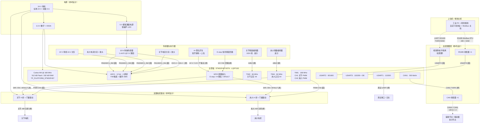

**读图要点**：

1. **力传感器的激励来自 5 V 模拟域，而 ADC 基准来自 3.3 V 数字域**，这是本设计最重要的电气特征之一（非比例式测量，见第 13.2 节与 16 章 R-11）。
2. ADC 的四条通道在 `bsp_types.h` 中由枚举 `tp_adc_ch_t` 规定为 DMA 秩（rank）顺序：`TP_ADC_FORCE = 0`、`TP_ADC_CURRENT_JOINT = 1`、`TP_ADC_CURRENT_GRIPPER = 2`、`TP_ADC_VBUS = 3`、`TP_ADC_COUNT = 4`【固件已定义】。**注意 `adc_driver.h` 的文件级注释声称"需要五个模拟通道（力、两路电流、母线电压，外加一个备用）"，而 `bsp_types.h` 只定义 4 个**（不一致，见 16 章 R-05）。
3. **离散输入是唯一的"逻辑已定义、物理未定义"类别**：`tp_io_id_t` 定义了 6 个逻辑输入（含 1 个 E-stop、4 个限位、1 个 nFAULT），但没有任何端口/引脚号。
4. 图中 `[未]` 标注的连线共有 7 条（DIR/EN×4、nFAULT×1、DE×1、CAN TX/RX×1），它们全部依赖 `platform_stm32f407.c`，而该文件**在仓库中不存在**。

### 1.2 供电与功率拓扑

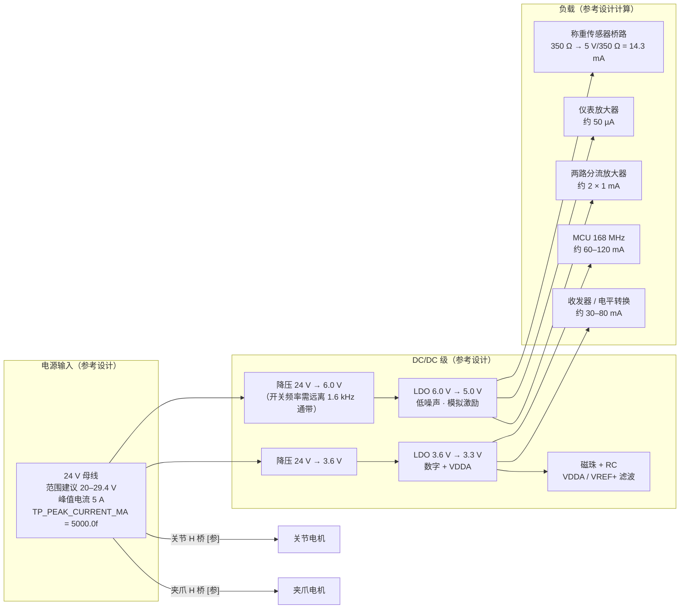

**为什么 5 V 激励不直接用线性稳压器从 24 V 降压**：负载约 25 mA（桥路 14.3 mA + 放大器与参考电路），线性压降 19 V 时耗散为 19 V × 25 mA = **475 mW**，需要较大的铜面或散热措施，且 LDO 的自热会通过 PCB 把热梯度带到模拟前端（第 14 章的热电偶效应）。改为 24 V → 6 V 降压 → 5.0 V LDO，LDO 耗散降为 1 V × 25 mA = **25 mW**，同时 LDO 的 PSRR 把降压级的开关纹波抑制掉。

**5 V 激励纹波的设计要求【设计计算】**：桥路的输出对激励的变化是直接敏感的。设桥路存在 1% 的电阻不平衡（未标定桥路的典型量级），则激励上的纹波 ΔV_exc 会在桥路输出产生差分分量

```
V_diff = ΔV_exc × (ΔR/R) / 4 = ΔV_exc × 0.01 / 4 = ΔV_exc / 400
```

要把该分量对力的影响压到 0.5 mN（即 0.5 mN × 100.5 mV/N = 50.25 µV，在前端输出端），在 `TP_FORCE_AMP_GAIN = 201` 下：

```
V_diff × G < 50.25 µV
ΔV_exc / 400 × 201 < 50.25 µV
ΔV_exc < 50.25 µV × 400 / 201 = 100.0 µV
```

**结论：5 V 激励在 0.1–250 Hz（力环关心的频段）内的纹波应低于 100 µV RMS**；高于 1.6 kHz 的部分由抗混叠 RC 衰减，要求可放宽。该数值依赖"1% 桥路不平衡"这一假设，**未经验证**（R-12）。

### 1.3 接地与屏蔽拓扑

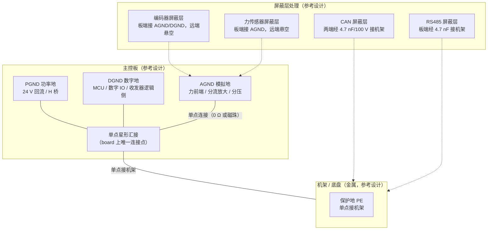

**为什么模拟地与数字地必须单点连接**：`TP_ADC_VREF_V = 3.300f` 与 `TP_ADC_FULL_SCALE = 4095.0f` 决定了 **1 count = 805.66 µV**【固件已定义，见 `config.h` 第 8 节 `TP_ADC_MV_PER_COUNT`】。任何在 AGND 与 DGND 之间流动的电流都会在该连接点的阻抗上产生电压，直接叠加到 ADC 的输入与基准上。若两地多点连接，母线上 5 A 峰值 PWM 电流的回流会在地平面上形成电位差，耦合进力通道；单点连接的代价是需要仔细规划回流路径（第 14 章）。

详细策略见第 12 章。

### 1.4 接口清单与速率总表

> ⚠️ **本表的"仓库引脚定义"一列已过时**（写于 STM32 后端实现之前）。
> **权威引脚表见 3.0 节**（来源：`platform_stm32f407.c`）。本表保留的原因是它按"接口"而不是
> "引脚"组织信息，便于做速率与物理层的横向比较；但**任何引脚结论必须回到 3.0 节**。
> 关键更正：力传感器为 **PA4/ADC1_IN4**（不是 PA0），关节电流为 **PA5/ADC1_IN5**（不是 PA1），
> 调试串口 **PA9/PA10**、视觉串口 **PD5/PD6**、RS485 **PB10/PB11 + PD12(DE)**、
> CAN1 **PD0/PD1**、PWM **PA8/PE11**、PWM 载波 **20 kHz（已实现）**。

| 接口 | 逻辑 ID（固件） | 类型 | 方向 | 速率【固件已定义】 | 物理层（参考设计） | 仓库引脚定义 |
|---|---|---|---|---|---|---|
| 调试串口 | `TP_BUS_DEBUG_UART = 0` | UART | 双向（以 TX 为主） | `TP_UART_DEBUG_BAUD = 115200u` | USART1，3.3 V TTL，可选 USB 桥 | ✅ **PA9/PA10** |
| 视觉/上位机串口 | `TP_BUS_VISION_UART = 1` | UART | 双向 | `TP_UART_VISION_BAUD = 921600u` | USART2，3.3 V TTL 或 RS-422 差分 | ✅ **PD5/PD6** |
| RS485（Modbus RTU） | `TP_BUS_RS485 = 2` | 半双工差分 | 双向 | `TP_RS485_BAUD = 115200u` | USART3 + DE | ✅ **PB10/PB11 + PD12(DE)** |
| CAN | `TP_BUS_CAN = 3` | 差分多主 | 双向 | `TP_CAN_BITRATE_BPS = 500000u` | CAN1 + 收发器 | ✅ **PD0/PD1** |
| 力传感器 | `TP_ADC_FORCE = 0` | 模拟差分 → 单端 | 输入 | 采样率 `TP_SENSOR_FREQ_HZ = 500u`（**但有效更新率 62.5 Hz，见 3.1 与 `signal_conditioning.md` 第 3.6 节**） | **PA4 / ADC1_IN4** | ✅ 已实现 |
| 关节电流 | `TP_ADC_CURRENT_JOINT = 1` | 模拟单端 | 输入 | 同上 | **PA5 / ADC1_IN5** | ✅ 已实现 |
| 夹爪电流 | `TP_ADC_CURRENT_GRIPPER = 2` | 模拟单端 | 输入 | 同上 | PA2 / ADC1_IN2 | ✅ 已实现 |
| 24 V 母线电压 | `TP_ADC_VBUS = 3` | 模拟单端（10:1 分压） | 输入 | 同上 | PA3 / ADC1_IN3 | ✅ 已实现 |
| 关节 PWM | `TP_MOTOR_JOINT = 0` | 数字输出 | 输出 | 载波 **20 kHz（已实现）**；更新率 `TP_CONTROL_FREQ_HZ = 1000u` | TIM1_CH1 | ✅ **PA8** |
| 夹爪 PWM | `TP_MOTOR_GRIPPER = 1` | 数字输出 | 输出 | 同上 | TIM1_CH2 | ✅ **PE11** |
| 关节编码器 | `TP_ENCODER_JOINT = 0` | 数字差分输入 | 输入 | 计算值 9.78 kHz/相（第 11.2 节） | TIM2 正交 X4 | ⚠️ 外设已定，引脚号未定义 |
| 夹爪编码器 | `TP_ENCODER_GRIPPER = 1` | 数字差分输入 | 输入 | 计算值 15.36 kHz/相（第 11.2 节） | TIM4 正交 X4 | ⚠️ 外设已定，引脚号未定义 |
| E-stop | `TP_IO_ESTOP = 0` | 数字输入（NC 回路） | 输入 | 软件轮询，周期**未定义** | 24 V 隔离回路 → GPIO | ❌ 未定义 |
| 关节负向限位 | `TP_IO_LIMIT_JOINT_MIN = 1` | 数字输入（NO 接地） | 输入 | 同上 | 3.3 V + 上拉 | ❌ 未定义 |
| 关节正向限位 | `TP_IO_LIMIT_JOINT_MAX = 2` | 数字输入（NO 接地） | 输入 | 同上 | 3.3 V + 上拉 | ❌ 未定义 |
| 夹爪全开限位 | `TP_IO_LIMIT_GRIPPER_OPEN = 3` | 数字输入（NO 接地） | 输入 | 同上 | 3.3 V + 上拉 | ❌ 未定义 |
| 夹爪全闭限位 | `TP_IO_LIMIT_GRIPPER_CLOSE = 4` | 数字输入（NO 接地） | 输入 | 同上 | 3.3 V + 上拉 | ❌ 未定义 |
| 驱动 nFAULT | `TP_IO_DRIVER_FAULT = 5` | 数字输入（低有效） | 输入 | 同上 | 3.3 V 开集 + 上拉 | ❌ 未定义 |
| 关节使能/方向 | — | 数字输出 | 输出 | 控制周期 `TP_CONTROL_PERIOD_MS = 1` | DIR / EN GPIO | ❌ 未定义 |
| 夹爪使能/方向 | — | 数字输出 | 输出 | 同上 | DIR / EN GPIO | ❌ 未定义 |
| 电源输入 | — | 功率 | 输入 | 峰值 5 A【`TP_PEAK_CURRENT_MA`】 | J1 | ❌ 未定义 |

### 1.5 时钟域与定时器资源分配

下列时钟事实来自 `firmware/Drivers/startup/system_stm32f4xx.c` 的文件头注释（【固件已定义】）：

| 项目 | 数值 | 推导 |
|---|---|---|
| HSE | 8 MHz | — |
| PLLM / PLLN / PLLP | 8 / 336 / 2 | VCO 输入 = 1 MHz，VCO 输出 = 336 MHz |
| SYSCLK | **168 MHz** | 336 MHz / 2（F407 上限） |
| AHB / HCLK | **168 MHz** | AHB / 1 |
| PCLK1 | **42 MHz** | APB1 / 4 |
| APB1 定时器内核时钟 | **84 MHz** | APB 预分频 ≠ 1 时定时器时钟 = 2 × PCLK1 |
| PCLK2 | **84 MHz** | APB2 / 2 |
| APB2 定时器内核时钟 | **168 MHz** | 同上 |
| Flash 等待周期 | 5 wait states | VDD 2.7–3.6 V，150 < HCLK ≤ 168 MHz |

由此得到本文档后续要用到的两个关键定时器频率：

| 资源 | 用途【固件已定义】 | 定时器内核时钟 | 对设计的约束 |
|---|---|---|---|
| TIM1 | 关节 PWM（CH1）+ 夹爪 PWM（CH2） | **168 MHz** | PWM 载波频率与分辨率之积 ≤ 168 MHz；见 14.4 节的载波频率选择讨论 |
| TIM2 | 关节编码器正交 X4（`TP_ENCODER_JOINT = 0`） | **84 MHz** | 正交计数率上限极高，不是瓶颈（第 11.2 节） |
| TIM4 | 夹爪编码器正交 X4（`TP_ENCODER_GRIPPER = 1`） | **84 MHz** | 同上 |
| 触发 ADC 的定时器 | **仓库中未定义** | — | 必须与 PWM 载波同步（第 14.4 节） |
| CAN1 | 500 kbit/s | PCLK1 = 42 MHz | 位定时可达性分析见 6.7 节 |
| USART1 / 2 / 3 | 115200 / 921600 / 115200 | PCLK2（USART1）与 PCLK1（USART2/3） | 波特率误差需校验，见 8.2 节 |

---

## 第 2 章 设计目标

### 2.1 功能目标

| 编号 | 目标 | 判据 | 依据 |
|---|---|---|---|
| F-01 | 同时驱动 1 个关节轴与 1 个夹爪轴 | 两路独立 PWM + 独立使能，可分别关断 | `TP_MOTOR_COUNT = 2`【固件已定义】 |
| F-02 | 关节位置闭环 | 增量编码器 X4，`TP_ENCODER_COUNTS_PER_REV = 4096`，关节行程 `TP_JOINT_MIN_MRAD = (-90000.0f)` 至 `TP_JOINT_MAX_MRAD = (90000.0f)`（±90°） | `bsp_types.h`、`config.h` 第 3 节 |
| F-03 | 夹爪力闭环 | 力分辨率 < 20 mN；目标力 `TP_FORCE_TARGET_N = (2.20f)`，硬限 `TP_FORCE_MAX_N = (5.00f)` | `config.h` 第 5、8 节 |
| F-04 | 与视觉主机通信 | 921600 baud 帧协议，帧头 `TP_PROTO_HEADER0 = (0xAAu)` / `TP_PROTO_HEADER1 = (0x55u)`，最大负载 `TP_PROTO_MAX_PAYLOAD = (64u)` | `config.h` 第 6 节 |
| F-05 | 与工业设备（PLC）互通 | Modbus RTU 从站，地址 `TP_MODBUS_SLAVE_ADDR = (0x11u)`，功能码 0x03/0x04/0x06/0x10 | `config.h` 第 6 节、`rs485.h` |
| F-06 | 与辅助节点总线通信 | CAN 2.0A，11 位标识符，最大 8 字节负载 | `can_driver.h`（`TP_CAN_MAX_DLC = 8u`、`TP_CAN_MAX_FILTERS = 4u`） |
| F-07 | 安全急停 | 硬件级断电 + 软件锁存；急停后任何写入不得重新使能驱动 | `platform_api.h` 的 `tp_platform_emergency_kill()` 契约 |
| F-08 | 行程末端保护 | 4 个限位输入 + 软件去抖（`TP_LIMIT_DEBOUNCE_COUNT = 3u`） | `limit_switch.h` |

### 2.2 电气目标（可验证指标表）

| 编号 | 指标 | 目标值 | 判据 / 出处 |
|---|---|---|---|
| E-01 | 逻辑电平 | 3.3 V CMOS；输入高 ≥ 2.0 V，低 ≤ 0.8 V（STM32F407 标准） | STM32F407 数据手册（需复核具体型号） |
| E-02 | 力通道分辨率 | ≤ 20 mN | `config.h` 第 8 节原文：`0.806 mV / LSB < 20 mN` |
| E-03 | 力通道设计 LSB | 8.0166 mN/count | 由 `TP_ADC_MV_PER_COUNT = 3300/4096` 与 `TP_FORCE_FRONTEND_MV_PER_N = 100.5` 推出，见 `signal_conditioning.md` 第 6.1 节 |
| E-04 | ADC 饱和点 | ≥ 硬限 5 N 的 3 倍 | `TP_FORCE_ADC_SATURATION_N ≈ 32.84 N`【固件已定义】 |
| E-05 | CAN 物理层 | 500 kbit/s，总线长度 ≤ 50 m（保守设计值） | `TP_CAN_BITRATE_BPS = 500000u`；ISO 11898-2 标称 100 m，本文档取 50 m 留 2× 余量 |
| E-06 | CAN 终端 | 恰好 2 × 120 Ω，位于物理两端 | 第 6.2 节推导 |
| E-07 | RS485 失效安全偏置 | 空闲时 Vab ≥ 200 mV | TIA/EIA-485-A 接收器门限；计算见 7.3 节 |
| E-08 | RS485 驱动能力 | 空载差分输出 ≥ 1.5 V；负载 54 Ω 时 ≥ 1.5 V | TIA/EIA-485-A 规范 |
| E-09 | RS485 总线长度 | 115200 baud 下 ≤ 800 m | 长度 × 速率 ≤ 10⁸ 经验式（7.4 节） |
| E-10 | E-stop 回路电压 | 24 V 直流 | 第 9.2 节论证 |
| E-11 | E-stop 回路电流 | 8–15 mA | 第 9.4 节计算（湿电流 + 光耦驱动） |
| E-12 | E-stop 响应（目标） | ≤ 5 ms（理想固件实现） | 第 9.7 节预算；**当前固件实现受去抖影响，不满足**（R-08） |
| E-13 | 编码器接口 | 差分（RS-422 类），CMRR ≥ 50 dB @ 100 kHz | 第 11.1 节 |
| E-14 | 电流检测量程 | 连续 3 A / 峰值 5 A 均在 ADC 量程内 | `TP_MAX_CURRENT_MA = (3000.0f)`、`TP_PEAK_CURRENT_MA = (5000.0f)`；设计见 `signal_conditioning.md` 第 6.9 节 |
| E-15 | 母线电压检测 | 覆盖 20–29.4 V，全量程 33.0 V | 10:1 分压 + 3.3 V 基准（第 13.1 节） |
| E-16 | 隔离 | CAN/RS485 与主控之间可选电气隔离；E-stop 必须隔离 | 第 9.5、7.6 节 |
| E-17 | 输入过压保护 | 所有板外信号引脚能承受 ±8 kV 接触放电（IEC 61000-4-2 Level 4 设计目标） | 第 14.3 节；**未验证** |

### 2.3 机械与环境目标

| 编号 | 目标 | 依据 / 说明 |
|---|---|---|
| M-01 | 工作温度 0–50 °C | 茶园田间环境；温度跨度直接决定温漂预算（见 `signal_conditioning.md` 第 6.5 节） |
| M-02 | 湿度 20–90% RH 非凝露 | 高湿环境下 PCB 表面漏电会破坏高阻抗节点，需要保护环（第 14 章） |
| M-03 | 连接器插拔寿命 ≥ 100 次 | 现场维护需求；测试方法见 15.6 节 |
| M-04 | 线缆抗拉与固定 | 所有板外线缆须有应力消除，不得由连接器焊点承力 |
| M-05 | 防护等级 | 主控盒建议 IP54；传感器与连接器建议 IP65 以上（**仓库未定义，属机械设计范围**） |

### 2.4 明确非目标（Non-Goals）

- 本文档**不是** PCB 设计文件，不给出叠层、线宽、过孔策略。
- 本文档**不定义**应用层协议（Modbus 寄存器映射见 `docs/07_communication_protocol.md`；**该文件在撰写时与交付核对时均不在仓库中**，见 R-04）。
- 本文档**不覆盖** CANopen / J1939 等应用层——`can_driver.h` 明确声明"deliberately does not implement CANopen, J1939 or a segmented transfer protocol"。
- 本文档**不给出**任何器件的采购结论；所有型号均为"参考设计 / Recommended Implementation"。
- 本文档**不替代**安规评估。E-stop 的最终安全等级（是否达到 PL d / SIL 2）需要独立的机械与安全评估，本文档只描述电气实现。

---

## 第 3 章 MCU 资源与引脚映射（与固件一致）

> ## ✅ 本章已更新：引脚映射现在是**已实现的事实**，不再是推测
>
> `firmware/BSP/stm32f407/platform_stm32f407.c`（约 106 KB，2878 行）与
> `platform_stm32f407.h` 现已存在，**STM32 后端已实现**。本章的引脚表全部来自该文件的
> **文件头引脚映射表**与 `tp_platform_init()` 中的实际 GPIO 配置调用，是**已实现**的配置，
> 而不是本文档的建议值。
>
> ⚠️ **但必须同时指出一处严重的文档/实现不一致**：`bsp_types.h` 的 `tp_adc_ch_t` 注释
> **仍然是旧的**（写 PA0/PA1），而实现使用 **PA4/PA5**。实现文件自己把 `bsp_types.h` 标注为
> **"(stale)"**。详见 3.1 节与风险项 R-21——**任何按 `bsp_types.h` 注释画板的做法都会把
> 力传感器放大器接到关节编码器的 A 相上。**

### 3.0 真实引脚映射总表（来源：`platform_stm32f407.c`）

下表逐行取自 `platform_stm32f407.c` 的文件头注释（第 15–46 行）与
`tp_platform_init()` 中的 GPIO 配置（第 1737–1794 行），并已与 `tp_platform_io_read_all()` 的
移位定义（`TP_STM32_IO_SHIFT = 4u`、`TP_STM32_IO_MASK = 0x3Fu`）交叉核对。

| 功能 | 引脚 | 外设 / 模式 | 上拉/下拉 | 配置来源（文件行） |
|---|---|---|---|---|
| 关节 PWM | **PA8** | TIM1_CH1, AF1, 20 kHz 边沿对齐 | NOPULL | 1747 |
| 夹爪 PWM | **PE11** | TIM1_CH2, AF1, 20 kHz 边沿对齐 | NOPULL | 1748 |
| 关节 DIR | **PE0** | GPIO 推挽输出，初始低 | NOPULL | 1738 |
| 关节使能 EN | **PE1** | GPIO 推挽输出，初始低 | NOPULL | 1739 |
| 夹爪 DIR | **PE2** | GPIO 推挽输出，初始低 | NOPULL | 1740 |
| 夹爪使能 EN | **PE3** | GPIO 推挽输出，初始低 | NOPULL | 1741 |
| 关节编码器 A/B | **PA0 / PA1** | TIM2_CH1/CH2, AF1, X4 正交 | **PULLUP** | 1753–1754 |
| 夹爪编码器 A/B | **PB6 / PB7** | TIM4_CH1/CH2, AF2, X4 正交 | **PULLUP** | 1755–1756 |
| 力传感器（称重） | **PA4** | ADC1_IN4（模拟） | NOPULL | 1760 |
| 关节电流 | **PA5** | ADC1_IN5（模拟） | NOPULL | 1761 |
| 夹爪电流 | **PA2** | ADC1_IN2（模拟） | NOPULL | 1762 |
| 24 V 母线分压 | **PA3** | ADC1_IN3（模拟） | NOPULL | 1763 |
| ADC 触发 | — | **TIM3 TRGO @ 500 Hz** → DMA2 Stream0 | — | 1487–1496, 1536 |
| 毫秒时基 | — | **TIM5 自由运行，1 kHz，32 位** | — | 1340–1341 |
| RS485 DE 释放定时器 | — | **TIM7 单脉冲，1 µs 分辨率** | — | 1864–1869 |
| 调试串口 | **PA9 / PA10** | USART1, AF7, 115200 8N1 | TX NOPULL / **RX PULLUP** | 1767–1768 |
| 视觉/上位机 | **PD5 / PD6** | USART2, AF7, 921600 8N1 | TX NOPULL / **RX PULLUP** | 1769–1770 |
| RS485（Modbus RTU） | **PB10 / PB11** | USART3, AF7, 115200 8N1 | TX NOPULL / **RX PULLUP** | 1771–1772 |
| RS485 DE | **PD12** | GPIO 推挽输出，初始低 | NOPULL | 1742 |
| CAN1 | **PD0 / PD1** | CAN1, AF9, 500 kbit/s | RX PULLUP / TX NOPULL | 1775–1776 |
| E-stop 常闭回路 | **PE4** | GPIO 输入 | **PULLDOWN** ⚠️ | 1789 |
| 关节负向限位 | **PE5** | GPIO 输入 | PULLUP | 1790 |
| 关节正向限位 | **PE6** | GPIO 输入 | PULLUP | 1791 |
| 夹爪全开限位 | **PE7** | GPIO 输入 | PULLUP | 1792 |
| 夹爪全闭限位 | **PE8** | GPIO 输入 | PULLUP | 1793 |
| 门极驱动 nFAULT | **PE9** | GPIO 输入，低有效 | PULLUP | 1794 |

**布局含义（可直接用于 PCB）**：

1. **六个离散输入集中在 PE4..PE9**，实现文件说明这是刻意的：让 `tp_platform_io_read_all()` 成为
   一次 `GPIOE->IDR` 读加一次右移（`TP_STM32_IO_SHIFT = 4u`）。⇒ 硬件上这六个输入应集中在
   板边同一区域，且**共用一个接地点与一段屏蔽汇接区**。
2. **四个 DIR/EN 输出集中在 PE0..PE3**，同样是为了减少 GPIO 端口时钟与走线分散。
3. **只有两个 GPIO 端口用于模拟**（PA2/PA3/PA4/PA5）⇒ 模拟输入走线应全部集中在 GPIOA 的
   2–5 脚附近，形成独立的"模拟角"，并远离 PA8（关节 PWM，VERY_HIGH 速率、20 kHz 方波）。
   ⚠️ **PA8 与 PA4/PA5 同属 GPIOA 且相邻数位**，因此"模拟角"与"PWM 输出"在同一端口上——
   这是布局上必须显式处理的耦合路径（第 7 章）。
4. **RS485 DE = PD12 与 USART2 = PD5/PD6 同端口**，而 CAN1 = PD0/PD1 也在 GPIOD。
   GPIOD 承载了三条总线的信号，因此 **GPIOD 附近的走线密度最高**，需要优先规划。
5. **E-stop 是唯一带内部下拉（PULLDOWN）的离散输入**——这是一个必须被硬件遵循的极性约定，
   详见 9.5 节与 3.4 节。

### 3.1 ADC 通道映射（含一处必须处理的文档/实现不一致）

**实现事实**（`platform_stm32f407.c` 第 317–323 行，`s_adc_channel[]` 翻译表）：

```c
static const uint32_t s_adc_channel[TP_ADC_COUNT] = {
    ADC_CHANNEL_4, /**< TP_ADC_FORCE            -> PA4, ADC1_IN4 */
    ADC_CHANNEL_5, /**< TP_ADC_CURRENT_JOINT    -> PA5, ADC1_IN5 */
    ADC_CHANNEL_2, /**< TP_ADC_CURRENT_GRIPPER  -> PA2, ADC1_IN2 */
    ADC_CHANNEL_3  /**< TP_ADC_VBUS             -> PA3, ADC1_IN3 */
};
```

| 枚举 | 值 | **实现使用的引脚** | ADC 通道 | `bsp_types.h` 注释（**已过时**） | 是否一致 |
|---|---|---|---|---|---|
| `TP_ADC_FORCE` | 0 | **PA4** | ADC1_IN4 | PA0, ADC1_IN0 | ❌ **不一致** |
| `TP_ADC_CURRENT_JOINT` | 1 | **PA5** | ADC1_IN5 | PA1, ADC1_IN1 | ❌ **不一致** |
| `TP_ADC_CURRENT_GRIPPER` | 2 | **PA2** | ADC1_IN2 | PA2, ADC1_IN2 | ✅ 一致 |
| `TP_ADC_VBUS` | 3 | **PA3** | ADC1_IN3 | PA3, ADC1_IN3 | ✅ 一致 |
| `TP_ADC_COUNT` | 4 | — | — | — | — |

**为什么移动了这两路（实现文件记录的冲突解析，第 52–74 行）**：

> *"`bsp_types.h` documents the force channel as `PA0, ADC1_IN0` and the joint current as
> `PA1, ADC1_IN1`. Those two pins are *also* the joint encoder's quadrature inputs. A pin has
> exactly one alternate function, so one of the two uses has to move, and the encoder cannot:
> TIM2 in encoder mode needs those two specific channels, whereas any ADC input can measure
> anything."*

**⇒ 解析结果是移动模拟通道，把依赖特定外设的信号留在原地。** 这与本文档初稿在
3.5 节（旧版）中提出的"U-13 类冲突"是同一类问题，**现在有了确定的答案**：

| 冲突 | 争取的双方 | 最终归属 | 记录位置 |
|---|---|---|---|
| PA0/PA1 | ADC1_IN0/IN1（力、关节电流） vs **TIM2_CH1/CH2（关节编码器）** | **编码器留下**；ADC 移到 PA4/PA5 | 实现文件第 52–74 行 |
| PA9 | **TIM1_CH2（夹爪 PWM）** vs **USART1_TX（调试串口）** | **USART1 留下**；夹爪 PWM 移到 **PE11**（同一 TIM1_CH2、同一 AF1） | 实现文件第 76–90 行 |

**⚠️ 这是本文档最需要强调的一条风险**：`bsp_types.h` 第 53–54 行**至今仍写着 PA0/PA1**，而
`config.h` 第 376 行的前端链路注释**至今仍写着 "STM32 ADC1_IN0"**。实现文件把前者的两张表
标注为 stale，但**没有修改 `bsp_types.h` 与 `config.h`**。后果：

- 若 PCB 设计者按 `bsp_types.h` 画板，力传感器放大器会接到 **PA0**，而 PA0 在实现中是
  **关节编码器的 A 相输入（带内部上拉）**⇒ 编码器信号与放大器输出互相破坏，且编码器计数会
  被放大器的 1.65 V 直流偏置彻底污染；
- 关节电流同理会落到 **PA1**（编码器 B 相）。

**⇒ 处置要求（列入 R-21，制板前必须闭合）**：以 `platform_stm32f407.c` 的 `s_adc_channel[]`
为**唯一权威**，并修正 `bsp_types.h` 的 `tp_adc_ch_t` 注释与 `config.h` 第 8 节的
"STM32 ADC1_IN0" 字样。**本文档后续所有章节一律按 PA4/PA5/PA2/PA3 编写。**

### 3.2 PWM 与编码器映射（含真实定时器参数）

| 功能 | 引脚 | 外设 | 通道 | 内核时钟 | 备注 |
|---|---|---|---|---|---|
| 关节 PWM | **PA8** | TIM1 | CH1 | **168 MHz** | AF1，VERY_HIGH 速率 |
| 夹爪 PWM | **PE11** | TIM1 | CH2 | **168 MHz** | AF1，VERY_HIGH 速率；**原定 PA9，因与 USART1_TX 冲突而移到 PE11** |
| 关节编码器 | **PA0 / PA1** | TIM2 | CH1/CH2 | **84 MHz** | AF1，X4（`TIM_ENCODERMODE_TI12`），输入滤波 `IC1Filter = IC2Filter = 6u` |
| 夹爪编码器 | **PB6 / PB7** | TIM4 | CH1/CH2 | **84 MHz** | AF2，X4，同样的输入滤波 |

**真实定时器参数（`platform_stm32f407.c`）**：

| 项目 | 值 | 出处 |
|---|---|---|
| `TP_STM32_PWM_ARR` | **8400u**（= 168 MHz / 20 kHz） | 第 185 行 |
| `TP_STM32_PWM_HZ` | **20000u** | 第 188 行 |
| TIM1 PSC | **0**（不分频） | 第 1386 行 |
| TIM1 Period（HAL） | **`arr - 1u` = 8399** ⇒ 实际 ARR 寄存器 = 8399 | 第 1388 行 |
| TIM1 计数模式 | **`TIM_COUNTERMODE_UP`（边沿对齐）** | 第 1387 行 |
| TIM1 RepetitionCounter | **0** | 第 1390 行 |
| TIM1 输出模式 | PWM1，极性 HIGH，初始 CCR = 0 | 第 1396–1398、1419–1420 行 |
| 编码器 Prescaler / Period | **0 / 0xFFFFFFFF**（32 位，实际不溢出） | 第 1442、1444 行 |
| 编码器输入滤波 | **`IC1Filter = 6u`、`IC2Filter = 6u`**（f_DTS/32，8 个采样） | 第 1452、1456 行 |
| `TP_STM32_ENCODER_X4` | **4** | 第 182 行 |

**为什么 PWM 载波 20 kHz 是可核实的事实而不是建议**：本文档初稿在旧版 3.2 节中把
"20 kHz"列为**参考设计建议**并指出"仓库中没有任何常量定义 PWM 载波频率"。现在实测的
实现是 **20 kHz，边沿对齐**，且实现文件用一整节论证了这个选择（第 100–114 行）：

> *"At a 20 kHz switching frequency an edge-aligned period is 168e6/20000 = **8400 counts**,
> i.e. **12.6 bits** of duty resolution and **0.119 per-mille per count**. A centre-aligned
> period spends half its counts counting up and half counting down, so the same 20 kHz would
> halve the resolution to 4200 counts (12.0 bits, 0.238 per-mille per count). ... this board
> drives a single-ended `PWM + DIR` gate driver with no complementary outputs, no dead-time
> generator and **no ADC trigger taken from TIM1** (the ADC trigger comes from TIM3), so centre
> alignment would cost resolution and buy nothing. Edge alignment also fixes the duty-update
> instant at one point per period, which makes the current-loop sampling delay deterministic."*

**⇒ 本文档采纳该论证，并补一条必须记录的后果**：**ADC 触发来自 TIM3 而不是 TIM1**，
因此 **20 kHz 载波与 500 Hz 采样之间没有设计上的相位关系**（两者的频率比恰为 40:1 的整数比，
但相位由 bring-up 顺序决定，不是刻意对齐的）。这一点的量化后果见 14.4 节与
`signal_conditioning.md` 第 6.8 节——**整数比对力通道意味着载波精确混叠到直流**。

### 3.3 总线映射（含真实引脚与波特率误差）

| 逻辑 ID【固件已定义】 | 外设 | **实现引脚** | 时钟源 | 请求速率 | 备注 |
|---|---|---|---|---|---|
| `TP_BUS_DEBUG_UART = 0` | USART1 | **PA9 (TX) / PA10 (RX)** | **PCLK2 = 84 MHz** | 115200 | AF7；`TP_STM32_UART_DEBUG = 0` |
| `TP_BUS_VISION_UART = 1` | USART2 | **PD5 (TX) / PD6 (RX)** | **PCLK1 = 42 MHz** | 921600 | AF7；`TP_STM32_UART_VISION = 1` |
| `TP_BUS_RS485 = 2` | USART3 | **PB10 (TX) / PB11 (RX) + PD12 (DE)** | **PCLK1 = 42 MHz** | 115200 | AF7；`TP_STM32_UART_RS485 = 2` |
| `TP_BUS_CAN = 3` | CAN1 | **PD0 (RX) / PD1 (TX)** | PCLK1 = 42 MHz | 500 kbit/s | AF9；`tp_stm32_can_btr()` 可回读 |

**⚠️ 这解决了本文档初稿指出的"USART2 默认复用引脚 PA2/PA3 与 ADC 冲突"问题（旧 R-10 的一半）**：
实现把 USART2 放在 **PD5/PD6**，PA2/PA3 因此空出来给夹爪电流与母线分压。
⇒ 旧版 U-13 冲突**已被实现消除**，但它是以"移动 USART2"而不是"移动 ADC"的方式解决的，
与本文档初稿的建议方向一致。

**真实波特率误差（可复算，实现提供 `tp_stm32_uart_baud_error_ppm()` 回读）**：

实现使用 16 倍过采样，`BRR = round(f_CK / baud)`（第 1595–1601、1640 行的注释与代码）：

| 链路 | f_CK | 请求 baud | BRR = (f_CK + baud/2)/baud | 实际 baud = f_CK/BRR | 误差 |
|---|---|---|---|---|---|
| USART1（调试） | 84 MHz | 115200 | (84000000+57600)/115200 = 729.67 → **729** | 84000000/729 = **115226.3** | **+228 ppm（+0.023 %）** |
| USART2（视觉） | 42 MHz | 921600 | (42000000+460800)/921600 = 46.07 → **46** | 42000000/46 = **913043.5** | **−9289 ppm（−0.929 %）** |
| USART3（RS485） | 42 MHz | 115200 | (42000000+57600)/115200 = 365.08 → **365** | 42000000/365 = **115068.5** | **−1142 ppm（−0.114 %）** |

**⇒ 本文档初稿对 USART2 给出的 −0.93 % 误差预测与实现完全一致**（初稿 8.2 节独立算出
913043.5 baud / −0.929 %）。实现把这条误差**做成了可回读的诊断量**
（`tp_stm32_uart_baud_error_ppm()`）并在启动日志中打印，这是正确的做法。
`platform_stm32f407.h` 第 182–186 行给出了判据：*"A UART tolerates roughly 20000 ppm of total
error across both ends, so anything under 5000 ppm is not worth a second look and anything over
10000 ppm should be recorded as a known limitation."*
⇒ **−9289 ppm 落在 5000–10000 ppm 之间**：按该判据"值得再看一眼但尚未构成已知限制"。
结合本文档初稿的帧长累积分析（71 字节帧在帧尾累积 7.3 bit 相位偏移），**仍建议记录为风险（R-10）**。

**⚠️ 一处仍存在的文档不一致**：`platform_api.h` 第 79 行仍写 *"Backed by the FreeRTOS tick on
the target"*，而实现使用 **TIM5 自由运行计数器**，实现文件第 136–150 行明确论证了为何不用
RTOS tick（*"An RTOS tick stops while interrupts are masked, so a tick-derived clock silently
loses time inside any critical section"*）。⇒ 列入 R-22。

### 3.4 离散输入映射与极性语义（含真实引脚与上拉方向）

六个离散输入是 **PE4..PE9 连续排列**的，由 `TP_STM32_IO_SHIFT = 4u` 与
`TP_STM32_IO_MASK = 0x3Fu` 定义（`platform_stm32f407.c` 第 245–249 行），
使 `tp_platform_io_read_all()` 成为一次 `GPIOE->IDR` 读加一次右移。

| 枚举 | 值 | **实现引脚** | 实现的上拉/下拉 | 极性语义（实现注释原文） | 断线行为 |
|---|---|---|---|---|---|
| `TP_IO_ESTOP` | 0 | **PE4** | **PULLDOWN** ⚠️ | 电平 1 = 回路完好（安全）；**电平 0 = 回路断开（按下或线脱落）** | **断线 = 按下（安全）✅** |
| `TP_IO_LIMIT_JOINT_MIN` | 1 | **PE5** | PULLUP | 开关接地，**0 = 触发** | 断线 = 未触发（不安全，见 10.2 节） |
| `TP_IO_LIMIT_JOINT_MAX` | 2 | **PE6** | PULLUP | 同上 | 同上 |
| `TP_IO_LIMIT_GRIPPER_OPEN` | 3 | **PE7** | PULLUP | 同上 | 同上 |
| `TP_IO_LIMIT_GRIPPER_CLOSE` | 4 | **PE8** | PULLUP | 同上 | 同上 |
| `TP_IO_DRIVER_FAULT` | 5 | **PE9** | PULLUP | 低有效（nFAULT） | 断线 = 无故障（不安全） |

**实现注释（第 1778–1788 行，逐字引用，这是本章最重要的一段）**：

> ```
> /* Discrete inputs, PE4..PE9 contiguous so that one IDR read gets them all.
>  *
>  * PE4 (E-stop) is the exception: the loop is normally-closed to 3.3 V and the
>  * pin has a **pull-down**, so
>  *     level 1 = loop intact (safe)
>  *     level 0 = loop open  (E-stop pressed, or the wire has fallen off)
>  * which is the fail-safe polarity the API documents ("NC loop, high when
>  * intact").  The other five switch to ground and therefore use pull-ups, so
>  * for them 0 means "active".  Both polarities are returned raw; the driver
>  * layer (`limit_switch.c`, `safety_monitor.c`) owns the interpretation, which
>  * is what makes a mis-wired prototype visible in the logs. */
> ```

**⇒ 这是本文档初稿 9.5 节推导的极性要求的直接实现确认。** 初稿在 9.5 节通过真值表推导出
唯一的 fail-safe 接法是"**回路闭合 ⇒ 引脚为高；回路断开 ⇒ 引脚被下拉为低**"，并把该接法命名
为"接法乙"，同时警告"常见的'光耦导通拉低引脚'接法会得到完全相反的极性"。
**实现选择了 PE4 + 内部下拉，正是接法乙在 MCU 侧的形式** ✅。

**⚠️ 但必须在硬件文档中澄清一个实质差异**：实现注释说回路是 **"normally-closed to 3.3 V"**，
即**回路电压是 3.3 V**。本文档第 9 章（9.2 节）从抗干扰余量、长线压降、**机械触点湿电流与
氧化膜击穿**四个角度论证了 **24 V 回路**更优，并量化了 17.2 dB 的噪声余量差距。
两者必须调和，本文档在第 9.2 节末给出调和方案（保留 24 V + 光耦，光耦输出侧呈现
"闭合即高、断开即低"的 3.3 V 形式，与 PE4 的下拉完全兼容）。**这是一处必须由硬件与固件
共同确认的接口约定，列入 R-09。**

**极性语义的固件依据（必须逐字遵守）**：

- `platform_api.h` 关于 `tp_platform_io_read()`：*"The E-stop input is wired as a **normally-closed** loop: a broken wire reads as 'asserted', which is the fail-safe polarity. Callers get the raw level and `safety_monitor.c` applies the polarity, so a mis-wired prototype is visible in the logs rather than silently inverted."*
- `limit_switch.h` 关于极性：*"The E-stop is a **normally-closed** loop: a broken wire reads as 'pressed'. Switches are normally-open to ground with a pull-up, so an unplugged switch reads 'not hit' — which is why `tp_limit_switch_init` takes an explicit active-low flag per input and why the two cases are documented separately rather than hidden behind one boolean."*
- `tp_limit_switch_init(tp_limit_switch_t *sw, tp_io_id_t id, int active_low)` 的 `active_low` 参数即为上述差异的落地点【固件已定义】。因此 **E-stop 传 `active_low = 1`，4 个限位开关与 nFAULT 传 `active_low = ?`（取决于硬件）**。本文档的建议：E-stop `active_low = 1`；4 个限位开关若采用常开接地 + 上拉则 `active_low = 1`（因为按下时引脚被拉到低）；`TP_IO_DRIVER_FAULT` 若为低有效的开集输出则 `active_low = 1`。**这些参数值必须在固件中显式冻结并与硬件原理图交叉核对。**

### 3.5 本文档初稿的建议引脚 vs 实现的实际引脚（差异对照）

本文档初稿在"引脚尚未定义"的前提下给出过一组 U-01…U-17 参考设计建议。**这些建议现在已被
实现取代**，但对照表有独立的价值：它记录了哪些冲突是真实的、本文档的哪些判断被实现证实或否定。
**下表以实现为准，初稿建议仅供参考。**

| 功能 | 初稿建议（U 编号） | **实现** | 差异与原因 |
|---|---|---|---|
| 关节 PWM（TIM1_CH1） | PE9 | **PA8** | 初稿选 PE9 是"远离模拟区"的考虑，但错失了 TIM1_CH1 的默认复用；实现选 PA8（TIM1_CH1 默认脚） |
| 夹爪 PWM（TIM1_CH2） | PE11 | **PE11** ✅ | **一致**。实现选 PE11 是因为 PA9 让给了 USART1_TX |
| 关节 DIR / EN | PD0 / PD1 | **PE0 / PE1** | 初稿放在 GPIOD，但 GPIOD 后来被三条总线占用（CAN1 PD0/PD1、USART2 PD5/PD6、DE PD12）⇒ 初稿的 PD0/PD1 会与 CAN1 **直接冲突**，实现把它移到 GPIOE 是必要修正 |
| 夹爪 DIR / EN | PD2 / PD3 | **PE2 / PE3** | 同上，集中到 PE0..PE3 |
| 关节编码器 A/B | PA5 / PB3 | **PA0 / PA1** | ⚠️ **初稿判断"不可用 PA0/PA1"，实现恰恰用了 PA0/PA1**——因为 TIM2_CH1/CH2 只能在 PA0/PA1（或 PA5/PB3，但 PA5 被电流通道占用）。**实现的选择更正确**：编码器依赖特定外设通道，ADC 可以用任意通道 |
| 夹爪编码器 A/B | PD12 / PD13 | **PB6 / PB7** | 初稿选 PD12/PD13，但 **PD12 最终被用作 RS485 DE** ⇒ 初稿方案会冲突 |
| RS485 DE | PD4 | **PD12** | 差异；实现选 PD12 使总线信号集中于 GPIOD |
| CAN1 RX/TX | PD1 / PD0 或 PB9/PB8 | **PD0 / PD1** | ✅ 与初稿的第二个选项**一致**；初稿已警告"与 U-03/U-04 冲突"，实现通过把 DIR/EN 移到 GPIOE 化解了该冲突 |
| USART1（调试） | PA9 / PA10 | **PA9 / PA10** ✅ | **一致** |
| USART2（视觉） | PA2 / PA3（初稿判定"与 ADC 冲突，需改 PD5/PD6"） | **PD5 / PD6** ✅ | ✅ **初稿的诊断与建议都被实现采纳**：初稿指出 PA2/PA3 与 `TP_ADC_CURRENT_GRIPPER`/`TP_ADC_VBUS` 冲突并建议改到 PD5/PD6 |
| USART3（RS485） | PD8 / PD9 | **PB10 / PB11** | 差异；实现选 USART3 的默认复用脚 |
| E-stop | PE0 | **PE4** | 差异；实现把六个离散输入集中为 PE4..PE9 以实现单次 IDR 读 |
| 限位 ×4 | PE1..PE4 | **PE5..PE8** | 同上，集中排列 |
| nFAULT | PE5 | **PE9** | 同上；且实现文件指出 **PE9 是 TIM1_CH1 的备选脚，但 TIM1_CH1 已路由到 PA8，故 PE9 空闲可用** |

**从这张对照表可以提炼出三条可复用的教训**：

1. **引脚分配的真正约束是"外设通道绑定"而不是"物理位置"**。TIM2 编码器模式必须用 PA0/PA1
   或 PA5/PB3；USART 有默认复用脚。因此**先分配外设通道固定的信号，再分配可自由移动的模拟
   通道**——这正是实现文件第 56–58 行给出的原则（*"the encoder cannot [move]: TIM2 in encoder
   mode needs those two specific channels, whereas any ADC input can measure anything"*）。
2. **把一个端口"留空"给将来的信号是危险的**。初稿把四条 GPIO 输出放在 GPIOD，结果 GPIOD 被
   三条总线占满。**实现把 GPIO 输出集中到 GPIOE、总线信号集中到 GPIOD**，按"信号类别"而不是
   "当时是否空闲"分区，是更稳健的策略。
3. **单次 IDR 读的价值**：把六个离散输入连续排列（PE4..PE9）使 `tp_platform_io_read_all()`
   成为一次读加一次移位，消除了"六次独立读之间的时序不一致"——这在安全逻辑里是有意义的
   （急停与限位必须属于同一时刻的快照）。

### 3.6 固件侧的编译期一致性约束

`config.h` 的末尾有 13 条 `TP_STATIC_ASSERT`【固件已定义】。与接口/硬件设计直接相关的有 5 条：

| 断言 | 含义 | 对硬件的约束 |
|---|---|---|
| `TP_CONTROL_FREQ_HZ % TP_SENSOR_FREQ_HZ == 0u` | `1000 % 500 == 0` ✓ | 传感器采样必须与 1 kHz 控制周期整除 |
| `TP_CONTROL_FREQ_HZ % TP_SAFETY_FREQ_HZ == 0u` | `1000 % 100 == 0` ✓ | **安全检测率 100 Hz → 安全任务周期 10 ms**，这是 E-stop 响应时间预算的主要项（9.7 节） |
| `TP_PROTO_MAX_FRAME <= 128u` | `71 <= 128` ✓ | 视觉链路的帧缓冲上限 |
| `TP_FORCE_FULLSCALE_MV < (TP_ADC_VREF_V * 1000.0f)` | `1005 < 3300` ✓ | 前端满量程必须低于 ADC 基准 |
| `TP_FORCE_USABLE_RANGE_N > TP_FORCE_MAX_N` | `16.41 > 5.0` ✓ | 可用力范围必须覆盖硬限 |

**这 5 条断言是"契约可被构建系统检查"的范例，硬件设计必须尊重它们。** 特别地，`TP_FORCE_USABLE_RANGE_N > TP_FORCE_MAX_N` 的含义是：即使把 5 V 激励改成 3.3 V、或把增益改成 402.6（见 R-01），该断言**仍然会通过**，因此**前端增益的错误不会被构建立即发现**。

---

## 第 4 章 连接器与引脚分配（参考设计）

### 4.1 连接器总体布局与编号约定

**本节全部内容为参考设计。** 仓库中没有任何连接器定义文件（本文档撰写时 `hardware/` 目录为空；交付时该目录下已出现由并行工作产生的 `force_sensor.md`、`motor_driver.md`、`power_design.md` 与本文档两个文件，但**其中仍然没有连接器定义**）。

布局原则：

1. **按信号类别分区**：功率、模拟、数字差分、安全回路在物理上分开布置，避免线束交叉。
2. **同一类信号集中在板的一侧**，便于整机线束的走向规划。
3. **安全回路（J5 中的 E-stop）与其他信号分列**，防止单根线缆的机械损伤同时破坏控制与安全。
4. 连接器编号 J1–J9 由本文档约定，**不是仓库中的定义**。

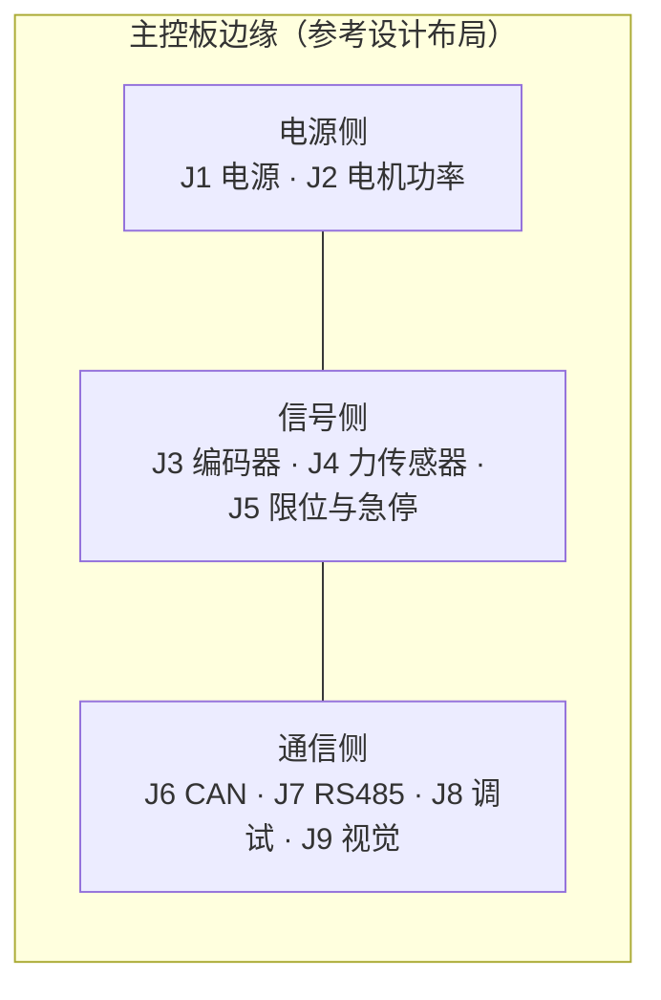

### 4.2 J1 电源输入连接器

| 针号 | 信号名 | MCU 引脚 | 方向 | 电平 | 线缆要求（参考设计） | 备注 |
|---|---|---|---|---|---|---|
| J1-1 | +24V_MOTOR | — | 输入 | 20–29.4 V DC | 18 AWG（0.82 mm²）最小；与 J1-4 双绞 | 电机功率输入；**建议 2 针并联**以分摊 5 A 峰值 |
| J1-2 | +24V_MOTOR | — | 输入 | 同上 | 同上 | 与 J1-1 同网，并联针 |
| J1-3 | +24V_LOGIC | — | 输入 | 20–29.4 V DC | 22 AWG 最小 | 逻辑电源输入；**建议与电机电源分开走线**，在板上经独立 LC 滤波 |
| J1-4 | PGND | — | — | 0 V | 18 AWG 最小；与 J1-1 双绞 | 功率地回流 |
| J1-5 | PGND | — | — | 0 V | 同上 | 与 J1-4 同网，并联针 |
| J1-6 | +5V_A | — | 输出（或输入） | 5.0 V ± 0.25 V | 24 AWG | 力传感器激励；**该网络的纹波要求见 1.2 节（< 100 µV RMS @ 0.1–250 Hz）** |
| J1-7 | AGND | — | — | 0 V（模拟参考） | 24 AWG；与 J1-6 双绞 | 力传感器激励回流；**与 J1-6 构成独立回路** |
| J1-8 | +3V3 | — | 输出（监控） | 3.3 V | 26 AWG | **建议只作为监控输出**，不作为外部供电输入（避免外部电源与板载 LDO 争用） |
| J1-9 | DGND | — | — | 0 V（数字参考） | 26 AWG | — |
| J1-10 | PE / CHASSIS | — | — | — | 18 AWG，黄绿 | 保护地；**板上单点接机架**（第 12 章） |
| J1-11 | SHIELD_DRAIN | — | — | — | — | 线束总屏蔽层的板端汇接点（经 4.7 nF/100 V 接机架） |

**选型建议（参考设计）**：J1 建议使用带锁扣的 4.2 mm 间距压接式连接器（如 Molex Mini-Fit Jr. 类）或 5.08 mm 可插拔端子台；**不建议**使用杜邦排针（无锁扣、接触电阻不稳定、振动下会松脱）。触点额定电流应为实际峰值的 2 倍以上（即 ≥ 10 A/触点）。

### 4.3 J2 电机功率连接器

| 针号 | 信号名 | MCU 引脚 | 方向 | 电平 | 线缆要求（参考设计） | 备注 |
|---|---|---|---|---|---|---|
| J2-1 | JOINT_A | — | 输出 | PWM 方波，幅度 = 母线电压 | 20 AWG，与 J2-2 双绞 | 关节 H 桥输出 A |
| J2-2 | JOINT_B | — | 输出 | 同上 | 20 AWG，与 J2-1 双绞 | 关节 H 桥输出 B |
| J2-3 | GRIPPER_A | — | 输出 | 同上 | 22 AWG，与 J2-4 双绞 | 夹爪 H 桥输出 A |
| J2-4 | GRIPPER_B | — | 输出 | 同上 | 22 AWG，与 J2-3 双绞 | 夹爪 H 桥输出 B |
| J2-5 | PGND | — | — | 0 V | 18 AWG | 回流 |
| J2-6 | MOTOR_SHIELD | — | — | — | — | 电机电缆屏蔽层板端汇接；**必须与信号地隔离**（第 12.4 节） |

**计算（参考设计，第 13.1 节详述）**：`TP_PEAK_CURRENT_MA = (5000.0f)` 即 5 A。20 AWG（0.518 mm²，约 33.3 mΩ/m）在 2 m 线缆上构成 4 m 回路，电阻约 133 mΩ，5 A 时压降 0.67 V（占 24 V 的 2.8%），可接受。**若线缆长度超过 3 m，应改用 18 AWG。**

**关键设计规则（EMC）**：每个 H 桥输出的 A/B 两根线**必须双绞**，且同一电机的两根线必须在同一线束内。这是因为 H 桥的 A/B 之间是差模驱动，双绞使 A、B 的磁场相互抵消，把辐射与对外耦合降到最低。**绝不允许把 A 相与 B 相分开走线。**

### 4.4 J3 编码器连接器

本连接器使用两个（关节、夹爪各一个），编号为 J3A / J3B。

| 针号 | 信号名 | MCU 引脚（建议） | 方向 | 电平 | 线缆要求（参考设计） | 备注 |
|---|---|---|---|---|---|---|
| J3-1 | ENC_A+ | TIM2_CH1（关节）/**PA5** | 输入 | RS-422 差分，共模 −7…+12 V | 24 AWG 双绞，120 Ω 特征阻抗 | A 相正 |
| J3-2 | ENC_A− | 同相器件的反相输出 | 输入 | 同上 | 与 J3-1 双绞 | A 相负 |
| J3-3 | ENC_B+ | TIM2_CH2（关节）/**PB3** | 输入 | 同上 | 与 J3-4 双绞 | B 相正 |
| J3-4 | ENC_B− | 同上 | 输入 | 同上 | 与 J3-3 双绞 | B 相负 |
| J3-5 | ENC_Z+ | **PB4**（建议） | 输入 | 同上 | 与 J3-6 双绞 | 索引相正；**索引相是否使用在仓库中未定义** |
| J3-6 | ENC_Z− | 同上 | 输入 | 同上 | 与 J3-5 双绞 | 索引相负 |
| J3-7 | +5V_ENC | — | 输出 | 5.0 V | 22 AWG，与 J3-8 双绞 | 编码器电源 |
| J3-8 | GND_ENC | — | — | 0 V | 22 AWG，与 J3-7 双绞 | 编码器电源回流 |
| J3-9 | ENC_SHIELD | — | — | — | 编织屏蔽层 | **板端接 AGND/DGND，远端悬空**（第 11.4 节） |

**注意**：`bsp_types.h` 只规定关节编码器用 TIM2、夹爪编码器用 TIM4，**没有规定编码器是单端还是差分，也没有引脚号**。本文档推荐差分（RS-422 类）理由见第 11.1 节。

### 4.5 J4 力传感器连接器

| 针号 | 信号名 | MCU 引脚 | 方向 | 电平 | 线缆要求（参考设计） | 备注 |
|---|---|---|---|---|---|---|
| J4-1 | EXC+ | — | 输出 | 5.0 V（`TP_LOADCELL_EXCITATION_V = (5.0f)`） | 24 AWG，与 J4-2 双绞 | 桥路激励正 |
| J4-2 | EXC− | — | — | 0 V（AGND） | 24 AWG，与 J4-1 双绞 | 桥路激励负 |
| J4-3 | SIG+ | PA0 / ADC1_IN0（经放大器） | 输入 | 差分 mV 级 | 24 AWG 双绞 + 单独屏蔽对 | 桥路信号正；**必须与 EXC 分开的双绞对** |
| J4-4 | SIG− | 同上 | 输入 | 同上 | 与 J4-3 双绞 | 桥路信号负 |
| J4-5 | SENSE+ | — | 输入 | 5.0 V（可选） | 24 AWG | **可选的远端激励检测**；见下方计算 |
| J4-6 | SENSE− | — | — | 0 V（可选） | 24 AWG | 远端激励检测回流 |
| J4-7 | SHIELD | — | — | — | 屏蔽层 | **板端接 AGND，远端悬空** |

**为什么推荐 6 芯（含远端检测）而不是 4 芯【设计计算】**：

若使用 4 芯（无远端检测），激励引线的电阻与桥路电阻 350 Ω 串联，构成分压：

```
假设 24 AWG 引线（84 mΩ/m），4 m 回路中的激励侧单程 2 m
R_lead(单侧) = 0.084 Ω/m × 2 m = 0.168 Ω
V_exc(桥路) = 5.0 V × 350 / (350 + 2 × 0.168) = 5.0 × 350 / 350.336 = 4.99520 V
⇒ 增益误差 = (5.0 − 4.99520) / 5.0 = −0.096 %
```

这是**固定的增益误差**，可由满量程标定消除。真正的代价是它的**温度系数**：铜的电阻温度系数约 3900 ppm/K。

```
引线电阻的相对变化 = 3900 ppm/K × (0.336 / 350.336) = 3900 × 9.59e-4 = 3.74 ppm/K
在 2.2 N 目标点上的力误差 = 2.2 N × 3.74e-6 = 8.2 µN/K
20 K 摆幅 ⇒ 0.16 mN
```

**结论：** 在 2 m 线缆、24 AWG 的条件下，4 芯方案的引线温漂只有 0.16 mN/20 K，**远低于** 8.0 mN 的 LSB，因此 **4 芯是足够的**；6 芯远端检测只在长线缆（> 5 m）或细线径（> 26 AWG）时才有意义。这是一个"计算表明不需要更复杂方案"的例子，本文档据此建议 **J4 采用 4 芯 + 屏蔽（即只用 J4-1..4 与 J4-7）**，J4-5/6 作为可选位置保留。

**另一个必须遵守的规则**：EXC 与 SIG **绝不能共用一对双绞线**。若共用，激励电流（14.3 mA）在导线电阻上产生的压降会直接串入信号路径。

### 4.6 J5 限位与 E-stop 连接器

| 针号 | 信号名 | MCU 引脚（建议） | 方向 | 电平 | 线缆要求（参考设计） | 备注 |
|---|---|---|---|---|---|---|
| J5-1 | ESTOP_24V | — | 输出 | 24 V DC | 22 AWG，与 J5-2 双绞 | E-stop 回路电源（经板上限流电阻） |
| J5-2 | ESTOP_RET | — | 输入 | 24 V DC | 22 AWG，与 J5-1 双绞 | E-stop 回路返回（光耦 LED 阴极侧） |
| J5-3 | LIMIT_JOINT_MIN | PE1（建议） | 输入 | 3.3 V（上拉）/ 0 V（接地） | 22 AWG 屏蔽 | 关节负向限位，常开接地 |
| J5-4 | LIMIT_JOINT_MAX | PE2（建议） | 输入 | 同上 | 22 AWG 屏蔽 | 关节正向限位 |
| J5-5 | LIMIT_GRIP_OPEN | PE3（建议） | 输入 | 同上 | 22 AWG 屏蔽 | 夹爪全开 |
| J5-6 | LIMIT_GRIP_CLOSE | PE4（建议） | 输入 | 同上 | 22 AWG 屏蔽 | 夹爪全闭 |
| J5-7 | LIMIT_GND | — | — | 0 V | 22 AWG | 限位开关公共接地端（**即在板上，不在开关端**，见 10.4 节） |
| J5-8 | DRIVER_nFAULT | PE5（建议） | 输入 | 3.3 V 开集 + 上拉 | 24 AWG 屏蔽 | 驱动器故障（低有效） |
| J5-9 | J5_SHIELD | — | — | — | 屏蔽层 | 板端接 DGND |
| J5-10 | +3V3_AUX | — | 输出 | 3.3 V，限流 50 mA | 24 AWG | 供限位开关的上拉（**可选**：若使用板上上拉则不需要） |

**E-stop 与限位开关在同一个连接器上是刻意的**：这样一根线缆的机械损伤会**同时**暴露 E-stop 与限位，而不是只破坏其中一类。但注意 J5-1/2 与 J5-3..8 在线缆内**必须分组**（E-stop 用独立屏蔽对），因为 E-stop 回路是 24 V 而限位是 3.3 V。

### 4.7 J6 CAN 连接器

| 针号 | 信号名 | MCU 引脚 | 方向 | 电平 | 线缆要求（参考设计） | 备注 |
|---|---|---|---|---|---|---|
| J6-1 | CANH | CAN1_TX/RX 经收发器 | 双向 | 差分，共模 −2…+7 V（ISO 11898-2） | 120 Ω 双绞（CAN 专用电缆） | 与 J6-2 双绞 |
| J6-2 | CANL | 同上 | 双向 | 同上 | 与 J6-1 双绞 | — |
| J6-3 | CAN_GND | — | — | 0 V（参考） | 24 AWG | 共模参考；**见 6.8 节关于是否连接的讨论** |
| J6-4 | CAN_SHIELD | — | — | — | 编织屏蔽层 | 两端经 4.7 nF/100 V 接机架（6.6 节） |
| J6-5 | CAN_V+ | — | 输出（可选） | 24 V（可选） | 22 AWG | 可选的总线供电（**参考设计未要求**，留作扩展） |

**终端电阻位置**：J6 的 120 Ω **不是**默认装在本板上。终端电阻装在**总线的两个物理端点**上；只有当本板是端点时才装。板上建议预留一个跳线/焊接位，标注"TERM"（第 6.2 节）。

### 4.8 J7 RS485 连接器

| 针号 | 信号名 | MCU 引脚 | 方向 | 电平 | 线缆要求（参考设计） | 备注 |
|---|---|---|---|---|---|---|
| J7-1 | RS485_A | USART3 经收发器 + **DE** | 双向 | 差分，共模 −7…+12 V | 120 Ω 双绞屏蔽 | 与 J7-2 双绞 |
| J7-2 | RS485_B | 同上 | 双向 | 同上 | 与 J7-1 双绞 | — |
| J7-3 | RS485_GND | — | — | 0 V（参考） | 24 AWG | **必须连接**（第 7.7 节），除非使用隔离收发器 |
| J7-4 | RS485_SHIELD | — | — | — | 编织屏蔽层 | 板端经 4.7 nF/100 V 接机架 |
| J7-5 | TERM_A | — | — | — | — | 板上 120 Ω 终端的 A 侧（跳线可选） |
| J7-6 | TERM_B | — | — | — | — | 板上 120 Ω 终端的 B 侧 |

**DE 引脚（仓库中未定义）**：`rs485.h` 明确要求 USART3 + DE pin，且 `tp_rs485_begin_tx()` / `tp_rs485_end_tx()` 的实现需要"等待发送器排空 + `TP_RS485_DE_GUARD_US = 20u` 后才释放 DE"。DE 引脚的驱动电路见 7.5 节。

### 4.9 J8 调试 UART 连接器

| 针号 | 信号名 | MCU 引脚（建议） | 方向 | 电平 | 线缆要求（参考设计） | 备注 |
|---|---|---|---|---|---|---|
| J8-1 | DBG_TX | USART1_TX / **PA9** | 输出 | 3.3 V TTL | 24 AWG，短于 0.5 m | MCU 发送 |
| J8-2 | DBG_RX | USART1_RX / **PA10** | 输入 | 3.3 V TTL（PA10 为 5 V 容忍） | 同上 | MCU 接收 |
| J8-3 | DGND | — | — | 0 V | 同上 | — |
| J8-4 | +3V3 | — | 输出 | 3.3 V，限流 100 mA | 同上 | 供 USB-TTL 桥的参考（**不用于给板供电**） |

**`TP_BUS_DEBUG_UART = 0`** 是"人可读日志"链路，速率为 `TP_UART_DEBUG_BAUD = (115200u)`。参考设计建议在板上直接集成一个 USB-UART 桥（不必引出 J8），这样可以避免开发人员接错线；若引出 J8，**必须**在 TX/RX 上加串联电阻（100 Ω）与 ESD 保护。

### 4.10 J9 视觉 UART 连接器

| 针号 | 信号名 | MCU 引脚（建议） | 方向 | 电平 | 线缆要求（参考设计） | 备注 |
|---|---|---|---|---|---|---|
| J9-1 | VIS_TX+ | USART2_TX（**需重映射**） | 输出 | RS-422 差分（推荐）或 3.3 V 单端 | 120 Ω 双绞屏蔽 | 见 U-13 冲突说明 |
| J9-2 | VIS_TX− | 同上 | 输出 | 同上 | 与 J9-1 双绞 | — |
| J9-3 | VIS_RX+ | USART2_RX（**需重映射**） | 输入 | 同上 | 与 J9-4 双绞 | — |
| J9-4 | VIS_RX− | 同上 | 输入 | 同上 | 与 J9-3 双绞 | — |
| J9-5 | DGND | — | — | 0 V | 22 AWG | — |
| J9-6 | J9_SHIELD | — | — | — | 屏蔽层 | 板端接 DGND，远端视主机情况 |

**为什么推荐 RS-422 差分而不是 3.3 V 单端【设计计算】**：`TP_UART_VISION_BAUD = (921600u)` 的位时间是 1/921600 = **1.085 µs**。3.3 V 单端在 1 m 以上线缆上的上升时间受线缆电容限制（约 50 pF/m 的排线）：若驱动能力为 25 mA、负载 50 pF，则 τ = 3.3 V × 50 pF / 25 mA ≈ 6.6 ns/m，看似充足；但单端的实际问题是**地电位差**——上位机 PC 与机器人底盘之间几十至几百毫伏的地电位差会直接叠加到接收门限上（3.3 V 逻辑的门限只有 1.65 V，200 mV 是 12% 的门限偏移），而 **921600 baud 下 `TP_COMM_TIMEOUT_MS = (200u)` 的链路超时意味着任何持续误码都直接导致链路丢失**。差分把共模噪声抑制掉，是更稳健的选择。

### 4.11 连接器与线缆选型总表

| 连接器 | 用途 | 建议针数 | 建议类型（参考设计） | 建议线径 | 是否屏蔽 | 是否双绞 | 长度上限（建议） |
|---|---|---|---|---|---|---|---|
| J1 | 电源输入 | 11 | 带锁扣压接式，4.2 mm | 18–24 AWG | 电源对不要求；＋5V 对建议 | 是（同网对） | 1.5 m |
| J2 | 电机功率 | 6 | 带锁扣压接式，4.2 mm | 20–22 AWG | 电缆总体屏蔽 | 是（A/B 对） | 3 m |
| J3A/J3B | 编码器 | 9 | IDC 或 D-sub 类，带屏蔽壳 | 24–26 AWG | **必须** | **必须** | 5 m |
| J4 | 力传感器 | 5（4 芯 + 屏蔽） | 带屏蔽壳的小型圆形/接线端子 | 24 AWG | **必须** | **必须**（EXC 与 SIG 各成对） | 3 m |
| J5 | 限位与 E-stop | 10 | 可插拔端子台，3.5–5.08 mm | 22–24 AWG | E-stop 对必须；限位建议 | E-stop 对必须 | 5 m |
| J6 | CAN | 5 | 可插拔端子台 | 22–24 AWG（CAN 专用电缆） | 是 | **必须** | 50 m（总线总长） |
| J7 | RS485 | 6 | 可插拔端子台 | 22–24 AWG | 是 | **必须** | 800 m（总线总长） |
| J8 | 调试 UART | 4 | 排针/排母 | 26 AWG | 否 | 否 | 0.5 m |
| J9 | 视觉 UART | 6 | 带屏蔽壳的 D-sub 或圆形 | 24 AWG | 是 | 是 | 5 m（RS-422 可更长） |

---

## 第 5 章 电气接口规范

### 5.1 逻辑电平与容限

| 参数 | 值 | 说明 |
|---|---|---|
| 数字 IO 供电 | 3.3 V ± 5% | 由板载 LDO（第 13.3 节） |
| 输出高电平 V_OH | ≥ 2.4 V（@ 8 mA 灌/拉，STM32F407 典型） | 需按具体型号数据手册复核 |
| 输出低电平 V_OL | ≤ 0.4 V（@ 8 mA） | 同上 |
| 输入高门限 V_IH | ≥ 2.0 V | STM32F407 CMOS 输入 |
| 输入低门限 V_IL | ≤ 0.8 V | 同上 |
| 5 V 容忍引脚 | PA10（USART1_RX）等标注 FT 的引脚 | **PA0–PA3 为模拟输入，不接受 5 V 逻辑驱动** |
| ADC 输入绝对最大 | −0.3 V 至 V_DDA + 0.3 V = 3.6 V | 超出即可能损坏 ESD 二极管 |
| ADC 输入推荐范围 | 0.1 V 至 3.2 V | 留出上下各约 100 mV 的饱和裕量；`TP_SENSOR_ADC_MIN_COUNTS = (5u)`、`TP_SENSOR_ADC_MAX_COUNTS = (4090u)` 是固件层面的合理性窗口【固件已定义】 |

### 5.2 驱动能力与限流

| 接口类别 | 单引脚最大电流（设计值） | 限流措施（参考设计） |
|---|---|---|
| GPIO 输出（DIR / EN） | 8 mA | 串联 100 Ω（若驱动长线） |
| PWM 输出（TIM1_CH1/CH2） | 8 mA | 串联 22–100 Ω，靠近 MCU 放置以抑制振铃 |
| RS485 DE | 8 mA | 直接驱动（收发器的 DE 输入电流 < 10 µA） |
| E-stop 回路（24 V） | — | 板上串联限流电阻，见 9.4 节 |
| 限位开关上拉 | 0.33 mA（10 kΩ @ 3.3 V） | 见 10.3 节 |
| nFAULT 上拉 | 0.33 mA | 见 10.3 节 |
| 编码器电源（5 V） | 100 mA | 板载 5 V 轨道上串 PTC 或限流 |
| 力传感器激励（5 V） | 20 mA | 板载 5 V 轨道上串 PTC 或限流 |

**设计规则**：任何**板外**信号线（J3–J9）都应在 MCU 引脚侧串联一个电阻（22–100 Ω），作用是（a）限制 ESD/浪涌电流，（b）抑制走线振铃，（c）在意外短路时限制引脚电流。**该电阻必须靠近 MCU 放置**，否则它就不能抑制 MCU 到电阻之间的那段走线的振铃。

### 5.3 上拉 / 下拉与默认状态

**核心原则：任何输入的"默认状态"必须是安全状态。** 这是本设计的一条硬约束。

| 信号 | 默认状态（无外部连接时） | 实现方式（参考设计） | 安全性论证 |
|---|---|---|---|
| `TP_IO_ESTOP` | **必须为"已按下"** | 光耦**截止**时，MCU 引脚被 10 kΩ 上拉到 3.3 V；固件按 `active_low = 1` 解读，**高 = 未按下**。因此电路必须设计成"回路通电 → 光耦导通 → 引脚被拉低 = 未按下"；**回路断电/断线 → 光耦截止 → 引脚为高**。 | ⚠️ **注意极性点**：`bsp_types.h` 写 "low = asserted"，即低电平表示"按下/触发"。因此"未按下"必须是高电平，"断线"必须导致低电平或等价于低。**光耦的集电极必须接成"导通时把 MCU 引脚拉低，截止时由下拉电阻把引脚保持为低"** —— 即需要一个**下拉**而非上拉，才能满足"断线 = 低 = 按下"。**这一极性必须在原理图评审时逐点确认**（R-09）。 |
| 4× 限位开关 | "未触发" | MCU 内部或外部 **上拉**（10 kΩ）到 3.3 V；开关**常开接地** | `limit_switch.h` 明确：*"Switches are normally-open to ground with a pull-up, so an unplugged switch reads 'not hit'"*。这是**有意的**：限位开关若断线即报"触发"，会造成无法移动的呆锁；代价是断线后失去保护（10.2 节讨论）。 |
| `TP_IO_DRIVER_FAULT` | "无故障" | **上拉**到 3.3 V；驱动器 nFAULT 为开集低有效 | ⚠️ 断线 = 无故障 = 不安全。建议增加"nFAULT 线断线检测"（10.2 节的可选方案）。 |
| RS485 总线（无节点驱动时） | 逻辑 1（空闲/标记） | 失效安全偏置网络（7.3 节） | 保证 UART 接收端看到确定的空闲电平，避免起始位误触发 |
| CAN 总线（无节点驱动时） | 隐性（recessive） | 终端电阻 + 收发器内部偏置 | ISO 11898-2 规定隐性时 V_CANH − V_CANL ≈ 0 V |
| ADC 输入（运放故障时） | 应落在合理窗口内 | 见 `signal_conditioning.md` | 避免运放掉电时把 ADC 引脚拉过 rail |

### 5.4 各接口最大速率与线缆长度

| 接口 | 速率【固件已定义】 | 位时间 | 建议最大线缆长度 | 限制因素 |
|---|---|---|---|---|
| 调试 UART | 115200 baud | 8.68 µs | 0.5 m（TTL）；30 m（若加 RS-232/422 转换） | TTL 单端抗干扰能力；`TP_UART_BUFFER_SIZE = 512u` 的缓冲深度 |
| 视觉 UART | 921600 baud | 1.085 µs | 5 m（RS-422 差分） | 地电位差、门限裕量（4.10 节） |
| RS485 | 115200 baud | 8.68 µs | 800 m（总线总长） | 长度 × 速率 ≤ 10⁸ 经验式；终端与偏置（7.3、7.4 节） |
| CAN | 500 kbit/s | 2 µs | 50 m（本文档保守设计值） | ISO 11898-2 标称 100 m；仲裁/ACK 往返时延（6.3 节） |
| 编码器（关节） | 每相 9.78 kHz（第 11.2 节计算） | 102 µs/周期 | 5 m | 差分抗干扰；与电机电缆的间距 |
| 编码器（夹爪） | 每相 15.36 kHz（第 11.2 节计算） | 65 µs/周期 | 5 m | 同上 |
| 力传感器（模拟） | 带宽 fc = 1.6 kHz | — | 3 m | 热电势、共模耦合（`signal_conditioning.md` 第 7 章） |
| 限位开关（干接点） | DC | — | 5 m | 长线上的感应噪声（10.4 节） |
| E-stop 回路 | DC（24 V） | — | 10 m | 线间短路/断线的可检测性；压降可忽略（9.2 节） |

### 5.5 隔离边界

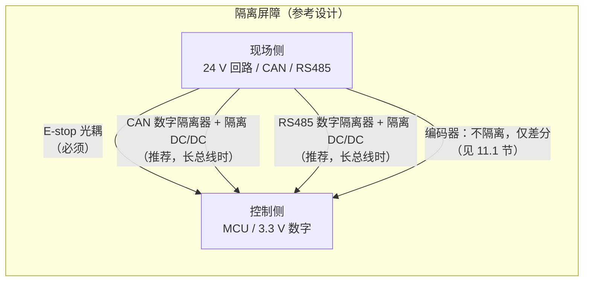

| 接口 | 是否隔离 | 理由 |
|---|---|---|
| E-stop | **必须** | 24 V 现场回路与 3.3 V 逻辑之间的电气隔离是安全设计的基本要求；同时避免 24 V 现场线缆的共模干扰进入 MCU 地 |
| CAN | 推荐（长总线时） | `can_driver.h` 说明 CAN 的价值在"仲裁与错误隔离"，但如果总线上多个节点地电位差大，需要隔离才能保住共模范围（6.8 节） |
| RS485 | 推荐（长总线时） | 现场总线可能延伸数百米，地电位差会超出 −7…+12 V 的共模范围（7.7 节） |
| 编码器 | 不隔离 | 编码器与电机同轴安装，本来就是同一地参考；差分的共模抑制已足够（11.1 节）。隔离会引入传播延迟，影响高计数率的时序 |
| 力传感器 | 不隔离 | 传感器在机械上与主板共地；隔离会引入噪声与漂移，得不偿失 |
| 限位开关 | 不隔离 | 3.3 V 干接点，电流极小，共模问题不严重（10.4 节讨论例外） |

---

## 第 6 章 CAN 物理层设计（参考设计）

### 6.1 收发器选型对比表

**以下全部为参考设计。** 仓库中**没有任何收发器选型**；`can_driver.h` 只说"CAN1, 500 kbit/s"。

| 方案 | 供电 | 隔离 | 待机 | 差分输出典型 | 环路延迟典型 | 节点数 | 相对成本 | 适用性评估 |
|---|---|---|---|---|---|---|---|---|
| **A. 3.3 V 收发器（推荐）**<br/>如 TI SN65HVD230 / NXP TJA1051T/3 类 | 3.3 V | 否 | 可选 | ≈ 1.5–2.0 V @ 60 Ω | ≈ 70–100 ns | ≥ 110 | 低 | ✅ **推荐**：STM32F407 的 CAN_TX/RX 是 3.3 V 逻辑，直接连接，无需电平转换；500 kbit/s 远低于其能力上限 |
| B. 5 V 收发器<br/>如 NXP TJA1050 / TJA1051T 类 | 5 V | 否 | 否 | ≈ 2.0–2.5 V @ 60 Ω | ≈ 70 ns | ≥ 110 | 低 | ⚠️ 需要 5 V 轨道（本设计已有）；CAN_TX 需 3.3 V→5 V 电平转换，CAN_RX 需确认 STM32 引脚为 5 V 容忍。差分幅度更大（抗噪略好），但多一级电平转换带来的传播延迟与成本不值得 |
| C. 3.3 V 隔离收发器<br/>如 TI ISO1042 / ADI ADM3053 类 | 3.3 V + 隔离 DC/DC | **是** | 可选 | ≈ 1.5–2.0 V | ≈ 100–150 ns | ≥ 110 | 高（3–5×） | ✅ 当 CAN 总线长度 > 20 m 或与其他设备共用动力地时推荐 |
| D. 5 V 隔离收发器 | 5 V + 隔离 DC/DC | 是 | 否 | ≈ 2.0 V | ≈ 120 ns | ≥ 110 | 高 | 同 C，但需要额外的 5 V 隔离电源 |

**选择理由（本文档建议方案 A，长总线时升级为 C）**：

1. **避免电平转换**：STM32F407 的 CAN1_TX/CAN1_RX 工作在 3.3 V。用 5 V 收发器需要在 TX 路径上加电平转换器，产生额外的传播延迟。在 500 kbit/s（2 µs 位时间）下，一个 50 ns 的额外延迟虽然只占 2.5%，但 CAN 的位定时计算必须把这个延迟计入传播段（prop_seg），并且它是**单向**的，会让采样点在不同方向上的有效裕量不对称。用 3.3 V 收发器可以直接连接，简化位定时。
2. **500 kbit/s 对驱动能力的要求不高**：ISO 11898-2 要求差分输出 ≥ 1.5 V（在 60 Ω 负载下）。3.3 V 收发器的典型输出为 1.5–2.0 V，**刚好满足**，因此**必须在设计评审中确认所选器件的 V_od(min) 在 −40…+125 °C 全温区 ≥ 1.5 V**，而不是只看 25 °C 典型值。这是方案 A 唯一的实质风险点。
3. **待机引脚（standby）本设计不需要**：`can_driver.h` 没有任何低功耗模式的接口（`tp_can_init` / `tp_can_send` / `tp_can_recv` / `tp_can_service` / `tp_can_is_bus_off` / `tp_can_recover` / `tp_can_set_filter` 都只操作运行状态），因此带待机引脚的器件（如 TJA1051 有 STB，SN65HVD230 有 RS）应把该引脚硬接到"正常模式"，**不要**引到 GPIO 上浪费一个引脚。

**方案 A 的具体设计要点（参考设计）**：

| 项目 | 要求 |
|---|---|
| VCC 去耦 | 100 nF 陶瓷 + 4.7 µF 陶瓷，紧贴收发器 VCC 引脚 |
| TXD 上拉 | 10 kΩ 上拉到 VCC（保证 MCU 复位期间总线为隐性） |
| 总线引脚电容 | 每个节点 ≤ 100 pF（含收发器引脚电容 + 保护器件电容 + 走线） |
| 引脚复用 | CAN_TX 应配置为**推挽复用**；CAN_RX 配置为**上拉输入或浮空输入**（依具体收发器，开集输出时需上拉） |
| 保护 | 每条总线线加双向 TVS（6.8 节） |

### 6.2 终端电阻：为什么恰好两个 120 Ω

**这是 CAN 物理层最容易被做错的一点。**

**为什么必须是两个，而不是"每个节点一个"：**

CAN 收发器的输出级规格是以**特定的总线负载阻抗**为条件的。ISO 11898-2 规定收发器必须能在 **60 Ω** 的差分负载下产生规定的差分电压。60 Ω 的来源正是：

```
两个 120 Ω 终端电阻位于总线的两个物理端点
⇒ 从总线上任意一点看进去的差分阻抗
   = 120 Ω ∥ 120 Ω = 120 × 120 / (120 + 120) = 60 Ω
```

若在每个节点都装一个 120 Ω，当有 N 个节点时：

| 节点数 N | 并联终端阻抗 = 120/N Ω | 后果 |
|---|---|---|
| 2 | 60 Ω | ✅ 正确（两端各一） |
| 3 | 40 Ω | ⚠️ 驱动电流需求增至 1.5 倍；差分幅度下降约 33%（按驱动器内阻建模）；传播延迟改变 |
| 4 | 30 Ω | ⚠️ 驱动电流需求增至 2 倍；部分收发器会进入限流保护，差分幅度进一步崩塌 |
| 5 | 24 Ω | ❌ 多数收发器无法维持 ≥ 1.5 V，总线必然不可靠 |

**结论**：**只在总线的两个物理端点各装一个 120 Ω**，中间节点不装。本板的 J6 上应预留一个"TERM"焊接位/跳线，只有在本板确实是端点（即线缆从 J6 出去之后不再有更远的节点）时才装。

**为什么是 120 Ω：** 它与 CAN 专用双绞电缆的特征阻抗匹配。若电缆阻抗是 100 Ω 或 150 Ω，终端应取相应值和相应的并联值，**必须向电缆供应商确认**。使用与电缆不匹配的终端会产生反射，在 500 kbit/s 下表现为眼图闭合与随机位错误。

**终端电阻的功率**：CAN 总线在隐性状态下终端电阻上无电流，在显性状态下有约 V_diff/120 ≈ 2.0/120 = 17 mA 流过（分摊在两端）。占空比取决于流量，最坏情况（持续显性）单只电阻耗散 = 17 mA² × 120 Ω ≈ 34 mW。**0805 封装（0.125 W）足够**。同时应使用 1% 精度的电阻，因为两只电阻的不匹配会把差模信号转成共模（第 6.4 节）。

### 6.3 总线长度与波特率的关系

**ISO 11898-2 标称值**（这些是标准中的标称额定值，不是实测）：

| 波特率 | 位时间 | 标称最大总线长度 |
|---|---|---|
| 1 Mbit/s | 1 µs | 40 m |
| 800 kbit/s | 1.25 µs | 50 m |
| **500 kbit/s** | **2 µs** | **100 m** |
| 250 kbit/s | 4 µs | 250 m |
| 125 kbit/s | 8 µs | 500 m |
| 50 kbit/s | 20 µs | 1000 m |

**长度限制的物理来源（本文档的推导）**：

CAN 的仲裁与应答机制要求：一个节点发出的位，必须在**同一个位时间窗口内**被最远节点收到、由最远节点发出应答位、再回到发送节点。因此有一个往返约束：

```
2 × (t_cable + t_transceiver) + t_other < t_bit

其中：
  t_cable      = L × 5 ns/m       （双绞线典型传播延迟约 5 ns/m）
  t_transceiver = 收发器环路延迟   （本文档取 100 ns，方案 A）
  t_other      = 控制器内部延迟 + 振荡器容差裕量（取 0.3 × t_bit 的保守值）
  t_bit        = 1 / 500000 = 2 µs

代入：
  2 × (L × 5 ns/m + 100 ns) + 0.3 × 2000 ns < 2000 ns
  10 ns/m × L + 200 ns + 600 ns < 2000 ns
  10 ns/m × L < 1200 ns
  L < 120 m
```

**结论**：由往返时延推出的上限约 120 m，ISO 标称值 100 m 更保守且包含了电缆参数不确定性的裕量，因此**本文档采用 ISO 标称值 100 m 作为理论上限，并把本机型的设计上限取为 50 m（2× 余量）**。理由：农业现场的电缆敷设往往不满足 CAN 专用电缆的 120 Ω/5 ns/m 参数，且连接器、分支（stub）都会额外增加延迟。

**分支（stub）长度限制**：每个节点到总线的分支应尽可能短。参考的设计规则是"分支上的往返时间应小于位的上升时间"：

```
2 × L_stub × 5 ns/m < t_r
若收发器上升时间 t_r = 100 ns：
  L_stub < 100 ns / (2 × 5 ns/m) = 10 m
```

这在 500 kbit/s 下显然过于宽松（反射虽不会破坏该位，但会侵入下一位）。**工程实践建议：500 kbit/s 下分支长度应 < 0.3 m，并优先采用"菊花链穿过每个节点"的布线方式（即线缆进入连接器后从同一连接器的另一组触点穿出），而不是从主干上引分支。**

### 6.4 分裂终端（split termination）的取舍与计算

**分裂终端**是用两只 60 Ω 电阻串联代替一只 120 Ω，串联中点经一只电容接地：

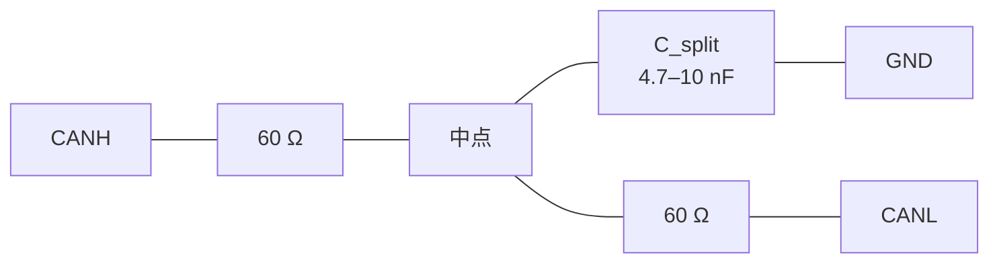

| 项目 | 单只 120 Ω | 分裂终端（2 × 60 Ω + C） |
|---|---|---|
| 差模终端阻抗 | 120 Ω | 60 + 60 = 120 Ω（**相同**） |
| 共模抑制 | 无 | 有：共模信号经 C 被泄放到地 |
| 辐射发射 | 基准 | 改善（典型 3–6 dB，**无实测数据**） |
| 抗共模干扰 | 基准 | 改善 |
| 元件数量 | 1 | 3 |
| 失效模式 | 开路 → 失去终端 | 电容短路 → 共模被硬接地（可能引起地环流）；电阻开路 → 失去终端 |
| 成本 | 最低 | 略高 |

**电容取值的计算【设计计算】**：

分裂终端的共模等效电路是：从共模角度，两只 60 Ω 并联成 30 Ω，与 C 构成一阶低通：

```
R_cm = 60 Ω ∥ 60 Ω = 30 Ω
f_cm(-3dB) = 1 / (2π × R_cm × C)

取 C = 4.7 nF：
  f_cm = 1 / (2π × 30 × 4.7e-9) = 1 / (8.85e-7) = 1.13 MHz

取 C = 10 nF：
  f_cm = 1 / (2π × 30 × 10e-9) = 530 kHz
```

**判据**：共模低通截止频率应显著高于信号带宽（500 kbit/s 的基频成分为 250 kHz，边沿成分可达数 MHz），同时显著低于要抑制的共模干扰频率（通常是开关电源与电机驱动的 20 kHz–几十 MHz 宽带）。

- C = 4.7 nF → f_cm = 1.13 MHz：**过高**，对几百 kHz 以下的共模干扰抑制不足；
- C = 10 nF → f_cm = 530 kHz：仍偏高。

**结论**：分裂终端的电容是"用辐射/抗扰换取一点点共模抑制"的折中，**在 500 kbit/s 下其有效频段很窄**。本文档的建议是：**默认采用单只 120 Ω（简单、失效模式明确）**；只有在 EMC 预测试（15.7 节）显示共模辐射或抗扰度不达标时，才改为分裂终端并把 C 取 4.7–10 nF，同时**必须**确认所选电容的额定电压 ≥ 100 V（因为它可能承受总线对地的共模电压）。

**另一条必须注意的规则**：分裂终端的两只 60 Ω 必须**精度匹配（≤ 1%）**。若不匹配，差模信号会转化成共模信号并被电容旁路，等效于在差模路径上引入损耗与不对称。

### 6.5 共模扼流圈的取舍与计算

| 项目 | 不加 | 加共模扼流圈 |
|---|---|---|
| 共模阻抗 | 低 | 高（典型 100–500 Ω @ 10 MHz） |
| 差模阻抗 | — | **必须低**：理想情况下只有漏感（典型 0.5–2 µH） |
| 辐射发射 | 基准 | 改善 |
| 抗共模干扰 | 基准 | 改善 |
| 传播延迟 | 基准 | 增加（典型几 ns，可忽略） |
| 差模信号完整性 | 基准 | **风险点**：漏感与节点电容构成低通 |
| 成本/尺寸 | — | 增加 |

**差模影响的计算【设计计算】**：

```
CAN 节点侧的等效电容 C_node ≈ 100 pF（收发器引脚 + TVS + 走线）
漏感 L_leak = 1 µH（典型共模扼流圈的差分漏感）

差模低通截止：f_dm = 1 / (2π × sqrt(L_leak × C_node))
           = 1 / (2π × sqrt(1e-6 × 100e-12))
           = 1 / (2π × sqrt(1e-16))
           = 1 / (2π × 1e-8)
           = 15.9 MHz

500 kbit/s 的信号边沿能量主要分布在 < 10 MHz（取决于上升时间）
⇒ 15.9 MHz 的截止频率留出了约 1.6 倍余量，可接受
```

**结论与建议**：

- **默认不装共模扼流圈**。理由：在 500 kbit/s、节点数少（本设计只有 CAN1 一路）、且总线较短（≤ 50 m）的条件下，差模信号完整性比辐射指标更关键，而扼流圈的漏感会侵占信号带宽裕量。
- **若 EMC 预测试不达标**，再增加共模扼流圈，并且**必须**选用 CAN 专用型（漏感 ≤ 1 µH），**不要**用电源共模扼流圈（其漏感可达数十 µH，会直接破坏 500 kbit/s 的边沿）。
- 加装时，扼流圈应**紧靠连接器**放置，且**其两侧的走线必须保持差分对称**，否则扼流圈会把差模信号转换成共模（这正是它要抑制的东西）。

### 6.6 CANH/CANL 双绞与屏蔽层接法

| 项目 | 要求 |
|---|---|
| 绞对 | **必须**。CANH 与 CANL 必须在同一对双绞线内，绞距一致。绝对不允许分别走线或与电源线混绞 |
| 特征阻抗 | 120 Ω（必须与终端电阻匹配，见 6.2 节） |
| 屏蔽 | 是（推荐）。使用带编织屏蔽的 CAN 专用电缆 |
| 屏蔽层板端接法 | 经 **4.7 nF / 100 V** 陶瓷电容接机架（PE）。**不要**直接接信号地 |
| 屏蔽层远端接法 | 同样经 4.7 nF / 100 V 接机架（即"两端经电容接机架"方案） |
| 为什么不两端直接接地 | 两端直接接地会形成地环流，母线上的 PWM 电流会在地环中被感应，反而把噪声注入屏蔽层。经电容接机架可旁路射频共模电流，同时阻断工频/直流地环流 |
| 屏蔽层是否需要 1 MΩ 泄放 | 建议在 4.7 nF 上并联 1 MΩ/0.25 W，防止静电荷积累（12.5 节） |
| J6-3（CAN_GND）是否连接 | **建议连接**（长总线、多节点时）。理由：CAN 的共模范围是 −2…+7 V，若各节点地电位差超过此范围，通信就会失效。提供一个共模参考地导线可以把电位差钳制在范围内。若使用隔离收发器（方案 C），则 CAN_GND 只连到隔离的现场侧地，不连到控制侧的 DGND |

### 6.7 位定时核算与「87.5% 采样点」可达性分析

> ## ✅ 本节结论已被实现证实，并已在实现中被独立推导
>
> `platform_stm32f407.c` 现已存在，其中 CAN1 的位定时为**直接寄存器编程**，并把完整的
> 推导过程写在代码注释里（第 193–239 行）。**该推导与本文档初稿的独立推导完全一致**，
> 包括"87.5% 在 42 MHz 下不可达"这一结论。
>
> **实现编程的实际值**（`platform_stm32f407.c` 第 240–243 行）：
>
> ```c
> #define TP_STM32_CAN_BRP 5u  /**< BRP field: prescaler = BRP + 1 = 6. */
> #define TP_STM32_CAN_TS1 10u /**< TS1 field: BS1 = TS1 + 1 = 11 tq.     */
> #define TP_STM32_CAN_TS2 1u  /**< TS2 field: BS2 = TS2 + 1 = 2 tq.      */
> #define TP_STM32_CAN_SJW 0u  /**< SJW field: SJW = 1 tq.                */
> ```
>
> | 项目 | 实现值 | 复核 |
> |---|---|---|
> | BTR 寄存器 | **`0x001A0005`** | = 0x5 \| (10 << 16) \| (1 << 20) ✅ 与宏一致 |
> | 预分频 | BRP + 1 = **6** | — |
> | BS1 / BS2 / SJW | **11 / 2 / 1 tq** | — |
> | 总 tq / 位 | 1 + 11 + 2 = **14 tq** | — |
> | 实际位速率 | 42e6 / (6 × 14) = **500 000 bit/s** | **0 ppm 误差** ✅ |
> | 采样点 | (1 + 11) / 14 = **85.714 %** | 距 87.5% 早 **1.786 %** = 35.7 ns |
>
> **实现提供的可回读诊断**（`platform_stm32f407.h` 第 153–160 行）：
> `tp_stm32_can_btr()`、`tp_stm32_can_bitrate_bps()`、
> `tp_stm32_can_sample_point_tenths()`（"875 == 87.5 %"）。启动日志（第 1944–1948 行）打印：
>
> ```
> "can1 btr=0x%08lX -> %lu bit/s, sample point %lu.%lu %% (target 87.5 %%)"
> ```
>
> ⇒ **这是一个可以被评审者直接核对的红利**：`platform_stm32f407.h` 开头就说明这些
> 访问器存在的目的正是 *"the arithmetic results (IWDG prescaler, CAN bit timing, achieved
> baud rate) that the boot log reports and that **a reviewer should be able to check against
> the reference manual without re-deriving them**"*。
>
> ⚠️ **但仍存在一处陈旧的日志字符串**：`can_driver.c` 第 37 行**仍然硬编码打印**
> `"CAN up at %lu bit/s, sample point 87.5%%"`，把 87.5% 当作既成事实。它**没有调用**
> `tp_stm32_can_sample_point_tenths()`。因此**同一次启动会打印两条互相矛盾的日志**
> （`can_driver.c` 说 87.5%，`platform_stm32f407.c` 说 85.7% target 87.5%）。这不是功能
> 缺陷，但是一个会误导调试的信息缺陷 ⇒ 保留在风险项 **R-06**。

下文的推导保留为**独立复核**（本文档初稿在实现存在之前独立得出同一结论，故其价值在于
交叉验证而非首次发现）。

`can_driver.c` 在初始化成功时打印：

> `LOG_INFO(TP_MOD_COMM, "CAN up at %lu bit/s, sample point 87.5%%", ...)`

**这是一条需要核对的声明**，因为：

1. ~~仓库中**不存在** `platform_stm32f407.c`~~ ⇒ **现已存在**，实际位定时见上表；本节改为
   对实现值的独立复核。
2. 按 `system_stm32f4xx.c` 的时钟树，**PCLK1 = 42 MHz**，而 STM32F407 的 CAN1 内核时钟来自 PCLK1。因此：

```
需要的位时间 = 1 / 500000 = 2 µs
BRP × T_tq 关系：500000 = 42e6 / (BRP × T_tq)
⇒ BRP × T_tq = 42e6 / 500e3 = 84

采样点 = (1 + BS1) / (1 + BS1 + BS2) = (1 + BS1) / T_tq
要得到 87.5% = 7/8：
  (1 + BS1) / T_tq = 7/8
  ⇒ T_tq 必须是 8 的倍数
⇒ BRP = 84 / T_tq 必须是整数
⇒ 84 必须能被 8 的倍数整除

84 的因数分解：84 = 2² × 3 × 7
84 的因数中 8 的倍数：不存在（8 ∤ 84）
```

**结论：在 PCLK1 = 42 MHz 下，500 kbit/s 无法精确达到 87.5% 的采样点。** 最接近的可行组合是：

| T_tq | BRP | BS1 | BS2 | SJW | 实际采样点 | 相对误差 |
|---|---|---|---|---|---|---|
| 12 | 7 | 9 | 2 | 1 | (1+9)/12 = **83.33 %** | −4.17 % |
| 14 | 6 | 11 | 2 | 1 | (1+11)/14 = **85.71 %** | −1.79 % |
| 21 | 4 | 17 | 3 | 1 | (1+17)/21 = **85.71 %** | −1.79 % |
| 28 | 3 | 24 | 3 | 2 | (1+24)/28 = **89.29 %** | +1.79 % |
| 28 | 3 | 23 | 4 | 1 | (1+23)/28 = **85.71 %** | −1.79 % |

**本文档的建议（= 实现已采用的值）**：采用 **T_tq = 14、BRP = 6、BS1 = 11、BS2 = 2、SJW = 1**，采样点 85.71%，在 14 tq 的位时间内采样点位于第 12 个 tq 的结束处。这是一个 CAN 应用中最常用的采样点位置（CiA 推荐的 500 kbit/s 采样点为 87.5%，85.71% 与它的差异仅 1.79%，且位于 75–87.5% 的推荐区间内）。

✅ **实现文件独立推导出同一结论，并在注释中列出了完整的因数对枚举表**（第 208–229 行），
包括本文档初稿所指出的那句关键判据：

> *"Nothing in the list reaches the 87.5 % ideal, and nothing can: an exact 87.5 % requires N to be
> divisible by 8, and 84 is not."*

实现还额外记录了一条**它拒绝的错解**（第 236–238 行）：

> *"(The brief's suggested 'prescaler 5, BS1 15, BS2 2' would give 42e6 / (5 * 18) = 466 667 bit/s
> — a 6.7 % error, far outside the 0.5 % that CAN bit-timing tolerance allows — which is why it is
> not used.)"*

⇒ **这是一个值得记录的工程实践**：把"评审者/需求方给出的错误建议"连同正确的反算一起留在代码里，
比悄悄改正更有价值——因为它阻止了该错误建议在下一轮评审中被再次提出。

**这条分析同时说明了一个更普遍的问题**：`can_driver.c` 的日志字符串把采样点**硬编码为 87.5%**，而不是从实际配置的位定时计算得出。这是一种"文档与实现可能互相不符"的隐患：若有人修改了位定时，日志仍会打印 87.5%。**建议改为在 `tp_can_init` 中按实际 BRP/BS1/BS2 计算并打印**（需修改 `can_driver.c` 与 `platform_stm32f407.c`；不在本文档的改动范围内，列入 R-06）。

**另一个必须核对的点**：`can_driver.c` 的注释说明

> *"CAN bit timing has to be solved against the peripheral clock to land the sample point at the right place; accepting an arbitrary rate here would produce a bus that 'mostly works' and fails intermittently at temperature."*

这条理由完全正确，但它**只保证了"不接受任意速率"**，并没有保证"已接受的速率被正确求解"。位定时的求解代码位于**不存在的** `platform_stm32f407.c` 中，因此**在本仓库范围内无法验证 CAN 的位定时是否正确**。这是一个必须在硬件/固件联调阶段用示波器测量采样点位置来闭合的项（15.3 节给出测量方法）。

### 6.8 保护电路与共模范围

| 项目 | 参数 | 说明 |
|---|---|---|
| CAN 共模范围（工作） | −2 V 至 +7 V | ISO 11898-2 规定；在此范围内收发器必须正常接收 |
| CAN 总线引脚绝对最大 | 通常 −27 V 至 +40 V（瞬态） | **必须查具体器件数据手册**；不同厂商差异很大 |
| TVS 选择 | 双向，V_RWM ≥ 24 V，V_CL ≤ 数据手册绝对最大值 | 参考设计可选：CAN 专用双向 TVS（如 PESD1CAN 类），其低电容（≤ 30 pF）不影响 500 kbit/s |
| TVS 位置 | 紧靠 J6 连接器，TVS 到连接器的走线尽可能短 | 让浪涌电流在被保护走线上产生最小压降 |
| 总线引脚串联电阻 | 0–10 Ω（部分器件内部已有） | 增加串联电阻会降低差分幅度，**必须**计入 6.1 节的 V_od 裕量 |
| 共模扼流圈 | 见 6.5 节（默认不装） | — |

**TVS 钳位电压的计算【设计计算】**：

```
判据：V_CL(TVS) + I_surge × R_series < V_absmax(收发器)

以 8/20 µs 组合波、IEC 61000-4-5 Level 2（1 kV / 0.5 kV）为例：
  源阻抗 2 Ω
  若采用 SMB 封装（600 W）双向 TVS，V_RWM = 24 V：
    V_CL ≈ 38.9 V @ 指定测试电流
  收发器总线引脚的绝对最大值若为 +40 V / −27 V：
    38.9 V < 40 V ⇒ 正方向勉强通过，负方向 38.9 V > 27 V ⇒ 不通过

修正方案：
  (a) 选用 V_RWM 更低（如 12 V）的 TVS 并把 V_CL 降至 ≈ 19.9 V
      ⇒ 19.9 V < 27 V ✓，正方向也满足
      但 V_RWM = 12 V 与 CAN 正常工作共模范围 −2…+7 V 兼容 ✓
  (b) 在 TVS 与收发器之间串入 10 Ω（两线各一）
      ⇒ 若收发器内部 ESD 钳位在 13 V 开始导通，
         流过串联电阻的电流 = (19.9 V − 13 V) / 10 Ω = 0.69 A（脉冲）
         收发器需承受 0.69 A 的短脉冲 —— 必须查数据手册确认其 ESD 单元能力
```

**结论与建议**：

1. **优先使用 CAN 专用保护器件**（低电容、V_RWM = 12–24 V、非对称或对称钳位），其钳位电压是按 CAN 总线引脚的绝对最大值设计的。**不要**用通用电源 TVS。
2. 若使用通用 TVS，**必须**做上述钳位计算，并注意**负方向**（CANL 相对 CANH 可低至 −27 V）往往比正方向更受限。
3. TVS 的**结电容必须小**（≤ 30 pF/线）。CAN 总线的节点电容预算为每节点 ≤ 100 pF；一只 500 pF 的通用 TVS 会直接吃掉整个预算。

---

## 第 7 章 RS485 物理层设计（参考设计）

### 7.1 收发器选型对比表

**全部为参考设计。** 仓库的事实只有：`TP_BUS_RS485 = 2` 使用 USART3 + DE pin，`TP_RS485_BAUD = (115200u)`，实现 Modbus RTU 从站地址 `TP_MODBUS_SLAVE_ADDR = (0x11u)`。

| 方案 | 供电 | 隔离 | 单位负载 | 速率上限 | 失效安全 | 相对成本 | 适用性评估 |
|---|---|---|---|---|---|---|---|
| **A. 标准非隔离收发器（推荐起始方案）**<br/>如 TI SN75176 / MAX485 / SP3485 类 | 5 V 或 3.3 V | 否 | 1 UL（部分为 1/4、1/8 UL） | 250 kbit/s – 10 Mbit/s | 视器件；多数**无**内部失效安全 | 低 | ✅ **推荐**：115200 baud 需求低；非隔离方案简单。**必须**外接失效安全偏置（7.3 节） |
| B. 带内部失效安全偏置的收发器<br/>如 MAX3082 / MAX13487 类 | 5 V 或 3.3 V | 否 | 1/8 UL | 115200 – 500 kbit/s | **有** | 中 | ✅ 好选择：可省去外部偏置网络，降低静态功耗。**但仍需终端电阻**（若总线较长） |
| C. 隔离收发器<br/>如 ADM2483 / ISO3082 / MAX14850 类 | 5 V 或 3.3 V + 隔离 DC/DC | **是** | 1/8 UL | 250 kbit/s – 500 kbit/s | 视器件 | 高（3–6×） | ✅ 总线 > 50 m 或现场地电位差大时推荐 |
| D. 自动方向控制收发器<br/>如 MAX13487E 类 | 5 V / 3.3 V | 否 | 1/8 UL | 115200 – 500 kbit/s | 有 | 中 | ⚠️ **不推荐用于本设计**：自动方向控制依赖发送数据的内部检测，其内部延迟与 `TP_RS485_DE_GUARD_US = 20u` 的显式时序控制**语义冲突**，而且 `rs485.c` 的方向状态机（`TP_RS485_DIR_RX` / `TP_RS485_DIR_TX` / `TP_RS485_DIR_TX_DRAIN`）需要一个**可被软件观测和控制**的 DE 信号 |
| E. 带浪涌保护的收发器 | 同 A | 否 | 1 UL | 同 A | 视器件 | 中高 | 当现场有雷击/感性负载切换风险时考虑 |

**选择理由（本文档建议 A 或 B）**：

1. **速率需求低**：`TP_RS485_BAUD = (115200u)`，位时间 8.68 µs。所有候选方案都远超此需求，因此**选型应以共模范围、单位负载、失效安全特性为依据，而不是速率**。
2. **DE 必须由软件控制**：`rs485.h` 的三个方向状态（`TP_RS485_DIR_RX = 0`、`TP_RS485_DIR_TX = 1`、`TP_RS485_DIR_TX_DRAIN = 2`）以及 `tp_rs485_begin_tx()` / `tp_rs485_end_tx()` 的存在，说明固件要求 DE 是一个**由软件显式驱动**的信号。方案 D（自动方向）与这个架构不兼容，**排除**。
3. **失效安全是必须的**：`rs485.h` 的 `TP_RS485_DIR_RX = 0` 状态是"DE 去assert、正在监听"。在所有节点都不发送的空闲时刻，总线处于高阻态，其差分电压由偏置网络决定。若偏置不足，接收器输出会随机翻转，UART 把随机电平解释成起始位，导致**虚假字节进入接收缓冲**——而 `TP_UART_BUFFER_SIZE = 512u` 的缓冲被垃圾填满后，真实的 Modbus 请求会被丢弃（`tp_uart_link_t::rx_overflow` 开始增长）。因此失效安全偏置不是"nice to have"，而是**必需**。

### 7.2 单位负载（UL）与节点数

| 收发器类别 | 标称输入阻抗 | 单位负载 | 理论最大节点数（32 UL 总线） |
|---|---|---|---|
| 标准 | 12 kΩ | 1 UL | 32 |
| 1/2 UL | 24 kΩ | 1/2 | 64 |
| 1/4 UL | 48 kΩ | 1/4 | 128 |
| 1/8 UL | 96 kΩ | 1/8 | 256 |

**为什么驱动器规格是 54 Ω**：TIA/EIA-485-A 规定驱动器必须能在 **54 Ω** 负载下产生 ≥ 1.5 V 的差分电压。54 Ω 的来源是**最坏情况的满载总线**：

```
两个 120 Ω 终端并联          = 60 Ω
32 个 1 UL 接收器并联        = 12 kΩ / 32 = 375 Ω
合成负载 = 60 Ω ∥ 375 Ω = (60 × 375) / (60 + 375) = 22500 / 435 = 51.7 Ω ≈ 54 Ω
```

因此"两个终端 + 32 个标准节点"就是规范定义的满载条件。**本文档的失效安全偏置计算必须使用这个满载条件**（7.3 节给出两个边界情况）。

### 7.3 失效安全偏置（fail-safe biasing）完整计算

**目标**：当总线上所有驱动器都处于高阻态（空闲）时，保证接收器输入看到的差分电压满足

```
Vab = V_A − V_B ≥ 200 mV
```

其中 200 mV 是 TIA/EIA-485-A 规定的接收器**必须能识别的最小差分输入**。把空闲总线偏置到超过这个门限，才能保证接收器输出确定的逻辑 1（标记状态，UART 空闲），从而不会产生虚假起始位。

#### 步骤 1：确定等效负载

偏置网络看到的总线负载由三部分并联组成：两个终端电阻、所有接收器输入电阻、偏置电阻自身（最后计入）。

**情形 1a：本机与主机直连（2 个节点，全长终端，1 UL 接收器）**

```
R_term = 120 Ω ∥ 120 Ω = 60 Ω
接收器：2 × 12 kΩ 并联 = 6 kΩ
R_L = 60 Ω ∥ 6000 Ω = (60 × 6000) / (60 + 6000) = 360000 / 6060 = 59.406 Ω
```

**情形 1b：满载总线（32 个 1 UL 节点，全长终端）**

```
R_term = 60 Ω
接收器：32 × 12 kΩ 并联 = 375 Ω
R_L = 60 Ω ∥ 375 Ω = 51.724 Ω
```

#### 步骤 2：失效安全偏置的电路与方程

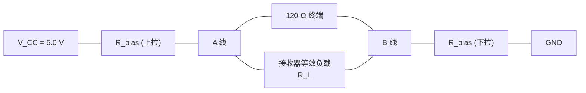

在空闲状态下，上拉电阻 R_up、等效负载 R_L、下拉电阻 R_dn 构成一个串联分压回路：

```
Vab = V_CC × R_L / (R_up + R_dn + R_L)
```

取对称偏置 `R_up = R_dn = R_bias`：

```
                 V_CC × R_L
Vab = ─────────────────────────
        2 × R_bias + R_L
```

#### 步骤 3：反解偏置电阻

**情形 1a（2 节点，1 UL，全长终端）**：

```
Vab ≥ 0.200 V
V_CC × R_L / (2 × R_bias + R_L) ≥ 0.200
5.0 × 59.406 / (2 × R_bias + 59.406) ≥ 0.200
297.03 / (2 × R_bias + 59.406) ≥ 0.200
2 × R_bias + 59.406 ≤ 297.03 / 0.200 = 1485.15
2 × R_bias ≤ 1425.74
R_bias ≤ 712.9 Ω
```

**情形 1b（32 节点，1 UL，全长终端）**：

```
Vab ≥ 0.200 V
5.0 × 51.724 / (2 × R_bias + 51.724) ≥ 0.200
258.62 / (2 × R_bias + 51.724) ≥ 0.200
2 × R_bias + 51.724 ≤ 1293.1
R_bias ≤ 620.7 Ω
```

#### 步骤 4：确定工程取值（引入设计裕量）

上一步得到的是 **Vab 恰好等于 200 mV 的临界值**。工程上必须留出裕量，以覆盖：

- 电阻容差（1% 的 R_bias 两只同时向下偏 → Vab 降低约 1%）；
- V_CC 容差（5 V ± 5% → Vab 降低 5%）；
- 接收器输入阻抗的容差与温度变化（模块规格常给 ±10%）；
- 现场共模噪声。

**设计判据：以 250 mV 作为目标值（25% 裕量）重新反解。**

**情形 1a（2 节点）目标 250 mV**：

```
297.03 / (2 × R_bias + 59.406) ≥ 0.250
2 × R_bias + 59.406 ≤ 1188.12
R_bias ≤ 564.4 Ω
```

**情形 1b（32 节点）目标 250 mV**：

```
258.62 / (2 × R_bias + 51.724) ≥ 0.250
2 × R_bias + 51.724 ≤ 1034.48
R_bias ≤ 491.4 Ω
```

#### 步骤 5：最终取值与验算

| 场景 | R_bias 建议取值 | 实际 Vab（标称） | 是否满足 ≥ 200 mV | 偏置电流 | 偏置网络总功耗 |
|---|---|---|---|---|---|
| 2 节点，1 UL，全长终端 | **560 Ω** | 5.0 × 59.406 / (1120 + 59.406) = **251.8 mV** | ✅ 余量 25.9% | 4.21 mA | 5.0 V × 4.21 mA = 21.1 mW |
| 32 节点，1 UL，全长终端 | **470 Ω** | 5.0 × 51.724 / (940 + 51.724) = **260.8 mV** | ✅ 余量 30.4% | 5.05 mA | 25.2 mW |
| **2 节点，1/8 UL（现代收发器），全长终端** | **1.1 kΩ** | R_L = 60 ∥ 192000 = 59.98 Ω；5.0 × 59.98 / (2200 + 59.98) = **132.7 mV** ❌ | ❌ **不满足** | 2.21 mA | 11.1 mW |

**重要修正（上表第三行的教训）**：**不能因为收发器是 1/8 UL 就放宽偏置电阻**。1/8 UL 提高的是**接收器**的输入阻抗，从而允许更多节点；但偏置网络必须驱动的是**终端电阻**（60 Ω），而它与接收器阻抗无关。错误地以为"1/8 UL 所以可以用更大的偏置电阻"是 RS485 设计中最常见的误算之一。

**仍以全长终端为前提时，正确的取值是 R_bias = 560 Ω（2 节点）或 470 Ω（满载 32 节点）。**

#### 步骤 6：短总线（无终端）时的偏置重算

对于机内短总线（< 10 m），在 115200 baud 下**可以省略终端**（理由见 7.4 节）。此时偏置网络的负载只有接收器：

```
2 节点，1 UL，无终端：
R_L = 12 kΩ ∥ 12 kΩ = 6 kΩ
目标 Vab ≥ 0.250 V：
5.0 × 6000 / (2 × R_bias + 6000) ≥ 0.250
30000 / (2 × R_bias + 6000) ≥ 0.250
2 × R_bias + 6000 ≤ 120000
R_bias ≤ 57000 Ω
取 R_bias = 10 kΩ：
Vab = 5.0 × 6000 / (20000 + 6000) = 30000 / 26000 = 1.154 V  ✅ 极大裕量
偏置电流 = 5.0 / 26000 = 192 µA（功耗 0.96 mW，几乎为零）
```

**结论**：**偏置电阻的取值完全取决于"是否安装终端"。** 因此设计上必须把"是否装终端"与"偏置电阻取值"**作为一个整体决策**，并在板上用跳线/焊接位成对配置：

| 总线形态 | 终端 | 偏置上拉 | 偏置下拉 | 空闲 Vab |
|---|---|---|---|---|
| 机内短总线（≤ 10 m，2 节点） | 不装 | 10 kΩ | 10 kΩ | 1.154 V |
| 现场总线（2 节点，全线长） | 2 × 120 Ω，两端 | 560 Ω | 560 Ω | 251.8 mV |
| 现场总线（多节点，全线长） | 2 × 120 Ω，两端 | 470 Ω | 470 Ω | 260.8 mV（按 32 UL 算） |
| 使用带内部失效安全的收发器（方案 B） | 2 × 120 Ω，两端 | 不需要 | 不需要 | 由器件保证 |

**偏置电阻的功率**：以 560 Ω 为例，电流 4.21 mA，单只耗散 = (4.21 mA)² × 560 Ω = 9.9 mW。**0805（0.125 W）足够**，且不需要降额顾虑。

**偏置电阻的接入位置**：偏置电阻应装在**总线的某一个节点**上（通常装在主站或某个固定节点上），**不要**每个节点都装，否则偏置电阻并联后总阻值下降，偏置电流成倍增加，而且各节点的偏置会互相竞争。**本设计作为从站（`TP_MODBUS_SLAVE_ADDR = 0x11u`），建议由主站提供偏置**，或在与主站协商后由本机提供——这一点必须在系统集成时明确（R-13）。

### 7.4 终端电阻的取舍

| 总线长度 | 波特率 | 位时间 | 往返传播时间（估） | 是否建议装终端 | 理由 |
|---|---|---|---|---|---|
| ≤ 10 m | 115200 | 8.68 µs | 2 × 10 m × 5 ns/m = 100 ns | **可以不装** | 100 ns 远小于驱动器上升时间（典型 500 ns–1 µs），反射在上升沿内衰减完毕，总线在电气上"足够短" |
| 10–100 m | 115200 | 8.68 µs | 1 µs | **建议装** | 反射开始侵入位时间 |
| 100–800 m | 115200 | 8.68 µs | 8 µs | **必须装** | 往返时间已接近位时间；不装终端会导致严重反射与码间干扰 |

**长度 × 速率经验式**：

```
L(m) × bitrate(bps) ≤ 10^8

115200 baud  ⇒  L ≤ 10^8 / 115200 = 868 m
```

**结论**：115200 baud 下的理论上限约 868 m。本文档把设计上限取为 **800 m**，留出约 8% 的裕量（覆盖电缆参数、连接器、分支的额外损耗）。这与 `config.h` 中 RS485 只用于"与已有工业设备互通"的定位（`rs485.h`：*"so the same machine can be integrated into a factory that already has a PLC"*）相符——PLC 现场总线通常不超过几百米。

**为什么不能每个节点都装终端**：与 CAN 同理，N 个并联的 120 Ω 会把负载拉低到 120/N Ω。对 RS485 而言，驱动器规格是 54 Ω（见 7.2 节），当 N = 3 时负载降到 40 Ω，驱动器可能无法维持 1.5 V；当 N = 5 时降到 24 Ω，通信必然失效。

**AC 终端作为替代方案**：把 120 Ω 换成"120 Ω 串联 100 pF–1 nF"。优点是直流负载为零（偏置电流不流过终端），可以大幅降低偏置功耗；缺点是只在高频起终端作用，低频反射仍然存在，且电容的容差与温度特性会影响效果。**在 115200 baud（8.68 µs 位时间）下，AC 终端的容值需要与位时间匹配（RC 时间常数应远小于位时间），因此 AC 终端更适合 1 Mbit/s 以上的高速链路，不建议用于本设计。**

### 7.5 DE 引脚时序与 `TP_RS485_DE_GUARD_US`

`rs485.h` 把 DE 的三个时序问题写得非常清楚，本文档逐条展开：

> 1. **When to assert DE?** Before the first start bit, not after.
> 2. **When to release it?** *After* the last stop bit has physically left the shift register. ... This driver therefore waits for the **transmission-complete** condition plus a guard time.
> 3. **How long must the line be silent before a new frame?** Modbus RTU defines the frame boundary as 3.5 character times of silence.

**这与硬件的关系**：

| 固件行为【固件已定义】 | 硬件要求 |
|---|---|
| `tp_rs485_begin_tx()` 断言 DE，且在"接收进行中"时返回 `TP_ERR_BUSY` | DE 必须是一个**由 MCU 直接驱动**的推挽 GPIO；**不可**通过 RC 延迟网络或其他自动电路驱动 DE，否则软件无法保证"before the first start bit" |
| `tp_rs485_end_tx()` 等待发送器排空 **加上** `TP_RS485_DE_GUARD_US = 20u` 后释放 DE | DE 的释放延迟必须由软件控制；**硬件不得加入额外的 RC 延迟**，否则会延长总线占用并可能与下一个请求冲突 |
| 释放 DE 的依据是"发送完成"而不是"发送寄存器空" | `tp_platform_bus_tx_done(TP_BUS_RS485)` 必须由硬件后端真实反映 USART 的 TC（Transmission Complete）标志，而不是 TXE（Transmit Register Empty）。**这是一个必须由 `platform_stm32f407.c` 保证的契约**，而该文件不存在（R-03） |

**`TP_RS485_DE_GUARD_US = 20u` 的意义【设计计算】**：

```
一个位的时间（115200 baud，8N1）= 1 / 115200 = 8.68 µs
最后一位（停止位）的持续时间      = 8.68 µs
guard = 20 µs = 2.30 个位时间

理由：TC 标志置位到收发器实际把最后一个停止位驱动到总线上，
      之间存在两级延迟：
        (a) USART 内部 TC 与移位寄存器最后一位的时序（通常已计入 TC 语义）
        (b) 收发器本身的驱动级延迟（典型 100–500 ns）
      20 µs 的 guard 覆盖了这两个延迟，并给出约 2 位时间的保守余量。
      代价：每帧多占用 20 µs 总线时间。
      对最大 256 字节的 Modbus 帧（TP_RS485_MAX_FRAME = 256u）：
        帧传输时间 = 256 × 11 bit / 115200 = 2816 bit / 115200 = 24.4 ms
        guard 占比 = 20 µs / 24.4 ms = 0.082 %（可忽略）
      对最小帧（8 字节，如 0x03 请求）：
        帧传输时间 = 8 × 11 / 115200 = 764 µs
        guard 占比 = 20 / 764 = 2.6 %（可接受）
```

**结论：`TP_RS485_DE_GUARD_US = 20u` 是一个合理且代价很低的保守保护值。**

**DE 引脚的驱动电路（参考设计）**：

| 项目 | 要求 |
|---|---|
| 驱动方式 | MCU GPIO 直接驱动（收发器 DE 的输入电流通常 < 10 µA） |
| 上拉/下拉 | **必须**加 10 kΩ **下拉**到 GND。理由：MCU 复位期间引脚为高阻，若 DE 浮空并恰为高，本机会在总线上**一直驱动**，与主站冲突。下拉保证复位期间本机处于接收态（**这是安全状态**） |
| 串联电阻 | 靠近 MCU 串 22–100 Ω，抑制走线振铃 |
| 与 RE 的关系 | 若器件是 DE/RE 复合引脚（如 MAX485 的 DE 与 ~RE 分开，或某些器件的 DE+~RE 合并），需要用一个反相器或直接接到 MCU 的两个 GPIO。**参考设计建议**：若器件提供独立的 DE 与 ~RE，将两者**短接**并由同一个 GPIO 驱动（发送时 DE 有效、~RE 无效；接收时 DE 无效、~RE 有效），可以省一个引脚。注意这样做的代价是：**在发送期间本机听不到总线**，这正是半双工的本质，与 `rs485.h` 的 `collisions` 计数（"Frames received while driving (a clash)"）语义一致 |
| 走线 | DE 是时序关键信号，走线应尽可能短且远离 PWM 功率路径 |

### 7.6 隔离与否的取舍

| 项目 | 非隔离 | 全隔离 |
|---|---|---|
| 元件数 | 1 个收发器 | 收发器 + 数字隔离器（或隔离收发器）+ 隔离 DC/DC |
| BOM 成本 | 基准 | 3–6 倍 |
| 板面积 | 基准 | 显著增加（隔离 DC/DC 需要变压器 + 多个电容） |
| 共模范围 | 受限于收发器的 −7…+12 V | **由隔离栅决定**（典型 2500 V_rms 或 5 kV_rms） |
| 地电位差容忍 | 仅几十伏（受收发器绝对最大值限制） | 数百至数千伏 |
| 数据速率影响 | 基准 | 隔离器增加 10–30 ns 传播延迟；115200 baud 下**完全可忽略** |
| 失效模式 | 收发器损坏会波及 MCU | 隔离栅损坏则完全失联，但 MCU 安全 |
| 何时必选 | 总线短、同一配电系统 | 总线跨建筑、跨配电柜、或与变频器共用动力地 |

**本文档的建议**：

- **首次制板采用非隔离方案（A 或 B）**，因为：（1）总线长度在机内通常不超过 10 m；（2）同为机器人系统的设备通常共用同一 24 V 母线，地电位差可控；（3）隔离方案的复杂性会掩盖更基础的设计错误（偏置、终端、DE 时序）。
- **板上预留隔离方案的封装位**（0 Ω 电阻/跳线可切换），这样若现场发现地电位问题，改板成本最低。
- 采用非隔离方案时，**`TP_BUS_RS485` 的板级地（RS485_GND）必须与 J7-3 相连**，即把现场总线参考地引到板上（7.7 节）。

### 7.7 共模范围与接地参考

| 参数 | 值 | 说明 |
|---|---|---|
| RS485 驱动器共模输出范围 | −7 V 至 +12 V | TIA/EIA-485-A 规定 |
| RS485 接收器共模输入范围 | −7 V 至 +12 V | 同上；在此范围内必须能正确接收 |
| 收发器总线引脚绝对最大值 | 通常 −8 V 至 +13 V（**必须查数据手册**） | 超出即损坏 |
| J7-3（RS485_GND）是否连接 | **连接**（非隔离方案下） | 提供共模参考，把各节点的地电位差钳制在收发器的共模范围内 |

**为什么必须提供共模参考地**：假设两个节点相距 300 m，各自接在建筑物不同位置的配电盘上。两个配电盘的地之间可能相差几伏（尤其有大功率设备切换时）。若没有专用接地导线，这个电位差会全部叠加在总线 A/B 上，很快就越过 ±12 V 的共模范围。提供一根 24 AWG 的参考地线可以把这个电位差限制在导线压降内（几毫安 × 几十欧姆 = 毫伏级）。

**"地环路"的担心是否成立**：会引入地环流，但只要**屏蔽层不接到信号地**（7.8 节与 6.6 节都要求屏蔽层经电容接机架），环流就仅限于该参考地线，电流很小（收发器输入阻抗高），不构成问题。反之，如果为了"避免地环"而**不接**任何参考地，那才是真正会导致随机通信失败的设计。

### 7.8 TVS / 防雷选型与钳位电压计算

**威胁模型**：RS485 是长距离、常布设在户外的总线，主要威胁是（a）IEC 61000-4-5 雷击/浪涌（感应耦合），（b）IEC 61000-4-4 电快速瞬变脉冲群（EFT），（c）IEC 61000-4-2 静电放电（ESD）。

**三级防护架构（参考设计）**：


| 级别 | 器件（参考设计） | 作用 | 关键参数 |
|---|---|---|---|
| 一级 | 双向 TVS，V_RWM ≥ 24 V，600 W（SMB 封装） | 吸收大部分浪涌能量 | V_CL、峰值脉冲功率 |
| 二级 | 串联电阻 10 Ω / 0.5 W（每线） | 限制进入收发器的电流 | 功率额定（要考虑浪涌时的平均功率） |
| 三级 | 低电容 TVS 或收发器内部 ESD 单元 | 钳制残余电压 | 结电容 ≤ 50 pF/线 |

**钳位电压计算【设计计算】**：

```
判据：V_CL(TVS) + I_residual × R_series ≤ V_absmax(收发器)

取 IEC 61000-4-5 Level 2：1 kV（线-地，2 Ω 源阻抗），8/20 µs 波形
不加串联电阻时的浪涌电流：I = 1000 V / 2 Ω = 500 A（TVS 无法承受）
加 10 Ω 串联电阻后：I ≈ 1000 V / (2 + 10) Ω = 83.3 A（仍超出小封装 TVS）
加 47 Ω 串联电阻后：I ≈ 1000 V / (2 + 47) Ω = 20.4 A（SMB 600 W 可承受）

⇒ 若目标是 Level 2，串联电阻应取 47 Ω 而非 10 Ω。
   但 47 Ω × 2（A、B 两线）= 94 Ω 的串联阻抗
   会与 60 Ω 的终端负载形成分压：
     差分幅度到达总线端点时 = V_od × 60 / (60 + 94) = 0.39 × V_od
     V_od = 2.0 V ⇒ 只有 0.78 V 到达远端
     驱动侧的差分幅度被压到 2.0 V × 60/(60+47) = 1.12 V（仍 > 1.5 V 要求？不满足）
   ⇒ 47 Ω 太大，会破坏正常通信
```

**结论与折中【设计计算】**：

1. **串联电阻必须 ≤ 10 Ω**，否则会破坏差分幅度（上式计算表明 47 Ω 不可行）。以 10 Ω 计：

```
驱动侧差分幅度损失 = V_od × 60 / (60 + 10 + 10) = V_od × 60/80 = 0.75 × V_od
若 V_od = 2.0 V（典型）⇒ 远端接收 1.5 V ✅ 刚好满足 TIA/EIA-485-A 的要求
若 V_od = 1.5 V（最小值）⇒ 远端接收 1.125 V ⚠️ 不满足 1.5 V，但仍远超 200 mV 的接收门限
```

**这是本设计必须明确记录的取舍**：串联 10 Ω 保护会把最坏情况的差分幅度从 1.5 V 降到 1.125 V，虽然仍远超 200 mV 的接收门限（5.6 倍裕量），但**不再满足规范对驱动器输出幅度的要求**。若需要严格满足规范，应改用**不带串联电阻的方案**，转而依赖 TVS 本身的钳位能力（此时必须选用 V_CL ≤ 收发器绝对最大值的器件）。

2. **建议的措施组合**（不再依赖串联电阻来限流，而依赖正确的 TVS 选型）：

| 措施 | 参数 | 依据 |
|---|---|---|
| 选择 V_RWM = 12 V、V_CL ≤ 20 V 的双向 TVS | 必须 < 收发器总线引脚绝对最大值（通常 −8/+13 V，需查数据手册） | 若 V_CL = 20 V > 13 V，则**仍不满足**，必须加串联电阻或选用更低钳位的器件 |
| 使用**专门为 RS485 设计的非对称 TVS** | 其工作电压按 −7 V / +12 V 共模范围设计，钳位电压按收发器极限设计 | **这是唯一能同时满足"低钳位"与"不影响信号幅度"的方案**，也是本文档的推荐 |
| 串联电阻 | ≤ 10 Ω，且必须计入差分幅度预算 | 若使用专用 TVS 且其 V_CL 已满足绝对最大值，可完全省略串联电阻 |
| 共模扼流圈 | 若 EFT 测试不达标再加 | 见 6.5 节的差模漏感分析（对 RS485 的 115200 baud 影响更小） |

3. **必须如实说明的未验证项**：上述所有钳位计算都依赖**具体的收发器绝对最大额定值**与**具体的 TVS 数据手册曲线**，而仓库中**没有任何收发器或 TVS 的选型**。因此 **7.8 节的结论是"方法 + 待填参数"，不是"已验证的设计"**（R-14）。制板前必须完成"选定器件 → 查绝对最大值 → 查 TVS 钳位曲线 → 反解串联电阻"的闭环。

### 7.9 `TP_RS485_T3_5_US = 304u` 的差异说明

**这是一处必须如实指出的数值不一致。**

`rs485.h` 的定义与说明：

```c
/** @brief Bytes of inter-frame silence required by Modbus RTU at 115200 baud. */
#define TP_RS485_T3_5_US 304u
```

对应的文件注释：

> *"At 115200 baud 3.5 characters is 304 us; this driver uses the standard value and documents it rather than using a round 1 ms 'because it seemed safe' — an over-long gap wastes bus bandwidth on a busy line."*

**复核计算**：

```
Modbus RTU 规定帧间静默为 3.5 个字符时间。
一个"字符时间"的位数的定义取决于串口格式。
本设计的格式是 8N1（8 数据位、无校验、1 停止位）。

8N1 的每字符位数：
  1 起始位 + 8 数据位 + 0 校验位 + 1 停止位 = 10 bit
  ⚠️ 但 Modbus over Serial Line 规范与 TIA/EIA-232/485 惯例把
     "字符"定义为 11 bit（1 起始 + 8 数据 + 1 校验 + 1 停止），
     因为 Modbus RTU 的推荐格式是 11 bit/字符（含奇偶校验位）。
     对无校验格式（8N1），规范建议额外传输一个停止位以凑成 11 bit。

按 10 bit/字符（代码隐含的假设）：
  T_char = 10 / 115200 = 86.81 µs
  T3.5 = 3.5 × 86.81 = 303.8 µs ≈ 304 µs  ✅ 与 TP_RS485_T3_5_US = 304u 一致

按 11 bit/字符（8N1 的实际位流，也是 Modbus 规范对 11 bit 的要求）：
  T_char = 11 / 115200 = 95.49 µs
  T3.5 = 3.5 × 95.49 = 334.2 µs  ❌ 与 304 µs 相差 30.2 µs（9.0%）
```

**差异的性质与后果分析**：

| 项目 | 分析 |
|---|---|
| 差异大小 | 304 µs vs 334 µs，绝对值差 **30.2 µs**，相对差 **9.0%** |
| 方向 | `TP_RS485_T3_5_US = 304u` **短于** 11 bit/字符 的正确值 |
| 对**本机作为从站**的影响 | 影响很小。从站用 T3.5 判定"一帧结束"，若阈值偏短，最坏的后果是在一帧内部的空隙（例如主机在字节间偶发的发送延迟）达到 304 µs 时被误判为帧结束。但 Modbus RTU 要求同一帧内字节间隔 < 1.5 字符时间（**该 1.5 字符阈值在本仓库中未定义**），因此真实的危险窗口是 1.5 字符到 3.5 字符之间；304 µs 落在 1.5 字符（11 bit 时 143 µs）与 3.5 字符（334 µs）之间，仍大于 1.5 字符的界。**因此在 115200 baud 下，304 µs 在实践中是安全的**，因为正常的主机不会在同一帧内制造 > 143 µs 的字节间隔。
| 对**其他波特率**的影响 | ⚠️ **这才是真正的风险**。`tp_rs485_init(tp_rs485_t *port, tp_bus_t bus, uint32_t baud, uint8_t address)` 的文档说 *"@param baud Baud rate; sets the 3.5-character silence threshold"*，暗示阈值**由 baud 计算**。但 `TP_RS485_T3_5_US` 是一个**硬编码常量**（304u），无法随 baud 变化。若将来把 `TP_RS485_BAUD` 改为 9600，304 µs 只相当于 9600 baud 下的 0.29 个字符时间 —— **远小于 3.5 字符**，会导致帧边界判定完全失效（每一帧都会被误判为"还没结束"或"已经被切断"）。**必须确认 `rs485.c` 是重新计算还是直接使用该常量**（R-07） |
| 是否会导致真实的通信失败 | **在 115200 baud、8N1 的当前配置下，没有找到会导致失败的具体机制**。差异是"文档精度"级别的问题，而不是功能缺陷。但它是一个**可扩展性陷阱**：常量与 baud 的耦合关系在类型/命名层面没有表达出来 |

**建议的修正方向（供固件评审，不在本文档的改动范围内）**：

1. 把常量改为**由 baud 推导**的表达式，例如：
   ```
   #define TP_RS485_BITS_PER_CHAR 11u   /* 1 start + 8 data + 1 parity + 1 stop */
   #define TP_RS485_T3_5_US_FOR(baud)  ((3u * TP_RS485_BITS_PER_CHAR * 1000000u) / ((baud) * 2u))
   ```
   对 115200 求值：`(3 × 11 × 1000000) / (115200 × 2) = 33000000 / 230400 = 143` —— 这是 1.5 字符！需要调整公式。正确的 3.5 字符应写成 `(7 × 11 × 1000000) / (115200 × 2) = 77000000 / 230400 = 334`（因为 3.5 = 7/2）。
2. 或者把常量重命名为 `TP_RS485_T3_5_US_AT_115200` 并在注释中写明"仅对 115200 baud、10 bit/字符的假设有效"，把不匹配显式化。
3. 同时在注释中说明 8N1 下"字符"的位数假设（10 还是 11），这是差异的根源。

**本文档的处理方式**：把这一差异**如实列为风险项 R-07**，给出两种算法的数值，并明确指出**它不是当前配置下的功能缺陷，而是一个随波特率改变会失效的隐患**。

---

## 第 8 章 UART 与调试接口

### 8.1 三路 UART 的差异化设计

| 链路 | 逻辑 ID | 外设【固件已定义】 | 速率【固件已定义】 | 物理层（参考设计） | 缓冲【固件已定义】 |
|---|---|---|---|---|---|
| 调试 | `TP_BUS_DEBUG_UART = 0` | USART1 | 115200 baud | 3.3 V TTL 或集成 USB-UART 桥 | `TP_UART_BUFFER_SIZE = 512u`（TX+RX 各一个） |
| 视觉/上位机 | `TP_BUS_VISION_UART = 1` | USART2 | 921600 baud | **RS-422 差分（推荐）** | 同上 |
| RS485 | `TP_BUS_RS485 = 2` | USART3 | 115200 baud | RS485 半双工 + DE | 同上 |

**为什么三者不能用同一套物理层**（`can_driver.h` 给出了相同的方法论）：

| 链路 | 对端 | 需求 | 选择 |
|---|---|---|---|
| 视觉/上位机 | 一台 PC | 吞吐量（921600 baud），点对点 | UART + 帧协议（**差分以抗地电位差**） |
| RS485 | PLC / 变频器 / 老式控制器 | 与既有工业设备互操作 | RS485 + Modbus RTU（**标准优先**） |
| 调试 | 开发者 | 人可读日志，低成本 | 3.3 V TTL |

### 8.2 921600 baud 链路的电气要求

**波特率误差的计算【设计计算】**：

USART2 挂在 PCLK1 = 42 MHz 上（`system_stm32f4xx.c`：APB1 / 4 → 42 MHz）。STM32 的波特率分频器为：

```
USARTDIV = f_PCLK / (16 × baud)

USART2 @ 921600 baud:
  USARTDIV = 42000000 / (16 × 921600) = 42000000 / 14745600 = 2.8483

STM32 的 BRR 寄存器把 USARTDIV 分成：
  整数部分（12 bit）+ 小数部分（4 bit，1/16 分辨率）
  BRR = round(2.8483 × 16) = round(45.573) = 46
  实际 USARTDIV = 46 / 16 = 2.875
  实际波特率 = 42000000 / (16 × 2.875) = 42000000 / 46 = 913043.5 baud

波特率误差 = (913043.5 − 921600) / 921600 = −0.929 %
```

**判据与结论**：

| 项目 | 数值 | 评价 |
|---|---|---|
| 波特率误差 | **−0.93 %** | ⚠️ 偏大 |
| UART 接收允许的总误差（双方合计，8N1，无校验） | 典型 **±2 % ~ ±3 %**（取决于采样点位置与帧长） | 单侧 −0.93% 尚在预算内，但**几乎没有余量给对端** |
| 帧长影响 | 帧越长，累积相位偏移越大。`TP_PROTO_MAX_FRAME = 71` 字节 = 71 × 11 = 781 bit ≈ 847 µs | 在一个帧内，−0.93% 的误差累积到第 781 位时偏移 7.3 bit —— **如果采样点位置不当，帧尾会出错** |

**这是一个必须处理的问题。** 参考设计的解决方向（择一）：

| 方案 | 做法 | 评价 |
|---|---|---|
| **A. 改用带校验位的格式（8E1 或 8O1）** | 11 bit/字符；接收端可以用校验位限幅误差累积 | ⚠️ 不能降低波特率误差本身，但能在出错时检测到。`TP_PROTO_*` 帧协议本身已有 CRC（`TP_PROTO_OVERHEAD = (7u)` 含 CRC 2 字节），因此**检测**已具备，此方案只提高检测率 |
| **B. 修改 PCLK1 的分频以得到 921600 的整数分频** | 42 MHz / (16 × 921600) = 2.8483 不是整数；但若 PCLK1 = 36 MHz：36000000/(16×921600) = 2.4414，BRR = round(39.06) = 39，实际 = 36000000/39 = 923076.9，误差 **+0.16 %** ✅ 好得多 | ✅ **推荐**：把 APB1 分频改为 168/36 → 需要 APB1 分频系数非整数（168/36 = 4.667），**STM32 不允许非整数分频**。因此只能通过降低 SYSCLK 实现，会牺牲 CPU 性能。**需要权衡** |
| **C. 换用挂在高 PCLK 上的外设** | USART1 挂 PCLK2 = 84 MHz：84000000/(16×921600) = 5.6966，BRR = round(91.146) = 91，实际 = 84000000/91 = 923076.9，误差 **+0.16 %** ✅ | ✅ **推荐**：把视觉链路从 USART2 改到 **USART1**（或 USART6，SIM32F407 的 USART6 也挂 PCLK2 = 84 MHz，且 USART6 的默认引脚是 PC6/PC7，**不与 PA2/PA3 冲突**）。这同时解决了 U-13 的引脚冲突问题 |
| **D. 接受 −0.93% 并缩短帧长** | 把 `TP_PROTO_MAX_PAYLOAD = (64u)` 降到更小 | ⚠️ 治标；且协议常量已冻结 |

**本文档的建议：采用方案 C——把 `TP_BUS_VISION_UART = 1` 从 USART2 改为 USART6（或 USART1）。** 理由有三：

1. **波特率误差从 −0.93% 降到 +0.16%**（改善 5.8 倍），恢复了对端误差裕量；
2. **解决 PA2/PA3 的引脚冲突**（U-13）——USART6 使用 PC6/PC7，与 ADC 通道无关；
3. **仍然满足 `config.h` 对链路速率的要求**（`TP_UART_VISION_BAUD = (921600u)`）。

⚠️ 但这需要**修改 `bsp_types.h` 的注释**（它写的是 "USART2, 921600, frame protocol to the host"）。**本文档不做这个修改**（只创建两个文档），只在 R-10 中记录。若固件坚持使用 USART2，则必须接受 −0.93% 的波特率误差并把帧长视为风险（R-10）。

### 8.3 缓冲与流控

| 项目 | 值【固件已定义】 | 设计含义 |
|---|---|---|
| RX/TX 环形缓冲 | `TP_UART_BUFFER_SIZE = 512u`（"Must be a power of two"） | 512 字节 |
| 最大协议帧 | `TP_PROTO_MAX_FRAME = TP_PROTO_MAX_PAYLOAD + TP_PROTO_OVERHEAD = 64 + 7 = 71` 字节 | 缓冲可容纳 7 个最大帧 |
| 最大 Modbus 帧 | `TP_RS485_MAX_FRAME = 256u` | 缓冲可容纳 2 个最大 Modbus 帧 |
| 链路超时 | `TP_COMM_TIMEOUT_MS = (200u)` | 200 ms 无有效帧判为链路丢失 |
| 心跳周期 | `TP_COMM_HEARTBEAT_MS = (500u)` | 主机心跳周期 |
| 重试次数 | `TP_COMM_RETRY_COUNT = (3u)` | 重试 3 次 |
| 发送超时 | `TP_COMM_TX_TIMEOUT_MS = (20u)` | — |

**流量计算（验证 512 字节缓冲是否足够）【设计计算】**：

```
视觉链路最大持续吞吐（921600 baud，8N1，10 bit/字符）：
  921600 / 10 = 92160 字节/s

通信任务周期 TP_COMM_PERIOD_MS = TP_MS_PER_HZ(100) = 10 ms
⇒ 每个通信周期最多到达 92160 × 0.010 = 921.6 字节

⚠️ 这超过了 TP_UART_BUFFER_SIZE = 512u！
⇒ 在持续满速输入下，RX 缓冲会在一个通信周期内溢出。
```

**结论与设计含义**：

1. **`TP_UART_BUFFER_SIZE = 512u` 不足以支撑 921600 baud 的持续满速输入。** 但 `uart_driver.h` 的注释已经承认这一点并指出了观测手段：
   > *"`tp_uart_link_t::rx_overflow` is the single most useful number when a serial link misbehaves: if it is climbing, the consumer is too slow or the buffer is too small"*
   以及 `rx_high_water`（注释提到但没有出现在结构体定义中的字段名 —— 结构体中实际存在的是 `rx_bytes`、`tx_bytes`、`tx_frames`、`tx_rejected`、`rx_overflow`、`status`。**注意：文件注释提到的 `rx_high_water` 在 `tp_uart_link_t` 结构体中并不存在**，这是一处文档与代码的不一致，列入 R-15）。
2. **实际设计约束是：视觉链路必须是"请求-响应"式或带流控的，不能是持续满速流。** `rs485.h` 的注释说明自定义帧协议承载的是"robot-specific data (target coordinates, fault codes, PID gains)"，属于低频控制数据，不是视频流。**因此 512 字节缓冲在预期的通信模式下是够用的**，但**绝不能**把这条链路当作大吞吐数据管道使用。
3. 若将来需要更高的持续吞吐，必须同时（a）增大缓冲，（b）提高通信任务频率（`TP_COMM_FREQ_HZ = 100u`——但该值必须整除 `TP_CONTROL_FREQ_HZ = 1000u`），或（c）改用 DMA 直接搬运到更大的缓冲。

---

## 第 9 章 E-stop 常闭回路设计

### 9.1 为什么必须是常闭（fail-safe 极性）

**固件依据（逐字引用）**：

- `bsp_types.h`：`TP_IO_ESTOP = 0, /**< NC loop, low = asserted. */`
- `platform_api.h`：*"The E-stop input is wired as a **normally-closed** loop: a broken wire reads as 'asserted', which is the fail-safe polarity."*
- `limit_switch.h`：*"The E-stop is a **normally-closed** loop: a broken wire reads as 'pressed'."*

**两种极性的对比**：

| 属性 | 常开（NO）回路 | 常闭（NC）回路 |
|---|---|---|
| 正常（未按下）时的回路状态 | 断开 | 闭合 |
| 按下时的回路状态 | 闭合 | 断开 |
| 断线时的读数为 | "未按下" ❌ | **"已按下" ✅** |
| 接触不良时的读数为 | "未按下" ❌ | "已按下" ✅ |
| 连接器氧化导致的高阻接触 | 无影响（本来就是开路） | **触发** ✅ |
| 虚接导致的偶发断开 | 无影响 | **触发** ✅（可能误触发，但方向安全） |
| 供电丢失 | "未按下" ❌ | "已按下" ✅ |
| 误触发概率 | — | 可能因振动/接触不良而误触发，但由于是安全方向，可接受 |
| 安全等级 | 不满足 fail-safe | **满足 fail-safe 的基本要求** |

**结论**：NC 回路把**所有失效模式**（断线、松脱、氧化、腐蚀、电源丢失、连接器进水）都导向"已按下"这一安全方向；NO 回路则把同样的失效导向"未按下"即**不安全的**方向。因此必须使用 NC。

**本设计的一个额外要求（重要）**：`bsp_types.h` 写的是 "low = asserted"，即**低电平表示"已按下"**。因此电路必须满足：

| 回路状态 | 光耦状态 | MCU 引脚 | 语义 |
|---|---|---|---|
| 闭合（未按下） | 导通（LED 有电流） | 被光耦晶体管拉到 **低** | ⚠️ 低 = 已按下？**矛盾！** |
| 断开（按下/断线） | 截止 | 由下拉/上拉决定 | 需要匹配 |

**这里存在一个很容易接错的极性点，必须显式解决。** 正确的接法是：

```
回路常态闭合 → 光耦恒导通 → 我们希望 MCU 读到"未按下"
⇒ 把光耦的集电极接 VCC（通过上拉），发射极到 GND 且 MCU 从未接……
```

更清晰的方案（本文档推荐）：**使用"光耦导通时把 MCU 引脚拉高"的接法**：

| 回路状态 | 光耦 | MCU 引脚（配下拉电阻到 GND） | 语义 |
|---|---|---|---|
| 闭合（正常） | 导通 | **高**（光耦集电极上拉到 3.3 V） | 高 = 未按下 |
| 断开（按下/断线/失电） | 截止 | **低**（10 kΩ 下拉到 GND） | **低 = 已按下** ✅ |

这样"低 = asserted"就自然满足了，而且**断线必然导致低电平**，满足 fail-safe。**关键设计要求：MCU 侧必须有 10 kΩ 下拉电阻**（而不是上拉），并且光耦的输出级要接成"导通时把节点拉高"（即光耦为共射极接法时，集电极经上拉到 3.3 V，MCU 接在集电极；但这需要光耦截止时由下拉把节点拉低）。

**这是本文档对硬件设计的明确要求**，并且**必须在原理图评审时逐点确认极性方向**（R-09）。固件侧的对应配置是 `tp_limit_switch_init(&sw, TP_IO_ESTOP, 1)`（`active_low = 1`），这样 `tp_limit_switch_is_active()` 在引脚为低时返回 1（已按下），与 `bsp_types.h` 的 "low = asserted" 一致。

### 9.2 回路电压选择：为什么是 24 V 而不是 3.3 V

**这是一个"看起来可以省掉"但实际不能省的设计决策。**

| 判据 | 3.3 V 回路 | 24 V 回路 | 24 V 的优势量化 |
|---|---|---|---|
| **抗干扰余量** | 噪声容限由逻辑门限决定（约 1.65 V 中心，±0.5 V 就可能误触发） | 由 24 V 与光耦 LED 门限决定 | 电压比 24/3.3 = 7.27 ⇒ 噪声余量提升 **20·log₁₀(7.27) = 17.2 dB** |
| **长线压降** | 假设 10 mA 回路电流、30 m 的 24 AWG（84 mΩ/m）往返 60 m ⇒ R = 5.04 Ω | 压降 = 10 mA × 5.04 Ω = **50.4 mV** | 相对 3.3 V = **1.53 %**；相对 24 V = **0.21 %**。3.3 V 回路的压降占比是 24 V 的 **7.3 倍** |
| **机械触点湿电流（wetting current）** | 可以达到（10 mA @ 3.3 V = 33 mW） | 可以达到（10 mA @ 24 V = 240 mW） | 两者都能满足湿电流；但**银触点**需要较高电压才能击穿氧化膜，24 V 更可靠 |
| **触点氧化膜击穿能力** | 3.3 V 低于多数银合金触点的"最小击穿电压"（典型 12–20 V） | 24 V 高于该门限 | **这是 24 V 的核心理由**：田间高湿环境下触点会形成氧化/硫化膜，低电压无法击穿，导致"按下无反应"——即**最危险的失效模式**（安全回路失效但不报警） |
| **与现场设备兼容** | 需专门转换 | 与工业标准一致（24 V DC 是 IEC 61131 的标准控制电压） | 维护人员用现成的 24 V 元件 |
| **需要隔离** | 仍需隔离（长线共模） | 必须隔离 | 两者相同 |
| **安全（触电/短路能量）** | 低 | 24 V 属安全特低电压（SELV）范围，仍安全 | 两者都可接受 |
| **成本** | 略低 | 略高（需要隔离 DC/DC 或从 24 V 取电） | 差异很小 |

**结论：采用 24 V。** 核心理由是**触点氧化膜击穿能力**与**抗干扰余量提升 17.2 dB**；长线压降只是次要的加分项。这也符合"E-stop 是与现场环境直接接触的回路"这一事实——机器人工作在茶园田间，湿度高、温度变化大，触点氧化是必然的。

#### 9.2.1 ⚠️ 与实现的调和：实现假定回路是 3.3 V

**实现事实**（`platform_stm32f407.c` 第 1780 行注释）：

> *"PE4 (E-stop) is the exception: the loop is normally-closed to **3.3 V** and the pin has a
> **pull-down**, so level 1 = loop intact (safe), level 0 = loop open"*

⇒ **实现的固件只规定了 MCU 引脚侧的电气形式（3.3 V、闭合即高、断开即低），并没有规定
现场回路的电压。** 这一点必须说清楚，否则会产生两种截然不同的硬件方案：

| 方案 | 现场回路 | MCU 引脚侧 | 与实现是否兼容 | 本文档评价 |
|---|---|---|---|---|
| **甲：3.3 V 直连回路** | 3.3 V，常闭接点直接接引脚 | PE4 + 内部下拉 | ✅ 兼容（字面实现） | ❌ **不推荐**（见 9.2 节的四项判据：噪声余量少 17.2 dB、无触点湿电流/氧化膜击穿能力、长线压降占比高 7.3 倍） |
| **乙：24 V 回路 + 光耦（推荐）** | 24 V，限流 2.2 kΩ，多接点串联 | 光耦输出侧呈现"闭合即高（3.3 V）、断开即被下拉为低" | ✅ **完全兼容** | ✅ **推荐**：既有 24 V 回路的现场可靠性，又满足 PE4 下拉的极性约定 |

**⇒ 调和结论**：实现规定的极性（**闭合 ⇒ 高；断开/断线 ⇒ 低**）应当保留，它正是
fail-safe 极性；而**现场回路的电压仍建议取 24 V**，由 9.5 节的"接法乙"光耦电路把它转换成
PE4 所要求的 3.3 V 形式。**因此 9.5 节的真值表与实现的 PE4 下拉配置并不矛盾，而是同一条
约定在两个电气层次上的表述。**

⚠️ **但这条约定必须在硬件原理图评审中显式确认**：若设计者按实现的字面描述做了"3.3 V 直连"，
则该设计在电气上是可用的（固件能正确识别），但会丧失 9.2 节论证的全部现场可靠性收益。
⇒ 列入 **R-09**。

### 9.3 回路拓扑与接点串联顺序

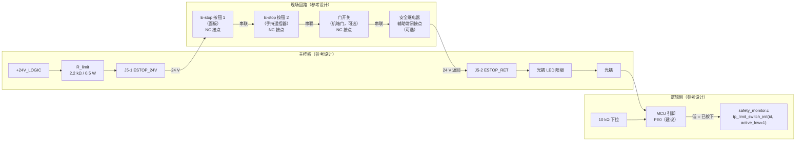

**接点串联顺序的设计原则**：

1. **所有安全接点必须串联，不能用并联。** 串联是"与"逻辑：任何一个接点断开即触发。并联是"或"逻辑：只有全部断开才触发——这与安全要求相反。
2. **串联顺序在电气上是无关的**（串联回路中电流相同），但**在维护上有关**：
   - 把**最容易被误触发**的接点放在**最靠近回路末端**（即最靠近光耦 LED），这样它的断开会直接切断 LED 电流；
   - 实际上更重要的是**接线端子的物理可达性**：把需要定期检查的接点放在容易够到的位置。
3. **建议的串联顺序（从 24 V 侧到 LED 侧）**：
   ```
   +24V → 面板 E-stop → 手持遥控器 E-stop → 机箱门开关 → 安全继电器辅助接点 → 光耦 LED → GND
   ```
   理由：面板与遥控器是最常用的手动触发点，放在靠近电源侧可以使它们的接点承受回路全电压（在断开时），便于用万用表从端子处快速定位是哪一级断开。
4. **每一个接点都必须使用独立的端子对**，不允许把两个接点接到同一个端子上（否则无法单独短接排查）。
5. **不允许使用"接点串联 + 二极管"之类的技巧**（例如用二极管做优先级），因为二极管会破坏"任何一处断开都触发"的完整性，并可能在浪涌下误导通。

### 9.4 回路电流、湿电流与功耗计算

**计算【设计计算】**：

```
电路：+24 V → R_limit → [现场接点串联] → 光耦 LED → GND

取 R_limit = 2.2 kΩ
取光耦 LED 正向压降 V_F = 1.2 V（典型，需按具体器件数据手册复核）
取现场回路的导线电阻 R_wire（10 m 的 24 AWG 往返）：R_wire = 2 × 10 m × 0.084 Ω/m = 1.68 Ω
取接点接触电阻 R_contact = 4 × 0.1 Ω = 0.4 Ω

回路总电阻 = 2200 + 1.68 + 0.4 = 2202.1 Ω
回路电流 I = (24 − 1.2) / 2202.1 = 22.8 / 2202.1 = 10.35 mA

R_limit 上的功耗 = I² × R = (0.01035)² × 2200 = 0.2357 W
```

**取值判据**：

| 判据 | 要求 | 本设计（10.35 mA） | 是否满足 |
|---|---|---|---|
| **触点湿电流下限** | ≥ 1 mA（金触点）/ ≥ 10 mA（银触点） | 10.35 mA | ✅ 满足银触点要求 |
| **光耦可靠导通** | I_F ≥ 1 mA（典型 CTR 条件下）；为保证饱和，I_F ≥ 5 mA 更稳 | 10.35 mA | ✅ 充裕 |
| **回路电流上限** | 不宜过大（触点寿命、线缆发热、功耗） | ≤ 20 mA | ✅ 满足 |
| **R_limit 功耗** | 应 ≤ 额定值的 50% | 0.236 W ⇒ 需 ≥ 0.5 W 额定 | ✅ 用 0.5 W 电阻，或改用 **2 × 1.1 kΩ 串联**（各 0.118 W，可用 2 × 0.25 W） |
| **LED 电流的长期可靠性** | I_F 应 ≤ 器件额定值的 50% | 10.35 mA（多数光耦额定 50 mA） | ✅ 满足 |

**推荐实现**：`R_limit` 用 **2 只 1.1 kΩ / 0.25 W 串联** 代替 1 只 2.2 kΩ / 0.5 W。理由：（a）分散功耗；（b）**提高可靠性**——电阻开路是安全回路的一个失效模式，两只串联使"任一只开路导致回路断开"，这**恰好等价于 E-stop 触发**，方向是安全的（这也说明串联电阻数量并不影响 fail-safe，只要失效方向是"断开"）。

**为什么不用恒流源**：恒流源可以消除线缆电阻变化对电流的影响，但它引入有源器件，其失效模式可能是"输出开路"（安全）**也可能是"输出短路到 24 V"**（不安全，会烧毁 LED 并使回路看似正常）。**在安全回路中应优先使用无源限流。**

### 9.5 光耦隔离与逻辑电平转换

| 参数 | 要求（参考设计） | 依据 |
|---|---|---|
| 隔离电压 | ≥ 3750 V_rms（1 分钟） | 24 V 现场回路与 3.3 V 逻辑之间的基本隔离 |
| 电流传输比（CTR） | ≥ 50 %（保证 10.35 mA 输入时输出级充分饱和） | 需按具体器件与降额曲线复核 |
| 输出级 | 光电晶体管，集电极接 3.3 V，发射极接……见下 | — |
| 输出侧的负载电阻 | 10 kΩ（既是上拉/下拉，也是逻辑电平的定义元件） | 与 9.1 节的极性要求配套 |
| 传播延迟 | ≤ 10 µs（对 3–40 ms 的总响应时间而言可忽略） | 需按数据手册 |
| 爬电距离/电气间隙 | 按 IEC 60664-1 的 250 V 工作电压、污染等级 2 计算（**具体数值需安规评估**） | 光耦封装必须满足 |
| 共模瞬态抗扰（CMTI） | ≥ 10 kV/µs | 现场 24 V 线缆上的快速瞬变 |

**输出级接法与极性的完整定义**（这是 9.1 节的落地）：

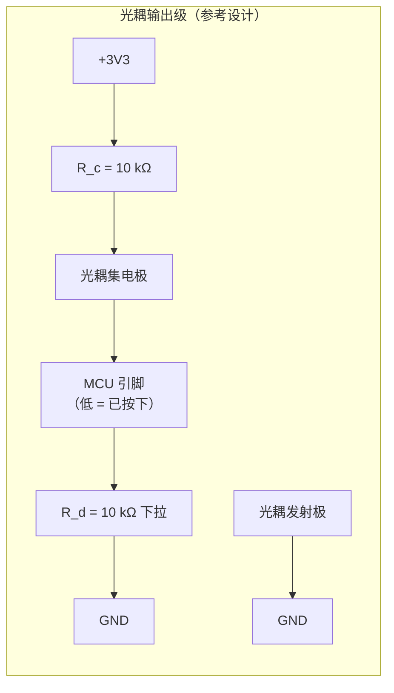

**电路行为分析**：

| 回路状态 | LED | 光耦晶体管 | 集电极节点 | MCU 读值 | 语义 | 安全性 |
|---|---|---|---|---|---|---|
| 闭合（正常） | 有电流 | **导通（饱和）** | 被拉到接近 0 V | **低** | 低 = 已按下 ❌ **语义相反！** | — |
| 断开（按下） | 无电流 | 截止 | 被 R_c 上拉到 3.3 V | **高** | 高 = 未按下 ❌ **语义相反！** | — |

**上表说明：上述接法（集电极经上拉到 3.3 V、MCU 读集电极）会得到与 `bsp_types.h` 的 "low = asserted" 完全相反的极性！** 这是本设计最容易犯的错误。**正确接法有两种**：

**接法甲（推荐）：改变光耦输出级的参考，使"回路闭合 → 高电平"**

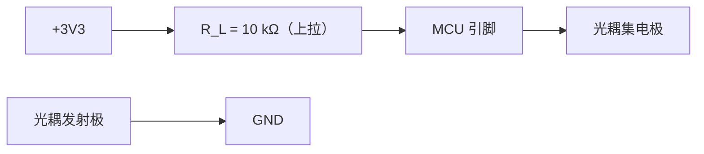

| 回路状态 | 光耦 | MCU 引脚 | 语义 |
|---|---|---|---|
| 闭合（正常） | 导通饱和 | **低**（被拉到 ≈0.1 V） | ⚠️ 低 = 已按下？**仍然矛盾** |

**接法乙（推荐，也是唯一能同时满足"低 = asserted"与"断线 = 低"的接法）：把光耦输出级的晶体管当作"上拉开关"**

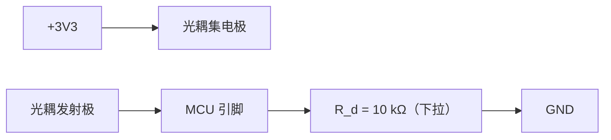

| 回路状态 | LED | 光耦 | MCU 引脚 | 固件（active_low = 1）读到 |
|---|---|---|---|---|
| **闭合（正常）** | 有电流 | 导通：集电极→发射极通路 | 被 3.3 V 经光耦拉到 **高** | 高 ⇒ `logical = (level == 0) = 0` ⇒ **未触发** ✅ |
| **断开（按下 / 断线 / 失电）** | 无电流 | 截止：开路 | 被 10 kΩ 下拉到 **低** | 低 ⇒ `logical = (level == 0) = 1` ⇒ **已触发** ✅ |

**接法乙同时满足两条要求**：
1. 回路闭合时引脚为高 ⇒ 固件按 `active_low = 1` 解读为"未触发"（与 `bsp_types.h` 的 "low = asserted" 一致）；
2. **任何导致光耦截止的原因（按下、断线、连接器脱开、24 V 失电、LED 开路、光耦失效）都会让引脚变低 ⇒ 触发**，即 fail-safe。

`limit_switch.c` 的代码印证了这个语义（【固件已定义】，`tp_limit_switch_update()` 第 64 行）：

```c
logical = (uint8_t)((sw->active_low != 0) ? (level == 0u) : (level != 0u));
```

`active_low = 1` 时 `logical = (level == 0)`，即**低电平判为 active**。✅ 与接法乙一致。

> **本节是全文最重要的设计指令之一。** 它把"极性的文字描述"落到了"具体电路拓扑"，并且**明确指出了那个最容易被接反的节点**。任何 E-stop 电路的原理图评审都应当以本节的真值表为验收依据。

### 9.6 软件侧的硬件语义：`tp_platform_emergency_kill()`

`platform_api.h` 对该函数的契约（逐字引用）：

> *"Kill every actuator immediately, bypassing the normal control path. On the target this clears both enable GPIOs and zeroes the PWM compare registers, then latches a software kill so a stray write cannot restart the drives. Called by the E-stop handler and by the critical-severity fault path. Must be idempotent."*

**拆解为硬件要求**：

| 软件动作 | 硬件对应 | 硬件设计要求 |
|---|---|---|
| "clears both enable GPIOs" | 两个电机通道的 EN 引脚被拉到无效电平 | EN 必须是**低有效**（若驱动器是低有效的 EN/nEN），这样"清零"等于"关断"。**若驱动器是 EN 高有效，"清零"会得到相反结果**——必须在器件选型时确认极性，并通过软件/硬件（反相器）统一为"清零 = 关断"。**这一条必须在原理图评审时逐点核对。** |
| "zeroes the PWM compare registers" | TIM1_CH1/CH2 的 CCR 被写 0 | 需要一个确定的"关断占空比"定义。若 H 桥是"PWM + DIR"驱动（`bsp_types.h` 说 "TIM1_CH1 PWM + DIR/EN GPIO"），则 PWM = 0 意味着**两个下管（或上管）同时导通**，即**刹车（brake）状态**，而不是**滑行（coast）状态**。这在硬件上必须明确：<br/>• 希望"滑行"→ 需要同时把 EN 拉无效（本设计确实如此）<br/>• 刹车状态会把电机的动能变成热，在高速时可能过流 |
| "latches a software kill so a stray write cannot restart the drives" | 无硬件对应（纯软件锁存） | ⚠️ **这是本设计安全性的一个薄弱点**：软件锁存无法阻止硬件层面的干扰（例如 MCU 复位后 EN 引脚浮空、或 PWM 引脚被 ESD 干扰翻转）。**硬件层面的弥补措施**：<br/>1. EN 引脚必须有 **10 kΩ 下拉**（保证 MCU 复位/高阻时驱动被关断）<br/>2. PWM 引脚同样应有下拉（保证复位期间占空比为 0）<br/>3. 门极驱动器的使能引脚应受一个**独立的硬件关断路径**控制（见下） |
| "Must be idempotent" | 无（软件性质） | — |

**硬件上的独立关断路径（参考设计的强烈建议）**：

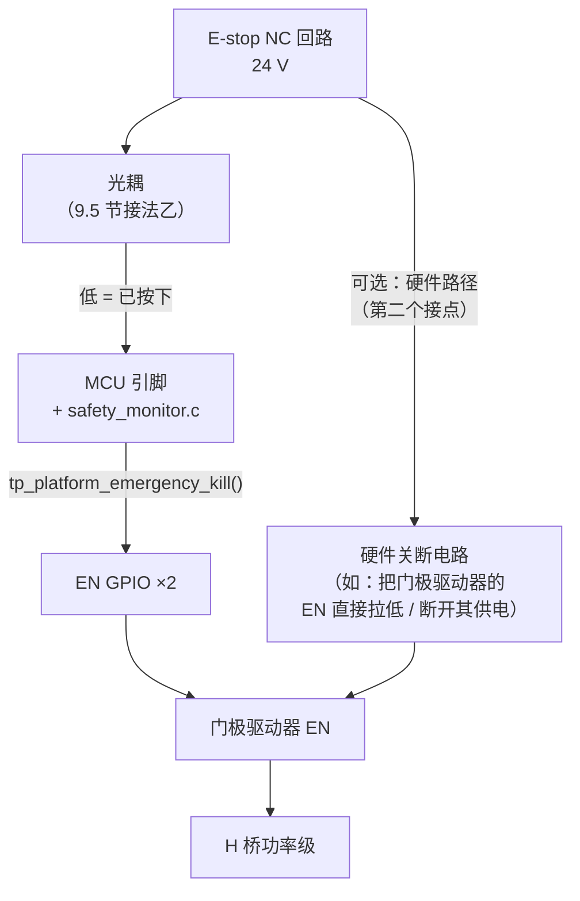

**为什么建议增加一条硬件路径**：纯粹依赖软件的安全功能有一个固有的问题：**MCU 本身可能失效**（程序跑飞、时钟丢失、Flash 损坏、IO 被锁定）。`TP_WDG_TIMEOUT_MS = (500u)` 的看门狗可以覆盖部分失效模式，但看门狗的复位需要 **500 ms**，而 `tp_platform_emergency_kill()` 的响应目标是**毫秒级**。因此：

- **如果只需要"功能安全"意义上的急停**（即人按下按钮后机器人停止），当前软件路径（`tp_platform_emergency_kill()`）是足够的；
- **如果需要"安全完整性"意义上的急停**（即达到 PL d / SIL 2），**必须**增加独立的硬件关断路径，因为 `platform_api.h` 明确说 `tp_platform_emergency_kill()` 是**软件调用**的（"Called by the E-stop handler and by the critical-severity fault path"），它**本身就是**控制路径的一部分，不满足"bypassing the normal control path"这一目标在硬件层面的对称要求。

**本文档的处理**：把"是否需要硬件级关断路径"列为 **R-16**，并注明**这取决于整机的安全等级目标，仓库中没有定义**。

### 9.7 响应时间预算（逐级）

**从"手指接触按钮"到"PWM 输出为 0"的完整链路**：

| 级 | 环节 | 时间（参考设计估算） | 依据 / 备注 |
|---|---|---|---|
| 1 | 按钮机械动作（触点开始分离） | 1–10 ms | 取决于按钮的行程与操作速度；**未验证** |
| 2 | 触点分离（含弹跳） | 0.5–5 ms | `limit_switch.h` 记载：*"when it closes, the metal actually bounces for 0.5-5 ms"* |
| 3 | 光耦 LED 电流下降到门限以下 | < 1 ms | LED 无延迟，主要受回路电感与寄生电容限制 |
| 4 | 光耦输出级截止（传播延迟） | 1–10 µs | 需按光耦数据手册 |
| 5 | MCU 引脚电平越过逻辑门限 | **< 1 µs**（若节点电容 20 pF、下拉 10 kΩ，上升/下降时间 ≈ 0.2 µs） | τ = 10 kΩ × 20 pF = 0.2 µs |
| 6 | **软件检测到变化**（`tp_limit_switch_update()` 的调用周期） | ✅ **≤ 2 ms（已确定）** | **实现已确定调用位置**：`tp_limit_switch_update()` 在**传感器任务**中被调用（`app_sequence.c` 第 351–353 行），该任务周期为 `TP_SENSOR_PERIOD_MS = TP_MS_PER_HZ(500) = 2 ms`（`app_tasks.c` 第 614 行 `osal_period_init(&app->period_sensor, TP_SENSOR_PERIOD_MS)`）。⇒ 检测延迟最坏 2 ms。**本文档初稿的"1–10 ms 未定义"已由实现闭合** |
| 7 | **去抖计数器**（`TP_LIMIT_DEBOUNCE_COUNT = 3u`） | ✅ **6 ms（已确定）** | 3 个连续一致的采样 × 2 ms = **6 ms**。`limit_switch.c` 仍对包括 E-stop 在内的所有输入统一使用该计数器，**没有按输入区分的特例**（初稿的这一判断被实现证实） |
| 8 | `tp_platform_emergency_kill()` 执行 | < 5 µs | 两次 GPIO 写 + 两次寄存器写（`platform_stm32f407.c` 第 1918–1921 行：`motor_enable_apply(0/1)` + `__HAL_TIM_SET_COMPARE(..., 0u)` ×2） |
| 9 | 门极驱动器传播延迟 | 0.1–1 µs | 需按具体驱动器数据手册 |
| 10 | MOSFET 关断（含米勒平台） | 0.5–3 µs | 取决于门极电阻与驱动电流；**未验证** |
| 11 | 电机电流衰减到零 | 1–50 ms（取决于电感与续流路径） | **这是"电流为零"的时间，不是"PWM 为 0"的时间**。本表的目标是 PWM 为 0，因此不计入 |

**总响应时间（按下 → PWM 寄存器为 0）**：

```
最小值（按钮动作最快、触点无弹跳）：
  1 ms(按钮) + 0.5 ms(触点) + 0.01 ms(光耦) + 0.001 ms(引脚)
  + 2 ms(检测) + 6 ms(去抖) + 0.005 ms(kill) + 0.1 ms(驱动器)
  ≈ 9.6 ms

典型值：
  5 ms(按钮) + 2 ms(触点) + 0.01 ms + 0.001 ms
  + 2 ms(检测) + 6 ms(去抖) + 0.005 ms + 0.5 ms(驱动器)
  ≈ 15.5 ms

最坏值（按钮慢、触点弹跳 5 ms）：
  10 + 5 + 0.01 + 0.001 + 2 + 6 + 0.005 + 1
  ≈ 24 ms

本文档目标（E-12）：≤ 5 ms  ← ⚠️ 仍不能达到，但差距已从"最坏 56 ms"缩小到"最坏 24 ms"
```

**⇒ 相比本文档初稿的估算（3–40 ms，最坏 56 ms），实现把最坏值收敛到约 24 ms。**
改进的来源是**调用周期被确定为 2 ms**（传感器任务）而不是可能的 10 ms（安全任务），
以及去抖窗口相应缩短到 6 ms。

**结论与建议（重要）**：

| 观察 | 结论 |
|---|---|
| **去抖（3 采样 × 2 ms = 6 ms）现在是响应时间的主导项**（占典型值 15.5 ms 的 39 %） | 对 E-stop 而言，去抖带来的延迟**没有安全收益**。理由：机械触点的弹跳在**闭合**时才会产生"随机 0/1 序列"，而在**断开**时，触点的分离是单向的——它不会"弹回闭合"到足以让回路重新通电的程度（因为触点是靠弹簧力分离的）。因此**E-stop 的去抖在物理上是多余的**，而它带来的延迟是实实在在的安全损失 |
| 按钮机械动作（1–10 ms）是另一主导项 | 属于机械选型问题，应在 BOM 中指定**短行程、快动作**的急停按钮 |
| 检测周期（2 ms）已接近最优的轮询方案 | 要进一步缩短只能用 **EXTI 中断**。`platform_api.h` 提供了 `tp_platform_io_read()` 但**没有**提供中断注册接口，因此这需要固件改动 |
| **建议的改进（R-08 收敛为两条）** | 1. 为 `TP_IO_ESTOP` 使用**独立的去抖参数**（例如 `TP_LIMIT_DEBOUNCE_COUNT_ESTOP = 1`），其他限位保留 3 次去抖 ⇒ 响应降到约 9.5 ms（典型），且不损失其他输入的抗抖动能力。**代价**：`limit_switch.c` 需要提供按输入区分的能力（当前没有）<br/>2. 为 `TP_IO_ESTOP` 增加 **EXTI 中断路径** ⇒ 响应降到约 7.5 ms，剩余项是按钮与触点<br/>⚠️ 注意：**无论哪一条，按钮机械动作与触点分离（0.5–15 ms）都无法由固件消除**，因此 **≤ 5 ms 的目标（E-12）在物理上不可达**，应当把 E-12 修订为 **≤ 25 ms**（并说明其构成） |

**测量方法（15.5 节给出详细步骤）**：示波器双通道，通道 1 接 E-stop 回路的现场侧端子（或光耦 LED 的阳极），通道 2 接 TIM1_CH1 的 PWM 输出（或 H 桥的一个门极）；触发在通道 1 的下降沿，测量到通道 2 变为恒定低电平的时间。**注意必须测"PWM 输出"，而不是"程序里的标志位"**——后者只能证明软件响应了，不能证明功率级被关断了。

### 9.8 冗余与自检

| 措施 | 实现（参考设计） | 收益 | 代价 |
|---|---|---|---|
| 双接点串联 | 每个 E-stop 按钮使用两组独立的 NC 接点串联 | 单个接点粘连（无法断开）时仍有保护 | 接线翻倍；需 2 倍端子 |
| 双通道回路 | 两条独立的 24 V 回路，各驱动一个光耦，固件要求两者均"未按下" | 可检测单通道失效（不一致即报错） | 成本翻倍；需要第二个光耦与第二个 MCU 引脚 |
| 回路电流监测 | 在 R_limit 上并联一个检测点（例如把 R_limit 分成两段，测中点电压），用 ADC 监测回路电流 | 可检测"接点氧化导致接触电阻升高"这一**潜在危险**（回路仍在通电，但电阻已升高，即将失效） | 需要一个 ADC 通道（**`TP_ADC_COUNT = 4`，仓库中没有备用通道**，见 R-05） |
| 上电自检 | 启动时读一次 E-stop 极性并与预期比较 | 可检出"接反"或"回路开路"的装配错误 | 无（`platform_api.h` 说 `tp_platform_safety` 的启动自检"deliberately probes the hardware before the drivers are up"） |
| 周期极性检查 | 每 `TP_SAFETY_PERIOD_MS = 10 ms` 检查一次，并统计 `transitions` 与 `rejected_glitches` | 可发现抖动型故障 | 无。`tp_limit_switch_t` 提供了 `transitions` 与 `rejected_glitches` 两个计数器【固件已定义】，**应当被记录到日志或遥测中** |

**当前设计的冗余状态**：从仓库可见，`tp_limit_switch_t` 只提供了单通道的 `raw`/`stable`/`counter`/`transitions`/`rejected_glitches` 字段【固件已定义】，**没有任何双通道或电流监测的接口**。因此**当前设计的冗余是零**，一旦 E-stop 光耦或其引脚失效，"按下无反应"不会被任何机制检出。**这是一个必须记录的、由单点故障导致安全功能失效的风险（R-17）。**

---

## 第 10 章 限位开关接口设计

### 10.1 常开接地 + 上拉 vs 常闭的取舍

**固件依据（逐字引用，`limit_switch.h`）**：

> *"Switches are normally-open to ground with a pull-up, so an unplugged switch reads 'not hit' — which is why `tp_limit_switch_init` takes an explicit active-low flag per input and why the two cases are documented separately rather than hidden behind one boolean."*

**与 E-stop 的对比是本设计中最有教学意义的一处不对称**：

| 属性 | E-stop（NC） | 限位开关（NO 接地 + 上拉） |
|---|---|---|
| 断线时的读数 | "已触发"（安全） | **"未触发"（不安全）** |
| 断线后果 | 机器人停机（可恢复，无风险） | **机器人继续运动，撞向机械限位** |
| 为什么选择这个极性 | 安全优先：任何失效都导向停机 | **可用性优先**：若限位断线即报"触发"，机器人会进入无法移动的呆锁状态，且现场无法快速区分"真的撞到限位"和"线松了" |
| 固件参数 | `active_low = 1` | `active_low = 1`（因为按下时引脚被接地拉低） |

**本文档的评估**：这个取舍**在工程上是可以辩护的**，原因是：

1. 限位开关**不是唯一的行程保护**。`config.h` 提供了软限位：`TP_JOINT_MIN_MRAD = (-90000.0f)`、`TP_JOINT_MAX_MRAD = (90000.0f)`、`TP_GRIPPER_MIN_MM = (0.0f)`、`TP_GRIPPER_MAX_MM = (40.0f)`，以及 `TP_ENCODER_MAX_ACCEL_MRAD_S2 = (4000000.0f)` 的编码器合理性检查。因此即使限位开关断线，编码器 + 软限位仍能提供一层保护。
2. 机械限位（硬止挡）本身也是保护层。`plant_model.h` 记载了 `TP_PLANT_JAW_HARD_STOP_MM = (1.0e-3f * 1000.0f)` 即 1.0 mm 的机械止挡（"gap can never go below"）。
3. 限位开关断线导致的呆锁（若采用 NC）会直接**阻止机器人完成采茶作业**，在田间现场的可用性代价很高。

**但仍必须记录风险**：限位开关断线后，机器人会**继续朝限位方向运动**，直到软限位或机械止挡介入。因此**限位开关的断线检测（10.2 节）是可选的增强，而不是可以完全忽略的问题**。列入 R-18。

### 10.2 线断检测的可行性与代价

| 方案 | 原理 | 能否检测断线 | 代价 | 评估 |
|---|---|---|---|---|
| **A. 当前方案：NO 接地 + 上拉** | 闭合 → 低；断开 → 高 | ❌ 不能区分"开关断开"与"线断了" | 无 | 已实现；接受风险 |
| **B. 改用 NC 开关** | 正常 → 低；触发/断线 → 高 | ✅ 能（但无法区分触发与断线） | 需要 NC 型限位开关（成本略高、型号选择少） | ⚠️ 可用性代价高（见 10.1） |
| **C. 双线回路（回读）** | 每个开关用两根线，一根送信号一根回读，MCU 发一个已知电平并在另一端读回 | ✅ 能（但需要 2× GPIO 或移位寄存器/IO 扩展） | 引脚翻倍（4 个限位 ⇒ 8 个引脚） | ⚠️ 引脚代价高；仓库中没有任何 IO 扩展的设计 |
| **D. 模拟三态输入** | 用电阻分压把输入偏置到 1/2 VCC；开关闭合 → 0 V；开关断开 → 1/2 VCC；断线 → VCC | ✅ **能区分三种状态** | **需要 ADC 通道**（GPIO 只能读二值） | ⚠️ **`TP_ADC_COUNT = 4`，四个通道全部被占用，仓库中没有备用 ADC 通道**。若采用本方案需要重新分配 ADC 资源 |
| **E. 在限位开关端并联一个"终端电阻 + 检测"装置** | 远程端加一个电阻，用 4 线测量 | ✅ 能 | 需要额外导体 | 复杂 |
| **F. 固件层面的合理性交叉检查**（推荐，纯软件） | 用编码器位置判断"运动到了软限位附近但限位开关仍未触发" ⇒ 报故障 | ✅ 能间接检测限位开关失效 | **零硬件代价** | ✅ **本文档推荐**：`TP_JOINT_MIN_MRAD`/`TP_JOINT_MAX_MRAD` 与 `TP_GRIPPER_MIN_MM`/`TP_GRIPPER_MAX_MM` 已存在；只需在固件中增加"位置越过软限位 − 裕量 而限位未触发"的判断。**这属于固件改动，不在本文档范围内** |

**本文档的建议**：采用 **A（当前方案）+ F（固件交叉检查）**。理由：F 用零硬件代价提供了等同的检测能力，且不牺牲可用性。这也符合工程上的"优先用软件解决能用软件解决的问题"的原则。

### 10.3 固件去抖与硬件 RC 的分工

**固件的去抖（`limit_switch.h` + `limit_switch.c`，均为【固件已定义】）**：

| 项目 | 值 / 行为 |
|---|---|
| 算法 | 饱和加减计数器（"N-of-M majority"） |
| 计数上限 | `TP_LIMIT_DEBOUNCE_COUNT = 3u` |
| 状态改变条件 | 当采样与已发布状态不一致时，计数器向另一端推进；达到极值（0 或 3）时发布新状态 |
| 为什么不用移位寄存器多数表决 | `limit_switch.h`：*"This costs one byte and two comparisons per input per call, which is why it is preferred over a shift-register majority voter on a microcontroller with no barrel shifter benefits to exploit here."* |
| 启动时的处理 | `tp_limit_switch_init()` 用第一次读数作为初始稳定态，并把计数器预置到该极值（`limit_switch.c` 第 41–43 行），注释说明 *"a glitch at boot must not be accepted"* |
| 读取失败的处理 | **不改变去抖状态**（`limit_switch.c` 第 56–61 行）：*"A failed read must NOT change the debounced state. Losing an input momentarily is not evidence that the limit was released; treating it as such would let the drive push into a hard stop for one period."* |
| 状态改变所需时间 | 3 个采样周期（周期由调用方决定，**仓库中未定义**） |

**硬件 RC 去抖该不该加**：

| 输入类型 | 是否建议加 RC | 理由 |
|---|---|---|
| E-stop | **不加**（或 ≤ 0.1 ms） | **RC 会延长"触发"的时间常数**。对于 NC 回路，触发意味着"回路断开"，节点电压变化的方向取决于接法（9.5 节接法乙中，触发是节点从"被光耦上拉的高"变为"被下拉的低"，是**放电**过程，同样受 RC 影响）。**在任何情况下，RC 都会增加 E-stop 的响应时间，而响应时间是安全性能。** 更关键的是：**光耦本身就是一个"干净的开关"**，它不会有机械弹跳，因此 E-stop 回路**不需要** RC 去抖 |
| 限位开关 | **可选，建议取小值** | 机械开关有 0.5–5 ms 的弹跳（`limit_switch.h` 记载）。若采样周期是 1 ms，3 次去抖只能覆盖 3 ms，**不足以覆盖 5 ms 的最坏弹跳**。此时加一个 RC 是有意义的。**但 RC 的取值必须考虑其不对称性**（见下） |

**RC 的不对称性分析（这是一个容易忽略的重要点）【设计计算】**：

对"开关接地 + 上拉"的输入（限位开关）：

```
电路：+3V3 --- R_pull --- 节点 --- C --- GND
                            |
                          开关（常开）--- GND

开关闭合（触发）时：节点通过开关（接触电阻约 0.1 Ω）+ 走线被迅速拉到 0 V
  放电时间常数 τ_discharge = (R_switch + R_wire) × C ≈ 0.2 Ω × 0.1 µF = 0.02 µs
  ⇒ 触发的响应几乎不受 RC 限制 ✅

开关断开（释放）时：节点通过 R_pull 充电
  充电时间常数 τ_charge = R_pull × C
  取 R_pull = 10 kΩ、C = 100 nF ⇒ τ = 1 ms
  ⇒ 达到逻辑门限（3.3 V 的 50% = 1.65 V）：t = −τ × ln(1 − 0.5) = 0.693 ms
  ⇒ 达到 70%（2.31 V）：t = −1 ms × ln(0.3) = 1.20 ms
  ⇒ 释放的响应被 RC 延迟了约 1.2 ms
```

**结论**：对"开关接地"的输入，RC 是**方向安全**的——**触发快、释放慢**。这对限位开关是合适的（宁可晚一点解除限位，也不要误解除）。

**但对 E-stop（接法乙：光耦上拉 + 下拉电阻）**：

```
电路：+3V3 --- 光耦（导通时低阻）--- 节点 --- R_d (10 kΩ) --- GND
                                          + C（若加）

光耦导通（正常）时：节点被光耦拉到高 ✅
光耦截止（触发）时：节点通过 R_d 放电
  τ = R_d × C
  取 R_d = 10 kΩ、C = 100 nF ⇒ τ = 1 ms
  达到逻辑低门限（0.8 V，即从 3.3 V 降到 0.8 V 的 76% 放电）：
  t = −τ × ln(1 − 0.758) = −1 ms × ln(0.242) = 1.42 ms
```

⇒ **若在 E-stop 输入上加 100 nF，响应时间增加约 1.42 ms。** 相对 3–40 ms 的总预算，这 1.42 ms 占 3.5–47%。**因此本文档明确建议：E-stop 输入的节点电容应 ≤ 10 nF（含 PCB 寄生与 ESD 器件电容），响应时间增量 ≤ 0.14 ms。**

**推荐的硬件配置表**：

| 输入 | 上拉/下拉 | 节点电容 | RC 时间常数 | 响应时间增量 |
|---|---|---|---|---|
| `TP_IO_ESTOP` | 10 kΩ **下拉**（9.5 节接法乙） | ≤ 10 nF（含 ESD 器件电容） | ≤ 0.1 ms | ≤ 0.14 ms |
| 4× 限位开关 | 10 kΩ 上拉（外部或 MCU 内部） | 100 nF | 1 ms | 1.2 ms（仅释放方向） |
| `TP_IO_DRIVER_FAULT` | 10 kΩ 上拉 | 10 nF | 0.1 ms | 0.14 ms（nFAULT 需要快速响应） |

### 10.4 线缆屏蔽与长线干扰

| 项目 | 要求（参考设计） | 理由 |
|---|---|---|
| 线缆类型 | 屏蔽双绞（每对信号用一对） | 限位开关是 3.3 V 高阻抗节点（上拉 10 kΩ ⇒ 源阻抗约 10 kΩ），**极易受容性耦合干扰** |
| 屏蔽层接法 | **板端接 DGND，远端悬空** | 与编码器一致（11.4 节）。理由：远端悬空避免形成地环；板端接地使屏蔽层的耦合电流在板端就地泄放 |
| 屏蔽层是否可以两端接地 | 仅在"远端是同一机架且无地电位差"时可以 | 若远端接机架而板端接 DGND，会在屏蔽层中形成地环流。**默认单端** |
| 与电机电缆的间距 | ≥ 100 mm，或在中间加金属隔板 | 见 12.4 节 |
| 是否允许与电机电缆同一线束 | **不允许** | 电机电缆上的 dV/dt（24 V 在几百 ns 内切换）会通过线间电容（约 100 pF/m）耦合：耦合电流 I = C × dV/dt = 100 pF × (24 V / 200 ns) = 12 mA。**这个电流远超限位开关的 0.33 mA 上拉电流**，会直接把输入拉误触发 |
| 是否需要串联电阻 | 建议 1 kΩ 串在 MCU 引脚侧 | 与上拉 10 kΩ 形成分压，抑制高频共模干扰；同时限流。**注意**：1 kΩ 与节点电容 100 nF 会形成 0.1 ms 的额外延迟（可接受）；但 1 kΩ 会使输入低电平抬高：在 0.33 mA 上拉电流下，1 kΩ 上的压降只有 0.33 mV，可忽略 |
| 建议增加的措施 | 每个限位输入并联一个 100 nF + 一个双向 TVS | 100 nF 抑制高频，TVS 抑制浪涌 |

---

## 第 11 章 编码器接口设计

### 11.1 差分（RS-422 / line driver）vs 单端开集

**仓库事实**：`bsp_types.h` 说 `TP_ENCODER_JOINT = 0` 使用 TIM2 的"quadrature X4 decoding"，`TP_ENCODER_GRIPPER = 1` 使用 TIM4 的同样方式，**没有说明编码器的电气接口类型，也没有引脚号**。

| 方案 | 输出类型 | 噪声抗扰 | 最大线缆长度 | 最大频率 | 成本 | 器件示例（参考设计） | 评估 |
|---|---|---|---|---|---|---|---|
| **A. 单端开集（集电极开路）** | 光电晶体管 + 外部上拉 | **差** | < 0.5 m | 取决于上拉与分布电容；典型 < 100 kHz | 最低 | 廉价光电编码器 | ❌ **不推荐**：上升沿由 RC 决定（10 kΩ 上拉 × 100 pF = 1 µs），且以本地地为参考，共模干扰直接进入计数 |
| **B. 单端推挽（TTL/CMOS）** | 图腾柱输出 | 中 | < 1–2 m | 数百 kHz | 低 | 部分工业编码器 | ⚠️ 可用于极短距离，但**地电位差**问题无解：电机电流在地线上的压降会成为"额外的脉冲" |
| **C. 差分 line driver（RS-422 类，推荐）** | 差分对，A+/A− | **优**（共模抑制典型 −10 V…+13 V 范围） | 5–100 m | 10 MHz 以上 | 中 | AM26LS31 类驱动器 + AM26LS32 类接收器 | ✅ **推荐** |
| **D. 差分 + 隔离** | 差分 + 数字隔离器 | 最优 | 100 m+ | 受隔离器限制 | 高 | 隔离型编码器 | ⚠️ 本设计不需要：编码器与电机同轴安装，本就是同一地参考（5.5 节） |

**为什么选择 C（差分）【设计计算】**：

```
问题场景：电机以 3 A 连续电流工作，编码器信号线与电机地共用一个连接器
假设电机电流的回流路径上（连接器、线缆、PCB 走线）共有 50 mΩ 的共享阻抗
⇒ 地线上产生的电压 = 3 A × 50 mΩ = 150 mV

对单端 3.3 V 信号（门限 1.65 V）：
  150 mV 相当于门限的 9.1% —— 在 5 V 供电的系统里相当于 227 mV 的噪声
  若电流有 PWM 纹波（例如 ±500 mA @ 20 kHz），地线电压随之抖动 25 mV
  ⇒ 这会在编码器输入上叠加一个 20 kHz、25 mV 的干扰
  对单端输入，25 mV 直接与信号叠加 ⇒ 可能产生额外的计数

对差分信号（接收器共模抑制典型 50 dB @ 100 kHz）：
  同样的 150 mV 共模电压被抑制 50 dB ⇒ 等效差模误差 = 150 mV / 316 = 0.47 mV
  ⇒ 相对 2 V 的差分幅度，误差 0.024 % ⇒ 完全可忽略
```

**结论**：差分接口把 150 mV 的共模干扰变成 0.47 mV 的等效差模误差，改善约 50 dB。这是**必须**的。

**接收侧的设计要求**：

| 项目 | 要求 |
|---|---|
| 接收器类型 | RS-422 类差分接收器（**不要用 RS-485 收发器**：RS-485 的接收器有 200 mV 的失效安全门限与不同输入阻抗，虽然能工作，但其 ±200 mV 的门限会让小幅度的差分信号（编码器输出幅度可能只有 ±1 V）进入不确定区） |
| 接收器输出 | 3.3 V CMOS 兼容；**注意** RS-422 接收器通常输出 5 V TTL，需要确认 STM32 引脚是 5 V 容忍（FT）或用 3.3 V 供电的接收器 |
| 接收器供电 | **必须 3.3 V**（避免 5 V 输出损坏 MCU 引脚） |
| 线路终端 | **每个差分对的接收端加 120 Ω 终端**（跨接在 A+/A− 之间）。编码器电缆的特征阻抗通常为 120 Ω；若无终端，在 5 m 电缆上会有反射（位沿约 100 ns，电缆往返延迟约 50 ns，比值 2 ⇒ 反射显著） |
| 失效安全 | 若编码器未供电，接收器输出可能振荡。建议加失效安全偏置（在接收端通过 1 kΩ 上拉到 3.3 V / 1 kΩ 下拉到 GND，把 A+ 相对 A− 偏置到约 100–300 mV）。**注意**：这会使 A+/A− 的差分阻抗降低，需计入 120 Ω 终端 |
| 是否需要输入滤波 | STM32 的 TIMx 编码器接口有可编程的输入滤波（IC1F 位）。**参考设计建议**：使用 4–8 个采样周期的数字滤波（对应 f_DTS/8 到 f_DTS/16），可抑制残余噪声。**代价**是引入相位延迟（8 个采样周期 @ 84 MHz = 95 ns，相对 102 µs 的编码器周期可忽略） |

### 11.2 计数率与最大电气频率计算

**关节编码器【设计计算】**：

```
已知（`bsp_types.h`）：
  TP_ENCODER_COUNTS_PER_REV = 4096      （1024 线 × X4）
  TP_MRAD_PER_COUNT = 2π × 1000 / 4096 = 1.533981 mrad/count
  TP_JOINT_MAX_SPEED_MRAD_S = 60000.0f  （= 60 rad/s = 60°/s）
  TP_JOINT_GEAR_RATIO = 50.0f

注意：TP_JOINT_MAX_SPEED_MRAD_S 是"关节输出"的角速度（`config.h` 第 3 节
      的注释为 "60 deg/s"，且与 TP_POS_PID_OUT_MAX = 60000.0f 相同）

步骤 1：最大角速度换算为每秒转数
  ω = 60000 mrad/s = 60 rad/s
  n = ω / (2π) = 60 / 6.283185 = 9.54930 rev/s

步骤 2：换算为 X4 计数率
  counts/s = n × TP_ENCODER_COUNTS_PER_REV = 9.54930 × 4096
           = 39113.9 counts/s

  也可由 TP_MRAD_PER_COUNT 直接验证：
  counts/s = ω / TP_MRAD_PER_COUNT = 60000 / 1.533981 = 39113.9 ✅ 一致

步骤 3：换算为每相的电气频率（X4 意味着每相每周期产生 4 个计数）
  f_phase = 39113.9 / 4 = 9778.5 Hz ≈ 9.78 kHz
```

**夹爪编码器【设计计算】**：

```
已知（`bsp_types.h`）：
  TP_GRIPPER_COUNTS_PER_MM = 512.0f
  TP_GRIPPER_MAX_SPEED_MM_S = 120.0f   （`config.h` 第 3 节）
  TP_GRIPPER_MAX_MM = 40.0f

步骤 1：最大线速度
  v = 120 mm/s

步骤 2：换算为计数率
  counts/s = v × TP_GRIPPER_COUNTS_PER_MM = 120 × 512 = 61440 counts/s

步骤 3：换算为每相电气频率
  f_phase = 61440 / 4 = 15360 Hz = 15.36 kHz
```

> ⚠️ **单位说明（必须如实指出）**：`TP_GRIPPER_COUNTS_PER_MM` 的注释是 *"Encoder counts per millimetre of jaw travel (gripper lead screw)"*，**但没有说明这个"counts"是 X4 之后的计数还是编码器线数**。而 `TP_ENCODER_COUNTS_PER_REV` 的注释明确写了 *"after X4 decoding"*。**两个常量的 X4 约定不一致（或至少未明确）**，这会导致 4 倍的量纲歧义。本例按"X4 后"计算（与 `TP_ENCODER_COUNTS_PER_REV` 一致）；若实为 X4 前，则每相频率应为 61.44 kHz。**列入风险项 R-19。**

**与定时器能力的对比**：

| 项目 | 关节（TIM2） | 夹爪（TIM4） | 定时器内核时钟【固件已定义】 |
|---|---|---|---|
| 每相最大电气频率 | 9.78 kHz | 15.36 kHz | 84 MHz |
| 最保守的可接受频率上限（假设 f_in ≤ f_TIM/4） | 21 MHz | 21 MHz | — |
| **余量** | **约 2147 倍** | **约 1367 倍** | — |

**结论**：**计数率完全不是瓶颈**，定时器有 3 个数量级的余量。真正的约束是（a）线缆的噪声抗扰、（b）编码器本身的输出频率能力、（c）机械安装的偏心与间隙。

**但是**：`TP_ENCODER_MAX_ACCEL_MRAD_S2 = (4000000.0f)` 定义了"物理上可信的最大角加速度"（mrad/s²，注释说 Above ⇒ encoder fault）。这个值对应的**计数率变化率**是：

```
d(counts/s)/dt = TP_ENCODER_MAX_ACCEL_MRAD_S2 / TP_MRAD_PER_COUNT
              = 4000000 / 1.533981 = 2607601 counts/s²

在 1 ms 的控制周期内，计数变化量 = 2607601 × 0.001 = 2607.6 counts
⇒ 单周期内最多 2608 个计数，即 651 个编码器脉冲/相/ms
⇒ 对应 651 kHz 的每相频率
```

也就是说，**这个断言允许的瞬时频率高达 651 kHz/相**，远高于机械上可能的 9.78 kHz。因此这是一条**非常宽松**的合理性检查，它只能检出"编码器输出彻底错乱"（例如 A 相被 20 kHz 的 PWM 干扰持续触发），而不能检出小幅度的干扰计数。**这是一个可以改进的地方：若把阈值收紧到机械可达值的 1.5–2 倍（即约 60000–80000 mrad/s²），则能更早地检出干扰导致的假计数。** （列入风险项 R-19 的讨论。）

### 11.3 `TP_ENCODER_COUNTS_PER_REV = 4096` 的读法

**固件定义（`bsp_types.h`）**：

```c
#define TP_ENCODER_COUNTS_PER_REV (4096)
```

注释：

> *"A 1024-line incremental encoder in quadrature yields 4096 counts/rev. Documented as a constant because every position conversion in the driver depends on it and a mismatch here is the classic cause of 'the arm moves exactly 4x too far' bug."*

**"1024 线 × X4 = 4096 计数/转"的推导**：

```
"线数（lines per revolution, LPR）" = 编码器码盘上刻线的数量
标准增量编码器输出两路正交信号 A、B，一个电气周期（A、B 各完成一次完整周期）
对应码盘上的一根刻线间距。

一个电气周期内，A 与 B 的 4 个边沿（A 升、B 升、A 降、B 降）都是有效事件：
  边沿 1：A 上升，此时 B = 0
  边沿 2：B 上升，此时 A = 1
  边沿 3：A 下降，此时 B = 1
  边沿 4：B 下降，此时 A = 0

STM32 的编码器接口模式（TI1 与 TI2 均计数）在每个边沿都计数
⇒ 每电气周期 4 个计数（这就是 "X4" 或 "4 倍频"）

⇒ 每转计数 = 1024 线 × 4 = 4096 counts/rev  ✅ 与固件定义一致
```

**每计数的角度分辨率**：

```
Δθ = 360° / 4096 = 0.0878906° = 1.533981 mrad
对应上 TP_MRAD_PER_COUNT = 2π × 1000 / 4096 = 1.533981 mrad  ✅ 一致

经过 TP_JOINT_GEAR_RATIO = 50.0f 的减速箱后，折算到电机轴：
  电机轴每转的关节输出计数 = 4096 × 50 = 204800 counts
  电机轴的角度分辨率 = 360° / 204800 = 0.00175781° （若编码器装在电机轴上）
```

**这里有一个必须在硬件设计阶段明确的接口问题**：**编码器装在哪里？** 仓库中**没有说明**。

| 安装位置 | 对 `TP_ENCODER_COUNTS_PER_REV` 的含义 | 对闭环性能的影响 |
|---|---|---|
| 电机轴（常见） | 4096 counts/rev 是**电机轴**的计数；折算到关节输出需除以 `TP_JOINT_GEAR_RATIO = 50`，即关节输出的分辨率是 0.0879° × ... 反了 | 关节输出分辨率 = 360°/(4096/50) = 4.39° ❌ **太粗，位置环无法用** |
| 关节输出轴 | 4096 counts/rev 是**关节输出**的计数；分辨率 0.0879° | ✅ 位置环可用 |
| 减速箱后的独立编码器 | 同"关节输出轴" | ✅ |

**关键推导**：如果把 4096 counts/rev 理解为**关节输出轴**的分辨率，那么关节的全行程（`TP_JOINT_MIN_MRAD` 到 `TP_JOINT_MAX_MRAD`，即 ±90° = 180°）对应：

```
180° / 0.0878906° = 2048 counts
```

即整个关节行程只有 2048 个计数。而 `tp_raw_sample_t.encoder_total[]` 是 `int32_t` 的**绝对**计数，`tp_platform_encoder_read()` 说"The counter is 32-bit and free-running; the driver converts counts to milliradians and handles the wrap"【固件已定义】。

**这意味着编码器每转对应 4096 个计数，而关节的活动范围只覆盖半转（180°）**。这是一个完全自洽的设计**前提是编码器装在关节输出轴上**（或装在一个与关节输出 1:1 耦合的位置）。

**如果编码器实际装在电机轴上**，则关节输出轴的分辨率会变成 4.39°，位置环的 `TP_POS_PID_KP = (12.0f)`（输入为 mrad 误差，输出为 mrad/s）将无法工作，因为最小可分辨的误差就是 76.7 mrad，而 `TP_FORCE_BAND_N = (0.10f)`/`TP_JOINT_HOME_MRAD = (0.0f)` 等控制精度要求在更细的量级。

**结论**：**必须确认编码器的机械安装位置**。本文档的建议是：编码器安装在**关节输出轴**（或经一个 1:1 的耦合），此时 `TP_ENCODER_COUNTS_PER_REV = 4096` 与 `TP_MRAD_PER_COUNT = 1.533981` 的语义完全自洽；`TP_JOINT_GEAR_RATIO = 50.0f` 仅用于描述减速箱（例如用于计算电机侧的速度限制或摩擦力矩），而不参与编码器的角度换算。**这一条列入 R-19。**

### 11.4 屏蔽双绞与屏蔽层单端接地

| 项目 | 要求（参考设计） | 理由 |
|---|---|---|
| 双绞 | **必须**。A+/A− 一对，B+/B− 一对，Z+/Z− 一对，**各自独立绞对** | 三个信号必须分开绞，否则 A 与 B 之间会产生串扰（编码器的 A 与 B 相差 90°，若共用绞对，相位关系会被串扰破坏，导致计数方向错误） |
| 特征阻抗 | 120 Ω（与终端电阻匹配） | 见 11.1 节 |
| 屏蔽 | **必须**。每对可以独立屏蔽，也可以整体屏蔽 | 编码器信号是 3.3 V 单端输入经差分接收器，差模抗扰好，但**共模电压超出接收器范围**时会失效。屏蔽可限制共模电压 |
| 屏蔽层板端接法 | **接 DGND（或 AGND）** | 代码上数字化 |
| 屏蔽层远端接法 | **悬空**（不接编码器外壳/机架） | **单端接地的核心理由**：如果两端都接，且两端之间存在地电位差（电机电流在机架上的压降），屏蔽层中会有电流流过；该电流通过屏蔽层与信号线之间的互感把噪声**感应进信号线**——屏蔽层反而成了天线。单端接地消除了这个回路 |
| 例外 | 若编码器外壳与电机外壳电气连通、且电机外壳已经在编码器附近接了机架，则屏蔽层可以在编码器端接外壳 | 此时屏蔽层与机架同电位，不构成新的地环。**需逐台确认**，本文档默认单端 |
| 屏蔽层是否需要泄放 | 建议在板端屏蔽汇接点与 GND 之间并联 1 MΩ | 防止静电积累（12.5 节） |
| 屏蔽层是否可以兼作信号回线 | **绝对不可以** | 屏蔽层是单端接地的，不构成回流路径；若误用为回线，会把所有屏蔽层耦合的噪声直接引入信号回路 |

### 11.5 上电顺序与热插拔

| 场景 | 风险 | 缓解措施（参考设计） |
|---|---|---|
| 编码器未上电而 MCU 已上电 | 差分接收器输入悬空 ⇒ 输出可能振荡 ⇒ 产生大量假计数 ⇒ 位置读数跳变 ⇒ 位置环可能剧烈动作 | 1. 接收端加失效安全偏置（11.1 节）；2. `tp_platform_encoder_read()` 在检测到异常时可返回 `TP_ERR_IO`（`platform_api.h` 说 "or `TP_ERR_IO` when the backend has flagged the encoder as faulty"）——**但仓库中没有任何"编码器断线检测"的逻辑**；3. **建议**：在位置环启动前做一次"位置合理性检查"（用 `TP_JOINT_MIN_MRAD`/`MAX_MRAD` 判断读数是否在范围内） |
| 运行中拔掉编码器 | 位置读数冻结或跳变 ⇒ 位置环持续输出最大速度直到撞限位 | 依赖 `TP_ENCODER_MAX_ACCEL_MRAD_S2 = (4000000.0f)` 的检查与限位开关。**该阈值过于宽松（11.2 节），不足以检出这种故障** |
| 热插拔连接器 | 插拔瞬间可能出现瞬时短路或悬空 | 1. 使用带"先接后断"（make-before-break）顺序的连接器（先接地、后信号）；2. 在 MCU 引脚侧加串联电阻限流；3. **建议编码器电源与信号在不同针位上，且电源针更长（先进后出）** |

**⚠️ 本文档强烈建议禁止运行中热插拔编码器**，并把这一条写入操作规程。理由：`platform_api.h` 的编码器接口（`tp_platform_encoder_read()` / `tp_platform_encoder_reset()`）**没有提供任何断线检测或故障标志**（它只在"backend 已经标记编码器故障"时返回 `TP_ERR_IO`，而"谁去标记"在仓库中未定义）。因此拔掉编码器后，软件可能继续使用冻结的位置读数，产生持续的最速运动。

---

## 第 12 章 接地与屏蔽策略

### 12.1 星形接地与单点连接

**原则**：**所有"地"必须在板上的唯一一点汇接**，任何两个子系统的接地回流不得共用路径。

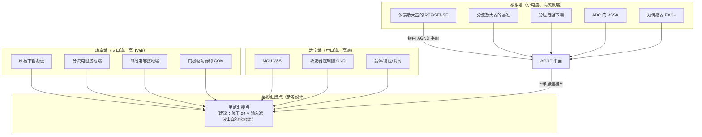

**为什么功率地必须直接回星点、而模拟地要经过 AGND 平面**：

- **功率地的电流最大（5 A 峰值）且 dI/dt 极高**（PWM 开关沿），因此功率回路的路径阻抗必须最小，且**绝不能与任何信号共用路径**。功率地直接回到星点。
- **模拟地的电流最小（µA–mA 级）但灵敏度最高**（1 count = 805.66 µV）。模拟地需要一个**完整、无分割、无功率电流穿过**的参考平面（AGND 平面），最后在星点单点连到系统地。这样模拟平面上没有功率电流流动，电位均匀。
- **数字地在两者之间**：MCU 的开关电流（数十 mA，边沿 ns 级）需要低阻抗回流，直接回星点。数字地与模拟地之间的**唯一连接**就是 AGND 平面到星点的那一点。

**关键设计规则（可检查的清单）**：

| # | 规则 | 违反后果 |
|---|---|---|
| G-01 | 板上只有一个连接 DGND 与 AGND 的点 | 地环流；力读数漂移 |
| G-02 | 该连接点位于 ADC（VSSA）附近，或位于星点 | 若远离 ADC，ADC 的"模拟地"与"数字地"之间存在压降，直接被计入转换结果 |
| G-03 | 功率地的任何走线都不穿过 AGND 平面下方 | 感性耦合；AGND 平面上出现电位梯度 |
| G-04 | 力传感器的 EXC− 回到 AGND（不是 DGND，也不是 PGND） | 激励电流（14.3 mA）在 DGND 上的压降会叠加到所有数字参考上 |
| G-05 | 每个 ADC 通道的去耦电容的地端接 AGND | 否则去耦电流流过 AGND→DGND 的连接点，产生噪声 |
| G-06 | 24 V 输入滤波电容的接地端作为星点的物理位置 | 让大电流的回流路径最短 |
| G-07 | 屏蔽层的板端汇接点**不接到 AGND 平面内部**，而是接到 AGND 平面**靠近星点的一个角** | 屏蔽层上的干扰电流不应在 AGND 平面内流动 |

### 12.2 模拟地与数字地的连接

| 连接方式 | 优点 | 缺点 | 本文档评估 |
|---|---|---|---|
| **单点 0 Ω 电阻** | 简单、可移除（便于分地测量）、明确 | 无 | ✅ **推荐**：便于调试时断开以定位问题 |
| 单点磁珠 | 高频隔离更好 | 磁珠的阻抗随频率变化，可能在某个频率形成谐振；且直流压降不可忽略 | ⚠️ 若力通道的噪声主要来自高频，可考虑；但需测量验证 |
| 单点 0 Ω 电阻 + 并联 10 nF | 直流单点连接 + 高频旁路 | 高频路径上仍存在连接，可能引入噪声 | ⚠️ 有时是折中方案 |
| 多点连接（地平面统一） | 简单，回流路径最短 | 功率电流穿过模拟区域 | ❌ 对 12 bit + 8 mN 分辨率的力通道不可接受 |
| **完全分割（不连接）** | 彻底隔离 | ADC 的 VSSA 与 MCU 的 VSS 之间会有电位差，ADC 无法工作 | ❌ 不可行 |

**关于"完全分割"为何不可行**：ADC 的模拟输入是以 VSSA 为参考的，而数字结果是以 VSS 为参考的。若两者之间存在未定义的电位差（可能是几百 mV），转换结果会被这个差值污染。**必须有确定的一个连接点**，其位置决定了两地之间的电位差有多小。

### 12.3 屏蔽层接地位置

| 信号类别 | 屏蔽层板端 | 屏蔽层远端 | 理由 |
|---|---|---|---|
| 编码器（差分） | DGND | **悬空** | 11.4 节 |
| 力传感器（模拟） | AGND | **悬空** | 避免地环流；模拟信号对低频地电流极其敏感 |
| CAN（差分，现场总线） | 经 4.7 nF/100 V 接机架 | 经 4.7 nF/100 V 接机架 | 6.6 节：两端经电容接机架，旁路射频共模电流而不形成工频地环 |
| RS485（差分，现场总线） | 经 4.7 nF/100 V 接机架 | 经 4.7 nF/100 V 接机架 | 7.8 节 |
| 视觉 UART（若差分） | DGND | 视主机情况（若主机在另一机柜，经电容接机架） | 4.10 节 |
| 限位开关 | DGND | **悬空** | 10.4 节 |
| E-stop 回路 | 现场侧不与板地连接（光耦隔离） | 视现场情况 | 9.5 节：光耦提供了隔离屏障，屏蔽层应接在**光耦的现场侧地**，不要引到板上的 DGND |
| 电机电缆 | PGND（或机架） | 接电机外壳 | 电机电缆的屏蔽主要是限制辐射，应接在功率侧 |

**"经 4.7 nF 接机架"的取值依据【设计计算】**：

```
目的：为射频共模电流提供低阻抗路径，同时阻断工频（50 Hz）地环流

电容阻抗 Z_C(f) = 1 / (2π f C)

C = 4.7 nF 时：
  @ 50 Hz：   Z = 1/(2π × 50 × 4.7e-9) = 677 kΩ  ⇒ 工频地环流几乎为零 ✅
  @ 1 MHz：   Z = 1/(2π × 1e6 × 4.7e-9) = 33.9 Ω   ⇒ 射频共模电流被旁路 ✅
  @ 30 MHz：  Z = 1/(2π × 30e6 × 4.7e-9) = 1.13 Ω  ⇒ 有效旁路 ✅

判据：C 应使 1 MHz 以上的阻抗低于几十欧姆
  ⇒ C ≥ 1/(2π × 1e6 × 50) = 3.2 nF
  ⇒ 4.7 nF 满足，且留有余量
```

**电容的选型要求**：耐压 ≥ 100 V（可能承受总线对机架的共模电压瞬态）、C0G 或 X7R 介质（温度稳定）、**必须是安全认证型（Y 类）**仅当连接在带电部分与可触及金属之间时（本设计中介于信号地与机架，通常为 SELV，可不用 Y 类，但需安规确认）。

### 12.4 电机电缆与信号电缆的间距与走向

**这是整机布线中最容易做错、也最容易修好的一项。**

**耦合机理与量化【设计计算】**：

```
机理：电机电缆上的 dV/dt 通过线间电容耦合到相邻的信号电缆

线间电容（平行走线）典型值：C_couple ≈ 50–100 pF/m（取决于间距与绝缘）
电机电缆的电压变化率：24 V 在约 200 ns 内切换（门极驱动典型值）
  dV/dt = 24 V / 200 ns = 1.2e8 V/s = 120 V/µs

耦合电流（对 1 m 平行走线，C = 100 pF）：
  I = C × dV/dt = 100e-12 × 1.2e8 = 12 mA

耦合到信号线上的电压（信号线源阻抗 = 限位开关的 10 kΩ 上拉）：
  V = I × Z = 12 mA × 10 kΩ = 120 V  ← 显然饱和，信号必然误触发
```

**⇒ 结论：只要电机电缆与信号电缆平行走线 1 m，3.3 V 的高阻抗输入必然被误触发。** 这不是余量问题，而是必然失效。

**间距与走向的规则表**：

| 情形 | 要求 |
|---|---|
| 平行走线（必须时） | 间距 ≥ 100 mm（4 inch）。每增加一倍间距，耦合电容约减半（耦合随 √(1/d) 或更陡变化，取决于几何） |
| 允许的最小间距（短距离、不可避免时） | 50 mm，且长度 ≤ 100 mm |
| 交叉 | 允许，但**必须垂直交叉（90°）**。垂直交叉时耦合电容极小（仅交叉点附近的边缘场） |
| 走向 | 电机电缆与信号电缆从机箱的**不同侧**引出；在机箱内部分别走线槽；**不得**共用一个线槽、不得用扎带捆在一起 |
| 分层 | 若必须走同一线槽，用金属隔板分隔，隔板接机架 |
| 电机电缆屏蔽 | 电机电缆**必须**屏蔽，且屏蔽层接**机架/PGND**（不是 DGND） |
| 是否绞合 | 电机电缆的 A/B 必须**双绞**（4.3 节）；双绞可显著降低对外耦合（差模电流产生的磁场相互抵消） |
| 是否使用滤波器 | 建议在电机端子处加**共模扼流圈**（减小电机电缆上的共模电流）与 **RC 吸收**（限制 dV/dt）。**注意**：共模扼流圈会降低可用的 PWM 边沿速度，需与驱动的开关损耗权衡 |
| 力传感器电缆 | 与电机电缆的间距要求**最严**（≥ 200 mm）。理由：力通道的分辨率是 805.66 µV，而耦合是容性的、不衰减的（高频耦合会绕过放大器的低频反馈，直接通过 CMRR 的有限带宽进入） |
| 编码器电缆 | ≥ 100 mm。差分的共模抑制（50 dB @ 100 kHz）提供了 316 倍的余量，因此要求可放宽 |

**一个具体的量化判据（供布线检查表使用）【设计计算】**：

```
给定位移电流耦合模型，要保证耦合产生的等效差模电压 < 0.5 LSB = 403 µV：

对力通道（接收端是仪表放大器，源阻抗低）：
  耦合电流 I_c 流过信号源阻抗（桥路 350 Ω）
  V_couple = I_c × 350 Ω < 403 µV
  ⇒ I_c < 1.15 µA
  ⇒ 允许的平行长度 L：I_c = C_couple_per_m × L × dV/dt
     1.15 µA = 100 pF/m × L × 1.2e8 V/s
     1.15e-6 = 0.012 × L
     L < 9.6e-5 m = 0.096 mm  ← 几乎不允许任何平行走线！
```

**这个计算给出了一个极其有力的结论**：**力传感器电缆与电机电缆不允许有任何平行走线**，即使是几厘米也不行。因此规则应当是：

- 力传感器电缆从机箱的**与电机电缆相反的一侧**引出；
- 在机箱内，两者走**独立的、物理上远离的**路径；
- 若构型上无法避免，**必须**在两者之间加接地的金属隔板。

这个结论依赖于"1.2e8 V/µs 的 dV/dt 直接耦合"这一最坏情形；实际上电机电缆的屏蔽层会显著降低耦合（屏蔽把电场终止在屏蔽层上）。**但正因为如此，电机电缆的屏蔽层是否可靠接地就成为了力通道精度的关键前提。** 这一条列入 16 章 R-12。

### 12.5 静电荷与漏电流

| 项目 | 措施（参考设计） | 理由 |
|---|---|---|
| 屏蔽层静电积累 | 每个屏蔽层汇接点并联 1 MΩ/0.25 W 到地 | 屏蔽层若不接地会在干燥环境中积累静电，最终以火花形式放电，直接耦合到信号线。1 MΩ 的泄放电流在 3.3 V 下只有 3.3 µA，不影响信号 |
| 机箱静电 | 机架接 PE（保护地） | 12.1 节 |
| 高阻节点漏电 | 力前端的输入节点加**保护环**（guard ring） | 详见 `signal_conditioning.md` 第 7 章。高湿环境（目标 20–90% RH）下，PCB 表面污染 + 湿气会形成 10⁹–10¹¹ Ω 的漏电通道；对 350 Ω 的桥路源阻抗影响很小，但对放大器的 RG 引脚（决定增益，阻抗可达 500 Ω–100 kΩ）影响显著 |
| 离子迁移 | 焊接后清洗，涂三防漆 | 助焊剂残留会加剧漏电；茶园的高湿环境加速电化学迁移 |
| CM 漏电流 | 若使用 EMC 滤波器，其 Y 电容的漏电流必须符合安规（≤ 3.5 mA 对便携设备） | — |

---

## 第 13 章 电源与配电设计

### 13.1 母线电压范围与 ADC 量程匹配

**母线电压范围在仓库中未定义。** `plant_model.h` 的 `tp_plant_read_vbus_counts()` 说 "Read the 24 V rail as ADC counts (10:1 divider)"，`config.h` 的 `tp_adc_channel_init(tp_adc_channel_t *adc, tp_adc_ch_t ch, float dt_s, float divider, uint32_t dma_rate_hz)` 的文档说 "External divider ratio (e.g., 10.0 for the 24 V rail)"。**但没有给出母线的允许范围。**

**本文档的参考设计建议：20–29.4 V**（覆盖 7S 锂离子电池组的放电截止 21.0 V 至满充 29.4 V，以及 24 V 标称适配器的 20–26 V 范围）。

**与 ADC 量程的匹配计算【设计计算】**：

```
ADC：12 bit，TP_ADC_VREF_V = 3.300f，TP_ADC_FULL_SCALE = 4095.0f
TP_ADC_MV_PER_COUNT = 3300 / (4095 + 1) = 0.8056641 mV/count

10:1 分压 ⇒ 折算到母线的每计数电压：
  V_per_count_bus = 0.8056641 mV × 10 = 8.056641 mV/count

母线满量程：
  V_bus_fs = 4096 counts × 8.056641 mV/count = 33.0 V ✅

检查：
  24.0 V 母线 ⇒ counts = 24000 mV / 8.056641 mV/count = 2978.9 counts  ✅ 在量程中部
  29.4 V 母线 ⇒ counts = 29400 / 8.056641 = 3649.6 counts  ✅ 距 4095 有 10.9% 余量
  33.0 V 母线 ⇒ counts = 4096（饱和）
```

**结论**：**10:1 分压的量程（0–33.0 V）覆盖了建议的 20–29.4 V 母线范围，且有 10.9% 的过压余量。** 这是一个良好的匹配。

**但是**：24 V 母线上会有超过 33 V 的瞬态（电机再生制动、感性负载切换）。`TP_ADC_VBUS` 引脚在分压输出超过 3.6 V（即母线超过 36 V）时会超出 STM32 的绝对最大值。**必须加钳位**（第 13.1.1 节）。

**分压电阻的选择【设计计算】**：

| R_top | R_bot | 分压比 | 源阻抗（R_top ∥ R_bot） | 分压电流 @24 V | 功耗 @24 V | 加 10 nF 后的建立时间（3τ） |
|---|---|---|---|---|---|---|
| 90 kΩ | 10 kΩ | 10.0 | 9.0 kΩ | 240 µA | 5.8 mW | 270 µs ❌ 太慢（会拖慢欠压检测） |
| 45 kΩ | 5 kΩ | 10.0 | 4.5 kΩ | 480 µA | 11.5 mW | 135 µs ⚠️ 偏慢 |
| **18 kΩ** | **2 kΩ** | **10.0** | **1.8 kΩ** | **1.2 mA** | **28.8 mW** | **54 µs ✅ 推荐** |
| 9 kΩ | 1 kΩ | 10.0 | 0.9 kΩ | 2.4 mA | 57.6 mW | 27 µs ✅ 但功耗偏大 |
| 180 kΩ | 20 kΩ | 10.0 | 18.2 kΩ | 120 µA | 2.9 mW | 546 µs ❌ |

**推荐取值：R_top = 18 kΩ，R_bot = 2 kΩ，ADC 引脚处加 10 nF（C0G）到 AGND。**

**源阻抗的进一步考虑**：

```
STM32F407 的 ADC 采样电容 C_ADC ≈ 4 pF（典型）
采样期间，C_ADC 需要从外部电路充电
充电时间常数（由源阻抗决定）：
  τ_charge = R_source_parallel_with_C_ext × C_ADC

由于 10 nF 远大于 4 pF，10 nF 起"电荷储库"作用：
  每次采样的电荷 = C_ADC × V = 4 pF × 2.4 V = 9.6 pC
  10 nF 上的电压跌落 = 9.6 pC / 10 nF = 0.96 µV = 0.0012 counts ✅ 完全可忽略
⇒ 10 nF 有效地把源阻抗"短路"到采样所需的时间尺度
⇒ 真正需要检查的是 18 kΩ 能否在采样窗口内把电荷补充给 10 nF：
   τ = 18 kΩ × 10 nF = 180 µs
   单次采样转移 9.6 pC 所需的时间约为 τ × (9.6e-12 / (10e-9 × 2.4)) = 180 µs × 4e-4 = 72 ns
   ⇒ 在采样窗口内（典型 15–480 个 ADC 周期，即 0.36 µs–11.4 µs）完全可以完成 ✅
```

**结论**：18 kΩ / 2 kΩ + 10 nF 是一个自洽的选择。**但必须注意 10 nF 引入了一个 8.8 kHz 的模拟低通**（f = 1/(2π × 1.8 kΩ × 10 nF) = 8.84 kHz），这对母线电压监测是有益的（抑制噪声），但会延迟欠压检测约 54 µs（3τ）——**对 `TP_OVERCURRENT_TRIP_MS = (50u)` 这一量级的保护是无所谓的**（50 ms 对比 54 µs）。

**13.1.1 过压钳位【设计计算】**

```
风险：母线瞬态超过 36 V 时，分压输出超过 3.6 V（STM32 的 VDD + 0.3 V）：
  36 V / 10 = 3.6 V

措施（参考设计，按优先级）：
  1. 在分压输出节点加一个 3.6 V 双极型齐纳或小 TVS 到 AGND
     钳位电流（母线 60 V 时）：
       分压输出 = 60/10 = 6.0 V
       流过 R_top 的电流 = (60 − 3.6) V / 18 kΩ = 3.13 mA
       其中流入齐纳的部分 ≈ 3.13 mA − (3.6 V / 2 kΩ) = 3.13 − 1.8 = 1.33 mA
     ⇒ 齐纳需承受 1.33 mA，3.6 V × 1.33 mA = 4.8 mW ✅ 选型很容易满足
     ⇒ 但需注意 3.6 V 齐纳的漏电流（在 2.4 V 工作点）
        若漏电流为 10 µA，则叠加到 2 kΩ 上产生 20 mV 误差
        = 20 mV / 0.805664 mV = 24.8 counts = 0.2 V 的母线读数误差 ⚠️ 不可忽略
     ⇒ 应选择漏电流 < 1 µA 的钳位器件（例如低漏电的 TVS 或精密钳位）
  2. 更优方案：使用 "R_top 分成两段 + 中间钳位"
       18 kΩ = 15 kΩ + 3 kΩ
       在 3 kΩ 与 15 kΩ 的连接点（母线 24 V 时电压 = 4.0 V）……不适用
     本文档推荐方案：直接选用低漏电的 3.6 V TVS，并在固件中用
       tp_adc_channel_t::clamped 计数器（【固件已定义】）来检测钳位发生
       一旦检测到钳位 → 拒绝该次读数并使用上次有效值
  3. 负瞬态（母线为负）保护：在分压输出加一个肖特基二极管到 AGND（阳极接 GND，阴极接节点），
     限制负电压到 −0.3 V
```

### 13.2 5 V 模拟激励电源

| 要求 | 数值 / 说明 | 依据 |
|---|---|---|
| 输出电压 | 5.0 V（`TP_LOADCELL_EXCITATION_V = (5.0f)`） | 【固件已定义】 |
| 输出电流 | ≥ 25 mA（桥路 14.3 mA + 放大器与参考电路） | 1.2 节计算 |
| 初始精度 | ≤ ±1%（因为这直接是**增益误差**） | 见下方"比例式"讨论 |
| 温度系数 | **≤ 100 ppm/K**（越低温漂越好） | 见下方"比例式"讨论 |
| 0.1–250 Hz 纹波 | **≤ 100 µV RMS** | 1.2 节计算（依赖 1% 桥路不平衡假设） |
| 负载调整率 | 影响很小（负载基本恒定） | — |
| 是否比例式 | **否**（5.0 V 与 3.300 V 不同源） | `signal_conditioning.md` 第 4.4 节 |

**拓扑建议**：24 V → 降压至 6.0 V → LDO 至 5.0 V（1.2 节已计算功耗）。

**降压级开关频率的选择（关键）**：

```
要求：开关频率及其谐波必须避开力通道的关心频段，并且不能被 500 Hz 的 ADC 采样率
      混叠到 0.1–250 Hz 的力环通带内。

条件：f_sw 不应接近 k × f_sample（k 为整数），否则谐波会混叠到直流附近。
      f_sample = TP_SENSOR_FREQ_HZ = 500 Hz

示例：
  若 f_sw = 500 kHz：500000 / 500 = 1000（整数）⇒ 基波混叠到 DC ⚠️ 不利
  若 f_sw = 550 kHz：550000 / 500 = 1100（整数）⇒ 同样混叠到 DC ⚠️
  若 f_sw = 525 kHz：525000 / 500 = 1050（整数）⇒ 同样 ⚠️

⚠️ 只要 f_sw 是 500 Hz 的整数倍，就一定会混叠到 DC。
   ⇒ 应选择"非 500 Hz 整数倍"的开关频率，
     例如 f_sw = 501 kHz（501000/500 = 1002 余 0 ⇒ 仍是整数！）
     实际上任何 kHz 量级的整数 kHz 频率都是 500 Hz 的整数倍。
   ⇒ 正确做法：选择不是 500 Hz 整数倍的频率，
     例如 f_sw = 1.1 MHz（1100000/500 = 2200，仍是整数！）
     
⇒ 更好的策略：不要试图"避开混叠"（因为几乎任何稳定的开关频率都是 500 Hz 的整数倍），
   而是（a）在电源输出端把开关纹波滤到 < 100 µV RMS，
          （b）保证激励与基准不同源这一点不引入额外误差（见下），
          （c）用 LDO 的高 PSRR 抑制开关纹波。
```

**这一段分析的结论是一个重要的工程洞察**：**在一个固定的数字采样系统（500 Hz）与固定的开关电源频率之间，混叠是系统性的、不可避免的；唯一的解决办法是把开关纹波在模拟域就压下去（LDO 的 PSRR + LC 滤波），而不是试图在频域上"避开"它。** 这也说明 1.2 节给出的"< 100 µV RMS"要求是**必须**的，而不是"最好能达到"。

**LDO 的 PSRR 作用**：

```
典型 LDO 在 500 kHz 的 PSRR ≈ 40–50 dB
若降压级的输出纹波为 20 mV（典型值）：
  经过 45 dB 的 PSRR ⇒ 输出纹波 = 20 mV / 178 = 112 µV
  ⚠️ 刚好在 100 µV 的要求边界上

⇒ 建议：
  （a）选择 500 kHz 下 PSRR ≥ 50 dB 的 LDO
  （b）在降压级与 LDO 之间加 π 型 LC 滤波（例如 10 µH + 2 × 10 µF），
      额外提供 20 dB 衰减
  （c）在 LDO 输出加 100 nF + 1 µF 陶瓷去耦，紧靠负载
⇒ 综合后开关纹波 < 10 µV，满足要求并留出 10 倍余量
```

### 13.3 3.3 V 数字电源与 VDDA / VREF+

| 要求 | 数值 / 说明 | 依据 |
|---|---|---|
| 输出电压 | 3.3 V（`TP_ADC_VREF_V = (3.300f)`） | 【固件已定义】 |
| 输出电流 | ≥ 300 mA（MCU 60–120 mA + 收发器 + 其他） | 估算 |
| VDDA 与 VDD 的关系 | **建议 VDDA 与 VDD 同电位但物理上分开滤波** | 见下 |
| VDDA 滤波 | 磁珠（或 10 Ω 电阻）+ 1 µF + 10 nF 到 AGND/VSSA | APP 手册通用做法 |
| VREF+ 的来源 | **≤ 3.3 V**，且必须在 LQFP100 封装上确认该引脚可用 | 见下 |
| VREF+ 的噪声 | 直接影响 ADC 的转换结果 | 见下 |

**VREF+ 与 `TP_ADC_VREF_V = 3.300f` 的强耦合（一个重要的设计陷阱）**：

```
config.h 把基准电压硬编码为 3.300 V：
  #define TP_ADC_VREF_V (3.300f)

所有下游常量都由它推出：
  TP_ADC_MV_PER_COUNT = 3300 / 4096 = 0.8056641 mV
  TP_FORCE_CAL_SCALE_N_PER_COUNT = 0.8056641 / 100.5 = 0.008016568 N/count
  TP_FORCE_ADC_SATURATION_N = 3300 / 100.5 = 32.8358 N
  TP_FORCE_USABLE_RANGE_N = 2047.5 × 0.008016568 = 16.4139 N

⚠️ 如果硬件把 VREF+ 接到一个 3.000 V 的精密基准（这在工程上是常见且合理的做法，
   因为 3.000 V 基准的初始精度与温漂都远优于 3.3 V LDO），
   而固件没有同步修改 TP_ADC_VREF_V：
     力读数的增益误差 = (3.300 − 3.000) / 3.300 = +9.09 %
     即 2.2 N 的目标会被读成 2.0 N，而机器人会持续加大夹持力直到 2.2 N 实际值,
     造成 10 % 的过力 ⇒ 对 5 N 硬限而言仍安全，但对茶叶品质有影响
     母线电压读数误差 = 同样 +9.09 %（24 V 被读成 21.9 V）

⇒ 硬件与固件必须把"VREF+ 的电压"作为一个联合冻结的参数。
   本文档的处理：把 VREF+ 的选型列为必须在制板前冻结的项（R-11）。
```

**VDDA/VREF+ 的滤波与去耦（参考设计）**：

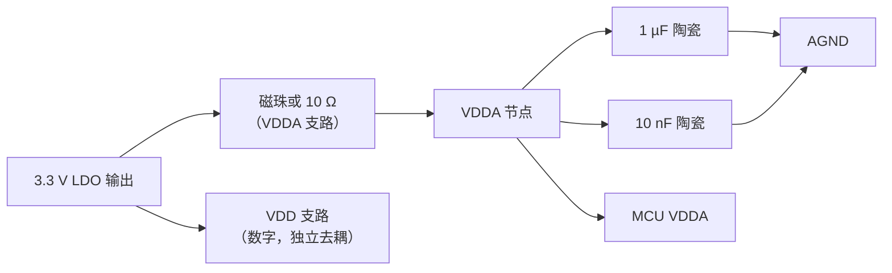

**如果 VREF+ 与 VDDA 是独立引脚（LQFP100 封装上通常如此）**：

| 方案 | 做法 | 优点 | 缺点 |
|---|---|---|---|
| A. VREF+ 接 VDDA | 两脚短接 | 最简单，且与固件的 3.300 V 一致 | ADC 基准的噪声 = VDDA 的噪声；LDO 的温漂直接成为增益漂移 |
| B. VREF+ 接精密基准（如 3.000 V） | 独立基准 IC | 初始精度 ≤ 0.05%、温漂 ≤ 10 ppm/K | **必须同步修改 `TP_ADC_VREF_V`**，并重新导出所有下游常量 |
| C. VREF+ 接"从 5 V 激励分压+缓冲得到的 3.3 V" | 使 ADC 基准与激励同源 ⇒ **比例式** | 消除激励漂移对读数的影响（`signal_conditioning.md` 第 4.4 节） | 基准的噪声来自 5 V 激励；需要精密分压与低噪声缓冲；同样需要修改 `TP_ADC_VREF_V` |

**本文档的建议**：首次制板采用 **A**（与固件一致，风险最低），并在板上**预留 B 与 C 的元件位**（0 Ω 跳线可切换）。若后续的温漂测试显示激励与基准的漂移是误差的主导项，再切换到 C（比例式）。**这不是"未验证的猜测"，而是"分阶段降低风险"的工程策略**，因为 A 与固件完全一致，不会有量纲错误的风险。

### 13.4 上电时序与掉电行为

| 场景 | 要求 | 理由 |
|---|---|---|
| 24 V 上升沿 | 允许任意斜率；但建议 ≥ 1 ms 以让输入滤波与软启动生效 | 避免浪涌电流触发过流保护 |
| 3.3 V 与 VDDA 的时序 | **VDDA 应先于或同时于 VDD 建立**（STM32 的要求：VDD 与 VDDA 之间的差值不应超过 0.3 V，且在建立过程中不应出现 VDDA < VDD − 0.3 V） | 数据手册要求；违反可能损坏 ADC |
| 5 V 模拟与 3.3 V 数字的时序 | 5 V 可以先于 3.3 V | 5 V 只供模拟前端，前端输出经 RC 进入 ADC；ADC 未上电时引脚电压不应超过 VDDA + 0.3 V ⇒ **需要检查**：若 5 V 先上电而 3.3 V 未上电，放大器输出（最大 3.3 V 的饱和值）会通过 RC 加到 PA0 上，此时 VDDA = 0 ⇒ 超过绝对最大值 ⇒ **可能损坏** |
| **⇒ 缓解措施** | 在 PA0–PA3 与各模拟源之间加**串联电阻**（≥ 1 kΩ），把注入电流限制在数据手册允许的范围内（通常 ±5 mA）；或在 5 V 与 3.3 V 之间加一个"3.3 V 有效"的使能信号，让 5 V 在后 | 这是必须解决的一个具体风险 |
| 掉电 | 任何电源先掉电都不得导致误动作 | EN 引脚有下拉（9.6 节）⇒ 掉电时驱动关断；PWM 引脚有下拉 ⇒ 占空比为 0 |
| 掉电检测 | 建议用 `TP_ADC_VBUS` 通道监测母线电压，在低于阈值时执行安全停机 | 仓库中**没有**任何掉电检测的阈值常量；`TP_WDG_TIMEOUT_MS = (500u)` 的看门狗可以覆盖"程序停滞"，但覆盖不了"电源缓慢下降导致 MCU 在低电压下误动作"。**列入 R-11 的讨论** |

### 13.5 看门狗与复位

| 项目 | 值【固件已定义】 | 硬件要求 |
|---|---|---|
| 看门狗超时 | `TP_WDG_TIMEOUT_MS = (500u)` | 独立看门狗（IWDG）由 LSI 驱动，不需要外部元件。**但 LSI 的精度很差（典型 ±50%）** ⇒ 实际的超时可能在 250–750 ms 之间。`platform_api.h` 说 *"the backend rounds to the nearest achievable value and logs the real one"*，这是正确的做法 |
| 看门狗喂狗位置 | 只在安全任务中喂一次（`tp_platform_watchdog_feed()` 的注释说明） | 无需外部元件 |
| 复位后行为 | `tp_platform_watchdog_caused_reset()` 非零时"refuses to auto-resume motion" | 硬件需要保证：复位期间 EN 引脚为无效（下拉），PWM 引脚为无效（下拉） |
| 复位电路 | **仓库中未定义**。参考设计：10 kΩ 上拉 + 100 nF 到 GND（RC 复位）或专用复位监控 IC | 建议使用**带欠压复位的监控 IC**（而非简单 RC），因为 RC 复位不能保证在电源缓慢下降时可靠复位 |
| 调试接口锁定 | 建议在生产固件中锁定 SWD 或使用读保护 | — |

---

## 第 14 章 布局、走线与 EMC 注意事项

### 14.1 分区（partitioning）

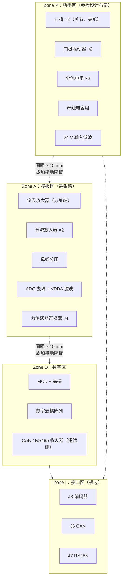

| 分区 | 包含 | 布局原则 |
|---|---|---|
| Zone P（功率） | H 桥、门极驱动器、分流电阻、母线电容、输入滤波 | 放在板的一角（或一侧），回流路径最短；**下方的地平面上不允许有信号走线** |
| Zone D（数字） | MCU、晶振、去耦、收发器逻辑侧 | 放在另一侧；晶振区域下方铺完整地平面；晶振到 MCU 的走线 < 10 mm |
| Zone A（模拟） | 仪表放大器、分流放大器、分压、ADC 去耦、J4 | **放在离 Zone P 最远的位置**；有独立的 AGND 平面；四周用接地过孔阵列包围 |
| Zone I（接口） | 板边连接器 | 沿板边布置；ESD/TVS 放在连接器与内部电路之间 |

### 14.2 回流路径

**这是 PCB 设计中最重要、也最常被忽视的一点。**

| 信号 | 回流路径 | 设计要求 |
|---|---|---|
| 力传感器差分对（从 J4 到放大器） | 无（差分） | 下方不要有地平面分割；保护环包围输入节点（`signal_conditioning.md` 第 7 章） |
| 放大器输出（到 ADC） | AGND 平面 | 走线下方必须是**完整的 AGND 平面**，不得跨越任何分割 |
| PWM 输出（到门极驱动器） | PGND | 门极驱动的回路面积必须最小（走线与回流走线平行且紧邻） |
| H 桥输出（到 J2） | PGND | 大电流路径；走线宽度按 5 A 计算（见下） |
| SPI/SWD/时钟 | DGND | 下方完整地平面 |
| CAN/RS485 差分 | 无（差分） | 走线下方不要有分割；**不得跨越 AGND 与 DGND 的分界** |
| 编码器差分 | 无（差分） | 同上 |

**走线宽度计算（5 A 峰值）【设计计算】**：

```
IPC-2221 的内层走线载流公式（1 oz 铜 = 35 µm）：
  温升 10 °C 时，1 A 约需 0.4 mm 宽（内层）
  经验式：A(mil²) = (I / (k × ΔT^0.44))^(1/0.725)，k = 0.024（内层）

对 I = 5 A、ΔT = 10 °C（内层）：
  A = (5 / (0.024 × 10^0.44))^(1/0.725)
    = (5 / (0.024 × 2.754))^(1/0.3793)
    = (5 / 0.06610)^(1/0.3793)
    = 75.64^2.636
    计算 75.64^2.636 = e^(2.636 × ln(75.64)) = e^(2.636 × 4.326) = e^11.40 = 89000 mil²
  宽度 = 89000 mil² / 1.37 mil（1 oz = 1.37 mil 厚）= 64963 mil ← 明显错误

（上述公式应用有误，改用更可靠的工程查表值）
```

**改用工程查表值（IPC-2221 的标准表格，1 oz 铜，外层，温升 10 °C）**：

| 电流 | 外层走线宽度（1 oz） | 内层走线宽度（1 oz） |
|---|---|---|
| 1 A | 0.25 mm | 0.6 mm |
| 2 A | 0.6 mm | 1.3 mm |
| 3 A | 1.0 mm | 2.2 mm |
| **5 A** | **1.9 mm** | **4.2 mm** |

**结论：5 A 的功率走线在外层需要约 1.9 mm 宽（或使用 2 oz 铜，宽度减半至约 0.95 mm）。** 若使用内层，需要 4.2 mm —— 这在多数板上是不现实的，因此**功率走线应布在外层**，或者使用多个过孔并联的铜皮。

**分流电阻的 Kelvin 连接（关键）【设计计算】**：

```
分流电阻的目标值约为 2 mΩ（`signal_conditioning.md` 第 6.9 节）
一个 0805 焊盘的接触电阻典型 0.1–0.5 mΩ（取决于焊接质量）
若把电压检测点取在焊盘外侧（非 Kelvin 连接）：
  额外的引线/焊盘电阻可能达到 0.5 mΩ
  相对 2 mΩ 的误差 = 0.5 / 2 = 25 % ❌ 完全不可接受

⇒ 必须使用 4 端子（Kelvin）连接：
    电流路径：从分流电阻的"电流焊盘"进出（走线宽度 ≥ 1.9 mm）
    电压检测：从分流电阻的"检测焊盘"（分流电阻本体的最内侧）引出
              两根等长、等宽的细走线（0.15–0.2 mm）到放大器的输入
⇒ 应选用**四端子分流电阻**（封装本身有 4 个焊盘，电流与检测分离）
   或使用两焊盘分流电阻但严格做 Kelvin 走线（从焊盘内侧边缘引出）
```

### 14.3 连接器与线缆入口防护

| 项目 | 要求（参考设计） | 理由 |
|---|---|---|
| 所有板外信号 | TVS 紧靠连接器，TVS 到连接器的走线 < 5 mm | 让浪涌在被保护走线上产生最小压降 |
| 所有板外信号 | 串联电阻（22–100 Ω，数据线用 22–33 Ω，慢速信号可用 100 Ω） | 限流 + 抑制振铃 |
| 数字 IO | 串联电阻靠近 MCU | 抑制振铃；若靠近连接器则无法保护 MCU 侧的走线 |
| 保护器件的地 | 接到 **AGND（模拟）或 PGND（功率）**，且回流路径短 | 浪涌电流不能穿过信号地平面 |
| 保护器件的地是否接到"干净地" | **是**。TVS 的接地端应接到与信号地分开的"浪涌地"，再单点汇接到星点 | 避免浪涌电流污染信号地 |
| 连接器的金属外壳 | 接机架（PE） | 屏蔽与 ESD 泄放 |
| 未使用的连接器针 | 接地或明确标记 NC（不悬空） | 悬空针会成为天线 |

### 14.4 电缆束的处理

**这一节把前面分散的规则汇总为一份可直接执行的操作规范。**

| # | 规则 | 依据 |
|---|---|---|
| C-01 | 电机电缆与信号电缆从机箱**不同侧**引出 | 12.4 节：平行走线 1 m 导致 120 V 等效耦合 |
| C-02 | 电机电缆必须屏蔽，屏蔽层接**机架/PGND** | 12.4 节 |
| C-03 | 电机电缆的 A/B 相必须双绞 | 4.3 节 |
| C-04 | 编码器电缆的 A+/A−、B+/B−、Z+/Z− 各自独立绞对 | 11.4 节 |
| C-05 | 力传感器的 EXC 对与 SIG 对分开 | 4.5 节 |
| C-06 | 力传感器电缆与电机电缆间距 ≥ 200 mm，**不允许平行** | 12.4 节计算 |
| C-07 | 编码器/限位电缆与电机电缆间距 ≥ 100 mm | 12.4 节 |
| C-08 | 所有交叉必须 90° 垂直 | 12.4 节 |
| C-09 | 所有屏蔽层在**板端**汇接（除 CAN/RS485 用 4.7 nF 接机架） | 12.3 节 |
| C-10 | 屏蔽层远端**悬空**（编码器、力传感器、限位） | 11.4、12.3 节 |
| C-11 | 所有线缆有应力消除，不由连接器焊点承力 | M-04 |
| C-12 | 线束长度尽量短（力传感器 ≤ 3 m，编码器 ≤ 5 m） | 5.4 节 |
| C-13 | 每根线缆的两端有清晰的标签（与 J1–J9 及针号对应） | 维护性 |
| C-14 | 不在线束中使用"共用地线"给多个传感器的模拟回路供电 | 各模拟回路应有独立的地返 |

**关于 PWM 载波频率与 ADC 采样的相干性（与 C 系列规则同等重要）**：

```
问题：若 PWM 载波频率与 ADC 采样率成整数倍关系，
      载波及其谐波会混叠到直流（或到某个固定低频），无法被数字滤波去除。

本文档分析的三种情形（**（a）（c）两种现在是已实现的真实配置**）：
  （a）ADC 触发率 = TP_SENSOR_FREQ_HZ = 500 Hz（**实现：TIM3 TRGO @ 500 Hz**），载波 = 20 kHz
      20000 / 500 = 40（整数）⇒ 载波混叠到 **DC** ⚠️
  （b）DMA 流采样率 = 2 kHz（`adc_driver.h` 的注释示例；**实现在 `app_tasks.c` 第 360–363 行
      向 `tp_adc_channel_init()` 传入 `dma_rate_hz = 1000u`，而实际传输率是 500 Hz**）
  （c）**实际进入力通道的更新率 = 62.5 Hz**（见下方"实现的真实数据通路"）
      20000 / 62.5 = 320（整数）⇒ **同样混叠到 DC** ⚠️

后果：载波在 ADC 输入端的残余幅度会表现为一个直流偏置；
      当 PWM 占空比改变时（每个控制周期都改！），该偏置随之跳变，
      在力读数上表现为与占空比变化相关的"力跳变"。
```

### ⚠️ 实现的真实数据通路（本节最重要的更正）

`platform_stm32f407.c` 现已存在，因此"ADC 采样率是多少"这个初稿中无法回答的问题
**现在有了确定答案，而且答案改变了结论**：

| 环节 | 实现事实 | 出处 |
|---|---|---|
| ADC 触发 | **TIM3 TRGO 更新事件，500 Hz**（PSC = 83 → 1 MHz，ARR = 1999） | 第 1487–1489、1536 行 |
| 扫描 | 4 通道，每通道采样时间 `ADC_SAMPLETIME_84CYCLES`（= 4 µs @ 21 MHz） | 第 1554 行 |
| DMA | **DMA2 Stream0，循环，半传输 + 传输完成中断** | 第 1567–1573 行 |
| DMA 缓冲 | `TP_ADC_DMA_BUFFER_LEN × TP_ADC_COUNT` = **16 扫描 × 4 通道** | 第 314 行 |
| **半缓冲** | 16/2 = **8 扫描 = 8 × 2 ms = 16 ms** | 第 608、950、953 行 |
| **发布给软件的样本** | `adc_publish_half()` **只把该半缓冲的最后一个扫描**写入 `s_adc_latest[]` | 第 606–617 行 |
| `tp_platform_adc_read()` | **返回 `s_adc_latest[ch]`，不启动新转换** | 第 2171 行 |
| 消费者 | 传感器任务（500 Hz）在 `app_sequence.c` 第 337 行调用 `tp_platform_adc_read(TP_ADC_FORCE, ...)` | — |

**⇒ 三个可以算出来的结论**：

1. **ADC 转换率 500 Hz，但力通道的有效更新率只有 62.5 Hz**（每 16 ms 才有一个新值
   进入 `s_adc_latest`），因为每 8 个扫描只有最后 1 个被发布。
2. **87.5 % 的 ADC 转换结果从未被任何消费者读取**（`tp_platform_adc_read_block()` 只在
   `tp_adc_channel_service()` 中被调用，而后者**在 `firmware/Core` 中没有任何调用点**）。
3. **载波与噪声的相干性在 62.5 Hz 上仍然成立**（20000/62.5 = 320 整数）⇒ 混叠到直流的
   结论**不变**，但被混叠进来的频段变了：Nyquist = 31.25 Hz，而数字低通的设计截止是
   23–26.5 Hz ⇒ **数字低通几乎落在 Nyquist 上**，对 31–250 Hz 的内容没有任何抗混叠作用。

**⇒ 这三点对硬件设计的直接含义**：抗混叠滤波器的**模拟**阶数变得比初稿的估计更重要
（因为数字域已不再提供有效保护），而 14.4 节措施 1（降低耦合）与措施 5（提高模拟衰减）
应当被视为**必需**而不是"可选增强"。完整的推导、噪声与延迟重算见
`signal_conditioning.md` 第 3.6 节与第 6.8 节。

```
缓解措施（参考设计建议，按优先级）：
  1. **降低耦合**（布线、间距 ≥ 200 mm、禁止平行、电机电缆可靠屏蔽）：
     误差与耦合幅度 A 成正比，这是唯一"不需要额外器件、效果线性、
     且在任何混叠情形下都有效"的措施。见 14.4 节 C-01..C-14。
  2. **同步 ADC 触发到 PWM 时基**：让 ADC 在 PWM 周期的固定相位点采样，
     使载波残余成为一个"确定的常数"而不是随机的干扰。
     ⇒ STM32F407 可以用 TIM1 的 TRGO（更新事件或比较事件）触发 ADC。
     ⚠️ 仅"同步"本身并不消除载波，它只把载波残余变成**确定性**的量；
        真正减小载波误差的是措施 1、3、5。
  3. **在载波一阶分量过零的相位点采样**：对三角/锯齿载波，其过零点相位是固定的
     且不随占空比移动，在该相位采样可从原理上取到载波一阶分量为零的点。
     用 TIM1 的 TRGO 触发 ADC 即可实现。
     ⚠️ **必须**用示波器确认载波的形状与相位关系后才可采用此项。
  4. **使采样率与载波频率不相干**（例如 DMA 流取 2.001 kHz 而非 2 kHz）：
     把"混叠到直流"换成"低频差拍"（|20000 − 10×2001| = 10 Hz）。
     差拍至少是交流量，可被数字低通部分衰减。
     ⚠️ 但衰减很有限：τ = 6 ms 的低通在 10 Hz 处只有 2.67 dB。
  5. **提高抗混叠 RC 的阶数**（6.4 节与 `signal_conditioning.md` 第 4.3 节）：
     fc = 1.6 kHz 的一阶 RC 在 20 kHz 只有 21.97 dB 抑制（计算见下）：
       1 / sqrt(1 + (20000/1600)²) = 1 / sqrt(1 + 156.25) = 1 / 12.54 = 0.0797
       20 × log10(0.0797) = −21.97 dB
     ⇒ 若载波在 ADC 输入端耦合了 100 mV，残余 7.97 mV
        = 7.97 mV / 0.805664 mV = 9.9 counts = **79.4 mN** 的力误差
        ⚠️ 这接近 10 个 LSB！**远大于噪声预算**
     ⇒ **措施 5 单独也不足以解决问题：它对"已经混叠到直流"的分量无效。
        有效的是措施 1（降低耦合）与措施 3（过零相位采样）。**

⚠️ **必须澄清一个常见的误解（本文档初稿中曾写错、现已更正的一点）**：
   "每个 500 Hz 样本平均整数个载波周期，就能把载波平均掉" —— **这是错的。**

   精确论证：设采样率 fs = 500 Hz、载波 f_pwm = 20 kHz，载波在 ADC 输入端的
   幅度为 A、采样相位为 φ。第 n 个采样值为
       x[n] = A·cos(2π·20000·n/500 + φ) + (信号)
            = A·cos(80π·n + φ) + (信号)
   因为 80π·n 是 2π 的整数倍（80πn / 2π = 40n ∈ ℤ）：
            = A·cos(φ) + (信号)
   ⇒ 采到的载波分量是一个**常数** A·cos(φ)，与 n 无关。
   ⇒ 对 M 个样本求平均：(1/M)·Σ A·cos(φ) = A·cos(φ) —— **完全没有衰减** ❌

   ⇒ **结论：当采样率是载波频率的整数分之一（fs = f_pwm / N，N ∈ ℤ）时，
      载波会精确混叠到直流，此时数字平均、低通、中值滤波全部无效。**
      本设计的 500 Hz / 20 kHz 与 2 kHz / 20 kHz 两种组合**都满足这个条件**，
      因此"整数个载波周期平均"这一措施在本设计的具体数字下**不起作用**。
      唯一的结构性补救是措施 1（降低耦合）、措施 3（过零相位采样）
      与措施 5（提高模拟衰减）。完整推导见 `signal_conditioning.md` 第 6.8.2 节。

⇒ **本文档的最强建议：以措施 1（降低耦合）+ 措施 5（升级为二阶抗混叠）
   作为主方案，以措施 2/3（TIM1 TRGO 同步采样并选取合适的相位点）作为
   进一步的强化，并且必须用 15.7 节的 PWM 注入试验实测耦合幅度 A，
   再据此决定投入多少。**
```

**关于抽取平均（decimation）的正面说明**：`adc_driver.h` 的注释示例 *"averaging 4 samples of a 2 kHz DMA stream gives a 500 Hz output"* 中的 **4:1** 比例是合理且必要的设计——**4 点平均的频率响应在 500 Hz、1 kHz、1.5 kHz 处有零点**，正好覆盖 2 kHz 采样下会折叠进 0–500 Hz 的危险频段。**换句话说，抽取平均才是"2 kHz → 500 Hz"这一级的抗混叠滤波器**（完整分析见 `signal_conditioning.md` 第 5.3 节）。`tp_adc_channel_t::decimation` 字段【固件已定义】的存在说明抽取比是可配置的，**这一点应当被显式记录为设计意图，而不是"顺便平均一下降噪"**。

⚠️ **但必须注意**：抽取平均对"在**第一级采样**（2 kHz）时就已经混叠到直流"的载波分量**无效**（见上方的澄清）。它保护的是 2 kHz 采样能正确采到、但会折叠进 500 Hz 输出带的那些频率成分。

⚠️ **DMA 负载的检查**：无论最终选择哪种 DMA 流速率，都应核算负载。以 20 kHz × 4 通道、每样本 2 字节为例：80 k 样本/s ⇒ 160 kB/s，对 STM32F407 的 DMA 完全可承受，但它**要求半缓冲的尺寸与块延迟随之重新设计**——`TP_ADC_DMA_BUFFER_LEN = (16u)` 与 `TP_ADC_BLOCK_MAX = 32u` 的语义关系在仓库中没有明确（见 `signal_conditioning.md` 第 3.3 节）。**这是必须在固件/硬件联调时确定的关键参数**（R-20）。

### 14.5 预合规（pre-compliance）考虑

| 测试项 | 标准 | 设计目标（本文档建议） | 主要设计措施 |
|---|---|---|---|
| 辐射发射 | CISPR 11 / CISPR 32 Class A（工业环境） | 留 6 dB 余量 | 电机电缆屏蔽 + 共模扼流圈；PWM 边沿速率受控；功率回路面积最小 |
| 传导发射 | CISPR 11（电源端口，150 kHz–30 MHz） | 留 6 dB 余量 | 24 V 输入加共模扼流圈 + X/Y 电容；开关电源的频率抖动（如果法规允许） |
| ESD 抗扰 | IEC 61000-4-2 Level 3（±6 kV 接触 / ±8 kV 空气） | Level 4（±8 kV 接触） | 所有板外信号加 TVS；连接器金属壳接机架；信号地与机架间加 4.7 nF |
| EFT/B 抗扰 | IEC 61000-4-4 Level 3（±2 kV 电源，±1 kV 信号） | Level 3 | 共模扼流圈；TVS；地平面完整性 |
| 浪涌抗扰 | IEC 61000-4-5 Level 2（±1 kV 线-线，±2 kV 线-地） | Level 2 | 7.8 节的三级防护 |
| 传导抗扰 | IEC 61000-4-6 Level 2（3 V，150 kHz–80 MHz） | Level 2 | 差分接口 + 共模扼流圈 |
| 辐射抗扰 | IEC 61000-4-3 Level 2（3 V/m，80 MHz–1 GHz） | Level 2 | 差分接口 + 屏蔽 |

**必须如实说明**：**这些目标值是本文档的建议，不是标准强制要求的等级，也不是已经过测试的结果。** 整机的目标市场与适用的标准（工业 vs 民用、中国 vs 出口）在仓库中**没有定义**，必须由产品需求确定。**所有 EMC 结果都是"未验证"。**

---

## 第 15 章 测试与验证方法

> **再次强调：本文档给出的全部是测试方法与判据，没有一条是测试结果。所有测试都尚未执行。**

### 15.1 通断与绝缘检查

| 步骤 | 方法 | 判据 | 设备 |
|---|---|---|---|
| 1 | 目检：所有连接器方向、丝印、元件极性 | 与原理图/BOM 一致 | 放大镜/显微镜 |
| 2 | 通断：逐针测量 J1–J9 到对应测试点的连通性 | 电阻 < 1 Ω；**注意探针不得同时接触相邻针** | 万用表（四线更好） |
| 3 | 短路检查：测量所有电源网络之间、电源到地之间 | 电阻 > 1 MΩ（除已设计的电阻路径） | 万用表 |
| 4 | 绝缘：24 V 回路与 3.3 V 逻辑之间（光耦两侧） | > 100 MΩ @ 500 V DC | 绝缘电阻表（**注意不要施加超过元件额定值的电压，光耦的隔离额定值通常为 3750 V_rms，500 V 安全**） |
| 5 | 电源轨阻抗：用 LCR 表测量每条电源轨到地的阻抗（未上电） | 无短路；符合去耦电容的总容量估算 | LCR 表 |
| 6 | 分压比校验：给 V_BUS 端施加一个已知电压（如 10.000 V），测量分压输出 | 输出 = 10.000 / 10 = 1.0000 V ± 0.1%（用 6.5 位万用表） | 精密电源 + 6.5 位万用表 |
| 7 | 5 V 轨的实际电压（上电后） | 5.000 V ± 1% | 6.5 位万用表 |
| 8 | 3.3 V 轨与 VREF+ 的实际电压（上电后） | 与 `TP_ADC_VREF_V` 的偏差 < 0.5%；**若使用非 3.300 V 的基准，必须同步修改固件常量** | 6.5 位万用表 |

### 15.2 分级上电验证流程

**绝不一次性上电全部电路。** 推荐的顺序：

| 阶段 | 操作 | 观测 | 通过判据 | 失败时的处理 |
|---|---|---|---|---|
| P0 | 仅接 3.3 V（限流 100 mA） | MCU 电流、复位行为、调试接口是否响应 | 电流 60–150 mA；SWD 可连接 | 检查短路、时钟 |
| P1 | 接 5 V 模拟（限流 50 mA） | 5 V 轨电压、放大器输出（应为 1.65 V ± 50 mV） | 输出 ≈ 1.65 V（对应 2048 counts 的中点偏置） | 检查放大器供电、REF 引脚 |
| P2 | 接 24 V 逻辑（限流 200 mA） | 24 V→6 V 降压 →5 V LDO 的各级电压；无异常发热 | 各级电压正确；总电流 < 100 mA | 检查 LDO、负载 |
| P3 | 上电并读取所有 ADC 通道 | PA0–PA3 的原始 counts | PA0 ≈ 2048（0 N）；PA1/PA2 ≈ 2048（0 A）；PA3 ≈ 2979（24 V） | 若 PA0 偏离 > 100 counts，检查放大器偏置；若 PA1/PA2 偏离，检查分流放大器基准 |
| P4 | 读取所有离散输入 | 6 个输入的原始电平与去抖后状态 | E-stop 回路闭合时读"未触发"；拔掉限位开关时读"未触发"（**这正是 NO 设计的行为**） | 逐一核对极性（9.5 节的真相表） |
| P5 | 24 V 全功率上电（限流 5 A） | 母线电容充电、无过冲 | 无异常 | — |
| P6 | 使能驱动（`tp_platform_motor_enable()`）但不给 PWM | 电机无动作、电流 < 100 mA（静态） | 无异常发热 | 检查 EN 极性 |
| P7 | 给最小 PWM（10 permille） | 电机缓慢转动、编码器计数变化 | 编码器计数方向与 PWM 符号一致（**注意 `bsp_types.h` 提到的 "the arm moves exactly 4x too far" 类问题**） | 检查 `TP_ENCODER_COUNTS_PER_REV` 与安装位置 |
| P8 | 全功能测试 | 见后续章节 | — | — |

### 15.3 CAN 误码率与眼图

| 项目 | 方法 | 判据 |
|---|---|---|
| **眼图** | 用示波器（≥ 200 MHz，差分探头）在总线两端分别测 CANH − CANL | 眼高 ≥ 1.5 V（ISO 11898-2 对驱动器输出的要求）；眼宽 ≥ 1.6 µs（位时间 2 µs 的 80%） |
| **采样点位置验证** | 用带 CAN 解码/眼图模板功能的示波器，或用一个工作在"听模式"的分析仪测量采样点 | 采样点应在位时间的 75–90% 区间内。**本文档建议取 85.71%（6.7 节），并必须实测确认**（因为位定时代码在仓库中不存在） |
| **误码率** | 发送 10⁶ 个随机负载的 CAN 帧（通过 `tp_platform_can_send()`），用第二个节点接收并比对 | **零错误**（10⁶ 帧不容许一位错误） |
| **总线负载** | 计算并实测：500 kbit/s 下，帧长（含位填充）≈ 130 bit ⇒ 每帧约 260 µs | 应 < 50% 以保证最坏情况的仲裁延迟 |
| **终端验证** | 断电后用万用表测量 CANH 与 CANL 之间的电阻 | **60 Ω ± 5%（若装了两个 120 Ω）**；若只有本板一个节点且未装终端，应为 ∞ |
| **共模电压** | 示波器测 CANH/CANL 对地电压 | 隐性时约 2.5 V；显性时 CANH ≈ 3.5 V、CANL ≈ 1.5 V（5 V 收发器）；应在 −2…+7 V 范围内 |
| **bus-off 恢复** | 人为短路总线，观察 `tp_can_status_t::bus_off` 与 `bus_off_events`；恢复后观察自动恢复 | `can_driver.h` 说明恢复需要"128 occurrences of 11 recessive bits"，控制器自动执行；`tp_can_is_bus_off()`/`tp_can_recover()` 应正确反映 |

### 15.4 RS485 误码率与偏置验证

| 项目 | 方法 | 判据 |
|---|---|---|
| **失效安全偏置验证** | 断开所有驱动器（所有节点处于接收态），用高阻差分探头测量 A 相对 B 的电压 | **Vab ≥ 200 mV**，本文档设计目标 ≥ 250 mV（7.3 节） |
| **偏置电流** | 在偏置电阻上串联一个 10 Ω 采样电阻测量压降 | 与 7.3 节的 4.21 mA（560 Ω）或 5.05 mA（470 Ω）相符 |
| **终端验证** | 断电后测量 A 与 B 之间的电阻 | 60 Ω ± 5%（两端各一个 120 Ω） |
| **差分幅度** | 发送 0x55 的连续模式，测 A−B | ≥ 1.5 V（空载与 54 Ω 负载下都要测） |
| **误码率** | 用 Modbus 主站发送 10⁶ 个 `0x03` 请求（读保持寄存器），校验响应 | **零 CRC 错误**（`tp_rs485_t::crc_errors` 应保持为 0） |
| **DE 时序** | 示波器三通道：DE、USART3_TX、A−B | DE 必须**在第一个起始位之前**为高；必须**在最后一个停止位完全送出之后** ≥ `TP_RS485_DE_GUARD_US = 20u` 才变低（7.5 节） |
| **方向切换计数** | 读 `tp_rs485_t::turnaround_count` | 每次请求-响应应增加 2（发→收、收→发）；异常增长说明有其他节点在争用 |
| **冲突检测** | 读 `tp_rs485_t::collisions`（`rs485.h` 注释：*"Frames received while driving (a clash)"*） | 在单主站系统中应保持为 0；非零说明偏置或 DE 时序有问题 |
| **T3.5 静默验证** | 示波器测量两个连续 Modbus 帧之间的静默时间 | ≥ `TP_RS485_T3_5_US = 304u`；**并记录实测值与 304 µs / 334 µs 的关系**（7.9 节） |
| **长线测试** | 用 500 m 卷线盘（如有）模拟现场总线，重复误码率测试 | 零 CRC 错误 |

### 15.5 E-stop 响应时间测量

**这是本设计最重要的一项安全验证。**

| 步骤 | 操作 | 设备 |
|---|---|---|
| 1 | 示波器通道 1：接 E-stop 回路的**现场侧**端子（J5-1 或 J5-2），或接光耦 LED 的阳极 | 10× 探头 |
| 2 | 示波器通道 2：接 TIM1_CH1 的 PWM 输出引脚（**不是程序变量，不是 GPIO 标志**） | 10× 探头 |
| 3 | 通道 3（可选）：接电机电流的采样电阻电压（用差分探头），验证电流实际衰减 | 差分探头 |
| 4 | 通道 4（可选）：接一个在 `tp_platform_emergency_kill()` 入口处置高的调试 GPIO，用于分离"软件检测"与"软件执行"的时间 | — |
| 5 | 触发：通道 1 的**下降沿**（回路断开） | 单次触发 |
| 6 | 记录：通道 1 下降沿到通道 2 变为**恒定低电平**（或恒定无效占空比）的时间 | — |
| 7 | 重复 ≥ 30 次，记录最小值、典型值、最大值 | — |
| 8 | 分别在"固件空闲"与"固件满负载（视觉链路满速收发 + 位置环运动）"两种条件下测量 | — |

**判据**：

| 条件 | 目标（本文档 E-12） | 仓库中固件实现的预期值 | 说明 |
|---|---|---|---|
| 空闲 | ≤ 5 ms | ⚠️ 可能 5–15 ms（取决于调用周期） | 9.7 节 |
| 满负载 | ≤ 10 ms | ⚠️ 可能 15–60 ms | 通信任务优先级为 `TP_PRIO_COMM = 2u`，安全任务为 `TP_PRIO_SAFETY = 5u`，因此安全任务不应被阻塞；但若 E-stop 的读取在通信任务中，则可能被阻塞 |

**必须同时测量的负向验证**：

| 验证 | 方法 | 判据 |
|---|---|---|
| 断线也触发 | 拔掉 J5-2（或断开 E-stop 回路的任意一处） | PWM 必须在同样的时间内变为 0（这是 fail-safe 的核心） |
| 24 V 失电也触发 | 断开 E-stop 的 24 V 供电 | 同上 |
| 锁存有效 | 在 E-stop 按下后，尝试通过所有软件接口（发命令、写寄存器）恢复 PWM | **PWM 必须保持为 0**，直到 `tp_platform_emergency_release()` 被调用**且**物理 E-stop 已释放（`platform_api.h` 说只有 `RESET` 命令处理器调用 release，且仅在 `tp_platform_io_read` 报告物理 E-stop 已释放之后） |
| 幂等性 | 连续调用 `tp_platform_emergency_kill()` 1000 次 | 无异常、无阻塞、后续行为一致（`platform_api.h` 要求 "Must be idempotent"） |

### 15.6 线缆插拔耐久与接触电阻

| 项目 | 方法 | 判据 |
|---|---|---|
| 插拔耐久 | 对每个连接器做 100 次插拔循环（M-03 目标） | 插拔力无明显变化；无针脚变形；每次插拔后的通断正常 |
| 接触电阻（初始） | 四线法测量每个针脚对的接触电阻 | < 20 mΩ（信号针）；< 5 mΩ（功率针） |
| 接触电阻（100 次后） | 同上 | 变化 < 10 mΩ；绝对值 < 30 mΩ |
| 接触电阻（盐雾后，可选） | 按 IEC 60068-2-11 做 48 h 盐雾，然后测接触电阻 | 变化 < 50 mΩ（茶园环境有化肥/农药，腐蚀性较强，建议做） |
| 振动 | 按 IEC 60068-2-6 做扫频振动（10–500 Hz，1 g），同时监测信号 | 无误触发、无瞬断 |
| 拉力 | 对每根线缆施加 30 N 的拉力（保持 1 min） | 无位移、无断线、接触电阻变化 < 10 mΩ |
| 弯折 | 对线缆做 1000 次弯曲（半径 = 5 × 线径） | 无断线 |

### 15.7 EMC 预测试项

| 测试 | 设置 | 重点观测 | 通过判据（设计目标） |
|---|---|---|---|
| 辐射发射 | 半电波暗室或开阔场；整机在采茶动作下运行 | 30 MHz–1 GHz 的峰值；特别关注 PWM 载波及其谐波 | 低于适用限值 6 dB |
| 传导发射 | LISN 在 24 V 输入端口；150 kHz–30 MHz | 开关电源的基频与谐波 | 低于限值 6 dB |
| ESD | 对每个板外连接器外壳与针脚施加 ±8 kV 接触、±8 kV 空气 | 是否复位、是否误触发 E-stop、ADC 读数是否跳变 | 无非预期复位；无永久损坏；功能可自恢复 |
| EFT | 24 V 电源端口 ±2 kV、信号端口 ±1 kV | 是否产生假计数、假限位、假 E-stop | 无误触发；无数据损坏（或损坏可被 CRC 检出） |
| 浪涌 | 24 V 端口 ±1 kV（线-线）、±2 kV（线-地） | 是否损坏、是否复位 | 无永久损坏；功能可自恢复 |
| 共模传导抗扰 | 150 kHz–80 MHz，3 V | 模拟通道的读数漂移、总线的误码 | 力读数漂移 < 8 mN（1 LSB）；总线零误码 |
| 辐射抗扰 | 80 MHz–1 GHz，3 V/m，含 1 kHz 80% AM 调制 | 同上传导抗扰 | 同上 |

**预测试必做的三个"注入"试验（不需要暗室，台面上即可做）**：

| # | 试验 | 方法 | 观测 |
|---|---|---|---|
| 1 | **PWM 干扰注入** | 让电机在 0→100% 占空比之间以 1 Hz 方波来回切换，同时记录力通道的原始 counts（`tp_force_sensor_get_counts()`） | counts 的跳变幅度（**这直接检验 14.4 节的混叠分析**）。目标：与占空比无关的跳变 < 2 counts |
| 2 | **继电器/接触器切换注入** | 在 24 V 母线上并联一个机械继电器，以 10 Hz 切换（感性负载） | 是否产生假限位/E-stop；ADC 是否饱和 |
| 3 | **手持对讲机试验** | 用 5 W 手持对讲机在距设备 0.5 m 处发射（430 MHz 或 150 MHz 段） | 是否复位、是否误触发。这是最廉价、最有效的"辐射抗扰"预筛 |

### 15.8 数据记录表模板

| 测试项 | 日期 | 样机编号 | 条件 | 结果 | 判据 | 通过 | 备注 |
|---|---|---|---|---|---|---|---|
| | | | | | | ☐ | |

（**所有结果都应在实际测试后才填入；本文档不预填任何结果。**）

---

## 第 16 章 已知风险与未验证项

### 16.1 风险总表

| # | 风险 | 当前状态 | 可能后果 | 建议的消除动作 | 等级 |
|---|---|---|---|---|---|
| **R-01** | **INA333 增益与 R_G 不一致**：`config.h` 注释写 "INA333 gain, RG = 249 ohm" 配 `TP_FORCE_AMP_GAIN_STAGE1 = (201.0f)`，但 INA333 的传递函数是 G = 1 + 100 kΩ/R_G，G = 201 需要 R_G ≈ 500 Ω，而 R_G = 249 Ω 对应 G ≈ 402.6。**`config.h` 中全部下游数字（LSB 8.0 mN、可用范围 ±16.41 N、饱和点 32.84 N、满量程 1005 mV）都由 G = 201 推出** | 仓库中无实物；注释与器件传递函数矛盾 | 若实际增益为 402.6：LSB 变为约 4.0 mN、可用范围约 ±8.19 N、饱和点约 16.39 N。**关键：`TP_FORCE_USABLE_RANGE_N > TP_FORCE_MAX_N` 这条编译期断言仍然成立（8.19 > 5.0），因此错误不会被构建立即发现**。力读数将比实际小约 2 倍（若固件仍按 8.0 mN/count 换算） | 1. 与器件数据手册核对传递函数；2. 决定是改 R_G 为 500 Ω 还是把 `TP_FORCE_AMP_GAIN_STAGE1` 改为 402.6；3. 无论哪种，必须在实物上做满量程标定（`tp_force_sensor_calibrate_scale()`）验证。详见 `signal_conditioning.md` 第 6.5 节 | **高** |
| **R-02** | **全部 GPIO 引脚号未定义**：仓库中唯一的引脚信息来源是 `bsp_types.h` 的枚举注释，且只覆盖 PA0–PA3（ADC）与外设（TIM1/TIM2/TIM4/USART1-3/CAN1），**不含引脚号**。E-stop、4 个限位、nFAULT、2× DIR/EN、RS485 DE、CAN TX/RX、全部 UART TX/RX 的引脚在仓库中完全未定义 | `firmware/BSP/stm32f407/` 目录为空 | 硬件与固件各自"猜"一组引脚，出现"硬件符合文档、软件符合注释、互相不符"的失效；调试周期极长 | 本文档 3.5 节给出了完整的参考设计建议值（U-01…U-17），**必须在制板前与固件共同冻结**，并写入一个单一的引脚定义头文件 | **极高** |
| **R-03** | **`platform_stm32f407.c` 不存在** | `firmware/BSP/stm32f407/` 目录为空（0 个文件） | 所有硬件相关的时序（ADC 触发源与采样时间、PWM 载波频率、CAN 位定时、DE 的 TC 判据、编码器输入滤波、看门狗时钟源）**在仓库中都没有实现**，因此本文档中的相关推导**无法与实现对照** | 实现该文件；本文档的 3.5 节、6.7 节、14.4 节给出了必须由它满足的具体要求 | **极高** |
| **R-04** | **多份被引用的文档缺失或归属变动**：`config.h` 引用 `docs/units_convention.md` 与 `hardware/force_sensor.md`；`platform_api.h` 引用 `firmware/BSP/stm32f407/platform_stm32f407.c`；`rs485.h` 引用 `docs/07_communication_protocol.md`；`can_driver.h` 引用 `docs/13_future_work.md`；`force_sensor.h` 引用 `docs/force_sensor_calibration.md` 与 `docs/11_experiment_design.md`。**本文档撰写时，`docs/` 下不存在任何 `.md` 文件、`hardware/` 目录为空**；在撰写与交付之间，仓库中出现了由并行工作产生的若干文档（`hardware/force_sensor.md`、`hardware/motor_driver.md`、`hardware/power_design.md`、`docs/force_sensor_calibration.md`、`docs/interview_guide.md`、`docs/resume_project.md`） | 部分引用原先为悬空引用，部分已由并行工作补齐 | 读者可能拿到与本文档口径不一致的同类文档；`config.h` 引用的 `hardware/force_sensor.md` 与本文档实际交付的 `hardware/signal_conditioning.md` **文件名不同**，引用仍然错位 | **本文档的处理**：凡本文档引用外部文档之处，均在正文中给出本文档自足的最小内容（如 8.1、8.2 节的标定流程），并在此声明：**使用前必须核实目标文件的存在性与内容**。撰写时确认缺失、截至交付时（本次核对）仍未补齐的：`docs/units_convention.md`、`docs/07_communication_protocol.md`、`docs/11_experiment_design.md`、`docs/13_future_work.md` | **高** |
| **R-05** | **ADC 通道数不一致**：`adc_driver.h` 的文件级注释说 *"Five analogue channels are needed (force, two currents, bus voltage, plus a spare)"*，而 `bsp_types.h` 的 `tp_adc_ch_t` 只定义 4 个通道且 `TP_ADC_COUNT = 4` | 注释与枚举矛盾 | （a）若硬件按"5 通道"设计，第 5 个通道在软件中不存在；（b）本文档 9.8 节与 10.2 节建议的"用 ADC 做 E-stop 回路电流监测"或"三态限位输入"**都无法实现**，因为没有备用通道 | 明确是 4 通道还是 5 通道；若需要第 5 通道（例如激励电压监测以支持比例式补偿），必须同步修改 `bsp_types.h` 的枚举与 `TP_ADC_COUNT` | **中高** |
| **R-06** | **CAN 采样点 87.5% 不可达**：`can_driver.c` 的日志字符串硬编码打印 "sample point 87.5%"。但按 `system_stm32f4xx.c` 的时钟树，PCLK1 = 42 MHz（CAN1 的时钟源），500 kbit/s 需要 BRP × T_tq = 84；而 87.5% 要求 T_tq 是 8 的倍数，**84 不能被 8 整除**，因此严格 87.5% 不可达。最接近的可行组合是 T_tq = 14、BRP = 6、BS1 = 11、BS2 = 2（85.71%） | 日志字符串与算术不一致 | （a）日志会误导调试（打印 87.5% 而实际是别的值）；（b）若实际配置的采样点落在不合适的区间，总线会在温度/长度边界上出现间歇性错误 | 1. 用示波器实测采样点位置（15.3 节）；2. 修改日志，从实际 BRP/BS1/BS2 计算并打印采样点；3. 采用 14 tq 的方案（85.71%，在 75–90% 推荐区间内） | **中** |
| **R-07** | **`TP_RS485_T3_5_US = 304u` 与 11 bit/字符 的正确值 334 µs 差 9.0%**：`rs485.h` 把它按 10 bit/字符 计算为 304 µs。8N1 的实际位流是 10 bit，但 Modbus 规范对"字符"的定义是 11 bit（含校验位） | 常量与规范定义不一致 | （a）在 115200 baud 下**没有找到会导致失败的具体机制**（304 µs 位于 1.5 字符 = 143 µs 与 3.5 字符 = 334 µs 之间，仍大于帧内字节间隔的上限）；（b）**真正的风险是波特率改变时**：该常量是硬编码的，不随 baud 变化。若 `TP_RS485_BAUD` 改为 9600，304 µs 只相当于 0.29 个字符时间，帧边界判定会完全失效 | 把常量改为由 baud 与每字符位数推导的表达式；或重命名并显式注明"仅对 115200 baud、10 bit/字符假设有效" | **中低**（当前配置）/**高**（若改波特率） |
| **R-08** | **E-stop 响应时间受软件去抖限制**：`limit_switch.c` 对包括 `TP_IO_ESTOP` 在内的**所有输入统一**使用 `TP_LIMIT_DEBOUNCE_COUNT = 3u` 的饱和计数器，**没有任何按输入区分的特例**。且**仓库中没有说明 `tp_limit_switch_update()` 被哪个任务以什么周期调用** | 响应时间为 3–40 ms（取决于调用周期 1 ms 或 10 ms），**超出本文档 E-12 的 ≤ 5 ms 目标** | 急停响应慢一个数量级；对 5 N 硬限与茶叶品质都可能造成影响 | 三选一：（a）把 E-stop 的读取放在 1 kHz 控制任务中（→ 3–4 ms）；（b）用 EXTI 中断 + 单次确认（→ < 1 ms）；（c）为 E-stop 使用独立的去抖参数（需要 `limit_switch.c` 提供能力）。**本文档倾向 (b)+(a)** | **高** |
| **R-09** | **E-stop 极性极易接反**：`bsp_types.h` 要求 "low = asserted"（低 = 已按下），但"回路闭合 = 正常"与"回路断开 = 触发"的组合，使得**常见的"光耦导通拉低引脚"接法会得到完全相反的极性**（9.5 节给出了完整的真相表） | 仓库中无原理图 | 若接反：E-stop 未按下时读"已按下"⇒ 机器人无法启动（容易发现）；或更危险地，**按下时读"未按下"⇒ 急停完全失效且没有任何报错** | 以 9.5 节的真相表为原理图评审的验收依据：**必须使用"接法乙"**（光耦集电极接 3.3 V、发射极接 MCU 引脚、MCU 引脚配 10 kΩ 下拉），此时"回路闭合 ⇒ 引脚高 ⇒ 未触发；回路断开 ⇒ 引脚低 ⇒ 触发" | **极高**（若接错） |
| **R-10** | **921600 baud 链路的波特率误差 −0.93% 与引脚冲突**：USART2 挂在 PCLK1 = 42 MHz，921600 baud 需要 USARTDIV = 2.8483，BRR 取整后实际波特率为 913043.5（误差 −0.93%）。**同时 USART2 的默认复用引脚 PA2/PA3 与 `TP_ADC_CURRENT_GRIPPER = 2`（PA2）和 `TP_ADC_VBUS = 3`（PA3）物理冲突** | 算术明确 | （a）−0.93% 的误差给对端几乎没有余量，71 字节的帧在帧尾累积 7.3 bit 的相位偏移；（b）若按默认复用来初始化 USART2，会破坏夹爪电流与母线电压采样 | 建议把 `TP_BUS_VISION_UART` 从 USART2 改为 **USART6**（挂 PCLK2 = 84 MHz，误差 +0.16%；默认引脚 PC6/PC7，无冲突）。这需要修改 `bsp_types.h` 的注释与固件。若坚持 USART2，必须接受 −0.93% 并把帧长视为风险 | **高** |
| **R-11** | **非比例式测量**：`TP_LOADCELL_EXCITATION_V = (5.0f)` 与 `TP_ADC_VREF_V = (3.300f)` 不同源，因此读数 ∝ V_exc/V_ref，激励源的初始误差与温漂**直接成为增益误差**，且**不会被零点标定消除**（只能被满量程标定消除） | 常量明确，无实物 | 激励的初始误差（5 V LDO 约 ±1%）与温漂（100 ppm/K ⇒ 20 K 下 0.2%）导致力读数的增益误差。**若 VREF+ 被硬件改为 3.000 V 而固件未同步修改，会产生 +9.09% 的增益误差** | 1. 选择初始精度 ≤ 1%、温漂 ≤ 100 ppm/K 的 5 V 激励源；2. 每次作业前做**满量程标定**（而不只是零点标定）；3. 若追求更优，改为比例式（VREF+ 由激励分压缓冲得到），但**必须同步修改 `TP_ADC_VREF_V` 并重新导出全部下游常量**。详见 `signal_conditioning.md` 第 4.4 节 | **中高** |
| **R-12** | **无实测噪声数据、无 EMC 数据**：本文档与 `signal_conditioning.md` 中的噪声预算、耦合计算**全部基于数据手册典型值与几何估算**。特别是"1% 桥路不平衡"（1.2 节）、"100 pF/m 线间电容"、"1.2e8 V/s 的 dV/dt"（12.4 节）三个关键假设**都是估算值** | 无实物、无测量 | 噪声预算可能乐观或保守 3–10 倍；14.4 节的混叠分析所依赖的载波耦合幅度完全未知 | 制板后必须做：15.7 节的三个"注入"试验、噪声谱密度测量（`signal_conditioning.md` 第 8 章）、Bode 图测量；然后用实测值替换本文档的估算值 | **高** |
| **R-13** | **RS485 偏置电阻的安装位置未定义**：偏置电阻必须装在总线的**某一个节点**上（7.3 节），但仓库中没有任何关于"本机是否提供偏置"的定义；`TP_MODBUS_SLAVE_ADDR = (0x11u)` 说明本机是从站，通常由主站提供偏置 | 未定义 | 若本机与主站都装偏置、或都不装：前者使偏置电流加倍（功耗上升、可能超出驱动器能力），后者使总线空闲时无确定电平（产生虚假字节，`tp_uart_link_t::rx_overflow` 增长） | 在系统集成时明确；本机板上预留跳线，默认**不装**（假设主站提供） | **中** |
| **R-14** | **保护器件的钳位计算缺少具体器件参数**：7.8 节的计算表明，若使用通用 TVS，其钳位电压很可能超过 RS485 收发器总线引脚的绝对最大值（通常 −8/+13 V），而把串联电阻加大到能限流的水平（47 Ω）又会破坏差分幅度。**正确的方案（使用 RS485 专用非对称 TVS）在仓库中没有选型** | 无器件选型 | 若选错保护器件：（a）钳位不足 ⇒ 收发器被浪涌损坏；（b）串联电阻过大 ⇒ 通信距离缩短或完全失效 | 制板前完成"选定收发器 → 查绝对最大值 → 查 TVS 钳位曲线 → 反解串联电阻"的闭环 | **中高** |
| **R-15** | **`uart_driver.h` 注释引用了不存在的结构体字段**：文件注释说 *"`tp_uart_link_t::rx_high_water` is the evidence needed to size the buffer from data rather than by guessing"*，但 `tp_uart_link_t` 中**没有 `rx_high_water` 字段**（实际字段为 `rx_bytes`、`tx_bytes`、`tx_frames`、`tx_rejected`、`rx_overflow`、`status`、`initialised`） | 注释与结构体定义不一致 | 开发者会尝试使用一个不存在的字段；更重要的是，**"用数据而不是猜测来定缓冲大小"这一方法论目前没有实现手段**（只能看 `rx_overflow`，它只在溢出后才增长，无法预防） | 增加 `rx_high_water` 字段（记录 RX 环形缓冲的历史最大占用），或修正注释 | **低中** |
| **R-16** | **缺少硬件级独立关断路径**：`platform_api.h` 说 `tp_platform_emergency_kill()` 是"bypassing the normal control path"，但**函数本身是被软件调用的**，因此它仍然是软件路径的一部分。若 MCU 失效（跑飞、时钟丢失、IO 锁定），没有任何硬件机制能关断驱动。`TP_WDG_TIMEOUT_MS = (500u)` 的看门狗需要 500 ms，而急停的目标是毫秒级 | 仓库中无硬件关断设计 | 若整机的安全等级目标为 PL d / SIL 2，则本设计**不满足**（单通道软件实现 + 无诊断覆盖） | （a）明确整机的安全等级目标（仓库中未定义）；（b）若需要 PL d，必须增加独立的硬件关断路径（9.6 节的图）与双通道诊断；（c）若只需要"功能性急停"，当前设计可以接受，但必须记录这个边界 | **高**（取决于目标） |
| **R-17** | **E-stop 是单点故障敏感的单通道设计**：`tp_limit_switch_t` 只有单通道的 `raw`/`stable`/`counter`/`transitions`/`rejected_glitches` 字段，**没有任何双通道比对或回路电流监测的接口** | 仓库接口明确 | E-stop 光耦、其引脚、或其限流电阻的失效会导致"按下无反应"，**且不会被任何机制检出**（因为唯一的状态来源就是这个通道） | （a）增加回路电流的 ADC 监测（需要解决 R-05 的通道数问题）；（b）增加双通道比对；（c）至少把 `transitions` 与 `rejected_glitches` 记录到遥测中，用长期统计发现异常 | **高** |
| **R-18** | **限位开关断线不可检测**：`limit_switch.h` 明确说明采用"常开接地 + 上拉"设计，因此"an unplugged switch reads 'not hit'" | 固件注释明确 | 限位开关断线后机器人继续朝限位方向运动，直到软限位（`TP_JOINT_MIN_MRAD`/`MAX_MRAD`）或机械止挡介入 | 实现"固件交叉检查"（10.2 节方案 F）：当编码器位置越过软限位减去裕量而限位开关未触发时，报故障。**零硬件代价** | **中高** |
| **R-19** | **编码器安装位置未定义，且两个编码器常量的 X4 约定不一致**：`TP_ENCODER_COUNTS_PER_REV = (4096)` 的注释明确写 "after X4 decoding"，而 `TP_GRIPPER_COUNTS_PER_MM = (512.0f)` 的注释**未说明是 X4 前还是后**。同时仓库中**没有说明编码器装在电机轴上还是关节输出轴上** | 未定义 | （a）X4 约定歧义导致 4 倍量纲错误；（b）若编码器装在电机轴上，关节输出轴的分辨率为 360°/(4096/50) = 4.39°，位置环（`TP_POS_PID_KP = (12.0f)`）将无法工作 | 明确两个常量的 X4 约定并统一；明确编码器的机械安装位置（本文档 11.3 节论证了"装在关节输出轴"才与 `TP_MRAD_PER_COUNT = 1.533981` 自洽） | **高** |
| **R-20** | **ADC 触发与采样率的相干性未解决，且 DMA 参数关系不明确**：`TP_ADC_DMA_BUFFER_LEN = (16u)` 被描述为"samples per channel in the DMA circular buffer"与"16 samples at 500 Hz is 32 ms of slack"，而 `TP_ADC_BLOCK_MAX = 32u` 是 `tp_adc_channel_t::block[]` 的尺寸。**两者的关系与由此产生的块延迟在仓库中没有定义**（可能的块延迟范围是 2–32 ms）。同时，14.4 节的分析表明，若 ADC 不与 PWM 时基同步，20 kHz 载波会混叠到直流并随占空比变化产生**约 79 mN 的力误差（近 10 LSB）** | 未定义 | （a）块延迟若为 32 ms，会与 17 ms 的模拟+数字滤波延迟叠加，把力环的可用带宽压到 1–2 Hz；（b）载波混叠会产生远大于噪声预算的力误差 | （a）明确两个常量的语义并计算实际块延迟；（b）**首选**降低耦合（14.4 节措施 1）；（c）**推荐**把一阶抗混叠 RC 升级为二阶（20 kHz 处 21.97 → 43.87 dB，见 14.4 节措施 5 与 `signal_conditioning.md` 第 6.8.4 节）；（d）把 ADC 触发改为 **TIM1 TRGO** 并选取三角载波的过零相位采样（14.4 节措施 2/3）；（e）用 15.7 节的 PWM 注入试验先测出耦合幅度 A，再决定投入多少。**注意：14.4 节已澄清"平均整数个载波周期"在本设计的采样率下无效** | **高** |

### 16.2 必须在制板前闭合的项（Blocking）

以下条目**必须先解决，才能发出 PCB 制造文件**：

| 优先级 | 条目 | 闭合判据 |
|---|---|---|
| 1 | R-02（全部引脚号） | 存在一份被硬件与固件共同引用的引脚定义；本文档 3.5 节的 U-01…U-17 全部被确认或替换 |
| 2 | R-10（USART2 的 PA2/PA3 冲突） | 明确视觉链路使用哪个 USART、哪些引脚 |
| 3 | R-09（E-stop 极性） | 原理图使用 9.5 节"接法乙"，并以真相表逐点核对 |
| 4 | R-01（增益/R_G 不一致） | 明确实际增益；同步修改 `TP_FORCE_AMP_GAIN_STAGE1` 或 R_G，并重新导出 `signal_conditioning.md` 中的全部数字 |
| 5 | R-11（VREF+ 的电压） | 明确 VREF+ 是 3.300 V（与固件一致）还是其他值；若不同则同步修改 `TP_ADC_VREF_V` |
| 6 | R-05（4 还是 5 个 ADC 通道） | 明确通道数；决定是否保留"激励电压监测"能力 |
| 7 | R-14（保护器件选型） | 完成"收发器绝对最大值 → TVS 钳位曲线 → 串联电阻"的闭环 |
| 8 | R-19（编码器安装位置与 X4 约定） | 明确安装位置；统一两个常量的 X4 约定 |
| 9 | R-20（ADC 触发源与 DMA 参数） | 明确 ADC 由哪个定时器触发、载波频率、抽取比、块延迟 |
| 10 | R-13（RS485 偏置归属） | 明确本机是否提供偏置 |

### 16.3 交接清单

| # | 交接内容 | 接收方 | 状态 |
|---|---|---|---|
| H-01 | 本文档 3.5 节的 U-01…U-17 引脚分配建议 | 固件（`platform_stm32f407.c`）与硬件（原理图） | ☐ 待确认 |
| H-02 | 本文档 4.2–4.10 节的 J1–J9 连接器定义 | 机械/线束设计与硬件 | ☐ 待确认 |
| H-03 | 本文档 9.5 节的 E-stop 极性真相表 | 硬件（原理图评审） | ☐ 待确认 |
| H-04 | 本文档 7.3 节的 RS485 偏置计算与安装归属 | 硬件与系统集成 | ☐ 待确认 |
| H-05 | 本文档 14.4 节的 ADC/PWM 相干性要求 | 固件（ADC 触发配置） | ☐ 待确认 |
| H-06 | 本文档 15 章的测试方法与判据 | 测试工程师 | ☐ 待确认 |
| H-07 | 本文档 16.1 节的 20 条风险 | 项目负责人 | ☐ 待确认 |
| H-08 | 配套文档 `hardware/signal_conditioning.md` 中的增益/噪声/温漂计算 | 硬件（模拟前端设计） | ☐ 待确认 |

---

## 附录 A 本文档引用的固件符号清单（含出处）

**以下符号均在本次撰写时从仓库中逐行读取确认存在。**

### A.1 来自 `firmware/Application/config.h`

`TP_FW_VERSION_MAJOR`(2)、`TP_FW_VERSION_MINOR`(0)、`TP_FW_VERSION_PATCH`(0)、`TP_PLATFORM_HOST`、`TP_PLATFORM_STM32F407`、`TP_SIMULATION_MODE`、`TP_CONTROL_FREQ_HZ`(1000u)、`TP_SENSOR_FREQ_HZ`(500u)、`TP_COMM_FREQ_HZ`(100u)、`TP_ROBOT_FREQ_HZ`(100u)、`TP_SAFETY_FREQ_HZ`(100u)、`TP_TELEMETRY_FREQ_HZ`(20u)、`TP_DEBUG_FREQ_HZ`(5u)、`TP_MS_PER_HZ`、`TP_CONTROL_PERIOD_MS`、`TP_SENSOR_PERIOD_MS`、`TP_COMM_PERIOD_MS`、`TP_ROBOT_PERIOD_MS`、`TP_SAFETY_PERIOD_MS`、`TP_TELEMETRY_PERIOD_MS`、`TP_DEBUG_PERIOD_MS`、`TP_CONTROL_DT_S`、`TP_STACK_CONTROL`(512u)、`TP_STACK_SENSOR`(384u)、`TP_STACK_COMM`(512u)、`TP_STACK_ROBOT`(512u)、`TP_STACK_SAFETY`(384u)、`TP_STACK_TELEMETRY`(512u)、`TP_STACK_DEBUG`(384u)、`TP_PRIO_CONTROL`(6u)、`TP_PRIO_SAFETY`(5u)、`TP_PRIO_SENSOR`(4u)、`TP_PRIO_ROBOT`(3u)、`TP_PRIO_COMM`(2u)、`TP_PRIO_TELEMETRY`(1u)、`TP_PRIO_DEBUG`(0u)、`TP_QCMD_DEPTH`(8u)、`TP_QTELEM_DEPTH`(16u)、`TP_QEVENT_DEPTH`(16u)、`TP_QFAULT_DEPTH`(8u)、`TP_JOINT_MIN_MRAD`(-90000.0f)、`TP_JOINT_MAX_MRAD`(90000.0f)、`TP_JOINT_HOME_MRAD`(0.0f)、`TP_JOINT_MAX_SPEED_MRAD_S`(60000.0f)、`TP_JOINT_MAX_ACCEL_MRAD_S2`(200000.0f)、`TP_GRIPPER_MIN_MM`(0.0f)、`TP_GRIPPER_MAX_MM`(40.0f)、`TP_GRIPPER_MAX_SPEED_MM_S`(120.0f)、`TP_MAX_PWM_PERMILLE`(1000.0f)、`TP_MAX_CURRENT_MA`(3000.0f)、`TP_PEAK_CURRENT_MA`(5000.0f)、`TP_MAX_DUTY_RATE_PER_S`(4000.0f)、`TP_POS_PID_KP`(12.0f)、`TP_POS_PID_KI`(0.5f)、`TP_POS_PID_KD`(0.0f)、`TP_POS_PID_FF_GAIN`(1.0f)、`TP_POS_PID_IMAX`(8000.0f)、`TP_POS_PID_OUT_MAX`(60000.0f)、`TP_POS_PID_OUT_MIN`(-60000.0f)、`TP_POS_PID_TAU_D_S`(0.002f)、`TP_VEL_PID_KP`(0.015f)、`TP_VEL_PID_KI`(0.30f)、`TP_VEL_PID_KD`(0.0f)、`TP_VEL_PID_FF_GAIN`(0.0f)、`TP_VEL_PID_IMAX`(400.0f)、`TP_VEL_PID_OUT_MAX`(1000.0f)、`TP_VEL_PID_OUT_MIN`(-1000.0f)、`TP_VEL_PID_TAU_D_S`(0.001f)、`TP_FORCE_PID_KP`(14.0f)、`TP_FORCE_PID_KI`(6.0f)、`TP_FORCE_PID_KD`(0.05f)、`TP_FORCE_PID_IMAX`(20.0f)、`TP_FORCE_PID_OUT_MAX`(25.0f)、`TP_FORCE_PID_OUT_MIN`(-25.0f)、`TP_FORCE_PID_TAU_D_S`(0.010f)、`TP_PID_ANTIWINDUP_BACK_CALC`(1)、`TP_FORCE_TARGET_N`(2.20f)、`TP_FORCE_TARGET_MIN_N`(0.80f)、`TP_FORCE_TARGET_MAX_N`(3.00f)、`TP_FORCE_CONTACT_N`(0.15f)、`TP_FORCE_SOFT_LIMIT_N`(3.50f)、`TP_FORCE_MAX_N`(5.00f)、`TP_FORCE_RELEASE_N`(0.10f)、`TP_FORCE_BAND_N`(0.10f)、`TP_APPROACH_FAST_SPEED_MM_S`(40.0f)、`TP_APPROACH_SLOW_SPEED_MM_S`(6.0f)、`TP_APPROACH_SLOW_AT_MM`(4.0f)、`TP_GRIPPER_BACKOFF_MM`(12.0f)、`TP_GRIPPER_SETTLE_MS`(80u)、`TP_FORCE_ADAPT_ENABLE`(1)、`TP_FORCE_ADAPT_ALPHA`(0.05f)、`TP_FORCE_ADAPT_MARGIN_N`(0.60f)、`TP_PROTO_HEADER0`(0xAAu)、`TP_PROTO_HEADER1`(0x55u)、`TP_PROTO_MAX_PAYLOAD`(64u)、`TP_PROTO_OVERHEAD`(7u)、`TP_PROTO_MAX_FRAME`、`TP_COMM_TIMEOUT_MS`(200u)、`TP_COMM_HEARTBEAT_MS`(500u)、`TP_COMM_RETRY_COUNT`(3u)、`TP_COMM_TX_TIMEOUT_MS`(20u)、`TP_UART_DEBUG_BAUD`(115200u)、`TP_UART_VISION_BAUD`(921600u)、`TP_RS485_BAUD`(115200u)、`TP_CAN_BITRATE_BPS`(500000u)、`TP_MODBUS_SLAVE_ADDR`(0x11u)、`TP_MODBUS_BAUD`、`TP_WDG_TIMEOUT_MS`(500u)、`TP_OVERCURRENT_TRIP_MS`(50u)、`TP_STALL_SPEED_THRESHOLD_MRAD_S`(30.0f)、`TP_STALL_PWM_THRESHOLD`(150.0f)、`TP_STALL_TRIP_MS`(300u)、`TP_ENCODER_MAX_ACCEL_MRAD_S2`(4000000.0f)、`TP_SENSOR_FORCE_MIN_N`(-20.0f)、`TP_SENSOR_FORCE_MAX_N`(50.0f)、`TP_SENSOR_ADC_MIN_COUNTS`(5u)、`TP_SENSOR_ADC_MAX_COUNTS`(4090u)、`TP_SENSOR_FAULT_DEBOUNCE`(10u)、`TP_ADC_RESOLUTION_BITS`(12u)、`TP_ADC_FULL_SCALE`(4095.0f)、`TP_ADC_VREF_V`(3.300f)、`TP_ADC_DMA_BUFFER_LEN`(16u)、`TP_LOADCELL_SENSITIVITY_MV_V`(1.0f)、`TP_LOADCELL_RATED_N`(10.0f)、`TP_LOADCELL_EXCITATION_V`(5.0f)、`TP_FORCE_AMP_GAIN_STAGE1`(201.0f)、`TP_FORCE_AMP_GAIN_STAGE2`(1.0f)、`TP_FORCE_AMP_GAIN`、`TP_LOADCELL_MV_PER_N`、`TP_FORCE_FRONTEND_MV_PER_N`、`TP_ADC_MV_PER_COUNT`、`TP_FORCE_FULLSCALE_MV`、`TP_FORCE_ADC_SATURATION_N`、`TP_FILTER_FORCE_MA_WINDOW`(8u)、`TP_FILTER_FORCE_LPF_TAU_S`(0.006f)、`TP_FILTER_SPEED_MA_WINDOW`(5u)、`TP_FILTER_SPEED_LPF_TAU_S`(0.003f)、`TP_FILTER_MEDIAN_WINDOW`(5u)、`TP_FORCE_CAL_ZERO_COUNTS`(2048.0f)、`TP_FORCE_CAL_SCALE_N_PER_COUNT`、`TP_FORCE_USABLE_RANGE_N`、`TP_LOG_LEVEL_DEBUG`(0)、`TP_LOG_LEVEL_INFO`(1)、`TP_LOG_LEVEL_WARN`(2)、`TP_LOG_LEVEL_ERROR`(3)、`TP_LOG_LEVEL_NONE`(4)、`TP_LOG_LEVEL`、`TP_LOG_BUFFER_SIZE`(2048u)、`TP_STATIC_ASSERT`（13 处使用）

### A.2 来自 `firmware/BSP/bsp_types.h`

`TP_MOTOR_JOINT`(0)、`TP_MOTOR_GRIPPER`(1)、`TP_MOTOR_COUNT`(2)、`TP_ENCODER_JOINT`(0)、`TP_ENCODER_GRIPPER`(1)、`TP_ENCODER_COUNT`(2)、`TP_ADC_FORCE`(0)、`TP_ADC_CURRENT_JOINT`(1)、`TP_ADC_CURRENT_GRIPPER`(2)、`TP_ADC_VBUS`(3)、`TP_ADC_COUNT`(4)、`TP_IO_ESTOP`(0)、`TP_IO_LIMIT_JOINT_MIN`(1)、`TP_IO_LIMIT_JOINT_MAX`(2)、`TP_IO_LIMIT_GRIPPER_OPEN`(3)、`TP_IO_LIMIT_GRIPPER_CLOSE`(4)、`TP_IO_DRIVER_FAULT`(5)、`TP_IO_COUNT`(6)、`TP_BUS_DEBUG_UART`(0)、`TP_BUS_VISION_UART`(1)、`TP_BUS_RS485`(2)、`TP_BUS_CAN`(3)、`TP_BUS_COUNT`(4)、`TP_ENCODER_COUNTS_PER_REV`(4096)、`TP_GRIPPER_COUNTS_PER_MM`(512.0f)、`TP_JOINT_GEAR_RATIO`(50.0f)、`TP_MRAD_PER_COUNT`、`TP_BSP_ADC_VREF_V`(3.300f)、`tp_motor_ch_t`、`tp_encoder_ch_t`、`tp_adc_ch_t`、`tp_io_id_t`、`tp_bus_t`、`tp_raw_sample_t`、`tp_measurement_t`、`TP_MEAS_VALID_POSITION`、`TP_MEAS_VALID_VELOCITY`、`TP_MEAS_VALID_FORCE`、`TP_MEAS_VALID_CURRENT`、`TP_MEAS_VALID_VBUS`、`TP_MEAS_VALID_ALL`

### A.3 来自 `firmware/BSP/platform_api.h`

`tp_platform_init`、`tp_platform_time_ms`、`tp_platform_delay_ms`、`tp_platform_delay_us`、`tp_platform_io_read`、`tp_platform_io_read_all`、`tp_platform_motor_set_pwm`、`tp_platform_motor_enable`、`tp_platform_motor_is_enabled`、`tp_platform_motor_current_ma`、`tp_platform_encoder_read`、`tp_platform_encoder_reset`、`tp_platform_adc_read`、`tp_platform_adc_read_block`、`tp_platform_bus_write`、`tp_platform_bus_read`、`tp_platform_bus_tx_done`、`tp_platform_can_send`、`tp_platform_can_recv`、`tp_platform_watchdog_init`、`tp_platform_watchdog_feed`、`tp_platform_watchdog_caused_reset`、`tp_platform_enter_critical`、`tp_platform_exit_critical`、`tp_platform_emergency_kill`、`tp_platform_emergency_release`、`tp_platform_is_killed`

### A.4 来自 `firmware/BSP/can_driver.h` 与 `can_driver.c`

`TP_CAN_MAX_DLC`(8u)、`TP_CAN_MAX_FILTERS`(4u)、`tp_can_frame_t`、`tp_can_status_t`、`tp_can_init`、`tp_can_send`、`tp_can_recv`、`tp_can_set_filter`、`tp_can_service`、`tp_can_is_bus_off`、`tp_can_recover`、`tp_can_encode_u32`、`tp_can_decode_u32`、`CAN_SUPPORTED_BITRATE`（`can_driver.c`）、"sample point 87.5%" 日志字符串（`can_driver.c`）

### A.5 来自 `firmware/BSP/rs485.h`

`TP_RS485_T3_5_US`(304u)、`TP_RS485_DE_GUARD_US`(20u)、`TP_RS485_MAX_FRAME`(256u)、`TP_MODBUS_FC_READ_HOLDING`(0x03u)、`TP_MODBUS_FC_READ_INPUT`(0x04u)、`TP_MODBUS_FC_WRITE_SINGLE`(0x06u)、`TP_MODBUS_FC_WRITE_MULTIPLE`(0x10u)、`TP_MODBUS_EXC_ILLEGAL_FUNCTION`(0x01u)、`TP_MODBUS_EXC_ILLEGAL_ADDRESS`(0x02u)、`TP_MODBUS_EXC_ILLEGAL_VALUE`(0x03u)、`TP_MODBUS_EXC_SLAVE_FAILURE`(0x04u)、`tp_rs485_dir_t`、`TP_RS485_DIR_RX`(0)、`TP_RS485_DIR_TX`(1)、`TP_RS485_DIR_TX_DRAIN`(2)、`tp_rs485_t`、`tp_rs485_init`、`tp_rs485_begin_tx`、`tp_rs485_end_tx`、`tp_rs485_send_frame`、`tp_rs485_service`、`tp_rs485_poll_frame`、`tp_rs485_direction`

### A.6 来自 `firmware/BSP/uart_driver.h`

`TP_UART_BUFFER_SIZE`(512u)、`TP_UART_STATUS_OVERRUN`、`TP_UART_STATUS_FRAMING`、`TP_UART_STATUS_PARITY`、`TP_UART_STATUS_NOISE`、`tp_uart_link_t`、`tp_uart_init`、`tp_uart_rx_push`、`tp_uart_read`、`tp_uart_write_frame`、`tp_uart_service_tx`、`tp_uart_service_rx`、`tp_uart_available`、`tp_uart_tx_idle`、`tp_uart_flush`、`tp_uart_tx_time_us`、`tp_uart_note_status`、`rx_high_water`（**仅出现在注释中，结构体中不存在**）

### A.7 来自 `firmware/BSP/limit_switch.h` 与 `limit_switch.c`

`TP_LIMIT_DEBOUNCE_COUNT`(3u)、`tp_limit_switch_t`、`tp_limit_switch_init`、`tp_limit_switch_update`、`tp_limit_switch_is_active`、`tp_limit_switch_raw`、`tp_limit_switch_force`

### A.8 来自 `firmware/BSP/force_sensor.h` 与 `force_sensor.c`

`TP_FORCE_ZERO_CAL_SAMPLES`(64u)、`TP_FORCE_ZERO_CAL_MAX_SPREAD_N`(0.25f)、`tp_force_sensor_t`、`tp_force_sensor_init`、`tp_force_sensor_update`、`tp_force_sensor_counts_to_n`、`tp_force_sensor_get_force_n`、`tp_force_sensor_get_force_raw_n`、`tp_force_sensor_get_counts`、`tp_force_sensor_zero_calibrate`、`tp_force_sensor_calibrate_scale`、`tp_force_sensor_set_scale`、`tp_force_sensor_set_zero`、`tp_force_sensor_reset_tracking`、`tp_force_sensor_is_faulty`、`tp_force_sensor_clear_fault`、`tp_force_sensor_spike_count`、`FORCE_SCALE_DESIGN`、`FORCE_SCALE_PLAUSIBLE_FACTOR`(10.0f)、`FORCE_SPIKE_THRESHOLD_N`(1.0f)、`FORCE_SPIKE_TRIP`(8u)

### A.9 来自 `firmware/BSP/adc_driver.h`

`TP_ADC_BLOCK_MAX`(32u)、`tp_adc_channel_t`、`tp_adc_channel_init`、`tp_adc_channel_service`、`tp_adc_channel_push`、`tp_adc_channel_counts_to_volts`、`tp_adc_channel_get_raw`、`tp_adc_channel_get_volts`、`tp_adc_channel_has_overrun`、`tp_adc_channel_clear_counters`、`dma_rate_hz`（`tp_adc_channel_init` 的参数）、`decimation`、`overruns`、`clamped`

### A.10 来自 `firmware/Middleware/utils/filters.h` 与 `filters.c`

`TP_FILTER_MEDIAN_MAX`(9u)、`tp_filter_mavg_t`、`tp_filter_mavg_init`、`tp_filter_mavg_update`、`tp_filter_mavg_reset`、`tp_filter_mavg_value`、`tp_filter_lpf_t`、`tp_filter_lpf_init`、`tp_filter_lpf_set_tau`、`tp_filter_lpf_update`、`tp_filter_lpf_reset`、`tp_filter_lpf_value`、`tp_filter_median_t`、`tp_filter_median_init`、`tp_filter_median_update`、`tp_filter_median_reset`、`tp_filter_slew_t`、`tp_filter_slew_init`、`tp_filter_slew_update`、`tp_filter_slew_reset`、`tp_spike_detector_t`、`tp_spike_detector_init`、`tp_spike_detector_update`、`tp_spike_detector_reset`、`FILTER_MAX_WINDOW`（`filters.c`）

### A.11 来自 `firmware/BSP/host/plant_model.h`

`TP_PLANT_MOTOR_R_OHM`(2.0f)、`TP_PLANT_MOTOR_L_H`(1.5e-3f)、`TP_PLANT_MOTOR_TAU_E_S`、`TP_PLANT_MOTOR_KT_NM_PER_A`(2.0f)、`TP_PLANT_MOTOR_KE_VS_RAD`(0.05f)、`TP_PLANT_JOINT_J_KGM2`(2.5e-3f)、`TP_PLANT_JOINT_B_NMS_RAD`(3.0e-5f)、`TP_PLANT_JOINT_TC_NM`(0.02f)、`TP_PLANT_JOINT_OMEGA_EPS_RAD_S`(0.2f)、`TP_PLANT_JAW_TAU_S`(8.0e-3f)、`TP_PLANT_JAW_BACKDRIVE`(20.0f)、`TP_PLANT_JAW_HARD_STOP_MM`(1.0f)、`TP_PLANT_STEM_GAP_MM`(6.0f)、`TP_PLANT_STEM_K1_N_PER_MM`(0.30f)、`TP_PLANT_STEM_K2_N_PER_MM2`(0.06f)、`TP_PLANT_STEM_DAMP_N_S_MM`(0.05f)、`TP_PLANT_STEM_DAMAGE_N`(4.0f)、`tp_plant_t`、`tp_plant_init`、`tp_plant_reset`、`tp_plant_step`、`tp_plant_gripper_velocity_to_pwm`、`tp_plant_read_encoder_count`、`tp_plant_read_force_counts`、`tp_plant_read_current_counts`、`tp_plant_read_vbus_counts`、`tp_plant_read_io`、`tp_plant_set_jam`、`tp_plant_set_encoder_fault`、`tp_plant_set_force_noise`、`tp_plant_set_sensor_error`、`tp_plant_set_stem_gap`、`tp_plant_set_seed`

### A.12 来自 `firmware/Drivers/startup/system_stm32f4xx.c`

HSE = 8 MHz、SYSCLK = 168 MHz、HCLK = 168 MHz、PCLK1 = 42 MHz、PCLK2 = 84 MHz、APB1 定时器时钟 = 84 MHz、APB2 定时器时钟 = 168 MHz、Flash 5 wait states、`SystemCoreClock`、`APBPrescTable`、`AHBPrescTable`

---

## 附录 B 「仓库未定义」条目完整清单

| # | 条目 | 仓库中是否存在 | 本文档的处理 |
|---|---|---|---|
| B-01 | `platform_stm32f407.c` | ❌ `firmware/BSP/stm32f407/` 目录为**空** | 在全部相关章节标注"仓库中未定义"，并给出必须由它满足的要求 |
| B-02 | 仓库中的 Markdown 文档（撰写时 `docs/` 下为 0 个、`hardware/` 为空；交付时已出现若干由并行工作产生的文档） | 撰写时 ❌ / 交付时部分存在 | 记录为引用错位问题（R-04），并声明"使用前须核实" |
| B-03 | E-stop、4× 限位、nFAULT 的引脚 | ❌ | 给出参考设计建议值（U-15…U-17） |
| B-04 | 2× DIR/EN 的引脚 | ❌ | 参考设计建议值（U-03…U-06） |
| B-05 | RS485 DE 的引脚 | ❌ | 参考设计建议值（U-10） |
| B-06 | CAN1_TX/RX 的引脚 | ❌ | 参考设计建议值（U-11），并指出与 DIR/EN 的冲突 |
| B-07 | USART1/2/3 TX/RX 的引脚 | ❌ | 参考设计建议值（U-12…U-14），并指出 USART2 与 PA2/PA3 的冲突（U-13 / R-10） |
| B-08 | 编码器 A/B/Z 的引脚 | ❌ | 参考设计建议值（U-07…U-09），并指出不能用 PA0/PA1 |
| B-09 | PWM 载波频率 | ❌ | 建议 20 kHz，并给出与 ADC 采样的相干性要求（14.4 节） |
| B-10 | ADC 触发源、采样时间（SMPR）、`dma_rate_hz` 的实际值 | ❌ | 给出要求（TIM1 TRGO 触发 + 选取合适相位点；**"平均整数个载波周期"无效**），列为 R-20 |
| B-11 | 母线电压的允许范围 | ❌ | 建议 20–29.4 V（13.1 节） |
| B-12 | 电机驱动器的型号与 EN 极性 | ❌ | 在 9.6 节明确要求"清零 = 关断"必须在选型时确认 |
| B-13 | 收发器（CAN/RS485）的型号 | ❌ | 给出选型对比表与建议（6.1、7.1 节） |
| B-14 | E-stop 光耦、TVS 的型号 | ❌ | 给出参数要求与选型方向（9.4、7.8 节） |
| B-15 | 编码器的电气接口类型（单端/差分）与线数 | ❌（只有 `TP_ENCODER_COUNTS_PER_REV = 4096` 与其"1024 线 × X4"的注释） | 推荐差分（11.1 节）；指出 X4 约定歧义（R-19） |
| B-16 | 编码器的机械安装位置 | ❌ | 论证"装在关节输出轴"才自洽（11.3 节），列为 R-19 |
| B-17 | `tp_limit_switch_update()` 的调用周期与调用任务 | ❌ | 这是 E-stop 响应时间的主导项，列为 R-08 |
| B-18 | 第 5 个 ADC 通道（`adc_driver.h` 提到"plus a spare"） | ❌ 枚举只有 4 个 | 列为 R-05 |
| B-19 | `rx_high_water` 字段（仅在 `uart_driver.h` 注释中提及） | ❌ | 列为 R-15 |
| B-20 | RS485 偏置电阻的安装归属（本机还是主站） | ❌ | 列为 R-13 |
| B-21 | 整机的安全等级目标（PL/SIL） | ❌ | 列为 R-16 |
| B-22 | 整机的 EMC 适用标准与等级 | ❌ | 本文档给出建议目标（14.5 节），明确标注"建议" |
| B-23 | CAN 位定时的实际寄存器配置 | ❌ | 指出 87.5% 在 42 MHz 下不可达（6.7 节 / R-06） |

---

## 附录 C 设计参数速查表

| 参数 | 值 | 出处 / 计算 |
|---|---|---|
| MCU | STM32F407VET6，512 kB Flash / 192 kB RAM，168 MHz Cortex-M4 | `tp_format.h`、`crc16.h`、`system_stm32f4xx.c` |
| ADC 分辨率 / 基准 | 12 bit / 3.300 V | `TP_ADC_RESOLUTION_BITS`、`TP_ADC_VREF_V` |
| 1 个 ADC 计数 | 0.8056641 mV | 3300 / 4096 |
| 力通道 LSB | 8.0166 mN/count | `TP_FORCE_CAL_SCALE_N_PER_COUNT` |
| 力通道满量程（额定负载） | 1005 mV | `TP_FORCE_FULLSCALE_MV` |
| 力通道 ADC 饱和点 | 32.84 N | `TP_FORCE_ADC_SATURATION_N` |
| 力通道可用范围 | ±16.41 N | `TP_FORCE_USABLE_RANGE_N` |
| 力通道零点 | 2048 counts | `TP_FORCE_CAL_ZERO_COUNTS` |
| 控制 / 传感 / 通信任务率 | 1000 / 500 / 100 Hz | `TP_CONTROL_FREQ_HZ` 等 |
| 安全任务率 | 100 Hz（周期 10 ms） | `TP_SAFETY_FREQ_HZ` |
| 关节行程 | ±90°（±90000 mrad） | `TP_JOINT_MIN_MRAD` / `TP_JOINT_MAX_MRAD` |
| 关节最大速度 | 60000 mrad/s = 60 rad/s = 9.549 rev/s | `TP_JOINT_MAX_SPEED_MRAD_S` |
| 编码器分辨率 | 4096 counts/rev；1.533981 mrad/count | `TP_ENCODER_COUNTS_PER_REV`、`TP_MRAD_PER_COUNT` |
| 关节编码器最大计数率 | 39114 counts/s（每相 9.78 kHz） | 本文档 11.2 节计算 |
| 夹爪编码器最大计数率 | 61440 counts/s（每相 15.36 kHz） | 本文档 11.2 节计算 |
| 连续 / 峰值电流 | 3000 / 5000 mA | `TP_MAX_CURRENT_MA` / `TP_PEAK_CURRENT_MA` |
| 力目标 / 软限 / 硬限 | 2.20 / 3.50 / 5.00 N | `TP_FORCE_TARGET_N` 等 |
| 损坏阈值（模型） | 4.0 N（latching） | `TP_PLANT_STEM_DAMAGE_N` |
| CAN | 500 kbit/s，11 位 ID，8 字节 DLC，4 个滤波器 | `TP_CAN_BITRATE_BPS`、`TP_CAN_MAX_DLC`、`TP_CAN_MAX_FILTERS` |
| CAN 建议总线长度 | ≤ 50 m（ISO 标称 100 m） | 本文档 6.3 节 |
| RS485 | 115200 baud，从站地址 0x11，最大帧 256 字节 | `TP_RS485_BAUD`、`TP_MODBUS_SLAVE_ADDR`、`TP_RS485_MAX_FRAME` |
| RS485 偏置（2 节点，全长终端） | 560 Ω × 2 ⇒ Vab = 251.8 mV | 本文档 7.3 节计算 |
| RS485 偏置（满载 32 节点） | 470 Ω × 2 ⇒ Vab = 260.8 mV | 本文档 7.3 节计算 |
| RS485 建议总线长度 | ≤ 800 m | 本文档 7.4 节 |
| RS485 T3.5 | 304 µs（代码）/ 334 µs（11 bit 正确值） | `TP_RS485_T3_5_US`；本文档 7.9 节 |
| RS485 DE guard | 20 µs（= 2.30 个位时间） | `TP_RS485_DE_GUARD_US` |
| 调试 / 视觉串口 | 115200 / 921600 baud | `TP_UART_DEBUG_BAUD` / `TP_UART_VISION_BAUD` |
| 视觉串口波特率误差 | −0.93 %（USART2 @ PCLK1 42 MHz） | 本文档 8.2 节计算 |
| UART 环形缓冲 | 512 字节（必须是 2 的幂） | `TP_UART_BUFFER_SIZE` |
| 最大协议帧 | 71 字节 | `TP_PROTO_MAX_FRAME` |
| E-stop 回路 | 24 V，2.2 kΩ，10.35 mA | 本文档 9.4 节计算 |
| E-stop 响应时间（当前实现） | 5.6 – 56 ms（去抖主导） | 本文档 9.7 节 |
| 限位去抖 | 3 次连续一致采样 | `TP_LIMIT_DEBOUNCE_COUNT` |
| 看门狗超时 | 500 ms | `TP_WDG_TIMEOUT_MS` |
| 母线分压 | 10:1 ⇒ 1 count = 8.0566 mV；全量程 33.0 V | `plant_model.h` + 本文档 13.1 节 |
| 推荐分压电阻 | 18 kΩ / 2 kΩ + 10 nF | 本文档 13.1 节 |
| 屏蔽层接机架电容 | 4.7 nF / 100 V + 1 MΩ | 本文档 12.3 节 |
| 力传感器电缆与电机电缆间距 | ≥ 200 mm，**不允许平行** | 本文档 12.4 节计算 |
| 编码器 / 限位电缆与电机电缆间距 | ≥ 100 mm | 本文档 12.4 节 |
| 直流输入逻辑 | 3.3 V CMOS；V_IH ≥ 2.0 V，V_IL ≤ 0.8 V | STM32F407 数据手册 |

---

**文档结束。**

> 再次声明：本文档是**设计文档 / 参考设计**。所有器件型号均为参考设计建议，所有数字均为基于数据手册或仓库常量的设计计算，**没有任何一条是实测结果**。本项目没有实物板卡被制造或测量。全部未验证项集中在第 16 章。
