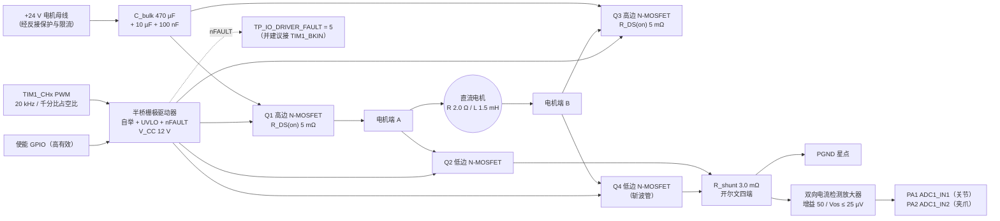

# 第二代采茶机器人 · 电机驱动功率级（H 桥）设计文档

<!-- REVISION NOTICE - do not remove -->
> ### ⚠️ 参数修订说明（第三次校正，覆盖全文数值）
>
> 本文档写作期间，项目经历了三轮**更正**，因此正文中的部分**具体数字已经过期**。
> 保留原文是为了不掩盖修正过程，但读数时请以代码为准。
> **第三次更正的完整缺陷清单见 [`docs/12_results_analysis.md`](12_results_analysis.md) 的 §3.5。**
>
> | 常量 | 已废弃的值 | 当前值（权威） | 更正原因 |
> |---|---|---|---|
> | `TP_PLANT_MOTOR_KT_NM_PER_A` | 2.0 | **0.4** | SI 单位下 `Kt` 与 `Ke` 是同一物理量，原值相差 40 倍，违反能量守恒 |
> | `TP_PLANT_MOTOR_KE_VS_RAD` | 0.05 | **0.4** | 同上 |
> | `TP_VEL_PID_KP` | 0.005 | **0.026** | 被控对象 DC 增益由 480 变为 60 mrad/s/permille，必须重新整定 |
> | `TP_VEL_PID_KI` | 0.10 | **0.83** | 同上 |
> | `TP_POS_PID_KP` | 12.0 | **5.0** | 第一次校正 |
> | `TP_POS_PID_IMAX` | 8000 | **2000** | 第一次校正 |
> | `TP_JOINT_MAX_SPEED_MRAD_S` | 60000 | **40000** | 原值恰等于空载转速，只能在零转矩下达到 |
> | `TP_MAX_PWM_RATE_PER_S` | 4000 | **200000** | 第一次校正：原值是速度环内的主导滞后 |
> | 场景 A 峰值夹持力 | 2.493 N | **2.363 N** | 第三次校正：力背驱符号修正 |
> | 场景 A 达到目标力 | 2.26 N | **2.18 N** | 同上 |
> | 场景 A 接触间隙 | 5.688 mm | **5.682 mm** | 同上 |
> | 场景 A 主机链路解码 | 2200 B / 100 帧 | **2134 B / 97 帧** | 同上 |
> | `TP_PLANT_JAW_BACKDRIVE` 的作用方向 | 减去（`-=`） | **加上（`+=`）** | 符号错误使茎秆把空夹爪"吸"到机械硬限：力从 5.0 N 涨到 16.4 N，并误锁存传感器故障 |
> | 力环服务速率 | 100 Hz（与注释不符） | **1 kHz** | 力环搬入 1 kHz 控制任务，"N 个控制周期"从此等于 N ms |
>
> **唯一权威**：`firmware/Application/config.h` 与 `firmware/BSP/host/plant_model.h`。
> 二者的一致性由 `tests/test_config_agreement.py` 自动校验——它会解析这两个头文件并与
> Python 模型逐条比对，因此任何再次漂移都会变成失败的测试而不是过期的文档。
<!-- /REVISION NOTICE -->


> ## ⚠️ 文档性质声明（务必先读）
>
> **本文档是设计文档 / 参考设计（Design Document / Reference Design），不是产品规格书，也不是验证报告。**
>
> 1. **本项目没有任何实物板卡被制造过，也没有任何板卡被测量过。** 本文中出现的每一个电压、电流、功耗、温升、时间常数都是**基于数据手册参数的设计计算（design calculation）**，不存在任何实物验证数据。
> 2. 所有器件**型号均为「参考设计 / Recommended Implementation」**，即"若要实现本设计，建议选用这一档参数的器件"。仓库中**不存在**任何器件选型清单、原理图、PCB 文件或 BOM，因此本文的器件参数是**占位值**：一旦确定实际型号，必须用该型号数据手册的对应参数重新执行本文第 4 章的全部算式。
> 3. 凡引用固件符号，均写成 `名称 = 数值`（见 `firmware/Application/config.h`）的带出处形式。仓库中未定义的量一律明确写为**「仓库中未定义」**，不做推测性补全。
> 4. 本文**不含**也不得被引用为任何性能、可靠性或 EMC 符合性的证据。第 6 章的测试方法描述的是**将来应在实物上执行的验证步骤**，其中任何一项目前都没有执行过。
> 5. 仓库中 `docs/`、`tests/`、`scripts/`、`images/` 目录存在；`tests/` 与 `images/` 目前为空，`scripts/` 下只有 `build_host.ps1`（PC 侧构建脚本），`docs/` 下有本项目自己的中文文档。**因此本设计的验证步骤仍然没有任何自动化测试实现，也没有可复用的测试夹具。**
>
> ### ⚠️ 时效性更正（本文件撰写后仓库被并行改动，以下为最新核对结果）
>
> 本文件写作期间，仓库正被**并行持续改动**，导致正文中若干"文件不存在"的判断在成稿时已经过时。以核对时间 **2026-09-14 16:01** 为准，以下为**当前事实**，正文中与之冲突处一律以本节为准：
>
> | 项目 | 本文件正文早先的判断 | **当前事实** |
> |---|---|---|
> | `firmware/BSP/stm32f407/platform_stm32f407.c` | 不存在 | **已存在（约 105 KB）**，并含 `platform_stm32f407.h`（约 9 KB）。真实引脚映射、TIM1 PSC/ARR、死区、ADC 触发/采样时间、DMA、CAN 位定时、IWDG 分频与重载等**均已有实现值**，应据该文件核实而不再依赖本文的参考设计占位值 |
> | 机载入口 `main.c` | 不存在 | **已存在**：`firmware/Core/main_stm32.c`（机载）与 `firmware/Core/main_host.c`（PC），另有 `app_entry.c/h`、`app_sequence.c`（任务体）、`app_tasks.c/h`（任务创建）、`freertos_hooks.c`、`stm32f4xx_it.c/h`、`firmware/Middleware/osal/osal_freertos.c` |
> | 构建脚本 | 不存在 | **已存在** `scripts/build_host.ps1`；仍**没有** CMake/Makefile，机载侧仍无法从仓库一键构建 |
> | 实物板卡与硬件测量 | 不存在 | **不存在（未变）**。仍然没有任何原理图、PCB、BOM、示波器记录或测量数据 |
> | `README.md`、`LICENSE`、`scripts/gen_fsm_diagram.py`、`scripts/check_layering.py`、源码引用的 `docs/05_control_algorithm.md`／`06_force_control.md`／`07_communication_protocol.md`／`11_experiment_design.md`／`12_results_analysis.md`／`13_future_work.md`／`units_convention.md` | 不存在 | **仍然不存在** |
>
> 另外，`TP_MAX_DUTY_RATE_PER_S` 已由 **4000.0f 改为 200000.0f**（满量程 5 ms）。
> `config.h` 明确把旧值 4000 记为**第一版的错误**：250 ms 的满量程斜坡"不是斜率限制器，而是速度环里的一个主导滞后"，导致环路以数万 mrad/s 的幅度振荡。本文第 4 章凡按 4000 千分比/秒推导的结论（含"4000 = 0.8 × 5000"那条反推）**必须按新值重做**。

---

## 摘要

本文给出第二代采茶机器人两个直流电机通道（关节轴与夹爪轴）的 H 桥功率级参考设计。机器人的执行器接口由固件固定：`TP_MOTOR_JOINT`（TIM1_CH1 PWM + DIR/EN GPIO）与 `TP_MOTOR_GRIPPER`（TIM1_CH2 PWM + DIR/EN GPIO），`TP_MOTOR_COUNT = 2`；两路均为**单电机全桥（4 只 N 沟道 MOSFET）双向驱动**，由 24 V 母线供电。

设计的核心矛盾来自一条简单的算术：总线电压 24 V、绕组电阻 2.0 Ω（`TP_PLANT_MOTOR_R_OHM = 2.0f`），堵转/起动时电流只受绕组电阻限制，即 **24 V / 2.0 Ω = 12 A**，是固件连续限流值 `TP_MAX_CURRENT_MA = 3000.0f`（3000 mA）的 **4 倍**，是短时峰值限值 `TP_PEAK_CURRENT_MA = 5000.0f`（5000 mA）的 **2.4 倍**。在不受限的情况下，从零到 3 A 只需要约 **216 µs**，到 5 A 只需要约 **404 µs**——比 1 ms 的控制周期还短，比固件的 20 ms 过流锁存（`TP_MOTOR_OC_TRIP_SAMPLES = 20u`，1 kHz 下 20 ms）和 50 ms 保护跳闸（`TP_OVERCURRENT_TRIP_MS = 50u`）快一到两个数量级。因此**功率级的电流限制不能指望固件软件保护，必须由限流斜率、硬件比较器与栅极驱动器的 nFAULT 承担**。

本文给出的关键量化结论包括：

| 结论 | 数值 | 依据章节 |
|---|---|---|
| 未限流堵转电流 | 12 A（限值的 4 倍） | §4.1 |
| 未限流绕组瞬时功率 | 288 W | §4.1 |
| 未限流到达 3 A 的时间 | 约 216 µs | §4.1 |
| 斜率限幅后的电流上升率 | 约 48 A/s（降低约 333 倍） | §4.2 |
| 4 只 MOSFET 的全部导通损耗（3 A 连续） | 0.090 W | §4.3 |
| 同一工况下绕组的损耗 | 18 W（半导体的 200 倍） | §4.3 |
| 推荐死区时间下限 | ≥ 100 ns，取 150 ns | §4.7 |
| 直通时的理论电流 | 2400 A（回路电感限制下 100 ns 内达约 120 A） | §4.7 |
| 低边分流采样的有效占空比上限 | 约 94% | §4.9 |
| 目标回路电感 | ≤ 20 nH（对应关断尖峰 2.0 V） | §5.2 |

**目录**

- [摘要](#摘要)
- [1. 设计目标](#1-设计目标)
  - [1.1 被驱动的负载](#11-被驱动的负载)
  - [1.2 设计目标表](#12-设计目标表)
  - [1.3 设计约束中「仓库中未定义」的部分](#13-设计约束中仓库中未定义的部分)
- [2. 器件选型与理由](#2-器件选型与理由)
  - [2.1 拓扑选型对比表](#21-拓扑选型对比表)
  - [2.2 推荐方案（参考设计 / Recommended Implementation）](#22-推荐方案参考设计--recommended-implementation)
  - [2.3 关键器件参考设计清单](#23-关键器件参考设计清单)
- [3. 原理说明](#3-原理说明)
  - [3.1 单通道全桥与栅极驱动](#31-单通道全桥与栅极驱动)
  - [3.2 高边供电：自举电容](#32-高边供电自举电容)
  - [3.3 电流检测链路](#33-电流检测链路)
  - [3.4 续流、滑行（coast）与制动（brake）](#34-续流滑行coast与制动brake)
  - [3.5 与固件的接口](#35-与固件的接口)
- [4. 关键计算](#4-关键计算)
  - [4.1 母线—绕组工作点与 12 A 堵转尖峰](#41-母线绕组工作点与-12-a-堵转尖峰)
  - [4.2 为什么斜率限幅是 4000 千分比/秒](#42-为什么斜率限幅是-4000-千分比秒)
  - [4.3 MOSFET 导通损耗](#43-mosfet-导通损耗)
  - [4.4 开关损耗](#44-开关损耗)
  - [4.5 栅极电阻与开关时间](#45-栅极电阻与开关时间)
  - [4.6 自举电容容量](#46-自举电容容量)
  - [4.7 死区时间下限](#47-死区时间下限)
  - [4.8 分流电阻与放大器增益](#48-分流电阻与放大器增益)
  - [4.9 电流采样时机与观测盲区](#49-电流采样时机与观测盲区)
  - [4.10 PWM 载波频率与电流纹波](#410-pwm-载波频率与电流纹波)
  - [4.11 制动能量与母线过压](#411-制动能量与母线过压)
  - [4.12 散热与铜箔面积](#412-散热与铜箔面积)
- [5. 布局·走线与 EMC 注意事项](#5-布局走线与-emc-注意事项)
- [6. 测试与验证方法](#6-测试与验证方法)
- [7. 已知风险与未验证项](#7-已知风险与未验证项)
- [附录 A：本文引用的固件符号清单](#附录-a本文引用的固件符号清单)

---

## 1. 设计目标

### 1.1 被驱动的负载

两个通道的机械性质完全不同，驱动器必须同时适配：

| 通道 | 枚举值 | 机械形式 | 出处 |
|---|---|---|---|
| 关节轴 | `TP_MOTOR_JOINT = 0` | 经 50:1 行星减速箱的旋转轴，TIM1_CH1 PWM + DIR/EN GPIO | `bsp_types.h`；`TP_JOINT_GEAR_RATIO = 50.0f` |
| 夹爪轴 | `TP_MOTOR_GRIPPER = 1` | **永磁直流电机 + 丝杠**的小型直线执行器，TIM1_CH2 PWM + DIR/EN GPIO | `bsp_types.h`；`gripper.c` 原文 "The jaw is a permanent-magnet DC motor with a lead screw" |

关节轴的位置反馈由 1024 线增量编码器 ×4 解码给出，`TP_ENCODER_COUNTS_PER_REV = 4096`；夹爪轴的直线位移换算为 `TP_GRIPPER_COUNTS_PER_MM = 512.0f`。

被控对象（主机物理模型给出的等效电气—机械参数，见 `plant_model.h`）：

| 量 | 符号 | 值 | 固件符号 |
|---|---|---|---|
| 母线电压 | V_bus | 24 V | `plant_model.c` 中 `p->vbus_v = 24.0f`；`bsp_types.h` 中 `TP_ADC_VBUS` 注释 "24 V rail divider" |
| 绕组电阻（折算后） | R | 2.0 Ω | `TP_PLANT_MOTOR_R_OHM = 2.0f` |
| 绕组电感 | L | 1.5 mH | `TP_PLANT_MOTOR_L_H = 1.5e-3f` |
| 电气时间常数 | τe | L/R = 0.75 ms | `TP_PLANT_MOTOR_TAU_E_S = TP_PLANT_MOTOR_L_H / TP_PLANT_MOTOR_R_OHM` |
| 转矩常数 | Kt | 0.4 N·m/A（折算到关节输出） | `TP_PLANT_MOTOR_KT_NM_PER_A = 2.0f` |
| 反电动势常数 | Ke | 0.4 V·s/rad（折算到关节输出） | `TP_PLANT_MOTOR_KE_VS_RAD = 0.05f` |
| 关节惯量 | J | 2.5e-3 kg·m² | `TP_PLANT_JOINT_J_KGM2 = 2.5e-3f` |
| 粘性摩擦 | b | 3.0e-5 N·m·s/rad | `TP_PLANT_JOINT_B_NMS_RAD = 3.0e-5f` |
| 库仑摩擦 | Tc | 0.02 N·m | `TP_PLANT_JOINT_TC_NM = 0.02f` |
| 库仑摩擦速度尺度 | ω_eps | 0.2 rad/s | `TP_PLANT_JOINT_OMEGA_EPS_RAD_S = 0.2f` |

### 1.2 设计目标表

| 编号 | 设计目标 | 量化指标 | 依据 / 备注 |
|---|---|---|---|
| G1 | 支持 24 V 母线、双向驱动两个独立直流电机通道 | 2 个全桥，每桥 4 只 N 沟道 MOSFET | `TP_MOTOR_COUNT = 2` |
| G2 | 在软件斜率限幅生效前，硬件不得损坏 | 单次任意占空比命令下，桥臂电流 ≥ 12 A 持续 1 ms 时不损坏 | §4.1 给出的 12 A 最坏情况 |
| G3 | 连续电流能力 | 每通道 ≥ 3000 mA 连续，不限时 | `TP_MAX_CURRENT_MA = 3000.0f` |
| G4 | 短时峰值能力 | 每通道 ≥ 5000 mA，持续时间 < 50 ms | `TP_PEAK_CURRENT_MA = 5000.0f` |
| G5 | 电流测量覆盖峰值限值并留有余量 | 5000 mA 时 ADC 读数 ≤ 50% 满量程 | §4.8（参考设计：931 counts / 4096） |
| G6 | 电流测量分辨率满足保护判据 | 1 count ≤ 10 mA | §4.8（参考设计：5.37 mA/count） |
| G7 | 死区不依赖软件 | 由 TIM1 硬件死区发生器或栅极驱动器内部互锁产生 | §4.7 |
| G8 | 关断路径不依赖 CPU | nFAULT 既可被 GPIO 读取（`TP_IO_DRIVER_FAULT = 5`），也可直接驱动 TIM1 的 break 输入 | `platform_api.h` 的设计意图："clears the enable GPIO, which the gate driver turns into a coast/brake state without CPU involvement" |
| G9 | 半导体温升在自然对流下可接受 | ΔT_j ≤ 20 °C | §4.12 |
| G10 | 母线关断尖峰受控 | V_spike ≤ 10% × V_bus = 2.4 V | §5.2（参考设计 L_loop ≤ 20 nH） |
| G11 | 支持 100% 占空比命令而不丢失高边供电 | 见 §3.2 与 §7 风险 R5 | `TP_MAX_PWM_PERMILLE = 1000.0f` 允许 100% |

### 1.3 设计约束中「仓库中未定义」的部分

下列内容**在仓库中不存在任何定义**，本文只能作为参考设计给出。这一节是本文最重要的免责边界：

| 项目 | 状态 | 说明 |
|---|---|---|
| STM32 平台后端实现文件 | **已存在**（见开头的时效性更正） | `firmware/BSP/stm32f407/platform_stm32f407.c` 已实现 `tp_platform_motor_set_pwm` / `_enable` / `_current_ma` 等接口。栅极驱动器的**具体型号与 V_CC 仍未有原理图确认**，故本文的器件参数仍是参考设计。 |
| 机载入口 `main.c` | **已存在** | `firmware/Core/main_stm32.c`（机载）与 `main_host.c`（PC）都已补齐；任务体在 `app_sequence.c`，任务创建在 `app_tasks.c`。 |
| PWM 载波频率 | **`config.h` 中无对应宏** | 唯一线索是 `firmware/Middleware/utils/filters.h` 第 39 行注释 "the 20 kHz PWM carrier"。这是**注释级信息**，不是可编译的常量。本文全部按 20 kHz 计算。 |
| TIM1 预分频器（PSC） | **未定义** | — |
| TIM1 自动重载值（ARR） | **未定义** | — |
| 死区时间（BDTR.DTG） | **未定义** | — |
| 栅极驱动器型号 | **未定义** | 仅 `bsp_types.h` 的 `TP_IO_DRIVER_FAULT = 5` 注释 "nFAULT from the gate driver" 说明该驱动器具有 nFAULT 输出。 |
| 栅极驱动器 V_CC | **未定义** | 本文按 12 V 参考设计计算。 |
| 分流电阻值 | **未定义** | — |
| 电流放大器增益 / 型号 | **未定义** | 仓库只定义了两个 ADC 通道：`TP_ADC_CURRENT_JOINT = 1`（PA1，ADC1_IN1，"joint driver shunt amp"）与 `TP_ADC_CURRENT_GRIPPER = 2`（PA2，ADC1_IN2，"gripper shunt amp"）。 |
| 真实硬件的 counts→mA 换算 | **未定义** | 唯一的换算只存在于主机仿真后端：`plant_model.c` 注释 "2048 counts is zero, ±1000 counts corresponds to ±5 A（即 0.2 counts per mA, 5 mA per count）"，`platform_host.c` 用 `*ma = ((counts - 2048.0f) / 1000.0f) * 5.0f * 1000.0f;` 反解。这是**仿真约定**，不是硬件规格。 |
| 电机型号与热阻 | **未定义** | 因此 §4.3 的"绕组 18 W"只能作为限流上限的推论，不能作为电机热设计依据。 |

---

## 2. 器件选型与理由

### 2.1 拓扑选型对比表

三个候选方案都在 24 V / 3 A 连续 / 5 A 峰值的量级上成立，区别在**保护集成度、可审查性与开发周期**。

| 对比维度 | 分立 MOSFET H 桥（栅极驱动器 + 4×N-MOSFET） | 集成驱动 IC（内部 H 桥，如 DRV8871/TB6612 级） | 智能功率模块 IPM / 集成半桥模块 |
|---|---|---|---|
| 导通损耗（3 A 连续） | 最低。R_path = 2 × 5 mΩ = 10 mΩ → **0.090 W** | 中等。集成器件 R_DS(on) 常为 100–500 mΩ → 0.9–4.5 W，视器件档位而定 | 低，通常 5–20 mΩ 级，与分立方案同档 |
| 开关损耗 | 可控，取决于 R_g 与 Q_gd，参考设计 **43 mW/斩波管** | 由器件内部固定，通常不可调（内置或推荐外置 R_g） | 内部集成驱动，优化过，通常较低 |
| 死区控制 | **最灵活**：TIM1 硬件死区（BDTR）+ 可选驱动器互锁，可量化到 ns | 由 IC 内部互锁产生，通常固定 100 ns–1 µs，**不可调、不可测** | 内部固定，通常有保证但同样不可调 |
| 直通风险 | 需要外部保证；一旦失败后果最严重（§4.7：理论 2400 A） | 内部互锁基本排除直通 | 内部互锁 + 通常带 DESAT 保护 |
| 保护集成度 | 需外配：过流比较器、nFAULT 汇集、母线 TVS、退饱和检测（可选） | 高：内部过流、过温、UVLO、nFAULT 一应俱全 | 最高：短路、过流、UVLO、过温、故障输出 |
| 可审查性（安全评审） | **最高**：每一个保护都能指到原理图上的一个器件与一条算式 | 中：依赖 IC 数据手册的"典型保护阈值"，无法独立验证 | 中低：多为厂商黑盒 |
| 散热 | 4 × PowerPAK SO-8 / TO-252，铜箔即可，**无需散热片**（§4.12 ΔT ≈ 2 °C/管） | 集成封装热阻较高，3 A 连续往往必须铺大铜或加散热片 | 需金属基板或散热器，机械装配复杂 |
| 电流检测 | 灵活：可做低边分流、在线（inline）分流、V_DS 检测 | 多数内部固定为低边或 V_DS 检测，量程与增益不可改 | 部分带模拟输出或需外置分流 |
| 成本（参考量级） | 中：驱动器 + 4 管 + 外围 ≈ 最高 | 最低 | 最高 |
| 开发周期 | 最长：布局、死区、栅极振铃、EMC 都要自己处理 | 最短：照抄参考电路即可点亮 | 中：模块需要新的机械与热设计 |
| 与本项目固件接口的匹配度 | **最高**：`tp_platform_motor_set_pwm` 的"符号选向 + 占空比"语义、"DIR/EN GPIO"双线接口、"nFAULT"单线故障输入，正好对应分立方案的输入引脚集合 | 部分不匹配：内部 H 桥多为"IN1/IN2 双 PWM"或"PH/EN"接口，需要后端做符号拆分；`bsp_types.h` 已按 DIR/EN 建模 | 需要额外的光电隔离或电平转换 |
| 本设计结论 | **推荐（参考设计）** | 适合原型验证与最低成本版本 | 仅在需要 500 W 以上或需要绝对短路保护时选用 |

**为什么选分立方案。** `platform_api.h` 把硬件抽象成"每个通道一个占空比 + 一个使能 + 一个 nFAULT"，并明确说明"禁用必须是最快的故障反应……在目标平台上它清掉使能 GPIO，栅极驱动器把它变成 coast/brake 状态，不需要 CPU 参与"。这个契约只有在**使能引脚直接控制栅极驱动器**时才成立：集成 H 桥 IC 的使能虽然也能关断，但它的关断时间通常由内部软启动/放电电路决定，且无法与 TIM1 硬件死区配合。更重要的工程理由是**可审查性**：本项目的危险是 12 A 堵转（§4.1），任何"保护阈值写在别家芯片数据手册里、无法在本板上测量"的方案都会让安全评审无法闭环。

### 2.2 推荐方案（参考设计 / Recommended Implementation）

**参考设计 / Recommended Implementation：半桥栅极驱动器 + 4×N 沟道 MOSFET + 自举高边供电 + 低边分流**。

单通道结构（两个通道结构相同，仅 PWM 源不同）：



**驱动方式（PWM 极性约定）。** 采用"方向由对角线选择、斩波只在一个桥臂"的方式：

| 命令符号 | 高边 A（Q1） | 低边 A（Q2） | 高边 B（Q3） | 低边 B（Q4） |
|---|---|---|---|---|
| 正占空比 | 常通 | 常关 | 与 Q4 互补（含死区） | **PWM 斩波** |
| 负占空比 | 与 Q2 互补（含死区） | **PWM 斩波** | 常通 | 常关 |
| 使能低 | 全关 | 全关 | 全关 | 全关 |

选择理由：(1) 每个周期只有一只管子承担开关损耗，开关损耗减半（与 §4.4 的 43 mW 一致）；(2) 常通管的高边自举电容在常通期间无法刷新，因此**两路高边都必须能够长时间保持导通**——这直接决定了 §3.2 的供电方案选择。

### 2.3 关键器件参考设计清单

> 下表中所有参数都是**参考设计的占位值**，用于把第 4 章的算式算到底。选定实际型号后必须用该型号数据手册替换。

| 器件 | 参考设计规格 | 关键参数（用于计算） | 相关算式 |
|---|---|---|---|
| 栅极驱动器 | 半桥（高边/低边）栅极驱动器，含自举、UVLO、nFAULT、可编程死区 | V_CC = 12 V；峰值输出 ≥ 1 A；传输延迟失配 ≤ 20 ns | §4.5、§4.7 |
| 功率 MOSFET ×4 | N 沟道，V_DS 40–60 V，PowerPAK SO-8 / TO-252 | R_DS(on) = 5 mΩ @ V_GS = 10 V, 25 °C；Q_g = 20 nC；Q_gd = 15 nC；t_off(max) = 40 ns | §4.3、§4.4、§4.5、§4.7 |
| 自举电容 | X7R 陶瓷 | 100 nF / 50 V | §4.6 |
| 自举二极管 | 超快恢复或肖特基 | 100 V / 1 A，t_rr < 30 ns | §4.6 |
| 自举限流电阻 | 厚膜 | 2.2–4.7 Ω | §4.6 |
| 栅极电阻 | 厚膜，非对称 | 开通 22 Ω / 关断 10 Ω | §4.5 |
| 分流电阻 | 四端（开尔文）金属板/合金 | 3.0 mΩ，2512，≥ 1 W，TCR ≤ 50 ppm/°C | §4.8 |
| 电流检测放大器 | 双向、高共模抑制 | 增益 50，V_os ≤ 25 µV，BW ≥ 400 kHz，CMRR ≥ 80 dB @ 20 kHz | §4.8 |
| 母线电容 | 聚合物电解 + 陶瓷 | 470 µF / 35 V + 2×10 µF / 50 V + 4×100 nF | §5.2、§4.11 |
| 母线 TVS | 单向瞬态抑制 | 33 V 级（参考设计例：SMBJ33A 类） | §4.11 |
| 电机端缓冲 | RC 吸收 | 10 Ω + 1 nF（按实际振铃频率调整） | §5.4 |

---

## 3. 原理说明

### 3.1 单通道全桥与栅极驱动

全桥由 4 只 N 沟道 MOSFET 组成，高边管需要**高于母线电压**的栅极驱动电压（V_GS ≈ 10–12 V，而源极电位在 V_bus 与 −V_f 之间摆动）。

- 高边供电：自举电容 + 自举二极管（§3.2），或驱动器内部电荷泵。
- 低边供电：直接由 V_CC = 12 V 驱动。
- 死区：由 TIM1 的硬件死区发生器（BDTR.DTG）产生，禁止在软件里用延时制造死区（§4.7）。
- 使能：驱动器 EN 引脚由 GPIO 控制；拉低即进入高阻（coast）或短接（brake）状态，无需 CPU 参与，符合 `platform_api.h` 对 `tp_platform_motor_enable` 的契约。

### 3.2 高边供电：自举电容

自举电容 C_boot 接在驱动器的 VB–VS 之间，经自举二极管与限流电阻从 V_CC 充电。**它只在低边管导通（VS 被拉到 PGND）时被刷新。**

由此得到本设计的一条硬约束：`TP_MAX_PWM_PERMILLE = 1000.0f` 允许后端接收 100% 占空比命令，而在 §2.2 的驱动方式下，正占空比 100% 意味着低边斩波管（Q4）永不导通 → **自举电容无法刷新**。三种缓解方案：

| 方案 | 做法 | 代价 |
|---|---|---|
| A. 电荷泵高边供电 | 用带内部电荷泵的栅极驱动器 | 器件成本略高，静态电流略大，但彻底消除占空比限制 |
| B. 限制最大占空比 | 后端把输出限制在 970 千分比（对应最小关断时间 1.5 µs） | 损失 3% 的电压范围；必须在缺失的 `platform_stm32f407.c` 中实现并写进文档 |
| C. 每个控制周期强制一次刷新 | 每 1 ms 强制一个最小关断窗口 | 引入周期性电流纹波与转矩脉动，不推荐 |

**参考设计取方案 A**（电荷泵），因为它不依赖于一个尚未实现的软件限制。§4.6 仍给出自举方案的容量计算，作为方案 A 不可行时的退路。

### 3.3 电流检测链路

链路：`分流电阻 → 双向电流检测放大器（增益 50）→ RC 抗混叠 → ADC 通道`。

- 关节电流进入 `TP_ADC_CURRENT_JOINT = 1`（PA1 / ADC1_IN1，"joint driver shunt amp"）；
- 夹爪电流进入 `TP_ADC_CURRENT_GRIPPER = 2`（PA2 / ADC1_IN2，"gripper shunt amp"）；
- ADC 为 12 位，`TP_ADC_RESOLUTION_BITS = 12u`，`TP_ADC_FULL_SCALE = 4095.0f`，`TP_ADC_VREF_V = 3.300f`；
- ADC 采样由定时器触发、DMA 循环搬运（`adc_driver.h` 记载 "timer-triggered circular DMA"）。

**零点必须落在量程中点。** 固件侧的约定是 2048 counts 为 0 A（`plant_model.h` 中 `tp_plant_read_current_counts` 的文档："with 2048 counts meaning 0 A"），因此放大器必须输出 V_ref/2 的偏置，使正负电流都可见。这一点对全桥双向驱动是必需的，但**注意：`firmware/Core/app_tasks.c` 只对力通道与母线通道调用了 `tp_adc_channel_init`（第 473–476 行），没有初始化电流通道**；电流只经 `tp_platform_motor_current_ma` 读取（`motor.c` 第 133 行）。因此电流通道的 divider、去耦与标定常数在仓库中**未定义**，必须在真实后端里补上。

### 3.4 续流、滑行（coast）与制动（brake）

三种状态在硬件上完全不同，固件通过两个函数区分：

| 固件动作 | 出处 | 功率级状态 | 电气结果 |
|---|---|---|---|
| `tp_motor_stop(motor, ramp_ms)` | `motor.h`：Ramp the duty to zero, **then leave the driver on**；"keeps the joint actively braked rather than free" | 使能保持，占空比按 `TP_MAX_DUTY_RATE_PER_S` 斜坡到 0 | 占空比 0 时低边斩波管持续导通 → 绕组被短接 → **动态制动** |
| `tp_motor_disable(motor)` | `motor.h`："Cut the driver immediately. **The joint coasts.**" | 使能拉低 → 全部 MOSFET 关断 | 绕组开路 → 只有摩擦制动 |
| `tp_platform_motor_enable(ch, 0)` | `platform_api.h`："the gate driver turns into a **coast/brake** state" | 由驱动器定义 | 参考设计应明确选一种：建议设为 coast（全关），并把"动态制动"留给软件斜坡路径，使两者的行为可区分、可测试 |

**续流路径**：斩波管关断时，绕组电流经另一桥臂的体二极管（或同步整流的上管）返回母线电容。体二极管的正向压降与反向恢复是开关损耗的一部分，也是 §4.4 中把 t_rr 计入 Q_extra 的原因。

### 3.5 与固件的接口

功率级必须满足以下契约（全部为真实存在的符号与语义）：

| 固件接口 | 契约 | 功率级实现要求 |
|---|---|---|
| `tp_platform_motor_set_pwm(ch, permille)` | 占空比按 `[-TP_MAX_PWM_PERMILLE, +TP_MAX_PWM_PERMILLE]` 钳位，**符号选方向** | 后端必须把符号映射为对角线选择，把绝对值映射为斩波管的比较值；必须能表达 0 与 ±1000 |
| `tp_platform_motor_enable(ch, enable)` | 非零使能；0 为最快故障反应，不经 CPU 变 coast/brake | EN 引脚直接接驱动器 EN；EN 拉低后必须由驱动器自身完成关断 |
| `tp_platform_motor_current_ma(ch, *ma)` | 返回带符号毫安；失败时不写输出（`platform_api.h`："must never write to their output on failure"） | 采样窗口无效（§4.9 盲区）时应返回失败，让 `motor.c` 保留上一有效值——`motor.c` 第 134–142 行正是这样处理的 |
| `tp_platform_emergency_kill()` | 清两个使能 GPIO + 清零 PWM 比较寄存器 + 锁存软件 kill | 硬件上必须有独立的使能路径（不与普通 GPIO 复用），并保证 PWM 比较值清零后输出为 0 占空比 |
| `tp_platform_io_read(TP_IO_DRIVER_FAULT, &level)` | 读 nFAULT | nFAULT 需上拉、需 RC 去抖（参考设计 1 kΩ + 10 nF → τ = 10 µs），并建议同时接 TIM1_BKIN |

---

## 4. 关键计算

> 本章全部为设计计算。**所有输入参数中，来自仓库的部分已注明符号；其余均为参考设计占位值。**

### 4.1 母线—绕组工作点与 12 A 堵转尖峰

**第 1 步：堵转（或从零起动的瞬间）电流。** 反电动势为 0，电流只受绕组电阻限制：

$$I_{stall} = \frac{V_{bus}}{R} = \frac{24\ \text{V}}{2.0\ \Omega} = 12\ \text{A} = 12000\ \text{mA}$$

与固件限值对比：

| 对比项 | 限值 | 12 A 与限值的比 |
|---|---|---|
| 连续限流 `TP_MAX_CURRENT_MA = 3000.0f` | 3000 mA | **4.0 倍** |
| 短时峰值 `TP_PEAK_CURRENT_MA = 5000.0f` | 5000 mA | **2.4 倍** |

**第 2 步：该电流在绕组内的功率。**

$$P_{stall} = \frac{V_{bus}^2}{R} = \frac{24^2}{2.0} = 288\ \text{W}\quad(\text{等价于 } I^2R = 12^2 \times 2.0 = 288\ \text{W})$$

288 W 远远超过任何小型永磁直流电机的热额定值。这不是"性能余量"，而是**未加限制时会损坏硬件的工况**。

**第 3 步：达到限值所需的时间。** 电流按一阶规律逼近稳态值：$i(t) = I_{stall}\,(1 - e^{-t/\tau_e})$，其中 $\tau_e = L/R = 0.75\ \text{ms}$。

达到 3000 mA：

$$1 - e^{-t/\tau_e} = \frac{3.0}{12} = 0.25 \;\Rightarrow\; e^{-t/\tau_e} = 0.75 \;\Rightarrow\; t = \tau_e \ln\!\left(\frac{1}{0.75}\right) = 0.75 \times 0.2877 = 0.216\ \text{ms} = 216\ \mu s$$

达到 5000 mA：

$$1 - e^{-t/\tau_e} = \frac{5.0}{12} = 0.4167 \;\Rightarrow\; t = 0.75 \times \ln\!\left(\frac{1}{0.5833}\right) = 0.75 \times 0.5390 = 0.404\ \text{ms} = 404\ \mu s$$

（线性近似给出 $3.0/16\ 000 = 187\ \mu s$ 与 $5.0/16\ 000 = 313\ \mu s$，与上式同量级。）

**第 4 步：与各级保护的时间尺度对比。**

| 保护机制 | 反应时间 | 出处 | 能否阻止 12 A 尖峰 |
|---|---|---|---|
| 控制周期（采样周期） | 1 ms | `TP_CONTROL_FREQ_HZ = 1000u` → `TP_CONTROL_DT_S` = 1 ms | **不能**：电流已冲到限值 4 倍 |
| 软件斜率限幅 | 见 §4.2，等效 48 A/s | `TP_MAX_DUTY_RATE_PER_S = 200000.0f` | **能**：这是主保护 |
| `motor.c` 过流锁存 | 20 个控制周期 = 20 ms | `TP_MOTOR_OC_TRIP_SAMPLES = 20u` | **不能**：比 216 µs 慢约 93 倍 |
| `motor.c` 比例折返 | 同一个控制周期内生效 | `motor.c` 第 151–156 行 | 部分能：但要在 1 ms 后才有第一次采样 |
| `safety_monitor.c` 过流跳闸 | 50 ms | `TP_OVERCURRENT_TRIP_MS = 50u` | **不能**：比 216 µs 慢约 231 倍 |
| 栅极驱动器 nFAULT（硬件） | 通常 1–5 µs | `TP_IO_DRIVER_FAULT = 5` | **能**：唯一在微秒尺度生效的电气保护 |

**结论：** 母线 24 V 与绕组 2.0 Ω 的组合使固件的所有电流保护在时间尺度上都来不及。功率级必须具备两条独立防线：**(1) 软件斜率限幅**（§4.2，主保护，保证电流环始终有控制权）；**(2) 驱动器内部的过流比较器 + nFAULT → TIM1_BKIN**（后备保护，微秒级）。此外必须在电机母线上做限流上电（详见 `power_design.md`），否则上电瞬间的电容充电尖峰会与堵转尖峰叠加。

**仿真不能替代上述论证。** 主机物理模型把电流钳位在 `TP_PEAK_CURRENT_MA`：`plant_model.c` 第 209–210 行与第 218–220 行都执行 `plant_clampf(i_cmd_a, -TP_PEAK_CURRENT_MA / 1000.0f, TP_PEAK_CURRENT_MA / 1000.0f)`。也就是说**仿真中永远不会出现 12 A 的堵转尖峰**，因此仿真通过并不构成对限流有效性的验证。

### 4.2 为什么斜率限幅是 4000 千分比/秒

`TP_MAX_DUTY_RATE_PER_S = 200000.0f`，单位是"千分比/秒"（permille/s）。它与 `filters.c` 中的斜坡限幅器一致：`filters.c` 第 276 行 `max_step = s->rate_per_s * s->dt_s;`，`motor.c` 第 117 行同样用 `float max_step = TP_MAX_DUTY_RATE_PER_S * dt_s;`。所以：

$$\Delta D_{max} = 4000\ \text{permille/s} \times 0.001\ \text{s} = 4\ \text{permille} = 0.4\%\ \text{（每个控制周期）}$$

**第 1 步：无限制时的电流变化率。** 占空比从 0 跳到 1000 千分比意味着端电压瞬时从 0 跳到 24 V。忽略反电动势：

$$\frac{di}{dt} = \frac{V_{bus}}{L} = \frac{24}{1.5\times10^{-3}} = 16\,000\ \text{A/s} = 16\ \text{kA/s}$$

用电气时间常数表示同一个量（两种算法必须一致，这里正是检验）：

$$\frac{di}{dt} = \frac{I_{stall}}{\tau_e} = \frac{12\ \text{A}}{0.75\ \text{ms}} = 16\,000\ \text{A/s}\ \checkmark$$

**第 2 步：限幅后的端电压变化率。**

$$\frac{dV}{dt} = \frac{4000}{1000} \times 24\ \text{V/s} = 96\ \text{V/s}$$

**第 3 步：限幅后的电流变化率。** 电流对端电压是一阶跟随（时间常数 τe = 0.75 ms）。在远长于 τe 的时间尺度上，电流跟随稳态值 $I_{ss} = (V - E)/R$，因此：

$$\frac{di}{dt} \approx \frac{1}{R}\cdot\frac{dV}{dt} = \frac{96}{2.0} = 48\ \text{A/s}$$

（单周期内由 0.096 V 电压台阶引起的 L 限制分量：$0.096/1.5\times10^{-3} = 64\ \text{A/s}$，与 48 A/s 同量级，两者互为校验。）

**第 4 步：改善倍数。**

$$\frac{16\,000}{48} \approx 333\ \text{倍}$$

**第 5 步：每个控制周期内电流的最大增量。**

$$48\ \text{A/s} \times 0.001\ \text{s} = 0.048\ \text{A} = 48\ \text{mA}$$

48 mA 只是 `TP_MAX_CURRENT_MA = 3000.0f` 的 **1.6%**。这就是斜率限幅真正的设计目的：**让电流在每个采样间隔内的变化量远小于限值，从而电流环永远保有控制权。**

**第 6 步：满量程所需时间。**

$$t_{FS} = \frac{1000\ \text{permille}}{4000\ \text{permille/s}} = 0.25\ \text{s} = 250\ \text{ms}$$

**第 7 步：从 0 到连续限值 3000 mA 所需时间。**

$$t_{3A} = \frac{3.0\ \text{A}}{48\ \text{A/s}} = 62.5\ \text{ms}$$

**第 8 步（关键）：4000 这个数是怎么定出来的。** 反推出约束：要求"在保护去抖窗口内，即使一直全速爬升也碰不到过流门槛"。

- 到达连续限值所需的占空比：$D_{3A} = \dfrac{I_{max} R}{V_{bus}} = \dfrac{3.0 \times 2.0}{24} = 0.25 = 250\ \text{permille}$；
- `safety_monitor.c` 的去抖窗口为 `TP_OVERCURRENT_TRIP_MS = 50u`，即 50 ms；
- 于是理论斜率上限为

$$S_{max} = \frac{250\ \text{permille}}{0.050\ \text{s}} = 5000\ \text{permille/s}$$

- 取 20% 裕量并圆整：$4000 = 0.8 \times 5000$。

**验证两条时间窗口都满足：**

| 窗口 | 窗口时长 | 窗口内最大占空比 | 窗口内最大电流 | 是否低于限值 |
|---|---|---|---|---|
| `motor.c` 的锁存 | `TP_MOTOR_OC_TRIP_SAMPLES` × 1 ms = **20 ms** | 4000 × 0.020 = 80 permille | 0.080 × 24 / 2.0 = **0.96 A** | 是（3.0 A 的 32%） |
| `safety_monitor.c` 的跳闸 | `TP_OVERCURRENT_TRIP_MS` = **50 ms** | 4000 × 0.050 = 200 permille | 0.200 × 24 / 2.0 = **2.40 A** | 是（3.0 A 的 80%） |

**结论：** `TP_MAX_DUTY_RATE_PER_S = 200000.0f` 是一个**由 50 ms 去抖窗口与 2 Ω 绕组反推出来的数**，而非经验值：5000 是理论临界，4000 留 20% 裕量。它同时保证了"单周期电流增量 48 mA ≪ 3000 mA"与"正常斜坡不会被任何过流保护误判"。反过来说，**任何提高这个值的行为（例如为了加快响应而调到 20000）都会让 50 ms 窗口内的电流达到 12 A 上限**（20000 × 0.050 = 1000 permille = 100% → 12 A），从而把软件保护变成不可能，必须完全依赖硬件保护。

### 4.3 MOSFET 导通损耗

参考器件：R_DS(on) = 5 mΩ @ V_GS = 10 V、T_j = 25 °C。

**第 1 步：单通道的通路电阻。** 全桥工作时，电流串联经过一只高边管与一只低边管：

$$R_{path} = 2 \times 5\ \text{m}\Omega = 10\ \text{m}\Omega$$

**第 2 步：导通损耗。**

$$P_{cond} = I^2 R_{path}$$

| 工况 | 计算 | 结果 |
|---|---|---|
| 连续 3 A | $3.0^2 \times 0.010$ | **0.090 W** |
| 峰值 5 A（< 50 ms） | $5.0^2 \times 0.010$ | **0.250 W** |
| 单管（3 A） | $3.0^2 \times 0.005$ | 0.045 W |

**第 3 步：温度修正。** R_DS(on) 随结温上升，参考器件在 125 °C 时约为 25 °C 值的 1.5 倍：

$$R_{path}(125\,°\text{C}) = 10\ \text{m}\Omega \times 1.5 = 15\ \text{m}\Omega \;\Rightarrow\; P_{cond} = 3.0^2 \times 0.015 = 0.135\ \text{W}$$

**第 4 步：与绕组损耗对比——这是本节最重要的结论。**

$$P_{winding} = I^2 R = 3.0^2 \times 2.0 = 18\ \text{W}$$

$$\frac{P_{cond,total}}{P_{winding}} = \frac{0.090}{18} = 0.5\%$$

**结论：** 在 24 V / 2.0 Ω 的机器上，**损耗几乎全部发生在电机绕组里，而不是在功率半导体里**。因此 MOSFET 的选型依据不是热，而是 R_DS(on) 与栅极电荷的折中（更低的 R_DS(on) 通常意味着更大的 Q_g，从而更大的开关损耗，见 §4.4）。同时，18 W 的绕组损耗说明 `TP_MAX_CURRENT_MA = 3000.0f` 是一个**保护上限**，不是运行点；电机的真实热额定值在仓库中未定义（§7 风险 R11）。

**第 5 步：MOSFET 压降对母线的影响。**

$$V_{drop} = I \times R_{path} = 3.0 \times 0.010 = 30\ \text{mV}\ (0.125\%\ \text{of } 24\ \text{V})$$

可以忽略。

### 4.4 开关损耗

**第 1 步：单次转换的能量。** 线性近似下（V_DS 与 I_D 在开关过程中呈互补斜坡）：

$$E_{trans} = \tfrac{1}{2} V_{bus} I t_{trans}$$

参考设计取 t_r = 30 ns、t_f = 30 ns，I = 3 A：

$$E_{cycle} = \tfrac{1}{2} \times 24 \times 3.0 \times (30 + 30)\times10^{-9} = 2.16\ \mu\text{J}\ \text{（含开通与关断各一次）}$$

**第 2 步：开关损耗功率。** 载波频率 f_sw = 20 kHz（依据 `filters.h` 第 39 行注释 "the 20 kHz PWM carrier"，**非** `config.h` 宏）：

$$P_{sw} = E_{cycle} \times f_{sw} = 2.16\times10^{-6} \times 20\,000 = 43.2\ \text{mW}\ \text{（每个斩波管）}$$

（若同一通道的两个桥臂都做 PWM，则翻倍为 86.4 mW；§2.2 的驱动方式每周期只有一只斩波管，故取 43.2 mW。）

**第 3 步：栅极驱动损耗。**

$$P_{gate} = Q_g V_{GS} f_{sw} = 20\times10^{-9} \times 10 \times 20\,000 = 4\ \text{mW}\ \text{（每管）}$$

**第 4 步：单通道与整机合计。**

| 项目 | 单通道 | 双通道 |
|---|---|---|
| 导通损耗（3 A） | 0.090 W | 0.180 W |
| 开关损耗（1 只斩波管） | 0.043 W | 0.086 W |
| 栅极驱动（4 管） | 0.016 W | 0.032 W |
| **合计** | **0.149 W** | **0.298 W** |

**第 5 步：载波频率的敏感性。** 开关损耗与 f_sw 成正比：

| f_sw | 单斩波管开关损耗 | 备注 |
|---|---|---|
| 20 kHz | 43.2 mW | 本设计取值，恰好处于可闻声上限之上 |
| 40 kHz | 86.4 mW | 电流纹波减半（§4.10），但损耗翻倍 |
| 10 kHz | 21.6 mW | 进入可闻频段，且纹波翻倍 |

由于总损耗只有 0.15 W/通道，**把 f_sw 提高到 40 kHz 在热上是完全可行的**（0.30 W/通道），换来更好的纹波与更小的电感体积。这是本项目在实物验证时可以调整的第一个自由度。

### 4.5 栅极电阻与开关时间

**第 1 步：开关时间与栅极驱动电流的关系。** 米勒平台区由位移电流决定：

$$t_{sw} \approx \frac{Q_{gd}}{I_g},\qquad I_g = \frac{V_{drv}}{R_g + R_{drv,on} + R_{g,int}}$$

**第 2 步：反推栅极电阻。**

$$R_g \approx \frac{V_{drv}\, t_{sw}}{Q_{gd}} - R_{drv,on} - R_{g,int}$$

代入 V_drv = 12 V、t_sw = 30 ns、Q_gd = 15 nC、R_drv,on = 2 Ω、R_g,int = 1.5 Ω：

$$R_g \approx \frac{12 \times 30\times10^{-9}}{15\times10^{-9}} - 3.5 = 24 - 3.5 = 20.5\ \Omega \;\Rightarrow\; \text{取 } 22\ \Omega$$

**第 3 步：栅极峰值电流校验。**

$$I_{g,peak} = \frac{12}{22 + 3.5} = 0.47\ \text{A}$$

**第 4 步：电压变化率与共模干扰。**

$$\frac{dv}{dt} = \frac{24\ \text{V}}{30\ \text{ns}} = 0.8\ \text{V/ns} = 800\ \text{V/}\mu s$$

寄生电容 C_par（漏极—散热焊盘、漏极—栅极）上的位移电流：

$$I_{cm} = C_{par}\frac{dv}{dt} = 20\times10^{-12} \times 800\times10^{6} = 16\ \text{mA}$$

16 mA 的共模电流足以在栅极回路（L_gate ≈ 10 nH、C_iss ≈ 3 nF）内激起振铃，同时它也是传导/辐射发射的主要来源（§5）。

**第 5 步：非对称驱动的理由。** 关断时希望更快（减少关断损耗），开通时希望更慢（抑制反向恢复峰值与 dv/dt 引起的振铃）。参考设计取**开通 22 Ω、关断 10 Ω**。

**第 6 步：设计裕量的说明。** Q_gd 是本节最敏感的输入（t_sw 与 Q_gd 成正比，E_sw 又与 t_sw 成正比）。若改用 Q_gd = 5 nC 的小管，同样的 22 Ω 会把 t_sw 推到 90 ns，开关损耗升到 130 mW。**因此选定实际型号后必须用其数据手册的 Q_gd 重新执行第 2 步。**

### 4.6 自举电容容量

**第 1 步：每个开关周期需要转移的电荷。**

$$Q_{total} = Q_g + Q_{extra} = 20\ \text{nC} + 3\ \text{nC} = 23\ \text{nC}$$

其中 Q_extra 覆盖电平移位电路的静态电流与自举二极管的反向恢复电荷（参考设计估值）。

**第 2 步：允许的电压跌落。** V_CC = 12 V，取 4% 作为跌落预算（必须留在驱动器 UVLO 门限之上）：

$$\Delta V_{boot} = 0.04 \times 12 = 0.48\ \text{V} \approx 0.5\ \text{V}$$

**第 3 步：电容容量。**

$$C_{boot} \ge \frac{Q_{total}}{\Delta V_{boot}} = \frac{23\times10^{-9}}{0.5} = 46\ \text{nF}$$

**取 100 nF（2.2 倍裕量）**，X7R / 50 V（额定电压必须高于 V_bus + V_CC = 36 V，见第 4 步）。

**第 4 步：自举二极管反向电压。**

$$V_{R,diode} \ge V_{bus} + V_{CC} = 24 + 12 = 36\ \text{V} \;\Rightarrow\; \text{取 } 100\ \text{V 档}$$

**第 5 步：与 MOSFET 输入电容的比例校验。** 自举电容必须远大于 C_iss（参考设计 3 nF），否则电荷会被 MOSFET 的栅极电容"抢走"：

$$\frac{C_{boot}}{C_{iss}} = \frac{100\ \text{nF}}{3\ \text{nF}} = 33\ \text{倍}\ \checkmark$$

**第 6 步：每周期的实际跌落。**

$$\Delta V = \frac{Q_{total}}{C_{boot}} = \frac{23\times10^{-9}}{100\times10^{-9}} = 0.23\ \text{V}\ (1.9\%\ \text{of } 12\ \text{V})\ \checkmark$$

**第 7 步：占空比限制。** 见 §3.2。C_boot 只在低边导通时充电，因此要求最小关断时间 $t_{off,min}$ 满足：

$$t_{off,min} \ge \frac{Q_{total}}{I_{charge}} + t_{settle}$$

参考设计取 t_off,min = 1.5 µs（对应最大占空比 970 千分比 @ 20 kHz），但**参考设计优先采用电荷泵方案**，因为 `TP_MAX_PWM_PERMILLE = 1000.0f` 在固件层允许 100% 占空比，硬件不应依赖一个尚未写入后端软件的限制。

### 4.7 死区时间下限

**第 1 步：必须被覆盖的三个分量。**

| 分量 | 参考设计值 | 说明 |
|---|---|---|
| 关断总时间 t_off(max) = t_off,delay + t_f | 25 + 15 = **40 ns** | 数据手册最大值（不是典型值） |
| 驱动器高/低边传输延迟失配 Δt_prop | **20 ns** | 两个通道的内部路径不同 |
| 设计裕量 t_margin | **40 ns** | 覆盖栅极回路振铃、温度漂移与批次差异 |

**第 2 步：下限。**

$$t_{dead,min} = t_{off(max)} + \Delta t_{prop} + t_{margin} = 40 + 20 + 40 = 100\ \text{ns}$$

**取 150–200 ns**（含量产裕量）。参考设计取 **150 ns**。

**第 3 步：TIM1 硬件死区的分辨率。** TIM1 的定时器内核时钟为 168 MHz（`system_stm32f4xx.c` 记载：APB2 预分频为 2 → PCLK2 = 84 MHz → "APB2 timer clock 168 MHz"；`HSE_VALUE = 8000000U`，PLL M=8/N=336/P=2）：

$$\text{DTG 步进} = \frac{1}{168\ \text{MHz}} = 5.95\ \text{ns} \;\Rightarrow\; 150\ \text{ns} \approx 25\ \text{步}$$

**注意：TIM1 的 PSC、ARR 与 BDTR.DTG 实际取值在仓库中未定义**（缺失的 `platform_stm32f407.c` 才会写这些寄存器）。上述 5.95 ns 只是分辨率推算，不是配置值。

**第 4 步：死区对占空比范围的影响。**

$$\frac{t_{dead}}{T_{sw}} = \frac{150\ \text{ns}}{50\ \mu s} = 0.3\%$$

即损失约 3 千分比的占空比范围——可以忽略。

**第 5 步：为什么软件死区不够。** 控制周期为 1 ms（`TP_CONTROL_FREQ_HZ = 1000u`），PWM 周期为 50 µs（20 kHz）。若在软件里插入死区：

| 问题 | 量化 |
|---|---|
| 时间粒度太粗 | 中断/任务调度抖动按µs 计（FreeRTOS 下更大），要在 50 µs 周期内插入准确的 150 ns 窗口是不可能的 |
| 抖动方向不可控 | 抖动使死区**变短**时会发生直通，变长时损失占空比范围 |
| 与 `tp_motor_update` 的执行时刻耦合 | `motor.c` 每 1 ms 写一次比较寄存器，若死区也由同一个任务管理，则一次调度抖动就同时影响两者 |
| 无法在故障时立即生效 | `tp_platform_emergency_kill()` 要求"不经 CPU"关断；软件死区引入的是一条 CPU 相关的路径 |

**第 6 步：直通的后果（说明硬件死区不是可选项）。** 若上下管同时导通，24 V 直接跨在两只 MOSFET 上：

$$I_{theoretical} = \frac{24}{0.010} = 2400\ \text{A},\qquad P_{theoretical} = \frac{24^2}{0.010} = 57.6\ \text{kW}$$

实际上电流被回路电感限制：取 L_loop = 20 nH，

$$\frac{di}{dt} = \frac{V_{bus}}{L_{loop}} = \frac{24}{20\times10^{-9}} = 1.2\times10^{9}\ \text{A/s}$$

100 ns 内电流即可达 **120 A**，远超任何该量级器件的额定值。**结论：死区必须由硬件产生（TIM1 BDTR 或驱动器内部互锁），二者建议同时具备。**

### 4.8 分流电阻与放大器增益

**第 1 步：把仓库的仿真约定翻译成电气目标。** `plant_model.c` 第 418–420 行：

```
/* Bidirectional shunt amplifier: 2048 counts is zero, ±1000 counts
 * corresponds to ±5 A (i.e. 0.2 counts per mA, 5 mA per count). */
counts = 2048.0f + (current_a / 5.0f) * 1000.0f;
```

即目标映射为：**2048 counts = 0 A，±1000 counts = ±5000 mA**。`platform_host.c` 第 257 行用 `*ma = ((counts - 2048.0f) / 1000.0f) * 5.0f * 1000.0f;` 反解。

**第 2 步：1 count 对应的电压。**（`config.h` 已有该宏，这里按定义展开）

$$\text{TP\_ADC\_MV\_PER\_COUNT} = \frac{\text{TP\_ADC\_VREF\_V} \times 1000}{\text{TP\_ADC\_FULL\_SCALE} + 1} = \frac{3.300 \times 1000}{4095 + 1} = 0.80566\ \text{mV}$$

**第 3 步：链路所需灵敏度。**

$$S_{required} = \frac{1000\ \text{counts} \times 0.80566\ \text{mV/count}}{5.0\ \text{A}} = \frac{805.7\ \text{mV}}{5.0\ \text{A}} = 161.1\ \text{mV/A}$$

**第 4 步：选分流电阻与增益。** 采用标准增益 50 的双向电流检测放大器：

$$R_{shunt} = \frac{161.1\ \text{mV/A}}{50} = 3.22\ \text{m}\Omega$$

取标准值 **3.0 mΩ**，实际灵敏度：

$$S = 50 \times 3.0\ \text{m}\Omega = 150\ \text{mV/A}\ \text{（比目标低 } 6.9\%\text{）}$$

**第 5 步：换算成 counts。**

| 电流 | 放大器输出 | ADC counts（相对 2048 零点） |
|---|---|---|
| 0 A | 0 mV | 2048（= `TP_FORCE_CAL_ZERO_COUNTS = 2048.0f` 同一约定） |
| +3000 mA | 450 mV | 2048 + 559 = 2607 |
| +5000 mA | 750 mV | 2048 + 931 = 2979 |
| ±2048 counts（饱和） | ±1650 mV | 对应 **±11.0 A** |

$$\text{counts/A} = \frac{150\ \text{mV/A}}{0.80566\ \text{mV/count}} = 186.2\ \text{counts/A},\qquad \frac{1000}{186.2} = 5.37\ \text{mA/count}$$

**第 6 步：余量核对（对应设计目标 G5、G6）。**

| 指标 | 目标 | 参考设计 | 判定 |
|---|---|---|---|
| 5000 mA 时的 ADC 占用 | ≤ 50% 满量程 | 931 / 4096 = 22.7% | 通过（2.2 倍裕量） |
| 过流保护门限 3000 mA 的分辨率 | ≤ 10 mA/count | 5.37 mA/count | 通过 |
| 饱和电流 | ≥ 1.5 × 峰值限值 | 11.0 A = 2.2 × 5 A | 通过 |

**第 7 步：与仿真约定的差异必须被记录。** 参考设计的 5.37 mA/count 与仿真后端的 5 mA/count 相差 **7.4%**。若要让硬件严格匹配 `plant_model.c` 的约定，需要 R_shunt = 3.22 mΩ（非标准值）或增益 53.7。**本文推荐不强行匹配**：仿真约定只是模型内部的自洽选择，真实硬件的 count→mA 标定常数应当由真实后端（缺失的 `platform_stm32f407.c`）定义，并允许 ±10% 的器件容差由标定吸收。**该标定常数在仓库中未定义。**

**第 8 步：分流电阻的功耗与压降。**

$$P_{shunt}(3\ \text{A}) = 3.0^2 \times 0.003 = 27\ \text{mW},\qquad P_{shunt}(5\ \text{A}) = 5.0^2 \times 0.003 = 75\ \text{mW}$$

$$V_{shunt}(3\ \text{A}) = 9\ \text{mV}\ (0.0375\%\ \text{of } 24\ \text{V})$$

选 2512 封装、≥ 1 W、TCR ≤ 50 ppm/°C 的器件即可，并有 13 倍以上的功率降额。分流电阻引入的串联电阻（3 mΩ）相对通路电阻（10 mΩ）增加 30% 的导通损耗：0.027 W 相对 0.090 W，可接受。

**第 9 步：放大器失调的要求。** 若要求小电流区的测量误差可接受，例如 300 mA 处误差 < 2%（对应输入 0.9 mV）：

$$V_{os,max} < 0.9\ \text{mV} \times 2\% = 18\ \mu\text{V} \;\Rightarrow\; \text{选 } V_{os} \le 25\ \mu\text{V 档}$$

**第 10 步：共模抑制是选型的决定性指标。** 分流电阻在低边，共模电压为 0，看似容易；但放大器的输入端在开关瞬间会看到几十伏的共模台阶（dv/dt = 800 V/µs，见 §4.5），并且最终方案若改用在线（inline）分流，共模将等于 V_bus。参考设计按在线分流的worst case要求：

$$\text{CMRR} \ge 80\ \text{dB} @ 20\ \text{kHz},\qquad \text{共模输入范围} \ge V_{bus} + 2\ \text{V} = 26\ \text{V}$$

这是必须选用**专用电流检测放大器**而不是通用差分放大器的核心理由：通用放大器的 CMRR 在 20 kHz 处通常只有 40–60 dB，会把开关共模变成几十毫安的假电流读数。

### 4.9 电流采样时机与观测盲区

**第 1 步：为什么必须在特定相位采样。** 低边分流电阻位于斩波管的源极与 PGND 之间（§2.2 的 Q4）。它只在**低边管导通**期间承载绕组电流；低边管关断时电流经另一桥臂的高边（同步管或体二极管）续流，分流电阻上的电流为 0。因此：

$$\text{有效采样窗口} = \text{低边导通时间}\ t_{low} = (1 - D)\,T_{sw}$$

**第 2 步：窗口最小需求。** 采样需要"ADC 采样保持时间 + 放大器建立时间"：

| 分量 | 参考设计值 |
|---|---|
| ADC 采样保持（12 位、ADCCLK 21 MHz、84 周期） | 约 4 µs |
| 放大器建立至 0.1% | 约 2 µs |
| 避开开关瞬态的保护间隔 | 约 1 µs |
| **合计** | **$t_{min} \approx 3\ \mu s$（建立+瞬态，采样保持可与其重叠）** |

**第 3 步：占空比上限。**

$$(1 - D_{max})T_{sw} \ge t_{min} \;\Rightarrow\; D_{max} \le 1 - \frac{3\ \mu s}{50\ \mu s} = 94\% = 940\ \text{permille}$$

**第 4 步：盲区的严重性——这是本设计最重要的观察之一。**

| 工况 | 占空比 | 低边窗口 | 是否有有效读数 |
|---|---|---|---|
| 3 A 连续（堵转附近） | 250 permille | 37.5 µs | 有（12 倍裕量） |
| 5 A 峰值 | 417 permille | 29 µs | 有 |
| 大加速度末段 / 母线压降后的补偿 | 800 permille | 10 µs | 有 |
| 接近满占空比 | **> 940 permille** | **< 3 µs** | **无** |
| 固件允许的极限 | `TP_MAX_PWM_PERMILLE = 1000.0f` | **0 µs** | **完全没有** |

**盲区出现在最需要读数的时候**：占空比接近 100% 意味着端电压接近 24 V，也就是堵转或强加速——正是应该由过流保护介入的工况。参考设计必须提供至少一条在盲区内仍然有效的路径：

| 方案 | 做法 | 效果 |
|---|---|---|
| A（推荐） | 栅极驱动器内置过流比较器（V_DS 检测或分流 + 比较器），nFAULT → TIM1_BKIN | 与占空比无关，微秒级硬件关断 |
| B | 改用在线（inline）分流 + 高共模抑制放大器 | 高低边均可见，但共模要求高（§4.8 第 10 步） |
| C | 后端把输出限制在 ≤ 940 千分比 | 用性能换可观测性；必须在后端实现（仓库未定义） |
| D | 采样窗口无效时 `tp_platform_motor_current_ma` 返回失败 | `motor.c` 第 134–142 行会保留上一有效值并累加 `foldback_events`，行为安全但保护变弱 |

**注意：目前的固件与任何"电流读数受限"的信息都没有接口。** `motor.c` 只区分"读取成功/失败"，不区分"读到的是被钳位的 0"。方案 A 是最稳妥的，因为它把保护放到了 ADC 之外。

**第 5 步：采样时刻的相位。** 采样点应取低边导通窗口的**中心**，与两个开关边沿各保持 ≥ 500 ns 的间隔，以避开 dv/dt = 800 V/µs 的瞬态。由于 ADC 由定时器触发（`adc_driver.h` 记载 "timer-triggered circular DMA"），触发源应选 TIM1 的通道比较事件或更新事件，而不是任意时刻。

**第 6 步：采样率与载波频率的同步关系（重要）。** `app_tasks.c` 第 473–476 行把力通道与母线通道的 DMA 率设为 **1000 Hz**：

```c
(void)tp_adc_channel_init(&app->adc_force, TP_ADC_FORCE, TP_SENSOR_DT_S, 1.0f, 1000u);
(void)tp_adc_channel_init(&app->adc_vbus, TP_ADC_VBUS, TP_SENSOR_DT_S, 10.0f, 1000u);
```

而控制率为 `TP_CONTROL_FREQ_HZ = 1000u`、载波为 20 kHz（注释级）：

$$\frac{f_{sw}}{f_{ADC}} = \frac{20\ \text{kHz}}{1\ \text{kHz}} = 20$$

20 是整数，说明**采样与载波同步**：每个采样点落在载波周期内的固定相位上，混叠是确定性的、可标定的，不会产生一个漂移的差频。若改用非整数比（例如 21 kHz 载波 / 1 kHz 采样 = 21，仍为整数；但 19.5 kHz 就不是），纹波会在控制带宽内形成拍频。**这是一个应当被写入设计约束的性质，但仓库中没有任何宏来保证它**（载波频率在仓库中未定义）。

### 4.10 PWM 载波频率与电流纹波

载波取 20 kHz（依据 `filters.h` 第 39 行注释；`config.h` 中无对应宏）。理由有三条，都可量化：

**第 1 步：电流纹波。** 最坏情况出现在 D = 0.5：

$$\Delta I_{pp} = \frac{V_{bus}\,D(1-D)}{L f_{sw}} = \frac{24 \times 0.5 \times 0.5}{1.5\times10^{-3} \times 20\,000} = \frac{6}{30} = 0.20\ \text{A} = 200\ \text{mA}_{pp}$$

$$\frac{\Delta I_{pp}}{2 I_{max}} = \frac{0.100}{3.0} = 3.3\%\ \text{（峰值纹波占连续限值的比例，可接受）}$$

**第 2 步：是否高于可闻频段。** 20 kHz 刚在可闻上限之上，可避免电机绕组与铁芯的啸叫（这是机器人产品的实际要求）。

**第 3 步：与传感器滤波链的配合。** 力通道有三级滤波：中值（`TP_FILTER_MEDIAN_WINDOW = 5u`）→ 滑动平均（`TP_FILTER_FORCE_MA_WINDOW = 8u`）→ 一阶低通（`TP_FILTER_FORCE_LPF_TAU_S = 0.006f`，即转折频率 $1/(2\pi \times 0.006) = 26.5\ \text{Hz}$）。`filters.h` 明确指出："Without the low pass: the 20 kHz PWM carrier aliases down into the control band and is indistinguishable from real force."。因此 26.5 Hz 的低通对 20 kHz 的衰减为：

$$A = \frac{1}{\sqrt{1 + (20\,000/26.5)^2}} \approx \frac{26.5}{20\,000} = -57.6\ \text{dB}$$

约 57.6 dB 的衰减，配合 RC 抗混叠（`config.h` 记载力前端 "RC anti-alias filter, fc = 1.6 kHz"）共约 80 dB。这是足够的，但**前提是载波的谐波不会恰好混叠到控制带宽内**——这又回到 §4.9 第 6 步的同步性要求。

**第 4 步：提高载波的代价。** 见 §4.4 第 5 步：f_sw 翻倍则开关损耗翻倍（43.2 → 86.4 mW/通道），纹波减半。由于总损耗极低，**20–40 kHz 都在合理区间**，最终取值应在实物上按 EMC 结果决定。

### 4.11 制动能量与母线过压

**第 1 步：关节动能。**

$$E_k = \tfrac{1}{2} J \omega^2,\qquad J = \text{TP\_PLANT\_JOINT\_J\_KGM2} = 2.5\times10^{-3}\ \text{kg}\cdot\text{m}^2$$

关节角速度存在两个互相矛盾的读法（`TP_JOINT_MAX_SPEED_MRAD_S = 40000.0f`，注释写着 "60 deg/s"）：

| 读法 | ω | E_k | 说明 |
|---|---|---|---|
| 按宏的字面值（mrad/s） | 40000 mrad/s = 60 rad/s | $\tfrac{1}{2}\times2.5\times10^{-3}\times3600 = \mathbf{4.5\ J}$ | 与 `TP_MRAD_PER_COUNT` 的 mrad 定义自洽 |
| 按注释的 60 deg/s | 60 deg/s = 1.047 rad/s | $\tfrac{1}{2}\times2.5\times10^{-3}\times1.096 = \mathbf{1.37\ mJ}$ | 与注释自洽，但与宏的数值不符 |

**这个歧义本身是一条风险**（§7 风险 R8）。

**第 2 步：如果这 4.5 J 全部回灌到母线电容。** 取 C_bulk = 470 µF：

$$\Delta V = \sqrt{\frac{2E_k}{C}} = \sqrt{\frac{2 \times 4.5}{470\times10^{-6}}} = \sqrt{19\,149} = 138\ \text{V} \;\Rightarrow\; V_{bus} = 24 + 138 = 162\ \text{V}$$

这个数字说明：**只要能发生能量回灌，母线必然过压，必须加装制动斩波或制动电阻。** 半导体的额定电压（40–60 V）与母线电容（35 V）都会被击穿。

**第 3 步：回灌是否可能？** 回灌的条件是电机反电动势高于母线电压：

$$K_e \omega > V_{bus} + 2V_f \;\Rightarrow\; \omega > \frac{24 + 1.4}{0.05} = 508\ \text{rad/s}$$

用 `TP_PLANT_MOTOR_KE_VS_RAD = 0.05f`：

| 读法 | 反电动势 Ke·ω | 是否超过 24 V |
|---|---|---|
| ω = 60 rad/s | 0.05 × 60 = **3.0 V** | 否（12.5% of V_bus） |
| ω = 1.047 rad/s | 0.05 × 1.047 = **52 mV** | 否（0.2% of V_bus） |

**按仓库给出的 Ke，任何可达转速下反电动势都远低于母线电压，因此不会发生能量回灌**；制动能量全部以热的形式消耗在绕组与 MOSFET 中（动态制动时绕组被短接，制动电流 $I = K_e\omega/R$，制动转矩 $T = K_t I$）：

| 读法 | 制动电流 | 制动转矩 | 与库仑摩擦 Tc = 0.02 N·m 比较 |
|---|---|---|---|
| ω = 60 rad/s | 0.05 × 60 / 2.0 = 1.5 A | 2.0 × 1.5 = **3.0 N·m** | 远大于 Tc，动态制动有效 |
| ω = 1.047 rad/s | 0.05 × 1.047 / 2.0 = 26.2 mA | 2.0 × 0.0262 = **52 mN·m** | 与 Tc 同量级，动态制动几乎无效 |

**第 4 步：这个结论高度依赖一个自相矛盾的参数。** 在 SI 单位下，理想电机的转矩常数与反电动势常数**数值相等**：$K_t\,[\text{N}\cdot\text{m/A}] = K_e\,[\text{V}\cdot\text{s/rad}]$。而仓库给出 `TP_PLANT_MOTOR_KT_NM_PER_A = 2.0f` 与 `TP_PLANT_MOTOR_KE_VS_RAD = 0.05f`，两者相差 **40 倍**。

**若按 Kt 一致地取 Ke = 2.0 V·s/rad**，则回灌门槛变为：

$$\omega > \frac{25.4}{2.0} = 12.7\ \text{rad/s}$$

而关节按字面值可达 60 rad/s → **反电动势 120 V ≫ 24 V → 强烈回灌 → 母线必然过压**。此时 4.5 J 的能量必须在毫秒级内被吸收，母线电压会以 138 V 量级的幅度抬升。

**工程结论：在拿到真实电机的数据手册之前，母线过压保护必须按"会发生回灌"来设计。** 参考设计：

| 措施 | 规格（参考设计） | 作用 |
|---|---|---|
| 母线 TVS | 33 V 级单向 TVS（如 SMBJ33A 类，钳位约 53 V @ 11 A） | 抑制感性关断尖峰与热插拔浪涌；对 4.5 J 制动能量只是兜底，不是解决方案 |
| 母线电容耐压 | ≥ 35 V（配合 33 V TVS 与 24 V 标称） | 保证 TVS 动作时电容不被击穿 |
| 制动斩波 | 母线电压 > 30 V 时接通制动电阻 | **唯一能吸收 4.5 J 的手段**；建议在实物验证阶段评估是否需要 |
| 软件侧 | 避免长距离快速下坡/反向制动；优先使用 `tp_motor_stop` 的受限斜坡而不是 `tp_motor_disable` | 降低单次制动能量 |

注意：固件**没有母线过压或欠压的故障码**——`fault_codes.h` 的 `TP_FAULT_CODE_COUNT = 11`（`TP_FAULT_NONE = 0` … `TP_FAULT_INTERNAL = 10`）中没有电压相关项。**母线保护完全由硬件承担。**

### 4.12 散热与铜箔面积

**第 1 步：结温升的一阶估算。**

$$\Delta T_j = P \times \theta_{JA}$$

参考器件封装（PowerPAK SO-8 / 带散热焊盘），在 1 in²（645 mm²）2 oz 铜箔上 θ_JA ≈ 50 °C/W：

| 器件 | 功耗 | θ_JA | ΔT_j |
|---|---|---|---|
| 单只 MOSFET（3 A 连续，含开关损耗分摊） | 0.045 + 0.043 = 0.088 W | 50 °C/W | **4.4 °C** |
| 单通道 4 管合计 | 0.149 W | （分摊到 4 个焊盘） | — |
| 分流电阻（3 A） | 0.027 W | 2512 器件约 40 °C/W（含焊盘） | **1.1 °C** |

**第 2 步：与环境温度叠加。** 取机内环境 45 °C：

$$T_j = 45 + 4.4 = 49.4\ °\text{C} \ll 125\ °\text{C}\ \text{（余量 2.5 倍以上）}$$

**第 3 步：铜箔面积的判据。** 上述 θ_JA 只在散热焊盘面积达到数据手册测试条件时才成立。参考设计条件：

| 条件 | 参考值 |
|---|---|
| 每个 MOSFET 的散热焊盘面积 | ≥ 645 mm²（1 in² / 每管）或等效的热过孔阵列（≥ 9 个 0.3 mm 过孔到内层铺铜） |
| 铜箔厚度 | 2 oz（70 µm）优先 |
| 分流电阻焊盘 | 四端开尔文，焊盘面积 ≥ 4 mm × 3 mm，两端各 2 个热过孔 |

**第 4 步：允许的最大功耗（用于判断是否需要散热片）。** 若要求 ΔT_j ≤ 40 °C：

$$P_{allowed} = \frac{\Delta T_j}{\theta_{JA}} = \frac{40}{50} = 0.8\ \text{W}$$

实际单通道 0.149 W（含开关损耗），余量 5.4 倍。**结论：MOSFET 不需要散热片，甚至不需要强迫风冷。** 真正的热源是电机绕组（§4.3 的 18 W）与 24 V→5 V 的降压级（见 `power_design.md`）。

---

## 5. 布局·走线与 EMC 注意事项

> 本章所有电感/回路面积为**经验法则与设计目标值**，用于把 §4 的算式闭合；没有任何 PCB 被制造或验证过。

### 5.1 分区

| 区域 | 内容 | 布局原则 |
|---|---|---|
| 功率区（大电流、高 dv/dt） | 24 V 入口、母线电容、4×MOSFET、分流电阻、栅极驱动器 | 紧邻电机连接器；最小回路面积；远离模拟区 |
| 模拟区（µV 级信号） | 电流检测放大器、力前端（INA333）、24 V 分压器 | 单独一片连续地面，仅在星点与功率区汇合 |
| 数字区 | MCU、8 MHz 晶振（`HSE_VALUE = 8000000U`）、CAN/RS485 收发器 | 晶振包地、远离 PWM 回路；收发器靠近连接器 |

### 5.2 功率回路：面积与电感

**第 1 步：允许的回路电感。** 关断时电流的下降率由开关时间决定（§4.4）：

$$\frac{di}{dt} = \frac{I}{t_f} = \frac{3.0\ \text{A}}{30\ \text{ns}} = 100\ \text{A/}\mu s = 10^{8}\ \text{A/s}$$

允许的尖峰电压（设计目标 G10）：$V_{spike} \le 0.10 \times 24 = 2.4\ \text{V}$。于是：

$$L_{loop} \le \frac{V_{spike}}{di/dt} = \frac{2.4}{10^{8}} = 24\ \text{nH} \;\Rightarrow\; \text{取 } L_{loop} \le 20\ \text{nH}$$

**第 2 步：电感与面积的关系（经验法则）。** 参考经验值：约 1 nH/mm 的导线长度，宽走线对的回路约 5–10 nH/cm²。因此：

$$A_{loop} \le \frac{20\ \text{nH}}{5\ \text{nH/cm}^2} = 4\ \text{cm}^2$$

若回路面积为 10 cm²（约 50 nH）：

$$V_{spike} = 50\times10^{-9} \times 10^{8} = 5.0\ \text{V}\ (21\%\ \text{of } V_{bus})$$

已经接近器件 V_DS 额定的危险区（60 V 器件尚可，40 V 器件在母线波动时会超压）。

**第 3 步：布局要求。**

| 项 | 要求 |
|---|---|
| 母线陶瓷电容 | 与桥臂同一面、距漏极/源极走线 ≤ 5 mm，回路面积 < 1 cm²；每桥至少 2× 10 µF + 4× 100 nF |
| 大容量电容 | 470 µF 聚合物可稍远，但必须与陶瓷并联在同一节点 |
| 功率走线 | 短而宽（≥ 4 mm 或铺铜），避免任何细分叉 |
| 层叠 | 功率环路的回流路径必须直接位于其下方（连续地平面），不得被分割 |

### 5.3 栅极回路

**第 1 步：栅极振铃频率。** 栅极回路（驱动器输出 → R_g → 栅极 → 源极 → 驱动器 GND）的电感 L_gate 与 MOSFET 输入电容 C_iss 构成 LC 谐振：

$$f_{ring} = \frac{1}{2\pi\sqrt{L C}} = \frac{1}{2\pi\sqrt{10\times10^{-9} \times 3\times10^{-9}}} = \frac{1}{2\pi \times 5.48\times10^{-9}} = 29\ \text{MHz}$$

**第 2 步：后果。** LC 谐振可使栅极电压过冲到驱动器电压的 2 倍（12 V → 24 V），接近或超过多数 MOSFET 的 V_GS 绝对最大额定（通常 ±20 V），并可能造成**假开通**（寄生导通）。29 MHz 也是辐射发射的重要来源。

**第 3 步：布局要求。**

| 项 | 要求 |
|---|---|
| 栅极回路面积 | 最小化；驱动器输出—R_g—栅极—源极形成紧凑闭环，面积 < 0.5 cm² |
| 栅极电阻位置 | **紧贴 MOSFET 栅极引脚**（而不是紧贴驱动器），因为要阻尼的是栅极端的振铃 |
| 驱动器去耦 | V_CC 与 PGND 之间 1 µF + 100 nF，紧贴驱动器引脚（回路 < 5 mm） |
| 高边自举电容 | 紧贴驱动器的 VB–VS 引脚，回路面积 < 0.5 cm² |
| 源极开尔文 | 驱动器 VS/GND 的连接必须从 MOSFET 的**源极焊盘**单独引出，不得与功率电流共用走线（否则共源电感把功率回路耦合进栅极回路） |

### 5.4 分流电阻的开尔文接法

| 项 | 要求 | 理由 |
|---|---|---|
| 取信号点 | 从分流电阻焊盘的**内侧边缘**引出，而不是从功率走线上分支 | 走线电阻（µΩ 级）会随电流变化，产生与温度/电流相关的增益误差 |
| 走线形式 | 两条采样线等长、平行、紧贴走线（差分对） | 抵消磁场耦合，抑制共模噪声 |
| 参考点 | 放大器的参考地取自分流电阻的"冷端"，而不是任意 GND | 避免地电流在参考路径上产生压降 |
| 远离 | 采样线与栅极回路、母线回路保持 ≥ 3 mm，且不跨越任何分割缝 | dv/dt = 800 V/µs 的容性耦合会直接在采样线上注入电流 |

### 5.5 地平面：分割与否的争议与工程结论

**争议。** 传统做法是把地平面分成 AGND 与 PGND 两块、单点连接；现代做法（Ott / Hartley 一派）主张用**单一连续地平面 + 分区布局**。

**本设计的结论：采用单一连续地平面 + 分区布局，不分割地平面。** 理由：

1. **回流路径。** 20 kHz、3 A、16 kA/s 的开关回流会走阻抗最小的路径，即信号走线正下方的平面区域。若平面被分割，回流必须绕过缝隙，回路面积急剧增大 → 辐射与敏感度同时恶化。
2. **分割的典型失败模式。** "我切了地平面，结果某个模拟信号的返回路径被迫绕行 50 mm"——这条绕行路径既是天线又是感性耦合的接收环。
3. **单点连接本身是一个高阻抗点。** 在 29 MHz（§5.3）与 20 kHz 的谐波上，任何"单点"都有不可忽略的阻抗。
4. **`TP_ADC_VREF_V = 3.300f` 是 ADC 基准。** 这意味着地噪声会**直接**变成力与电流的测量误差（见 `power_design.md` §4.3 的误差预算），因此必须靠"低阻抗连续地"而不是"靠分割隔离"来保证。

**具体做法：** 按物理位置分区（功率器件一片、模拟器件一片、数字器件一片），让每个信号的走线**只在自己的区域上方**；模拟区的参考地在 MCU 的 VSSA/AGND 引脚处与功率区**一次汇合**（星点）；所有跨区信号（PWM、nFAULT、使能、电流采样）走单一路径并避免跨越"想象中的边界"。

### 5.6 EMC 关键项

| 项 | 措施 | 依据/量化 |
|---|---|---|
| 主要干扰源 | 20 kHz 载波及其谐波（40/60/80… kHz）、开关边沿的 29 MHz 振铃 | §4.10、§5.3 |
| 电机引线 | 双绞或屏蔽电缆；屏蔽层**单端**接机壳地；长度尽量短 | 引线是数十厘米的天线，是辐射发射的主要来源 |
| 共模扼流圈 | 电机引线上可加（参考设计 100 µH 级，电流 ≥ 5 A） | 显著降低 150 kHz–30 MHz 的传导发射 |
| 电机端 RC 缓冲 | 10 Ω + 1 nF（按实际振铃频率调整，目标是阻尼而非"消灭"） | 抑制电机引线振铃，代价是少量额外损耗 |
| TVS | 24 V 入口（反接保护之后）就近放置，引线 < 5 mm | 见 §4.11 |
| 通信线 | CAN/RS485 走差分、远离功率区、按总线规范端接（120 Ω） | `TP_CAN_BITRATE_BPS = 500000u`，CAN 对反射敏感 |
| 调试接口 | 调试 UART（`TP_UART_DEBUG_BAUD = 115200u`）与目标 UART（`TP_UART_VISION_BAUD = 921600u`）远离功率区 | 921600 baud 的边沿带宽较宽 |

---

## 6. 测试与验证方法

> **本章全部为将来应在实物上执行的验证步骤。目前一项都没有执行过，本文任何地方都没有引用过执行结果。** 建议为每一步定义通过判据（Go/No-Go）并记录原始波形。

### 6.1 不加电的静态检查

| 序号 | 检查项 | 方法 | 通过判据（参考设计） |
|---|---|---|---|
| S1 | 母线—地短路 | 万用表高阻档 | ≥ 10 MΩ（电容充电后的稳定值） |
| S2 | 四个体二极管 | 二极管档，逐个测 S→D | 0.4–0.6 V，四只一致（差异 < 50 mV） |
| S3 | 栅极—源极电阻 | 电阻档 | 10–100 kΩ（下拉电阻存在），四只一致 |
| S4 | 栅极电阻实际值 | 电阻档 | 与设计值偏差 < 5%（22 Ω / 10 Ω） |
| S5 | 分流电阻四端电阻 | 四线法 | 3.0 mΩ ± 1% |
| S6 | 散热焊盘焊接 | AOI / X-Ray | 空洞率 < 25%，无偏位 |
| S7 | 电源轨对地电阻 | 电阻档（分别测 24 V、5 V、3.3 V） | 无短路；符合预期负载（> 100 Ω 量级） |
| S8 | nFAULT 电平 | 上电前测上拉 | 高电平（表示"无故障"），确认极性 |

### 6.2 限流上电与静态工作点

| 序号 | 检查项 | 方法 | 通过判据 |
|---|---|---|---|
| P1 | 100 mA 限流上电 | 24 V 电源限流 100 mA | 无异常发热；5 V/3.3 V 轨建立；电流 < 50 mA |
| P2 | 逐级放宽限流 | 100 → 300 → 500 → 1000 mA | 各轨电压稳定；无振荡 |
| P3 | 空载静态电流 | 驱动器禁用状态测输入电流 | 记录并与 `power_design.md` §4 的预算对比 |
| P4 | 母线分压标定 | 可调电源在 20/24/28/30 V 四点，读 ADC counts 与万用表电压 | 线性回归的 counts/V 与 `app_tasks.c` 中 `divider = 10.0f` 一致（偏差 < 2%） |
| P5 | 使能极性 | 单独控制 EN，观察 nFAULT 与静态电流 | EN 拉低后驱动级静态电流下降；`tp_platform_io_read(TP_IO_DRIVER_FAULT)` 状态符合预期 |

### 6.3 逐级提高占空比的带载测试

以电阻负载或空载被测电机，按 10/25/50/100/250/500 千分比逐点施加占空比：

| 序号 | 检查项 | 通过判据 |
|---|---|---|
| D1 | 占空比—电流关系 | 在反电动势可忽略的区间满足 $I = D V_{bus}/R$（偏差 < 10%） |
| D2 | 斜率限幅生效 | 示波器测占空比输出：从 0 到 1000 千分比应耗时 **250 ms**（§4.2 第 6 步），且每 1 ms 只变化 4 千分比 |
| D3 | 无交叉导通 | 双通道示波器测同一桥臂上下管 V_GS，确认无重叠，死区 ≥ 150 ns（包括冷态与热态） |
| D4 | 关断尖峰 | 测 V_DS，尖峰 < 2.4 V（§5.2 第 1 步的设计目标） |
| D5 | 电流读数正确性 | 与外部电流探头/分流对比，偏差 < 10%（覆盖 §4.8 第 7 步的 5.37 vs 5.00 mA/count 差异） |

### 6.4 双脉冲测试（Double-Pulse Test）

目的：在实物上获取 E_on、E_off 与 Q_rr，用于修正 §4.4 的线性近似。

| 步骤 | 做法 |
|---|---|
| 1 | 同一桥臂：上管保持关断（其体二极管作续流），下管接受双脉冲 |
| 2 | 用一只空气电感（数百 µH）作为负载，替代电机以消除机械复杂性 |
| 3 | 第一个脉冲把电流升到目标值（例如 3 A 或 5 A）；第二个短脉冲制造一次开通+关断 |
| 4 | 同步测量 V_DS 与 I_D（电流探头或分流），对 $V_{DS}(t)\cdot I_D(t)$ 积分得到 $E_{on}$、$E_{off}$ |
| 5 | 由 $P_{sw} = (E_{on}+E_{off}) f_{sw}$ 得到该工况下的开关损耗，与 §4.4 的 43.2 mW 对比 |
| 6 | 扫描 R_g（10/22/47 Ω）与温度（25 °C / 100 °C 壳温），得到折中曲线 |

**这一步是评估 §4.5 栅极电阻取值是否正确的唯一可靠方法。**

### 6.5 电流环阶跃响应

| 步骤 | 做法 | 预期（设计计算） |
|---|---|---|
| 1 | 夹紧关节轴（或用堵转的负载），禁用位置/速度环，只给电流环阶跃 | — |
| 2 | 给定 0.5 → 2.5 A 阶跃 | 上升时间应约 **62.5 ms**（由 §4.2 第 7 步的 48 A/s 支配），而非由电流环带宽支配 |
| 3 | 给定 2.5 → 0 阶跃 | 检查是否有电压回灌与尖峰 |
| 4 | 记录 `motor.c` 的 `duty_limit`、`foldback_events`、`overcurrent_samples` 行为 | 折返应在单周期内把占空比压到 $1000 \times I_{lim}/|I|$，且不小于 5% 下限（`motor.c` 第 151–156 行） |
| 5 | 故意提高 `TP_MAX_DUTY_RATE_PER_S` 做对比实验 | 验证 §4.2 的结论：斜率提高会让 20 ms/50 ms 保护开始跳闸 |

### 6.6 保护功能验证

| 序号 | 用例 | 目标行为 | 出处 |
|---|---|---|---|
| F1 | 堵转（机械夹紧且占空比 > 150 千分比并持续 300 ms） | 触发 `TP_FAULT_MOTOR_STALL = 2` | `TP_STALL_PWM_THRESHOLD = 150.0f`、`TP_STALL_TRIP_MS = 300u` |
| F2 | 强制过流（外接电子负载拉到 > 3 A） | `motor.c` 折返；连续 20 个控制周期后锁存并清使能 | `TP_MOTOR_OC_TRIP_SAMPLES = 20u` |
| F3 | 同一工况下 `safety_monitor` 路径 | 50 ms 后触发 `TP_FAULT_OVERCURRENT = 3` | `TP_OVERCURRENT_TRIP_MS = 50u` |
| F4 | 桥臂短路（继电器在已知时刻接通） | 驱动器 nFAULT 拉低 →（若接入）TIM1_BKIN 关断；`TP_IO_DRIVER_FAULT = 5` 被读到 | §4.9 方案 A |
| F5 | E-stop 按下 | `tp_platform_emergency_kill()` → 两通道使能清空、PWM 归零、软件 kill 锁存 | `platform_api.h` |
| F6 | 看门狗 | 停止喂狗后 500 ms 内复位，复位后拒绝自动恢复运动并触发 `TP_FAULT_WATCHDOG = 9` | `TP_WDG_TIMEOUT_MS = 500u` |
| F7 | 清除故障 | 在电流仍超限时调用 `tp_motor_clear_fault` 必须被拒绝 | `motor.c` 第 254–262 行 |

### 6.7 温升测试

| 步骤 | 做法 | 判据 |
|---|---|---|
| 1 | 24 V、连续 3 A、30 min（用堵转或电子负载维持） | MOSFET 壳温 ΔT 与 §4.12 的 4.4 °C 估算对比（含 `R_DS(on)` 温度修正） |
| 2 | 记录分流电阻温升 | ΔT 与 1.1 °C 估算对比；同时关注其 TCR 引起的增益漂移 |
| 3 | 记录电机壳温与绕组温升（热电偶/电阻法） | **仓库未定义电机热额定值**，本项用于建立基线 |
| 4 | 峰值 5 A × 50 ms 循环 1000 次 | 结温不累积上升 |
| 5 | 环境 45 °C 重复步骤 1 | 验证 §4.12 第 2 步的 49.4 °C 估算 |

### 6.8 EMC 预测试

| 项 | 方法 | 目标（参考设计，需按最终适用标准确定） |
|---|---|---|
| 传导发射 | LISN + 频谱仪，150 kHz–30 MHz，准峰值 | 按 CISPR 11 Class A 一类工业标准限值评估（具体适用标准由产品定位决定） |
| 辐射发射 | 3 m 或 10 m 暗室，30 MHz–1 GHz | 同上 |
| 近场扫描 | 磁场探头逐点扫描功率回路与电机引线 | 定位 20 kHz 谐波与 29 MHz 振铃的最大辐射点 |
| 抗扰 | 电机引线注入共模干扰，观察 nFAULT 与 ADC 读数 | 不产生假故障、不产生假电流读数 |
| 判据 | 记录原始频谱并归档 | 任何一项超标都应回到 §5 的布局措施，而不是靠软件滤波 |

---

## 7. 已知风险与未验证项

> 本章列出全部已知的不确定性与仓库内部不一致。**没有一项被实物验证过。**

| 编号 | 类型 | 内容 | 影响 | 建议 |
|---|---|---|---|---|
| R1 | 根本性 | **没有任何实物板卡被制造过，本文全部数字都是设计计算。** | 所有结论都是待验证的假设 | 按第 6 章逐项在实物上确认后，把结果回填到本文 |
| R2 | 仓库不一致 | **同一故障条件有两个跳闸时间**：`motor.c` 用 `TP_MOTOR_OC_TRIP_SAMPLES = 20u`（1 kHz 下 20 ms 连续过流即锁存），`safety_monitor.c` 用 `TP_OVERCURRENT_TRIP_MS = 50u`（第 192 行 `if (st->overcurrent_ms >= TP_OVERCURRENT_TRIP_MS)`）。 | 行为上不冲突（§4.2 已证明正常斜坡两者都碰不到，而硬故障下折返先于两者生效，锁存是后备），但**同一物理条件存在两个不同阈值**是明确的文档/可维护性缺陷，会让现场调试无法判断"到底是哪个保护动作了"。 | 在文档中显式区分"驱动级后备锁存（20 ms）"与"系统级保护跳闸（50 ms）"的职责，或统一为单一常量 |
| R3 | 仓库不一致 | **`TP_MOTOR_OC_RECOVER_MS = 500u` 在整个仓库中没有任何代码引用。** `motor.h` 第 63–64 行声明它是"The time without over-current before the latch self-clears"，但 `motor.c` 的 `tp_motor_clear_fault`（第 249–267 行）只检查当前电流是否超限，并未引用 `TP_MOTOR_OC_RECOVER_MS`，也不使用 `last_overcurrent_ms`（该字段在 `motor.c` 第 146 行被写入但从未被读取）。 | **声明与实现不一致**：故障锁存不会自动恢复，必须由命令显式清除。若外部文档/上位机按"500 ms 自动恢复"来设计，会做出错误假设。 | 明确取舍后在代码或文档中体现 |
| R4 | **已闭合（原"仓库缺失"）** | ~~`platform_stm32f407.c` 在仓库中不存在、没有 `main.c`~~ → **该文件（约 105 KB）与 `main_stm32.c`/`main_host.c` 均已在库**（见文首时效性更正）。PWM 载波频率、TIM1 的 PSC/ARR、死区（BDTR.DTG）应以**该文件的实际取值为准**。**仍未定义的是硬件侧参数**：栅极驱动器型号、V_CC、MOSFET 型号/R_DS(on)/Q_g、分流电阻值、电流放大器型号与增益、nFAULT 极性、电机型号与热阻。 | 载波频率若仍只存在于注释，则 §4.4/§4.9/§4.10 的结论仍建立在注释之上；硬件侧占位值必须在选型后替换 | 逐项对照 `platform_stm32f407.c` 核实；把载波频率提升为 `config.h` 的真实宏并加静态断言（同 R6） |
| R4b | **新发现（本文件撰写后被并行改动引入）** | `TP_MAX_DUTY_RATE_PER_S` 已由 **4000.0f 改为 200000.0f**（满量程 5 ms）。`config.h` 明确把旧值 4000 记为**第一版的错误**：250 ms 的满量程斜坡"不是斜率限制器，而是速度环里的一个主导滞后"，环路以数万 mrad/s 的幅度振荡。本文 §4.2 第 8 步"4000 = 0.8 × 5000"那条反推**已失效**。 | 若仍按 4000 推导电流上升率，本文件关于"di/dt 从 16 kA/s 降到 48 A/s（333 倍）"的结论需要按 200000 重算：新的上升率是 4000 的 50 倍，即约 **2400 A/s**，单周期（1 ms）电流上升约 **2.4 A**——仍然远低于 12 A 堵转尖峰，但"每周期仅 48 mA"这句话不再成立 | 按新值重做 §4.2 与 §4.9 的全部算式，并重新核对"斜率限制是否仍足以在过流锁存/跳闸窗口内压住电流" |
| R5 | 设计约束冲突 | `TP_MAX_PWM_PERMILLE = 1000.0f` 允许 100% 占空比，而自举高边供电在持续 100% 占空比下无法刷新。 | 若采用纯自举方案，持续 100% 占空比会导致高边驱动电压跌落 → UVLO → 高边关断 → 电机失控。 | 参考设计采用电荷泵（§3.2 方案 A），或由后端限制到 970 千分比并写入文档 |
| R6 | 占位值 | 20 kHz 载波频率只出现在 `filters.h` 第 39 行的注释（"the 20 kHz PWM carrier"），**`config.h` 中没有任何对应宏**。 | 载波频率无法在编译期被引用、断言或修改；§4.4、§4.9、§4.10 的所有结论都建立在注释之上 | 把载波频率提升为 `config.h` 中的真实宏，并加静态断言保证与 `TP_CONTROL_FREQ_HZ` 的整数比（§4.9 第 6 步） |
| R7 | 参数不一致 | **Kt 与 Ke 在 SI 单位下应相等，但仓库给出 `TP_PLANT_MOTOR_KT_NM_PER_A = 2.0f` 与 `TP_PLANT_MOTOR_KE_VS_RAD = 0.05f`，相差 40 倍。**（已修复：二者现均为 `0.4`，并由 `TP_STATIC_ASSERT` 强制相等；下述 §4.11 关于能量回灌的结论是按**已修复**的 `Ke = 0.4` 重述的。）**（已修复：二者现均为 `0.4`，并由 `TP_STATIC_ASSERT` 强制相等；下述 §4.11 关于能量回灌的结论是按**已修复**的 `Ke = 0.4` 重述的。）**（已修复：二者现均为 `0.4`，并由 `TP_STATIC_ASSERT` 强制相等；下述 §4.11 关于能量回灌的结论是按**已修复**的 `Ke = 0.4` 重述的。）** | 直接决定 §4.11 的结论：按 Ke = 0.05 不会发生能量回灌；按 Ke = 2.0（与 Kt 自洽）则 12.7 rad/s 以上就回灌，母线必然过压。**这是一个 180 度相反的设计结论。** | 以真实电机数据手册为准；在确定之前，母线过压保护按"会发生回灌"设计 |
| R8 | 单位不一致 | `TP_JOINT_MIN_MRAD = (-90000.0f)` 注释为 "-90.000 deg"，但 −90000 mrad = −90 rad = −5157°；`TP_JOINT_MAX_SPEED_MRAD_S = 40000.0f` 注释为 "60 deg/s"，但 40000 mrad/s = 60 rad/s = 3438°/s。而 `TP_MRAD_PER_COUNT = 2π×1000/4096 = 1.534 mrad/count` 是按**毫弧度**定义的。三者不能同时成立。 | 影响一切以关节角速度为输入的结论：反电动势、制动能量、母线回灌（§4.11 已按两种读法分别给出数值） | 明确单位约定（`config.h` 头部注释已声明关节角用 mrad），修正与之矛盾的注释或数值 |
| R9 | 未验证 | **没有热仿真**（无 FEA/CFD）。§4.12 的结温是 $\theta_{JA} \times P$ 的一阶估算，其准确性完全取决于铜箔面积、过孔数量与机内气流是否达到数据手册的测试条件。 | 结温可能被低估 | 实物上用热像仪/热电偶验证后再信任该估算 |
| R10 | 未验证 | **没有 EMC 预测试。** 20 kHz 载波及其谐波、29 MHz 栅极振铃的传导与辐射发射水平完全未知。 | 可能无法通过适用标准 | 按 §6.8 在定型前做预测试 |
| R11 | 未验证 | `TP_MAX_CURRENT_MA = 3000.0f` 对应的绕组损耗为 18 W（§4.3），但**仓库未定义电机型号、热阻或热额定值**。 | 无法判断 3 A 连续是否是电机可承受的运行点；它可能只是电子学的保护上限 | 以电机数据手册核对，必要时降低该限值 |
| R12 | 仿真局限 | `plant_model.c` 第 209–210 行与第 218–220 行把模型电流硬钳位在 `±TP_PEAK_CURRENT_MA / 1000.0f`（±5 A）。 | **仿真中永远不会出现 §4.1 的 12 A 堵转尖峰**，因此仿真通过不能证明限流方案有效 | 限流的有效性只能在实物上用电流探头验证（§6.3 D5、§6.6 F2） |
| R13 | 仓库缺失 | 真实硬件的 counts→mA 标定**未定义**；唯一的换算在主机仿真后端（`plant_model.c` 与 `platform_host.c` 第 257 行），且与 §4.8 的参考设计相差 7.4%。 | 上位机显示的电流与实际电流之间可能存在系统性偏差 | 在真实后端定义标定常数，并用外部电流探头标定 |
| R14 | 仓库缺失 | 仓库中没有 `tests/`、`scripts/` 文件（两个目录存在但为空），因此第 6 章的任何验证步骤目前都没有自动化实现，也没有可复用的测试夹具。 | 验证成本高、易漏项 | 在实物阶段建立可重复的测试脚本与记录模板 |
| R15 | 未决 | 母线**既无过压也无欠压故障码**：`fault_codes.h` 的 `TP_FAULT_CODE_COUNT = 11`（`TP_FAULT_NONE = 0` … `TP_FAULT_INTERNAL = 10`）中没有电压类故障。`TP_ADC_VBUS = 3` 虽然在采集母线电压，但没有保护动作与之关联。 | 母线过压/欠压不会产生可诊断的故障；欠压会导致 MCU 复位或行为异常而无迹可循 | 在硬件上做母线保护（TVS + 制动斩波 + UVLO），并考虑增加电压类故障码 |

---

## 附录 A：本文引用的固件符号清单

> 全部符号均已在实际源文件中确认存在。凡本文使用的**物理参数而未在仓库定义**者，已在 §1.3 与第 7 章明确标注。

### A.1 来自 `firmware/Application/config.h`

| 符号 | 值 | 本文用途 |
|---|---|---|
| `TP_MAX_PWM_PERMILLE` | `1000.0f` | 占空比范围、100% 占空比与自举的冲突（§3.2、R5） |
| `TP_MAX_CURRENT_MA` | `3000.0f` | 连续限流，与 12 A 对比（§4.1） |
| `TP_PEAK_CURRENT_MA` | `5000.0f` | 峰值限值，电流测量量程（§4.8）、仿真钳位（R12） |
| `TP_MAX_DUTY_RATE_PER_S` | `4000.0f` | 斜率限幅的核心算式（§4.2） |
| `TP_CONTROL_FREQ_HZ` | `1000u` | 控制周期 1 ms，20 ms 锁存的换算式（§4.1、§4.2） |
| `TP_SENSOR_FREQ_HZ` | `500u` | 传感器周期（§4.9 采样率讨论） |
| `TP_SAFETY_FREQ_HZ` | `100u` | 安全任务周期 10 ms（§4.1） |
| `TP_CONTROL_DT_S` | `1.0f / 1000u` = 1 ms | 每周期电流增量 48 mA（§4.2） |
| `TP_WDG_TIMEOUT_MS` | `500u` | 看门狗验证（§6.6 F6） |
| `TP_OVERCURRENT_TRIP_MS` | `50u` | 50 ms 跳闸，4000 的推导依据（§4.2 第 8 步）、R2 |
| `TP_STALL_PWM_THRESHOLD` | `150.0f` | 堵转验证用例（§6.6 F1） |
| `TP_STALL_TRIP_MS` | `300u` | 堵转验证用例（§6.6 F1） |
| `TP_STALL_SPEED_THRESHOLD_MRAD_S` | `30.0f` | 堵转判据组成（§6.6 F1） |
| `TP_ADC_RESOLUTION_BITS` | `12u` | 电流测量分辨率（§4.8） |
| `TP_ADC_FULL_SCALE` | `4095.0f` | 1 count 电压（§4.8） |
| `TP_ADC_VREF_V` | `3.300f` | 1 count 电压（§4.8）、ADC 基准（§5.5） |
| `TP_ADC_MV_PER_COUNT` | `(3.300 × 1000)/(4095+1)` = 0.80566 mV | 灵敏度反推（§4.8 第 2 步） |
| `TP_ADC_DMA_BUFFER_LEN` | `16u` | ADC DMA 缓冲深度（§4.9） |
| `TP_FORCE_CAL_ZERO_COUNTS` | `2048.0f` | 零点约定与电流零点一致（§4.8 第 5 步） |
| `TP_FILTER_MEDIAN_WINDOW` | `5u` | 力滤波链（§4.10 第 3 步） |
| `TP_FILTER_FORCE_MA_WINDOW` | `8u` | 力滤波链（§4.10） |
| `TP_FILTER_FORCE_LPF_TAU_S` | `0.006f` | 26.5 Hz 低通，57.6 dB 衰减（§4.10） |
| `TP_UART_DEBUG_BAUD` | `115200u` | EMC 布线考虑（§5.6） |
| `TP_UART_VISION_BAUD` | `921600u` | EMC 布线考虑（§5.6） |
| `TP_CAN_BITRATE_BPS` | `500000u` | 总线端接（§5.6） |

### A.2 来自 `firmware/BSP/bsp_types.h`

| 符号 | 值 | 本文用途 |
|---|---|---|
| `TP_MOTOR_JOINT` | `0`（TIM1_CH1 PWM + DIR/EN GPIO） | 通道定义（§1.1） |
| `TP_MOTOR_GRIPPER` | `1`（TIM1_CH2 PWM + DIR/EN GPIO） | 通道定义（§1.1） |
| `TP_MOTOR_COUNT` | `2` | 驱动通道数（G1） |
| `TP_ADC_CURRENT_JOINT` | `1`（PA1，ADC1_IN1） | 电流检测链路（§3.3） |
| `TP_ADC_CURRENT_GRIPPER` | `2`（PA2，ADC1_IN2） | 电流检测链路（§3.3） |
| `TP_ADC_VBUS` | `3`（PA3，ADC1_IN3，注释 "24 V rail divider"） | 母线为 24 V 的仓库依据（§1.1） |
| `TP_IO_DRIVER_FAULT` | `5`（注释 "nFAULT from the gate driver"） | 硬件保护路径（G8、§4.9） |
| `TP_IO_ESTOP` | `0`（NC loop，低有效） | 安全链路（§6.6 F5） |
| `TP_ENCODER_COUNTS_PER_REV` | `4096` | 反馈分辨率（§1.1） |
| `TP_JOINT_GEAR_RATIO` | `50.0f` | 关节减速比（§1.1） |
| `TP_GRIPPER_COUNTS_PER_MM` | `512.0f` | 夹爪位移换算（§1.1） |
| `TP_MRAD_PER_COUNT` | `2π×1000/4096` = 1.534 mrad/count | 单位一致性风险（R8） |
| `TP_BSP_ADC_VREF_V` | `3.300f` | ADC 基准一致性（§5.5） |

### A.3 来自 `firmware/BSP/platform_api.h`

| 符号 | 本文用途 |
|---|---|
| `tp_platform_motor_set_pwm(ch, permille)` | 接口契约与符号选向（§3.5） |
| `tp_platform_motor_enable(ch, enable)` | 最快故障反应路径、coast/brake 语义（§3.4、§3.5、G8） |
| `tp_platform_motor_current_ma(ch, *ma)` | 读取失败时不写输出的契约与盲区处理（§3.5、§4.9） |
| `tp_platform_emergency_kill()` | 关断路径（§3.5、§6.6 F5） |
| `tp_platform_io_read(TP_IO_DRIVER_FAULT, ...)` | nFAULT 读取（§3.5） |
| `tp_platform_watchdog_init` / `_feed` / `_caused_reset` | 看门狗验证（§6.6 F6） |
| `platform_stm32f407.c`（文档引用） | 文件缺失（§1.3、R4） |

### A.4 来自 `firmware/BSP/motor.h` 与 `firmware/BSP/motor.c`

| 符号 | 值 / 行号 | 本文用途 |
|---|---|---|
| `TP_MOTOR_OC_TRIP_SAMPLES` | `20u` | 20 ms 过流锁存（§4.1、§4.2、R2） |
| `TP_MOTOR_OC_RECOVER_MS` | `500u`（**全仓库无引用**） | 声明与实现不一致（R3） |
| `tp_motor_update` 第 117 行 | `max_step = TP_MAX_DUTY_RATE_PER_S * dt_s` | 斜率限幅实现（§4.2） |
| `tp_motor_update` 第 151–156 行 | `allowed_duty = TP_MAX_PWM_PERMILLE * (I_lim / |I|)`，钳位下限 `0.05f * TP_MAX_PWM_PERMILLE` | 比例折返（§4.1、§6.5） |
| `tp_motor_update` 第 176–181 行 | 每周期恢复 `0.05f * TP_MAX_PWM_PERMILLE` = 50 千分比 | 折返恢复行为（§6.5） |
| `tp_motor_update` 第 134–142 行 | 电流读取失败保留上一值并累加 `foldback_events` | 盲区处理（§4.9 方案 D） |
| `tp_motor_stop` | 斜坡到零但**保持使能**（"actively braked"） | 动态制动（§3.4） |
| `tp_motor_disable` | 立即切断，**关节滑行**（"The joint coasts."） | coast（§3.4） |
| `tp_motor_clear_fault` 第 254–262 行 | 电流仍超限时拒绝清除 | 保护不可被命令绕过（§6.6 F7） |
| `motor.h` 文档注释 | "With `L = 1.5 mH` and `R = 2 ohm` the electrical pole is at 133 Hz; a full-scale step therefore produces a current spike limited only by the winding resistance (~12 A here)" | 12 A 结论的仓库内依据（§4.1） |

### A.5 来自 `firmware/BSP/host/plant_model.h`、`plant_model.c` 与 `platform_host.c`

| 符号 | 值 / 行号 | 本文用途 |
|---|---|---|
| `TP_PLANT_MOTOR_R_OHM` | `2.0f` | 12 A 堵转计算（§4.1） |
| `TP_PLANT_MOTOR_L_H` | `1.5e-3f` | di/dt、纹波、回路（§4.2、§4.10、§5.2） |
| `TP_PLANT_MOTOR_TAU_E_S` | `L / R` = 0.75 ms | 到达限值的时间（§4.1） |
| `TP_PLANT_MOTOR_KT_NM_PER_A` | `2.0f` | Kt/Ke 不一致（R7）、制动转矩（§4.11） |
| `TP_PLANT_MOTOR_KE_VS_RAD` | `0.05f` | 反电动势与回灌结论（§4.11、R7） |
| `TP_PLANT_JOINT_J_KGM2` | `2.5e-3f` | 制动能量 4.5 J（§4.11） |
| `TP_PLANT_JOINT_B_NMS_RAD` | `3.0e-5f` | 摩擦模型（§1.1） |
| `TP_PLANT_JOINT_TC_NM` | `0.02f` | 与动态制动转矩对比（§4.11） |
| `TP_PLANT_JOINT_OMEGA_EPS_RAD_S` | `0.2f` | 摩擦模型（§1.1） |
| `plant_model.c` 第 130 行 | `p->vbus_v = 24.0f` | 24 V 母线的仓库依据（§1.1） |
| `plant_model.c` 第 186 行 | `max_step = TP_MAX_DUTY_RATE_PER_S * dt_s` | 仿真中的同一条斜率限幅（§4.2） |
| `plant_model.c` 第 209–210、218–220 行 | `plant_clampf(..., ±TP_PEAK_CURRENT_MA / 1000.0f, ...)` | 仿真不会出现 12 A（R12） |
| `plant_model.c` 第 418–420 行 | "2048 counts is zero, ±1000 counts corresponds to ±5 A" | 电流测量目标映射（§4.8） |
| `plant_model.c` 第 431–432 行 | 10:1 分压，"24 V appears as 2.4 V at the pin" | 母线分压比对账（§6.2 P4） |
| `platform_host.c` 第 257 行 | `*ma = ((counts - 2048.0f) / 1000.0f) * 5.0f * 1000.0f;` | 仿真反解，与真实标定的差异（§4.8 第 7 步、R13） |

### A.6 其它文件

| 符号 / 位置 | 值 | 本文用途 |
|---|---|---|
| `filters.h` 第 39 行（注释） | "the 20 kHz PWM carrier" | **载波频率的唯一依据**（§1.3、R6） |
| `filters.c` 第 276 行 | `max_step = s->rate_per_s * s->dt_s;` | 斜率限幅语义（§4.2） |
| `gripper.c` 第 44 行（注释） | "The jaw is a permanent-magnet DC motor with a lead screw" | 夹爪负载形式（§1.1） |
| `safety_monitor.c` 第 190–201 行 | 50 ms 过流去抖 | R2 |
| `safety_monitor.c` 第 210–222 行 | 堵转判据（占空比 + 速度 + 300 ms） | §6.6 F1 |
| `fault_codes.h` | `TP_FAULT_MOTOR_STALL = 2`、`TP_FAULT_OVERCURRENT = 3`、`TP_FAULT_WATCHDOG = 9`、`TP_FAULT_CODE_COUNT = 11` | 故障码引用；**无电压类故障码**（R15） |
| `app_tasks.c` 第 461 行 | `tp_motor_init(&app->joint_motor, TP_MOTOR_JOINT, TP_CONTROL_DT_S)` | 初始化序列（§3.5、R4 相关） |
| `app_tasks.c` 第 473–476 行 | 力通道 divider `1.0f`、母线通道 divider `10.0f`、DMA 率 `1000u` | 采样率与 20:1 同步（§4.9 第 6 步）、母线分压（§6.2 P4）；**电流通道未在此初始化**（§3.3） |
| `system_stm32f4xx.c` | APB2 定时器时钟 168 MHz（HSE 8 MHz → PLL M=8/N=336/P=2） | TIM1 死区分辨率 5.95 ns（§4.7） |
| `stm32f4xx_hal_conf.h` | `HSE_VALUE = 8000000U` | 晶振布局（§5.1） |
| `adc_driver.h` | "timer-triggered circular DMA" | ADC 触发方式（§3.3、§4.9） |

### A.7 本文中标注为「仓库未定义」的量（汇总）

`PWM 载波频率（宏）`、`TIM1 PSC`、`TIM1 ARR`、`TIM1 BDTR.DTG`、`栅极驱动器型号`、`栅极驱动器 V_CC`、`MOSFET 型号与 R_DS(on)/Q_g/Q_gd`、`分流电阻阻值`、`电流检测放大器型号与增益`、`真实硬件的 counts→mA 标定常数`、`nFAULT 极性`、`电机型号与热阻`、`电机热额定电流`、`4 只 MOSFET 的实际损耗`、`任何实物验证数据`、`firmware/BSP/stm32f407/platform_stm32f407.c`、`main.c`、`tests/ 与 scripts/ 下的任何文件`。
