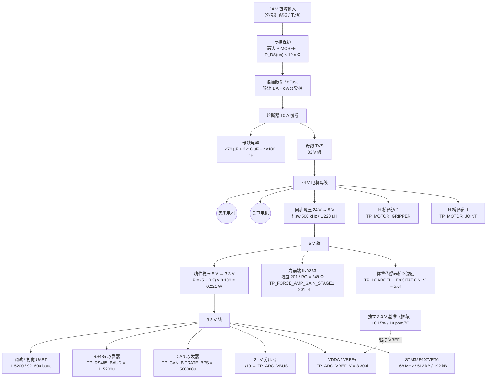
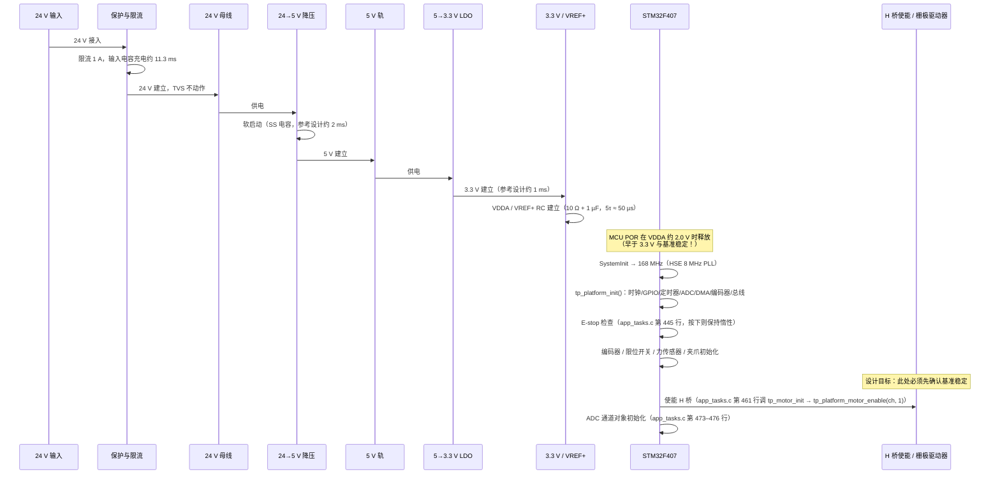
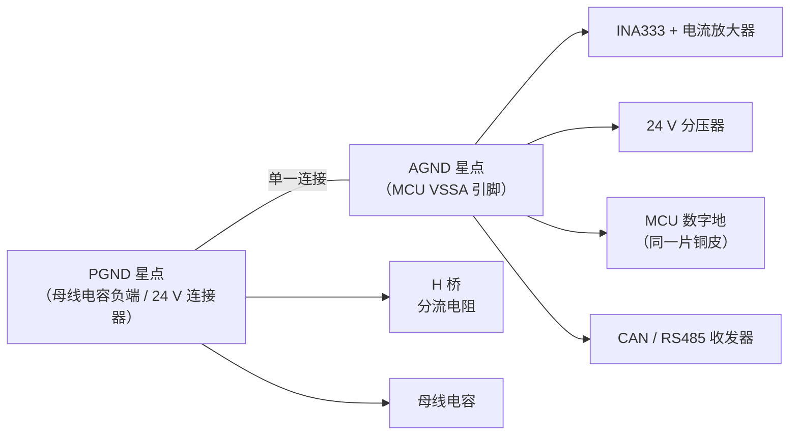

# 第二代采茶机器人 · 电源与功率树设计文档

<!-- REVISION NOTICE - do not remove -->
> ### ⚠️ 参数修订说明（第三次校正，覆盖全文数值）
>
> 本文档写作期间，项目经历了三轮**更正**，因此正文中的部分**具体数字已经过期**。
> 保留原文是为了不掩盖修正过程，但读数时请以代码为准。
> **第三次更正的完整缺陷清单见 [`docs/12_results_analysis.md`](12_results_analysis.md) 的 §3.5。**
>
> | 常量 | 已废弃的值 | 当前值（权威） | 更正原因 |
> |---|---|---|---|
> | `TP_PLANT_MOTOR_KT_NM_PER_A` | 2.0 | **0.4** | SI 单位下 `Kt` 与 `Ke` 是同一物理量，原值相差 40 倍，违反能量守恒 |
> | `TP_PLANT_MOTOR_KE_VS_RAD` | 0.05 | **0.4** | 同上 |
> | `TP_VEL_PID_KP` | 0.005 | **0.026** | 被控对象 DC 增益由 480 变为 60 mrad/s/permille，必须重新整定 |
> | `TP_VEL_PID_KI` | 0.10 | **0.83** | 同上 |
> | `TP_POS_PID_KP` | 12.0 | **5.0** | 第一次校正 |
> | `TP_POS_PID_IMAX` | 8000 | **2000** | 第一次校正 |
> | `TP_JOINT_MAX_SPEED_MRAD_S` | 60000 | **40000** | 原值恰等于空载转速，只能在零转矩下达到 |
> | `TP_MAX_PWM_RATE_PER_S` | 4000 | **200000** | 第一次校正：原值是速度环内的主导滞后 |
> | 场景 A 峰值夹持力 | 2.493 N | **2.363 N** | 第三次校正：力背驱符号修正 |
> | 场景 A 达到目标力 | 2.26 N | **2.18 N** | 同上 |
> | 场景 A 接触间隙 | 5.688 mm | **5.682 mm** | 同上 |
> | 场景 A 主机链路解码 | 2200 B / 100 帧 | **2134 B / 97 帧** | 同上 |
> | `TP_PLANT_JAW_BACKDRIVE` 的作用方向 | 减去（`-=`） | **加上（`+=`）** | 符号错误使茎秆把空夹爪"吸"到机械硬限：力从 5.0 N 涨到 16.4 N，并误锁存传感器故障 |
> | 力环服务速率 | 100 Hz（与注释不符） | **1 kHz** | 力环搬入 1 kHz 控制任务，"N 个控制周期"从此等于 N ms |
>
> **唯一权威**：`firmware/Application/config.h` 与 `firmware/BSP/host/plant_model.h`。
> 二者的一致性由 `tests/test_config_agreement.py` 自动校验——它会解析这两个头文件并与
> Python 模型逐条比对，因此任何再次漂移都会变成失败的测试而不是过期的文档。
<!-- /REVISION NOTICE -->


> ## ⚠️ 文档性质声明（务必先读）
>
> **本文档是设计文档 / 参考设计（Design Document / Reference Design），不是产品规格书，也不是验证报告。**
>
> 1. **本项目没有任何实物板卡被制造过，也没有任何板卡被测量过。** 本文中出现的每一个电压、电流、功耗、效率、温升、时间都是**基于数据手册参数的设计计算（design calculation）**，不存在任何实物验证数据。
> 2. 所有器件**型号均为「参考设计 / Recommended Implementation」**，即"若要实现本设计，建议选用这一档参数的器件"。仓库中**不存在**任何器件选型清单、原理图、PCB 文件或 BOM，因此本文的器件参数是**占位值**：一旦确定实际型号，必须用该型号数据手册的对应参数重新执行本文第 4 章的全部算式。
> 3. 凡引用固件符号，均写成 `名称 = 数值`（见 `firmware/Application/config.h`）的带出处形式。仓库中未定义的量一律明确写为**「仓库中未定义」**，不做推测性补全。
> 4. 本文**不含**也不得被引用为任何性能、可靠性或 EMC 符合性的证据。第 6 章的测试方法描述的是**将来应在实物上执行的验证步骤**，其中任何一项目前都没有执行过。
> 5. 仓库中 `docs/`、`tests/`、`scripts/`、`images/` 目录存在；`tests/` 与 `images/` 目前为空，`scripts/` 下只有 `build_host.ps1`（PC 侧构建脚本），`docs/` 下有本项目自己的中文文档。**因此本设计的验证步骤仍然没有任何自动化测试实现，也没有可复用的测试夹具。**
> 6. 本文与 `hardware/motor_driver.md` 是配套文档：功率级的损耗、回路与保护结论在彼处推导，本文不重复，只引用结论。
>
> ### ⚠️ 时效性更正（本文件撰写后仓库被并行改动，以下为最新核对结果）
>
> 以核对时间 **2026-09-14 16:01** 为准：
>
> | 项目 | 本文件正文早先的判断 | **当前事实** |
> |---|---|---|
> | `firmware/BSP/stm32f407/platform_stm32f407.c` | 不存在 | **已存在（约 105 KB）**，`platform_stm32f407.h` 也已存在。真实引脚映射、ADC 触发（**TIM3 TRGO 500 Hz**）、ADC 时钟（**PCLK2/4 = 21 MHz**）、采样时间（**84 周期 = 4 µs**）、DMA（**DMA2 Stream0，circular，16 × TP_ADC_COUNT 半字**）、CAN 位定时、IWDG 分频与重载**均已有实现值** |
> | 机载入口 `main.c` | 不存在 | **已存在**：`firmware/Core/main_stm32.c`、`main_host.c`，另有 `app_entry.c/h`、`app_sequence.c`、`app_tasks.c/h`、`freertos_hooks.c`、`stm32f4xx_it.c/h`、`osal/osal_freertos.c` |
> | 构建脚本 | 不存在 | **已存在** `scripts/build_host.ps1`；仍**没有** CMake/Makefile |
> | 实物板卡与硬件测量、热仿真、EMC 预测试 | 不存在 | **不存在（未变）**——本文件风险表首部条目依然成立 |
> | `README.md`、`LICENSE`、`scripts/gen_fsm_diagram.py`、`scripts/check_layering.py`、源码引用的 `docs/05`–`07`、`11`–`13`、`units_convention.md` | 不存在 | **仍然不存在** |
>
> 另有一条与电源/传感直接相关的**新增事实**：`config.h` 新增了
> `TP_SENSOR_TEMP_UNAVAILABLE (32767)`，其注释说明"**参考设计没有板温传感器**，
> 所以 `temp_c_x10` 字段上报这个哨兵值而不是一个看起来合理的零；
> 一个把它渲染成 '0.0 C' 的上位机工具会主动误导"。`tp_adc_ch_t` 只有 4 路，
> **没有任何温度通道**。这直接支持本文"功率级温度监测在当前设计中不存在"的判断。

---

## 摘要

本文给出第二代采茶机器人的电源系统参考设计：**24 V 直流输入 → 保护（反接 / 熔断 / TVS / 浪涌限制）→ 24 V 电机母线（两路 H 桥）与 24 V→5 V 降压 → 5 V（称重传感器桥路激励 + 力前端）→ 5 V→3.3 V 线性稳压 → MCU、ADC 基准、CAN/RS485 收发器**。

供电对象由固件固定：母线为 24 V（`plant_model.c` 中 `p->vbus_v = 24.0f`；`bsp_types.h` 中 `TP_ADC_VBUS = 3` 注释 "24 V rail divider"）；称重传感器的桥路激励为 5 V（`TP_LOADCELL_EXCITATION_V = 5.0f`）；ADC 基准为 3.3 V（`TP_ADC_VREF_V = 3.300f`、`TP_BSP_ADC_VREF_V = 3.300f`）。四路通信链路（`TP_BUS_COUNT = 4`：调试 UART、视觉 UART、RS485、CAN）需要各自的总线收发器。

本文的量化结论汇总：

| 结论 | 数值 | 依据章节 |
|---|---|---|
| 5 V 轨总电流预算 | 约 140 mA（其中 130 mA 属 3.3 V 轨折算） | §4.1 |
| 5 V 轨本地负载（不含 3.3 V 轨） | 约 6 mA（几乎全部是称重传感器桥路） | §4.1 |
| 24 V→5 V buck 的损耗与结温 | 0.124 W，ΔT = 7.4 °C | §4.2 |
| 3.3 V 轨电流预算 | 约 130 mA | §4.3 |
| 5 V→3.3 V LDO 的损耗 | 0.221 W，ΔT = 13.3 °C（SOT-223 级封装） | §4.3 |
| 若用 LDO 直接做 24 V→5 V | 2.58 W、效率 21%（拒绝） | §4.2 |
| 三级方案对比：最优系统效率 | 单级方案 81% vs 推荐两级方案 56% | §4.4 |
| 推荐的 ADC 基准误差预算 | 独立基准 5.0 mV（0.15%）vs LDO 直供 24.8 mV（0.75%） | §4.5 |
| 反接保护：肖特基 vs 高边 P-MOSFET 的损耗差 | 2.1 W vs 0.072 W（29 倍） | §4.6 |
| 输入电容充电能量与电荷 | 0.135 J / 11.28 mC | §4.7 |
| 无限流时的电容充电尖峰 | 约 80 A（源阻抗 0.3 Ω） | §4.7 |
| 母线分压 1/10 的满量程 | 33.00 V，1 count = 8.06 mV | §4.8 |
| 保险丝与线径 | 10 A 慢断；输入 AWG 16、电机 AWG 18 | §4.9 |
| 保护极限下的母线功率 | 144 W（峰值 240 W < 50 ms） | §4.10 |

**目录**

- [摘要](#摘要)
- [1. 设计目标](#1-设计目标)
  - [1.1 供电对象与电压轨](#11-供电对象与电压轨)
  - [1.2 设计目标表](#12-设计目标表)
  - [1.3 仓库中未定义的部分](#13-仓库中未定义的部分)
- [2. 器件选型与理由](#2-器件选型与理由)
  - [2.1 稳压拓扑对比：线性稳压 / 降压 / 电源模块](#21-稳压拓扑对比线性稳压--降压--电源模块)
  - [2.2 同步降压 vs 非同步降压](#22-同步降压-vs-非同步降压)
  - [2.3 反接保护方案对比](#23-反接保护方案对比)
  - [2.4 浪涌限制方案对比](#24-浪涌限制方案对比)
  - [2.5 推荐方案（参考设计 / Recommended Implementation）](#25-推荐方案参考设计--recommended-implementation)
- [3. 原理说明](#3-原理说明)
  - [3.1 功率树](#31-功率树)
  - [3.2 各级作用与设计理由](#32-各级作用与设计理由)
  - [3.3 5 V 作为称重传感器桥路激励](#33-5-v-作为称重传感器桥路激励)
  - [3.4 3.3 V 作为 ADC 基准](#34-33-v-作为-adc-基准)
  - [3.5 反接保护与地参考](#35-反接保护与地参考)
  - [3.6 上电时序](#36-上电时序)
- [4. 关键计算](#4-关键计算)
  - [4.1 5 V 轨电流预算](#41-5-v-轨电流预算)
  - [4.2 24 V→5 V 降压的损耗、效率与结温](#42-24-v5-v-降压的损耗效率与结温)
  - [4.3 3.3 V 轨电流预算与 LDO 功耗](#43-33-v-轨电流预算与-ldo-功耗)
  - [4.4 单级 vs 两级：三种方案对比](#44-单级-vs-两级三种方案对比)
  - [4.5 3.3 V 作为 ADC 基准的误差预算](#45-33-v-作为-adc-基准的误差预算)
  - [4.6 反接保护的压降与损耗](#46-反接保护的压降与损耗)
  - [4.7 浪涌与上电冲击](#47-浪涌与上电冲击)
  - [4.8 24 V 母线分压到 ADC](#48-24-v-母线分压到-adc)
  - [4.9 保险丝与线径](#49-保险丝与线径)
  - [4.10 母线总功率与电源选型](#410-母线总功率与电源选型)
- [5. 布局与 EMC](#5-布局与-emc)
- [6. 测试与验证方法](#6-测试与验证方法)
- [7. 已知风险与未验证项](#7-已知风险与未验证项)
- [附录 A：本文引用的固件符号清单](#附录-a本文引用的固件符号清单)

---

## 1. 设计目标

### 1.1 供电对象与电压轨

| 轨 | 电压 | 供电对象 | 仓库依据 |
|---|---|---|---|
| 24 V 电机母线 | 24 V | 两个 H 桥（`TP_MOTOR_JOINT`、`TP_MOTOR_GRIPPER`） | `plant_model.c` 中 `p->vbus_v = 24.0f`；`bsp_types.h` 中 `TP_ADC_VBUS = 3` 注释 "24 V rail divider" |
| 5 V | 5 V | **称重传感器桥路激励**、力前端（INA333）、5 V 逻辑（若有） | `TP_LOADCELL_EXCITATION_V = 5.0f` |
| 3.3 V | 3.3 V | MCU（STM32F407VET6，`-DTP_PLATFORM_STM32F407`）、**ADC 基准**、CAN 收发器、RS485 收发器 | `TP_ADC_VREF_V = 3.300f`、`TP_BSP_ADC_VREF_V = 3.300f` |
| 12 V（可选） | 12 V | 栅极驱动器的 V_CC（见 `motor_driver.md` §2.3，**仓库未定义**） | 无 |

**四路通信链路**需要各自的总线物理层（`TP_BUS_COUNT = 4`）：

| 总线 | 波特率 | 出处 | 收发器供电 |
|---|---|---|---|
| 调试 UART `TP_BUS_DEBUG_UART` | `TP_UART_DEBUG_BAUD = 115200u` | USART1 | 3.3 V（TTL 直连，若外接需电平转换） |
| 视觉 UART `TP_BUS_VISION_UART` | `TP_UART_VISION_BAUD = 921600u` | USART2 | 3.3 V（TTL 直连） |
| RS485 `TP_BUS_RS485` | `TP_RS485_BAUD = 115200u`，`TP_MODBUS_SLAVE_ADDR = 0x11u` | USART3 + DE 引脚 | 3.3 V 型收发器（若用 5 V 型则增加 5 V 轨负载） |
| CAN `TP_BUS_CAN` | `TP_CAN_BITRATE_BPS = 500000u` | CAN1 | 3.3 V 型收发器（若用 5 V 型则增加 5 V 轨负载） |

### 1.2 设计目标表

| 编号 | 设计目标 | 量化指标 | 依据 / 备注 |
|---|---|---|---|
| P1 | 单输入、多轨输出 | 24 V 输入同时供给电机母线与逻辑电源 | §3.1 |
| P2 | 反接不损坏 | -24 V 反接持续 60 s 无电流、无损坏 | §4.6 |
| P3 | 上电不触发电源保护 | 输入限流 ≤ 2 A，输入电容充电时间 ≥ 5 ms | §4.7 |
| P4 | 5 V 轨满足称重传感器激励 | 5 V ±2%，电流能力 ≥ 30 mA | `TP_LOADCELL_EXCITATION_V = 5.0f`；§4.1 |
| P5 | 3.3 V 轨满足 MCU 与收发器 | 3.3 V ±2%，电流能力 ≥ 200 mA | §4.3 |
| P6 | **ADC 基准误差 ≤ 0.2%** | ±6.6 mV on 3.3 V（含初始精度、温漂、负载调整率、纹波） | §4.5；力分辨率为 8 mN LSB（`config.h` 注释） |
| P7 | 母线电压可被监测 | 24 V → ADC 读数 ≈ 2979 counts（72.7% 满量程），满量程母线 33.00 V | §4.8；`app_tasks.c` 中 divider = 10.0f |
| P8 | 母线分压器单一故障安全 | R1 短路不得把 24 V 直接加到 ADC 引脚 | §4.8 第 6 步 |
| P9 | 熔断与线径覆盖连续与峰值电流 | 连续 6 A、峰值 10 A（< 50 ms） | `TP_MAX_CURRENT_MA = 3000.0f`、`TP_PEAK_CURRENT_MA = 5000.0f`；§4.9 |
| P10 | 上电顺序保证"基准稳定后才使能驱动器" | 见 §3.6 | 设计目标（当前实现顺序见 §7 风险 W10） |
| P11 | 母线过压/欠压由硬件兜底 | TVS + 可选制动斩波 | §4.7、`motor_driver.md` §4.11；固件无电压类故障码（风险 W9） |
| P12 | 单一连续地平面 + 分区布局 | 不做模拟/数字地分割 | §5.1 |
| P13 | 5 V 承载称重传感器激励、3.3 V 承载 ADC 基准 | 5 V 与 3.3 V 的角色在本文与 `force_sensor` 前端之间保持唯一约定 | `TP_LOADCELL_EXCITATION_V = 5.0f`、`TP_ADC_VREF_V = 3.300f` |

### 1.3 仓库中未定义的部分

| 项目 | 状态 | 影响 |
|---|---|---|
| 24 V 电源的型号与功率 | **未定义** | §4.10 只能按保护极限给上限 |
| 24 V 母线的实际工作电流 | **未定义** | §4.10 的 144 W 是保护极限，不是运行需求 |
| 称重传感器的桥路电阻 | **未定义** | 本文按参考设计取 1 kΩ（5 V 下 5 mA）；若为常见 350 Ω 桥则为 14.3 mA，5 V 轨预算随之变化（§4.1 备注） |
| MCU 电流消耗 | **未定义** | 本文按 168 MHz 运行的参考设计值 80 mA 估算 |
| CAN/RS485 收发器型号与电流 | **未定义** | 本文按 3.3 V 型器件的参考设计值估算 |
| 是否有 12 V 轨（栅极驱动） | **未定义** | 若有，需在 §3.1 的功率树中增加一级 |
| 逻辑侧是否有其他负载（相机、照明、舵机） | **未定义** | 视觉链路的供电未在本设计范围内 |
| 反接保护、浪涌限制、熔断器型号 | **未定义** | 全部为参考设计 |
| 母线过压/欠压保护电路 | **未定义** | 固件也没有电压类故障码（`TP_FAULT_CODE_COUNT = 11` 中无对应项） |
| STM32F407VET6 的 VREF+ 是否单独引出 | 仓库未定义 | 若 LQFP100 引脚定义允许（须以芯片数据手册为准），可用独立基准提升 ADC 精度（§4.5） |
| 真实硬件的电压/电流标定常数 | **需按新事实复核** | `firmware/BSP/stm32f407/platform_stm32f407.c` 现已存在（见开头的时效性更正），分压比与电流标定常数应以该文件的真实取值为准。本文的 divider、电阻取值与限流点仍是**参考设计**。 |

---

## 2. 器件选型与理由

### 2.1 稳压拓扑对比：线性稳压 / 降压 / 电源模块

对**两级**分别评估（24 V→5 V 与 5 V→3.3 V）。

**第一级 24 V → 5 V（负载约 140 mA，含 3.3 V 轨）：**

| 方案 | 损耗计算 | 损耗 | 效率 | 判定 |
|---|---|---|---|---|
| 线性稳压 LDO | $(24-5) \times 0.140$ | **2.58 W** | 21% | **拒绝**：需要散热片；且 2.58 W 的持续发热会显著抬高机内环境温度 |
| 非同步降压 buck（二极管续流） | 见 §4.2 | ≈ 0.16 W | ≈ 80% | 可用，但续流二极管损耗与效率略差 |
| **同步降压 buck** | 见 §4.2 | **0.124 W** | 85% | **推荐（参考设计）** |
| 隔离型 DC/DC 模块 | 无隔离需求，浪费 | — | 70–85% | 拒绝：本机不需要隔离，模块成本与体积更高 |
| 非隔离电源模块（如 TO-220 封装的开关模块） | — | ≈ 0.15 W | 80% | 备选：开发周期最短，但开关频率与纹波不可控，会污染 ADC 基准 |

**第二级 5 V → 3.3 V（负载约 130 mA）：**

| 方案 | 损耗计算 | 损耗 | 效率 | 判定 |
|---|---|---|---|---|
| **线性稳压 LDO** | $(5-3.3) \times 0.130$ | **0.221 W** | 66% | **推荐（参考设计）**：见下方理由 |
| 同步降压 buck | 约 0.04 W | ≈ 85% | 更高效，但把开关纹波直接加在 ADC 基准上 | 备选：仅在 §4.5 的基准精度不敏感时使用 |
| 从 24 V 直接 LDO 到 3.3 V | $(24-3.3)\times0.130$ | 2.69 W | 14% | 拒绝 |

**为什么第二级推荐 LDO 而不是更高效的 buck：** `TP_ADC_VREF_V = 3.300f` 说明 **3.3 V 就是 ADC 的基准电压**（`TP_BSP_ADC_VREF_V = 3.300f` 是它在 BSP 层的副本）。ADC 基准上的任何纹波都会按比例直接变成力与电流的测量误差（§4.5 的误差预算）。LDO 在 1 MHz 处的 PSRR 通常在 50–60 dB，而 buck 的开关纹波（500 kHz、数十 mV）会直接出现在基准上。用 0.221 W 的损耗换取基准的洁净度，是正确的工程取舍。

### 2.2 同步降压 vs 非同步降压

以 24 V→5 V、140 mA 为例：

| 对比维度 | 非同步 buck（二极管续流） | 同步 buck（下管 MOSFET） |
|---|---|---|
| 续流损耗 | $V_f \times I_{out} \times (1-D)$ ≈ 0.5 V × 0.14 × 0.755 = **0.053 W** | $I^2 R_{DS(on)} \times (1-D)$ ≈ $0.14^2 \times 0.05 \times 0.755$ = **0.0007 W** |
| 效率（本负载点） | 约 78–82% | 约 85–88% |
| 轻载效率 | 较好（二极管无开关损耗） | 较差（下管的栅极驱动与死区损耗固定），需 PFM/跳跃模式 |
| 器件数 | 少（一只肖特基） | 多（一只 MOSFET + 自举电容 + 驱动器） |
| 反向电流 | 二极管阻断，天然不允许反向 | 允许反向，轻载时可能从输出倒灌 |
| 电磁干扰 | 二极管的硬恢复会产生高频振铃 | 软开关特性更好（下管同步整流） |
| 结论 | 在 140 mA 这个**极轻载**点上，两者的绝对损耗差只有 0.05 W | **推荐（参考设计）**：效率更高、发热更低；但若选非同步方案，其总损耗（0.16 W）同样可以接受，本设计不因这一项而否决非同步方案 |

**本设计对同步/非同步不做强约束**，因为该级的绝对损耗（0.12–0.16 W）远低于热设计的关注阈值（§4.2 第 4 步）。真正需要关注的是**开关频率与纹波**（§2.1 的理由）。

### 2.3 反接保护方案对比

| 方案 | 3 A 时的压降 | 3 A 时的损耗 | 5 A 时的损耗 | 优点 | 缺点 |
|---|---|---|---|---|---|
| 串联肖特基二极管 | 0.6–0.9 V | 1.8–2.7 W | 3.0–4.5 W | 最简单、无控制回路、失效模式明确 | 损耗大（占母线 2.5–3.8%）；按 D-PAK θ_JA ≈ 50 °C/W，2.1 W 对应 ΔT ≈ 105 °C，必须加散热 |
| 二极管整流桥 | 1.2–1.8 V | 3.6–5.4 W | 6.0–9.0 W | 任意极性的输入都能工作 | 损耗最大；**地电位被抬起 0.6–0.9 V**；母线有效电压损失最大 |
| **P-MOSFET 高边** | $3 \times 8\ \text{m}\Omega$ = **24 mV** | **0.072 W** | 0.200 W | 损耗低 29 倍；**保持"板地 = 电源回线"** | 需要栅极钳位与上拉网络 |
| N-MOSFET 低边 | 24 mV | 0.072 W | 0.200 W | 驱动最简单（源极接地） | **把整块板的本地地从电源回线抬起 24 mV**（见 §3.5 的诚实分析） |
| 理想二极管控制器（高边） | ≈ 24 mV | 0.072 W | 0.200 W | 有源快速反向切断；可同时承担浪涌限制 | 器件最多、成本最高 |
| 结论 | **推荐：P-MOSFET 高边**（参考设计），R_DS(on) ≤ 10 mΩ @ V_GS = −10 V，栅极加 15 V 齐纳钳位 + 100 kΩ 上拉 | | | | |

### 2.4 浪涌限制方案对比

| 方案 | 冷态限流 | 稳态损耗（3 A） | 热态重启是否仍有限流 | 复杂度 | 判定 |
|---|---|---|---|---|---|
| 无保护 | 仅由源阻抗限制（约 80 A） | 0 | — | 无 | **拒绝**：见 §4.7 |
| NTC 热敏电阻 | 5 Ω → 24 V/5 Ω = **4.8 A** | 0.5 Ω × 3² = **4.5 W** | **否**：热时间常数 30–60 s，热态重启时阻值已低，几乎无限流作用 | 最低 | 仅适用于稳态电流 < 0.5 A；**必须配继电器/MOSFET 旁路** |
| NTC + 旁路继电器/MOSFET | 冷态 4.8 A；旁路后等效 0.03 Ω | 0.09 W（旁路 MOS） | 是（旁路后 NTC 冷却，下次冷启动仍有限流） | 中 | **可用**（参考设计备选） |
| 固定电阻 + 延时继电器 | 由电阻决定 | 0.09 W（旁路后） | 是 | 中 | 可用但继电器是机械寿命件 |
| **有源限流 / eFuse** | 可编程，取 **1 A** | $I^2 R_{DS(on)}$ = 0.09 W | **是**（每次上电都重新限流） | 中高 | **推荐（参考设计）**：可重复、可诊断、可与熔断功能合并 |
| 结论 | 推荐 eFuse / 有源限流，限流点 1–2 A，配 dV/dt 受控的栅极驱动 | | | | |

### 2.5 推荐方案（参考设计 / Recommended Implementation）

**参考设计 / Recommended Implementation：P-MOSFET 高边反接保护 + 有源浪涌限流（eFuse） + 10 A 慢断熔断 + 33 V 级母线 TVS + 同步降压（24→5 V） + 线性稳压（5→3.3 V） + 独立 3.3 V 基准（驱动 VREF+，可选但推荐）**。

| 器件 | 参考设计规格 | 关键参数（用于计算） | 相关章节 |
|---|---|---|---|
| 反接保护 MOSFET | P 沟道，V_DS 40 V | R_DS(on) ≤ 10 mΩ @ V_GS = −10 V | §4.6 |
| 浪涌限流 | eFuse / 有源限流控制器 | 限流点 1 A；dV/dt 受控；SOA 需覆盖 24 W / 11.3 ms | §4.7 |
| 熔断器 | 慢断（T）型 | 10 A，I²t 需覆盖 0.011 A²s 的浪涌 | §4.9 |
| 母线 TVS | 单向瞬态抑制 | 33 V 级（参考设计例：SMBJ33A 类，钳位约 53 V @ 11 A） | §4.7、`motor_driver.md` §4.11 |
| 24→5 V 降压 | 同步降压，f_sw = 500 kHz | I_out 能力 ≥ 1 A；软启动；L = 220 µH；C_out = 22 µF | §4.2 |
| 5→3.3 V 稳压 | 线性稳压 LDO | I_out ≥ 300 mA；SOT-223 / DFN 带散热焊盘；PSRR ≥ 60 dB @ 1 MHz | §4.3 |
| ADC 基准（推荐） | 独立串联型基准 | 3.300 V，±0.15%，10 ppm/°C 级（参考设计：REF3333 类） | §4.5 |
| 母线分压 | 0.1% 薄膜电阻 | R1 = 2 × 50 kΩ 串联，R2 = 11.0 kΩ | §4.8 |
| 母线电容 | 聚合物电解 + 陶瓷 | 470 µF / 35 V + 2 × 10 µF / 50 V + 4 × 100 nF | §4.7 |

---

## 3. 原理说明

### 3.1 功率树



### 3.2 各级作用与设计理由

| 级 | 作用 | 设计理由 |
|---|---|---|
| 反接保护 | 防止 -24 V 损毁整机 | 现场接线错误是机器人最常见的损坏原因；见 §4.6 的损耗对比 |
| 浪涌限制 | 限制输入电容的充电电流 | 见 §4.7：无限流时约 80 A 的尖峰会让适配器进入保护 |
| 熔断 | 线束短路保护 | 见 §4.9；它保护**线束与电源**，不保护 H 桥（H 桥由驱动器的微秒级保护负责） |
| TVS | 抑制感性关断尖峰与热插拔浪涌 | 见 `motor_driver.md` §4.11 |
| 母线电容 | 提供 PWM 开关的脉冲电流 | PWM 开关电流来自电容，而不是电缆；见 `motor_driver.md` §5.2 |
| 24→5 V 降压 | 为传感器激励与 3.3 V 轨供电 | 不能用 LDO：见 §2.1 |
| 5 V 轨 | **称重传感器桥路激励** | `TP_LOADCELL_EXCITATION_V = 5.0f`；见 §3.3 |
| 5→3.3 V LDO | 为 MCU 与**ADC 基准**供电 | 见 §2.1 与 §3.4 |
| 3.3 V 轨 | MCU、ADC 基准、收发器 | `TP_ADC_VREF_V = 3.300f` |
| 独立基准（推荐） | 用高精度基准驱动 VREF+ | 见 §4.5 的误差预算 |

### 3.3 5 V 作为称重传感器桥路激励

`config.h` 的力前端注释给出了完整链路（这是本文 §3.3 与 §4.5 的依据）：

```
10 N load cell (1 mV/V, 5 V excitation)
  -> INA333 instrumentation amp, gain 201 (RG = 249 ohm)
  -> RC anti-alias filter, fc = 1.6 kHz
  -> STM32 ADC1_IN0, 12 bit, Vref = 3.3 V
```

对应符号：`TP_LOADCELL_SENSITIVITY_MV_V = 1.0f`、`TP_LOADCELL_RATED_N = 10.0f`、`TP_LOADCELL_EXCITATION_V = 5.0f`、`TP_FORCE_AMP_GAIN_STAGE1 = 201.0f`（RG = 249 Ω）、`TP_ADC_VREF_V = 3.300f`。

**桥路灵敏度与激励电压成正比**：

$$\text{TP\_LOADCELL\_MV\_PER\_N} = \frac{\text{TP\_LOADCELL\_SENSITIVITY\_MV\_V} \times \text{TP\_LOADCELL\_EXCITATION\_V}}{\text{TP\_LOADCELL\_RATED\_N}} = \frac{1.0 \times 5.0}{10.0} = 0.5\ \text{mV/N}$$

因此 **5 V 轨的精度直接按比例影响力标定**：5 V 轨偏差 1% → 力灵敏度偏差 1% → 在 2.2 N 处 22 mN 的误差（是 8 mN LSB 的 2.75 倍）。**结论：5 V 轨不是"给传感器供电即可"的粗放电源，它必须与 ADC 基准同级别地对待**——参考设计要求 ±2% 以内（P4），并建议在实物上标定时把 5 V 轨的实际值写入标定常数。

设计要点：

| 项 | 要求 | 理由 |
|---|---|---|
| 桥路电流 | 参考设计 1 kΩ 桥 → 5 V/1 kΩ = 5 mA | 桥阻仓库未定义；若为 350 Ω 桥则为 14.3 mA（§4.1 备注） |
| 激励去耦 | 桥路供电端就近 10 µF + 100 nF | 桥路对激励纹波敏感，纹波直接调制输出 |
| 走线 | 激励走线与信号走线分开；桥路采用四线（激励二线 + 信号二线） | 激励电流在激励走线上的压降不影响信号对 |
| 参考端 | INA333 的 REF 引脚应接一个与 ADC 参考同源的稳定电压（参考设计：3.3 V/2 或独立分压） | REF 的误差直接进入输出；同时保证零负载时输出约为 V_ref/2，对应 `TP_FORCE_CAL_ZERO_COUNTS = 2048.0f` |

### 3.4 3.3 V 作为 ADC 基准

`TP_ADC_VREF_V = 3.300f` 与 `TP_BSP_ADC_VREF_V = 3.300f` 说明 3.3 V 轨同时是 ADC 的基准，而 `TP_FORCE_CAL_SCALE_N_PER_COUNT` 是由该基准**计算出来**的：

$$\text{TP\_ADC\_MV\_PER\_COUNT} = \frac{3.300 \times 1000}{4096} = 0.80566\ \text{mV}$$

$$ \text{TP\_FORCE\_CAL\_SCALE\_N\_PER\_COUNT} = \frac{\text{TP\_ADC\_MV\_PER\_COUNT}}{\text{TP\_FORCE\_FRONTEND\_MV\_PER\_N}} = \frac{0.80566}{100.5} = 0.008017\ \text{N/count}$$

（`config.h` 注释给出 **0.00802 N per ADC count**，即 **8.0 mN LSB**。）

**因此：3.3 V 轨的误差 = 力读数的比例误差。** 这决定了本文 §4.5 的全部误差预算，也决定了 §2.1 中"第二级用 LDO 而不是 buck"的选择。

注意两个直接的后果：

1. **若改用 3.000 V 基准**，必须同步修改 `TP_ADC_VREF_V`，否则 `TP_FORCE_CAL_SCALE_N_PER_COUNT` 会整体偏移 10%（力读数出现 10% 的系统误差）。参考设计**选择 3.300 V 基准**以保持该宏不变。
2. **STM32F407VET6 的 VREF+ 是否在封装上单独引出，仓库未定义。** STM32F407 在 100 引脚封装上通常提供 VREF+/VREF− 引脚，**但必须以芯片数据手册的引脚定义为准**。若可用，则可用独立基准驱动 VREF+（§4.5 推荐）；若不可用，则只能提升 VDDA 的精度。

### 3.5 反接保护与地参考

反接保护器件串在**高边**（V_bus 侧）时，板地仍等于电源回线；串在**低边**（回线侧）时，板地被抬起 $I \times R_{DS(on)}$。本文对这个差异给出一个**诚实的量化分析**，因为它常被夸大：

- 3 A 时低边器件的压降为 $3 \times 8\ \text{m}\Omega = 24\ \text{mV}$。
- **板上所有单端测量都以本地地为参考**：INA333 的桥路、其 REF 引脚、ADC 的 VDDA/VREF+、分流放大器——它们的地参考会**一起**被抬起 24 mV，因此这一抬升对力与电流读数是**共模的，会被抵消**。所以"低边保护会产生 24 mV 的力测量误差"这一常见说法在本设计中**并不成立**（24 mV / 100.5 mV/N = 0.24 N，若真的作用在信号上会是灾难性的，但它是共模的）。
- 真正受影响的是**以电源回线或机壳为参考的信号**：CAN/RS485 的共模电平（偏移 24 mV，相对于总线共模范围可忽略）、屏蔽层的回流路径、E-stop 常闭回路（`TP_IO_ESTOP = 0`，注释 "NC loop, low = asserted"）、以及任何跨越该器件的电流检测路径。
- **因此低边 N-MOSFET 的真正缺点不是测量误差，而是破坏了"板地 = 电源回线 = 机壳地"这一接地约定的简洁性**，使 §5.1 的星形接地必须额外说明电流返回路径，并在故障时让电机回线悬浮。

**参考设计选择高边 P-MOSFET**，理由是接地约定的简洁性与故障时的确定性，而不是损耗差异（高边与低边的损耗相同，都是 0.072 W @ 3 A）。

### 3.6 上电时序

**设计目标（P10）：H 桥使能必须是整条时序上的最后一个动作，且在 3.3 V 与 ADC 基准稳定之后。**



**为什么"基准稳定后才使能"是硬要求。** 若在基准未稳时使能驱动器，电流保护会读到错误的电流值：

| 基准状态 | 电流读数偏差 | 后果 |
|---|---|---|
| 基准偏低 10% | 同一实际电流的读数**偏高**约 11% | 在 2.7 A 处就误触发 3.0 A 门槛 → 频繁误跳闸 |
| 基准偏高 10% | 同一实际电流的读数**偏低**约 9% | 3.3 A 才触发 3.0 A 门槛 → **超过 `TP_MAX_CURRENT_MA = 3000.0f` 10%，保护失效** |

**一个可执行的检查（建议，仓库中未实现）：** 在使能 H 桥之前，用 `TP_ADC_VBUS` 的读数做一次合理性确认——母线电压应落在 20–30 V 区间内（对应 §4.8 的 2482–3724 counts）。这一步**同时覆盖**"基准未稳"与"母线异常"两类上电故障，而且只需要已有的 ADC 通道与已有的 `divider = 10.0f` 参数（`app_tasks.c` 第 475–476 行）。目前固件没有这个检查，也没有电压类故障码（风险 W9、W10）。

**时间尺度的估算（参考设计）：**

| 阶段 | 参考时长 | 依据 |
|---|---|---|
| 输入电容充电（限流 1 A） | 11.3 ms | §4.7 第 4 步 |
| buck 软启动 | 约 2 ms | SS 电容取值决定，参考设计 |
| LDO 建立 | 约 1 ms | 参考器件软启动 |
| VDDA/VREF+ RC 建立（5τ） | 约 50 µs | 10 Ω × 1 µF，τ = 10 µs |
| **合计（24 V 接入 → 基准稳定）** | **约 14 ms** | — |

而 MCU 的 POR 在 VDDA 约 2.0 V 时就释放，即**远早于**基准稳定。因此固件**必须**显式地在使能驱动器之前等待或验证基准/母线，不能依赖上电顺序天然正确。

---

## 4. 关键计算

> 本章全部为设计计算。**所有输入参数中，来自仓库的部分已注明符号；其余均为参考设计占位值。**

### 4.1 5 V 轨电流预算

**第 1 步：称重传感器桥路电流。**

$$I_{bridge} = \frac{\text{TP\_LOADCELL\_EXCITATION\_V}}{R_{bridge}} = \frac{5.0\ \text{V}}{1000\ \Omega} = 5.0\ \text{mA}$$

**第 2 步：完整预算表。**

| 负载 | 电流 | 依据 |
|---|---|---|
| 称重传感器桥路（参考设计 1 kΩ @ 5 V） | 5.00 mA | `TP_LOADCELL_EXCITATION_V = 5.0f`；桥阻**仓库未定义**，取参考值 1 kΩ |
| 力前端 INA333 静态电流 | 0.05 mA | 数据手册典型值（参考设计） |
| 5 V 上拉 / 分压 / 指示等杂项 | 1.00 mA | 参考设计假设 |
| **5 V 轨本地负载小计** | **6.05 mA** | 对应 30.3 mW |
| 3.3 V 轨折算（LDO 输入电流 ≈ 输出电流） | 130.0 mA | §4.3 |
| **5 V 轨总计** | **136.1 mA → 取 140 mA** | 对应 0.700 W |

**第 3 步：若桥阻为 350 Ω（常见工业值）。**

$$I_{bridge} = \frac{5.0}{350} = 14.3\ \text{mA} \;\Rightarrow\; \text{5 V 本地负载变为 } 15.3\ \text{mA}$$

5 V 轨总计变为 145.3 mA（0.727 W）。这一变化**不影响本文的任何结论**（buck 的损耗从 0.124 W 变为 0.129 W），但它说明**桥阻是一个必须尽早确定的参数**（风险 W5）。

**第 4 步：5 V 轨的"轻载"性质。** 本地负载只有 6 mA，即 30 mW。这一观察有两个后果：

1. 若**只有**称重传感器与力前端需要 5 V，则用 LDO 从 24 V 直接降到 5 V 的损耗仅为 $(24-5)\times 0.006 = 0.114\ \text{W}$，比 buck 更简单且无开关噪声。
2. **buck 之所以必需，完全是因为 3.3 V 轨（130 mA）挂在 5 V 之后**：此时 LDO 方案的损耗升到 2.58 W（§4.2 第 3 步）。

这一区分很重要：**不要把"5 V 轨需要 buck"当成结论，它的真正依据是 3.3 V 轨的负载。**

### 4.2 24 V→5 V 降压的损耗、效率与结温

**第 1 步：输出功率。**

$$P_{out} = 5.0\ \text{V} \times 0.140\ \text{A} = 0.700\ \text{W}$$

**第 2 步：输入功率与损耗（参考设计效率 η = 85%）。**

$$P_{in} = \frac{0.700}{0.85} = 0.824\ \text{W},\qquad P_{loss} = 0.824 - 0.700 = 0.124\ \text{W}$$

$$I_{in} = \frac{0.824}{24} = 34.3\ \text{mA}$$

**第 3 步：与 LDO 方案对比（这是 buck 存在的理由）。**

$$P_{loss,LDO} = (24 - 5) \times 0.140 = 2.58\ \text{W},\qquad \eta_{LDO} = \frac{5}{24} = 21\%$$

$$P_{loss,buck} = 0.124\ \text{W} \;\Rightarrow\; \frac{2.58}{0.124} = 20.8\ \text{倍}$$

**第 4 步：结温升。**

$$\Delta T = P_{loss} \times \theta_{JA} = 0.124 \times 60 = 7.4\ °\text{C}\ \Rightarrow\; T_j = 45 + 7.4 = 52.4\ °\text{C}$$

（θ_JA = 60 °C/W 为 SO-8/DFN 带散热焊盘、1 in² 铜箔的参考值；与 125 °C 上限相比余量超过 2 倍。）

**第 5 步：占空比、电感与输出电容（参考设计）。** 取 f_sw = 500 kHz、ΔI = 输出的 30%：

$$D = \frac{V_{out}}{V_{in}\eta} = \frac{5}{24 \times 0.85} = 0.245 \;(24.5\%)$$

$$\Delta I = 0.30 \times 0.140 = 0.042\ \text{A}$$

$$L = \frac{(V_{in} - V_{out})D}{\Delta I f_{sw}} = \frac{(24-5)\times 0.245}{0.042 \times 500\,000} = \frac{4.655}{21\,000} = 221.7\ \mu\text{H} \;\Rightarrow\; \text{取 } 220\ \mu\text{H}$$

$$C_{out} = \frac{\Delta I}{8 f_{sw} \Delta V_{out}} = \frac{0.042}{8 \times 500\,000 \times 0.020} = 0.53\ \mu\text{F} \;\Rightarrow\; \text{取 } 22\ \mu\text{F 陶瓷（大幅降额）}$$

**第 6 步：输入电容的纹波电流。**

$$I_{rms} \approx I_{out}\sqrt{D(1-D)} = 0.140 \times \sqrt{0.245 \times 0.755} = 0.140 \times 0.430 = 60\ \text{mA}_{rms}$$

相对于母线电容（470 µF 聚合物 + 陶瓷）的额定纹波电流（通常 > 1 A），余量充足。

**第 7 步：轻载效率的提醒（诚实说明）。** 上述 85% 是**在本负载点**（140 mA）的参考设计估值。开关电源的效率随负载下降而降低：在 6 mA 的本地负载点，开关损耗与静态电流占主导，效率可能低至 50–70%。由于本文的负载点（140 mA）已远离极轻载区，该影响有限；但若未来把 3.3 V 轨改为直接由 24 V 降压（§4.4 方案 C），本级的负载会掉到 6 mA，其效率必须重新评估。

### 4.3 3.3 V 轨电流预算与 LDO 功耗

**第 1 步：预算表（参考设计估算值，仓库未定义各项实际电流）。**

| 负载 | 电流 | 说明 |
|---|---|---|
| STM32F407VET6 @ 168 MHz（内核 + 外设 + ADC + DMA + Flash/ART） | 80 mA | 参考设计估算 |
| CAN 收发器（3.3 V 型） | 17 mA | 参考设计估算 |
| RS485 收发器（3.3 V 型，空闲） | 5 mA | 发送时可瞬时增加约 35 mA |
| 调试 / 状态 LED | 6 mA | 参考设计 |
| 外部 NVM（可选） | 5 mA | 参考设计 |
| 上拉 / 杂项 | 10 mA | 参考设计 |
| **合计** | **123 mA → 取 130 mA** | 对应 0.429 W |

**第 2 步：LDO 功耗。**

$$P_{LDO} = (V_{in} - V_{out}) \times I = (5.0 - 3.3) \times 0.130 = 1.7 \times 0.130 = 0.221\ \text{W}$$

**第 3 步：结温升与封装选择（这是本节的关键结论）。**

| 封装 | θ_JA（参考值） | ΔT = P × θ_JA | T_j（环境 45 °C） | 判定 |
|---|---|---|---|---|
| SOT-23-5 / SC-70 | 250 °C/W | **55.3 °C** | **100.3 °C** | 勉强，余量仅 25 °C，且未计入邻近器件加热 |
| SOT-89 | 100 °C/W | 22.1 °C | 67.1 °C | 可用 |
| **SOT-223 / DFN-8 带散热焊盘** | **60 °C/W** | **13.3 °C** | **58.3 °C** | **推荐** |
| TO-252（DPAK） | 50 °C/W | 11.1 °C | 56.1 °C | 可用（占板面积大） |

**结论：130 mA 看起来"很小"，但真正约束封装的是 0.221 W 的功耗，不是电流额定值。** 一只额定 300 mA 的 SOT-23-5 LDO 在 130 mA 下会到 100 °C 结温——选型时必须按功耗而不是按电流额定额选封装。

**第 4 步：效率。**

$$\eta_{LDO} = \frac{3.3}{5.0} = 66\%$$

整个 24 V→3.3 V 链路的效率：

$$\eta_{cascade} = 0.85 \times 0.66 = 56\%$$

**第 5 步：LDO 的 PSRR 是它被选中的理由。** 5 V 轨上的 buck 纹波（在 500 kHz 处，参考设计估计 10–30 mV）经 LDO 后：

$$V_{ripple,out} = \frac{V_{ripple,in}}{\text{PSRR}_{linear}} = \frac{20\ \text{mV}}{10^{60/20}} = \frac{20\ \text{mV}}{1000} = 20\ \mu\text{V}$$

20 µV 相对 3.3 V 是 0.0006%，对 §4.5 的误差预算完全可忽略——**这就是"第二级用 LDO"的定量理由**。

### 4.4 单级 vs 两级：三种方案对比

以"3.3 V @ 130 mA 逻辑 + 5 V @ 6 mA 传感器"为总需求：

| 方案 | 结构 | 损耗计算 | 总损耗 | 系统效率（有用输出/输入） | 优点 | 缺点 |
|---|---|---|---|---|---|---|
| A | 24→5 LDO → 5→3.3 LDO | $(24-5)\times0.140 + (5-3.3)\times0.130 = 2.58 + 0.221$ | **2.801 W** | 14% | 最简单、无开关噪声 | 发热不可接受 |
| **B（推荐）** | 24→5 buck → 5→3.3 LDO | $0.124 + 0.221$ | **0.345 W** | **55.7%** | 5 V 轨本来就需要；ADC 基准落在 LDO 之后（PSRR 保护）；开关噪声只有一个源 | 效率不是最优 |
| C | 24→5 buck（仅传感器）+ 24→3.3 buck（逻辑） | $0.013 + 0.094$ | **0.107 W** | **81%** | 效率最优；两级解耦 | 两个开关源 → 两倍 EMI 与布局难度；**3.3 V 作为 ADC 基准会带上 buck 纹波**（违反 P6） |

**方案 B 的有用输出：** $3.3 \times 0.130 + 5.0 \times 0.006 = 0.429 + 0.030 = 0.459\ \text{W}$
**方案 B 的输入：** $P_{in} = 0.824\ \text{W}$（§4.2 第 2 步）→ $\eta = 0.459/0.824 = 55.7\%$
**方案 C 的输入：** $24\to3.3$ 级 $P_{in} = 0.429/0.82 = 0.523\ \text{W}$；$24\to5$ 级（6 mA，η 取 70%）$P_{in} = 0.030/0.70 = 0.043\ \text{W}$；合计 0.566 W → $\eta = 0.459/0.566 = 81\%$

**结论：保留方案 B。** 理由按优先级：(1) 方案 C 把 buck 纹波直接放在 ADC 基准上，违反 P6（0.2% 的基准误差预算），而 0.345 W 的损耗在热上完全无所谓（ΔT 分别只有 7.4 °C 与 13.3 °C）；(2) 方案 C 引入第二个开关源，会显著增加 §5 的 EMC 难度；(3) 效率差 0.24 W 在 24 V/150 W 量级的系统里可以忽略。若将来发现机内温度或 EMI 有压力，方案 C 是明确的优化方向。

### 4.5 3.3 V 作为 ADC 基准的误差预算

**第 1 步：力前端的灵敏度（全部由 `config.h` 的宏链给出）。**

$$\text{TP\_LOADCELL\_MV\_PER\_N} = \frac{1.0 \times 5.0}{10.0} = 0.5\ \text{mV/N}$$

$$\text{TP\_FORCE\_FRONTEND\_MV\_PER\_N} = 0.5 \times 201 = 100.5\ \text{mV/N}$$

**第 2 步：1 count 与 1 LSB。**

$$\text{TP\_ADC\_MV\_PER\_COUNT} = \frac{3.300 \times 1000}{4096} = 0.80566\ \text{mV}$$

$$\text{TP\_FORCE\_CAL\_SCALE\_N\_PER\_COUNT} = \frac{0.80566}{100.5} = 0.008017\ \text{N/count}$$

**第 3 步：与 `config.h` 注释的交叉校验。**

| 量 | `config.h` 注释 | 本文计算 | 一致性 |
|---|---|---|---|
| 力标定 | 0.00802 N/count | 0.008017 N/count | ✓ |
| `TP_FORCE_TARGET_N = 2.20f` 对应的计数 | "~274 counts above zero" | $2.2/0.008017 = 274.4$ | ✓ |
| 1 LSB 占读数的比例 | "0.36 %" | $0.008017/2.2 = 0.364\%$ | ✓ |

**第 4 步：把"0.36%"翻译成对 3.3 V 轨的要求。** 若要求基准误差不超过 1 LSB 的一半（即 4 mN，占 2.2 N 的 0.18%）：

$$V_{ref,error} \le 0.0018 \times 3.3 = 5.94\ \text{mV}$$

取整为**±6.6 mV（0.2%）**，即设计目标 P6。

**第 5 步：方案 1——用 ±0.5% 的 LDO 直接作为 VDDA/VREF+。**

| 误差源 | 3.3 V 上的量级 | 对 2.2 N 读数的影响 | 占 8.0 mN LSB |
|---|---|---|---|
| 初始精度 ±0.5% | 16.50 mV | 11.0 mN | 1.38 LSB |
| 温漂 100 ppm/°C × 25 °C = 0.25% | 8.25 mV | 5.5 mN | 0.69 LSB |
| 负载调整率 0.5%（负载从 6 mA 到 130 mA） | 16.50 mV | 11.0 mN | 1.38 LSB |
| 纹波与噪声（经 PSRR 后） | 1.0 mV | 0.7 mN | 0.09 LSB |
| **均方根（RSS）** | **24.8 mV（0.75%）** | **16.5 mN** | **2.06 LSB** |

**结论：±0.5% 的 LDO 直接作基准，会引入约 2 个 LSB（16.5 mN，占 2.2 N 目标的 0.75%）的系统性误差**，使 `config.h` 精心论证的 8 mN 分辨率只剩下约一半有效。这**不足以否决**方案（16.5 mN 对夹持一根茶茎的功能是可接受的），但足以说明"标定"不是可选项：必须在实物上把 3.3 V 的实际值写入标定。

**第 6 步：方案 2（推荐）——独立 3.3 V 基准驱动 VREF+。**

| 误差源 | 3.3 V 上的量级 | 对 2.2 N 的影响 | 占 LSB |
|---|---|---|---|
| 初始精度 ±0.15% | 4.95 mV | 3.30 mN | 0.41 LSB |
| 温漂 10 ppm/°C × 25 °C = 0.025% | 0.83 mV | 0.55 mN | 0.07 LSB |
| 负载调整率（基准自身，VREF+ 电流小） | ≈ 0 mV | ≈ 0 | — |
| 噪声（0.1–10 Hz 与宽带） | 0.5 mV | 0.33 mN | 0.04 LSB |
| **RSS** | **5.03 mV（0.15%）** | **3.35 mN** | **0.42 LSB** |

**第 7 步：RC 滤波的陷阱（一个容易被忽略的细节）。** 若在基准输出与 VREF+ 之间放一个串联电阻做 RC 滤波，VREF+ 的静态电流会在该电阻上产生直流压降：

$$V_{drop} = I_{VREF+} \times R_{series} = 0.5\ \text{mA} \times 10\ \Omega = 5\ \text{mV}\ (0.15\%\ \text{of } 3.3\ \text{V})$$

5 mV 已经等于整个误差预算（±6.6 mV），因此：

| 做法 | 串联电阻 | 直流压降 | 判定 |
|---|---|---|---|
| 10 Ω + 1 µF（fc = 15.9 kHz） | 10 Ω | 5.0 mV（0.15%） | **吃掉大部分预算**，不推荐 |
| 4.7 Ω + 1 µF（fc = 33.9 kHz） | 4.7 Ω | 2.4 mV（0.07%） | 可接受 |
| **VREF+ 直接接基准输出 + 输出端就近 1 µF + 100 nF；RC 只放在 VDDA 上** | — | 0 mV | **推荐** |

（$I_{VREF+} = 0.5\ \text{mA}$ 为参考设计估值；实际值须以芯片数据手册与实际负载为准。）

**第 8 步：结论。** 若要保持 `config.h` 中 8 mN LSB 的分辨率在标定后仍然有意义，**ADC 基准应使用独立基准**（参考设计：3.300 V、±0.15%、10 ppm/°C 级）。若成本或 BOM 受限而采用 LDO 直供，则误差预算必须接受约 0.75%，并且**必须在实物上执行一次基准标定**（把实际 3.3 V 写进标定常数）。两种方案的差异（16.5 mN vs 3.35 mN）在"夹持茶茎"这个任务上不会改变功能，但会影响力控回路的稳态精度与 `TP_FORCE_TARGET_N = 2.20f` 的可重复性。

### 4.6 反接保护的压降与损耗

**第 1 步：串联二极管的损耗。**

$$P_{diode}(3\ \text{A}) = V_f \times I = 0.70 \times 3.0 = 2.1\ \text{W}\qquad P_{diode}(5\ \text{A}) = 0.70 \times 5.0 = 3.5\ \text{W}$$

母线有效电压损失：

$$\frac{0.70}{24} = 2.9\%$$

散热：D-PAK 在 1 in² 铜箔上的 θ_JA ≈ 50 °C/W：

$$\Delta T = 2.1 \times 50 = 105\ °\text{C}$$

**105 °C 的温升意味着必须加散热片或改用更大封装——这是二极管方案被否决的直接原因。**

**第 2 步：P-MOSFET 高边的损耗。**

$$V_{drop} = 3.0 \times 0.008 = 24\ \text{mV},\qquad P(3\ \text{A}) = 3.0^2 \times 0.008 = 0.072\ \text{W}$$

$$P(5\ \text{A}) = 5.0^2 \times 0.008 = 0.200\ \text{W}\ (\text{< 50 ms}),\qquad \Delta T(3\ \text{A}) = 0.072 \times 50 = 3.6\ °\text{C}$$

**第 3 步：对比总结。**

| 方案 | 压降@3 A | 占母线 | 损耗@3 A | 损耗@5 A | ΔT@3 A |
|---|---|---|---|---|---|
| 肖特基二极管 | 0.70 V | 2.9% | 2.10 W | 3.50 W | 105 °C |
| 二极管整流桥 | 1.40 V | 5.8% | 4.20 W | 7.00 W | 210 °C |
| **P-MOSFET 高边（推荐）** | **24 mV** | **0.1%** | **0.072 W** | 0.200 W | **3.6 °C** |
| 理想二极管控制器 | 24 mV | 0.1% | 0.072 W | 0.200 W | 3.6 °C |

**第 4 步：P-MOSFET 的栅极网络设计。** 高边 P-MOSFET 的源极接母线，因此栅极必须被拉到低于源极 10 V 才能导通：

| 元件 | 参考设计 | 作用 |
|---|---|---|
| 栅极上拉电阻 | 100 kΩ（源极 → 栅极） | 无驱动时保证关断（V_GS = 0） |
| 齐纳钳位 | 15 V（栅极 → 源极） | 限制 V_GS 不超过绝对最大额定（通常 ±20 V） |
| 栅极驱动 | 由使能信号控制的小信号 NPN/N-MOSFET 拉到地 | 提供 -V_bus 的栅极电压 |
| 反向切断速度 | 由栅极网络的 RC 决定 | 反接发生时压降建立即自断，无需检测 |

**第 5 步：一个重要的补充——反接保护与浪涌限制可以合并。** 若采用"理想二极管控制器 + eFuse"的组合器件，则同一个 MOSFET 可以同时承担反接保护与受控 dV/dt 上电，减少一个串联器件、再省 0.072 W。参考设计将此列为**优先考虑的集成方向**，但本文仍按分立的两级给出算式，以便单独验证每一项功能。

### 4.7 浪涌与上电冲击

**第 1 步：输入电容的充电能量与电荷。**

$$E = \tfrac{1}{2} C V^2 = \tfrac{1}{2} \times 470\times10^{-6} \times 24^2 = 0.1354\ \text{J}$$

$$Q = C V = 470\times10^{-6} \times 24 = 11.28\ \text{mC}$$

**第 2 步：无限流时的峰值电流。** 取源内阻与线束电阻合计 0.3 Ω：

$$I_{pk} = \frac{24}{0.3} = 80\ \text{A}$$

$$\tau = R C = 0.3 \times 470\times10^{-6} = 141\ \mu s \;\Rightarrow\; 3\tau = 423\ \mu s$$

**80 A 持续几百微秒的尖峰**会让任何常见的 24 V/5 A 桌面适配器立即进入过流保护或"打嗝"模式，母线永远无法建立。

**第 3 步：NTC 方案。** 冷态 5 Ω：

$$I_{pk} = \frac{24}{5} = 4.8\ \text{A}$$

稳态热态约 0.5 Ω，在 3 A 下：

$$P_{NTC} = 3.0^2 \times 0.5 = 4.5\ \text{W}$$

这是无法接受的持续损耗。**若用 NTC，必须配旁路继电器/MOSFET**：旁路后损耗降到 $I^2 R_{DS(on)} = 3.0^2 \times 0.010 = 0.09\ \text{W}$，同时旁路后 NTC 冷却，下次冷启动仍有限流作用。

**NTC 的第二个缺陷：热态重启不再限流。** NTC 的热时间常数为 30–60 s，若在断电后 5 s 内重新上电，NTC 仍处于低阻态，浪涌完全不被限制。对于需要频繁上下电的调试场景，这是实际存在的问题。

**第 4 步：有源限流 / eFuse（推荐）。** 取限流点 1 A：

$$\frac{dV}{dt} = \frac{I_{lim}}{C} = \frac{1.0}{470\times10^{-6}} = 2128\ \text{V/s}$$

$$t_{charge} = \frac{24}{2128} = 11.3\ \text{ms}$$

充电期间 MOSFET 工作在线性区，应力：

$$P_{pk} = 24\ \text{V} \times 1.0\ \text{A} = 24\ \text{W}\ \text{（t = 0 时刻）}$$

$$E_{stress} = \tfrac{1}{2} \times 24 \times 11.3\times10^{-3} = 0.136\ \text{J}$$

**校验：** $E_{stress} = 0.136\ \text{J} \approx \tfrac{1}{2}CV^2 = 0.135\ \text{J}$ ✓ —— 这符合预期：恒流充电时，电源提供的能量有一半存进电容，一半消耗在限流器件上。

**第 5 步：SOA 检查（这是 eFuse 设计中最容易出错的地方）。** 限流 MOSFET 必须能在 V_DS = 24 V 下承受 24 W、持续 11.3 ms。**大多数现代低压 MOSFET 的 SOA 曲线在 24 V / 11 ms 处远低于 24 W**（因为它们在设计中并不针对线性模式）。选型时必须：

1. 在数据手册的 SOA 图上核对 (24 V, 11.3 ms) 这一点；
2. 若超出，则改用 SOA 强化型器件，或增大限流点以缩短充电时间（限流 2 A → t = 5.7 ms，P_pk 仍为 24 W 但时间减半），或改用 NTC + 旁路的折中方案。

**第 6 步：为什么 24 V 电机母线必须限流（这是本节的核心结论）。** 三个尖峰来源会叠加：

| 尖峰来源 | 量级 | 持续时间 |
|---|---|---|
| 输入电容充电（无限流） | 约 80 A | 约 400 µs |
| 电机堵转 / 起动（每个通道） | 12 A | 直到软件限流生效（设计目标 250 ms 满量程斜坡） |
| 两个通道同时堵转 | 24 A | 同上 |

而 24 V 母线的塌陷会带来三重后果：

1. **适配器进入保护** → 母线无法建立或反复重启；
2. **MCU 欠压复位** → 且**固件中没有母线欠压的故障码**（`fault_codes.h` 的 `TP_FAULT_CODE_COUNT = 11`，`TP_FAULT_NONE = 0` … `TP_FAULT_INTERNAL = 10`，无电压类项），因此这次复位**不会**表现为 `TP_FAULT_WATCHDOG`；
3. **`tp_platform_watchdog_caused_reset()` 返回 0** → 按 `platform_api.h` 的约定，只有该函数返回非零时固件才"拒绝自动恢复运动并触发 `TP_FAULT_WATCHDOG`"。也就是说**一次由电源塌陷引起的复位不会阻止机器人自动恢复运动**——这是一个由电源完整性直接导致的安全后果。

**结论：24 V 电机母线必须在入口处限流。** 参考设计：eFuse 限流 1–2 A（覆盖浪涌），并由 H 桥的驱动器 nFAULT 与固件的斜率限幅覆盖运行时的过流（见 `motor_driver.md` §4.1、§4.9）。

### 4.8 24 V 母线分压到 ADC

**第 1 步：仓库已有的约定。** `app_tasks.c` 第 475–476 行把母线通道的分压比设为 10.0：

```c
(void)tp_adc_channel_init(&app->adc_vbus, TP_ADC_VBUS, TP_SENSOR_DT_S, 10.0f, 1000u);
```

`plant_model.c` 第 431–432 行给出一致的注释与算式：

```c
/* 10:1 divider, so 24 V appears as 2.4 V at the pin. */
v_adc = (p->vbus_v / 10.0f);
```

**第 2 步：分压比与满量程。**

$$k = \frac{1}{10} \;\Rightarrow\; V_{adc}(24\ \text{V}) = 2.4\ \text{V}$$

$$\text{counts} = \frac{2.4}{3.300} \times (4095+1) = 0.7273 \times 4096 = 2979\ \text{counts}\ (72.7\%\ \text{FS})$$

$$V_{bus,FS} = 3.300 \times 10 = 33.00\ \text{V}$$

$$1\ \text{count} = \text{TP\_ADC\_MV\_PER\_COUNT} \times 10 = 0.80566 \times 10 = 8.057\ \text{mV}$$

**第 3 步：裕量核对。**

| 母线电压 | ADC 引脚电压 | counts | 占满量程 | 判定 |
|---|---|---|---|---|
| 20 V（欠压判据下界） | 2.000 V | 2482 | 60.6% | 可测 |
| 24 V（标称） | 2.400 V | 2979 | 72.7% | 可测 |
| 28 V（适配器偏高） | 2.800 V | 3475 | 84.8% | 可测 |
| 30 V（过压警戒） | 3.000 V | 3724 | 90.9% | 可测，裕量仅 9% |
| **33.00 V** | **3.300 V** | **4096（饱和）** | **100%** | **满量程** |
| > 33.0 V | 钳位在 3.3 V | 4095 | 100% | **读数失去分辨力：母线过压不可观测** |

**第 4 步：1/10 是否是好的选择？** 33.00 V 的满量程对 24 V 系统是合适的（留出 37.5% 的过压观测余量，覆盖回灌与适配器偏高）；但它**不能观测到 33 V 以上的过压**，而 `motor_driver.md` §4.11 的分析表明：若真实电机的 Ke 与 Kt 自洽，制动回灌可以把母线推到 162 V——那种情况下分压器早已饱和。**结论：分压器的量程只服务于"正常范围监测"，母线过压保护必须由硬件（TVS + 可选制动斩波）承担，不能指望 ADC。**

**第 5 步：电阻取值与戴维南电阻。**

| 参数 | 参考设计 | 说明 |
|---|---|---|
| R1（上） | 2 × 50 kΩ 串联 = 100 kΩ，0.1% | 拆成两只串联的原因见第 6 步 |
| R2（下） | 11.0 kΩ，0.1% | — |
| 实际分压比 | $k = 11.0/111.0 = 0.099099$ | 与 1/10 相差 0.9%，在容差范围内 |
| 24 V 时的 counts | $\frac{2.3785}{3.300}\times4096 = 2952$ | 与理想 2979 相差 27 counts（0.9%） |
| 满量程母线电压 | $3.300/0.099099 = 33.30\ \text{V}$ | — |
| 1 count 对应母线电压 | $0.80566/0.099099 = 8.130\ \text{mV}$ | — |
| 戴维南电阻 | $100\,\text{k}\Omega \parallel 11\,\text{k}\Omega = 9.91\ \text{k}\Omega$ | 见下 |
| 分压器静态电流 | $24 / 111\,\text{k}\Omega = 216\ \mu\text{A}$（5.2 mW） | 可忽略 |

**采样时间的校验。** STM32F407 的 ADC 采样电容约 4 pF。若采样时间为 84 个 ADC 周期、ADCCLK = 21 MHz（→ 4 µs），则要建立到 0.5 LSB（12 位 → 需 $\ln(4096/0.5) = 9.01$ 个时间常数）：

$$R_{th,max} = \frac{t_s}{C_{adc} \times 9.01} = \frac{4\times10^{-6}}{4\times10^{-12} \times 9.01} = 111\ \text{k}\Omega$$

实际 R_th = 9.91 kΩ，**比上限小 11 倍**，因此采样建立没有问题。在 ADC 引脚处再加 100 nF：

$$f_c = \frac{1}{2\pi R_{th} C} = \frac{1}{2\pi \times 9910 \times 100\times10^{-9}} = 161\ \text{Hz}$$

161 Hz 的转折频率足以滤掉 20 kHz 载波与其低次谐波，同时不会显著延迟母线的慢变化（母线监测只需几十 Hz 的带宽）。

**第 6 步：单一故障安全（P8）。** 分压器直接跨接在 24 V 母线上，任何把 24 V 引到 ADC 引脚的故障都会超过 PA3 的绝对最大额定（V_DD + 0.4 V ≈ 3.7 V）：

| 故障 | 后果 | 措施 |
|---|---|---|
| **R1 短路** | **24 V 直接加到 PA3 → 损坏 MCU** | **把 R1 拆成两只 50 kΩ 串联**：单只短路后仍剩 50 kΩ，节点被 50 kΩ 与 R2 分压限制在 $24 \times 11/61 = 4.33\ \text{V}$，再由钳位二极管吸收（电流仅 $(4.33-3.3)/11\,\text{k}\Omega = 94\ \mu\text{A}$） |
| 钳位二极管 | — | 加一只到 3.3 V 的小信号肖特基（如 BAT54 类）；94 µA 的故障电流远在其额定范围内 |
| R2 开路 | 节点被拉到接近 24 V（经 100 kΩ，限流 240 µA） | 由同一只钳位二极管保护 |
| 电阻耐压 | 24 V 系统瞬态可达 40 V | 两只 50 kΩ 串联同时提高了耐压裕量 |

**第 7 步：分压比的精度。** 0.1% 电阻给出 0.2% 的分压比误差（两只电阻串联叠加）：

$$\Delta V_{bus} = 0.002 \times 24 = 48\ \text{mV} = 5.9\ \text{counts}$$

相对于"欠压/过压警戒"所需要的精度（通常在 ±1 V 量级），5.9 counts 完全可以接受。若使用 1% 电阻，误差为 59 counts（0.48 V），仍然可用——但参考设计取 0.1% 以免在标定时引入不必要的混淆。

### 4.9 保险丝与线径

**第 1 步：电流汇总。**

| 项目 | 连续 | 峰值（< 50 ms） | 依据 |
|---|---|---|---|
| 关节通道 | 3.0 A | 5.0 A | `TP_MAX_CURRENT_MA = 3000.0f`、`TP_PEAK_CURRENT_MA = 5000.0f` |
| 夹爪通道 | 3.0 A | 5.0 A | 同上 |
| 逻辑（24→5 V 折算） | 0.034 A | — | §4.2 第 2 步 |
| **合计** | **6.03 A** | **10.03 A** | — |

**第 2 步：熔断器选型。**

| 准则 | 计算 | 结果 |
|---|---|---|
| 不得在连续电流下动作 | 取 ≥ 1.5 × 6.03 | ≥ 9.0 A |
| **选型** | — | **10 A 慢断（T 型）**，在 6.03 A 下为 60% 额定，永不动作 |
| 必须耐受浪涌 | 限流 1 A / 11.3 ms 的 $I^2t = 1^2 \times 11.3\times10^{-3} = 0.0113\ \text{A}^2\text{s}$ | 10 A 慢断熔断器的熔化 $I^2t$ 通常在 10² A²s 量级，**有 4 个数量级的余量** |

**注意熔断器保护的对象：** 它保护的是**线束与电源**，不是 H 桥。真正 12 A 级的电机堵转由固件的斜率限幅 + 驱动器 nFAULT 处理（微秒到毫秒级），熔断器在这个时间尺度上什么也不做。若希望熔断功能也覆盖瞬时过流，可用 eFuse 设 12 A / 100 µs 的跳闸点替代熔断器（§2.4）。

**第 3 步：线径。**

| 回路 | 电流 | 参考线规 | 单位长度电阻 | 往返长度 | 回路电阻 | 压降 | 损耗 |
|---|---|---|---|---|---|---|---|
| 24 V 输入线束 | 6.03 A | **AWG 16**（1.31 mm²，13.2 mΩ/m） | 13.2 mΩ/m | 1.5 m | 19.8 mΩ | 0.119 V（**0.50%**） | 0.71 W |
| 24 V 输入线束（备选） | 6.03 A | AWG 18（0.823 mm²，20.95 mΩ/m） | 20.95 mΩ/m | 1.5 m | 31.4 mΩ | 0.188 V（0.78%） | 1.13 W |
| 每通道电机引线 | 5.0 A（< 50 ms） | **AWG 18**（0.823 mm²） | 20.95 mΩ/m | 0.6 m | 12.6 mΩ | 0.063 V | 0.31 W |
| 每通道电机引线（备选） | 5.0 A | AWG 20（0.518 mm²，33.3 mΩ/m） | 33.3 mΩ/m | 0.6 m | 20.0 mΩ | 0.100 V | 0.50 W |

**电流密度校验**（束缚线束、105 °C 绝缘，经验取值 4–6 A/mm²）：

| 线规 | 截面积 | 载流 6.03 A 时的密度 | 判定 |
|---|---|---|---|
| AWG 16 | 1.31 mm² | **4.6 A/mm²** | ✓ |
| AWG 17 | 1.04 mm² | 5.8 A/mm² | 临界 |
| AWG 18 | 0.823 mm² | **7.3 A/mm²** | ✗（偏高） |
| AWG 20（电机引线，5 A 瞬态） | 0.518 mm² | 9.7 A/mm²（瞬态） | 瞬态可接受，但不推荐作为长期选择 |

**参考设计：24 V 输入线束 AWG 16；每通道电机引线 AWG 18。** 地线用同规格或大一档；信号地与功率地分开走线，只在 §5.1 的星点汇合。

**第 4 步：连接器的压降常被忽略。** 一个接触电阻 10 mΩ 的连接器对在 6 A 下产生 60 mV 压降与 0.36 W 的发热——与 AWG 16 的整条线束同量级。选型时应明确接触电阻指标（参考设计：≤ 10 mΩ/触点，额定电流 ≥ 10 A）。

### 4.10 母线总功率与电源选型

**第 1 步：保护极限下的功率（不是运行需求）。**

$$P_{bus,max} = 2 \times 3.0\ \text{A} \times 24\ \text{V} = 144\ \text{W}$$

$$P_{bus,peak} = 2 \times 5.0\ \text{A} \times 24\ \text{V} = 240\ \text{W}\ (\text{< 50 ms})$$

加上逻辑电源：

$$P_{total,max} = 144 + 0.824 = 144.8\ \text{W}$$

**第 2 步：这 144 W 意味着什么（重要的工程判断）。** 若真的在 3 A 连续下运行，每个电机的绕组会耗散

$$P_{winding} = 3.0^2 \times 2.0 = 18\ \text{W}$$

（见 `motor_driver.md` §4.3）。18 W 对一个小型永磁直流电机是很高的持续损耗，其机械输出也会远超采茶所需的量级（2.2 N 的夹持力、`TP_JOINT_MAX_SPEED_MRAD_S = 40000.0f` 的关节速度）。因此：

**144 W 是电子学的保护包络，不是运行需求。** 真正的功率需求必须由实物上的关节转矩与转速确定，而这两者在仓库中**未定义**（风险 W4）。

**第 3 步：电源选型（参考设计）。**

| 方案 | 规格 | 依据 | 适用场合 |
|---|---|---|---|
| 按保护极限选 | 24 V / ≥ 8 A 连续（192 W）、≥ 15 A 瞬态 | 覆盖 6 A 连续 + 20% 裕量 | 两个通道可能同时运行在限流点 |
| 按互锁后的需求选 | 24 V / ≥ 4 A 连续（96 W） | 假设两个通道不同时满负荷 | 需要在固件/上位机层做互锁（仓库未定义此类互锁） |
| 按实际需求选 | **未定义** | 需实物测得的关节转矩与转速 | 定型时确定 |

**第 4 步：最低要求（无论选哪一种）。** 电源必须满足：

1. **能承受 11.3 ms 的 1 A 限流充电**（否则必须加大限流点或缩短充电时间，见 §4.7 第 5 步）；
2. **能在 OCP 之前提供 10 A 的 50 ms 峰值**（`TP_PEAK_CURRENT_MA = 5000.0f` × 2 通道）；
3. **欠压/过压不会导致 MCU 复位**：见 §4.7 第 6 步的安全后果；
4. 输出纹波在 20 kHz–1 MHz 区间低于数百毫伏（母线纹波会经分压器进入 ADC，虽然 §4.8 的 161 Hz 低通会大幅衰减它）。

---

## 5. 布局与 EMC

> 本章所有回路面积与经验值均为**设计目标**，用于把第 4 章的算式闭合；没有任何 PCB 被制造或验证过。

### 5.1 星形接地与分区

| 区域 | 内容 | 参考地 |
|---|---|---|
| 功率区 | 24 V 入口、反接保护、eFuse、母线电容、H 桥、分流电阻 | **PGND 星点**：位于母线电容的负端与 24 V 连接器之间 |
| 模拟区 | 力前端（INA333）、称重传感器接口、电流检测放大器、24 V 分压器 | **AGND 星点**：位于 MCU 的 VSSA/AGND 引脚 |
| 数字区 | MCU、8 MHz 晶振（`HSE_VALUE = 8000000U`）、CAN/RS485 收发器 | 同 AGND，但布局上与模拟区分开 |

**单点汇合：** AGND 与 PGND 只在**一个**位置连接（推荐在 MCU 的 VSSA 引脚附近或电源连接器处，取决于哪一处能让模拟回流路径最短）。**Mermaid 示意图：**



**关键约束：** 功率回流（H 桥电流、母线电容的脉冲电流）**不得穿过模拟区**；模拟信号（力前端输出、分流放大器输出、分压器输出）**不得跨越功率回路**。

### 5.2 去耦电容布置

| 位置 | 电容 | 布置要求 |
|---|---|---|
| 每个 MCU VDD 引脚 | 100 nF（0402/0603） | 紧贴引脚，回路 < 5 mm |
| MCU 整体 | 4.7–10 µF 陶瓷 bulk | 位于引脚簇中心 |
| VDDA | 1 µF + 10 nF | 与 VDD 分开，经铁氧体或 4.7 Ω 从 3.3 V 滤波 |
| **VREF+** | **1 µF + 100 nF（就近基准输出）** | §4.5 第 7 步：优先不做串联 RC |
| 基准输出 | 1 µF + 100 nF | 紧贴基准引脚 |
| buck 输入 | 10 µF + 100 nF | 紧贴 VIN 与 PGND，回路 < 5 mm |
| buck 输出 | 22 µF 陶瓷 | 紧贴电感与 PGND |
| 5 V 轨 | 10 µF + 100 nF | 分布在负载附近 |
| 3.3 V 轨 | 4.7 µF + 100 nF | LDO 输出就近 |
| 24 V 母线 | 470 µF 聚合物/电解 + 2 × 10 µF + 4 × 100 nF | 陶瓷电容必须与桥臂同面、就近（见 `motor_driver.md` §5.2） |
| 栅极驱动器 V_CC | 1 µF + 100 nF | 紧贴驱动器（见 `motor_driver.md` §5.3） |

### 5.3 大电流回路的环路面积

| 回路 | 目标面积 | 依据 |
|---|---|---|
| 母线电容 → 高边管 → 电机 → 低边管 → 分流 → 母线电容 | ≤ 4 cm²（对应 L_loop ≤ 20 nH） | `motor_driver.md` §5.2 第 1–2 步：关断尖峰 ≤ 2.4 V |
| buck 输入回路（C_in → 高边 → 低边 → C_in） | ≤ 1 cm² | 500 kHz 开关，回路面积直接决定辐射 |
| buck 输出回路（L → C_out → PGND） | ≤ 1 cm² | 同上 |
| 电机引线 | 双绞或屏蔽，长度尽量短 | 数十厘米的引线是主要辐射源 |

### 5.4 TVS 与缓冲电路位置

| 器件 | 位置 | 理由 |
|---|---|---|
| 母线 TVS（33 V 级） | 反接保护**之后**、母线电容**之前**，引线 < 5 mm | 必须在保护器件的下游，否则反接时 TVS 会先导通而受损 |
| 电机端 RC 缓冲（10 Ω + 1 nF） | 每个通道的电机输出端 | 抑制电机引线振铃（`motor_driver.md` §5.6） |
| 共模扼流圈（参考设计 100 µH 级） | 电机引线上 | 降低 150 kHz–30 MHz 传导发射 |
| 屏蔽层接地点 | 单端接机壳地 | 双端接地会形成地环路 |

### 5.5 地平面分割的争议与工程结论

**争议：** 传统做法把地平面分成 AGND 与 PGND；现代做法（Ott / Hartley 一派）主张**单一连续地平面 + 分区布局**。

**本设计的结论：采用单一连续地平面 + 分区布局，不分割地平面。** 理由：

1. **回流路径 = 最小面积。** 开关回流自然走信号走线正下方的平面；一旦分割，回流必须绕过缝隙，回路面积急剧增加，辐射与敏感度同时恶化。
2. **本机的开关频率很低（20 kHz）但 di/dt 很高（16 kA/s 级，见 `motor_driver.md` §4.2）**，回流的低频特性更强，对平面连续性的依赖比高频设计更大。
3. **"单点连接"在 29 MHz 的栅极振铃频率上并不是低阻抗点**（见 `motor_driver.md` §5.3）。
4. **本设计的精度命脉是 ADC 基准**（`TP_ADC_VREF_V = 3.300f`）。地噪声会按 §4.5 的误差预算**直接**变成力与电流误差，因此必须靠低阻抗连续地保证，而不是靠"隔离"。

**具体做法：** 按物理位置分区（功率、模拟、数字各一片），让每条走线只在自己的区域上方；所有跨区信号（PWM、nFAULT、使能、电流采样、力信号）走单一路径，避免"想象中的边界"被跨越；模拟参考地在 MCU 的 VSSA 处与功率地**一次**汇合。

### 5.6 EMC 关键项汇总

| 项 | 措施 | 依据 |
|---|---|---|
| 主要干扰源 1 | 20 kHz 载波及其谐波（40/60/80… kHz） | `motor_driver.md` §4.10 |
| 主要干扰源 2 | buck 的 500 kHz 开关与开关节点振铃 | §4.2 |
| 主要干扰源 3 | 栅极回路的 29 MHz 振铃 | `motor_driver.md` §5.3 |
| 敏感接收者 1 | 力前端（µV 级输入、100.5 mV/N 的灵敏度） | `config.h` |
| 敏感接收者 2 | 电流检测放大器（mV 级输入） | `motor_driver.md` §4.8 |
| 敏感接收者 3 | CAN/RS485 差分对与 921600 baud 的 UART | `TP_CAN_BITRATE_BPS = 500000u`、`TP_UART_VISION_BAUD = 921600u` |
| 措施 | 8 MHz 晶振（`HSE_VALUE = 8000000U`）包地、远离 PWM 与 buck 回路 | 时钟抖动会影响所有时序 |
| 措施 | 开关节点（buck SW、H 桥相端）铜箔面积最小化；不用长走线引出 | 开关节点是电容耦合的天线 |
| 措施 | 反馈走线（buck FB）远离 SW 节点，从输出电容的安静端取样 | 避免噪声进入调节环路 |

---

## 6. 测试与验证方法

> **本章全部为将来应在实物上执行的验证步骤。目前一项都没有执行过，本文任何地方都没有引用过执行结果。**

### 6.1 上电顺序与静态验证

| 序号 | 检查项 | 方法 | 通过判据（参考设计） |
|---|---|---|---|
| E1 | 逐轨电阻检查 | 不加电，分别测 24 V、5 V、3.3 V 对地电阻 | 无短路；符合预期负载 |
| E2 | 限流上电 | 24 V 电源限流 100 mA，示波器同时记录 24 V / 5 V / 3.3 V | 三轨建立过程单调、无回勾；输入电流 ≤ 100 mA |
| E3 | 建立时间 | 记录 24 V 接入到 3.3 V 稳定的时间 | 与 §3.6 的约 14 ms 估算对比 |
| E4 | 逐级放宽限流 | 100 → 300 → 500 → 1000 → 2000 mA | 无振荡、无保护动作 |
| E5 | 使能时序 | 在 EN 引脚与 VREF+ 上同步测量 | **EN 上升沿必须晚于 VREF+ 稳定**（P10 与 §3.6） |
| E6 | 母线分压标定 | 可调电源在 20/24/28/30 V 四点记录 ADC counts | 与 §4.8 第 5 步按 R1 = 100 kΩ / R2 = 11 kΩ 算出的 2460/2952/3443/3690 counts 对比；并核对与 `app_tasks.c` 的 `divider = 10.0f` 的标称含义（理想 1/10 对应 2482/2979/3475/3724 counts），两者差异即分压电阻的实际误差 |
| E7 | 上电检查是否生效 | 强制在基准未稳时使能（如缩短时序） | 应能观测到保护误动作或读数偏差；用于验证 §3.6 的必要性 |

### 6.2 纹波与负载瞬态

| 序号 | 检查项 | 方法 | 通过判据 |
|---|---|---|---|
| R1 | 5 V 轨纹波 | 示波器 AC 耦合、20 MHz 带宽限制、弹簧地环 | 参考设计目标 < 50 mVpp |
| R2 | 3.3 V 轨纹波 | 同上 | 参考设计目标 < 20 mVpp |
| R3 | **ADC 基准纹波** | 在 VREF+ 引脚上直接测（这是最关键的一项） | 目标 < 2 mVpp；若超标则必须改进 §5.2 的去耦 |
| R4 | 负载瞬态（3.3 V） | 电子负载在 65 mA ↔ 130 mA 之间阶跃 | 下冲 < 100 mV，恢复时间 < 100 µs，无振荡（验证 LDO 环路稳定） |
| R5 | 电机运行时的轨纹波 | 在占空比 250 与 1000 千分比两种工况下重测 R1–R3 | 与静态相比增量 < 5 mVpp |
| R6 | buck 开关节点 | 测 SW 节点振铃与上升时间 | 振铃频率与幅度需记录，用于评估是否需 RC 缓冲 |

### 6.3 效率与温升

| 序号 | 检查项 | 方法 | 判据 |
|---|---|---|---|
| T1 | buck 效率曲线 | 分别测量 24 V 输入功率与 5 V 输出功率，负载扫 10%/50%/100% | 与 §4.2 的 85% 估算对比（偏差 > 10 个百分点需查明原因） |
| T2 | 系统总效率 | 测 24 V 输入功率与 3.3 V + 5 V 输出功率 | 与 §4.4 方案 B 的 55.7% 对比 |
| T3 | buck 结温 | 满载 30 min 后测壳温，按 θ_JC 反推 T_j | ΔT 与 §4.2 第 4 步的 7.4 °C 对比 |
| T4 | LDO 结温 | 满载 30 min 后测焊盘/壳温 | ΔT 与 §4.3 第 3 步的 13.3 °C 对比；若超过 20 °C，检查是否用了小封装 |
| T5 | 反接保护 MOSFET 温升 | 3 A 下持续 30 min | ΔT 与 §4.6 第 2 步的 3.6 °C 对比 |
| T6 | 环境 45 °C 复测 | 在温箱内重复 T3–T5 | 全部结温 < 125 °C（含 20% 裕量） |

### 6.4 反接与浪涌耐受

| 序号 | 检查项 | 方法 | 判据 |
|---|---|---|---|
| S1 | 反接耐受 | 限流 1 A 的可调电源反接 -24 V，持续 60 s | 输入电流 ≈ 0；无反接器件的温升；断开后正接一切正常 |
| S2 | 反接的动态响应 | 记录反接瞬间的输入电流与母线电压 | 电流在 µs 级内截止；无反灌路径 |
| S3 | 冷启动浪涌 | 断电 ≥ 60 s 后上电，电流探头记录输入电流峰值 | 参考设计 ≤ 2 A（限流点 1 A + 裕量）；充电时间约 11.3 ms |
| S4 | 热插拔 50 次 | 每次间隔 5 s 反复插拔 | 熔断器不动作；母线每次都能建立；浪涌峰值不上升 |
| S5 | 限流 MOSFET 的 SOA 验证 | 上电时用示波器记录限流器件的 V_DS 与 I_D | 工作点落在数据手册 SOA 曲线之内（§4.7 第 5 步） |
| S6 | 熔断器不误动作 | 故意让两个通道同时堵转（10 A 峰值）100 次 | 熔断器不动作（§4.9 第 2 步） |
| S7 | 母线塌陷的诊断性 | 用可调电源把母线缓慢拉低并观察固件行为 | 记录 MCU 复位阈值与复位后的行为；用于验证 §4.7 第 6 步关于"复位后可能自动恢复运动"的风险 |

### 6.5 基准精度与标定

| 序号 | 检查项 | 方法 | 判据 |
|---|---|---|---|
| C1 | 3.3 V 实际值 | 6½ 位万用表在 LDO 输出与 VREF+ 上测 | 记录实际值；若用 LDO 直供，需写入标定常数（§4.5 第 5 步） |
| C2 | VREF+ 与 VDDA 的差异 | 同时测量两个节点 | 差异 < 1 mV（若用独立基准，应为 0） |
| C3 | 基准温漂 | 在 25 °C 与 60 °C 两点测 3.3 V | 与数据手册的 ppm/°C 指标对比 |
| C4 | 负载调整率影响 | 在负载 6 mA 与 130 mA 两点测 3.3 V | 差异 < 16.5 mV（0.5%）；否则 LDO 选型不合格 |
| C5 | 力标定验证 | 用已知砝码（对应 0.5/1.1/2.2 N）多点加载，回归 N/count | 与 `TP_FORCE_CAL_SCALE_N_PER_COUNT` = 0.008017 N/count 对比；偏差 > 2% 需查明基准或增益来源 |
| C6 | 零点稳定性 | 空载 30 min 记录 counts | 漂移 < 3 counts（对应 24 mN） |
| C7 | 5 V 激励的实际值 | 测 5 V 轨在桥路加载前后的电压 | 变化 < 2%（§3.3 的要求） |

### 6.6 EMC 预测试

| 项 | 方法 | 目标（参考设计，需按最终适用标准确定） |
|---|---|---|
| 传导发射 | LISN + 频谱仪，150 kHz–30 MHz，准峰值 | 按 CISPR 11 Class A 一类工业标准限值评估（具体适用标准由产品定位决定） |
| 辐射发射 | 3 m 或 10 m 暗室，30 MHz–1 GHz | 同上 |
| 近场扫描 | 磁场探头扫描 buck 输入/输出回路、H 桥回路 | 定位 20 kHz 与 500 kHz 谐波的最大辐射点 |
| 抗扰 | 在电机引线上注入共模干扰 | 不产生假故障码、不产生假电流读数、通信不丢帧（`TP_COMM_TIMEOUT_MS = 200u` 不被触发） |
| 记录 | 归档原始频谱与测试配置 | 任何超标都应回到 §5 的布局措施，而不是靠软件滤波 |

---

## 7. 已知风险与未验证项

> 本章列出全部已知的不确定性与仓库内部不一致。**没有一项被实物验证过。**

| 编号 | 类型 | 内容 | 影响 | 建议 |
|---|---|---|---|---|
| W1 | 根本性 | **没有任何实物板卡被制造过，本文全部数字都是设计计算。** | 所有结论都是待验证的假设 | 按第 6 章逐项在实物上确认后，把结果回填到本文 |
| W2 | 未验证 | **没有热仿真**（无 FEA / CFD）。§4.2、§4.3、§4.6 的结温全部是 $\theta_{JA} \times P$ 的一阶估算，其准确性取决于铜箔面积、过孔数量、气流与邻近器件加热，而 θ_JA 是数据手册在特定测试板上的值。 | 结温可能被低估；尤其 LDO 在 SOT-23-5 封装下的 100 °C 估算对布局极其敏感 | 实物上用热像仪/热电偶验证后再信任这些估算 |
| W3 | 未验证 | **没有 EMC 预测试。** 20 kHz 载波、500 kHz buck、29 MHz 栅极振铃的传导与辐射水平完全未知。 | 可能无法通过适用标准 | 按 §6.6 在定型前做预测试 |
| W4 | 未验证 | **母线实际电流需求（关节峰值转矩）尚未由实物测得**，仓库中也没有电机型号、转矩常数与热额定值的真实数据。§4.10 的 144 W 是保护极限（2 × 3 A × 24 V），不是运行需求；按 §4.3 类推，3 A 连续对应 18 W 的绕组损耗，很可能超过电机的热额定值。 | 电源功率、线径、熔断器与散热设计缺乏真实依据 | 在实物上获取关节转矩—转速曲线后重新执行 §4.9 与 §4.10 |
| W5 | 未定义 | **称重传感器的桥路电阻在仓库中未定义。** 本文按 1 kΩ 给出 5 mA；若为 350 Ω 则为 14.3 mA。 | 5 V 轨的预算与 buck 的负载点变化（影响有限，但会改变效率与纹波评估） | 以传感器数据手册确定；同时核对 `TP_LOADCELL_RATED_N = 10.0f` 与 `TP_LOADCELL_SENSITIVITY_MV_V = 1.0f` 是否与该型号一致 |
| W6 | 未定义 | **STM32F407VET6 的 VREF+ 是否在封装上单独引出，仓库未定义。** §4.5 推荐的"独立基准驱动 VREF+"方案依赖该引脚可用。 | 若不可用，则只能提升 VDDA 的精度，基准误差预算必须接受约 0.75%（16.5 mN） | 以芯片数据手册的引脚定义确认；若可用，注意**必须保持 `TP_ADC_VREF_V = 3.300f` 有效**（采用 3.300 V 基准），否则 `TP_FORCE_CAL_SCALE_N_PER_COUNT` 会整体偏移 |
| W7 | 未定义 | 3.3 V 与 5 V 轨的电流预算全部是参考设计估算值（MCU 80 mA、CAN 17 mA、RS485 5 mA 等），仓库中没有任何一项的实际参数。 | buck 与 LDO 的选型、效率与温升结论都建立在这些估算上 | 在实物上测量各轨的实际负载电流后回填 |
| W8 | 未定义 | 栅极驱动器是否需要 12 V 轨、是否有其他 5 V 负载（相机、照明、舵机等）**均未定义**。 | §3.1 的功率树可能缺少一级；5 V 轨的"轻载"性质（§4.1 第 4 步）会被改变 | 在原理图定型前确认全部负载清单 |
| W9 | 仓库缺失 | **母线既无过压也无欠压故障码。** `fault_codes.h` 的 `TP_FAULT_CODE_COUNT = 11`（`TP_FAULT_NONE = 0` … `TP_FAULT_INTERNAL = 10`）中没有电压类项；`TP_ADC_VBUS = 3` 虽在采集母线电压，但没有任何保护动作与之关联。 | 母线过压/欠压不会产生可诊断的故障；欠压时 MCU 可能复位而没有任何记录 | 硬件侧必须完成母线保护（TVS + 可选制动斩波 + UVLO）；同时建议在固件中增加电压类故障码 |
| W10 | 时序问题 | **`firmware/Core/app_tasks.c` 中驱动器使能（第 461 行 `tp_motor_init` → `tp_platform_motor_enable(ch, 1)`）早于 ADC 通道对象的初始化（第 473–476 行）。** 注意：ADC **外设**本身在更早的 `tp_platform_init()`（第 427 行）中已建立，因此这不等价于"ADC 未初始化就使能"；但"保护通道就绪后再使能"的设计意图（P10、§3.6）**并未由代码顺序保证**。 | 在基准或采集链未稳时使能驱动器，电流保护会读到错误值（§3.6 的定量分析：基准偏低 10% → 2.7 A 处误跳闸；偏高 10% → 3.3 A 才跳闸，保护失效 10%） | 在使能前增加一次母线/基准合理性检查（用已有的 `TP_ADC_VBUS` 与 `divider = 10.0f`），或调整初始化顺序 |
| W11 | 安全链 | **由电源塌陷引起的复位不会被识别为看门狗复位。** `platform_api.h` 规定只有 `tp_platform_watchdog_caused_reset()` 返回非零时，固件才"拒绝自动恢复运动并触发 `TP_FAULT_WATCHDOG`"。母线塌陷导致的是掉电复位，该函数的返回值为 0。 | **一次由电源完整性引起的复位不会阻止机器人自动恢复运动** | 从硬件侧保证母线不会塌陷（§4.7 第 6 步的限流）；并在固件侧增加掉电/欠压的复位原因识别 |
| W12 | **已闭合（原"仓库缺失"）** | ~~`platform_stm32f407.c` 在仓库中不存在、没有 `main.c`~~ → **该文件与 `main_stm32.c`/`main_host.c` 均已在库**（见文首时效性更正）。剩下的真实缺口是：**栅极驱动器型号、MOSFET 型号、分流电阻值、电流放大器型号与增益、母线实测电流需求**这些**硬件侧**参数，以及 24 V 电源型号。 | ADC 触发（TIM3 TRGO 500 Hz）、ADC 时钟（PCLK2/4）、采样时间（84 周期）、DMA（DMA2 Stream0 circular）**已有实现值**；但本文的 divider、电阻取值与限流点仍是**参考设计**，需与该文件的实际取值对齐后再冻结 | 逐项对照 `platform_stm32f407.c` 把参考值落成真实常量；硬件参数待选型后回填 |
| W13 | 部分闭合 | `tests/` 与 `images/` 仍为**空目录**；`scripts/` 下已有 `build_host.ps1`（PC 侧构建脚本）。**第 6 章的验证步骤仍然没有任何自动化测试实现。** | 验证成本高、易漏项 | 在实物阶段建立可重复的测试脚本与记录模板；`tests/` 目录已就位，可直接补测试 |
| W14 | 参数来源 | `TP_LOADCELL_EXCITATION_V = 5.0f` 使 5 V 轨同时是**传感器激励**与逻辑电源，因此 5 V 轨的精度直接影响力标定（§3.3：1% 的 5 V 误差 = 2.2 N 处 22 mN）。本文只把 5 V 轨的目标定为 ±2%（P4），这一目标**尚未与力控精度需求做完整闭环**。 | 若力控精度要求高于 ±2% 的激励精度，则 5 V 轨也必须使用基准级或经标定补偿 | 把 5 V 实际值纳入标定常数（§6.5 C7），或改用比例式（ratiometric）测量结构 |
| W15 | 关联风险 | 本文与 `hardware/motor_driver.md` 共享两项上游风险并受其影响：**(a) `TP_PLANT_MOTOR_KT_NM_PER_A = 2.0f` 与 `TP_PLANT_MOTOR_KE_VS_RAD = 0.05f` 在 SI 单位下应相等却相差 40 倍**（**已修复**：二者现均为 `0.4`，并由 `TP_STATIC_ASSERT` 强制相等；下文关于回灌过压的结论已按 `Ke = 0.4` 重新评估），直接决定"母线是否会因制动回灌而过压"（按 Ke = 2.0 会，按 Ke = 0.05 不会）；**(b) `TP_JOINT_MAX_SPEED_MRAD_S = 40000.0f` 的注释 "60 deg/s" 与数值（60 rad/s）不符**。两者都影响 §4.7 与 §4.10 的母线保护结论。 | 母线过压保护的设计依据不确定 | 以真实电机数据手册为准；在确定之前，母线过压保护按"会发生回灌"设计 |
| W16 | 未验证 | 全部器件参数（反接保护 R_DS(on)、eFuse 限流点与 SOA、buck 的 η、LDO 的 θ_JA 与 PSRR、基准的精度与温漂、电阻容差）都是**参考设计的占位值**，不是选定型号的数据手册值。 | 所有算式都必须用真实型号的参数重算 | 在选型确定后重新执行第 4 章 |

---

## 附录 A：本文引用的固件符号清单

> 全部符号均已在实际源文件中确认存在。凡本文使用的**物理参数而未在仓库定义**者，已在 §1.3 与第 7 章明确标注。

### A.1 来自 `firmware/Application/config.h`

| 符号 | 值 | 本文用途 |
|---|---|---|
| `TP_LOADCELL_EXCITATION_V` | `5.0f` | 5 V 轨必须存在的原因（§1.1、§3.3、§4.1） |
| `TP_LOADCELL_SENSITIVITY_MV_V` | `1.0f` | 桥路灵敏度计算（§3.3） |
| `TP_LOADCELL_RATED_N` | `10.0f` | 桥路灵敏度计算（§3.3、W5） |
| `TP_LOADCELL_MV_PER_N` | `(1.0 × 5.0)/10.0` = 0.5 mV/N | 前端灵敏度链（§3.3、§4.5） |
| `TP_FORCE_AMP_GAIN_STAGE1` | `201.0f`（RG = 249 Ω） | 前端总增益（§3.3、§4.5） |
| `TP_FORCE_AMP_GAIN_STAGE2` | `1.0f` | 前端总增益（§3.3） |
| `TP_FORCE_AMP_GAIN` | `201.0 × 1.0` | 前端总增益（§3.3） |
| `TP_FORCE_FRONTEND_MV_PER_N` | `0.5 × 201` = 100.5 mV/N | 前端灵敏度（§4.5） |
| `TP_ADC_VREF_V` | `3.300f` | **ADC 基准**（§2.1、§3.4、§4.5、§5.5） |
| `TP_ADC_RESOLUTION_BITS` | `12u` | 分辨率（§4.5、§4.8） |
| `TP_ADC_FULL_SCALE` | `4095.0f` | 1 count 与 counts 换算（§4.5、§4.8） |
| `TP_ADC_MV_PER_COUNT` | `(3.300 × 1000)/(4095+1)` = 0.80566 mV | **ADC 基准误差预算的核心**（§4.5、§4.8） |
| `TP_FORCE_CAL_ZERO_COUNTS` | `2048.0f` | 零点约定（§4.5） |
| `TP_FORCE_CAL_SCALE_N_PER_COUNT` | `0.80566/100.5` = 0.008017 N/count | 力标定，随基准变化（§3.4、§4.5、W6） |
| `TP_FORCE_TARGET_N` | `2.20f` | 误差预算的参考点（§4.5） |
| `TP_FORCE_USABLE_RANGE_N` | `(4095/2) × 0.008017` | 力量程（§4.5） |
| `TP_FORCE_FULLSCALE_MV` | `100.5 × 10.0` = 1005 mV | 与 3.3 V 基准的裕量（§3.3） |
| `TP_MAX_CURRENT_MA` | `3000.0f` | 母线连续电流预算（§4.9、§4.10） |
| `TP_PEAK_CURRENT_MA` | `5000.0f` | 母线峰值电流预算（§4.9、§4.10） |
| `TP_MAX_PWM_PERMILLE` | `1000.0f` | 母线电流的上限来源（§4.9、§4.10） |
| `TP_CONTROL_FREQ_HZ` | `1000u` | 控制周期（§4.2） |
| `TP_SENSOR_FREQ_HZ` | `500u` | 传感器周期（§4.8） |
| `TP_COMM_TIMEOUT_MS` | `200u` | 抗扰测试判据（§6.6） |
| `TP_UART_DEBUG_BAUD` | `115200u` | EMC 与区布局（§3.1、§5.6） |
| `TP_UART_VISION_BAUD` | `921600u` | EMC 与区布局（§3.1、§5.6） |
| `TP_RS485_BAUD` | `115200u` | 收发器供电与布局（§3.1） |
| `TP_MODBUS_SLAVE_ADDR` | `0x11u` | RS485 链路标识（§3.1） |
| `TP_CAN_BITRATE_BPS` | `500000u` | 收发器与总线端接（§3.1、§5.6） |
| `TP_ENCODER_MAX_ACCEL_MRAD_S2`、`TP_SENSOR_ADC_MIN_COUNTS`、`TP_SENSOR_ADC_MAX_COUNTS` | 未在本文使用 | 仅作为传感器合理性窗口的背景（见 `config.h`） |

### A.2 来自 `firmware/BSP/bsp_types.h`

| 符号 | 值 | 本文用途 |
|---|---|---|
| `TP_ADC_VBUS` | `3`（PA3，ADC1_IN3，注释 "24 V rail divider"） | 母线分压与 24 V 母线的仓库依据（§4.8） |
| `TP_ADC_FORCE` | `0`（PA0，ADC1_IN0） | 力前端链路（§3.3） |
| `TP_ADC_CURRENT_JOINT` | `1`（PA1，ADC1_IN1） | 电流链路（见 `motor_driver.md`） |
| `TP_ADC_CURRENT_GRIPPER` | `2`（PA2，ADC1_IN2） | 电流链路（见 `motor_driver.md`） |
| `TP_ADC_COUNT` | `4` | ADC 通道数（§3.1） |
| `TP_BUS_DEBUG_UART` / `TP_BUS_VISION_UART` / `TP_BUS_RS485` / `TP_BUS_CAN` | `0` / `1` / `2` / `3` | 四路总线与收发器供电（§3.1） |
| `TP_BUS_COUNT` | `4` | 同上（§3.1） |
| `TP_MOTOR_JOINT` / `TP_MOTOR_GRIPPER` | `0` / `1` | 24 V 母线的负载（§3.1） |
| `TP_MOTOR_COUNT` | `2` | 母线功率预算（§4.10） |
| `TP_IO_ESTOP` | `0`（NC loop，低有效） | 低边反接保护对接地约定的影响（§3.5） |
| `TP_IO_DRIVER_FAULT` | `5`（nFAULT） | 与本文相关的保护路径（§4.7 第 6 步） |
| `TP_BSP_ADC_VREF_V` | `3.300f` | 3.3 V 作为 ADC 基准在 BSP 层的副本（§2.1、§3.4） |

### A.3 来自 `firmware/BSP/host/plant_model.h` 与 `plant_model.c`

| 符号 / 位置 | 值 | 本文用途 |
|---|---|---|
| `plant_model.c` 第 130 行 | `p->vbus_v = 24.0f` | **24 V 母线的仓库依据**（§1.1） |
| `plant_model.c` 第 431–432 行 | "10:1 divider, so 24 V appears as 2.4 V at the pin" | 母线分压比（§4.8） |
| `TP_PLANT_MOTOR_R_OHM` | `2.0f` | 绕组损耗 18 W @ 3 A（§4.10） |
| `TP_PLANT_MOTOR_L_H` | `1.5e-3f` | 与母线保护相关（见 `motor_driver.md`） |
| `TP_PLANT_MOTOR_KT_NM_PER_A` | `2.0f` | Kt/Ke 不一致（W15） |
| `TP_PLANT_MOTOR_KE_VS_RAD` | `0.05f` | 回灌与母线过压结论（W15） |
| `TP_PLANT_JOINT_J_KGM2` | `2.5e-3f` | 制动能量（见 `motor_driver.md` §4.11） |

### A.4 来自 `firmware/Core/app_tasks.c`

| 位置 | 内容 | 本文用途 |
|---|---|---|
| 第 427 行 | `st = tp_platform_init();` | 上电时序中 ADC 外设的建立点（§3.6、W10） |
| 第 445 行 | E-stop 检查（按下则保持惰性） | 上电时序（§3.6） |
| 第 461 行 | `tp_motor_init(&app->joint_motor, TP_MOTOR_JOINT, TP_CONTROL_DT_S)` | 驱动器使能点（§3.6、W10） |
| 第 473–474 行 | 力通道：`divider = 1.0f`，`dma_rate = 1000u` | 采样率（§4.8） |
| 第 475–476 行 | 母线通道：`divider = 10.0f`，`dma_rate = 1000u` | **母线分压比的仓库依据**（§4.8、§6.1 E6） |

### A.5 其它文件

| 符号 / 位置 | 值 | 本文用途 |
|---|---|---|
| `platform_api.h` | `platform_stm32f407.c`（文档引用）、`tp_platform_watchdog_caused_reset()` 的语义 | 文件缺失（W12）、复位后自动恢复运动的风险（W11） |
| `fault_codes.h` | `TP_FAULT_NONE = 0` … `TP_FAULT_INTERNAL = 10`，`TP_FAULT_CODE_COUNT = 11` | **无母线电压类故障码**（W9） |
| `stm32f4xx_hal_conf.h` | `HSE_VALUE = 8000000U`、`HSI_VALUE = 16000000U`、`LSI_VALUE = 32000U`（同时给 IWDG 供时钟） | 晶振布局（§5.2）、看门狗时钟源 |
| `system_stm32f4xx.c` | HSE 8 MHz → PLL M=8/N=336/P=2 → 168 MHz；APB2 定时器时钟 168 MHz | 时钟与功耗估算的参考（§4.3） |
| `tp_format.h` | 该型号为 512 kB Flash / 192 kB RAM | MCU 资源背景（§4.3） |
| `crc16.h` | 168 MHz Cortex-M4 | 主频背景（§4.3） |
| `tp_platform_adc_read` / `tp_platform_adc_read_block` (`platform_api.h`) | 非阻塞读取、失败不写输出 | 母线/电流采样的可用性（§3.6） |

### A.6 本文中标注为「仓库未定义」的量（汇总）

`24 V 电源型号与功率`、`母线的实际工作电流`、`称重传感器桥路电阻`、`MCU 实际电流`、`CAN/RS485 收发器型号与电流`、`是否存在 12 V 轨`、`其他 5 V 负载清单`、`反接保护/eFuse/熔断器/TVS 型号`、`母线过压欠压保护电路`、`STM32F407VET6 的 VREF+ 引脚可用性`、`真实硬件的电压/电流标定常数`、`平台后端 platform_stm32f407.c`、`main.c`、`任何实物验证数据`、`任何热仿真`、`任何 EMC 预测试`、`tests/ 与 scripts/ 下的任何文件`。
