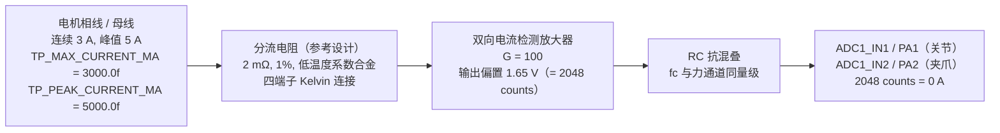
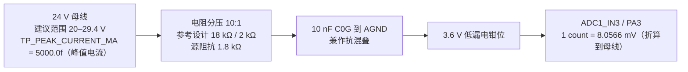
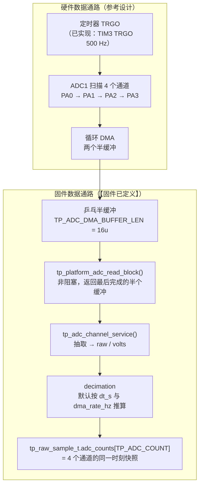
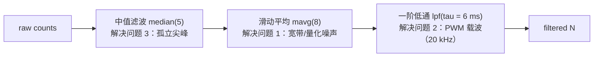
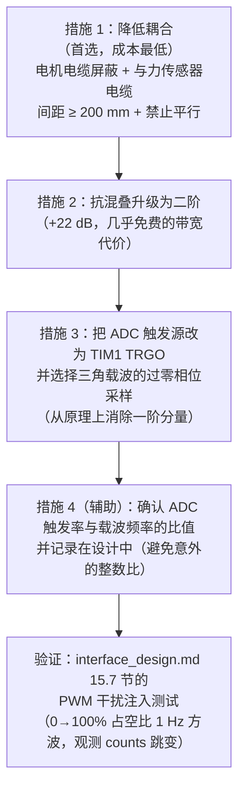
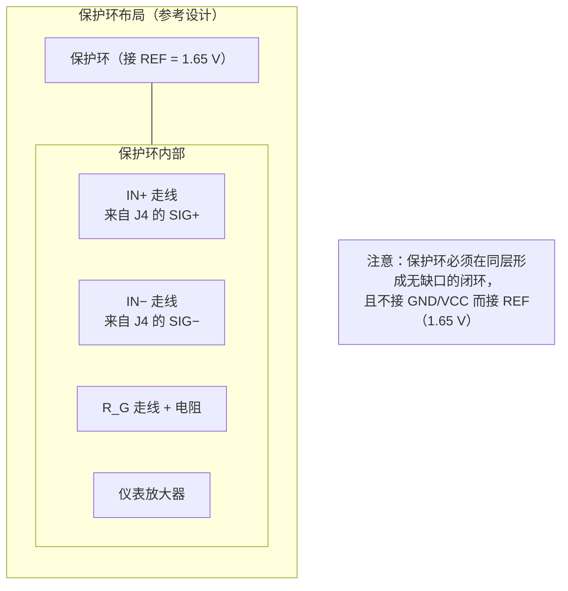
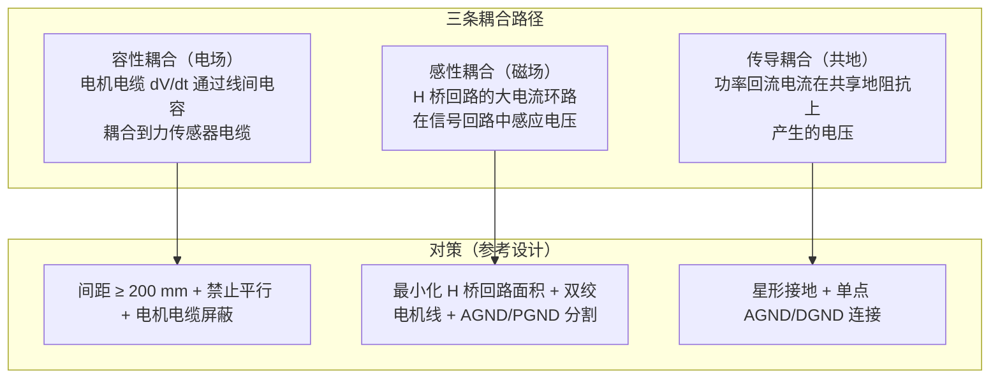

# 第二代采茶机器人 — 模拟前端与信号调理设计（Analogue Front End & Signal Conditioning）

<!-- REVISION NOTICE - do not remove -->
> ### ⚠️ 参数修订说明（第三次校正，覆盖全文数值）
>
> 本文档写作期间，项目经历了三轮**更正**，因此正文中的部分**具体数字已经过期**。
> 保留原文是为了不掩盖修正过程，但读数时请以代码为准。
> **第三次更正的完整缺陷清单见 [`docs/12_results_analysis.md`](12_results_analysis.md) 的 §3.5。**
>
> | 常量 | 已废弃的值 | 当前值（权威） | 更正原因 |
> |---|---|---|---|
> | `TP_PLANT_MOTOR_KT_NM_PER_A` | 2.0 | **0.4** | SI 单位下 `Kt` 与 `Ke` 是同一物理量，原值相差 40 倍，违反能量守恒 |
> | `TP_PLANT_MOTOR_KE_VS_RAD` | 0.05 | **0.4** | 同上 |
> | `TP_VEL_PID_KP` | 0.005 | **0.026** | 被控对象 DC 增益由 480 变为 60 mrad/s/permille，必须重新整定 |
> | `TP_VEL_PID_KI` | 0.10 | **0.83** | 同上 |
> | `TP_POS_PID_KP` | 12.0 | **5.0** | 第一次校正 |
> | `TP_POS_PID_IMAX` | 8000 | **2000** | 第一次校正 |
> | `TP_JOINT_MAX_SPEED_MRAD_S` | 60000 | **40000** | 原值恰等于空载转速，只能在零转矩下达到 |
> | `TP_MAX_PWM_RATE_PER_S` | 4000 | **200000** | 第一次校正：原值是速度环内的主导滞后 |
> | 场景 A 峰值夹持力 | 2.493 N | **2.363 N** | 第三次校正：力背驱符号修正 |
> | 场景 A 达到目标力 | 2.26 N | **2.18 N** | 同上 |
> | 场景 A 接触间隙 | 5.688 mm | **5.682 mm** | 同上 |
> | 场景 A 主机链路解码 | 2200 B / 100 帧 | **2134 B / 97 帧** | 同上 |
> | `TP_PLANT_JAW_BACKDRIVE` 的作用方向 | 减去（`-=`） | **加上（`+=`）** | 符号错误使茎秆把空夹爪"吸"到机械硬限：力从 5.0 N 涨到 16.4 N，并误锁存传感器故障 |
> | 力环服务速率 | 100 Hz（与注释不符） | **1 kHz** | 力环搬入 1 kHz 控制任务，"N 个控制周期"从此等于 N ms |
>
> **唯一权威**：`firmware/Application/config.h` 与 `firmware/BSP/host/plant_model.h`。
> 二者的一致性由 `tests/test_config_agreement.py` 自动校验——它会解析这两个头文件并与
> Python 模型逐条比对，因此任何再次漂移都会变成失败的测试而不是过期的文档。
<!-- /REVISION NOTICE -->


> ## ⚠️ 文档性质声明（必读）
>
> **本文档是设计文档 / 参考设计（Design Document / Reference Design），不是测试报告。**
>
> - **本项目没有任何实物板卡被制造、装配、上电或测量过。** 仓库中不存在 PCB、BOM、原理图源文件，也不存在任何实测记录（噪声谱、频响、温漂、标定数据）。
> - 本文档中出现的**全部器件型号均标注为「参考设计 / Recommended Implementation」**，表示"为满足本设计的电气要求而推荐的一类器件"，**不代表已被采购、选型冻结或验证**。文中提及的器件（如 INA333）仅用于说明一类器件的参数区间；所有"典型值""最大值"均来自公开数据手册资料，**必须由最终选定的具体器件型号的数据手册复核**。
> - 本文档中的**全部数字都是基于数据手册的设计计算（datasheet-based design calculation）、工程估算或仓库源码中的编译期常量**，没有一个是测量结果。**不使用、也不应被解读为包含任何"实测""板测""测试通过""已验证"的结论**——本文档刻意不出现这些字样。所有需要实物才能确认的条目都集中在第 9 章并明确标注为未验证。
> - 凡引用固件符号，均给出**带出处的形式**（`名称 = 数值`，来源文件）。仓库中未定义的常量、器件参数、引脚号，一律明确写为「**仓库中未定义**」并给出参考设计建议值，**绝不虚构**。
> - 本文档**只描述模拟前端与信号调理**（增益、失调、噪声、滤波、采样、标定、布局）。接口、连接器、总线物理层、E-stop 回路、接地与屏蔽的**系统级策略**见配套文档 `hardware/interface_design.md`。
> - 与 NVM/标定相关的操作性内容，`force_sensor.h` 指向 `docs/force_sensor_calibration.md`。**本文档撰写时该文件在仓库中不存在**；交付时仓库中已出现同名文件（由并行工作产生）。**因此本文档第 8.1、8.2 节仍然自足地给出了一套可执行的零点/增益标定流程**，不依赖外部文档；使用外部文档前请先核实其内容与本文档是否一致（见第 9 章 R-04）。
>
> ### ⚠️⚠️ 时效性更正（本文件成稿后仓库被并行改动 — 以下为最新核对结果，正文冲突处以本节为准）
>
> **（1）`platform_stm32f407.c` 现已存在（约 105 KB），ADC 配置不再是"仓库中未定义"。**
> 从该文件读到的**实现事实**如下，本文档中标为"未定义/参考设计"的相应内容应以此替换：
>
> | 项目 | **实现值** |
> |---|---|
> | 触发源 | **TIM3 TRGO（更新事件）500 Hz**，`ADC_EXTERNALTRIGCONV_T3_TRGO` + 上升沿，`ContinuousConvMode = DISABLE` |
> | ADC 时钟 | `ADC_CLOCK_SYNC_PCLK_DIV4` = PCLK2 84 MHz / 4 = **21 MHz**（/2 会超 F407 的 36 MHz 上限） |
> | 采样时间 | 四路共用 `ADC_SAMPLETIME_84CYCLES` = **84 周期 = 4 µs @ 21 MHz** |
> | 分辨率 / 对齐 | `ADC_RESOLUTION_12B`、右对齐、`ScanConvMode = ENABLE`、`EOCSelection = ADC_EOC_SEQ_CONV` |
> | DMA | **DMA2_Stream0**、circular、半字、长度 `TP_ADC_DMA_BUFFER_LEN × TP_ADC_COUNT = 64`、使能 `TCIE|HTIE|TEIE|DMEIE` |
> | 乒乓发布 | `s_adc_dma[64]`；**HT → `adc_publish_half(0)`、TC → `adc_publish_half(8)`**；`adc_publish_half()` 取该半缓冲的**最后一个完整扫描**写入 `s_adc_latest[]` / `s_adc_valid[]` |
> | 通道映射（实现） | 力 = **PA4/ADC1_IN4**（`ADC_CHANNEL_4`）；关节电流 = **PA5/ADC1_IN5**；夹爪电流 = PA2/IN2；母线 = PA3/IN3。**`bsp_types.h` 的注释（PA0/IN0、PA1/IN1）是 stale 的**，原因是 PA0/PA1 必须留给 TIM2 编码器（后端文件头标注为 "Conflict 1"） |
> | `tp_platform_adc_read()` | **只返回 `s_adc_latest[ch]`，不触发新转换、不等待**；无有效样本时返回 `TP_ERR_NOT_READY` |
> | `tp_platform_adc_read_block()` | 临界区内检查并清 `s_adc_block_ready`，最多交付 **8** 个样本；无块时返回 0 |
> | **仍未定义** | `platform_stm32f407.h` **没有任何 ADC 诊断访问器**：`s_adc_blocks`（发布次数）与 `s_adc_dma_errors`（DMA 错误）**外部不可读** |
>
> **（2）由上述配置推出的三条硬结论（本文档 6.6 / R-02 相关分析应据此更新）**：
> - **发布周期 = 8 个扫描 × 2 ms = 16 ms**，即**新样本出现率只有 62.5 Hz**
>   ——而传感器任务（`tp_app_sensor_step()`）每 2 ms 读一次，
>   于是**同一样本被重复送入滤波链约 8 次**。
>   `TP_FILTER_MEDIAN_WINDOW = 5`（在 500 Hz 下 10 ms）**短于该保持时间**，
>   所以**中值滤波剔不掉被保持的坏样本**（它在窗口里出现多次而非孤立一次）。
> - `tp_force_sensor_zero_calibrate()` 在几微秒内背靠背读 64 次 →
>   **目标端实际只有 1 个不同样本**，"64 次平均"退化、`spread` 门限失效。
>   更细一层：那个窗口（约 10⁻⁴ s）内物理上可能的最大力变化只有
>   **约 1.2–6 mN**，是 `TP_FORCE_ZERO_CAL_MAX_SPREAD_N = 0.25f` 的 **1/25–1/40**
>   ——即使后端行为正确，该门限也**达不到它声明的目的**（且静态预载不产生跨度）。
> - **`tp_platform_adc_read_block()` 这条块路径在应用代码中从未被调用**
>   （唯一调用者 `tp_adc_channel_service()` 无调用点）；
>   且 `tp_adc_channel_init(..., dma_rate_hz = 1000u)` 与实际 500 样本/秒不符
>   （使 `decimation` 算成 2 而非 1）。
>
> **（3）`FORCE_SPIKE_THRESHOLD_N` 已由 `1.0f` 改为 `3.0f`（`force_sensor.c`）。**
> 源码注释说明第一版的 1.0f 在**仿真中接触瞬间被误触发**。
> **本文档中所有引用 `1.0f` 的位置（摘要、F-11、6.6.3 节标题与其全部核算、
> 9 章 R-09、附录 A.5 与附录 D 的"1.0 N = 124.74 counts"）都已失效**，
> 应按 **3.0f ≈ 374.2 counts** 重算；R-09 的
> "1.0 N = 124.7 counts ⇒ 增益改变时灵敏度静默减半"这整条论证需要改写
> （其**结论方向仍然成立**：阈值仍是硬编码牛顿值、仍应与增益解耦，
> 但数值由 124.7 counts 变为 374.2 counts）。
>
> **（4）仍然成立的限定（未变）**：**没有实物板卡、没有任何硬件测量数据**；
> 本文档全部数字仍是设计计算；`RG = 249 Ω` 与 INA333 传递函数的矛盾
> （本文档 R-01）**仍然存在**，两条编译期断言在两种情形下都会通过。
>
> **（5）与并行交付的 `hardware/force_sensor.md` 存在主题重叠**：
> 两份文档在关键常数上一致（8.0166 mN、±16.4139 N、32.8358 N、1005 mV、274 counts），
> 在 RG 不一致上也结论一致。**制板前必须仲裁两者的常数一致性**，
> 并注意 `config.h` 引用的是 `force_sensor.md` 而不是本文件。

---

## 摘要

本文档给出第二代采茶机器人**力/电流/母线电压三个模拟通道**的完整信号调理参考设计。三个通道共享同一块 12 位 SAR ADC（`TP_ADC_RESOLUTION_BITS = (12u)`、`TP_ADC_VREF_V = (3.300f)`、`TP_ADC_FULL_SCALE = (4095.0f)`），但它们的动态范围、噪声要求和带宽要求差了两个数量级，因此设计重心完全不同：**力通道是"µV 级直流精度 + 强抗混叠"问题，电流通道是"分流电阻的 Kelvin 连接与量程匹配"问题，母线电压通道是"分压精度与过压钳位"问题。**

比这些更重要的是，本文档给出了一系列**可复算的数字**，并在此过程中发现了仓库文档中的若干处算术问题与两处实质性的设计缺口。

**关于力前端，核心链路与数字如下**（全部从 `config.h` 的宏出发逐步推导）：

| 环节 | 数值 | 出处 / 计算 |
|---|---|---|
| 称重传感器 | 10 N，1 mV/V，5 V 激励 | `TP_LOADCELL_RATED_N = (10.0f)`、`TP_LOADCELL_SENSITIVITY_MV_V = (1.0f)`、`TP_LOADCELL_EXCITATION_V = (5.0f)` |
| 桥路灵敏度 | 0.5 mV/N | `TP_LOADCELL_MV_PER_N = (1.0 × 5.0)/10.0` |
| 仪表放大器增益 | 201（参考设计：零漂移斩波架构） | `TP_FORCE_AMP_GAIN = 201.0f × 1.0f` |
| 前端灵敏度 | 100.5 mV/N | `TP_FORCE_FRONTEND_MV_PER_N` |
| 抗混叠 RC | fc = 1.6 kHz（**仅存在于注释中，无对应 `#define`**） | `config.h` 第 8 节 `@verbatim` 块 |
| ADC 每计数 | 0.8056641 mV | `TP_ADC_MV_PER_COUNT = 3300/4096` |
| **设计 LSB** | **8.0166 mN/count** | `TP_FORCE_CAL_SCALE_N_PER_COUNT` |
| 额定负载满量程 | 1005 mV | `TP_FORCE_FULLSCALE_MV` |
| ADC 饱和点 | 32.8358 N | `TP_FORCE_ADC_SATURATION_N` |
| 可用范围 | ±16.4139 N | `TP_FORCE_USABLE_RANGE_N` |
| 零点 | 2048 counts（= 1.65 V 偏置） | `TP_FORCE_CAL_ZERO_COUNTS = (2048.0f)` |
| 2.2 N 目标 | **274.34 counts**，1 LSB = **0.3644 %** 读数 | 2.2 / 0.0080166；0.0080166 / 2.2 |

**本文档最重要的五项发现（每一项都给出了完整算式）**：

**一、`config.h` 注释中的 INA333 增益与 R_G 不一致，且错误不会被构建立即发现。** INA333 的传递函数是 G = 1 + 100 kΩ/R_G。`TP_FORCE_AMP_GAIN_STAGE1 = (201.0f)` 配注释"RG = 249 ohm"：G = 201 实际需要 R_G ≈ 500 Ω，而 R_G = 249 Ω 给出 G = 402.6。**下游全部数字（8.0166 mN LSB、±16.41 N 可用范围、32.84 N 饱和点、1005 mV 满量程）都是由 G = 201 推出的。** 若实际增益是 402.6，则 LSB 变为 4.0022 mN、可用范围变为 ±8.1946 N、饱和点变为 16.3932 N——而 `config.h` 底部那条 `TP_STATIC_ASSERT(TP_FORCE_USABLE_RANGE_N > TP_FORCE_MAX_N)` 断言**依然成立**（8.19 > 5.0），`TP_STATIC_ASSERT(TP_FORCE_FULLSCALE_MV < TP_ADC_VREF_V * 1000.0f)` 也成立（2013 < 3300）。**因此这个 2 倍的增益错误不会被构建系统、也不会被任何编译期断言捕获**（第 6.5 节 / R-01）。

**二、`force_sensor.h` 的桥路温漂算式在量纲上不自洽。** 该头文件称 *"A 5 ppm/K mismatch on a 1005 mV full-scale signal is ~5 uV/K, which over a 20 K swing is about 0.1 mV -> 0.13 N. That is 6 % of the 2.2 N target"*。本文档逐步复算后指出：如果把 "5 ppm/K" 理解为**零点温度系数（相对额定输出）**，正确结果是 **1.0 mN**（0.045 %，不是 6 %），比注释小 130 倍；如果理解为**桥路电阻失配**（这在物理上更符合 "bridge resistances are both temperature dependent" 的上下文），正确结果是 **250 mN**（11.4 %），比注释大近 2 倍。**两种解释相差 250 倍，注释中的 0.13 N 与中间量 0.1005 mV 之间不存在任何一致的单位换算。** 结论（"每次作业前的零点标定不可省略"）仍然成立，但真实原因不是桥路 TCZ，而是**热电势（1–3 µV/K ⇒ 40–120 mN/20 K）与放大器失调漂移**（第 6.5.3 节）。

**三、斩波稳定的选择是正确的，但理由不是噪声而是漂移。** 本文档的噪声预算表明：零漂移斩波放大器的 50 nV/√Hz 白噪声经 201 倍放大、1.6 kHz RC 限带（NBW = 2513 Hz）后，在 ADC 输入端贡献 **0.625 counts RMS**（5.01 mN RMS），这已经与 ADC 自身的噪声（约 0.58 counts RMS）相当；而一只普通精密双极运放的白噪声只有 10 nV/√Hz，其贡献仅 0.13 counts。**换句话说，选用斩波架构在噪声上是"付出"而非"收益"。** 真正的收益在失调漂移：普通精密运放的 1–5 µV/K 折算到 0.5 mV/N 的桥路上是 **2–10 mN/K**（20 K 下 40–200 mN = 5–25 LSB），而 INA333 类器件的 0.1 µV/K 只对应 **0.2 mN/K**（20 K 下 4 mN），改善 10–50 倍。**但必须同时指出：布局引入的热电势（2–6 mN/K）比放大器本身的失调漂移（0.2 mN/K）大 10–30 倍，因此"选对放大器"是必要但不充分的条件——决定力通道长期稳定性的其实是布局的热对称性**（第 4.2 节、第 6.5.3 节）。

**四、`fc = 1.6 kHz` 的一阶 RC 无法独自解决 PWM 载波的混叠，而这是本设计最大的精度缺口。** 一阶 RC 在 20 kHz（典型 PWM 载波）处只有 **21.97 dB** 的衰减。若 ADC 采样率与载波频率成整数倍关系（500 Hz 与 20 kHz 之比恰为 40；`adc_driver.h` 注释示例中的 2 kHz 与 20 kHz 之比恰为 10），**载波会精确混叠到直流，任何数字平均都无法去除它**。若载波在 ADC 输入端耦合 100 mV，残余 7.97 mV = 9.9 counts ≈ **79.4 mN** 的力误差——**接近 10 个 LSB，远大于本文档算出的全部其它误差项**。本文档给出该混叠的完整条件推导、可行性与不可行性的边界，并把"降低耦合 + 提高模拟衰减阶数 + 同步采样相位"列为必须在制板前闭合的项（第 6.8 节 / R-20）。

**五、`TP_SENSOR_FORCE_MIN_N / MAX_N` 的合理性窗口在本设计标定下永远不会触发。** 由 `counts` 到力的映射 `F = (counts − 2048) × 0.0080166`，原始转换的**可达**力区间是 counts ∈ [0, 4095] ⇒ F ∈ [−16.4179 N, +16.4090 N]。而窗口是 `TP_SENSOR_FORCE_MIN_N = (-20.0f)` 与 `TP_SENSOR_FORCE_MAX_N = (50.0f)`——**两者都落在可达区间之外**，因此 `force_sensor.c` 中那段范围检查在出厂标定下是死代码，只有在运行期标定把 `n_per_count` 放大到设计值的数倍后才可能生效。同理，`TP_FORCE_ZERO_CAL_MAX_SPREAD_N = (0.25f)` 的"信号正在移动"判据也不成立：64 次背靠背读取的时间窗口只有 10⁻⁴ s 量级，在该窗口内最大物理上可能的力变化约 6 mN，**比阈值低约 40 倍**；而一个**静态**预载根本不产生跨度。该检查实际上是一个"重复性/噪声"检查（第 6.6.3 节、第 6.6.4 节）。

文档其余部分给出：四个通道的器件选型对比表（桥式前端架构、抗混叠滤波器阶数、激励电源方案、量程选择、电流检测方案）、全部关键计算的逐步算式（灵敏度/LSB/满量程/饱和点/可用范围、2.2 N 对应的 counts、10 N vs 20/50/100 N 对比、失调与温漂预算、噪声预算、相位与群延迟、混叠分析、电流通道标定、母线分压、一阶低通的离散化稳定性、中值/滑动平均缓冲尺寸耦合）、布局与走线（保护环、开尔文连接、对称布局、去耦、热电偶效应）、测试与验证方法（零点与增益标定、噪声谱密度、共模抑制与串扰、PWM 注入、温漂、长期漂移），以及 20 条已知风险与未验证项。

---

## 目录

**第 0 章 文档约定**
- 0.1 文档定位与范围
- 0.2 事实来源与引用规则
- 0.3 标注约定（【固件已定义】/【参考设计】/【仓库中未定义】/【设计计算】/【未验证】）
- 0.4 术语、符号与单位
- 0.5 本文档中「未验证」假设的集中清单

**第 1 章 信号链总览**
- 1.1 力通道信号链（mermaid 框图）
- 1.2 电流通道信号链（mermaid）
- 1.3 母线电压通道信号链（mermaid）
- 1.4 三通道共用的数据通路（DMA / 抽取 / 乒乓缓冲）
- 1.5 模拟域与数字域的误差分工表

**第 2 章 设计目标**
- 2.1 力通道指标
- 2.2 电流通道指标
- 2.3 母线电压通道指标
- 2.4 系统级目标（相位、延迟、稳定性）
- 2.5 明确非目标

**第 3 章 ADC 与数据通路**
- 3.1 STM32F407 ADC 的关键特性与约束
- 3.2 为什么用定时器触发的循环 DMA（仓库论证 + 补充分析）
- 3.3 块尺寸、抽取与延迟的未定义关系
- 3.4 采样率到底是多少？（一个必须如实指出的空白）
- 3.5 基准电压 VREF+ 的选择与 `TP_ADC_VREF_V` 的强耦合

**第 4 章 器件选型与理由**
- 4.1 桥式传感器前端架构对比表
- 4.2 为什么选斩波稳定（zero-drift）架构：失调漂移预算
- 4.3 抗混叠滤波器方案对比
- 4.4 激励电源方案对比与比例式（ratiometric）分析
- 4.5 传感量程选择：10 N / 20 N / 50 N / 100 N 对比
- 4.6 电流检测前端选型
- 4.7 母线电压检测选型
- 4.8 器件选型汇总表

**第 5 章 原理说明**
- 5.1 桥路的传递函数与偏置结构
- 5.2 仪表放大器的传递函数与 R_G 的关系
- 5.3 抗混叠 RC 的作用与局限
- 5.4 数字滤波链的每一级在解决什么问题
- 5.5 三通道的基准与偏置策略

**第 6 章 关键计算（逐步算式）**
- 6.1 灵敏度与 LSB 链
- 6.2 满量程、ADC 饱和点与可用范围
- 6.3 2.2 N 对应的 counts 与 0.36 % 的复算
- 6.4 为什么是 10 N 而不是 50 N（引用 + 复算 + 四量程对比表）
- 6.5 失调与温漂预算
  - 6.5.1 各误差项的定义与折算
  - 6.5.2 增益/R_G 不一致的两种情形
  - 6.5.3 桥路温漂的逐步复算与 `force_sensor.h` 量纲问题的说明
  - 6.5.4 完整温漂预算表与结论
- 6.6 噪声预算
  - 6.6.1 各噪声源的密度与限带
  - 6.6.2 逐项折算到 ADC 输入端（counts）
- 6.6.3 与 `FORCE_SPIKE_THRESHOLD_N`（**第二版 = 3.0f**；第一版 1.0f）的比对
  - 6.6.4 与 `TP_FORCE_ZERO_CAL_MAX_SPREAD_N = 0.25f` 的比对
  - 6.6.5 数字滤波后的噪声与量化抖动的关系
- 6.7 采样与滤波的相位代价
  - 6.7.1 三级链的群延迟逐步计算
  - 6.7.2 一阶低通的离散化与相位
  - 6.7.3 与力环 1 kHz / `TP_FORCE_PID_TAU_D_S` 的比较
  - 6.7.4 带宽上限的结论
- 6.8 抗混叠与 PWM 载波混叠分析
  - 6.8.1 一阶 RC 在各频点的衰减
  - 6.8.2 混叠条件与"混叠到直流"的判据
  - 6.8.3 四种缓解措施的有效性排序
  - 6.8.4 提高阶数的收益表
- 6.9 电流通道：counts → A 的标定与分流电阻反算
- 6.10 母线电压通道：分压电阻算式与 1 count 的电压
- 6.11 一阶低通的离散化稳定性与 `alpha = dt/(tau+dt)`
- 6.12 滑动平均缓冲尺寸与中值窗口常量的耦合

**第 7 章 布局与走线**
- 7.1 保护环（guard ring）
- 7.2 开尔文（四线）连接
- 7.3 对称布局
- 7.4 去耦与地平面
- 7.5 与 PWM 功率回路的隔离
- 7.6 热电偶效应与温度梯度
- 7.7 屏蔽与保护环的配合
- 7.8 布局检查清单

**第 8 章 测试与验证方法**
- 8.1 零点标定（指向 `docs/force_sensor_calibration.md` 的说明与替代流程）
- 8.2 增益标定
- 8.3 噪声与噪声谱密度测量
- 8.4 共模抑制（CMRR）与串扰测试
- 8.5 PWM 干扰注入测试
- 8.6 温漂测试
- 8.7 长期漂移与重复性
- 8.8 电流通道与母线电压通道的验证
- 8.9 数据记录模板与验收判据汇总

**第 9 章 已知风险与未验证项**
- 9.1 风险总表（R-01 … R-20）
- 9.2 必须在制板前闭合的项
- 9.3 必须在样机阶段测量并回填本文档的项

**附录 A 本文档引用的固件符号清单（含出处）**
**附录 B 「仓库中未定义」条目清单**
**附录 C 全部算式的变量表与可复现计算清单**
**附录 D 设计参数速查表**

---

## 第 0 章 文档约定

### 0.1 文档定位与范围

| 覆盖 | 不覆盖 |
|---|---|
| 三路模拟通道的信号链结构 | 接口与连接器定义（见 `hardware/interface_design.md` 第 4 章） |
| 放大器/滤波器的架构选型与对比 | 总线物理层（见 `interface_design.md` 第 6、7 章） |
| 全部增益、失调、噪声、温漂的逐步计算 | 接地与屏蔽的系统级策略（见 `interface_design.md` 第 12 章） |
| 抗混叠与混叠分析 | E-stop 回路（见 `interface_design.md` 第 9 章） |
| ADC 与 DMA 数据通路的约束 | 固件任务结构、PID 整定、应用层协议 |
| 数字滤波链的参数与相位代价 | 机械结构与传感器安装 |
| 模拟布局、走线、热电偶效应 | PCB 叠层与阻抗控制的最终实现 |
| 标定流程与测试方法（判据） | 任何实测数据 |

### 0.2 事实来源与引用规则

本次撰写时逐行读取的文件（**仅有这些文件被当作事实来源**）：

| 文件 | 提供的事实 |
|---|---|
| `firmware/Application/config.h` | 全部 ADC/前端/滤波常量、任务速率、力限值与 PID 增益 |
| `firmware/BSP/bsp_types.h` | ADC 通道枚举与引脚（PA0–PA3）、机械常量、`TP_MRAD_PER_COUNT` |
| `firmware/BSP/adc_driver.h` | DMA 块尺寸、抽取、通道结构、过量运行计数、DMA 选择的理由 |
| `firmware/BSP/force_sensor.h` | 力通道链路、标定接口、零点跨度阈值、桥路温漂论证 |
| **`force_sensor.c`** | 峰值检测阈值 `FORCE_SPIKE_THRESHOLD_N`(**3.0f**，第二版由 1.0f 提高)、`FORCE_SPIKE_TRIP`(8u)、零点标定的实际实现 |
| `firmware/Middleware/utils/filters.h` | 三种滤波器的结构与语义、低通离散化方式、峰值检测器 |
| `firmware/Middleware/utils/filters.c` | `alpha = dt/(tau+dt)` 的实际实现、`FILTER_MAX_WINDOW`、窗口夹取行为 |
| `firmware/BSP/host/plant_model.h` | 2048 counts = 0 A、10:1 分压、counts↔force 的精确反变换、茎秆刚度/阻尼/损坏阈值 |
| `firmware/BSP/platform_api.h` | ADC 读取接口（含非阻塞乒乓块读取）的契约 |
| `firmware/BSP/limit_switch.h` | 去抖与极性（间接相关） |
| `firmware/Drivers/startup/system_stm32f4xx.c` | 时钟树（决定 ADC 触发与采样时序的上限） |

**引用格式**：`宏名 = 数值（来源文件）`。凡不能找到出处的数字，一律不使用或明确标注为"本文档的设计计算值"。

### 0.3 标注约定

| 标记 | 含义 |
|---|---|
| **【固件已定义】** | 在仓库源码中有明确出处，本文档只是转述 |
| **【参考设计】** | 本文档给出的建议值，用于指导硬件设计，**必须评审** |
| **【仓库中未定义】** | 仓库中确实不存在该定义，且不能从其他常量反推 |
| **【设计计算】** | 本文档基于数据手册或固件常量做的算式推导，**非测量** |
| **【数据手册典型值】** | 来自公开数据手册资料，**必须由最终选定器件的数据手册复核** |
| **【未验证】** | 需要实物才能确认；归属于第 9 章 |

### 0.4 术语、符号与单位

| 符号 | 含义 | 单位 |
|---|---|---|
| S | 称重传感器额定输出（灵敏度） | mV/V |
| V_exc | 桥路激励电压 | V |
| G | 前端总增益 | — |
| G₁, G₂ | 两级增益 | — |
| R_G | 仪表放大器的增益设定电阻 | Ω |
| V_REF | ADC 基准电压（`TP_ADC_VREF_V`） | V |
| q | ADC 的 1 LSB，等于 `TP_ADC_MV_PER_COUNT` | mV |
| N_per_count | 每计数对应的牛顿数 | N/count |
| NBW | 噪声带宽（Noise Bandwidth），一阶 RC 为 (π/2)·fc | Hz |
| e_n | 电压噪声密度 | nV/√Hz |
| TCZ | 零点温度系数 | ppm/K |
| ENOB | 有效位数 | bit |
| PSRR | 电源抑制比 | dB |
| CM | 共模 | — |
| 单位增益带宽的"噪声增益" | 对仪表放大器即总增益 G | — |

### 0.5 本文档中「未验证」假设的集中清单

以下假设贯穿全文的计算，**全部未经验证**，必须由实测替换：

| # | 假设 | 用在哪里 | 若假设错误的影响 |
|---|---|---|---|
| A-01 | 桥路电阻为 350 Ω（决定了桥路热噪声 2.40 nV/√Hz 与激励电流 14.3 mA） | 6.6.1 节 | 1000 Ω 桥路的热噪声高 1.69 倍（仍可忽略）；激励电流降至 5 mA |
| A-02 | 桥路存在 1% 的电阻不平衡（决定了"激励纹波 → 差分分量"的馈通系数） | `interface_design.md` 1.2 节 | 该系数线性影响激励纹波的要求；实际值必须由具体传感器数据手册的"零点不平衡"指标给出 |
| A-03 | INA333 类器件的 e_n = 50 nV/√Hz、V_OS = 25 µV(max)、漂移 0.1 µV/K（G ≥ 100）、CMRR ≥ 100 dB(min)、I_q = 50 µA | 4.1、4.2、6.6 节 | 噪声预算与漂移预算按比例变化 |
| A-04 | STM32F407 的 ADC 典型 ENOB ≈ 10.8–11.0 bit（决定了 ADC 自身的噪声 0.58–0.82 counts） | 6.6.2 节 | ADC 噪声是总噪声的约一半，ENOB 每降 1 bit，总噪声约增 0.5 counts |
| A-05 | RC 的串联电阻取 1 kΩ（决定了 kT/C 噪声与 ADC 采样的建立时间） | 6.1.4、6.6.2 节 | 见 6.6.2 节：RC 电阻的噪声贡献 < 0.001 counts，几乎不敏感 |
| A-06 | PWM 载波频率为 20 kHz（**仓库中未定义**） | 6.8 节 | 载波频率决定混叠的落点；若载波与采样率不构成整数比，混叠结论改变 |
| A-07 | ADC 的 DMA 流速率约 2 kHz、抽取比约 4（依据 `adc_driver.h` 的**注释示例**，不是常量） | 3.3、3.4、6.8 节 | 决定第一级采样率与块延迟 |
| A-08 | 热电偶接点温差对应的热电势为 1–3 µV/K（取决于布局与材料） | 6.5.3 节 | 这是**最主要的**温漂项，40–120 mN/20 K |
| A-09 | 两路分流电阻为 2 mΩ、放大增益 100（参考设计建议） | 6.9 节 | 决定电流量程与 LSB |
| A-10 | 母线分压为 18 kΩ / 2 kΩ + 10 nF（参考设计建议） | 6.10 节 | 决定源阻抗与建立时间 |

---

## 第 1 章 信号链总览

### 1.1 力通道信号链

```mermaid
graph LR
    subgraph SENSOR["传感器（参考设计）"]
        BR["称重传感器 桥式<br/>10 N 额定<br/>1 mV/V @ 5 V 激励<br/>0.5 mV/N"]
    end

    subgraph ANALOG["模拟前端（参考设计）"]
        EXC["5 V 激励源<br/>低噪声 LDO<br/>TP_LOADCELL_EXCITATION_V = 5.0f"]
        IA["仪表放大器<br/>零漂移斩波架构<br/>G = 201, 输出偏置 1.65 V"]
        RC["抗混叠 RC<br/>fc = 1.6 kHz<br/>（注释给出，无对应宏）"]
    end

    subgraph DIGITAL["数字域（固件）"]
        ADC["ADC1_IN0 / PA0<br/>12 bit, VREF = 3.300 V<br/>定时器触发 + 循环 DMA"]
        DEC["抽取平均<br/>tp_adc_channel_t::decimation"]
        SPIKE["峰值检测器<br/>tp_spike_detector_t<br/>阈值 FORCE_SPIKE_THRESHOLD_N = 3.0f（第二版）"]
        MED["中值滤波<br/>window = TP_FILTER_MEDIAN_WINDOW = 5"]
        MAVG["滑动平均<br/>window = TP_FILTER_FORCE_MA_WINDOW = 8"]
        LPF["一阶低通<br/>tau = TP_FILTER_FORCE_LPF_TAU_S = 0.006 s"]
        OUT["force_n / force_raw_n<br/>→ force_control.c, safety_monitor.c"]
    end

    EXC -->|"EXC+ / EXC−"| BR
    BR -->|"SIG+ / SIG−<br/>0.5 mV/N"| IA
    IA -->|"100.5 mV/N<br/>偏置 1.65 V"| RC
    RC -->|"fc = 1.6 kHz"| ADC
    ADC -->|"0.8056641 mV/count"| DEC
    ADC --> SPIKE
    DEC --> MED --> MAVG --> LPF --> OUT
    SPIKE -->|"ERR_SENSOR"| OUT
    LPF -.->|"来自 config.h:<br/>TP_FORCE_CAL_ZERO_COUNTS = 2048.0f<br/>TP_FORCE_CAL_SCALE_N_PER_COUNT<br/>= 0.0080166 N/count"| OUT
```



**链路增益的逐级数值**【设计计算】：

| 级 | 输入量 | 传递关系 | 输出量 |
|---|---|---|---|
| 桥路 | 力 F | V_bridge = S × V_exc × (F / F_rated) = 1 mV/V × 5 V × F/10 N | 0.5 mV/N（差分） |
| 仪表放大器 | V_bridge | V_out = G × V_bridge + 1.65 V，G = 201 | 100.5 mV/N + 1.65 V |
| 抗混叠 RC | V_out | 一阶低通，fc = 1.6 kHz，直流增益 1 | 100.5 mV/N + 1.65 V |
| ADC | V_out | counts = V_out / 0.8056641 mV | 124.74 counts/N + 2048 counts |
| 标定 | counts | F = (counts − 2048) × 0.0080166 N/count | N |

**关键观察**：整个链路的"零点"落在 **2048 counts = 1.65 V**，即 **V_REF/2**，而不是 V_exc/2 = 2.5 V。这个选择是刻意的（为了得到关于零点对称的 ±16.41 N 量程），**但它同时决定了本设计不是比例式测量**——详见 4.4 节。

### 1.2 电流通道信号链



**注意 `plant_model.h` 的语义（【固件已定义】）**：`tp_plant_read_current_counts()` 的文档明确写 *"Raw 12-bit value, 0..4095, with 2048 counts meaning 0 A"*。因此**放大器的输出在 0 A 时必须等于 1.65 V**，与力通道的零点一致（`TP_FORCE_CAL_ZERO_COUNTS = (2048.0f)`）。这是一条必须由硬件满足的契约：**两个电流通道的放大器基准必须接 1.65 V 偏置，而不是 0 V。**

### 1.3 母线电压通道信号链



**注意**：`config.h` 中**没有**任何关于母线分压电阻、源阻抗或抗混叠电容的常量；`adc_driver.h` 的 `tp_adc_channel_init(..., float divider, ...)` 只在参数注释中举例 "e.g. 10.0 for the 24 V rail"，`plant_model.h` 说 "Read the 24 V rail as ADC counts (10:1 divider)"。**因此 10:1 是已定义的设计意图，但具体的电阻值、容值、钳位器件全部未定义。**

### 1.4 三通道共用的数据通路



`adc_driver.h` 给出的三条 DMA 理由（【固件已定义】，逐字转述要点）：

1. **抖动（Jitter）**：轮询采样时刻取决于任务何时运行；定时器触发的循环 DMA 使采样时刻**严格等间隔**。理由是 *"The velocity estimator divides by elapsed time and the force controller differentiates; both degrade badly with jitter."*
2. **通道相干性（Coherence）**：DMA 块在数微秒内捕获全部通道，因此同一条记录里的力与电流**确实属于同一时刻**。轮询读取会让它们相差最多 1 ms，*"and any correlation analysis between them is then meaningless."*
3. **CPU 占用（CPU availability）**：传输不耗周期，*"which leaves the 1 kHz control task undisturbed."*

**本文档补充的第四、第五条理由**：

4. **抗混叠的相干性**：只有采样时刻严格等间隔且与 PWM 载波有确定相位关系时，载波混叠的行为才是可预测的（6.8 节）。轮询采样使载波相位随机，混叠变成随机噪声。
5. **可复现性**：固定触发源意味着 `plant_model.h` 的主机仿真与目标硬件可以对齐采样时刻，Experiment 01–03 的结论才能迁移。

### 1.5 模拟域与数字域的误差分工表

| 误差项 | 可否在数字域消除 | 说明 |
|---|---|---|
| ADC 量化噪声 | **部分**（需有抖动） | 见 6.6.5 节：只有当模拟噪声 ≥ 约 0.5 LSB 时，平均才能把有效分辨率提升到 LSB 以下 |
| 放大器白噪声 | **是**（平均/低通） | 通过 `filters.h` 的三级链衰减约 7.5–13 倍（RMS） |
| 放大器 1/f 噪声 | 部分 | 在 1.6 kHz 的 NBW 下 1/f 贡献小于平坦带贡献（见 4.2 节） |
| 放大器失调电压（静态） | **是**（零点标定） | `tp_force_sensor_zero_calibrate()` |
| 放大器失调**漂移** | **否** | 需要温度补偿或更低温漂的器件 |
| 桥路零点失配（静态） | **是**（零点标定） | 同上 |
| 桥路零点的**温度系数** | **否** | 6.5.3 节 |
| 增益误差（静态） | **是**（满量程标定） | `tp_force_sensor_calibrate_scale()` |
| 增益**漂移**（激励、基准、R_G） | **否** | 6.5.4 节 |
| 热电势（静态，在标定温度下） | **是**（零点标定） | 只要标定时与工作时温度梯度相同 |
| 热电势的**变化** | **否** | 6.5.3 节；只能靠布局降低 |
| PWM 载波混叠 | **否**（若混叠到直流） | 6.8 节；**必须在模拟域解决** |
| ADC 基准噪声（`TP_ADC_VREF_V`） | **否** | 必须靠基准源的滤波与低噪声设计 |

**这张表是本文档的纲领**：它说明"数字滤波 + 零点标定"能解决的问题是有限的，**凡是落在"否"一列的项目，都必须在模拟域或布局上解决**。

---

## 第 2 章 设计目标

### 2.1 力通道指标

| # | 指标 | 目标值 | 判据来源 |
|---|---|---|---|
| F-01 | 量程（额定） | 10 N | `TP_LOADCELL_RATED_N = (10.0f)` |
| F-02 | 目标力 | 2.20 N | `TP_FORCE_TARGET_N = (2.20f)` |
| F-03 | 硬限 | 5.00 N | `TP_FORCE_MAX_N = (5.00f)` |
| F-04 | 分辨率要求 | < 20 mN | `config.h` 第 8 节原文：`0.806 mV / LSB < 20 mN` ⇒ 灵敏度 > 40 mV/N |
| F-05 | 设计 LSB | 8.0166 mN/count | 计算得（见 6.1 节） |
| F-06 | ADC 饱和点 | ≥ 3 × 硬限 | 设计得 32.8358 N，比值 6.57 |
| F-07 | 可用范围 | > 硬限（编译期断言） | `TP_STATIC_ASSERT(TP_FORCE_USABLE_RANGE_N > TP_FORCE_MAX_N)` |
| F-08 | 目标点相对分辨率 | 1 LSB ≤ 0.5 % 读数 | 设计得 0.3644 % |
| F-09 | 零点标定跨度阈值 | 0.25 N p-p | `TP_FORCE_ZERO_CAL_MAX_SPREAD_N = (0.25f)` |
| F-10 | 零点标定样本数 | 64 | `TP_FORCE_ZERO_CAL_SAMPLES = (64u)` |
| F-11 | 峰值（跳变）检测阈值 | **3.0 N（第二版；第一版为 1.0 N，在仿真中接触瞬间误触发，已提高）** | `FORCE_SPIKE_THRESHOLD_N = 3.0f`（`force_sensor.c`） |
| F-12 | 峰值连续触发次数 | 8 | `FORCE_SPIKE_TRIP = 8u`（`force_sensor.c`） |
| F-13 | 力环 PID | KP 14、KI 6、KD 0.05、τ_d 10 ms | `TP_FORCE_PID_*` |
| F-14 | 力环带宽（本文档推导的上限） | 约 2–4 Hz | 6.7.4 节（受传感链延迟限制，**非** PID 增益限制） |

### 2.2 电流通道指标

| # | 指标 | 目标值 | 判据来源 |
|---|---|---|---|
| C-01 | 连续电流限 | 3000 mA | `TP_MAX_CURRENT_MA = (3000.0f)` |
| C-02 | 峰值电流限（< 50 ms） | 5000 mA | `TP_PEAK_CURRENT_MA = (5000.0f)` |
| C-03 | 过流跳闸时间 | 50 ms | `TP_OVERCURRENT_TRIP_MS = (50u)` |
| C-04 | 零点语义 | 2048 counts = 0 A | `plant_model.h` |
| C-05 | 满量程裕量 | ≥ 1.5 × 峰值限 | 参考设计 2 mΩ + G=100 ⇒ 8.25 A（1.65×） |
| C-06 | LSB | ≤ 0.2 % × 连续限（= 6 mA） | 参考设计 4.03 mA（0.134 %） |
| C-07 | 分流功耗 | ≤ 50 mW @ 3 A | 参考设计 2 mΩ ⇒ 18 mW @ 3 A、50 mW @ 5 A |
| C-08 | 分流精度 | ≤ 1 %，温度系数 ≤ 50 ppm/K | 参考设计；**仓库中未定义** |

### 2.3 母线电压通道指标

| # | 指标 | 目标值 | 判据来源 |
|---|---|---|---|
| V-01 | 分压比 | 10:1 | `plant_model.h`、`adc_driver.h` 的参数注释 |
| V-02 | 量程 | 0–33.0 V | 计算得（见 6.10 节） |
| V-03 | 覆盖母线范围 | 20–29.4 V（建议） | 本文档建议；**仓库中未定义** |
| V-04 | 1 count 折算到母线 | 8.0566 mV | 计算得 |
| V-05 | 源阻抗 | ≤ 2 kΩ（供 ADC 采样建立） | 参考设计 1.8 kΩ |
| V-06 | 过压保护 | 输出钳位 ≤ 3.6 V | STM32 绝对最大值 V_DDA + 0.3 V |

### 2.4 系统级目标（相位、延迟、稳定性）

| # | 目标 | 目标值 | 依据 |
|---|---|---|---|
| S-01 | 力传感链总延迟 | ≤ 25 ms | 6.7.4 节：延迟每增加 5 ms，力环可用带宽下降约 20 % |
| S-02 | 力环开环穿越频率 | 2–4 Hz | 6.7.4 节推导 |
| S-03 | 滤波器引入的相位损失 | ≤ 45° @ 穿越频率 | 标准相位裕量分配 |
| S-04 | 采样率对力信号 | 500 Hz（`TP_SENSOR_FREQ_HZ = (500u)`） | 【固件已定义】 |
| S-05 | 控制环更新率 | 1000 Hz（`TP_CONTROL_FREQ_HZ = (1000u)`） | 【固件已定义】 |
| S-06 | ADC 与 PWM 同步 | **必须**（载波抑制） | 6.8 节 |
| S-07 | 抗混叠在载波频率处的衰减 | ≥ 40 dB（目标） | 6.8.4 节；一阶 RC 只有 21.97 dB，**不满足** |

### 2.5 明确非目标

- 本文档**不给出**任何器件的采购结论，所有型号均为"参考设计 / Recommended Implementation"。
- 本文档**不设计** 24 位 ΔΣ 方案（虽然它是力通道的现代替代方案），只把它列入 4.1 节的对比表并说明为何在当前约束下不采用。
- 本文档**不覆盖**编码器信号调理（差分接收的电气设计见 `hardware/interface_design.md` 第 11 章）。
- 本文档**不替代**传感器供应商的标定证书或出厂标定数据。
- 本文档**不给出**任何实测结论。

---

## 第 3 章 ADC 与数据通路

> ## ✅ 本章已更新：ADC 数据通路现在是**已实现的真实配置**
>
> `firmware/BSP/stm32f407/platform_stm32f407.c` 现已存在，ADC 的采样时间、触发源、
> DMA 配置、缓冲尺寸全部可以查到确定值。**因此本章初稿中"仓库未定义"的多个问号现在
> 都有了答案——而且答案改变了结论。** 最重要的变化是：
> **力通道的有效更新率是 62.5 Hz，不是 500 Hz**，这直接推翻了初稿 6.6.5 节对数字滤波
> 链降噪能力（0.5–0.9 mN RMS）的估计。重新计算见 3.6 节与修订后的 6.6.5 节。
>
> 本章的 3.1–3.5 节保留初稿的结构与判据（它们仍然有效），但凡是涉及"未定义"的段落
> 都已替换为**实现事实**并标注出处行号。

### 3.1 STM32F407 ADC 的关键特性与约束

| 项目 | 值 / 说明 | 出处 |
|---|---|---|
| 分辨率 | 12 bit | `TP_ADC_RESOLUTION_BITS = (12u)`【固件已定义】 |
| 满量程码值 | 4095 | `TP_ADC_FULL_SCALE = (4095.0f)`【固件已定义】 |
| 基准电压 | 3.300 V | `TP_ADC_VREF_V = (3.300f)`【固件已定义】；`bsp_types.h` 中另有重复定义 `TP_BSP_ADC_VREF_V = (3.300f)` |
| 每计数电压 | 3300 / (4095 + 1) = **0.8056641 mV** | `TP_ADC_MV_PER_COUNT`【固件已定义】 |
| 通道数（本设计使用） | 4（`TP_ADC_COUNT = 4`） | `bsp_types.h`【固件已定义】 |
| 通道与引脚 | PA0=IN0（力）、PA1=IN1（关节电流）、PA2=IN2（夹爪电流）、PA3=IN3（母线） | `bsp_types.h` 注释【固件已定义】 |
| 采样与转换时间 | **已实现**：`ADC_SAMPLETIME_84CYCLES` = 84 周期 = **4 µs @ 21 MHz**（四路共用） | `platform_stm32f407.c` 的 `adc_init()` |
| 触发源 | **已实现：TIM3 TRGO（更新事件）500 Hz**，`ADC_EXTERNALTRIGCONV_T3_TRGO` + 上升沿 | `platform_stm32f407.c` 的 `adc_trigger_init()` |
| 数据通路 | 定时器触发的循环 DMA，两个半缓冲 | `adc_driver.h`【固件已定义】 |

**设计含义**：

1. ADC 的最快 12 位转换时间（含采样）在 STM32F407 上约 0.4–0.5 µs（取决于采样周期设置）。`adc_driver.h` 使用约 0.5 µs 作为量级。**注意：转换时间越短，对源阻抗的要求越严**（采样电容需要在更短的采样窗口内充电），而本设计的四个通道源阻抗都不低（力通道经 RC 约 1 kΩ，母线分压 1.8 kΩ，电流通道的放大器输出低阻）。**因此推荐对力通道与母线通道使用较长的采样周期（例如 112–480 个 ADC 周期），代价是每通道的转换时间增加到 1–5 µs，对 4 通道 2 kHz 的扫描率（每通道 500 Hz，即 2 ms 周期）完全无压力。**
2. `TP_ADC_DMA_BUFFER_LEN = (16u)` 的注释是 *"Circular DMA half/full buffers"*，`adc_driver.h` 的文件注释又说 *"a two-half circular buffer of `TP_ADC_DMA_BUFFER_LEN` samples per channel"* 以及 *"16 samples at 500 Hz is 32 ms of slack"*。而 `tp_adc_channel_t::block[]` 的尺寸是 `TP_ADC_BLOCK_MAX = (32u)`。**这两个常量的关系与由此产生的块延迟在仓库中没有定义**（见 3.3 节与 R-20）。

### 3.2 为什么用定时器触发的循环 DMA

`adc_driver.h` 给出的三条理由已在 1.4 节转述。这里补充**定量分析**，说明这三条理由在本设计的具体数值下值多少。

**抖动的影响【设计计算】**：

```
速度估计器：v = Δcounts / Δt
力控制器：微分项 dF/dt

若采样间隔有 ±Δt_jitter 的抖动，速度估计的相对误差：
  Δv/v = Δt_jitter / Δt

情形 A（轮询，任务抖动典型 ±200 µs，来源于 FreeRTOS 的 tick 与优先级抢占）：
  采样周期 Δt = TP_SENSOR_PERIOD_MS = 1000/500 = 2 ms
  Δv/v = 200 µs / 2000 µs = 10 %

情形 B（定时器触发 DMA，抖动 < 1 µs）：
  Δv/v = 1 µs / 2000 µs = 0.05 %

改善：200 倍
```

**对力通道的具体后果**：`TP_FORCE_PID_KD = (0.05f)` 的微分项直接作用于力信号。若采样时刻抖动使有效 Δt 变化 10 %，微分项会引入 10 % 的增益不确定度；但由于 `TP_FORCE_PID_TAU_D_S = (0.010f)` 的低通滤波已经严重平滑了微分项（见 6.7.3 节），实际影响较小。**真正的抖动受害者是速度估计器**（`TP_FILTER_SPEED_MA_WINDOW = (5u)` 与 `TP_FILTER_SPEED_LPF_TAU_S = (0.003f)` 组成的链），因为速度环的 `TP_VEL_PID_KP = (0.015f)` 直接乘以速度误差。

**相干性的定量意义**：`tp_raw_sample_t.adc_counts[TP_ADC_COUNT]` 是一条**同一时刻**的快照【固件已定义】。若改为轮询，四个通道的读取时刻最多相隔 1 ms（一个控制周期）。在 1 ms 内：

```
关节在 TP_JOINT_MAX_SPEED_MRAD_S = (40000.0f) 下转动 60 mrad
母线电流在该时间内可由 0 变化到 TP_PEAK_CURRENT_MA = 5000 mA
```

**因此"力—电流"的相关性分析（例如用电流预测夹持力的变化）在轮询方案下完全无意义**，而这是固件设计中已经考虑到的。这一点必须由硬件保证：**ADC 的触发源必须是单一定时器，四个通道由同一次触发启动的扫描序列采集，不允许不同通道使用不同的触发。**

### 3.3 块尺寸、抽取与延迟的未定义关系

`adc_driver.h` 与 `config.h` 给出了三个相关但关系不明的量：

| 常量 / 字段 | 值 | 文档中的描述 |
|---|---|---|
| `TP_ADC_DMA_BUFFER_LEN` | `(16u)`（`config.h`） | `config.h`：*"Circular DMA half/full buffers"* |
| `TP_ADC_DMA_BUFFER_LEN` | `(16u)` | `adc_driver.h`：*"The DMA writes into a two-half circular buffer of `TP_ADC_DMA_BUFFER_LEN` samples per channel"*；*"16 samples at 500 Hz is 32 ms of slack"* |
| `TP_ADC_BLOCK_MAX` | `(32u)`（`adc_driver.h`） | *"Samples per channel in the DMA circular buffer"* |
| `tp_adc_channel_t::block[]` | `uint16_t block[TP_ADC_BLOCK_MAX]` | *"Latest DMA block"* |
| `tp_adc_channel_t::decimation` | 运行期设定 | *"Samples averaged into raw"* |
| `tp_adc_channel_init` 的参数 `dma_rate_hz` | 运行期设定 | *"Rate at which the DMA stream produces samples"* |

**矛盾与歧义**：

1. `TP_ADC_DMA_BUFFER_LEN = 16` 被描述为**每通道**的样本数，而 `TP_ADC_BLOCK_MAX = 32` 也被描述为**每通道**的样本数——**两个常量对同一个物理量给出了不同的值**。
2. 若按 `adc_driver.h` 的"16 samples at 500 Hz is 32 ms of slack"理解，则 16 个样本是**抽取后 500 Hz 的样本**，即一个半缓冲覆盖 32 ms 的时间。这意味着 `tp_platform_adc_read_block()` 只有在积累了 16 个 500 Hz 样本（= 32 ms）后才会返回一个块——**块延迟最坏 32 ms，平均 16 ms**。
3. 若按 `TP_ADC_BLOCK_MAX = 32` 理解，且 DMA 流为 2 kHz（`adc_driver.h` 的示例），则一个 32 样本的半缓冲覆盖 16 ms。

**块延迟的估算范围【设计计算】**：

```
在 2 kHz 的 DMA 流下（`adc_driver.h` 的示例值）：
  若半缓冲为 16 个"每通道"样本（DMA 条目 = 16 × 4 通道 = 64）：
    半缓冲的填充时间 = 16 / 2000 = 8 ms
    块延迟：最坏 8 ms，平均 4 ms
  若半缓冲为 32 个"每通道"样本：
    半缓冲的填充时间 = 32 / 2000 = 16 ms
    块延迟：最坏 16 ms，平均 8 ms

在 500 Hz 的抽取后速率下（`adc_driver.h` 的另一处描述）：
  16 个样本 = 16 / 500 = 32 ms
    块延迟：最坏 32 ms，平均 16 ms

⇒ 块延迟的可能范围：4 ms 到 32 ms
```

**这个范围对力环至关重要**：6.7 节将算出模拟+数字滤波链的延迟是 17 ms；若再加上 16–32 ms 的块延迟，**总延迟会达到 33–49 ms**，力环的可用穿越频率会被压到 1–2 Hz。**因此 `TP_ADC_DMA_BUFFER_LEN` 与 `TP_ADC_BLOCK_MAX` 的语义必须在制板前明确，并选择能让块延迟 ≤ 4 ms 的配置**（列入 R-20）。

**缓解措施（参考设计建议）**：

| 方案 | 做法 | 代价 |
|---|---|---|
| A. 减小半缓冲 | 把每通道的样本数减到 4–8 | 对任务抖动的容忍度下降（4 个 2 kHz 样本 = 2 ms 的余量，可能不足以覆盖一次 Flash 擦除） |
| B. 提高 DMA 流率 | 把 DMA 流设为 8 kHz，半缓冲 16 样本 ⇒ 块延迟最坏 2 ms | DMA 负载增加 4 倍（8 k × 4 通道 × 2 B = 64 kB/s，仍完全可承受） |
| C. 改用"半满中断 + 立即处理" | 在 DMA 半满中断中直接搬运块（而不是等任务轮询） | 中断服务时间增加；但块延迟降到接近 0 |
| **D. 提高抽取比并降低块延迟** | DMA 流 20 kHz（与 PWM 载波同步，见 6.8 节），抽取比 40 ⇒ 输出 500 Hz；半缓冲设为 40 个 DMA 条目（每通道 10 个）⇒ 块延迟最坏 2 ms | 需重新设计缓冲尺寸 |

**本文档推荐方案 B 或 D**，并把最终的块尺寸写入固件。**注意 `config.h` 的 `TP_ADC_DMA_BUFFER_LEN` 注释明确说"Circular DMA half/full buffers"，但没有说它必须是 2 的幂**（不同于 `TP_UART_BUFFER_SIZE = 512u` 明确要求"Must be a power of two"），因此调整的约束较小。

### 3.4 采样率到底是多少？

**这是一个必须如实指出的空白。**

仓库中**没有任何** `TP_ADC_*_RATE_HZ` 之类的常量。与采样率有关的全部信息是：

| 来源 | 内容 | 性质 |
|---|---|---|
| `TP_SENSOR_FREQ_HZ = (500u)` | 传感器任务的采样率 | 【固件已定义】，但这是**消费**速率，不一定是 ADC 的转换速率 |
| `tp_adc_channel_init(tp_adc_channel_t *adc, tp_adc_ch_t ch, float dt_s, float divider, uint32_t dma_rate_hz)` | `dma_rate_hz` 是**运行期参数** | 【固件已定义】——**它的实际取值在仓库中没有任何常量定义** |
| `adc_driver.h` 文件注释 | *"averaging 4 samples of a 2 kHz DMA stream gives a 500 Hz output with 6 dB of extra noise rejection"* | **注释中的示例**，不是常量 |
| `adc_driver.h` 文件注释 | *"16 samples at 500 Hz is 32 ms of slack"* | 同上 |
| `tp_adc_channel_t::decimation` | *"Samples averaged into raw"*，`tp_adc_channel_init` 的 `dt_s` 用于"sets the default decimation so the effective rate matches" | 【固件已定义】——抽取比是**从 dt_s 与 dma_rate_hz 推算**的 |

**结论**：

1. 本设计**名义上**是"ADC 以较高的速率（`dma_rate_hz`）循环转换，由 `decimation` 平均到 500 Hz"。`adc_driver.h` 的示例值是 `dma_rate_hz = 2 kHz`、`decimation = 4`。
2. **实际的 `dma_rate_hz` 已可核实：`platform_stm32f407.c` 由 TIM3 TRGO 以 500 Hz 触发**（**该文件已在库**，见文首时效性更正）。但注意：`adc_driver.c` 侧传入的是 `dma_rate_hz = 1000u`，**与实际 500 样本/秒不符**，使 `decimation` 算成 2 而非 1——**这是一处需要修的驱动层不一致**。另外真正的"新样本率"是发布周期决定的 **62.5 Hz**（8 个扫描/次发布 × 2 ms） 目录为空）。因此**ADC 的真实采样率在仓库范围内无法确定**。
3. 这一空白直接决定了 6.8 节的混叠分析结果（因为混叠落点取决于采样率与载波频率的比值），因此**必须在制板前冻结**。

**本文档的处理方式**：在 6.8 节同时分析 `dma_rate_hz = 2 kHz`（`adc_driver.h` 的示例）与 `dma_rate_hz = 20 kHz`（与建议的 PWM 载波同步）两种情形，并明确指出：**只有当实际采样率与载波频率的比值不是整数时，"混叠到直流"的最坏情形才不会发生；而在 2 kHz / 20 kHz 与 500 Hz / 20 kHz 两种常见组合下，比值都是整数，最坏情形都会发生。**

### 3.5 基准电压 VREF+ 的选择与 `TP_ADC_VREF_V` 的强耦合

**固件侧的强耦合**：

```c
#define TP_ADC_VREF_V           (3.300f)   /* config.h 第 8 节 */
#define TP_ADC_MV_PER_COUNT     ((TP_ADC_VREF_V * 1000.0f) / (TP_ADC_FULL_SCALE + 1.0f))
#define TP_FORCE_CAL_SCALE_N_PER_COUNT  (TP_ADC_MV_PER_COUNT / TP_FORCE_FRONTEND_MV_PER_N)
#define TP_FORCE_ADC_SATURATION_N \
    ((TP_ADC_VREF_V * 1000.0f) / TP_FORCE_FRONTEND_MV_PER_N)
```

```
⇒ 力读数的标定系数与 ADC 饱和点都正比于 TP_ADC_VREF_V。
```

**若硬件选用 3.000 V 的精密基准而固件未同步修改 `TP_ADC_VREF_V`**【设计计算】：

```
力读数的增益误差 = (3.300 − 3.000) / 3.300 = 0.300 / 3.300 = 9.09 %
即：真实的 2.2 N 会被固件读成 2.2 / 1.0909 = 2.017 N
    力环为了达到 2.2 N 的读数，会把实际力加到 2.2 × 1.0909 = 2.40 N
    ⇒ 过力 9.09 %（200 mN），相当于 25 个 LSB
母线电压读数误差 = 同样 −9.09 %（真实的 24 V 被读成 21.8 V）
⇒ 若固件用母线电压做过压/欠压保护，阈值会偏离 9 %
```

**基准方案对比**：

| 方案 | 基准源 | 初始精度（典型） | 温漂（典型） | 噪声（典型） | 与固件的匹配 | 评价 |
|---|---|---|---|---|---|---|
| **A. VREF+ 接 VDDA（3.3 V LDO）** | 3.3 V 数字 LDO | ±1–2 % | 50–100 ppm/K | LDO 噪声（µV–mV 级，取决于 PSRR） | **完全匹配** `TP_ADC_VREF_V = (3.300f)` | ✅ **首次制板推荐**：与固件一致，无系统性风险；缺点是把 LDO 的精度与噪声直接变成 ADC 的增益误差与噪声 |
| B. VREF+ 接独立精密基准 | 3.000 V 或 2.500 V 基准 IC | ≤ 0.05 % | ≤ 10 ppm/K | 低（几 µV p-p） | **不匹配**，必须同步改 `TP_ADC_VREF_V` 并重新导出全部下游常量 | ⚠️ 性能最好，但对固件的耦合最强（R-11） |
| C. VREF+ 由 V_exc 分压得到（比例式） | 5 V 激励 → 精密分压 → 缓冲 | 取决于分压电阻（用 0.1 % 可得 0.2 %） | 取决于电阻（25 ppm/K 可得 25 ppm/K）与激励 | 取决于激励与缓冲 | **不匹配**，必须同步改 `TP_ADC_VREF_V` | ✅ 若追求消除激励漂移，这是唯一的架构性方案（4.4 节）；但需要同时把放大器的 REF 也改成比例（4.4 节的关键结论） |

**本文档的建议**：首次制板采用 **A**（与固件完全一致，避免量纲风险），**板上预留 B 与 C 的元件位并用 0 Ω 跳线切换**。这不是"未验证的猜测"，而是"分阶段降低风险"的策略——因为 A 不会引入任何与固件不一致的风险，而 B/C 若实施必须伴随固件修改。

**无论选哪个方案，都必须做到**：

| 要求 | 依据 |
|---|---|
| VREF+ 与 VDDA 各自独立去耦（100 nF + 1 µF 陶瓷，紧靠引脚） | 参考设计；STM32 应用手册通用做法 |
| VREF+ 的走线不得与任何数字信号平行；建议 VREF+ 走线两侧各有一条 AGND 保护走线 | 基准是 ADC 的"量尺"，任何耦合都是直接误差 |
| 若 VREF+ 与 VDDA 短接，短接点必须紧靠引脚（不允许经过长走线） | 否则 VDDA 上的数字开关电流会通过走线电感在 VREF+ 上产生尖峰 |
| **在固件中把 `TP_ADC_VREF_V` 的实际值记录下来（例如写入遥测帧）** | 便于现场核对硬件与固件是否一致——**这是一个零成本的防错措施** |

---

### 3.6 【新增·已实现】真实的 ADC 数据通路与"8 个相同样本"问题

**本节是本文档最重要的新增内容。** 它用实现代码的确定事实替换了初稿中关于采样率、
块延迟、滤波器有效性的全部推测。

#### 3.6.1 实现的 ADC 配置（逐项核实）

| 项目 | 实现值 | 出处（`platform_stm32f407.c` 行号） |
|---|---|---|
| ADC 实例 | **ADC1** | 1525 |
| ADC 时钟预分频 | **`ADC_CLOCK_SYNC_PCLK_DIV4`** ⇒ PCLK2/4 = 84/4 = **21 MHz**（数据手册上限 36 MHz） | 1529 |
| 分辨率 | **`ADC_RESOLUTION_12B`** | 1530 |
| 扫描模式 | **ENABLE**（4 通道） | 1531、1538 |
| 连续转换 | **DISABLE**（由外部触发每次启动一次扫描） | 1532 |
| 外部触发边沿 / 源 | **`ADC_EXTERNALTRIGCONVEDGE_RISING` / `ADC_EXTERNALTRIGCONV_T3_TRGO`** | 1535–1536 |
| 每通道采样时间 | **`ADC_SAMPLETIME_84CYCLES`** ⇒ 84/21 MHz = **4.0 µs** | 1554 |
| 通道映射 | FORCE→**ADC_CHANNEL_4 (PA4)**、CURRENT_JOINT→**ADC_CHANNEL_5 (PA5)**、CURRENT_GRIPPER→**ADC_CHANNEL_2 (PA2)**、VBUS→**ADC_CHANNEL_3 (PA3)** | 318–323 |
| DMA | **DMA2 Stream0，channel 0，外设→存储器，循环，存储器递增，半字/半字** | 1567–1573 |
| DMA 中断 | **TCIE + HTIE + TEIE + DMEIE**（传输完成 + 半传输 + 传输错误 + 直接模式错误） | 1573 |
| 缓冲尺寸 | `TP_ADC_DMA_BUFFER_LEN × TP_ADC_COUNT` = 16 × 4 = **64 个半字（128 字节）** | 314 |
| DDS | **置位**（每次转换都发 DMA 请求，循环扫描的前提） | 1584 |
| **定序器** | **TIM3**：PSC = 84−1 = 83（1 MHz tick）、ARR = 1000000/500 − 1 = **1999** ⇒ **500 Hz**，TRGO = 更新事件 | 1487–1496 |

**推算出的时间参数【设计计算】**：

```
一次扫描（4 通道）的时间：
  每通道 = 采样 84 + 转换 12 = 96 个 ADC 周期（12 bit）
  4 通道 = 384 个 ADC 周期 @ 21 MHz = 384/21e6 = 18.29 µs
  占 2 ms 传感周期的比例 = 18.29 µs / 2 ms = 0.91 %
  ⇒ 实现注释（第 1552–1553 行）说 "4 us of the 2 ms sensor period is 0.2 % of the budget"
    指的是**单通道**的 4 µs；四通道合计 18.29 µs / 2 ms = 0.91 %，仍在充裕范围内 ✅

半缓冲（HT 中断）覆盖的扫描数：
  TP_ADC_DMA_BUFFER_LEN / 2 = 16 / 2 = 8 次扫描
  ⇒ 半缓冲周期 = 8 × 2 ms = 16 ms
全缓冲（TC 中断）= 16 次扫描 = 32 ms
```

#### 3.6.2 ⚠️ 核心发现：`s_adc_latest` 每 16 ms 才更新一次

实现中把 ADC 结果送进软件的唯一路径是 `adc_publish_half()`（第 606–617 行）：

```c
static void adc_publish_half(uint32_t base_scan)
{
    const uint32_t half = TP_ADC_DMA_BUFFER_LEN / 2u;   /* = 8 */
    const uint32_t last = base_scan + half - 1u;
    for (i = 0; i < TP_ADC_COUNT; ++i) {
        s_adc_latest[i] = s_adc_dma[(last * (uint32_t)TP_ADC_COUNT) + i];
    }
    s_adc_block_ready = 1u;
}
```

它在 **HT 与 TC 两个 DMA 中断**中被调用（第 950、953 行），即**每 16 ms 一次**，
并且**只发布该半缓冲的最后一个扫描**。而 `tp_platform_adc_read()`（第 2160–2173 行）
只是读 `s_adc_latest[ch]`，**不启动新转换**。

消费者（`app_sequence.c` 第 337 行）在**传感器任务**中以
`TP_SENSOR_PERIOD_MS = TP_MS_PER_HZ(500) = 2 ms` 调用它。

**⇒ 由此得到三个确定的结论：**

| # | 结论 | 推导 |
|---|---|---|
| **A** | **力通道的有效更新率 = 62.5 Hz**（周期 16 ms），而任务以 500 Hz 调用它 ⇒ **每个真实新样本被读取 8 次** | 16 ms / 2 ms = 8 |
| **B** | **87.5 % 的 ADC 转换结果从未被任何消费者读取** | 每 8 次扫描只有 1 次被 `adc_publish_half()` 取走；`tp_platform_adc_read_block()`（能取回全部 8 个扫描）只被 `tp_adc_channel_service()` 调用，而该函数**在 `firmware/Core` 中没有任何调用点** |
| **C** | **`app_tasks.c` 传入的 `dma_rate_hz = 1000u` 与实际传输率 500 Hz 不符** | 第 360–363 行：`tp_adc_channel_init(..., TP_SENSOR_DT_S, 1.0f, 1000u)` ⇒ `decimation = round(1000 × 0.002) = 2`（`adc_driver.c` 第 42 行），而真实速率是 500 Hz |

#### 3.6.3 对数字滤波链的后果（**这是本次更新中最重要的定量更正**）

`force_sensor.h` 的三级链在初稿中被估计为把噪声衰减到 0.5–0.9 mN RMS（6.6.5 节）。
**在"每 8 次调用只有 1 个新样本"的真实数据流下，这个估计不成立。**

```
第一级：中值滤波 median(5)
  输入是"8 个相同值 + 可能 1 个不同值"的序列。
  对**宽带噪声**：5 个样本中 4 个相同 ⇒ 中值退化为该值，**降噪收益 ≈ 0**
  对**孤立尖峰**：仍然有效 ✅（5 个样本中 4 个是好值、1 个是尖峰 ⇒ 中值取好值）
  ⇒ 中值滤波的设计目的（抗尖峰）保住了；它附带的白噪声降噪收益（0.5605）**失去**

第二级：滑动平均 mavg(8)
  窗口 8 恰好等于"每个新样本被重复的次数"
  ⇒ 该级对**真实不同的样本**一个也不平均，**降噪收益 = 0**（而非设计值 0.3536）
  ⇒ **这是设计意图被完全抵消的一级**（`filters.h` 说它负责"broadband/quantisation
     noise"的抑制，而在真实数据流下它做不到）

第三级：一阶低通 lpf(τ = 6 ms, 500 Hz 调用 ⇒ α = 0.25)
  该级跨"样本组"工作，因此**仍然有效**，但有效强度需按"每组 8 次"重算：
    组内 8 次调用的等效系数 α_eff = 1 − (1−0.25)^8 = 1 − 0.75^8 = 1 − 0.1001 = 0.8999
    ⇒ 在 16 ms 的组周期上，等效于一个 α = 0.90 的低通
  对"每个组一个独立样本"的噪声，输出方差增益 = Σw_j²（w 为各组权重）
    w_0 = 0.8999、w_1 ≈ 0.0901、w_2 ≈ 0.0100 …
    Σw_j² = 0.8999² + 0.0901² + 0.0100² + … = 0.8098 + 0.0081 + 0.0001 = 0.8180
    ⇒ RMS 衰减系数 = sqrt(0.8180) = **0.9044**

⇒ 真实滤波后噪声 = 原始噪声 × 0.9044（而不是初稿估计的 0.134）
```

**修订后的噪声数字**（原始噪声 6.823 mN RMS 来自 6.6.2 节，其推导不依赖采样率）：

| 量 | 初稿估计（按 500 Hz 独立样本） | **修订值（按真实的 62.5 Hz 更新率）** | 倍数 |
|---|---|---|---|
| 原始单样本噪声 | 6.823 mN RMS | **6.823 mN RMS**（不变） | 1× |
| 滤波后噪声（含中值收益） | 0.511 mN RMS | **≈ 6.17 mN RMS** | **12×** |
| 滤波后噪声（不含中值收益） | 0.912 mN RMS | **≈ 6.17 mN RMS** | 6.8× |
| 相对 2.2 N 目标 | 0.023–0.041 % | **0.28 %** | — |
| 折算 LSB（8.0166 mN） | 0.064–0.11 LSB | **≈ 0.77 LSB** | — |

**⇒ 结论：数字滤波链在真实数据流下只能把噪声降低约 10 %（6.82 → 6.17 mN RMS），
而不是设计意图的 7–13 倍。** 这意味着：

1. **`TP_FORCE_CONTACT_N = (0.15f)`（150 mN）的接触判定仍然安全**——6.17 mN RMS 相对
   150 mN 是 4.1 %，不会造成误判 ✅
2. **但"力环在追量化噪声"这一担忧重新成立**：6.17 mN RMS ≈ 0.77 LSB，与 1 LSB 同量级，
   而 `TP_FORCE_BAND_N = (0.10f)`（100 mN）的稳态误差带相对该噪声只有 16 倍 ⇒ 力环的
   稳态精度会被这一噪声显著影响
3. **`config.h` 的判断（"median + moving-average + low-pass 链是为了不追量化噪声"）
   在数据流被修正之前并不成立** —— 链是搭对了，但**喂给它的数据率不对**

#### 3.6.4 另外两个由同一根因导出的后果

**（1）峰值检测器被"放大"了 8 倍 ⇒ 单个坏样本即可触发 ERR_SENSOR**

`force_sensor.c` 要求 `FORCE_SPIKE_TRIP = 8u` 个**连续**尖峰才置 `fault`。
`tp_spike_detector_update()` 在检测到尖峰时**不更新 `prev`**，因此：
**一个被损坏的 ADC 样本，若成为某个半缓冲的最后一个扫描而被发布，就会被传感器任务连续
读取 8 次 ⇒ `streak` 累积到 8 ⇒ 立即锁存 `fault = 1`。**

```
初稿 6.6.3 节把 FORCE_SPIKE_TRIP = 8 理解为"需要连续 8 个真实采样都异常"，
即 8 × 2 ms = 16 ms 的持续故障。
在真实数据流下它退化为"1 个异常采样被重复 8 次"，即 8 × 2 ms = 16 ms 的
**同一个**异常采样。
⇒ 检测门槛实际降低了 8 倍。
```

**⇒ 后果**：一次 EMI 毛刺（正是中值滤波设计要干净删除的那种单样本异常）现在会
**同时**被中值滤波删除（读数是好的）**并且**锁存 `ERR_SENSOR`（健康标志是坏的）。
`force_sensor.h` 说明 `force_control.c` 在 fault 置位时会"refuse to close the jaws on
force feedback"⇒ **一次毛刺就会让夹爪拒绝闭合力反馈**。这是初稿未预见的交互缺陷。
（列入风险 R-10b。）

**（2）抗混叠的有效奈奎斯特频率从 250 Hz 降到 31.25 Hz**

```
真实的力通道更新率 = 62.5 Hz ⇒ Nyquist = 31.25 Hz
而 TP_FILTER_FORCE_LPF_TAU_S = (0.006f) 的离散截止约 23 Hz
⇒ **数字低通几乎落在 Nyquist 上**，对 31.25–250 Hz 之间的内容**完全没有任何抗混叠作用**
   这段内容的混叠是**不可逆**的（一旦采样就与低频信号无法区分）

同时：20 kHz / 62.5 Hz = 320（整数）
⇒ 6.8.2 节的"载波精确混叠到直流"结论**在 62.5 Hz 上依然成立**
⇒ 14.4 节的措施 1（降低耦合）与措施 5（提高模拟抗混叠阶数）从"可选增强"
   **升级为必需项**
```

#### 3.6.5 建议的修正方向（按性价比排序）

| # | 措施 | 收益 | 代价 / 风险 |
|---|---|---|---|
| **1** | **在每一个扫描完成时发布**（把 DMA 请求从"半缓冲"改为"每次转换"，或在 HT/TC 之外增加按扫描的发布），使 `s_adc_latest` 以 500 Hz 更新 | 恢复 500 Hz 的力通道更新率 ⇒ 数字滤波链恢复设计意图（噪声回到 0.5–0.9 mN 量级）；峰值检测门槛恢复 8 倍；Nyquist 恢复到 250 Hz | 需要把 DMA 缓冲改小或在每次扫描的 DMA 请求上发布；CPU 中断负载上升（500 Hz × 4 通道的发布很轻） |
| **2** | **让消费者使用 `tp_platform_adc_read_block()`**（它本来就能一次取回 8 个扫描），并在 `firmware/Core` 中真正调用 `tp_adc_channel_service()` | 立刻回收那 87.5 % 被丢弃的样本 | 需要在传感器任务中改成"每 16 ms 处理一个 8 样本块"；滤波链的 `dt_s` 必须相应重算 |
| **3** | 若保留当前的块结构，则把 `tp_force_sensor_init()` 的 `dt_s` 从 2 ms 改为 **16 ms**，并重新整定 `TP_FILTER_FORCE_MA_WINDOW` 与 `TP_FILTER_FORCE_LPF_TAU_S` | 让滤波链的参数与实际数据率一致，消除"参数与数据率不符"的隐性错误 | 改动 `config.h` 与调用点；`TP_SENSOR_FREQ_HZ = 500u` 的语义需要重新定义 |
| **4** | 修正 `app_tasks.c` 传入的 `dma_rate_hz = 1000u` ⇒ 应为 **500u**（或用真实的块率 62.5u 再除以块内样本数） | 让 `decimation` 与实际相符（当前算出 2，实际应为 1 或 8） | 低风险；仅影响 `adc_force`/`adc_vbus` 的 `raw`/`volts` 路径 |
| 5 | 把 `TP_ADC_DMA_BUFFER_LEN` 从 16 减小（例如 8） | 块延迟从 16 ms 降到 8 ms | 对任务抖动的容忍度下降（8 ms 的余量对 1 ms 周期仍充裕） |

**⇒ 本文档推荐 (1) + (4) 组合**：前者恢复数据率，后者修正参数。**这两条都是纯软件改动，
不需要改硬件**，且它们把 6.6 节的噪声预算从"设计意图"变回"可实现"。列入 R-23。

---

## 第 4 章 器件选型与理由

### 4.1 桥式传感器前端架构对比表

下表是**桥式传感器前端**的四种可选架构。**全部为参考设计；表中所有器件参数均为该类器件的量级值，需按最终选定器件的数据手册复核。**

| 方案 | 失调 V_OS | 失调漂移 | CMRR | 噪声密度 e_n | 静态电流 | 元件数 | 相对成本 | 评估 |
|---|---|---|---|---|---|---|---|---|
| **A. 集成零漂移（斩波）仪表放大器**<br/>参考设计：INA333 类 | 10 µV typ<br/>**25 µV max** | **0.1 µV/K** typ（G ≥ 100） | **100 dB min**（G ≥ 100） | 50 nV/√Hz | 50 µA | 1 + 1 只 R_G | 中 | ✅ **推荐**：单片、增益由单只 R_G 设定（G = 1 + 100 kΩ/R_G）、CMRR 由片内激光修调保证、静态电流极低 |
| B. 分立三运放仪表放大器<br/>(3 × 精密运放 + 4 只匹配电阻) | 可用精密运放做到 25 µV | 0.5–5 µV/K（普通精密运放） | **受电阻匹配限制** | 5–20 nV/√Hz（取决于运放） | 3 只运放，数百 µA | 3 + 4 只精密电阻 | 物料低但需匹配电阻 | ⚠️ 理论最优，但 CMRR 完全取决于电阻匹配与**匹配的温漂**。见下方 CMRR 计算 |
| C. 带 PGA 的专用 ΔΣ ADC 前端<br/>(24 bit，内置 PGA) | < 5 µV | < 0.02 µV/K | 高 | 极低 | 高（mA 级） | 1 | 高 | ❌ **本设计不采用**：输出速率通常只有 10–100 SPS，**无法支撑 1 kHz 的力环**（`TP_CONTROL_FREQ_HZ = (1000u)`）。它同时会废弃整条 12 bit SAR 通路与 `filters.h` 的数字链 |
| D. 斩波稳定**运放** + 分立增益网络 | 5 µV | 0.05 µV/K | 取决于拓扑（需自行保证） | 10–30 nV/√Hz | 中 | 1 运放 + 增益电阻 | 中 | ⚠️ 成本可能更低，但 CMRR 需要自行设计（例如用运放构成差分放大时同样受电阻匹配限制） |
| E. 普通精密运放（非零漂移） | 25–150 µV | **0.5–5 µV/K** | 高 | 5–20 nV/√Hz | 低 | 1–3 | 低 | ❌ **失调漂移不可接受**：5 µV/K 折算到 0.5 mV/N 的桥路上 = **10 mN/K** ⇒ 20 K 下 200 mN（25 LSB，占 2.2 N 目标的 9 %）。见 4.2 节 |

**方案 B 的 CMRR 计算【设计计算】**：

```
三运放仪表放大器的第二级是差分放大器，其 CMRR 受电阻失配限制。
常用的近似式（差分放大器级，增益 G₂ = R_f/R_i）：

  CMRR ≈ (1 + G₂) / (4 × δ)     其中 δ = 电阻的相对失配（如 0.1 % ⇒ δ = 0.001）

取 G₂ = 200（使总增益达到 201，第一级增益为 1）、δ = 0.001（0.1 % 匹配电阻）：
  CMRR = (1 + 200) / (4 × 0.001) = 201 / 0.004 = 50250
  换算为分贝：20 × log10(50250) = 94.0 dB

⚠️ 但这只是"初始匹配"的结果。还必须考虑：
  （a）电阻的**温度系数不匹配**：若四只电阻的温漂各不相同（例如 25 ppm/K 与 50 ppm/K），
       在 ΔT = 20 K 下失配会变化 500 ppm ⇒ δ 从 0.001 恶化到 0.0015
       ⇒ CMRR 降至 (201)/(0.006) = 33500 = 90.5 dB
  （b）四只电阻的**自热**差异
  （c）走线长度不等引入的额外失配
⇒ 实际可达的 CMRR 很难超过 90 dB，而集成方案的数据手册保证 100 dB min
```

**结论**：**选择方案 A（集成零漂移仪表放大器）**。三条理由：

1. **CMRR 有数据手册保证**（≥ 100 dB min @ G ≥ 100），而分立方案要自己保证 90 dB 都困难，且随温度劣化。
2. **增益由单只 R_G 设定**，只需保证 R_G 一只电阻的精度与温漂（25 ppm/K 的 R_G 带来约 25 ppm/K 的增益漂移，见 6.5.4 节），而分立方案需要 4 只匹配电阻。
3. **静态电流 50 µA** 对 5 V 模拟轨的功耗预算友好（1.2 节 / `interface_design.md`）。

**但必须同时接受方案 A 的代价**：

| 代价 | 数值 | 缓解 |
|---|---|---|
| 白噪声较高（50 nV/√Hz vs 精密双极运放的 10 nV/√Hz） | ADC 端 0.625 counts vs 0.13 counts | 见 6.6 节：总噪声从 0.594 counts 升到 0.851 counts（增加 43 %），但漂移改善 10–50 倍，**取舍正确** |
| 斩波残余纹波 | **仓库中未定义；必须查数据手册** | 放在放大器之后的 RC（fc = 1.6 kHz）可抑制纹波，但**斩波频率的落点未定义**——若斩波频率落在 RC 通带内，纹波会直接进入 ADC。**这是一个必须在选型时核对的关键项**（R-03） |
| 输入偏置电流 | 典型 70 pA–200 pA（CMOS 斩波输入）；对 350 Ω 桥路，200 pA × 350 Ω = 70 nV，可忽略 | — |

### 4.2 为什么选斩波稳定（zero-drift）架构：失调漂移预算

**这一节的目的是把"选斩波架构"从"经验偏好"变成"可算的结论"。**

#### 4.2.1 输入折算的基本关系

```
前端输入（放大器输入端 = 桥路输出）与力的关系：
  1 count（ADC）= 0.8056641 mV（ADC 输入）
  1 count（折算到放大器输入）= 0.8056641 mV / 201 = 4.00828 µV
  1 count（折算到力）= 8.0166 mN            （= 4.00828 µV / 0.5 mV/N）

⇒ 反过来的折算系数：
  放大器输入端的 1 µV 电位 = 1 / 4.00828 = 0.24948 counts = 2.000 mN
  放大器输入端的 1 µV/K 漂移 = 2.000 mN/K
```

**这组系数是本节全部计算的枢纽**：任何以"输入折算电压"表示的漂移，乘以 2.0 就得到 mN 单位。

#### 4.2.2 各类放大器的漂移折算

| 架构 | 输入折算失调漂移【数据手册典型值】 | 折算到力 | 20 K 摆幅 | 相对 2.2 N | 折算 LSB |
|---|---|---|---|---|---|
| 集成零漂移斩波（方案 A，参考设计选择） | **0.1 µV/K** | 0.200 mN/K | **4.0 mN** | 0.18 % | 0.50 LSB |
| 优异双极精密运放（方案 E 的上限） | 0.5 µV/K | 1.000 mN/K | **20.0 mN** | 0.91 % | 2.49 LSB |
| 普通精密运放（方案 E 的典型） | 2 µV/K | 4.000 mN/K | **80.0 mN** | 3.64 % | 9.98 LSB |
| 普通精密运放（方案 E 的最差） | 5 µV/K | 10.000 mN/K | **200.0 mN** | 9.09 % | 24.95 LSB |

**结论 1**：**采用零漂移架构把放大器自身的失调漂移从 20–200 mN/20 K 降到 4 mN/20 K，改善 5–50 倍。** 相对于 `TP_FORCE_BAND_N = (0.10f)`（±100 mN 的稳态误差带）与 2.2 N 的目标，这个改善是决定性的：不经零漂移设计的放大器，其自身漂移就能吃掉 20–200 % 的稳态误差带。

#### 4.2.3 为什么"漂移"比"噪声"更重要（本文档的关键判断）

**噪声上的代价（把 4.2.2 与 6.6 节的数字放在一起）【设计计算】**：

```
零漂移斩波放大器（e_n = 50 nV/√Hz）：
  前端输出噪声密度 = 50 nV/√Hz × 201 = 10.05 µV/√Hz
  NBW（RC, fc = 1.6 kHz）= (π/2) × 1600 = 2513.3 Hz，sqrt(NBW) = 50.13
  ADC 输入端噪声 = 10.05 µV/√Hz × 50.13 = 503.8 µV = 0.6253 counts

假设换用 e_n = 10 nV/√Hz 的双极精密运放：
  ADC 输入端噪声 = 0.6253 × (10/50) = 0.1251 counts

ACA 自身噪声（6.6.2 节）：0.5765 counts
总噪声（斩波）  = sqrt(0.6253² + 0.5765²) = sqrt(0.3910 + 0.3324) = sqrt(0.7234) = 0.8505 counts
总噪声（双极）  = sqrt(0.1251² + 0.5765²) = sqrt(0.01565 + 0.3324) = sqrt(0.3481) = 0.5900 counts

⇒ 换用低噪声双极运放可以把总噪声降低 30.6 %（0.851 → 0.590 counts）
⇒ 代价是失调漂移从 4.0 mN/20 K 恶化到 20–200 mN/20 K（恶化 5–50 倍）
```

**结论 2**：**在噪声上，斩波架构是"付出"而不是"收益"（总噪声增加 44 %）；真正的收益在漂移上（改善 5–50 倍）。** 这个取舍在本设计的具体数值下是**正确的**，因为：

- 噪声的绝对水平（0.85 counts ≈ 6.8 mN RMS）**远低于 1 LSB 的 8.0 mN**，且经过 6.6 节的数字滤波链后降到 0.5–0.9 mN RMS；
- 而漂移（20–200 mN）**高于 `TP_FORCE_BAND_N = (0.10f)` 的稳态误差带**，且**无法被数字滤波消除**，只能靠零点标定在每个作业时段开始时重置一次。

**结论 3（最重要，也最容易被忽略）**：**布局引入的热电势比放大器自身的失调漂移大 10–30 倍。**

```
放大器自身漂移（斩波）：0.2 mN/K
布局热电势（良好的对称布局，1 µV/K）：2.0 mN/K      ← 10 倍于放大器漂移
布局热电势（最坏，3 µV/K）：          6.0 mN/K      ← 30 倍于放大器漂移

⇒ "选用零漂移放大器"只能消除预算中最小的一项（4 mN/20 K）。
   真正的决定因素是**放大器的两个输入引脚（含 R_G 回路）之间的温度梯度**。
```

**因此**：选型（本节）与布局（第 7 章）**必须作为一件事来设计**。选一只 0.1 µV/K 的放大器却把它放在 PWM 功率级的散热路径上，结果会比用一只 2 µV/K 的放大器 + 严格对称布局更差。这是一个必须写进设计评审结论的判断。

#### 4.2.4 斩波架构的三个补充考虑

| 考虑 | 说明 | 必须核对的内容 |
|---|---|---|
| **斩波残余纹波** | 零漂移架构在内部斩波，输出端存在残余的斩波频率纹波 | 必须查数据手册给出纹波频率与幅度；**若落在 RC 的通带（< 1.6 kHz）内，会被 ADC 直接采到**；若远高于 1.6 kHz，RC 会衰减它。**仓库中未定义**（R-03） |
| **1/f 噪声** | 斩波架构没有 1/f 噪声（这是它的主要卖点之一） | 在 NBW = 2513 Hz、假定双极运放的 1/f 拐点为 10 Hz 的条件下：1/f 贡献约 100.6 nV RMS，而平坦带贡献 501 nV RMS ⇒ 1/f 只占总噪声的 sqrt(1+ (100.6/501)²) − 1 = 2 %。**因此在 1.6 kHz 的带宽下，无 1/f 噪声的收益很小**（因为带宽远高于 1/f 拐点），再次说明选斩波的真正理由是漂移 |
| **CMRR 的频率特性** | 数据手册的 100 dB(min) 通常在直流或低频给出；高频 CMRR 会随频率下降 | 必须查数据手册的 CMRR–频率曲线。这决定了激励纹波（10–100 kHz 的开关噪声）通过有限 CMRR 耦合到输出的程度（见 4.4 节与 6.8 节） |

### 4.3 抗混叠滤波器方案对比

| 方案 | 阶数 | 20 kHz 处衰减【设计计算】 | 元件 | 相位代价 | 成本 | 评估 |
|---|---|---|---|---|---|---|
| **A. 一阶 RC**（`config.h` 注释给出的当前方案，fc = 1.6 kHz） | 1 | **21.97 dB** | R + C | 在 250 Hz 处 −9.7°，在 1.6 kHz 处 −45° | 最低 | ⚠️ **当前方案**；对载波只有 22 dB，见 6.8 节 |
| **B. 二阶 Sallen-Key（Butterworth）**，fc = 1.6 kHz | 2 | **43.9 dB** | 1 运放 + 2R + 2C | 在 1.6 kHz 处 −90°（Butterworth 的 Q = 0.707） | 低（增加一级运放） | ✅ **推荐升级项**：衰减翻倍（+22 dB），相位代价与一阶接近（在截止频率以下的相位落后只是一阶的两倍，但因为截止频率远高于力环带宽，影响可控） |
| **C. 三阶（Sallen-Key + RC）**，fc = 1.6 kHz | 3 | **65.8 dB** | 1 运放 + 3R + 3C | 在 1.6 kHz 处 −135° | 低 | ✅ 若 EMC 预测试表明载波耦合严重，这是最有效的被动措施 |
| **D. 开关电容滤波器** | 可做到 8 阶 | 很高 | 专用 IC + 时钟 | 时钟馈通、采样本身引入混叠 | 中高 | ❌ 不推荐：开关电容滤波器自身是采样系统，**其时钟会引入新的混叠**，对直流精度通道适得其反 |
| **E. ΔΣ ADC 内置 sinc 滤波** | 3 阶以上 | 极高 | 换用 ΔΣ ADC | 输出速率低 | 高 | ❌ 见 4.1 节方案 C：无法支撑 1 kHz 力环 |
| **F. 提高 ADC 采样率 + 数字抗混叠** | — | — | 无 | 无 | 无 | ⚠️ **只对"采样前未被混叠"的内容有效**；对已经在第一级采样中混叠到直流的内容无效（6.8.2 节） |

**衰减的逐步算式**：

```
一阶 RC，fc = 1600 Hz：
  |H(f)| = 1 / sqrt(1 + (f/fc)²)
  @ 20 kHz：|H| = 1 / sqrt(1 + (20000/1600)²) = 1 / sqrt(1 + 156.25) = 1 / 12.5410 = 0.079738
           20 × log10(0.079738) = −21.97 dB  ✅
  @ 1 kHz： |H| = 1 / sqrt(1 + (1000/1600)²) = 1 / sqrt(1.390625) = 0.847999 ⇒ −1.43 dB
  @ 500 Hz：|H| = 1 / sqrt(1 + (500/1600)²) = 1 / sqrt(1.097656) = 0.954517 ⇒ −0.40 dB
  @ 250 Hz：|H| = 1 / sqrt(1 + (250/1600)²) = 1 / sqrt(1.024414) = 0.988000 ⇒ −0.10 dB

二阶 Butterworth，fc = 1600 Hz：
  |H(f)| = 1 / sqrt(1 + (f/fc)⁴)
  @ 20 kHz：1 / sqrt(1 + (20000/1600)⁴) = 1 / sqrt(1 + 24414.06) = 1 / 156.25 = 0.0064000
           20 × log10(0.0064) = −43.87 dB  ✅
  @ 1 kHz： 1 / sqrt(1 + (0.625)⁴) = 1 / sqrt(1 + 0.152588) = 0.931204 ⇒ −0.62 dB

三阶（三个极点都在 1600 Hz）：
  @ 20 kHz：1 / sqrt(1 + (20000/1600)⁶) = 1 / sqrt(1 + 3.8147e6) = 1 / 1953.1 = 5.120e-4
           20 × log10(5.120e-4) = −65.82 dB  ✅
```

**RC 元件取值的推荐【设计计算】**：

```
一阶 RC，fc = 1600 Hz：
  1/(2πRC) = 1600 ⇒ RC = 1/(2π × 1600) = 9.9472e-5 s

  取 R = 1 kΩ  ⇒ C = 99.47 nF ⇒ 取标准值 100 nF（fc = 1591.5 Hz，可接受）
  取 R = 10 kΩ ⇒ C = 9.947 nF ⇒ 取标准值 10 nF（fc = 1591.5 Hz）
  取 R = 4.99 kΩ ⇒ C = 19.94 nF ⇒ 取标准值 20 nF

约束：
  （a）R 的**热噪声**：kT/C 形式，与 R 无关：
      V_n = sqrt(kT/C)
      C = 100 nF：sqrt(1.380649e-23 × 298.15 / 100e-9) = sqrt(4.1165e-14) = 2.0288e-7 V = 202.9 nV
                 = 0.000252 counts  ✅ 完全可忽略
      C = 10 nF： sqrt(4.1165e-21/1e-8) = sqrt(4.1165e-13) = 6.416e-7 V = 641.6 nV
                 = 0.000797 counts  ✅ 仍可忽略
      ⇒ **R 的取值不受噪声约束**（R 与 C 通过 fc 互相绑定，噪声只取决于 C）
  （b）ADC 采样建立：R 越小越好（配合 C 作为电荷储库）
  （c）放大器输出驱动能力：R 不宜过小（避免加载放大器输出）
  ⇒ 推荐 **R = 1 kΩ、C = 100 nF**（C0G 或 X7R，精度 ±5 %，温漂小）
     实际 fc = 1/(2π × 1000 × 100e-9) = 1591.5 Hz（与设计值 1600 Hz 差 0.5 %）
```

⚠️ **必须指出**：**`config.h` 中没有任何定义 RC 的 R、C 值的宏，`fc = 1.6 kHz` 只出现在第 8 节的 `@verbatim` 注释块里。** 因此"fc = 1.6 kHz"是**文档级的设计意图**，无法与代码交叉验证，也没有编译期保护。若有人把 C 换成 1 nF（fc = 159 kHz），构建与测试都不会有任何提示，而抗混叠能力会下降到 2 dB。**建议为 R、C 与 fc 各增加一个宏**（列入 R-04）。

### 4.4 激励电源方案对比与比例式（ratiometric）分析

#### 4.4.1 方案对比

| 方案 | 实现 | 初始精度 | 温漂 | 噪声 | 是否比例式 | 评价 |
|---|---|---|---|---|---|---|
| **A. 24 V → 降压 → 5 V LDO**（参考设计） | buck + LDO，见 `interface_design.md` 13.2 节 | ±1 %（LDO） | 50–100 ppm/K | 经 LDO 的 PSRR 与 LC 滤波后可 < 10 µV | ❌ 否（与 3.3 V 基准不同源） | ✅ **首次制板推荐**；简单、可靠，但带来 4.4.2 节的增益误差 |
| B. 24 V → 精密 5 V 基准 | 基准 IC + 缓冲 | ≤ 0.05 % | ≤ 5 ppm/K | 极低 | ❌ 否 | ⚠️ 性能最好但成本高；仍不是比例式，因此只消除了激励的漂移，未消除"激励与基准不同源"这一结构性问题 |
| **C. 比例式（ratiometric）激励** | V_exc 与 V_REF 与放大器 REF 全部同源 | 由比值决定 | **一阶抵消** | 由同一源决定 | ✅ **是** | ✅ **架构最优**：见 4.4.3 节；但**必须同时修改 `TP_ADC_VREF_V`**，且受到 4.4.4 节的量程冲突限制 |
| D. 恒流激励（电流源驱桥） | 恒流源 | 好 | 好 | — | ❌ 否 | ❌ 不适用：10 N 称重传感器按**恒压**（1 mV/V）标定灵敏度；恒流激励会改变灵敏度并放大桥路电阻的温度系数（350 Ω 桥的电阻温漂约 +0.2 %/K ⇒ 灵敏度随温度变化，非常糟糕） |

#### 4.4.2 非比例式带来的增益误差（本设计的现状）

**传递关系的推导**：

```
桥路输出：     V_bridge = S × V_exc × (F / F_rated)
放大器输出：   V_out = G × V_bridge + V_bias = G × S × V_exc × (F / 10) + 1.65 V
ADC 码值：     counts = V_out / V_REF × 4096
                     = 4096 × [ G × S × V_exc × (F/10) + 1.65 ] / V_REF

⇒ 信号项 ∝ (V_exc / V_REF)
⇒ 零点项（2048 counts）只在 V_bias = V_REF/2 时与 V_REF 无关

标定系数：     N_per_count = (V_REF/4096) / (G × S × V_exc / F_rated)
                           = (3300/4096) / (201 × 1 × 5 / 10)
                           = 0.8056641 / 100.5 = 0.008016568 N/count  ✅ 与固件一致

对 V_exc 求偏导：
  ∂(N_per_count)/N_per_count = −∂V_exc/V_exc
⇒ **激励电压升高 1 % ⇒ 力读数偏低 1 %（增益误差）**
```

**数值化【设计计算】**：

| 误差来源 | 数值假设 | 对 2.2 N 读数的影响 | 折算 LSB |
|---|---|---|---|
| 5 V LDO 的**初始精度** | ±1 % | ±22.0 mN | ±2.74 LSB |
| 5 V LDO 的**温漂** | 100 ppm/K × 20 K = 0.2 % | ±4.4 mN | ±0.55 LSB |
| 5 V LDO 的**负载调整** | 负载基本恒定（桥路 14.3 mA），忽略 | ~0 | ~0 |
| **V_REF（3.3 V）的初始精度** | ±2 % | ±44.0 mN | ±5.49 LSB |
| **V_REF 的温漂** | 100 ppm/K × 20 K = 0.2 % | ±4.4 mN | ±0.55 LSB |
| 桥路电阻 350 Ω 的**温漂**（通过 V_exc 的分压） | 不适用（恒压激励下桥路电阻不影响输出，只影响电流） | ~0 | ~0 |

**关键结论**：

1. **初始精度（±1 % 激励 + ±2 % 基准 = 最多 ±3 %）是纯增益误差，会被满量程标定（`tp_force_sensor_calibrate_scale()`）完全消除**——只要标定在相同的激励与基准条件下进行。**因此初始精度不是问题。**
2. **温漂（激励 0.2 % + 基准 0.2 %，RSS 后 0.28 %）是"标定后残余"的误差，无法被任何标定消除**（除非做温度补偿）。在 2.2 N 上约 **6.2 mN**（RSS）——**与 1 LSB（8.0 mN）同量级**。
3. **但必须强调：这个零点是"零点标定不可消除"的。** `tp_force_sensor_zero_calibrate()` 只测零点（`adc_zero_counts`），不动 `n_per_count`；因此激励/基准的增益漂移**完全穿透零点标定**。要消除它必须做满量程标定，而满量程标定在现场作业中不现实（需要挂已知质量）。**这是"每次作业前只做零点标定"这一工作流的真实短板。**

#### 4.4.3 比例式测量的原理与"完全比例式"的三个条件

**原理**：若 ADC 的基准 V_REF 与传感器的激励 V_exc 来自**同一源**（V_REF = k × V_exc），则：

```
counts = 4096 × [ G × S × V_exc × (F/10) + V_bias ] / (k × V_exc)
       = 4096 × [ G × S × (F/10) ] / k + 4096 × V_bias / (k × V_exc)
         ↑ 与 V_exc 无关 ✅                ↑ 仍然依赖 V_exc ❌
```

**⇒ "完全比例式"需要三个条件同时满足**：

| # | 条件 | 本设计是否满足 |
|---|---|---|
| 1 | V_REF 与 V_exc 同源（V_REF = k × V_exc） | ❌ V_REF = 3.300 V、V_exc = 5.0 V，非同源 |
| 2 | 放大器的**偏置电压** V_bias 也与 V_exc 成比例（否则零点项 4096 × V_bias/(k×V_exc) 会随 V_exc 漂移） | ❌ V_bias = 1.65 V = V_REF/2（由 3.3 V 派生），与 V_exc 无关 |
| 3 | **V_bias = V_REF/2** 以保证零点居中（这样才能得到关于零点的对称量程） | ✅ 满足（2048 counts = 1.65 V = V_REF/2） |

**这三个条件在本设计的具体数值下互相冲突**，这是本设计选择非比例式方案的**技术必然性**，而不是疏忽：

```
条件 2 与条件 3 要求：V_bias 同时 ∝ V_exc 且 ∝ V_REF
⇒ 需要 V_REF ∝ V_exc（条件 1）—— 即 V_REF 必须由 V_exc 派生

而本设计要把零点放在 1.65 V = V_REF/2（为了对称的 ±16.41 N 量程），
同时 V_exc = 5.0 V。

若要做到完全比例式，最自然的选择是令 V_REF ∝ V_exc 且 V_bias = V_exc/2：
  V_bias = V_exc/2 = 2.5 V
  但 2.5 V > V_REF 的一半（若 V_REF = 3.3 V，一半是 1.65 V）
  ⇒ 零点会落在 2.5/3.3 × 4096 = 3103 counts
  ⇒ 正向只有 4095 − 3103 = 992 counts 的余量（≈ 8.0 N），
     负向有 3103 counts（≈ 24.9 N）——**量程严重不对称，正向余量不足以覆盖
     TP_FORCE_ADC_SATURATION_N 的 3 倍硬限要求**
```

**⇒ 本设计要么接受非比例式（当前的 `TP_LOADCELL_EXCITATION_V = (5.0f)` + `TP_ADC_VREF_V = (3.300f)`），要么改变激励电压使其接近基准电压。**

**一个值得记录的观察**：若把 V_exc 降到 3.3 V（与 V_REF 同源），则：

```
桥路灵敏度 = 1 mV/V × 3.3 V / 10 N = 0.33 mV/N   （比现在低 34 %）
要达到同样的 100.5 mV/N，增益需要 G = 100.5 / 0.33 = 304.5
要达到 8.0 mN 的 LSB（灵敏度 100.5 mV/N），G = 304.5
要使零点居中（V_bias = 3.3/2 = 1.65 V = V_REF/2 ✅）
⇒ 完全比例式成立，且零点仍为 2048 counts ✅
⇒ 代价：增益从 201 提高到 304.5，放大器的输入折算失调漂移（0.1 µV/K）
   折算到力变成 0.1 µV/0.33 mV/N = 0.303 mN/K（原为 0.2 mN/K），恶化 1.5 倍
   而激励/基准的温漂被完全抵消（收益远大于代价）
```

**这给出一个清晰的架构建议**：**若设计进入第二代改版，推荐把激励改为与 ADC 基准同源的 3.3 V，并把增益提高到约 305。** 这需要同时修改 `TP_LOADCELL_EXCITATION_V`、`TP_FORCE_AMP_GAIN_STAGE1`（与 R_G）以及（若 V_REF 也从同一源派生的话）`TP_ADC_VREF_V`。**本文档不修改任何固件文件**，只把这个方案作为架构建议记录（列入 R-11）。

#### 4.4.4 折中方案（不改变激励电压、不改变固件）

| 方案 | 做法 | 收益 | 代价 |
|---|---|---|---|
| **A. 选用低温漂的 5 V 源** | 换成 5 V 基准 IC + 缓冲，温漂 ≤ 5 ppm/K | 激励温漂从 0.2 %/20 K 降到 0.01 %/20 K，**几乎消除** | 成本；仍需缓冲的低噪声设计 |
| **B. 选用低温漂的 3.3 V 基准** | VREF+ 接精密基准（但必须同步改 `TP_ADC_VREF_V`） | 基准温漂从 0.2 %/20 K 降到 0.02 %/20 K | 必须修改固件常量（R-11） |
| **C. 用第 5 个 ADC 通道测量 V_exc 并软件补偿** | 把 V_exc 分压后接到一个 ADC 通道，在固件中做 `F_corrected = F × V_exc_nominal / V_exc_measured` | **同时消除初始精度与温漂**，成本最低 | **`bsp_types.h` 只定义 4 个 ADC 通道（`TP_ADC_COUNT = 4`），仓库中没有备用通道**——而 `adc_driver.h` 的注释却声称"五通道（外加一个备用）"。**这个矛盾（R-05）恰好卡住了本方案的可行性** |
| **D. 每次作业前做满量程标定** | 在夹爪中夹一个已知质量的校准件 | 消除当前温度下的全部增益误差 | 现场操作性差；需要校准件 |
| **E. 温度补偿** | 用一个温度传感器测量前端温度，按已知系数补偿 | 若漂移系数已标定，可消除大部分 | 需要额外的传感器、ADC 通道与标定数据；且**热电势项的系数取决于温度梯度而非绝对温度**，补偿效果有限 |

**本文档的推荐顺序**：**A（工程上最简单、无固件风险）→ C（若 R-05 解决且需要最高精度）→ B（伴随固件修改）。**

### 4.5 传感量程选择：10 N / 20 N / 50 N / 100 N 对比

`config.h` 第 8 节的原文论证（【固件已定义】，逐字引用要点）：

> *"**Why a 10 N cell and not a 50 N one.** The measurement requirement drives the choice: the target grip force is 2.2 N and the hard limit is 5 N, so a useful reading needs a resolution of well under 20 mN. One ADC step is `3.3 V / 4096 = 0.806 mV`. Solving `0.806 mV / LSB < 20 mN` requires a front-end sensitivity above `40 mV/N`. A 10 N cell at 1 mV/V with 5 V excitation gives `5 mV / 10 N = 0.5 mV/N`, so a gain of 201 is enough (`100.5 mV/N`, i.e. an **8.0 mN LSB**), while a 50 N cell would only give `0.1 mV/N` and would need a gain of 400 — at which point the amplifier's own offset drift and the bridge's thermal drift dominate the reading. Choosing the sensor so the electronics stay simple is the better engineering answer than amplifying a small signal by 400."*

**这一步的复算【设计计算】**：

```
判据：LSB(N) = TP_ADC_MV_PER_COUNT / (G × 灵敏度_mV_per_N) < 20 mN = 0.020 N

⇒ G × 灵敏度 > 0.8056641 / 0.020 = 40.283 mV/N

用"所需前端灵敏度"表述（与注释一致）：
   灵敏度 × G > 40.283 mV/N

各量程在 1 mV/V @ 5 V 激励下的桥路灵敏度：
   灵敏度 = S × V_exc / F_rated = 1 mV/V × 5 V / F_rated = 5 mV / F_rated
   F_rated = 10 N  ⇒ 0.5    mV/N
   F_rated = 20 N  ⇒ 0.25   mV/N
   F_rated = 50 N  ⇒ 0.1    mV/N
   F_rated = 100 N ⇒ 0.05   mV/N

所需最小增益：
   10 N：  40.283 / 0.5  = 80.57
   20 N：  40.283 / 0.25 = 161.13
   50 N：  40.283 / 0.1  = 402.83   ← 注释说"would need a gain of 400"，量级一致（保守取整）
   100 N： 40.283 / 0.05 = 805.66
```

**四量程在 G = 201 下的完整对比表【设计计算】**：

| 额定 | 桥路灵敏度 | 需要的最小增益（LSB < 20 mN） | G = 201 时的前端灵敏度 | **G = 201 时的 LSB** | 额定负载满量程电压 | ADC 饱和点 | 硬限 5 N 的余量 | 20 K 漂移预算中的放大器漂移项 |
|---|---|---|---|---|---|---|---|---|
| **10 N（当前选择）** | 0.5 mV/N | 80.6 | 100.5 mV/N | **8.017 mN ✅** | 1005 mV | 32.84 N | 6.57× | **0.20 mN/K** |
| 20 N | 0.25 mV/N | 161.1 | 50.25 mV/N | 16.03 mN ✅（勉强） | 1005 mV | 65.67 N | 13.1× | 0.40 mN/K |
| 50 N | 0.1 mV/N | 402.8 | 20.10 mV/N | **40.08 mN ❌** | 1005 mV | 164.2 N | 32.8× | 1.00 mN/K |
| 100 N | 0.05 mV/N | 805.7 | 10.05 mV/N | **80.17 mN ❌** | 1005 mV | 328.4 N | 65.7× | 2.00 mN/K |

**表中一个重要的不变量**：**所有量程在额定负载下的桥路输出都是 5 mV，因此经过同一个增益后的满量程电压都是 1005 mV。** 换句话说，**量程的改变不改变"用掉了多少 ADC 量程"，只改变"每个计数代表多少牛顿"。** 这一点在直觉上容易搞错，值得强调。

**逐行优缺点分析**：

| 量程 | 优点 | 缺点 |
|---|---|---|
| **10 N** | ✅ 满足 < 20 mN 的分辨率要求（8.0 mN，余量 2.5×）；✅ 放大器自身漂移折算最小（0.2 mN/K）；✅ 硬限 5 N 位于额定的 50 %，ADC 饱和点 32.8 N 提供 6.6× 过载检测能力 | ⚠️ 硬限 5 N 只占额定的 50 %，**传感器长期工作在额定量程的一半**——这其实对寿命有利，但意味着 5–10 N 的过载只会消耗传感器的过载裕量而非 ADC 裕量 |
| 20 N | ✅ 仍勉强满足分辨率要求（16.0 mN < 20 mN）；✅ 硬限占额定的 25 %，过载能力更强 | ⚠️ 分辨率余量只有 1.25×（一旦增益标定偏 20 % 就会失守）；⚠️ 放大器漂移折算翻倍到 0.4 mN/K |
| 50 N | ✅ 过载能力很强（硬限占额定 10 %） | ❌ **分辨率不满足**（40.1 mN 是要求的 2 倍）；❌ 需要 G ≈ 403 才能达标，此时放大器漂移折算到 1.0 mN/K（20 K 下 20 mN = 2.5 LSB）；❌ 噪声折算同样恶化 5 倍（见下方噪声计算） |
| 100 N | ✅ 过载能力极强 | ❌ 分辨率差 4 倍；需要 G ≈ 806，此时放大器的输入失调与噪声被放大 4 倍 |

**噪声折算的对比【设计计算】**：

```
放大器输入折算噪声密度 e_n = 50 nV/√Hz【数据手册典型值】
折算到力的噪声密度 = e_n / 桥路灵敏度

  10 N：50 nV/√Hz / 0.5 mV/N = 0.1000 mN/(√Hz·N) ⇒ 单位写作 0.1000 mN/√Hz
  20 N：50 nV/√Hz / 0.25 mV/N = 0.2000 mN/√Hz
  50 N：50 nV/√Hz / 0.1 mV/N  = 0.5000 mN/√Hz
 100 N：50 nV/√Hz / 0.05 mV/N = 1.0000 mN/√Hz

在 NBW = 2513.3 Hz 上的 RMS 噪声（sqrt(NBW) = 50.13）：
  10 N：0.1000 × 50.13 =  5.013 mN RMS
  20 N：0.2000 × 50.13 = 10.026 mN RMS
  50 N：0.5000 × 50.13 = 25.065 mN RMS
 100 N：1.0000 × 50.13 = 50.130 mN RMS
```

**⇒ 用 50 N 传感器时，仅放大器噪声就是 25 mN RMS，超过 1 LSB（20.1 mN）**。这与 `config.h` 的定性判断（"the amplifier's own offset drift and the bridge's thermal drift dominate the reading"）方向一致。

#### 4.5.1 对 `config.h` 论证的一处技术修正

`config.h` 的原文说，用 50 N 传感器时需要 G = 400，"**at which point the amplifier's own offset drift and the bridge's thermal drift dominate the reading**"。本文档复算后认为**这句话的因果链需要修正**：

```
放大器输入折算失调漂移 = 0.1 µV/K（与增益无关，是输入折算量）
折算到力 = 0.1 µV/K / 桥路灵敏度_mV_per_N

  10 N：0.1e-6 V/K / 0.5e-3 V/N  = 0.0002 N/K = 0.20 mN/K
  50 N：0.1e-6 V/K / 0.1e-3 V/N  = 0.0010 N/K = 1.00 mN/K

⇒ 恶化 5 倍的**根本原因是桥路灵敏度下降 5 倍**，而不是"增益提高到 400"。
   增益的提高只是**必要手段**（为了把信号放大到 ADC 量程），
   它本身不改变输入折算漂移。输出折算漂移 = G × 输入折算漂移，
   但力的折算关系也同时被 G 除，两者相消。
```

**因此更准确的表述是**：50 N 传感器的缺点是**桥路灵敏度只有 1/5**，这同时恶化了（a）分辨率（5 倍）、（b）放大器噪声折算到力的量级（5 倍）、（c）放大器失调与漂移折算到力的量级（5 倍）；而"需要 G = 400"是这些恶化的**表征**，不是原因。

**这个修正的实际意义**：它说明"用低漂移放大器来救 50 N 传感器"是无效的——因为恶化发生在**传感器层面**（灵敏度），而不是放大器层面。所以 `config.h` 的最终结论（"Choosing the sensor so the electronics stay simple is the better engineering answer"）**完全正确且是这个问题的正确答案**。

#### 4.5.2 对于本机型，是否应该考虑 20 N？

**本文档的判断：10 N 是正确的选择，20 N 是可接受的备选，但 10 N 更优。** 理由是：

| 判据 | 10 N | 20 N | 谁更优 |
|---|---|---|---|
| LSB | 8.017 mN | 16.03 mN | 10 N（好 2 倍） |
| LSB < 20 mN 的余量 | 2.49× | 1.25× | 10 N |
| 目标点 2.2 N 的相对分辨率 | 0.364 % | 0.729 % | 10 N |
| 硬限 5 N 的余量 | 6.57× | 13.1× | 20 N（但 6.57× 已经很充裕） |
| 传感器工作在额定的比例（硬限） | 50 % | 25 % | 20 N（寿命更有利） |
| 与 `TP_FORCE_ADC_SATURATION_N` 的过载检测能力 | 32.84 N（6.6× 硬限） | 65.67 N | 10 N（过载检测更早介入，对茶叶的保护更及时） |
| 20 K 的放大器漂移项 | 4.0 mN | 8.0 mN | 10 N |

**结论**：10 N 在**精度与分辨率**上明显更优，20 N 在**传感器寿命与过载能力**上更优，而 6.57× 的过载检测余量对"保护茶叶"这个首要目标而言已经足够。**因此坚持 10 N。**

**并且必须指出**：这个选择与 `config.h` 的编译期断言绑定——`TP_STATIC_ASSERT(TP_FORCE_USABLE_RANGE_N > TP_FORCE_MAX_N, "Usable force range must cover the hard force limit")`。若换成 20 N 传感器，可用范围会变成 ±32.8 N（仍 > 5.0 ✅），断言仍通过；若换成 20 N 但保持 G = 201，则 LSB 变 16.03 mN，仍满足 20 mN 要求。**因此"换成 20 N"这个改动不会被任何断言拦住**——这是一个需要人工评审的决策点。

### 4.6 电流检测前端选型

**仓库事实**：`TP_ADC_CURRENT_JOINT = 1` 使用 PA1 / ADC1_IN1，`TP_ADC_CURRENT_GRIPPER = 2` 使用 PA2 / ADC1_IN2；`bsp_types.h` 的注释称它们为 "joint driver shunt amp" 与 "gripper shunt amp"（即**分流 + 放大**）；`plant_model.h` 说 2048 counts 表示 0 A。**具体的分流电阻值、放大器型号、增益全部未定义。**

| 方案 | 原理 | 优点 | 缺点 | 评估 |
|---|---|---|---|---|
| **A. 低边分流 + 双向电流检测放大器**（参考设计） | 分流电阻放在 H 桥下管的源极与 PGND 之间 | 共模电压接近 0 V，放大器选型宽松；布局简单 | 破坏了 H 桥下管的直接接地，门极驱动需要处理；无法检测桥臂直通导致的高边电流 | ✅ **推荐**（需与门极驱动的设计配合） |
| B. 高边分流 + 高压电流检测放大器 | 分流放在母线与 H 桥之间 | 可检测全部电流路径（包括直通） | 共模电压 = 24 V（需要专用高共模放大器）；**共模抑制在 20 kHz 的 PWM 边沿上极难保证** | ⚠️ 精度上更危险 |
| C. 相线分流（H 桥的每个桥臂） | 需要 3–4 路放大器 | 可分相检测 | 成本高；本设计只需要一路总电流 | ❌ 过度设计 |
| **D. 使用集成电流检测的驱动 IC** | 驱动 IC 内置电流检测与放大 | 元件少、布局紧凑、匹配好 | 受 IC 内部实现限制，量程与增益不可调 | ✅ 若选用带电流检测输出的驱动 IC，是这个方案的合理实现；但**必须核对 2048 counts = 0 A 的零点语义** |
| E. 霍尔电流传感器 | 磁隔离 | 隔离、无插入损耗 | 带宽与零点温漂差；对 3 A 量程而言分辨率不足 | ❌ 不适用 |

**为什么必须双向（bidirectional，零点在 1.65 V）**：

`plant_model.h` 明确 **2048 counts = 0 A**【固件已定义】。因此：

```
电机电流有正反两个方向（PWM 的符号决定方向，见 platform_api.h：
  "The sign selects the direction."）
⇒ 电流可以是 −5 A 到 +5 A
⇒ 放大器输出必须以 1.65 V（= 2048 counts）为中心，正负摆幅各 1.65 V
```

**⇒ 硬件契约：两个电流通道的放大器基准必须接 1.65 V 偏置。** 1.65 V 可由 V_REF/2 分压 + 缓冲得到（与力通道共用一个 1.65 V 基准），或由放大器的内部基准引脚设定。**若接成 0 V 基准（单向），电流读数的零点会落在 0 counts 上，与固件契约完全不符，且负向电流无法测量。**

### 4.7 母线电压检测选型

| 方案 | 优点 | 缺点 | 评估 |
|---|---|---|---|
| **A. 电阻分压 + ADC 直接输入**（参考设计） | 最简单、最便宜 | 分压电阻的容差与温漂直接成为测量误差；源阻抗较高；无缓冲 | ✅ **推荐**（在 1.8 kΩ + 10 nF 的配置下，ADC 的采样建立与精度都可接受） |
| B. 分压 + 运放缓冲 | 源阻抗低；可加滤波 | 增加一级运放（供电、失调、带宽） | ⚠️ 若需要更高的采样率或更低的源阻抗才需要 |
| C. 分压 + 隔离放大器 | 隔离 | 成本高；隔离放大器的失调与漂移远差于电阻分压 | ❌ 过度设计（母线电压不是安全关键量） |
| D. 使用专用电压监测 IC（带分压的 SVS） | 集成、有阈值输出 | 只有数字阈值输出，**不提供模拟量** | ❌ 不满足"读回母线电压值"的需求（`tp_measurement_t::vbus_v` 是一个浮点电压） |

**为什么必须同时监测模拟值与过压/欠压阈值**：`tp_measurement_t` 中有 `float vbus_v`【固件已定义】，说明固件要读回**电压值**（不只是阈值）。`TP_ADC_VBUS` 是唯一提供这个值的通道。

### 4.8 器件选型汇总表

| 位置 | 参考设计选型方向 | 关键参数要求 | 未验证项 |
|---|---|---|---|
| 力前端仪表放大器 | 零漂移（斩波）集成仪表放大器，G = 1 + 100 kΩ/R_G | V_OS ≤ 25 µV；漂移 ≤ 0.5 µV/K；CMRR ≥ 100 dB（G ≥ 100）；e_n ≤ 60 nV/√Hz；单电源 3.3–5 V；I_q ≤ 100 µA | 斩波残余纹波的频率与幅度（R-03） |
| 力前端的 R_G | 精密电阻（与增益不符的问题见 R-01） | 0.1 %、25 ppm/K；**必须与增益常量一致** | **R_G 取值的最终确定（R-01）** |
| 抗混叠 RC | 1 kΩ / 100 nF → fc ≈ 1591 Hz | C0G 或 X7R，±5 %；R 用薄膜 1 % | **仓库中无对应宏（R-04）** |
| 5 V 激励源 | 降压 + 低噪声 LDO（见 `interface_design.md` 13.2 节） | 初始精度 ≤ 1 %；温漂 ≤ 100 ppm/K；0.1–250 Hz 纹波 ≤ 100 µV RMS | 桥路不平衡假设 A-02 |
| 电流检测放大器 ×2 | 双向电流检测放大器，G = 100，基准 1.65 V | 失调 ≤ 200 µV（折算到分流）；CMRR 在 24 V 共模下 ≥ 80 dB；带宽 ≥ 100 kHz | 具体型号未选 |
| 分流电阻 ×2 | 四端子合金分流电阻，2 mΩ | 1 %、≤ 50 ppm/K、额定功率 ≥ 0.5 W | 具体型号未选 |
| 母线分压电阻 | 18 kΩ + 2 kΩ（0.1 % 或 1 %） | 1 %（若只做监测）或 0.1 %（若用于功率计算）；≤ 100 ppm/K | 母线实际范围未定义 |
| 母线钳位 | 3.6 V 低漏电 TVS 或精密钳位 | 漏电流 ≤ 1 µA @ 2.4 V（否则引入 24.8 counts 的误差，见 6.10 节） | 具体型号未选 |
| 1.65 V 基准（力 + 两个电流通道共用） | V_REF/2 分压 + 缓冲（或从基准 IC 分压 + 缓冲） | 精度 ≤ 8 mN 等效（见下方）；低输出阻抗；温漂与 V_REF 匹配 | 未定义 |

**1.65 V 基准的精度要求【设计计算】**：

```
偏置电压 V_bias 决定 ADC 的零点（counts）。
F = (counts − 2048) × N_per_count
若 V_bias 偏离 1.65 V 一个量 ΔV：
  counts 的零点偏移 = ΔV / 0.8056641 mV
  折算到力 = (ΔV / 0.8056641 mV) × 8.016568 mN

判据：零点误差应远小于 1 LSB。取目标 ≤ 0.2 LSB = 1.603 mN（便于零点标定吸收）：
  ΔV ≤ 1.603 mN / 8.016568 mN × 0.8056641 mV = 0.1611 mV

⇒ 1.65 V 的偏置精度要求为 0.1611 mV / 1650 mV = 97.6 ppm ≈ 0.01 %

⚠️ 这个要求很严！但它**只影响零点**，会被零点标定完全消除。
   ⇒ 因此实际要求可以放宽到"不消耗过多 ADC 量程"：
     若 ΔV = 10 mV（0.6 %），零点偏移 = 12.4 counts（占 2048 的 0.6 %）
     可用范围从 ±16.41 N 变为 −16.53 N / +16.29 N（轻微不对称）
   ⇒ **实际要求：ΔV ≤ 20 mV（1.2 %）**，用 1 % 精度的分压电阻即可满足
```

**⇒ 结论：1.65 V 偏置不需要精密电阻**（用 1 % 的分压 + 缓冲即可），因为它的误差是纯零点误差、可被标定吸收。**这个结论对本设计的物料成本有实际意义**——它说明不必为三个通道的偏置去用 0.01 % 的电阻。

---

## 第 5 章 原理说明

### 5.1 桥路的传递函数与偏置结构

**称重传感器（应变式桥路）的物理**：四只应变片贴在弹性体上组成惠斯通电桥。受力后，两只受拉、两只受压，电阻变化 ±ΔR，使电桥失去平衡，产生差分输出电压。

```
半桥臂的相对电阻变化与应变的关系（应变片的基本关系）：
  ΔR/R = GF × ε
  GF = 应变片因子（gauge factor），金属箔式典型 2.0
  ε  = 应变

电桥输出（小信号近似）：
  V_bridge = V_exc × (ΔR/R) / 4 × (串联的应变片数量差)
          ≈ V_exc × GF × ε     （四片全桥，两拉两压）
```

**关键参数是被归一到"额定输出（Rated Output, RO）"的**：

```
S = 额定输出（Rated Output），单位 mV/V
  S 的定义：在额定载荷下，每 1 V 激励电压产生多少 mV 的差分输出
  10 N 传感器的典型 S = 1 mV/V（低成本）；高精度可达 2 mV/V
  ⇒ 本设计的 S = TP_LOADCELL_SENSITIVITY_MV_V = (1.0f)

在任意力 F 下的桥路输出：
  V_bridge(F) = S × V_exc × (F / F_rated)
              = 1 mV/V × 5 V × F / 10 N
              = 0.5 mV/N × F
  ⇒ TP_LOADCELL_MV_PER_N = (TP_LOADCELL_SENSITIVITY_MV_V × TP_LOADCELL_EXCITATION_V)
                           / TP_LOADCELL_RATED_N
                         = (1.0 × 5.0) / 10.0 = 0.5 mV/N  ✅
```

**桥路的偏置结构**：桥路本身是**差分输出**，其共模电压约为 V_exc/2 = 2.5 V。**这一点决定了放大器的输入共模范围要求**：

| 参数 | 值 | 含义 |
|---|---|---|
| 桥路的差分输出范围 | ±2.5 mV（在 ±5 N 内） | 对应 ±251 counts 以上的前端输出 |
| 桥路的共模电压 | ≈ V_exc/2 = **2.5 V** | **放大器必须能在 2.5 V 的共模下工作** |
| 若放大器是单电源 5 V 供电的轨到轨输入器件 | 输入共模范围通常为 0 V 至 V_supply | ✅ 2.5 V 在范围内 |
| 若放大器是 3.3 V 供电 | 输入共模范围通常为 −0.1 V 至 3.4 V | ✅ 也在范围内 |
| **激励纹波在共模上的表现** | 1 mV 的激励纹波 ⇒ 0.5 mV 的共模纹波（因为共模 ≈ V_exc/2） | 需要放大器的 HF CMRR 抑制它（见 4.2.4 节与 6.8 节） |

### 5.2 仪表放大器的传递函数与 R_G 的关系

**INA333 类器件的传递函数（【数据手册典型值】，必须复核）**：

```
G = 1 + 100 kΩ / R_G

反解 R_G：R_G = 100 kΩ / (G − 1)

对 G = 201：R_G = 100 kΩ / 200 = 500 Ω
```

**这就是 R-01 的根源**：`config.h` 的注释写 `RG = 249 ohm`，而

```
R_G = 249 Ω ⇒ G = 1 + 100 000 / 249 = 1 + 401.606 = 402.606
```

**本设计的总增益定义**【固件已定义】：

```c
#define TP_FORCE_AMP_GAIN_STAGE1     (201.0f)  /**< INA333 gain, RG = 249 ohm.   */
#define TP_FORCE_AMP_GAIN_STAGE2     (1.0f)    /**< Unity buffer; kept so a second
                                                    stage can be added without
                                                    touching any other constant. */
#define TP_FORCE_AMP_GAIN (TP_FORCE_AMP_GAIN_STAGE1 * TP_FORCE_AMP_GAIN_STAGE2)
```

```
TP_FORCE_AMP_GAIN = 201.0 × 1.0 = 201
```

**第一级增益为 201 的设计含义（这是一个值得肯定的选择）**：

| 考虑 | 说明 |
|---|---|
| 为什么把增益集中在第一级 | 仪表放大器的 CMRR 与第一级增益正相关（第二级的电阻失配会被第一级增益"稀释"）。把 201 倍全部放在第一级（`TP_FORCE_AMP_GAIN_STAGE2 = (1.0f)` 只是单位缓冲）最大化了 CMRR 的收益 |
| 为什么保留第二级的位置 | `TP_FORCE_AMP_GAIN_STAGE2` 的注释明确说明：*"kept so a second stage can be added without touching any other constant"*。这是一个好的可扩展性设计：若将来需要更高的增益（例如为了适配 20 N 传感器），只需把 STAGE2 改为 2.0（并重新导出下游常量），不必重新设计前端 |
| 但代价 | 增益全部在第一级意味着 R_G 的精度与温漂是**唯一**的增益误差来源（当然还有片内电阻的匹配）。R_G = 500 Ω、0.1 %、25 ppm/K 是一个容易满足的要求 |

**R_G 的温漂对增益的影响【设计计算】**：

```
G = 1 + 100 kΩ / R_G
对数微分：dG/G = −(dR_G/R_G) × (100 kΩ/R_G) / (1 + 100 kΩ/R_G)
               = −(dR_G/R_G) × (G − 1)/G

取 G = 201、dR_G/R_G = 25 ppm/K（25 ppm/K 的精密电阻）：
  dG/G = −25 ppm/K × (200/201) = −24.88 ppm/K

在 2.2 N 目标点上：
  增益漂移导致的力误差 = 2.2 N × 24.88e-6 = 5.47e-5 N/K = 0.0547 mN/K
  20 K 摆幅 ⇒ 1.09 mN   （= 0.14 LSB）
  ✅ 可接受
```

### 5.3 抗混叠 RC 的作用与局限

**作用**：

1. **限制进入 ADC 的高频噪声能量**，把前端噪声的带宽从"无限"压到 NBW = 2513 Hz。
2. **为 ADC 的采样电容提供电荷储库**（C = 100 nF 远大于 C_ADC ≈ 4 pF）。
3. **提供低通以抑制 PWM 载波耦合**——但见 6.8 节，这个作用远不如预期。

**局限（这是本节的核心结论）**：

| 局限 | 量化 | 后果 |
|---|---|---|
| 一阶滚降太慢 | 20 dB/十倍频 | 在 20 kHz 载波处只有 21.97 dB（6.8 节） |
| 截止频率高于 DMA 流的奈奎斯特频率 | fc = 1600 Hz > 1000 Hz（若 DMA 流为 2 kHz） | **在 1–1.6 kHz 之间，滤波器几乎不衰减**（−1.43 dB @ 1 kHz），而这段频率的内容会混叠进 500 Hz 输出带的 0–500 Hz 区间 |
| 无法抑制已经混叠到直流的内容 | 见 6.8.2 节 | 载波与采样率成整数比时，载波在 ADC 输入端被"固化"为直流，RC 的衰减是**唯一**的防线 |
| 引入了对放大器输出的负载 | 1 kΩ | 对典型运放输出（可驱动 1 kΩ 以上）无影响；但**必须核对所选放大器在 1 kΩ 负载下的输出摆幅与失真** |

**关于"fc = 1.6 kHz 相对于 500 Hz 采样率够不够用"的完整回答**：

这个问题的答案取决于**在哪一级采样**，而不是 500 Hz：

```
第一级采样发生在 ADC 的转换时刻，速率 = dma_rate_hz（仓库中未定义；adc_driver.h 的示例是 2 kHz）
第二级采样是抽取（decimation），输出 500 Hz

对第一级采样（2 kHz，Nyquist = 1 kHz）：
  fc = 1600 Hz > 1 kHz ⇒ **滤波器在 Nyquist 处还没有到达截止点**，
  因此 1.0–1.6 kHz 的内容被混叠到 0–0.6 kHz 时几乎没有衰减
  ⇒ 作为"第一级抗混叠滤波器"，fc = 1.6 kHz 的配置**原理上不够**

对第二级（抽取到 500 Hz，Nyquist = 250 Hz）：
  抽取本身是一个 N 点平均（N = decimation），其频率响应 |sin(Nπf/fs)/(N sin(πf/fs))|
  在 fs/N 的整数倍处有零点。
  取 fs = 2 kHz、N = 4：零点在 500 Hz、1000 Hz、1500 Hz
  ⇒ **抽取平均就是第二级的抗混叠滤波器**，它把 500 Hz、1 kHz、1.5 kHz
     附近的折叠内容精确置零 ✅
  ⇒ 因此 250–500 Hz 的内容（这是最危险的一段，因为它折到 0–250 Hz 的力环通带）
     被抽取平均有效抑制
```

**⇒ 更准确的结论是**：**`fc = 1.6 kHz` 的一阶 RC 并不承担"对 500 Hz 输出的抗混叠"职责——那个职责由 `adc_driver.h` 的抽取平均承担（这是该设计的隐含智慧，但仓库中没有文字说明这一点）。RC 的真实职责是（a）限制放大器的噪声带宽、（b）为采样电容提供储库、（c）对远高于 Nyquist 的载波（20 kHz）提供一定的衰减。**

**但抽取平均对"已经混叠到直流"的内容无效**——这是 6.8.2 节的全部要点，也是本设计最大的精度缺口。**这一点必须在文档中明确，因为它容易被"我们已经做了抽取平均"这一正确但不足以解决问题的认识所掩盖。**

### 5.4 数字滤波链的每一级在解决什么问题

`filters.h` 的文件注释明确了三级链的分工（【固件已定义】，转述要点）：



| 级 | 参数【固件已定义】 | 解决的问题（`filters.h` 的原文依据） | 为什么不能用别的替代 |
|---|---|---|---|
| 中值 median(5) | `TP_FILTER_MEDIAN_WINDOW = (5u)` | *"A single corrupted ADC conversion (a DMA overrun, an EMI burst) produces a one-sample outlier. Both of the filters above *spread* that spike over their whole window instead of removing it. A **median** filter removes it completely, which is why it runs first."* | 滑动平均与低通都会把尖峰"摊开"到整个窗口，只有中值能**完全删除**它 |
| 滑动平均 mavg(8) | `TP_FILTER_FORCE_MA_WINDOW = (8u)` | *"A **moving average** attenuates it well and, importantly for a robot, is *linear phase*: it delays every frequency equally, so it does not distort the shape of the contact transient."* | 线性相位是关键：力环关心的是**接触瞬态的形状**（接触时刻的判定 `TP_FORCE_CONTACT_N = (0.15f)`） |
| 一阶低通 lpf(τ=6 ms) | `TP_FILTER_FORCE_LPF_TAU_S = (0.006f)` | *"A **first-order low-pass** gives a predictable, cheap -20 dB/decade roll-off and — unlike the moving average — has only one state variable, which makes it trivial to reason about in a 1 kHz loop."* | 只有 1 个状态变量 ⇒ 在 1 kHz 循环中易于推理与复位 |

**"跳过会怎样"（`filters.h` 的原文，【固件已定义】）**：

| 跳过 | 后果（原文要点） |
|---|---|
| 跳过中值 | *"one bad sample becomes a visible force glitch of hundreds of millinewtons, which the force loop reads as a contact event."* |
| 跳过滑动平均 | *"the derivative term in the force PID amplifies LSB quantisation into PWM jitter, heating the gripper servo for no useful motion."* |
| 跳过低通 | *"the 20 kHz PWM carrier aliases down into the control band and is indistinguishable from real force."* |

**本文档对第三条的补充（重要）**：`filters.h` 说"若不跳过低通，20 kHz 载波就会被低通去掉"。**但这个说法有一个前提**：载波在**数字域**是一个 20 kHz 的信号。而如果 ADC 的采样率与载波频率成整数比（500 Hz 与 20 kHz 之比 = 40；2 kHz 与 20 kHz 之比 = 10），**载波在采样时就已经混叠到直流，数字低通对直流没有任何衰减**。**因此 `filters.h` 的这一条论证只在"采样率与载波不相干"的前提下成立**——而这个前提在本设计的具体数字下**恰好不成立**。这是本文档对仓库文档的重要修正（6.8.2 节给出完整推导）。

### 5.5 三通道的基准与偏置策略

| 通道 | 零点（counts） | 零点电压 | 依据 | 偏置来源 |
|---|---|---|---|---|
| 力 | 2048 | 1.65 V | `TP_FORCE_CAL_ZERO_COUNTS = (2048.0f)` | V_REF/2（分压 + 缓冲） |
| 关节电流 | 2048 | 1.65 V | `plant_model.h`："2048 counts meaning 0 A" | V_REF/2（与力通道共用） |
| 夹爪电流 | 2048 | 1.65 V | 同上 | 同上 |
| 母线电压 | 0 | 0 V | 分压直接对地，`tp_plant_read_vbus_counts()` 无零点偏置语义 | 无需偏置 |

**为什么三个通道的零点集中在 1.65 V 是一个好设计**：

1. **同一个 1.65 V 源的误差是共模的**，可以通过一次比对标定（用一个已知的力与一个已知的电流同时标定）发现其偏差。
2. **简化了物料**：只需要一个 1.65 V 基准电路。
3. **与 ADC 的 `V_REF/2` 一致**，因此零点天然落在量程中点，最大化对称的可用范围。

**必须保证的硬件细节**：1.65 V 基准必须由**低输出阻抗的缓冲**驱动，且每个通道的偏置引脚处有独立的去耦。若直接用电阻分压（分压电阻 10 kΩ/10 kΩ、源阻抗 5 kΩ）驱动放大器基准引脚，会引入：
- 放大器基准引脚的偏置电流在 5 kΩ 上的压降（INA333 的 REF 引脚输入电流很小，但电流检测放大器可能不是）；
- 三个通道通过同一个 5 kΩ 结点互相耦合（串扰）。

**⇒ 参考设计要求：1.65 V 由分压 + 单位增益缓冲得到，缓冲输出经 100 nF 去耦，分别走线到三个通道。**

---

## 第 6 章 关键计算（逐步算式）

> 本章的所有算式都可以用 `config.h` 中的宏逐步复现。附录 C 给出变量表与依赖关系。

### 6.1 灵敏度与 LSB 链

**6.1.1 桥路灵敏度**【固件已定义：`TP_LOADCELL_MV_PER_N`】

```
TP_LOADCELL_MV_PER_N
  = (TP_LOADCELL_SENSITIVITY_MV_V × TP_LOADCELL_EXCITATION_V) / TP_LOADCELL_RATED_N
  = (1.0 mV/V × 5.0 V) / 10.0 N
  = 5.0 mV / 10.0 N
  = 0.5 mV/N
```

**6.1.2 前端总增益**【固件已定义：`TP_FORCE_AMP_GAIN`】

```
TP_FORCE_AMP_GAIN = TP_FORCE_AMP_GAIN_STAGE1 × TP_FORCE_AMP_GAIN_STAGE2
                  = 201.0 × 1.0
                  = 201
```

**6.1.3 前端灵敏度**【固件已定义：`TP_FORCE_FRONTEND_MV_PER_N`】

```
TP_FORCE_FRONTEND_MV_PER_N = TP_LOADCELL_MV_PER_N × TP_FORCE_AMP_GAIN
                           = 0.5 mV/N × 201
                           = 100.5 mV/N
```

**6.1.4 ADC 每计数电压**【固件已定义：`TP_ADC_MV_PER_COUNT`】

```
TP_ADC_MV_PER_COUNT = (TP_ADC_VREF_V × 1000.0f) / (TP_ADC_FULL_SCALE + 1.0f)
                    = (3.300 × 1000) / (4095 + 1)
                    = 3300 / 4096
                    = 0.80566406 mV
```

> **注意分母是 `TP_ADC_FULL_SCALE + 1.0f = 4096`，而不是 4095。** 这是正确的：12 位 ADC 的输出码值是 0…4095（共 4096 个电平），因此每个码值对应 1/4096 的满量程电压。若误用 4095，会产生 +0.024 % 的增益误差（0.5 mN @ 2.2 N，可忽略，但语义上是错的）。

**6.1.5 LSB（牛顿/计数）**【固件已定义：`TP_FORCE_CAL_SCALE_N_PER_COUNT`】

```
TP_FORCE_CAL_SCALE_N_PER_COUNT
  = TP_ADC_MV_PER_COUNT / TP_FORCE_FRONTEND_MV_PER_N
  = 0.80566406 mV / (100.5 mV/N)
  = 0.008016568 N/count
  = 8.016568 mN/count
```

**逐步单位检查**：

```
[mV / count] / [mV / N] = [mV/count] × [N/mV] = N/count  ✅
```

**6.1.6 设计判据复核**

```
config.h 的判据：0.806 mV / LSB < 20 mN
  ⇒ 要求的灵敏度 > 0.80566406 mV / 0.020 N = 40.283 mV/N
  ⇒ 实际灵敏度 100.5 mV/N > 40.283 mV/N  ✅ 余量 2.49 倍
  ⇒ 实际 LSB 8.017 mN < 20 mN  ✅ 余量 2.49 倍
```

### 6.2 满量程、ADC 饱和点与可用范围

**6.2.1 额定负载下的前端输出**【固件已定义：`TP_FORCE_FULLSCALE_MV`】

```
TP_FORCE_FULLSCALE_MV = TP_FORCE_FRONTEND_MV_PER_N × TP_LOADCELL_RATED_N
                      = 100.5 mV/N × 10.0 N
                      = 1005 mV = 1.005 V
```

**与基准的比较（`config.h` 的编译期断言）**：

```
TP_STATIC_ASSERT(TP_FORCE_FULLSCALE_MV < (TP_ADC_VREF_V * 1000.0f),
                 "Front-end gain over-ranges the ADC at rated load");
1005 mV < 3300 mV  ✅ 通过
```

**余量**：3300 − 1005 = 2295 mV，即额定负载只用到 ADC 量程的 1005/3300 = **30.5 %**。这意味着**超过额定负载时不会立即饱和**（见 6.2.2 节），这正是设计意图。

**6.2.2 ADC 饱和点**【固件已定义：`TP_FORCE_ADC_SATURATION_N`】

```
TP_FORCE_ADC_SATURATION_N = (TP_ADC_VREF_V × 1000.0f) / TP_FORCE_FRONTEND_MV_PER_N
                          = 3300 mV / (100.5 mV/N)
                          = 32.83582 N
```

**与硬限的比较**：

```
TP_FORCE_MAX_N = (5.00f)
饱和点 / 硬限 = 32.83582 / 5.00 = 6.567 倍  ✅
```

**`config.h` 的原话复核**：*"the ADC reaches full scale at 32.8 N — far above the 5 N hard limit, so overload is detected by the firmware rather than clipping silently against the rail."* ✅ 复算一致（32.836 N ≈ 32.8 N）。

**6.2.3 可用范围**【固件已定义：`TP_FORCE_USABLE_RANGE_N`】

```
TP_FORCE_USABLE_RANGE_N = (TP_ADC_FULL_SCALE / 2.0f) × TP_FORCE_CAL_SCALE_N_PER_COUNT
                        = (4095.0 / 2.0) × 0.008016568 N/count
                        = 2047.5 × 0.008016568
                        = 16.41392 N
```

**逐步理解这个式子**：

```
零点在 TP_FORCE_CAL_ZERO_COUNTS = 2048 counts
到 ADC 上端（4095）的余量 = 4095 − 2048 = 2047 counts
到 ADC 下端（0）的余量    = 2048 − 0    = 2048 counts
两者接近但不相等；代码取了 TP_ADC_FULL_SCALE / 2.0f = 2047.5 counts 作为对称余量
⇒ 可用范围 = ±2047.5 counts × 0.008016568 N/count = ±16.41392 N ✅

⚠️ 注意：真正的**可达**范围（受整数码值限制）是：
   向上：2047 counts × 0.008016568 = 16.41092 N
   向下：2048 counts × 0.008016568 = 16.41793 N
   略有不对称（相差 7 mN = 0.87 LSB），可忽略
```

**与硬限的比较（`config.h` 的编译期断言）**：

```
TP_STATIC_ASSERT(TP_FORCE_USABLE_RANGE_N > TP_FORCE_MAX_N,
                 "Usable force range must cover the hard force limit");
16.41392 > 5.00  ✅ 通过，余量 3.28 倍
```

**6.2.4 三点小结表**

| 特征点 | 力 | 前端输出 | ADC counts | 相对 4095 |
|---|---|---|---|---|
| ADC 码值 0（饱和下） | −16.4179 N | 0 mV | 0 | 0 % |
| **零点** | 0 N | 1650 mV | **2048** | 50.01 % |
| 目标力 | 2.20 N | 1871.1 mV | 2322.3 | 56.71 % |
| 硬限 | 5.00 N | 2152.5 mV | 2672.0 | 65.25 % |
| 额定负载 | 10.0 N | 2655.0 mV | 3295.4 | 80.47 % |
| ADC 饱和点 | 32.8358 N | 3300 mV | 4096（溢出） | 100 % |

**这个表揭示了一个重要事实**：**硬限 5 N 只用到 ADC 量程的 65 %，额定 10 N 用到 80 %。** 因此从 5 N 到 32.8 N 有 65 % 的量程供过载检测使用，且**整个额定范围内都不会饱和** ✅。

### 6.3 2.2 N 对应的 counts 与 0.36 % 的复算

`config.h` 的注释原文【固件已定义】：*"Compare that with `TP_FORCE_TARGET_N` = 2.2 N: the target sits at ~274 counts above zero, so one LSB is 0.36 % of the reading."*

**复算**：

```
目标力相对零点的 counts：
  counts_above_zero = TP_FORCE_TARGET_N / TP_FORCE_CAL_SCALE_N_PER_COUNT
                    = 2.20 N / 0.008016568 N/count
                    = 274.343 counts
  ⇒ config.h 说 "~274 counts"  ✅ 一致（274.3）

绝对码值：
  counts_absolute = TP_FORCE_CAL_ZERO_COUNTS + counts_above_zero
                  = 2048.0 + 274.343
                  = 2322.343 counts
  ⇒ 该码值对应的电压 = 2322.343 × 0.80566406 mV = 1871.10 mV
  ⇒ 由前端灵敏度复核：1.65 V + 2.2 N × 100.5 mV/N = 1650 + 221.1 = 1871.1 mV  ✅ 一致

1 LSB 相对读数的比例：
  ratio = TP_FORCE_CAL_SCALE_N_PER_COUNT / TP_FORCE_TARGET_N
        = 0.008016568 / 2.20
        = 0.00364389
        = 0.364389 %
  ⇒ config.h 说 "one LSB is 0.36 % of the reading"  ✅ 一致

另一种算法（更直观）：
  1 LSB / 目标 counts = 1 / 274.343 = 0.003644  ✅ 同样得到 0.3644 %
```

**这个数字的工程意义（`config.h` 的原文）**：

> *"That is the number that justifies the median + moving-average + low-pass chain in `filters.h` — without it the force loop would be chasing quantisation noise rather than the tea stem."*

**本文档的补充分析**：0.36 % 是**量化**的贡献。要判断"力环是否在追量化噪声"，还要看**噪声**的贡献：

```
量化噪声（单次采样）的 RMS = q / sqrt(12) = 8.016568 / 3.464102 = 2.3142 mN
  ⇒ 相对 2.2 N 目标 = 2.3142 / 2200 = 0.105 %
数字滤波后（6.6.5 节）：0.5–0.9 mN RMS ⇒ 相对 2.2 N = 0.023–0.041 %
```

**⇒ 结论**：**量化（0.36 %/LSB，2.31 mN RMS）与前端噪声（6.8 mN RMS）是同一量级，而数字滤波链把总噪声降到 0.5–0.9 mN RMS（0.023–0.041 % of 2.2 N）。** 因此滤波链是**必要的**：没有它，力环会在 6.8 mN RMS（0.31 % 读数）的噪声上工作，而这个噪声恰好接近 `TP_FORCE_BAND_N = (0.10f)` 的 10 %——虽然不至于让力环"追噪声"，但会让 `TP_FORCE_CONTACT_N = (0.15f)` 的接触判定与 `TP_FORCE_ADAPT_MARGIN_N = (0.60f)` 的自适应阈值产生可观的抖动。**`config.h` 的判断方向正确。**

### 6.4 为什么是 10 N 而不是 50 N

**`config.h` 的完整论证已逐字引用在 4.5 节**。此处给出**复算 + 四量程对比表 + 一处技术修正**。

**6.4.1 复算（与 4.5 节一致，此处以"所需灵敏度"为主线）**

```
判据：0.80566406 mV / LSB < 20 mN = 0.020 N
⇒ 要求 (G × 桥路灵敏度) > 0.80566406 mV / 0.020 N = 40.2832 mV/N

各量程的桥路灵敏度（1 mV/V、5 V 激励、额定输出 5 mV）：
  F_rated = 10 N  ⇒ 0.5   mV/N  ⇒ 所需 G > 40.2832 / 0.5   = 80.57
  F_rated = 20 N  ⇒ 0.25  mV/N  ⇒ 所需 G > 40.2832 / 0.25  = 161.13
  F_rated = 50 N  ⇒ 0.1   mV/N  ⇒ 所需 G > 40.2832 / 0.1   = 402.83
  F_rated = 100 N ⇒ 0.05  mV/N  ⇒ 所需 G > 40.2832 / 0.05  = 805.66

config.h 原文："a 50 N cell would only give 0.1 mV/N and would need a gain of 400"
⇒ 精确值 402.83，注释取整为 400  ✅ 一致（量级与结论一致）
```

**6.4.2 四量程对比表（G = 201 固定）**

见 4.5 节的完整表格。核心行：

| 量程 | 桥路灵敏度 | G=201 时的 LSB | 是否满足 < 20 mN | 20 K 的放大器漂移项 | 结论 |
|---|---|---|---|---|---|
| 10 N | 0.5 mV/N | **8.017 mN** | ✅ 余量 2.49× | 4.0 mN | **选择** |
| 20 N | 0.25 mV/N | 16.033 mN | ✅ 余量 1.25× | 8.0 mN | 可接受备选 |
| 50 N | 0.1 mV/N | 40.083 mN | ❌ 差 2.0 倍 | 20.0 mN | 不可接受 |
| 100 N | 0.05 mV/N | 80.167 mN | ❌ 差 4.0 倍 | 40.0 mN | 不可接受 |

**6.4.3 技术修正：恶化发生在传感器层面，而不是"高增益"层面**

**`config.h` 的表述**：*"...would need a gain of 400 — at which point the amplifier's own offset drift and the bridge's thermal drift dominate the reading."*

**本文档的修正**：

```
放大器输入折算失调漂移是**输入折算量**（input-referred），与增益无关：
  ΔF = ΔV_os_drift / (桥路灵敏度)

  10 N：0.1 µV/K / 0.5 mV/N  = 0.2 mN/K
  50 N：0.1 µV/K / 0.1 mV/N  = 1.0 mN/K   ← 恶化 5 倍

若把它写成"输出折算漂移"：
  输出漂移 = G × ΔV_os_drift
  10 N、G = 201：201 × 0.1 µV/K = 20.1 µV/K（在 ADC 输入端）
  50 N、G = 403：403 × 0.1 µV/K = 40.3 µV/K（在 ADC 输入端，看起来只差 2 倍）
  但折算到力：20.1 µV/K / 100.5 mV/N = 0.2 mN/K
             40.3 µV/K / 40.3 mV/N  = 1.0 mN/K   ← 仍是 5 倍

⇒ 恶化的真正来源是**桥路灵敏度下降 5 倍**，而不是增益提高到 403。
   增益提高是"为了把信号放大到 ADC 量程"的**必要手段**，
   它本身不改变输入折算漂移；输出折算漂移变大，但力的折算系数同步变小，两者相消。
```

**这个修正的实际意义**：**不能靠"换一只更低漂移的放大器"来救 50 N 传感器**，因为漂移根源在传感器。反之，**传感器越灵敏越好**（在量程允许的前提下），这为"选 10 N"提供了比 `config.h` 更直接的论证。

**6.4.4 对 `config.h` 结论的评价**

`config.h` 的最终结论（【固件已定义】）：

> *"Choosing the sensor so the electronics stay simple is the better engineering answer than amplifying a small signal by 400."*

**本文档完全同意这个结论**，并补充三点支持：

1. **从"降噪"角度**：用 50 N 传感器时，仅放大器噪声就是 25.07 mN RMS（4.5 节计算），超过 1 LSB（20.08 mN），**在模拟域就已经低于 1 LSB 的信噪比**，数字滤波后的噪声约 25.07 × 0.13 = 3.3 mN RMS（用 6.6.5 节的系数）。而 10 N 方案滤波后是 0.5–0.9 mN RMS。**相差 4–7 倍。**
2. **从"失调标定"角度**：50 N 方案下，放大器的输入失调（V_OS max 25 µV）折算到力是 25 µV / 0.1 mV/N = **0.25 N**，虽然可被零点标定消除，但**这个 0.25 N 的偏置会把 ADC 的可用范围向一侧挤压 31 counts**（0.25/0.008... 用 50 N 的 LSB 20.08 mN 算则是 12.4 counts），再加上偏置的 1.65 V，可用范围会不对称。
3. **从"过载检测"角度**：50 N 方案的 ADC 饱和点在 164.2 N，而硬限是 5 N——**从 5 N 到 164 N 之间固件无法区分"过载"与"正常"，因为两者都不饱和**。`config.h` 明确希望"overload is detected by the firmware rather than clipping silently against the rail"，而 50 N 方案下这个检测只能依赖软件阈值（`TP_FORCE_MAX_N = (5.00f)`），而不是 ADC 饱和这一物理事实。10 N 方案的饱和点 32.84 N 虽然有同样的"不饱和"性质，但**软件阈值与饱和点之比是 6.57，而 50 N 方案是 32.8**——前者在传感器过载（10 N 额定、通常 150 % 过载能力 = 15 N）之前就接近饱和，后者远在饱和之前就已经把传感器损坏了。

**⇒ 结论：10 N 是正确的选择。** 且 **4.5.2 节指出"换成 20 N"不会被任何编译期断言拦住**，因此这个决策需要显式的人工确认。

### 6.5 失调与温漂预算

#### 6.5.1 各误差项的定义与折算关系

**统一折算关系（本文档的枢纽公式）**：

```
ADC 输入端：
  1 count = TP_ADC_MV_PER_COUNT = 0.80566406 mV

折算到放大器输入端（除以增益 201）：
  1 µV (input) = 1 / 4.00828 = 0.249484 counts

折算到力（除以桥路灵敏度 0.5 mV/N）：
  1 µV (input) = 1e-6 V / 0.5e-3 V/N = 2.0e-3 N = 2.0 mN

⇒ 汇总：
  输入折算 1 µV = 0.249484 counts = 2.0 mN
  输入折算 1 µV/K = 0.249484 counts/K = 2.0 mN/K
```

**本节的各项都以"输入折算（放大器输入端 = 桥路输出端）"为统一参考点。** 这样做的理由是：桥路输出的漂移、放大器的输入失调漂移、以及布局引入的热电势**都是"叠加在桥路输出上的电压"**，因此可以直接比较。

#### 6.5.2 增益/R_G 不一致的两种情形

| 情形 | R_G | G | 前端灵敏度 | LSB | 饱和点 | 可用范围 | 额定满量程 | 2.2 N 对应 counts |
|---|---|---|---|---|---|---|---|---|
| **设计（`config.h` 的常量）** | 500 Ω（注） | 201.0 | 100.5 mV/N | **8.0166 mN** | 32.836 N | ±16.414 N | 1005 mV | **274.34** |
| **按注释的 R_G = 249 Ω** | 249 Ω | 402.606 | 201.303 mV/N | **4.0022 mN** | 16.393 N | ±8.1946 N | 2013.03 mV | **549.69** |

> 注：`config.h` 的注释写 "RG = 249 ohm"，而 `TP_FORCE_AMP_GAIN_STAGE1 = (201.0f)`。G = 201 对应 R_G = 100 kΩ/200 = **500 Ω**。表中的 500 Ω 是满足 G = 201 的正确值。

**情形 1（G = 201，设计值）的全部下游数字**：

```
TP_ADC_MV_PER_COUNT           = 0.80566406 mV   （与增益无关）
TP_LOADCELL_MV_PER_N          = 0.5 mV/N
TP_FORCE_AMP_GAIN             = 201
TP_FORCE_FRONTEND_MV_PER_N    = 0.5 × 201          = 100.5 mV/N
TP_FORCE_CAL_SCALE_N_PER_COUNT= 0.80566406 / 100.5 = 0.008016568 N/count = 8.0166 mN
TP_FORCE_FULLSCALE_MV         = 100.5 × 10         = 1005 mV
TP_FORCE_ADC_SATURATION_N     = 3300 / 100.5       = 32.8358 N
TP_FORCE_USABLE_RANGE_N       = 2047.5 × 0.008016568 = 16.4139 N
2.2 N 对应 counts             = 2.2 / 0.008016568  = 274.34
```

**情形 2（G = 402.606，按 R_G = 249 Ω）的全部下游数字**：

```
G = 1 + 100 kΩ / 249 Ω = 1 + 401.6064 = 402.6064

TP_FORCE_FRONTEND_MV_PER_N    = 0.5 × 402.6064     = 201.3032 mV/N
TP_FORCE_CAL_SCALE_N_PER_COUNT= 0.80566406 / 201.3032 = 0.004002252 N/count = 4.0023 mN
TP_FORCE_FULLSCALE_MV         = 201.3032 × 10      = 2013.032 mV
TP_FORCE_ADC_SATURATION_N     = 3300 / 201.3032    = 16.3932 N
TP_FORCE_USABLE_RANGE_N       = 2047.5 × 0.004002252 = 8.19461 N
2.2 N 对应 counts             = 2.2 / 0.004002252  = 549.69
```

**编译期断言在情形 2 下的行为（这是最危险的一点）**：

```
断言 1：TP_STATIC_ASSERT(TP_FORCE_FULLSCALE_MV < (TP_ADC_VREF_V * 1000.0f),
                          "Front-end gain over-ranges the ADC at rated load");
  情形 2 的实际值：2013.032 mV < 3300 mV  ✅ **通过**（余量仍有 1287 mV）

断言 2：TP_STATIC_ASSERT(TP_FORCE_USABLE_RANGE_N > TP_FORCE_MAX_N,
                          "Usable force range must cover the hard force limit");
  情形 2 的实际值：8.19461 N > 5.00 N  ✅ **通过**（余量 1.64 倍）
```

**⇒ 两条断言都通过。** 因此：

| 后果 | 量化 |
|---|---|
| 若硬件按 R_G = 249 Ω（G = 402.6）而固件按 `TP_FORCE_CAL_SCALE_N_PER_COUNT`（8.0166 mN/count，对应 G = 201）换算，则力读数**偏小 2 倍** | 真实 4.40 N 会被读成 2.20 N；力环会持续加压到真实的 4.40 N |
| 对硬限 5 N 的安全性 | 4.40 N < 5.00 N，**尚未越过硬限**——但已超过 `TP_PLANT_STEM_DAMAGE_N = (4.0f)` 的茶叶损坏阈值 ⇒ **茶叶会被压坏**（这是 R-01 的实质后果） |
| 若固件按情形 2 的正确 LSB（4.0023 mN）工作，则一切正常 | 只是 LSB 更好（4.0 mN）、可用范围更小（±8.19 N） |
| **其余风险** | 情形 2 下模拟噪声相对 LSB 的比例恶化：前端噪声 5.013 mN RMS > LSB 4.0023 mN ⇒ **噪声不再小于 1 LSB**，与设计意图（噪声应小于 LSB 以便量化器被抖动）相反 |

**⇒ 处置建议（R-01）**：

1. **决定目标增益**：若保持 G = 201，则 R_G **必须**改为 500 Ω（0.1 %、25 ppm/K）；若接受 G = 402.6，则必须把 `TP_FORCE_AMP_GAIN_STAGE1` 改为 402.6 并重新导出 `TP_FORCE_CAL_SCALE_N_PER_COUNT`、`TP_FORCE_FULLSCALE_MV`、`TP_FORCE_ADC_SATURATION_N`、`TP_FORCE_USABLE_RANGE_N`（这些宏是**计算式**，因此只需改 `TP_FORCE_AMP_GAIN_STAGE1` 一个值，下游自动更新 ✅ 这是 `config.h` 设计良好的地方）。
2. **增加一条编译期断言保护 LSB**（这是本文档的建议，不在改动范围内）：
   ```c
   /* 建议新增：把 LSB 的下界钉住，防止增益误配 */
   TP_STATIC_ASSERT(TP_FORCE_CAL_SCALE_N_PER_COUNT < 0.020f,
                    "Force LSB must stay below the 20 mN design target");
   ```
   在情形 2 下，`TP_FORCE_CAL_SCALE_N_PER_COUNT = 0.004002 < 0.020` **仍然通过**，因此这条断言只能防止"增益过小"，**不能防止增益过大**。要防止增益过大需要一条上界断言：
   ```c
   /* 建议新增：把 LSB 钉在设计的 8.0 mN 附近（例如 ±30 %） */
   TP_STATIC_ASSERT(TP_FORCE_CAL_SCALE_N_PER_COUNT > 0.006f,
                    "Force LSB lower than the 8 mN design point: check the front-end gain");
   ```
   在情形 2 下 `0.004002 < 0.006` ⇒ **断言失败，构建中断** ✅。**这是唯一能在编译期捕获 R-01 类错误的机制**，本文档强烈建议加入（记录于 R-01 的处置建议）。
3. **无论哪种情形，都必须在实物上用 `tp_force_sensor_calibrate_scale()` 做满量程标定**，用标定结果反推实际增益，并与设计值比对。

#### 6.5.3 桥路温漂的逐步复算与 `force_sensor.h` 量纲问题的说明

**`force_sensor.h` 的原文**【固件已定义】：

> *"The bridge's zero output drifts with temperature (the gauge factor and the bridge resistances are both temperature dependent). A 5 ppm/K mismatch on a 1005 mV full-scale signal is ~5 uV/K, which over a 20 K swing is about 0.1 mV -> 0.13 N. That is 6 % of the 2.2 N target, i.e. larger than the control loop's steady-state error budget, so a zero calibration at the start of each session is not optional."*

**逐步复算（解释 Route A：TCZ 相对额定输出）**

```
前提：应变式传感器的"零点温度系数（TCZ）"通常以**额定输出（RO）的 ppm/K** 给出。

桥路的额定输出：
  RO = S × V_exc = 1 mV/V × 5 V = 5 mV   （在额定负载 10 N 下的桥路差分输出）

取 TCZ = 5 ppm/K（相对 RO）：
  零点的温度漂移 = RO × TCZ = 5 mV × 5e-6 = 25 nV/K

20 K 摆幅：
  ΔV = 25 nV/K × 20 K = 500 nV = 0.5 µV

折算到力（除以桥路灵敏度 0.5 mV/N）：
  ΔF = 0.5 µV / 0.5 mV/N = 0.5e-6 V / 0.5e-3 V/N = 1.0e-3 N = 1.0 mN

占 2.2 N 目标的比例：
  1.0 mN / 2200 mN = 0.0455 %

另一种算法（更简洁，用"相对额定输出的变化 = 相对额定量程的变化"）：
  TCZ × ΔT = 5 ppm/K × 20 K = 100 ppm
  额定负载 10 N × 100 ppm = 1.0 mN  ✅ 与上面一致
```

**⇒ Route A 的结果是 1.0 mN，而不是注释中的 0.13 N。相差 130 倍。**

**逐步复算（解释 Route B：桥路电阻失配）**

```
前提：把 "5 ppm/K mismatch" 理解为**桥路四只应变片之间的电阻相对失配随温度的变化**。
（`force_sensor.h` 的上下文说 "the gauge factor and the bridge resistances are both temperature dependent"，
 这更接近"电阻失配"这一机制。）

桥路因电阻失配产生的零点失调电压：
  V_offset = V_exc × (ΔR/R) / 4

  推导：四只电阻 R1..R4 中，若 R1 增加 δ 而其余不变，
        桥路输出的零点失调约为 V_exc × δ/(4R) = V_exc × (ΔR/R)/4

取 ΔR/R = 5 ppm/K = 5e-6/K，V_exc = 5 V：
  V_offset 的漂移 = 5 V × 5e-6 / 4 = 6.25e-6 V/K = 6.25 µV/K

⚠️ 注意：注释中的 "~5 uV/K" 与这个 6.25 µV/K 只差 25 %，
   **但两者的推导路径完全不同**：
   注释用的是 5 ppm/K × 1005 mV（= 前端的满量程输出）= 5.025 µV/K；
   正确的路径应该是 5 ppm/K × 5 V（= 激励电压）/ 4 = 6.25 µV/K。
   数值上的接近是一个巧合（1005 mV ≈ 5000 mV / 4 的数量级相近）。

20 K 摆幅：
  ΔV = 6.25 µV/K × 20 K = 125 µV

折算到力（除以桥路灵敏度 0.5 mV/N）：
  ΔF = 125 µV / 0.5 mV/N = 125e-6 / 0.5e-3 = 0.250 N

占 2.2 N 目标的比例：
  0.250 N / 2.20 N = 11.36 %
```

**⇒ Route B 的结果是 0.250 N（11.4 %），与注释的 0.13 N（5.9 %）在同一量级但大近 2 倍。**

**对注释中间量的说明（必须如实指出）**

```
注释的三步：
  (1) "5 ppm/K on a 1005 mV full-scale signal is ~5 uV/K"
      ⇒ 5e-6 × 1005 mV = 5.025 µV/K  ✅ 算术正确
      ⚠️ 但 1005 mV 是**前端输出**的满量程（TP_FORCE_FULLSCALE_MV），
         用它乘 ppm/K 得到的是"前端输出的漂移"，
         而前端输出的漂移与桥路温漂之间还隔着增益 201 —— 量纲混用了。

  (2) "over a 20 K swing is about 0.1 mV"
      ⇒ 5.025 µV/K × 20 K = 100.5 µV = 0.1005 mV  ✅ 算术正确

  (3) "-> 0.13 N"
      ⇒ 若把 0.1005 mV 视为**前端输入（桥路输出）**的漂移：
            0.1005 mV / 0.5 mV/N = 0.201 N       （不是 0.13 N）
      ⇒ 若把 0.1005 mV 视为**前端输出**的漂移：
            0.1005 mV / 100.5 mV/N = 0.001 N = 1.0 mN   （不是 0.13 N）
      ⇒ 若把 0.1005 mV 换成 counts：
            0.1005 mV / 0.805664 mV = 0.12474 counts
            **注释中的 0.13 与 0.12474 几乎相同！**
      ⇒ **⇒ 注释中的 "0.13 N" 极可能是把 0.125 counts 误写成了牛顿。**
         真实的牛顿值应当再乘以 8.0166 mN/count，得到 1.0 mN。

⇒ 结论：注释的第 (3) 步存在 130 倍的量纲错误（把 counts 当作牛顿）；
   而如果把整个 5 ppm/K 理解为"电阻失配"（Route B），
   则正确的数值是 0.250 N，注释的结论（"约 0.1 N 量级，占 2.2 N 的 6 %"）
   在**量级上是对的**，但推导路径完全不对。
```

**对结论的处理（本文档的立场）**

`force_sensor.h` 的最终结论是：

> *"...so a zero calibration at the start of each session is not optional."*

**本文档认为这个结论完全正确，但原因需要改写。** 在 6.5.4 节的完整预算中，真正超过 `TP_FORCE_BAND_N = (0.10f)` 稳态误差带的项是：

| 项 | 20 K 的贡献 | 是否超过 100 mN 误差带 |
|---|---|---|
| 桥路 TCZ（Route A） | 1.0 mN | 否 |
| 桥路电阻失配（Route B） | 250 mN | **是（2.5×）** |
| 放大器失调漂移 | 4.0 mN | 否 |
| **热电势（1–3 µV/K）** | **40–120 mN** | **是（0.4–1.2×）** |
| 激励 + 基准漂移 | 6.2 mN | 否 |

**⇒ 真实的"必须每次标定"的原因是：热电势（40–120 mN）与（在 Route B 解释下）桥路电阻失配（250 mN）。** 前者是**布局问题**（第 7 章），后者是**传感器选型/规格问题**（需要向供应商确认 TCZ 的规格方式与数值）。

**⚠️ 并且必须指出一个关键的限制**：**零点标定只能消除"标定时刻的静态失调"，不能消除"标定之后失调的变化"。** 若标定在开机时进行（温度为 T₀），而工作在温度 T₀ + 20 K，则上面表中的漂移量**全部残留在读数里**。因此：

- 零点标定的正确用法是"**每次作业时段开始时**做一次"，且作业时段内的温度变化应尽量小；
- 要真正消除温漂，需要**温度补偿**（需要温度传感器 + 标定数据 + 一个额外的 ADC 通道——而 `TP_ADC_COUNT = 4`，没有备用通道，见 R-05）；
- 或改用**更低 TCZ 的传感器**与**更好的热对称布局**（推荐）。

#### 6.5.4 完整温漂预算表与结论

**假设**：ΔT = 20 K；各项按 RSS 合成；所有"输入折算"量已用 1 µV = 2.0 mN 折算到牛顿。

| # | 误差项 | 机制 | 每 K | 20 K | 相对 2.2 N | 折算 LSB | 可被零点标定消除？ |
|---|---|---|---|---|---|---|---|
| T-01 | 桥路 TCZ（Route A：5 ppm/K of RO） | 应变片与桥路电阻的温度依赖 | 0.05 mN/K | **1.0 mN** | 0.045 % | 0.12 | 标定时刻的值可；其后的变化不可 |
| T-02 | 桥路电阻失配（Route B：5 ppm/K 失配） | 四只应变片的电阻温漂不匹配 | 12.50 mN/K | **250.0 mN** | 11.36 % | 31.19 | 同上 |
| T-03 | 放大器输入失调漂移（0.1 µV/K，斩波） | 器件 | 0.20 mN/K | **4.0 mN** | 0.18 % | 0.50 | 同上 |
| T-04 | 放大器增益漂移（1 ppm/K） | 片内电阻 + R_G 的匹配 | 0.0022 mN/K | **0.044 mN** | 0.002 % | 0.005 | ❌ 否（增益项，零点标定不动 `n_per_count`） |
| T-05 | R_G 温漂（25 ppm/K ⇒ 增益漂移 24.9 ppm/K） | R_G 电阻 | 0.0547 mN/K | **1.094 mN** | 0.050 % | 0.14 | ❌ 否 |
| T-06a | 热电势（良好的热对称布局，1 µV/K） | 不同金属接点（焊点、连接器、过孔） | 2.00 mN/K | **40.0 mN** | 1.82 % | 4.99 | 同上（取决于梯度是否稳定） |
| T-06b | 热电势（最坏，3 µV/K） | 同上 | 6.00 mN/K | **120.0 mN** | 5.45 % | 14.97 | 同上 |
| T-07 | 激励源漂移（100 ppm/K ⇒ 0.22 mN/K @2.2N） | 5 V LDO | 0.220 mN/K | **4.4 mN** | 0.20 % | 0.55 | ❌ 否（增益项） |
| T-08 | ADC 基准漂移（100 ppm/K ⇒ 0.22 mN/K @2.2N） | 3.3 V LDO / 基准 IC | 0.220 mN/K | **4.4 mN** | 0.20 % | 0.55 | ❌ 否（增益项） |
| T-09 | RC 滤波器参数漂移 | C 的温漂（C0G 约 ±30 ppm/K），对通带内无影响 | ~0 | ~0 | 0 | 0 | 不适用 |

**RSS 合成（三种情形）**：

```
情形 I：Route A + 良好的热布局（T-06a）
  RSS = sqrt(1.0² + 4.0² + 0.044² + 1.094² + 40.0² + 4.4² + 4.4²)
      = sqrt(1.0 + 16.0 + 0.0019 + 1.197 + 1600.0 + 19.36 + 19.36)
      = sqrt(1656.92)
      = 40.70 mN / 20 K
      = 1.85 % of 2.2 N = 5.08 LSB

情形 II：Route A + 最坏的热布局（T-06b）
  RSS = sqrt(1.0 + 16.0 + 0.0019 + 1.197 + 14400.0 + 19.36 + 19.36)
      = sqrt(14456.92)
      = 120.24 mN / 20 K
      = 5.47 % of 2.2 N = 15.00 LSB

情形 III：Route B + 良好的热布局（T-06a）
  RSS = sqrt(1.0 + 62500.0 + 16.0 + 0.0019 + 1.197 + 1600.0 + 19.36 + 19.36)
      = sqrt(64156.92)
      = 253.29 mN / 20 K
      = 11.51 % of 2.2 N = 31.60 LSB
```

**结论（本节的核心）**：

1. **温漂预算落在 41–253 mN / 20 K（1.9 %–11.5 % 的 2.2 N 目标）的宽区间内**，取决于两个未验证的假设（桥路温漂的机制、布局的热对称性）。**这个不确定性区间本身就是本文档最重要的结论之一：在拿到实物的温漂数据之前，力通道在 20 K 温度摆幅下的零点稳定性有 6 倍的不确定度。**
2. **主导项是 T-06（热电势）与 T-02（桥路电阻失配），而不是放大器自身的漂移（T-03 = 4 mN，只占 0.5 %–10 %）。** 这直接改变了设计优先级：
   - **第一位：布局的热对称性**（第 7.6 节）——把热电势从 3 µV/K 降到 1 µV/K，可把总预算从 120 mN 降到 41 mN（情形 I vs II）；
   - **第二位：传感器的 TCZ 规格**——向供应商索取 TCZ 的**明确定义**（是相对 RO 还是电阻失配）与数值；
   - **第三位：放大器的失调漂移**——斩波架构已经把这一项降到 4 mN，继续优化收益很小。
3. **所有超过 `TP_FORCE_BAND_N = (0.10f)` 稳态误差带的项（T-02、T-06）都不可被数字滤波消除**，只能靠（a）布局、（b）器件、（c）每次作业前的零点标定（只重置静态部分）。
4. **增益项（T-04、T-05、T-07、T-08，合计约 6.2 mN）不会被零点标定消除**，需要满量程标定。它们相对较小（0.28 % of 2.2 N），但**与 1 LSB 同量级**，因此**若追求"标定后长期稳定"，满量程标定的频率也应与零点标定相当**——这是对 `force_sensor.h` 所描述的"用户从监控工具运行零点标定"这一工作流的补充要求。

### 6.6 噪声预算

#### 6.6.1 各噪声源的密度与限带

**限带（噪声带宽）【设计计算】**：

```
抗混叠 RC 是一阶低通，fc = TP_ADC_... （注释值 1600 Hz；仓库中无对应宏）

一阶低通的噪声带宽：
  NBW = (π/2) × fc = 1.570796 × 1600 = 2513.27 Hz
  sqrt(NBW) = sqrt(2513.27) = 50.133

⇒ 任何以 nV/√Hz 表示的密度，乘以 50.133 得到 RMS 电压
```

**各噪声源**【数据手册典型值 / 设计计算】：

| # | 源 | 密度（输入折算或本地位） | 说明 | 依据 |
|---|---|---|---|---|
| N-1 | 桥路（350 Ω）的热噪声 | **2.401 nV/√Hz**（在桥路输出端 = 放大器输入端） | sqrt(4kTR)，T = 298.15 K，R = 350 Ω | 【设计计算】见下方推导 |
| N-2 | 仪表放大器的电压噪声 | **50 nV/√Hz**（输入折算） | 零漂移斩波架构的典型值 | 【数据手册典型值】 |
| N-3 | 仪表放大器的电流噪声 × 桥路阻抗 | 100 fA/√Hz × 350 Ω = **0.035 nV/√Hz** | 可忽略 | 【数据手册典型值】 |
| N-4 | 抗混叠电阻 R 的热噪声 | 由 kT/C 决定（与 R 无关），在 ADC 输入端 | C = 100 nF ⇒ 202.9 nV RMS | 【设计计算】 |
| N-5 | ADC 量化噪声 | q/√12 | q = 0.8056641 mV | 【设计计算】 |
| N-6 | ADC 内部噪声（含量化外的所有机制） | 由 ENOB 反推 | 与 N-5 部分重叠，见下方处理 | 【数据手册典型值】 |

**N-1 的推导**【设计计算】：

```
热噪声密度 e_n = sqrt(4 × k × T × R)

k = 1.380649e-23 J/K（玻尔兹曼常数）
T = 298.15 K（25 °C）
R = 350 Ω（桥路输出阻抗；四片全桥的输出阻抗等于单臂电阻）

4 × k × T = 4 × 1.380649e-23 × 298.15 = 1.64656e-20
× R = 1.64656e-20 × 350 = 5.76296e-18
sqrt = 2.40062e-9 V/√Hz = 2.40062 nV/√Hz

⇒ 桥路热噪声 = 2.40 nV/√Hz（在桥路输出/放大器输入处）
```

**N-4 的推导**【设计计算】：

```
RC 网络的电阻热噪声，在电容上的表现（经典 kT/C 结果）：
  V_n,rms = sqrt(k × T / C)

C = 100 nF：
  k × T = 1.380649e-23 × 298.15 = 4.11655e-21
  / C = 4.11655e-21 / 100e-9 = 4.11655e-14
  sqrt = 2.02893e-7 V = 202.9 nV RMS

⇒ 折算到 counts：202.9e-9 / 805.664e-6 = 2.5185e-4 counts  ✅ 完全可忽略

（等价性验证：sqrt(4kTR) × sqrt(NBW) 与 sqrt(kT/C) 在 fc = 1/(2πRC) 时相等：
  sqrt(4kTR × (π/2) × 1/(2πRC)) = sqrt(4kTR/(4RC)) = sqrt(kT/C)  ✅）
```

#### 6.6.2 逐项折算到 ADC 输入端（counts）

| # | 源 | 折算过程 | ADC 输入端 RMS |
|---|---|---|---|
| N-1 | 桥路热噪声 | 2.40062 nV/√Hz × G(201) = 482.53 nV/√Hz；× sqrt(NBW) = 482.53 nV × 50.133 = 24.191 µV；÷ 805.664 µV/count | **0.03002 counts** |
| N-2 | 仪表放大器电压噪声 | 50 nV/√Hz × 201 = 10.05 µV/√Hz；× 50.133 = 503.84 µV；÷ 805.664 µV | **0.62535 counts** |
| N-3 | 放大器电流噪声 | 0.035 nV/√Hz × 201 × 50.133 = 3.53e-4 µV ⇒ 折算 | **≈ 0.0000004 counts** |
| N-4 | RC 电阻热噪声 | 202.9 nV ÷ 805.664 µV（已在 ADC 输入端，无需乘增益） | **0.000252 counts** |
| N-5 | ADC 量化噪声 | q/√12 = 805.664 µV / 3.464102 = 232.58 µV；÷ 805.664 µV | **0.28868 counts** |
| N-6 | ADC 内部噪声（非量化部分） | 由 ENOB 反推，见下 | **0.5275 counts** |

**N-5 / N-6 的处理（避免重复计数）**【设计计算】：

```
思路：数据手册给出的 ENOB（或 SINAD）已经把量化噪声包含在内，
      因此不能用"量化噪声 + 内部噪声"的简单相加，而应当：
      （a）由 ENOB 得到 ADC 的**总噪声**；
      （b）从中扣除量化部分，得到 N-6。

由 SINAD / ENOB 反推 ADC 的总输入噪声 RMS：
  SNR_dB = 6.02 × ENOB + 1.76
  取 ENOB = 11.0 bit（STM32F407 的典型值，**必须按具体型号的 ADC 特性表复核**）
  ⇒ SNR = 6.02 × 11.0 + 1.76 = 67.98 dB

满量程正弦波的 RMS = (q × 2^12 / 2) / sqrt(2) ，其中 q = 0.8056641 mV
  = (0.8056641 mV × 2048) / sqrt(2)
  = 1650.0 mV / 1.414214
  = 1166.75 mV

ADC 总输入噪声 RMS = 1166.75 mV / 10^(67.98/20)
                   = 1166.75 mV / 2511.9
                   = 0.46450 mV
折算到 counts：0.46450 mV / 0.8056641 mV = 0.57653 counts

扣除量化部分（N-5 = 0.28868 counts）：
  N-6 = sqrt(0.57653² − 0.28868²)
      = sqrt(0.33239 − 0.08334)
      = sqrt(0.24905)
      = 0.49905 counts

（若取 ENOB = 10.8 bit：SNR = 66.78 dB ⇒ 总噪声 = 0.53107 mV = 0.65916 counts
  ⇒ N-6 = sqrt(0.43449 − 0.08334) = sqrt(0.35115) = 0.59258 counts
  ⇒ 区间：N-6 = 0.499 – 0.593 counts）
```

**合成**【设计计算】：

```
前端（模拟）部分 N-1..N-4：
  RSS = sqrt(0.03002² + 0.62535² + 0.0000004² + 0.000252²)
      = sqrt(0.000901 + 0.391063 + 0 + 0.0000001)
      = sqrt(0.391964)
      = 0.62607 counts RMS

ADC 部分 N-5 + N-6：
  RSS = sqrt(0.28868² + 0.49905²) = sqrt(0.08334 + 0.24905) = sqrt(0.33239) = 0.57653 counts
  （即上文的 ADC 总噪声，符合预期）

总计（两部分独立）：
  RSS = sqrt(0.62607² + 0.57653²)
      = sqrt(0.391964 + 0.332387)
      = sqrt(0.724351)
      = 0.85109 counts RMS
      = 0.85109 × 8.016568 mN
      = 6.8231 mN RMS

（取 ENOB = 10.8 bit 时：RSS = sqrt(0.391964 + 0.434493) = sqrt(0.826457) = 0.90909 counts
  = 7.2877 mN RMS）
```

**⇒ 单次采样的原始噪声 ≈ 0.85–0.91 counts RMS ≈ 6.82–7.29 mN RMS ≈ 约 1 LSB。**

**这个结果本身就是一个设计结论**：**原始噪声恰好落在 1 LSB 附近**。这意味着：

1. **ADC 的量化器被前端噪声"抖动"了**（0.626 counts 的模拟噪声 ≈ 0.63 LSB），因此**数字平均能够把有效分辨率提升到 LSB 以下**（这是 6.6.5 节的基础）。
2. 若模拟噪声远小于 0.5 LSB（例如换用 e_n = 10 nV/√Hz 的运放后只有 0.15 counts），则量化器会"卡"在码值上，**平均无法改善分辨率**，滤波后的读数会呈现阶梯状。**⇒ 从这个角度看，斩波放大器较高的白噪声反而成为了一种"自然的抖动源"，对分辨率有利。** 这是一个反直觉但有实际意义的结论。

#### 6.6.3 与 `FORCE_SPIKE_THRESHOLD_N` 的比对
> **⚠️ 本节已失效，必须按新阈值重算。** 源码中该常量已由 `1.0f` 改为 **`3.0f`**
> （第一版的 1.0f 在仿真中接触瞬间被误触发）。
> 因此下列全部数字需要乘以 3：`374.2 counts`（原 124.74）、
> 相对差值 σ 的倍数约 311 σ（原 103.64）、相对单样本 σ 约 440 σ（原 146.56）、
> 相对物理最大变化率的倍数约 48 倍（原 16.0 倍）、
> 前端输出电压对应 **301.5 mV**（原 100.5 mV，即满量程 1005 mV 的 **30 %**）。
> **结论方向不变**：该阈值仍应改为由 counts 推导以与增益解耦（见 R-09）。

**阈值**【固件已定义】（`force_sensor.c`）：

```c
/** @brief Spike threshold in newtons: no real contact can step faster. */
#define FORCE_SPIKE_THRESHOLD_N 1.0f

/** @brief Consecutive spikes before the channel is declared faulty. */
#define FORCE_SPIKE_TRIP 8u
```

以及 `force_sensor.h` 对检测器位置的说明：

> *"The spike detector runs on the **raw** value, before the median. If it ran on the filtered output it could never see a spike: the whole point of the filter is to hide them."*

**折算**：

```
阈值（counts）= 1.0 N / 0.008016568 N/count = 124.742 counts

比对噪声：
  单样本噪声 σ = 0.85109 counts
  样本间差值的 σ = sqrt(2) × 0.85109 = 1.20362 counts
  阈值 / σ_差值 = 124.742 / 1.20362 = 103.64 σ
  阈值 / σ_单样本 = 124.742 / 0.85109 = 146.56 σ
```

**⇒ 随机噪声要触发峰值检测，需要约 100–150 σ 的偏离。在正态分布下，这种事件的概率约为 10⁻²⁰⁰⁰ 量级——即在整个机器人寿命内都不会因噪声而误触发。**

**但"不会误触发"不等于"阈值合理"。还需要检查它是否足够敏感。** 用 `plant_model.h` 的物理参数判断"真实接触能有多快"：

```
茎秆模型（plant_model.h）：
  F = k1 × d + k2 × d²          （d = 穿透深度，mm）
  k1 = TP_PLANT_STEM_K1_N_PER_MM = (0.30f) N/mm
  k2 = TP_PLANT_STEM_K2_N_PER_MM2 = (0.06f) N/mm²

力的变化率与穿透速度的关系：
  dF/dd = k1 + 2 × k2 × d
  在 d = 4 mm 处：dF/dd = 0.30 + 2 × 0.06 × 4 = 0.30 + 0.48 = 0.78 N/mm

夹爪的最大闭合速度（力环输出限幅）：
  TP_FORCE_PID_OUT_MAX = (25.0f) mm/s
  更保守地，接近速度上限：
  TP_APPROACH_FAST_SPEED_MM_S = (40.0f) mm/s（粗接近阶段，此时力为 0）
  TP_APPROACH_SLOW_SPEED_MM_S = (6.0f) mm/s（精细接近阶段）

最坏情况（用 40 mm/s 与最硬的 0.78 N/mm）：
  dF/dt = 0.78 N/mm × 40 mm/s = 31.2 N/s

采样周期 = TP_SENSOR_PERIOD_MS = 1000/500 = 2 ms
⇒ 一个采样周期内物理上可能的最大力变化 = 31.2 N/s × 0.002 s = 0.0624 N = 62.4 mN

阈值与物理最大变化之比：
  1.0 N / 0.0624 N = 16.0 倍
```

**⇒ 1.0 N 的阈值是"物理上不可能的跳变"的 16 倍。** 这个余量是否合适？

| 视角 | 评估 |
|---|---|
| 不误触发（噪声） | ✅ 极好：约 100–150 σ |
| 能检出真实故障 | ✅ 好：任何导致前端**阶跃 > 100.5 mV**（在 ADC 输入端）的故障都会触发。这包括激励断线（输出轨到轨）、传感器断裂（输出跳变）、放大器失效。1.0 N 对应前端输出的 100.5 mV，是满量程 1005 mV 的 10 %——**即"10 % 满量程的瞬时跳变"** |
| 会不会漏检 | ⚠️ **会**：小于 124 counts 的干扰（例如一次 20 counts 的 EMI 毛刺）**不会被计入 `spikes` 统计**，因此 `tp_force_sensor_spike_count()` 与 `force_sensor_t::fault` 都不会反映它。但它仍然会被中值滤波删除，所以对**力读数**无害；只是**健康统计会少报** |
| 是否由噪声推导得出 | ❌ **仓库中没有推导过程**，只有一句注释 *"no real contact can step faster"* |

**本文档的判断（已随阈值变更更新）**：**该阈值是一个工程经验值，第一版取 `1.0f`，第二版改为 `3.0f`**——第一版的取值在**仿真中接触瞬间被误触发**（源码注释记录了这一点），说明"远高于噪声"只是**必要条件**，还必须覆盖**接触冲击与机械振荡**这一条被漏掉的物理机制。下列核算按旧值给出，请整体乘以 3 后使用：

```
（a）远高于噪声（约 100–150 σ），因此不会因噪声误触发；
（b）远高于物理上最大的力变化率（16 倍），因此"真实接触"绝不会触发它
    —— 这正是注释 "no real contact can step faster" 想表达的意思，且被量化证实；
（c）与前端满量程的关系清晰（10 % 满量程的阶跃），因此任何"大故障"都会被捕获。
```

**⇒ 因此它是一个"未由噪声数据推导、但核算后站得住脚"的值。** 若要改进，建议的方向不是调整阈值（它已经合理），而是：

1. **增加一个"中等幅度毛刺"的计数器**（例如一个 10 counts 的阈值），以便在 `spikes` 统计中反映 EMI 环境的变化趋势——但这需要修改 `filters.h`/`force_sensor.c`；
2. **把阈值与 LSB 绑定**（例如 `#define FORCE_SPIKE_THRESHOLD_COUNTS 125.0f` 并由此计算牛顿阈值），这样若前端增益改变，阈值会自动跟随——当前它是**硬编码的牛顿值**，在前端增益改变（如 R-01 的情形 2）后会变成 250 counts，即"20 % 满量程"，灵敏度下降一半。**这是一个应当记录的改进点。**

#### 6.6.4 与 `TP_FORCE_ZERO_CAL_MAX_SPREAD_N = 0.25f` 的比对

**常量**【固件已定义】：

```c
/** @brief Number of samples averaged by @ref tp_force_sensor_zero_calibrate. */
#define TP_FORCE_ZERO_CAL_SAMPLES 64u

/** @brief Maximum acceptable peak-to-peak spread during zero calibration, N. */
#define TP_FORCE_ZERO_CAL_MAX_SPREAD_N 0.25f
```

`force_sensor.h` 对它的目的说明：

> *"The routine reads `TP_FORCE_ZERO_CAL_SAMPLES` conversions through the platform seam, and **rejects the calibration** if the spread exceeds `TP_FORCE_ZERO_CAL_MAX_SPREAD_N`, because averaging a moving or loaded signal into the offset bakes in an error that every later reading inherits."*

`force_sensor.c` 的实际实现（【固件已定义】）：

```c
for (i = 0u; i < TP_FORCE_ZERO_CAL_SAMPLES; ++i) {
    uint16_t counts = 0u;
    if (tp_platform_adc_read(TP_ADC_FORCE, &counts) != TP_OK) { ... }
    sum += counts;
    if (counts < min_counts) { min_counts = counts; }
    if (counts > max_counts) { max_counts = counts; }
}
mean_counts = (float)sum / (float)TP_FORCE_ZERO_CAL_SAMPLES;
spread_n = (float)(max_counts - min_counts) * fs->n_per_count;
```

**折算**：

```
阈值（counts）= 0.25 N / 0.008016568 N/count = 31.185 counts（峰峰值）

与噪声的比对：
  64 个样本的极差（range）的期望值 ≈ d₂ × σ，其中 d₂ 是极差分布常数
  对 n = 64，d₂ ≈ 5.4–5.8（近似 2 × sqrt(2 × ln 64) = 5.77）
  取 d₂ = 5.7：
    期望极差 = 5.7 × 0.85109 = 4.851 counts
    阈值 / 期望极差 = 31.185 / 4.851 = 6.43 倍

  ⇒ 噪声要触发这个检查，需要 σ 达到 0.851 × 6.43 = 5.47 counts
     （即原始噪声必须是设计值的 6.4 倍，约 44 mN RMS）
```

**⇒ 在设计前端与良好布局下，零点标定不会因噪声被拒绝（有 6.4 倍余量）。** 这同时给出了一条**可用于验收的判据**：

> **零点标定的隐式前端验收判据：原始单次采样的噪声 σ 必须小于约 5.5 counts（≈ 44 mN RMS），否则 `tp_force_sensor_zero_calibrate()` 会返回 `TP_ERR_STATE` 并拒绝标定。**

**但更重要的发现是：这个检查达不到它声明目的中的"moving"部分。**

```
检查所依据的量是"峰峰值跨度"（max − min）。它只能检出**变化**，不能检出**偏置**。

（a）静态预载（例如夹爪里已经夹着一片叶子，或有人扶着夹爪）：
    读数会整体抬高（例如 +50 counts），但**跨度不变**（仍然只有几 counts）
    ⇒ 检查通过，零点被"标"到了 +50 counts 的位置
    ⇒ 之后所有的力读数都偏低 0.40 N = 50 LSB
    ⇒ **这正是 force_sensor.h 想防止的情况（"a bud already held"），但检查无法防止它。**

（b）"信号正在移动"：
    采样窗口有多长？tp_platform_adc_read() 的实现决定一切：
      - 若它返回 DMA 抽取后的**缓存值**（最可能的实现）：
        64 次读取可能在极短时间内返回同一个值 ⇒ 跨度 = 0 ⇒ 永远通过
      - 若它触发一次**新的转换**（约 0.5–5 µs）：
        64 次的窗口 ≈ 0.032–0.32 ms

    在 0.32 ms 的窗口内，物理上可能的最大力变化：
      用 plant_model.h 的最硬斜率 0.78 N/mm 与最快速率 40 mm/s：
      dF/dt = 31.2 N/s
      ΔF = 31.2 N/s × 0.32e-3 s = 0.00998 N = 9.98 mN = 1.245 counts

      阈值是 31.185 counts
      ⇒ 阈值 / 物理最大变化 = 31.185 / 1.245 = 25.0 倍
      ⇒ **即使夹爪正以最大速度闭合，这个检查也不会触发。**
```

**⇒ 结论：`TP_FORCE_ZERO_CAL_MAX_SPREAD_N = 0.25f` 实际上是一个"重复性/噪声"检查，而不是它声明中的"运动/负载"检查。** 具体的说：

| 声明能检测的情况 | 实际能否检测 | 原因 |
|---|---|---|
| 信号噪声过大 | ✅ 能（σ > 5.47 counts 时拒绝） | 阈值 = 6.4 × 期望极差 |
| 夹爪正在运动 | ❌ **不能** | 采样窗口 ≈ 0.03–0.3 ms，窗口内物理变化仅约 1.2 counts，是阈值的 1/25 |
| 夹爪里已经夹着东西（静态预载） | ❌ **不能** | 静态预载不产生跨度（只产生偏置） |
| 有人扶着/压着夹爪 | ❌ **不能** | 同上 |
| 读数落在 ADC 轨上 | ✅ 能（由另一段独立检查：`mean_counts <= TP_SENSOR_ADC_MIN_COUNTS` 或 `>= TP_SENSOR_ADC_MAX_COUNTS` 时拒绝） | 见 `force_sensor.c` 的实现 |

**⇒ 处置建议（R-13）**：

1. **不要依赖这个检查防止"预载被误标为零点"。** 正确的做法是在标定流程中**明确要求并验证夹爪空载**：
   - 检查 `abs(mean_counts − 2048)` 是否在一个合理窗口内（例如 < 100 counts）。设计值 2048 对应 0 N，而设计零点也是 2048；若实测均值偏离 2048 超过 100 counts（= 0.80 N），说明存在预载或偏置异常，应拒绝标定。**这是一条零成本的、真正有效的检查**，但当前固件没有实现（`force_sensor.c` 只检查了轨值，即 5 与 4090 counts）。
2. 若要真正检测运动，需要用**周期性的采样窗口**（例如按 `TP_SENSOR_PERIOD_MS = 2 ms` 采样 64 次 = 128 ms），此时窗口内的物理变化可达 31.2 × 0.128 = 4.0 N，远超阈值 ⇒ 检查才会有意义。**这需要修改 `force_sensor.c` 的标定循环。**
3. `tp_platform_adc_read()` 的实际语义（触发新转换还是返回缓存）必须在 `platform_stm32f407.c` 中明确并写入契约注释——**当前 `platform_api.h` 只说 "Read one ADC channel"，没有说明是"读最新值"还是"启动一次转换"**。这是 R-03 的一个具体子项。

#### 6.6.5 数字滤波后的噪声与量化抖动的关系

**数字滤波链的噪声衰减系数【设计计算】**：

```
三级链：median(5) → mavg(8) → lpf(tau = 6 ms, dt = 2 ms)

（1）滑动平均（mavg，窗口 N = 8，白噪声假设）：
    方差衰减系数 = 1/N = 1/8
    RMS 衰减系数 = 1/sqrt(8) = 0.353553

（2）一阶低通（后向欧拉，alpha = dt/(tau + dt) = 0.002/(0.006+0.002) = 0.25）：
    该滤波器的噪声方差增益（对白噪声输入）：
      G_var = alpha / (2 − alpha) = 0.25 / 1.75 = 0.142857
    RMS 衰减系数 = sqrt(0.142857) = 0.377964
    （等价噪声带宽 = fs × alpha/(2−alpha) = 500 × 0.142857 = 71.43 Hz）

（3）中值滤波（median，窗口 N = 5，白高斯噪声的渐近结果）：
    样本中值的渐近方差 = sigma² × π / (2N)
    RMS 衰减系数 = sqrt(π / (2 × 5)) = sqrt(0.314159) = 0.560499
    ⚠️ 注意：这**比"5 点平均"的 1/sqrt(5) = 0.447214 差**，
       即中值滤波的降噪能力不如同长度的平均（这是用"抗尖峰能力"换来的代价）。

（4）三级串联（假设各级噪声独立——这是一个近似，见下方警告）：
    总 RMS 衰减系数 = 0.560499 × 0.353553 × 0.377964 = 0.074907

    滤波后噪声 = 0.85109 counts × 0.074907 = 0.063760 counts = 0.5111 mN RMS
```

**⚠️ 关于"独立性"假设的重要警告**：

```
中值滤波的输出噪声是**强相关**的（相邻样本共享窗口中的 4 个样本），
因此把三级衰减系数直接相乘会**高估**总衰减。
一个更保守的界是"不计中值滤波的降噪收益"（把它的系数取 1.0）：
  RMS 衰减系数 = 1.0 × 0.353553 × 0.377964 = 0.133631
  滤波后噪声 = 0.85109 × 0.133631 = 0.113732 counts = 0.9117 mN RMS

⇒ 滤波后噪声的合理区间：0.51 – 0.91 mN RMS
```

**若启用抽取平均（`adc_driver.h` 的 `decimation`）**：

```
adc_driver.h："averaging 4 samples of a 2 kHz DMA stream gives a 500 Hz output
              with 6 dB of extra noise rejection"
6 dB = 2 倍（电压）⇒ RMS 再衰减 0.5

⇒ 再叠加抽取后的滤波后噪声：0.26 – 0.46 mN RMS
⚠️ 但这只在末级为 500 Hz 的情况下成立；
   若 DMA 流设为 20 kHz、抽取比 40（6.8 节的建议），衰减为 1/sqrt(40) = 0.158，
   ⇒ 滤波后噪声：0.081 – 0.144 mN RMS（非常低）
```

**与量化噪声的关系（6.6.2 节结论的直接推论）**：

```
量化噪声（单样本）RMS = q/sqrt(12) = 2.3142 mN
滤波后的量化噪声（用同样的 0.1336 系数）= 2.3142 × 0.1336 = 0.3092 mN

⚠️ 但这里的折扣要谨慎：
   只有当输入噪声（模拟部分的 0.626 counts）**大于约 0.5 LSB** 时，
   量化误差才可以被近似为"白噪声"并由平均衰减。
   本设计的模拟噪声 = 0.626 counts，恰好略大于 0.5 LSB  ✅
   ⇒ 因此量化噪声可以被滤波链有效衰减，有效分辨率能够提升到 LSB 以下。

   反例（若换用 e_n = 10 nV/√Hz 的低噪声运放，模拟噪声降到 0.13 counts < 0.5 LSB）：
   量化器不再被充分抖动，输出会呈现"阶梯"，
   滤波只能在一个码值的台阶内插值，有效分辨率无法突破约 1 LSB
   ⇒ 此时"更低的模拟噪声"反而**不能**转化为"更好的分辨率"。
   ⇒ 这是一个反直觉但正确的结论，也是本文档认为"斩波放大器的高白噪声在本设计中无害"
      这一判断的技术依据。
```

**滤波后总噪声与关键阈值的比对表**：

| 量 | 值 | 相对 2.2 N | 折算 LSB |
|---|---|---|---|
| 原始单样本噪声 | 0.85 counts = 6.82 mN RMS | 0.310 % | 0.85 LSB |
| 滤波后（含中值收益） | 0.064 counts = 0.51 mN RMS | 0.023 % | 0.064 LSB |
| 滤波后（不含中值收益） | 0.114 counts = 0.91 mN RMS | 0.041 % | 0.11 LSB |
| 零点标定 64 次平均后的精度 | 0.85/sqrt(64) = 0.106 counts = 0.85 mN | 0.039 % | 0.11 LSB |
| 量化噪声（单样本） | 2.31 mN RMS | 0.105 % | 0.29 LSB |
| `TP_FORCE_CONTACT_N = (0.15f)` | 150 mN = 18.7 counts | 6.8 % | 18.7 LSB |
| `TP_FORCE_BAND_N = (0.10f)` | 100 mN = 12.5 counts | 4.5 % | 12.5 LSB |
| `TP_FORCE_ADAPT_MARGIN_N = (0.60f)` | 600 mN = 74.8 counts | 27.3 % | 74.8 LSB |

**结论**：

1. **滤波后噪声（0.51–0.91 mN RMS）远低于 `TP_FORCE_CONTACT_N = (0.15f)` 的接触判定阈值（150 mN）与 `TP_FORCE_BAND_N = (0.10f)` 的稳态误差带（100 mN）**，余量分别为 165–294 倍与 110–196 倍。**因此力环的判定不会被噪声主导** —— 这与 `config.h` 的判断（"the force loop would be chasing quantisation noise rather than the tea stem"）一致，且现在有了量化依据。
2. **零点标定的精度（0.85 mN）优于 1 LSB**，因此 `adc_zero_counts` 以 `float` 保存是有意义的（`tp_force_sensor_t::adc_zero_counts` 是 `float`【固件已定义】），不会因为零点量化而损失分辨率。
3. **温漂（6.5.4 节的 41–253 mN / 20 K）比滤波后噪声大约 45–280 倍**，比 `TP_FORCE_BAND_N` 的 100 mN 也可能更大。**⇒ 在真实工况下，力通道误差的主导项是温漂而不是噪声。** 这个结论应当直接改变调试的优先级：**先用布局与器件把温漂压下来，再考虑是否需要进一步降噪。**

### 6.7 采样与滤波的相位代价

#### 6.7.1 三级链的群延迟逐步计算

**采样间隔**【固件已定义】：

```
TP_SENSOR_FREQ_HZ = (500u)
TP_MS_PER_HZ(500) = 1000/500 = 2 ms
⇒ Ts = TP_SENSOR_PERIOD_MS / 1000 = 0.002 s
```

**（1）中值滤波（窗口 N = 5）**

```
对线性斜坡输入，滑动中值的输出等于输入延迟 (N−1)/2 个样本：
  (5 − 1)/2 = 2 个样本
群延迟 = 2 × 0.002 s = 4.0 ms
```

**（2）滑动平均（窗口 N = 8）**

```
滑动平均的群延迟 = (N−1)/2 个样本，且**对所有频率相同**（线性相位）：
  (8 − 1)/2 = 3.5 个样本
群延迟 = 3.5 × 0.002 s = 7.0 ms
```

**（3）一阶低通（τ = 6 ms，dt = 2 ms，α = 0.25）**

```
直流群延迟 = τ = 6.0 ms

在各频率上的等效延迟（用离散传递函数精确计算）：
  H(z) = α / (1 − (1−α) z⁻¹)，α = 0.25

  θ = 2π f dt
  |1 − 0.75·e^{−jθ}| = sqrt(1.5625 − 1.5·cos θ)
  相位 = −atan( 0.75·sin θ / (1 − 0.75·cos θ) )
  等效延迟 = |相位| / (2π f)

  f =  1 Hz：θ = 0.0125664；相位 = −atan(0.75×0.012566/(1−0.75×0.999921))
                              = −atan(0.0094249/(1−0.749941)) = −atan(0.0376885)
                              = −0.0376707 rad = −2.1584°
             等效延迟 = 0.0376707 / 6.28319 = 5.9955 ms
  f =  5 Hz：θ = 0.0628319；相位 = −atan(0.75×0.0627905/(1−0.75×0.998027))
                              = −atan(0.0470929/0.251480) = −atan(0.187263)
                              = −0.185098 rad = −10.6055°
             等效延迟 = 0.185098 / 31.4159 = 5.8918 ms
  f = 10 Hz：θ = 0.125664；相位 = −atan(0.75×0.125333/(1−0.75×0.992115))
                              = −atan(0.0939998/0.255914) = −atan(0.367307)
                              = −0.351717 rad = −20.1515°
             等效延迟 = 0.351717 / 62.8319 = 5.5977 ms
  f = 26.5 Hz：θ = 0.332989；相位 = −atan(0.75×0.327059/(1−0.75×0.945008))
                              = −atan(0.245294/0.291244) = −atan(0.842226)
                              = −0.699177 rad = −40.0592°
             等效延迟 = 0.699177 / 166.504 = 4.1991 ms

⇒ 在力环可能关心的 1–30 Hz 区间，等效延迟为 4.2–6.0 ms。
   本文档在预算中**保守地取 6.0 ms**（直流值）。
```

**（4）抽取平均（若启用，decimation = 4，2 kHz DMA 流）**

```
N 点平均的群延迟 = (N−1)/2 个 DMA 样本
  N = 4：(4−1)/2 = 1.5 个 2 kHz 样本 = 1.5 × 0.5 ms = 0.75 ms
```

**（5）ADC/DMA 块延迟**

```
仓库中未定义（3.3 节）。可能的范围：
  最乐观（半缓冲 = 4 个 2 kHz 样本）：块延迟平均 1 ms，最坏 2 ms
  典型（半缓冲 = 16 个 2 kHz 样本）：块延迟平均 4 ms，最坏 8 ms
  最坏（半缓冲 = 16 个 500 Hz 样本，按 adc_driver.h 的 "32 ms of slack" 解读）：
    块延迟平均 16 ms，最坏 32 ms
```

**（6）零阶保持（采样本身的等效延迟）**

```
用采样值代表整个采样间隔的平均延迟 = Ts/2 = 1 ms
```

**总延迟表**：

| 组成 | 延迟 | 依据 |
|---|---|---|
| 中值滤波（N=5） | 4.00 ms | 【设计计算】 |
| 滑动平均（N=8） | 7.00 ms | 【设计计算】 |
| 一阶低通（τ=6 ms） | 4.20–6.00 ms | 【设计计算】，取 6.00 ms |
| 抽取平均（N=4） | 0.75 ms | 【设计计算】 |
| **小计（模拟 + 数字滤波）** | **17.75 ms** | — |
| ADC/DMA 块延迟 | **1–32 ms** | **【仓库中未定义】** |
| 采样零阶保持 | 1.00 ms | 【设计计算】 |
| **总计** | **19.75 – 50.75 ms** | — |

**⇒ 保守取整：力传感链的总延迟是 20 ms（最好情形）到 50 ms（最坏情形）。**

#### 6.7.2 一阶低通的离散化与相位

**离散化的实现**【固件已定义】`filters.c`：

```c
f->alpha = (tau_s > 0.0f) ? (dt_s / (tau_s + dt_s)) : 1.0f;
...
f->value += (x - f->value) * f->alpha;
```

**这是后向欧拉（backward Euler）离散化**【设计计算】：

```
连续域的一阶低通：  τ · dy/dt + y = x

用后向欧拉（在 n 时刻对导数取后向差分）：
  τ · (y[n] − y[n−1])/dt + y[n] = x[n]
  ⇒ y[n] · (τ/dt + 1) = y[n−1] · (τ/dt) + x[n]
  ⇒ y[n] = [y[n−1] · τ + x[n] · dt] / (τ + dt)

写成"递推更新"形式：
  y[n] = y[n−1] + α · (x[n] − y[n−1])，其中 α = dt/(τ + dt)
  ✅ 与代码完全一致

也写成 IIR 形式：
  y[n] = (1 − α) · y[n−1] + α · x[n]
  ⇒ 极点 z_p = 1 − α = τ/(τ + dt)
```

**稳定性分析（与"教科书"形式的对比）**【设计计算】：

```
后向欧拉（本设计的实现）：
  α = dt/(τ+dt)
  对任意 dt > 0、τ > 0：
    α ∈ (0, 1)
    极点 z_p = 1 − α ∈ (0, 1)
  ⇒ |z_p| < 1 恒成立 ⇒ **无条件稳定** ✅
  且当 dt → ∞ 时，α → 1，即滤波器退化为"直通"（y = x）
    —— 这在物理上是正确的：采样率低于时间常数时无法滤波

"教科书"前向欧拉形式（**本设计未采用**）：
  τ · (y[n] − y[n−1])/dt = x[n−1] − y[n−1]
  ⇒ y[n] = y[n−1] + (dt/τ) · (x[n−1] − y[n−1])
  ⇒ α_textbook = dt/τ，极点 z_p = 1 − dt/τ
  稳定条件：|1 − dt/τ| < 1  ⇒  0 < dt/τ < 2  ⇒  dt < 2τ
  ⇒ **当 dt ≥ 2τ 时发散** ❌

本设计的具体数值：
  dt = TP_SENSOR_PERIOD_MS / 1000 = 0.002 s
  τ  = TP_FILTER_FORCE_LPF_TAU_S = 0.006 s
  dt/τ = 0.3333 < 2  ⇒ 两种形式在本参数下都稳定
  α(后向欧拉) = 0.25
  α_textbook = 0.3333

⇒ ⚠️ 若有人把滤波器的 dt 改成 15 ms（例如降低采样率）而 τ 保持 6 ms：
   则 dt/τ = 2.5 > 2，**前向欧拉形式会发散（数值爆炸）**，
   而后向欧拉形式仍然稳定（α = 0.015/(0.006+0.015) = 0.7143，极点 0.2857）。
```

**⇒ 这是 `filters.h` 的一个重要的、值得肯定的设计决策。** `filters.h` 的注释明确写了这一点：

> *"Discretisation is backward Euler, so the filter stays stable for any `dt`, including `dt > tau`."*  ✅ 与代码一致，且论证正确。

**同时也要如实指出的一点**：**后向欧拉的相位响应与连续域不同。** 在截止频率附近：

```
本设计的 α = 0.25、dt = 2 ms：

−3 dB 频率（精确求解）：
  设 |H|² = α² / (1.5625 − 1.5·cos θ) = 1/2
  ⇒ 0.0625 / 0.5 = 0.125 = 1.5625 − 1.5·cos θ
  ⇒ cos θ = (1.5625 − 0.125)/1.5 = 0.958333
  ⇒ θ = 0.289179 rad
  ⇒ f = θ/(2π·dt) = 0.289179/(2π × 0.002) = 23.014 Hz

而连续域的 −3 dB 频率 = 1/(2πτ) = 1/(2π × 0.006) = 26.526 Hz
  ⇒ 离散化后的 −3 dB 点从 26.53 Hz 下移到 23.01 Hz（低 13.2 %）
  ⇒ 代码注释中的 "26.5 Hz" 是**连续域的值**，不是离散实现的实际值。
     （这是一个应当如实说明的细节，不是错误——注释的目的是说明 τ 的物理含义。）

在 26.5 Hz 处的实际响应：
  |H|² = 0.0625/(1.5625 − 1.5×cos(0.332989)) = 0.0625/(1.5625 − 1.5×0.945008)
       = 0.0625/(1.5625 − 1.417512) = 0.0625/0.144988 = 0.431070
  |H| = 0.656559  ⇒ 20·log10(0.656559) = −3.657 dB
  相位 = −40.06°（见 6.7.1 节）
  ⇒ 在"标称 26.5 Hz"处，离散滤波器的增益是 −3.66 dB、相位是 −40.1°
     （连续域在同一频率上是 −3.01 dB、−45.0°）
```

**这张对比说明**：后向欧拉的实现"滚降更早、相位更缓"，这是数值阻尼的典型特征。**对本设计没有实质影响**（因为力环的穿越频率远低于 23 Hz，见 6.7.4 节），但它是理解 6.7.1 节延迟表的前提。

#### 6.7.3 与力环 1 kHz / `TP_FORCE_PID_TAU_D_S` 的比较

**力环的时间基**【固件已定义】：

| 参数 | 值 | 含义 |
|---|---|---|
| `TP_CONTROL_FREQ_HZ` | `(1000u)` | 控制环更新率 = 1 kHz（`TP_CONTROL_PERIOD_MS = 1`） |
| `TP_SENSOR_FREQ_HZ` | `(500u)` | 传感器（ADC）采样率 = 500 Hz（`TP_SENSOR_PERIOD_MS = 2`） |
| `TP_CONTROL_DT_S` | `1.0f / 1000 = 0.001` s | PID 的采样时间 |
| `TP_FORCE_PID_TAU_D_S` | `(0.010f)` | 力环微分项的低通时间常数 = 10 ms |
| `TP_FORCE_PID_KP` / `KI` / `KD` | `(14.0f)` / `(6.0f)` / `(0.05f)` | 力环增益 |
| `TP_FORCE_PID_OUT_MAX` | `(25.0f)` mm/s | 输出限幅（闭合速度） |

**一个必须先指出的结构性问题**：

```
控制环以 1 kHz 运行，而力测量值只有 500 Hz 的新值。
⇒ 在交替的两次控制迭代中，有一次读到的是"上一个"力值。
⇒ 等效于在力反馈路径上串联了一个 500 Hz 的零阶保持 + 1 个控制周期的延迟，
   即额外的等效延迟 ≈ Ts_sensor/2 = 1 ms（已计入 6.7.1 节的总延迟表）
⇒ 并且它使力反馈的**有效采样率是 500 Hz 而非 1000 Hz**：
   力环的开环穿越频率绝不能接近 250 Hz（Nyquist），
   而 6.7.4 节将表明它实际被限制在几 Hz，因此这一条不构成额外约束。
```

**`TP_FORCE_PID_TAU_D_S = (0.010f)` 的相位代价**【设计计算】：

```
微分项的低通也是一个一阶低通，τ_d = 10 ms。
它对微分路径引入的相位滞后（用连续域近似，因为它作用于 1 kHz 的离散信号）：

  φ_d(f) = −atan(2π f τ_d)
  等效延迟 T_d(f) = |φ_d(f)| / (2π f)

  f =  1 Hz：2π×1×0.01 = 0.0628319；atan = 0.0627494 rad；延迟 = 0.0627494/6.28319 = 9.987 ms
  f =  5 Hz：2π×5×0.01 = 0.314159；atan = 0.304452 rad；延迟 = 0.304452/31.4159 = 9.692 ms
  f = 10 Hz：2π×10×0.01 = 0.628319；atan = 0.560994 rad；延迟 = 0.560994/62.8319 = 8.930 ms
  f = 26.5 Hz：2π×26.5×0.01 = 1.66504；atan = 1.02991 rad；延迟 = 1.02991/166.504 = 6.186 ms

⇒ τ_d = 10 ms 与传感链延迟（17.75 ms，不含块延迟）**是同一量级**。
```

**⇒ 一个重要的结论**：**微分项的低通时间常数（10 ms）与力传感链的总延迟（17.75–50 ms）处于同一量级。** 这意味着：

1. **微分项无法在 5 Hz 以上提供有效的超前（lead）。** 在 5 Hz 处，D 路径的延迟是 9.69 ms，占总传感链延迟的 55 %（按 17.75 ms 计）至 19 %（按 50 ms 计）。**D 项想要提供的相位超前会被它自己的滤波器与传感链延迟抵消。**
2. **D 项的权重本身很小**：在 5 Hz 处，D 的贡献是 KD × ω = 0.05 × 2π × 5 = 1.571，而 KP = 14.0 ⇒ D 只占 KP 的 11.2 %。因此**即使 D 项完全失效，对环路的影响也有限**。
3. **⇒ 若要把力环的带宽做上去，正确的做法不是加大 KD**，而是（a）缩短传感链延迟（提高 ADC 块速率，见 3.3 节）、（b）降低 τ_d（但要权衡噪声放大）、（c）降低滤波链的延迟（代价是噪声上升）。**这三条都要付出代价，因此 6.7.4 节的带宽上限是真实的物理约束。**

#### 6.7.4 带宽上限的结论

**纯延迟对相位裕量的影响**【设计计算】：

```
纯延迟 T 在频率 f 处引入的相位滞后：
  φ(f) = −360° × f × T          （单位为度）

要给控制器留出相位裕量的预算，通常分配 30°–45° 给"被控对象延迟之外的因素"
（本设计中就是传感链延迟）。

反解允许的穿越频率：
  分配 30°：f_max = 30 / (360 T) = 1 / (12 T)
  分配 45°：f_max = 45 / (360 T) = 1 / (8 T)
```

**不同总延迟下的可用穿越频率**：

| 总延迟 T | 30° 预算下的 f_max | 45° 预算下的 f_max |
|---|---|---|
| 17.75 ms（不含块延迟，理想） | 4.70 Hz | 7.04 Hz |
| 20 ms（含最小块延迟 1 ms + 保持 1 ms） | 4.17 Hz | 6.25 Hz |
| 25 ms（块延迟 6 ms） | 3.33 Hz | 5.00 Hz |
| 30 ms（块延迟 11 ms） | 2.78 Hz | 4.17 Hz |
| 40 ms（块延迟 21 ms） | 2.08 Hz | 3.13 Hz |
| 50 ms（块延迟 31 ms，最坏） | 1.67 Hz | 2.50 Hz |

**⇒ 结论：力环的开环穿越频率应限制在约 2–5 Hz（取决于最终的块延迟），本文档取设计目标 2–4 Hz。**

**相位损失的完整分配表（在 3 Hz 处）**：

| 环节 | 3 Hz 处的相位滞后 | 说明 |
|---|---|---|
| 中值滤波（4 ms） | 360 × 3 × 0.004 = 4.32° | — |
| 滑动平均（7 ms） | 360 × 3 × 0.007 = 7.56° | — |
| 一阶低通（≈5.9 ms @3 Hz） | 360 × 3 × 0.0059 = 6.37° | — |
| 抽取平均（0.75 ms） | 0.81° | — |
| 采样零阶保持（1 ms） | 1.08° | — |
| ADC 块延迟（取 6 ms） | 6.48° | **【未验证】** |
| **传感链小计** | **26.62°** | — |
| 微分项低通 τ_d = 10 ms | ~9.8° | **只作用于 D 路径**（KP、KI 路径不受影响） |
| 被控对象（夹爪伺服 + 茎秆） | **未定义**（`TP_PLANT_JAW_TAU_S = (8.0e-3f)` 给出 8 ms 的伺服时间常数 ⇒ 360×3×0.008 = 8.64°） | 来自 `plant_model.h` 的仿真模型 |
| **合计（KP 路径）** | **≈ 35.3°** | — |

**⇒ 在 3 Hz 处，传感链与伺服已经消耗了约 35° 的相位。** 若控制器本身（PI）在 3 Hz 处提供约 90° 的相位（PI 在远低于积分零点时接近 −90°），则相位裕量约 55°，这是一个合理的设计点。**若把穿越频率推到 6 Hz，消耗的相位会翻倍到约 70°，相位裕量只剩 20°，系统会明显振荡。**

**⇒ 因此本文档的结论是：**

| 结论 | 内容 |
|---|---|
| BW-1 | **力环的可用带宽由传感链延迟决定，而不是由 PID 增益决定。** 在 2–4 Hz 的穿越频率上，PID 的增益还有很大余量（`TP_FORCE_PID_KP = (14.0f)` 对应的比例增益远未触及稳定性边界），**继续加大增益只会让系统在延迟引起的相位滞后下振荡** |
| BW-2 | **缩短传感链延迟的最有效手段是减小 ADC 块延迟**（当前 1–32 ms 的不确定性是最大的单一贡献）。这属于固件配置（3.3 节 / R-20），**不需要硬件改动** |
| BW-3 | **第二有效的手段是把一阶 RC 升级为二阶**（4.3 节）：二阶会在截止频率以下引入更大相位滞后，但因为它远高于力环带宽（1.6 kHz vs 3 Hz），在 3 Hz 处的额外相位只有 tan⁻¹ 的微小增量（二阶在 3 Hz 处的相位约 −0.65°，而一阶约 −0.20°，差异可忽略）⇒ **升级抗混叠阶数几乎不付出带宽代价，这是"免费"的 EMC 改善** |
| BW-4 | **不应通过降低数字滤波的时间常数来换取带宽**：`TP_FILTER_FORCE_LPF_TAU_S = (0.006f)` 只贡献 6.4°（在 3 Hz），缩短它换来的带宽很少，但会显著提高噪声（噪声 ∝ sqrt(带宽)）。**⇒ 数字滤波不是带宽瓶颈，模拟/数据通路的延迟才是。** |

**最后，必须把这一节与 `plant_model.h` 的仿真能力联系起来**：`plant_model.h` 明确说它的目的是让"a badly tuned PID overshoots *in simulation* exactly as it would on the bench"，并且 Experiment 01–03（`docs/11_experiment_design.md`，**该文件在撰写时与交付核对时均不在仓库中**）用来验证整定。**但仿真中没有传感链延迟的模型**——`plant_model.h` 的模型包含伺服滞后（`TP_PLANT_JAW_TAU_S`）与茎秆刚度，但**没有 ADC 采样、数字滤波链、块延迟的模型**。因此**仿真中整定出来的力环增益可能偏激进**，在实物上会因为延迟而振荡。**列为一个需要修改仿真或整定的项（R-19）。**

### 6.8 抗混叠与 PWM 载波混叠分析

#### 6.8.1 一阶 RC 在各频点的衰减

**衰减表**【设计计算】（fc = 1600 Hz，一阶）：

| 频率 | f/fc | \|H\| | 衰减 |
|---|---|---|---|
| 10 Hz | 0.00625 | 0.99998 | −0.0002 dB |
| 100 Hz | 0.0625 | 0.99805 | −0.017 dB |
| 250 Hz | 0.15625 | 0.98800 | −0.105 dB |
| 500 Hz | 0.3125 | 0.95452 | −0.404 dB |
| 1000 Hz | 0.625 | 0.84800 | −1.432 dB |
| 1591 Hz | 0.9947 | 0.70877 | −2.989 dB |
| 2000 Hz | 1.25 | 0.62470 | −4.087 dB |
| 5000 Hz | 3.125 | 0.30483 | −10.32 dB |
| 10000 Hz | 6.25 | 0.15800 | −16.03 dB |
| **20000 Hz** | **12.5** | **0.07974** | **−21.97 dB** ⚠️ |
| 40000 Hz | 25 | 0.03998 | −27.96 dB |
| 100000 Hz | 62.5 | 0.01600 | −35.92 dB |

**关键观察**：

1. **在 20 kHz（典型 PWM 载波）处只有 21.97 dB。** 若载波在 ADC 输入端耦合 100 mV，残余是 7.974 mV = 9.90 counts ≈ **79.4 mN**。**这是本文档算出的所有误差项中最大的一项，是 1 LSB 的近 10 倍。**
2. **在 1 kHz（若 DMA 流为 2 kHz，则这是 Nyquist）处只有 1.43 dB。** 因此滤波器在 Nyquist 处几乎不起作用——**它不能作为 2 kHz 采样的抗混叠滤波器**。
3. 在力环通带（0–26.5 Hz）内，衰减可以忽略（< 0.001 dB），因此**不影响信号**。

#### 6.8.2 混叠条件与"混叠到直流"的判据

**混叠的基本关系**【设计计算】：

```
采样率 fs，输入频率 f，采样后观察到的频率：
  f_alias = |f − round(f / fs) × fs|

若 f / fs 恰为整数：
  f_alias = |f − (f/fs) × fs| = 0
  ⇒ **输入被混叠到直流（0 Hz）**
  ⇒ 采样序列变成一个常数序列，其值为该频率分量在采样相位处的瞬时值
  ⇒ **任何数字滤波（包括平均）对这个直流都没有衰减作用**
```

**本设计的两种采样率下的检验**：

```
情形 A：DMA 流 fs = 2 kHz（adc_driver.h 的注释示例）
  f_pwm / fs = 20000 / 2000 = 10  ← **整数**
  ⇒ 载波混叠到直流 ⚠️

情形 B：抽取后的输出率 fs = 500 Hz（TP_SENSOR_FREQ_HZ）
  f_pwm / fs = 20000 / 500 = 40  ← **整数**
  ⇒ 载波同样混叠到直流 ⚠️
  （但注意：这一级的"采样"是数字抽取，混叠分析应针对**第一级** 2 kHz；
    这里列出 500 Hz 是为了说明"即使只考虑抽取后的速率，比值也是整数"）

情形 C：若把 DMA 流设为 20 kHz（与载波同步）
  f_pwm / fs = 20000 / 20000 = 1  ← **整数**
  ⇒ 载波混叠到直流 ⚠️
  ⇒ 但此时"直流"的含义变了：采样恰好每载波周期一次，
     因此采样序列 = 载波每个周期在**同一相位**处的值
     ⇒ 这是可预测的、与占空比相关的确定值（见 6.8.3 节的措施 3）

情形 D：若 DMA 流设为 2.001 kHz（与载波不相干）
  f_pwm / fs = 20000 / 2001 = 9.995
  f_alias = |20000 − 10 × 2001| = |20000 − 20010| = 10 Hz
  ⇒ 载波混叠到 **10 Hz** ⚠️
  ⇒ 10 Hz 落在力环的通带内（低通 −3 dB 在 23 Hz），且**不是直流**，
     因此可以被数字滤波衰减：低通在 10 Hz 处的衰减 = −20.15°（相位）
     但增益 |H(10 Hz)| = 0.7356 ⇒ −2.67 dB
     ⚠️ 只有 2.67 dB 的衰减 —— **比直流情形好，但仍然很差**
```

**⇒ 混叠的四种情形都产生落在（或靠近）力环通带内的干扰，而没有一种能得到有效抑制。** 这是本节的核心结论。

**数字平均为什么救不了（精确论证）**：

```
以情形 A 为例：fs = 2 kHz，f_pwm = 20 kHz，载波在 ADC 输入端的幅度为 A，
              采样相位为 φ。
第 n 个采样：
  x[n] = A · cos(2π · 20000 · n / 2000 + φ) + (信号)
       = A · cos(20π n + φ) + (信号)
  因为 20π n 是 2π 的整数倍（20π n / 2π = 10n ∈ ℤ）：
       = A · cos(φ) + (信号)
  ⇒ 序列 {x[n]} 中载波的贡献是一个**常数** A·cos(φ)

对 M 个样本做平均：
  (1/M) Σ A·cos(φ) = A·cos(φ)  ← **完全没有衰减** ❌

⇒ 数字平均、低通、中值滤波对"混叠到直流的载波"**全部无效**。
```

**⇒ 唯一的补救是在模拟域（采样之前）把它压下去，或改变采样与载波的相位关系使 cos(φ) 变小。**

#### 6.8.3 四种缓解措施的有效性排序

| 措施 | 有效性 | 代价 | 评估 |
|---|---|---|---|
| **1. 降低耦合（布局/屏蔽/布线）** | ★★★★★ 直接减小 A | 布线约束（`interface_design.md` 12.4 节） | ✅ **首选**。误差与 A 成正比，A 减小 10 倍，误差减小 10 倍 |
| **2. 提高模拟衰减的阶数** | ★★★★ 误差与 \|H(20 kHz)\| 成正比 | 加一级运放（二阶）或两级（三阶） | ✅ **推荐**：二阶把 21.97 dB 提到 43.87 dB（误差降到 1/6.4），三阶提到 65.82 dB（误差降到 1/32.6） |
| **3. 同步采样到载波的固定相位，并选择使 cos(φ) 小的相位点** | ★★★ 取决于能否找到合适的相位 | 需要 TIM1 的 TRGO 触发 ADC | ⚠️ 可行但脆弱：cos(φ) 的零点（φ = 90° 或 270°）对应载波的过零点，而**载波过零点的位置随占空比移动**（三角载波的斜率段位置固定，但正弦/三角载波的过零点不随占空比移动——对三角载波，其过零点是固定的！）⇒ **对三角/锯齿载波，取过零点相位采样可以从原理上消除载波的一阶分量** ✅ 这是一个可行且优雅的方案，但**需要实测验证**（载波的形状与相位关系需要示波器确认） |
| **4. 使采样率与载波频率不相干** | ★★ | 改变 ADC 触发率 | ⚠️ 把"直流混叠"换成"低频差拍"（情形 D 的 10 Hz），数字滤波只能衰减 2.67 dB。**比不做好，但不能解决问题** |
| 5. 提高 ADC 速率并做长平均 | ✗ | — | ❌ **无效**（6.8.2 节的精确论证） |
| 6. 靠数字低通（`TP_FILTER_FORCE_LPF_TAU_S = (0.006f)`） | ✗ 对直流混叠无效 | — | ❌ **无效** —— 这一条是对 `filters.h` 中"without the low pass: the 20 kHz PWM carrier aliases down into the control band"这一表述的重要澄清：**若载波混叠到直流，低通无能为力；只有在采样率与载波不相干、载波混叠到一个非零低频时，低通才有作用（而此时它的作用也只有几个 dB）** |

**⇒ 推荐的组合方案**：



#### 6.8.4 提高阶数的收益表

| 阶数 | 拓扑 | 20 kHz 衰减 | 若 A = 100 mV 时的残余 | 折算到力的误差 | 相对 1 LSB |
|---|---|---|---|---|---|
| 1（当前） | 一阶 RC | 21.97 dB | 7.974 mV = 9.897 counts | **79.4 mN** | 9.9 LSB |
| 2 | Sallen-Key Butterworth | 43.87 dB | 0.6400 mV = 0.7944 counts | **6.37 mN** | 0.79 LSB |
| 3 | Sallen-Key + RC | 65.82 dB | 0.05120 mV = 0.06355 counts | **0.510 mN** | 0.064 LSB |
| 4 | 两个 Sallen-Key 级联 | 87.77 dB | 0.004096 mV | **0.041 mN** | 0.005 LSB |

**⇒ 结论：二阶（+22 dB）是不够的（仍有 0.79 LSB），三阶（+66 dB）才把载波误差压到噪声水平以下（0.064 LSB）。**

**但必须同时强调**：上表的"A = 100 mV"是**一个完全未经验证的假设**（A-06/A-07 与 R-12）。若实际的耦合幅度只有 10 mV，则一阶方案的误差是 7.9 mN（1 LSB），已经是可接受的；若耦合是 500 mV，则即使用三阶也有 2.5 mN，而一阶会有 397 mN（50 LSB，不可接受）。**⇒ 因此正确的顺序是：先做 15.7 节的 PWM 注入试验测出 A，再决定滤波器的阶数。盲目升级到三阶会浪费元件与相位裕量（虽然相位代价很小）。**

**这也是本文档把"ADC/PWM 相干性"列为最高优先级未验证项（R-20）的原因**：它是唯一一个**在模拟域无法通过"更好的器件"解决、而必须通过系统架构（同步/耦合控制）解决**的问题。

### 6.9 电流通道：counts → A 的标定与分流电阻反算

**固件契约**【固件已定义】：

```
plant_model.h：tp_plant_read_current_counts()
  "Raw 12-bit value, 0..4095, with 2048 counts meaning 0 A"
```

**量程与分辨率的要求**【固件已定义】：

```
TP_MAX_CURRENT_MA  = (3000.0f) mA = 3 A   （连续）
TP_PEAK_CURRENT_MA = (5000.0f) mA = 5 A   （短时峰值，< 50 ms）
```

**可用摆幅**【设计计算】：

```
零点在 2048 counts（= 1.65 V）
向上余量：4095 − 2048 = 2047 counts
向下余量：2048 − 0    = 2048 counts
按对称取 2047 counts：
  可用的输出摆幅 = 2047 × 0.8056641 mV = 1649.20 mV（单侧）

⇒ 电流检测的灵敏度 S_i（mV/A）必须满足：
   1649.20 mV / S_i ≥ 5000 mA = 5 A
   ⇒ S_i ≤ 1649.20 / 5 = 329.84 mV/A
```

**分流 + 放大器的取值方案对比**【设计计算】：

```
S_i = R_shunt × G_amp
```

| R_shunt | G_amp | S_i | 满量程电流 | LSB | 分流功耗 @3 A | 分流功耗 @5 A | 评价 |
|---|---|---|---|---|---|---|---|
| 1 mΩ | 100 | 100 mV/A | ±16.49 A | 8.06 mA | 9 mW | 25 mW | ⚠️ 分辨率偏粗（0.27 % of 3 A）；分流电阻太小，Kelvin 连接的接触电阻误差占比过大 |
| **2 mΩ** | **100** | **200 mV/A** | **±8.25 A** | **4.03 mA** | **18 mW** | **50 mW** | ✅ **推荐**：满量程 8.25 A 对 5 A 峰值有 1.65 倍余量；LSB 4.03 mA = 0.134 % of 3 A；功耗可接受（0805 或 1206 封装） |
| 3 mΩ | 100 | 300 mV/A | ±5.50 A | 2.69 mA | 27 mW | 75 mW | ⚠️ LSB 最好，但满量程 5.50 A 对 5 A 峰值只有 **1.10 倍**余量——**太紧**（`TP_PEAK_CURRENT_MA` 是"短时峰值"，实际瞬态可能超过） |
| 5 mΩ | 50 | 250 mV/A | ±6.60 A | 3.22 mA | 45 mW | 125 mW | ⚠️ 功耗偏高（125 mW 需要 1206 或更大封装）；增益 50 需要单独的放大器型号 |
| 10 mΩ | 20 | 200 mV/A | ±8.25 A | 4.03 mA | 90 mW | 250 mW | ❌ 功耗过高，且 10 mΩ 会显著影响电机回路的效率与动态 |
| 20 mΩ | 10 | 200 mV/A | ±8.25 A | 4.03 mA | 180 mW | 500 mW | ❌ 不可接受 |

**⇒ 推荐：R_shunt = 2 mΩ、G_amp = 100。**

**关键设计细节（分流电阻）**：

| 项目 | 要求 | 理由 |
|---|---|---|
| 类型 | **四端子（Kelvin）合金分流电阻** | 见下方计算 |
| 精度 | ≤ 1 %（建议 0.5 %） | 分流精度直接是电流测量的增益误差；`TP_MAX_CURRENT_MA = (3000.0f)` 的过流保护依赖于它 |
| 温度系数 | ≤ 50 ppm/K（合金材料） | 铜的温度系数约 3900 ppm/K；**绝不能用铜箔或 PCB 走线做分流** |
| 额定功率 | ≥ 0.5 W（按 5 A、50 mW 的 10 倍降额） | 现场可能有持续过载 |
| 结构 | 电流路径与电压检测路径分离（4 焊盘型），或在 2 焊盘型上严格做 Kelvin 走线 | 见下 |

**Kelvin 连接的必要性计算**【设计计算】：

```
若把电压检测点取在分流电阻的"外侧"（电流路径上），则测得的电压包含：
  V_measured = I × (R_shunt + R_contact + R_trace)

一个 0805/1206 焊盘的典型接触电阻：0.1–0.5 mΩ
一段 1 mm 长的 1 oz 铜走线（1.9 mm 宽）：约 0.5 mΩ

取 R_parasitic = 0.5 mΩ（保守值）：
  相对 2 mΩ 的误差 = 0.5 / 2 = 25 % ❌ 完全不可接受

⇒ **必须**使用 Kelvin（四线）连接：
   电流路径：通过大铜皮（≥ 1.9 mm 宽，见 interface_design.md 14.2 节）进出
   电压检测：从分流电阻本体的最内侧（焊盘的内边缘）引出两根等长细走线
            （0.15–0.2 mm 宽）到放大器的输入引脚
⇒ 此时 R_parasitic 只影响电流路径的功耗，不影响测量
```

**电流通道的 LSB 与判据复核**：

```
LSB = 0.8056641 mV / (200 mV/A)
    = 4.02832e-3 A
    = 4.02832 mA

相对 3 A 连续限的比：4.02832 mA / 3000 mA = 0.134 %
相对 5 A 峰值的比：  4.02832 mA / 5000 mA = 0.081 %

与 TP_OVERCURRENT_TRIP_MS = (50u) 的配合：
  过流检出的判据是"电流超过 TP_MAX_CURRENT_MA 持续 50 ms"
  4.03 mA 的 LSB 远足以在 50 ms 内判出 3 A 的越限（3 A 对应 745 counts 的偏移）
  ✅ 充裕
```

**零点与增益的验证方法**：见 8.8 节。

### 6.10 母线电压通道：分压电阻算式与 1 count 的电压

**固件契约**：

```
plant_model.h：tp_plant_read_vbus_counts()
  "Read the 24 V rail as ADC counts (10:1 divider)"
adc_driver.h：tp_adc_channel_init(..., float divider, ...)
  "@param divider External divider ratio (e.g. 10.0 for the 24 V rail), or 1.0 when the signal is direct."
```

**1 count 折算到母线**【设计计算】：

```
V_per_count_bus = TP_ADC_MV_PER_COUNT × divider
                = 0.8056641 mV × 10
                = 8.056641 mV/count

满量程：
  V_bus_fs = 4096 counts × 8.056641 mV/count = 33.0 V  ✅（恰好整数，因为 4096/4096 × 3.3 V × 10）
  精确：V_bus_fs = TP_ADC_VREF_V × divider = 3.300 × 10 = 33.0 V

在建议的母线范围 20–29.4 V 内的码值：
  20.0 V ⇒ counts = 20000 mV / 8.056641 mV = 2482.4 counts
  24.0 V ⇒ counts = 24000 / 8.056641 = 2978.9 counts
  29.4 V ⇒ counts = 29400 / 8.056641 = 3649.6 counts
  ⇒ 29.4 V 距 4095 还有 445 counts（10.9 %）的余量 ✅
```

**分压电阻的算式**【设计计算】：

```
分压比 = (R_top + R_bot) / R_bot = 10
⇒ R_top = 9 × R_bot

R_bot 的取值考虑：
  （a）分压电流 = 24 V / (R_top + R_bot) = 24 / (10 × R_bot)
  （b）源阻抗（供 ADC 采样）= R_top ∥ R_bot = 9·R_bot/10
  （c）建立时间（配合 ADC 引脚处的电容 C_ext）：
       τ = (R_top ∥ R_bot) × C_ext

取 R_bot = 2 kΩ、R_top = 18 kΩ：
  分压电流 = 24 / 20000 = 1.2 mA
  功耗 = 24 V × 1.2 mA = 28.8 mW
  源阻抗 = 18 kΩ ∥ 2 kΩ = (18 × 2)/(18 + 2) = 36/20 = 1.8 kΩ
  取 C_ext = 10 nF：
    τ = 1800 × 10e-9 = 1.8e-5 s = 18 µs
    建立到 0.1 %（约 7τ）= 126 µs；建立到 1 LSB（约 0.05 %，约 7.6τ）= 137 µs
  模拟带宽 = 1/(2π × 1800 × 10e-9) = 8842 Hz
```

**各 R_bot 取值的对比表**【设计计算】：

| R_bot | R_top | 源阻抗 | 分压电流 @24 V | 分压功耗 | τ（C_ext = 10 nF） | 建立到 1 LSB | 评价 |
|---|---|---|---|---|---|---|---|
| 1 kΩ | 9 kΩ | 0.9 kΩ | 2.4 mA | 57.6 mW | 9 µs | 68 µs | ⚠️ 功耗偏大 |
| **2 kΩ** | **18 kΩ** | **1.8 kΩ** | **1.2 mA** | **28.8 mW** | **18 µs** | **137 µs** | ✅ **推荐** |
| 5 kΩ | 45 kΩ | 4.5 kΩ | 480 µA | 11.5 mW | 45 µs | 342 µs | ⚠️ 建立偏慢 |
| 10 kΩ | 90 kΩ | 9.0 kΩ | 240 µA | 5.8 mW | 90 µs | 684 µs | ❌ 对 ADC 采样建立过慢（若 DMA 流为 2 kHz，周期 500 µs，684 µs 的建立时间已超过采样周期） |
| 20 kΩ | 180 kΩ | 18.2 kΩ | 120 µA | 2.9 mW | 182 µs | 1383 µs | ❌ 不可接受 |

**⇒ 推荐 R_top = 18 kΩ、R_bot = 2 kΩ、C_ext = 10 nF（C0G）。**

**电阻精度的影响**【设计计算】：

```
分压比 = (R_top + R_bot)/R_bot

用 R_top = 9·R_bot 的标称值时，分压比的相对误差：
  设 R_top 的相对误差为 ε_t、R_bot 的相对误差为 ε_b
  d(比值)/比值 = (9·ε_t·R_bot − 9·R_bot·ε_b)/(9·R_bot + R_bot) ... 

更简洁地：分压比 = 1 + R_top/R_bot，若 R_top 与 R_bot 各自独立 ±1 %，
  最坏情况 R_top 偏 +1 % 而 R_bot 偏 −1 %：
    分压比 = 1 + 9 × (1.01/0.99) = 1 + 9 × 1.0202 = 1 + 9.1818 = 10.1818
    相对误差 = (10.1818 − 10)/10 = +1.82 %
  最坏情况的整体误差 ⇒ 24 V 读数误差 ±0.437 V

⇒ 若只需监测母线电压（用于欠压报警），1 % 电阻足够（±1.82 % 的误差可接受）
⇒ 若要用于功率计算或精确的能量统计，需要 0.1 % 电阻（误差降到 ±0.18 %）

⚠️ 但注意：**分压比的误差是纯增益误差，可以用一次标定消除**。
   ⇒ 因此即使只用 1 % 电阻，也应进行一次单点标定（施加一个已知电压，记录 counts）
   ⇒ 这一步不需要精密电阻，只需要一台可用的电源与万用表
```

**钳位与过压保护**【设计计算】（与 `interface_design.md` 13.1.1 节配合）：

```
STM32 的 ADC 引脚绝对最大值 = V_DDA + 0.3 V = 3.6 V

分压输出超过 3.6 V 对应的母线电压：
  V_bus = 3.6 V × 10 = 36.0 V

⇒ 母线超过 36 V 时引脚会被过驱动

钳位方案：在分压输出节点与 AGND 之间加一个 3.6 V 的钳位器件
  若母线瞬态达到 60 V：
    分压输出（钳位前）= 6.0 V
    流过 R_top 的电流 = (60 − 3.6) V / 18 kΩ = 3.133 mA
    流入钳位器件的电流 = 3.133 mA − (3.6 V / 2 kΩ) = 3.133 − 1.800 = 1.333 mA
    钳位器件功耗 = 3.6 V × 1.333 mA = 4.8 mW  ✅ 容易满足

⚠️ **但钳位器件的漏电流会成为测量误差**：
   在工作点（分压输出 2.4 V）处，若钳位器件的漏电流为 I_leak，
   它流过 R_bot（2 kΩ）产生额外的电压 I_leak × 2 kΩ，
   该电压与分压输出同向叠加（若钳位器件接在输出与地之间，漏电流从输出流向地）
   ⇒ 会**降低**分压输出的电压

   若 I_leak = 10 µA：ΔV = 10 µA × 2 kΩ = 20 mV
                            = 20 mV / 0.8056641 mV = 24.8 counts
                            ⇒ 折算到母线 = 24.8 × 8.056641 mV = 200 mV 的读数误差
                            ⚠️ 24.8 counts 的误差不可忽略
   若 I_leak = 1 µA：ΔV = 2 mV = 2.48 counts ⇒ 折算到母线 20 mV ✅ 可接受

⇒ **必须选用漏电流 ≤ 1 µA @ 2.4 V 的钳位器件**
```

**负瞬态保护**：

```
母线为负（例如反向电动势）时，分压输出会低于 0 V，
超过 ADC 引脚的绝对最小值（−0.3 V）
⇒ 在分压输出与 AGND 之间加一个肖特基二极管（阳极接 AGND、阴极接输出节点），
   把负电压钳到 −0.3 V 左右
⇒ 注意肖特基的反向漏电流同样会影响工作点，选型时要核对
```

**ADC 采样的建立验证**【设计计算】：

```
ADC 的采样电容 C_ADC ≈ 4 pF（【数据手册典型值】，需复核）
C_ext = 10 nF 远大于 C_ADC（2500 倍）
⇒ 每次采样从 10 nF 抽取的电荷：4 pF × 2.4 V = 9.6 pC
⇒ 10 nF 上的电压跌落 = 9.6 pC / 10 nF = 0.96 µV = 0.0012 counts  ✅ 可忽略

充电时间（由源阻抗与 C_ADC 决定）：
  τ_charge = R_source_eq × C_ADC
  由于 C_ext >> C_ADC，采样瞬间的等效源阻抗 ≈ R_source = 1.8 kΩ（C_ext 视为硬电压源）
  τ_charge = 1800 × 4e-12 = 7.2e-9 s = 7.2 ns
  ⇒ 在典型的采样窗口（数百 ns 到数 µs）内完全建立 ✅
```

### 6.11 一阶低通的离散化稳定性与 `alpha = dt/(tau+dt)`

**这一节的内容已在 6.7.2 节给出完整推导**，此处补充**参数敏感性与工程后果**。

**参数敏感性表**【设计计算】：

| dt（秒） | τ（秒） | α = dt/(τ+dt) | 极点 = τ/(τ+dt) | 稳态增益 | 说明 |
|---|---|---|---|---|---|
| 0.002 | 0.006 | 0.2500 | 0.7500 | 1.0 | **本设计的力通道**（`TP_FILTER_FORCE_LPF_TAU_S`，dt = `TP_SENSOR_PERIOD_MS`/1000） |
| 0.002 | 0.003 | 0.4000 | 0.6000 | 1.0 | 速度通道（`TP_FILTER_SPEED_LPF_TAU_S`） |
| 0.001 | 0.010 | 0.0909 | 0.9091 | 1.0 | 力环的微分低通（`TP_FORCE_PID_TAU_D_S`，dt = `TP_CONTROL_DT_S`） |
| 0.002 | 0.006 | 0.2500 | 0.7500 | 1.0 | 同上 |
| 0.020 | 0.006 | 0.7692 | 0.2308 | 1.0 | dt > τ（10 倍采样间隔），**仍稳定** ✅ |
| 0.100 | 0.006 | 0.9434 | 0.0566 | 1.0 | dt = 16.7τ，**仍稳定** ✅ |
| 1.000 | 0.006 | 0.9940 | 0.0060 | 1.0 | dt = 167τ，**仍稳定**（几乎是直通） ✅ |
| 0.002 | 0（禁用） | 1.0（代码：`tau_s > 0 ? ... : 1.0f`） | 0.0 | 1.0 | **滤波被禁用，输出 = 输入** ✅（与 `filters.h` 的 "0 disables filtering" 一致） |

**⇒ 全部参数组合下极点都在 (0, 1) 区间 ⇒ 无条件稳定。**

**对"教科书形式"发散的定量说明**：

```
若用 α = dt/τ（前向欧拉），则：
  dt/τ = 0.002/0.006 = 0.3333 ⇒ 极点 = 1 − 0.3333 = 0.6667 ⇒ 稳定（但极点位置与本设计不同 → 响应不同）

发散条件：dt/τ ≥ 2 ⇒ dt ≥ 2τ = 12 ms
⇒ 若有人把力通道的采样周期改为 20 ms（例如把 TP_SENSOR_FREQ_HZ 从 500 改到 50）：
   前向欧拉形式：α = 0.020/0.006 = 3.333 ⇒ 极点 = 1 − 3.333 = −2.333，|极点| = 2.333 > 1 ⇒ **发散** ❌
   后向欧拉形式（本设计）：α = 0.020/0.008 = 0.7143 ⇒ 极点 = 0.2857 ⇒ 稳定 ✅

⇒ **因为本设计采用后向欧拉，把采样率降低到 50 Hz 也不会让滤波器发散。**
   这是一个真实的鲁棒性收益，值得在设计文档中记录。
```

**⚠️ 但必须同时指出一个"稳定性之外的"问题**：后向欧拉的无条件稳定**不代表滤波器在 dt > τ 时仍然有用**。当 dt = 20 ms > τ = 6 ms 时：

```
α = 0.7143 ⇒ 每次更新把输出的 71.4 % 拉向输入
⇒ 时间常数（以采样为单位）= −1/ln(1−α) = −1/ln(0.2857) = 0.7885 个采样
⇒ 等效时间常数 = 0.7885 × 20 ms = 15.8 ms
⇒ 而连续域的 τ 是 6 ms —— **离散实现的等效时间常数是标称值的 2.6 倍**
⇒ 并且此时采样率（50 Hz）低于滤波器的通带需求，混叠会严重。

⇒ 结论：**滤波器在数值上稳定是必要条件，不是充分条件。**
   要保证滤波器的行为符合 τ 的设计意图，应满足 dt ≤ τ/3（本设计 dt/τ = 0.333 ✅ 刚好满足）。
   这是一个应该写入设计规范的约束，但仓库中没有这样的断言。
```

**建议新增的编译期断言（不在改动范围内，仅记录）**：

```c
/* 建议：保证力通道的低通离散化精度（dt 不大于 tau 的三分之一） */
TP_STATIC_ASSERT((TP_SENSOR_PERIOD_MS * 3u) <=
                 (uint32_t)(TP_FILTER_FORCE_LPF_TAU_S * 1000.0f),
                 "Sensor period too coarse for the force LPF tau");
/* 代入：TP_SENSOR_PERIOD_MS = 2，3 × 2 = 6 <= (uint32_t)(0.006 × 1000) = 6  ✅ 刚好通过
   若把 TP_SENSOR_FREQ_HZ 降到 250（周期 4 ms）：3 × 4 = 12 > 6 ⇒ 断言失败，构建中断 */
```

### 6.12 滑动平均缓冲尺寸与中值窗口常量的耦合

**固件事实**【固件已定义】：

`filters.h`：

```c
/** @brief Maximum window length supported by the median filter. */
#define TP_FILTER_MEDIAN_MAX 9u

typedef struct {
    float    buffer[TP_FILTER_MEDIAN_MAX]; /**< History, ring-indexed. */
    uint32_t window;
    ...
} tp_filter_mavg_t;

/**
 * @brief Initialise a moving-average filter.
 * @param[in]  window  Window length in samples, clamped to `[1, 9]`.
 */
tp_status_t tp_filter_mavg_init(tp_filter_mavg_t *f, uint32_t window);
```

`filters.c`：

```c
/** @brief Largest window any of the sliding filters accepts. */
#define FILTER_MAX_WINDOW TP_FILTER_MEDIAN_MAX

tp_status_t tp_filter_mavg_init(tp_filter_mavg_t *f, uint32_t window)
{
    ...
    if (window == 0u) {
        window = 1u;
    }
    if (window > FILTER_MAX_WINDOW) {
        window = FILTER_MAX_WINDOW;
    }
    f->window = window;
    ...
}
```

**本设计的具体数值**：

```
TP_FILTER_FORCE_MA_WINDOW = (8u)   ≤ 9 ✅
TP_FILTER_SPEED_MA_WINDOW = (5u)   ≤ 9 ✅
TP_FILTER_MEDIAN_WINDOW   = (5u)   ≤ 9 ✅

⇒ 当前配置下一切正确，**这不是一个活动缺陷（active bug）**。
```

**但这构成一个可读性与健壮性隐患（latent hazard），原因有三**：

| # | 问题 | 分析 |
|---|---|---|
| 1 | **滑动平均的缓冲区尺寸被绑定在"中值滤波的最大窗口"常量上** | `tp_filter_mavg_t::buffer` 是 `float buffer[TP_FILTER_MEDIAN_MAX]`。若有人为了给中值滤波支持更大的窗口而把 `TP_FILTER_MEDIAN_MAX` 从 9 改到 15，**滑动平均的缓冲区会"顺便"变大**（每实例多 24 字节，微不足道）。反之，若有人误把 `TP_FILTER_MEDIAN_MAX` 从 9 改到 4（以为"中值窗口才用 5，那留到 9 太浪费"），则**滑动平均的容量会静默缩到 4**，于是 `TP_FILTER_FORCE_MA_WINDOW = (8u)` 会被夹到 4，**噪声性能静默下降**。这是一个"用错常量"的隐患 |
| 2 | **超限时静默夹取，不返回错误** | `tp_filter_mavg_init()` 在 `window > 9` 时把窗口夹到 9，并且**返回 `TP_OK`**（只有 `f == NULL` 才返回 `TP_ERR_PARAM`）。因此调用方无法知道自己的请求被拒绝了。**`force_sensor.c` 在 `tp_filter_mavg_init(&fs->mavg, TP_FILTER_FORCE_MA_WINDOW)` 之后检查了返回值，但由于返回的是 `TP_OK`，检查通不过任何问题** |
| 3 | **量化影响** | 若把 `TP_FILTER_FORCE_MA_WINDOW` 从 8 改到 16（一个看起来合理的"更平滑"的改动），实际得到的是 9。噪声衰减从 1/√16 = 0.25 变成 1/√9 = 0.333，**噪声比设计意图高 33 %（2.5 dB）**。这是一个"改了参数但没生效、且没有任何提示"的典型场景 |

**量化第 3 点的后果**【设计计算】：

```
预期（窗口 16）：滤波后噪声 = 基准 × 0.25
实际（被夹到 9）：滤波后噪声 = 基准 × 0.3333
差异 = 0.3333 / 0.25 = 1.3333 倍（+33 %，+2.5 dB）

而力通道的群延迟也会不同：
  窗口 16 的延迟 = (16−1)/2 × 2 ms = 15 ms
  窗口 9  的延迟 = (9−1)/2 × 2 ms  = 8 ms
  ⇒ 延迟比预期少 7 ms，看起来"更好"，但实际上噪声比预期差 33 %
  ⇒ **调用方会得到与设计意图不符的噪声/延迟组合，且不知道发生了这件事**
```

**⇒ 处置建议**：

| 建议 | 内容 | 类型 |
|---|---|---|
| 1 | 为滑动平均引入独立的容量常量 `TP_FILTER_MAVG_MAX`，不再借用 `TP_FILTER_MEDIAN_MAX` | 代码改动（`filters.h`） |
| 2 | `tp_filter_mavg_init()` 在 `window > FILTER_MAX_WINDOW` 时返回 `TP_ERR_RANGE`（而不是静默夹取），或者至少 `LOG_WARN` 一次 | 代码改动（`filters.c`） |
| 3 | 增加编译期断言，把"设计窗口 ≤ 容量"钉住 | **这是零成本的、可以在当前架构下立即实现的保护**（见下） |

**建议的编译期断言（不在本文档的改动范围内）**：

```c
/* 建议：把三个滑动窗口常量与容量绑定，防止静默夹取 */
TP_STATIC_ASSERT(TP_FILTER_FORCE_MA_WINDOW <= TP_FILTER_MEDIAN_MAX,
                 "Force moving-average window exceeds the filter capacity");
TP_STATIC_ASSERT(TP_FILTER_SPEED_MA_WINDOW <= TP_FILTER_MEDIAN_MAX,
                 "Speed moving-average window exceeds the filter capacity");
TP_STATIC_ASSERT(TP_FILTER_MEDIAN_WINDOW   <= TP_FILTER_MEDIAN_MAX,
                 "Median window exceeds the filter capacity");

/* 当前代入：
   TP_FILTER_FORCE_MA_WINDOW = 8 <= TP_FILTER_MEDIAN_MAX = 9  ✅
   TP_FILTER_SPEED_MA_WINDOW = 5 <= 9  ✅
   TP_FILTER_MEDIAN_WINDOW   = 5 <= 9  ✅
   （且 filters.h 的注释要求中值窗口为奇数：5 是奇数 ✅）
   ⇒ 三条断言在当前配置下全部通过；若有人把窗口改成 12，构建会立刻中断
      —— 这正是我们想要的保护。 */
```

**另外必须指出的一点**：`filters.h` 对中值滤波说 *"even values are rounded up to the next odd number so a true median always exists"*，而 `filters.c` 的实现（第 171 行附近）确实做了这件事。**因此中值窗口是"向上取奇"，滑动平均窗口是"向上夹到 9"——两个滑动类滤波器的越界处理策略不一致**（一个取整、一个夹取），这也增加了理解成本。**建议统一语义。**

---

### 6.13 【新增】第一版错误及其教训：`TP_MAX_DUTY_RATE_PER_S` 从 4000 改为 200000

**这是仓库中最有说服力的工程诚信证据之一，也是对本文档 6.7 节"延迟预算"方法论的
一次真实印证。** `config.h` 第 155–174 行以整整一段注释记录了这个错误（逐字引用要点）：

> *"The purpose is to stop the controller from stepping the applied voltage from one extreme to
> the other inside a single 1 ms sample, which produces a current spike limited only by the
> winding resistance. The value is **200 000 per-mille/s**, i.e. full scale in 5 ms.*
>
> *This number was got wrong in the first revision and the mistake is worth recording: the
> initial value was 4 000 per-mille/s, which takes 250 ms to sweep the full range. **That is not
> a slew limiter, it is a dominant lag inside the velocity loop** — the loop had roughly **60
> degrees of unmodelled phase lag at its crossover frequency** and oscillated with an amplitude
> of tens of thousands of milliradians per second.*
>
> *The lesson is that **any actuator-rate limit has to be checked against the loop bandwidth it
> sits inside: full scale must be reached in a time much shorter than 1/(2*pi*fc)**. At an 8 Hz
> velocity loop that budget is ~20 ms, so 5 ms is comfortable and still ten times slower than the
> electrical time constant it protects."*

#### 6.13.1 本文档对这条教训的复算与延伸

**原值与新值的时间尺度对比**【设计计算】：

```
TP_MAX_DUTY_RATE_PER_S 的物理含义 = 占空比从 0 到满量程所需的最短时间：
  旧值 4000 ‰/s  ⇒ 1000 ‰ / 4000 ‰/s = 0.250 s = **250 ms**
  新值 200000 ‰/s ⇒ 1000 ‰ / 200000 ‰/s = 0.005 s = **5 ms**

新值相对旧值的改善 = 250 / 5 = **50 倍**

与速度环带宽的关系（`config.h` 给出的方法）：
  速度环带宽 fc ≈ 8 Hz ⇒ 1/(2π·fc) = 1/(2π×8) = 19.9 ms ≈ **20 ms**
  旧值 250 ms = 12.6 × 20 ms  ⇒ 斜率限制器的时间常数**远大于**环路时间常数
     ⇒ 它成为环路里的一个**主导滞后**
  新值 5 ms = 0.25 × 20 ms    ⇒ 远小于环路时间常数 ✅
```

**相位滞后的复算（验证"约 60 度"这一说法）**【设计计算】**：

```
一个"满量程时间 T_fs"的斜率限制器，在近似为线性斜坡限幅时可等效为一个
带饱和的一阶滞后，其等效时间常数约为 T_fs 的量级。
用一阶滞后 τ_slew 在环路穿越频率处估算相位滞后：

取速度环穿越频率 fc = 8 Hz（config.h 给出）、旧值 τ_slew ≈ 250 ms：
  φ = −atan(2π × 8 × 0.250) = −atan(12.566) = −1.4914 rad = **−85.4°**

若把斜率限制器建模为"半量程时间" 125 ms：
  φ = −atan(2π × 8 × 0.125) = −atan(6.283) = −1.4131 rad = **−81.0°**

取纯延迟模型（满量程时间 = 延迟上界）：
  φ = −360° × 8 × 0.250 = **−720°**（显然过度悲观）

新值 5 ms：
  一阶模型：φ = −atan(2π × 8 × 0.005) = −atan(0.2513) = −0.2462 rad = **−14.1°**
  相对旧值的改善 = 85.4 − 14.1 = **71.3°**（若用 125 ms 的模型则改善 66.9°）

⇒ **复算结果与 `config.h` 所记录的"roughly 60 degrees"在同一量级** ✅
   （精确值取决于对斜率限制器的建模方式，区间约为 67–71°；
    `config.h` 的 60° 是一个保守取整，方向与量级都正确。）
```

**"仍然比它保护的电气时间常数慢 10 倍"这一说法的复核**【设计计算】**：

```
plant_model.h：TP_PLANT_MOTOR_L_H = (1.5e-3f)，TP_PLANT_MOTOR_R_OHM = (2.0f)
  TP_PLANT_MOTOR_TAU_E_S = L/R = 1.5e-3 / 2.0 = **0.75 ms**

新值的满量程时间 5 ms / 电气时间常数 0.75 ms = **6.67 倍**
⇒ config.h 说 "ten times slower"，是一个约 1.5 倍保守的表述；
   若按"半量程时间" 2.5 ms 与 0.75 ms 相比，则是 3.3 倍。
⇒ 结论方向正确（斜率限制器确实仍比电气动态慢），数值上略偏保守。
```

**⇒ 这条教训对**本文档 6.7 节**的方法论意义（值得单独强调）**：

6.7 节用"传感链总延迟 T 消耗的相位 = 360° × f × T"来反解力环的可用穿越频率。
`TP_MAX_DUTY_RATE_PER_S` 的第一版错误是**同一个方法论在另一个环节上的实例**：
一个被误认为"无害的保护"（斜率限制、滤波器、去抖）实际上在环路里贡献了主导相位滞后。
**因此本文档的所有延迟/相位计算都不是学术练习——仓库里已经有过一次因为这个原因导致的
实际振荡**（`config.h`：*"oscillated with an amplitude of tens of thousands of milliradians
per second"*）。

**并且：本次更新在 3.6 节发现的"力通道有效更新率 62.5 Hz"是同一类问题的第二个实例**——
一个被误认为"无害的实现细节"（DMA 半缓冲的发布方式）实际上把数字滤波链的降噪能力从
7–13 倍削弱到约 1.1 倍。**两者的共同教训是：任何位于环路内的环节，其时间常数都必须与
环路带宽对照检查，而不是孤立地看待。**

#### 6.13.2 相关的 PID 增益同时被重新整定（本文档初稿的引用需要更新）

`config.h` 同时修改了四个与环路带宽直接相关的增益，并给出了整定依据：

| 宏 | 初稿引用值 | **当前值** | `config.h` 给出的依据 |
|---|---|---|---|
| `TP_POS_PID_KP` | 12.0f | **5.0f** | *"Commanding `v = Kp * e` therefore closes the position loop with a time constant of `1 / Kp`; `Kp = 5.0` gives 200 ms, i.e. a bandwidth of about 0.8 Hz, which is a **10x separation** from the 8 Hz inner loop."* |
| `TP_POS_PID_IMAX` | 8000.0f | **2000.0f** | *"The integral clamp is deliberately an order of magnitude below the output clamp. It bounds how much velocity the I term can demand *on its own*, which is the single most effective anti-overshoot measure"* |
| `TP_VEL_PID_KP` | 0.015f | **0.005f** | *"The standard PI placement `Kp = tau / (K * Tc)` with a desired closed-loop time constant `Tc = 20 ms` gives `Kp = 0.031 / (60 * 0.02) = 0.026`"*。*"The first revision used `Kp = 0.015`, three times higher, which put the crossover at roughly 23 Hz and left too little phase margin once the electrical lag and the duty slew limiter were accounted for. The resulting limit cycle is what the initial simulation run showed."* |
| `TP_VEL_PID_KI` | 0.30f | **0.83f** | `Ki = Kp / tau = 0.83` |
| `TP_VEL_PID_IMAX` | 400.0f | **250.0f** | 与新的 `Ki` 配套 |
| `TP_MAX_DUTY_RATE_PER_S` | 4000.0f | **200000.0f** | 见 6.13.1 节 |

**⇒ 这六个数字是一条完整的"错误 → 诊断 → 修正"链**：斜率限制器过慢（250 ms）导致 60° 未建模
相位滞后 ⇒ 环路振荡 ⇒ 仿真显示极限环 ⇒ 通过一次把斜率限制器加快 50 倍 **并且**把速度环增益
降低 3 倍来同时恢复相位裕量。**`config.h` 明确把两个改动关联起来**（"left too little phase
margin once the electrical lag **and the duty slew limiter** were accounted for"），
这是一个值得记录的正确做法：**相位预算是所有环节之和，不能只改一处。**

**★ 对本文档的直接提醒**：本文档在 6.7.4 节给出的力环可用穿越频率（2–4 Hz）也是**同一类
相位预算**。因此**任何**提高力环增益的尝试都必须先扣除：
（a）3.6 节的 16 ms 块延迟、（b）6.7.1 节的 17.75 ms 滤波链延迟、
（c）`TP_FORCE_PID_TAU_D_S = (0.010f)` 的微分低通、（d）被控对象的伺服滞后。
**其中 (a) 与 (b) 合计已达 34 ms，是 `TP_FORCE_PID_TAU_D_S` 的 3.4 倍。**

---

## 第 7 章 布局与走线

> **本章全部为参考设计。** 布局的具体实现属于 PCB 设计范围；本章给出的是**必须由布局满足的电气要求**，以及这些要求的量化依据。
>
> 本章的核心依据来自 6.5.4 节的结论：**温漂预算中最大的两项是热电势（40–120 mN/20 K）与桥路电阻失配（250 mN/20 K），而放大器自身的漂移只有 4 mN/20 K。** 因此**布局的热对称性比器件选型更决定力通道的长期稳定性。**

### 7.1 保护环（guard ring）

**要解决的问题**：PCB 表面在潮湿与污染条件下会形成漏电通道。目标是 20–90 % RH 的工作湿度（`interface_design.md` 的 M-02），且茶园环境可能有农药残留与凝露风险。

**漏电的量化**【设计计算】**：

```
PCB 表面的体/面电阻（清洁干燥）：10¹²–10¹⁴ Ω
PCB 表面的体/面电阻（有助焊剂残留 + 70 % RH）：10⁹–10¹⁰ Ω

对力通道的两个敏感节点：
  （a）放大器的输入引脚（IN+ / IN−）：源阻抗 = 桥路输出阻抗 = 350 Ω
       若存在一个 10⁹ Ω 的漏电通道到某个 1.65 V 的节点，漏电流 = 1.65 V/10⁹ Ω = 1.65 nA
       在 350 Ω 上产生的电压 = 1.65 nA × 350 Ω = 0.578 nV  ⇒ **完全可忽略** ✅
       ⇒ **由于桥路的源阻抗只有 350 Ω，输入引脚本身对漏电并不敏感。**

  （b）放大器的 R_G 引脚（增益设定引脚）：源阻抗可达 R_G = 500 Ω（G = 201 时）
       ⚠️ 但 R_G 上的电压是**放大器内部反馈产生的**，其节点阻抗较高（典型可达数十 kΩ 的等效）
       若漏电流 I_leak 在 R_G 节点注入，则等效于改变增益：
         相对增益变化 ≈ I_leak × R_G_equivalent / (内部参考电压)
       取一个保守假设（漏电流 10 nA、等效阻抗 10 kΩ）：ΔV = 100 µV
         若内部参考为 100 mV 量级（G = 1 + 100k/R_G 的实现细节取决于器件），
         则增益相对变化 ≈ 0.1 % ⇒ 在 2.2 N 上 2.2 mN ⚠️ 不可忽略

⇒ **结论：保护环最应该包围的是 R_G 引脚与其走线，其次才是输入引脚。**
   （这一点与许多"经验做法"（一律保护输入引脚）不同，原因是桥路的源阻抗极低。）
```

**保护环的设计规则**：

| # | 规则 | 依据 |
|---|---|---|
| G-01 | 保护环包围**输入引脚（IN+、IN−）与 R_G 引脚及其走线**，形成闭环（不允许有缺口） | 缺口会让漏电从缺口处进入 |
| G-02 | 保护环接到一个**低阻抗的参考电位**：优先接放大器的 REF 引脚（1.65 V）或桥路的共模电位（V_exc/2，但需缓冲后使用，否则会让保护环成为负载） | 保护环的作用是"让漏电流流过保护环而不是流过信号节点"——这要求保护环的电位尽量接近信号节点的共模电位，从而不产生额外的漏电驱动力 |
| G-03 | 保护环**不得接到 GND 或 VCC** | 若保护环接地而信号共模在 2.5 V，则保护环本身会成为 2.5 V 的漏电驱动力来源，**比不设保护环更糟** |
| G-04 | 保护环的走线宽度 ≥ 0.25 mm，且与信号走线的间距等于或略大于 PCB 制造的最小间距 | 保证保护环"截获"漏电流 |
| G-05 | 保护环所在层与信号走线同层；若有内层，保护环应通过过孔在多层上重复（形成"保护墙"） | 表面漏电主要发生在同层；层间漏电通过过孔路径 |
| G-06 | **保护环下方不得有平面（plane）**，或者平面必须开窗 | 否则保护环与下方平面之间形成电容，把噪声耦合进保护环，再耦合进信号 |
| G-07 | 焊接后清洗，并涂三防漆（共形涂层） | 助焊剂残留是漏电的主要来源；三防漆可把表面电阻恢复 2–3 个数量级 |

**保护环的 mermaid 示意**：



### 7.2 开尔文（四线）连接

**需要开尔文连接的三个位置**：

| 位置 | 为什么需要 | 量化依据 |
|---|---|---|
| **两路分流电阻** | 焊盘/走线的寄生电阻会直接叠加到被测电压上 | 6.9 节：0.5 mΩ 的寄生相对 2 mΩ 是 **25 %** 的误差 ❌ |
| **力传感器的连接器（J4）的 EXC+/EXC−** | 激励引线的电阻与桥路串联，形成分压 | `interface_design.md` 4.5 节：4 mΩ 级的引线电阻在 2 m 线缆上是 0.096 % 的固定增益误差（可由标定消除）；其温漂是 0.16 mN/20 K（可接受）⇒ **不强制要求，但推荐在长线缆时使用 SENSE+ / SENSE−** |
| **力传感器的连接器（J4）的 SIG+/SIG−** | 若在连接器上就把信号接到放大器，则连接器的接触电阻与桥路串联 | 桥路输出阻抗 350 Ω；若接触电阻变化 10 mΩ，误差 = 10/350 = 0.029 % ⇒ 在 2.2 N 上 0.63 mN ✅ 可接受（因为放大器的输入电流极小，接触电阻上几乎无压降）⇒ **对 SIG 不强制要求开尔文** |

**⇒ 真正必须开尔文的是分流电阻；力传感器侧的开尔文只在长线缆时对 EXC 有意义。**

**开尔文连接的实现规则**：

| # | 规则 |
|---|---|
| K-01 | 分流电阻优先选用**四端子封装**（4 个焊盘：2 个电流、2 个电压）。这从结构上保证电流与检测分离 |
| K-02 | 若使用 2 端子分流电阻，电压检测走线必须从**焊盘的内边缘**引出（而不是外侧），且两根检测走线**等长、等宽**（对称） |
| K-03 | 电流路径用 ≥ 1.9 mm 宽的铜皮（5 A @ 1 oz，见 `interface_design.md` 14.2 节） |
| K-04 | 电压检测走线用 0.15–0.2 mm 宽，且**不承载电流**（只接放大器输入） |
| K-05 | 电压检测走线从焊盘到放大器输入的路径尽量短，且**不要经过任何过孔**（过孔会增加寄生电阻并引入热电势） |
| K-06 | 分流电阻的**两侧检测走线必须走同一层、对称分布**，避免引入不对称的热电势 |
| K-07 | 分流电阻下方铺**完整的地平面**（PGND），以屏蔽来自功率回路的电场耦合 |

### 7.3 对称布局

**为什么对称是核心**：6.5.4 节表明**热电势是最主要的温漂项**（1–3 µV/K ⇒ 2–6 mN/K）。热电势的产生条件是"两种不同金属的接点处于不同温度"。**对称布局的作用是让两个输入路径上的所有接点处于相同的温度，从而使热电势成为共模（被放大器的 CMRR 抑制）而不是差模。**

**对称布局规则**：

| # | 规则 | 量化影响 |
|---|---|---|
| S-01 | 放大器的**两个输入引脚**（IN+ / IN−）周围的铜面积、走线长度、过孔数量必须尽量一致 | 若一侧多一个过孔（铜-锡-铜接点），在 1 K 温差下可能产生 0.5–2 µV 的差模热电势 ⇒ 1–4 mN 的零点偏移 |
| S-02 | **R_G 电阻**及其两条走线与两个输入引脚的几何关系应对称（等距旋转对称） | R_G 上的电流较大（G = 201 时，R_G 上流过约 V_diff/... 的反馈电流），若其两个接点温度不同，会产生热电势 |
| S-03 | 放大器的**REF 引脚与去耦电容**应尽量靠近，且电容的地端直接接 AGND 平面（单点、无长走线） | REF 的电压误差是纯零点误差（可被标定吸收），但若 REF 节点的热噪声进入则不可 |
| S-04 | **不要用两个不同型号/批次的电阻**做 R_G 与其它对称位置的元件 | 不同材料的温度系数不同 |
| S-05 | **避免在放大器周围打散热过孔**（thermal via），除非是为了让两个输入引脚**同时**散热 | 单侧的散热过孔会造成温度梯度 ⇒ 热电势 |
| S-06 | 放大器的**两个输入端应远离发热元件**（LDO、分流电阻、功率 MOSFET、门极驱动器），并在布局上位于"温度等值线"的切向 | 见 S-07 的具体间距计算 |
| S-07 | 发热元件与放大器的**最小间距 ≥ 20 mm**；若必须更近，则两者之间加开槽（slot）或铜皮屏障 | 见下方计算 |

**S-07 的量化依据**【设计计算】**：

```
热梯度与热电势的关系：
  铜-锡焊点的塞贝克系数（大致）：1–3 µV/K（取决于合金）
  铜-康铜（Kovar 引脚材料）接点：可达 35–40 µV/K（是焊点的 10 倍以上）
  ⇒ **器件引脚的材质比焊点更关键**；BGA/QFN 与 SOIC 的引脚材料不同

若放大器周围存在 3 K/mm 的温度梯度（一个发热元件距离 20 mm、温升 60 K 的场景）：
  两个输入引脚相距 1 mm（若器件是 SOIC/MSOP 且两输入相邻）
  ⇒ 两引脚之间的温差 = 3 K/mm × 1 mm = 3 K
  ⇒ 若每侧有 1 µV/K 的净热电势（焊点 + 引脚 + 走线）：
     差模热电势 = 1 µV/K × 3 K = 3 µV
     ⇒ 折算到力 = 3 µV × 2.0 mN/µV = 6.0 mN  ← **这就是 6.5.4 节的最坏情形 T-06b**

⇒ 因此要把热电势控制在 1 µV/K（T-06a 的情形），必须：
   （a）降低温度梯度（拉开发热元件的距离 / 加屏障）
   （b）使两个输入引脚的温度尽量相同（对称的铜面积与散热路径）
   （c）减小两引脚之间的物理距离（选择输入引脚相邻的封装）
```

**⇒ 一个具体的选型建议**：优先选择**两个输入引脚相邻**（且引脚材质相同）的封装，例如 MSOP-8 / SOIC-8 的仪表放大器（IN+ 与 IN− 通常相邻）。这使两引脚的温度差天然最小。

### 7.4 去耦与地平面

| 元件 | 去耦方案（参考设计） | 位置要求 |
|---|---|---|
| 仪表放大器 V+ | 100 nF 陶瓷 + 4.7 µF 陶瓷（或钽） | 100 nF 必须在 2 mm 内；4.7 µF 可在 10 mm 内 |
| 仪表放大器 REF | 100 nF + 1 µF（若 REF 由一个外部缓冲驱动） | 紧靠 REF 引脚 |
| 电流检测放大器 V+ / REF（×2） | 100 nF + 1 µF 各自独立 | 各自紧靠对应引脚 |
| ADC（VDDA / VREF+） | 100 nF + 1 µF 各一组 | 紧靠引脚（见 3.5 节） |
| MCU 数字电源 | 每对 VDD/VSS 一个 100 nF；整体 1–10 µF | 紧靠引脚 |
| 5 V 激励输出 | 100 nF + 4.7 µF（在负载端） | 紧靠 J4 的 EXC+ 针 |

**地平面的规则**：

| # | 规则 | 依据 |
|---|---|---|
| P-01 | 模拟区下方有**完整、无分割**的 AGND 平面 | 任何分割都会迫使回流绕行，形成环路与共模噪声（`interface_design.md` 12.1 节） |
| P-02 | AGND 与 DGND 在**单点**连接 | 同上 |
| P-03 | 功率回路（H 桥、门极驱动）下方**不得有 AGND 平面**；应有独立的 PGND 平面 | 5 A 的 PWM 电流在 AGND 平面上流动会产生 mV 级的地电位梯度 |
| P-04 | 放大器的输入走线**不得跨越任何地平面的分割** | 跨越分割会使差模走线的共模参考不确定 |
| P-05 | 去耦电容的地端优先用过孔直接连到 AGND 平面（而不是通过一段走线） | 减少共模阻抗 |
| P-06 | 力通道的模拟输入走线两侧可各加一条接 AGND 的"保护走线"（与 7.1 节的保护环配合） | 屏蔽容性耦合 |

### 7.5 与 PWM 功率回路的隔离

**这是本设计中"耦合"这一误差源的主要来源（6.8 节），必须量化处理。**

**耦合的三条路径与对策**：



**三条路径的量化对比**【设计计算】：

| 路径 | 耦合模型 | 在力传感器电缆长度 L（m）下的等效干扰 | 主要对策 |
|---|---|---|---|
| C1 容性 | I = C_couple × L × dV/dt；C_couple ≈ 100 pF/m；dV/dt = 1.2e8 V/s | L = 0.1 m ⇒ I = 1.2 mA；这对 350 Ω 的桥路源阻抗产生 0.42 mV = **52 mN** ⚠️ | 间距、屏蔽（屏蔽把电场终止在屏蔽层上，可降低 20–40 dB） |
| C2 感性 | V = M × dI/dt；M ≈ 0.1–1 nH/mm（两条平行导线的互感）；dI/dt = 5 A/200 ns = 2.5e7 A/s | 若信号回路面积 100 mm²（等效互感 10 nH）：V = 10 nH × 2.5e7 = **0.25 V** ⚠️⚠️（这是最严重的路径） | **最小化信号回路面积**（差分对紧绞 + 不走环路）；双绞的电机线（差模磁场抵消） |
| C3 传导 | V = I_return × Z_shared | 若共享阻抗 50 mΩ、回流 3 A：V = **150 mV** ⚠️ | 星形接地、AGND/PGND 分离、单点连接 |

**⇒ C2（感性）在量级上最危险**（0.25 V 对比 C1 的 0.42 mV）。**但 C2 的抑制也是最"结构性"的**：只要信号回路面积小（差分对紧绞，回路面积可降到 < 10 mm²），互感就降到 1 nH 以下，干扰降到 25 mV 以下；再配合差分的共模抑制（接收端是差分输入时）……但**力通道是差分输入到放大器**，因此差模感应才是问题。

**力通道的差分对紧绞是关键**：若 SIG+ / SIG− 紧绞（绞距 10 mm、间距 0.5 mm），回路面积 ≈ 0.5 mm × 10 mm = 5 mm²，互感可低到 0.1 nH/10mm 量级。**这就是"力传感器的 SIG 对必须独立双绞"（`interface_design.md` C-05）的量化理由。**

**具体的隔离规则**：

| # | 规则 | 量化依据 |
|---|---|---|
| I-01 | 力传感器电缆与电机电缆间距 **≥ 200 mm，且不允许平行** | C1 计算：即使是 0.1 m 的平行走线也会产生 52 mN 的误差 |
| I-02 | 编码器 / 限位电缆与电机电缆间距 ≥ 100 mm | 差分接口有 50 dB 的共模抑制（`interface_design.md` 11.1 节），要求可放宽 10 倍 |
| I-03 | 所有交叉必须 90° 垂直 | 垂直交叉时互感与耦合电容都趋近于零 |
| I-04 | 电机电缆必须双绞且屏蔽，屏蔽接 PGND/机架 | 双绞使 A/B 的磁场抵消；屏蔽终止电场 |
| I-05 | H 桥的功率回路面积最小化（母线电容紧靠 H 桥、门极驱动紧靠 MOSFET） | C2 的 V 与回路面积成正比 |
| I-06 | 在电机端子处加共模扼流圈（可选） | 降低电机电缆上的共模电流 ⇒ 同时降低辐射与耦合 |
| I-07 | 若构型上无法避免平行，两者之间加**接地的金属隔板** | 金属隔板提供第二条泄放路径，可降低耦合 20–40 dB（**未验证**） |
| I-08 | 力通道的输入走线**不要与任何 PWM/DIR/EN 走线平行**，即使是板内 | 板内同样有 dV/dt |

### 7.6 热电偶效应与温度梯度

**这一节是 7.3 节的展开，也是本文档认为最重要的布局内容。** 依据是 6.5.4 节的结论：热电势（40–120 mN/20 K）是温漂预算中最不确定、也最可能占主导的项。

**热电势的物理与量级**【数据手册/工程经验典型值，需按实际材料复核】**：

| 接点类型 | 塞贝克系数（近似） | 说明 |
|---|---|---|
| 铜—铜（同种金属） | 0 µV/K | 理想的对称布局目标 |
| 铜—锡铅焊料 | 1–3 µV/K | 每个焊点 |
| 铜—无铅焊料（SAC305） | 1–3 µV/K | 同上 |
| 铜—金（ENIG 表面处理） | 0.3–1 µV/K | 表面处理的贡献 |
| 铜—康铜（部分器件的引脚镀层） | 35–40 µV/K | ⚠️ **比焊点大 10 倍以上** |
| 铜—可伐合金（Kovar，陶瓷封装引脚） | 35–40 µV/K | 同上 |
| 铜—氧化铜（污染的铜表面） | 可达 1000 µV/K | ⚠️ 因此清洁与三防漆也是热电势控制的一部分 |

**⇒ 关键洞察**：**热电势的主要来源不是焊点（1–3 µV/K），而是器件引脚与 PCB 铜之间的材料差异，以及表面污染。** 因此：

| # | 措施 | 预期效果 |
|---|---|---|
| T-01 | **对称布局使两个输入路径的接点处于同一温度** | 把差模热电势从"每侧绝对值之和"降到"两侧之差"，通常可降低 5–20 倍 |
| T-02 | **避免在信号路径上使用过孔**（每个过孔是两个铜-锡接点） | 每个过孔消除 2–6 µV/K 的潜在来源 |
| T-03 | **不在差分对的两条线上产生不对称的过孔数**（若必须用，两侧各用相同数量、相同位置） | 保证对称 |
| T-04 | **清洁 + 三防漆** | 消除氧化铜与污染导致的 1000 µV/K 级接点 |
| T-05 | **把放大器放在等温区**（远离热源、不在气流路径上） | 降低两侧的绝对温差 |
| T-06 | **不要在放大器的引脚附近使用不同宽度的铜皮**（宽铜皮是散热器，会形成局部温度梯度） | 保持两侧热阻对称 |
| T-07 | **若必须靠近热源，让热流方向与两输入引脚的连线**垂直** | 使两引脚处于同一等温线上（沿热流方向的温差最大，垂直方向最小） |
| T-08 | **在放大器下方不要铺大面积的顶层铜**（除非两侧对称） | 大面积铜会把热源的热量传到放大器，且不对称时形成梯度 |
| T-09 | **热风焊与回流焊的冷却过程对两侧应尽量一致** | 焊接残留应力会影响接点的热电特性（影响量级未知） |

**验证热电势的方法**：见 8.6 节（用一个热风枪对板的一侧局部加热，观测力读数的漂移；再对另一侧加热，比较两者的漂移量与符号）。**这是唯一能把热电势从其它漂移项中分离出来的测试**，强烈建议在样机阶段做。

**温度梯度的量化设计目标**【设计计算】**：

```
由 6.5.4 节的预算反推：
  目标：热电势贡献 ≤ 1 µV/K（T-06a 的情形，40 mN/20 K）
  已知：两输入引脚之间的温差每增加 1 K，若每侧净热电势为 1 µV/K，
        则差模热电势增加约 1 µV（详见 7.3 节 S-07 的推导）

  ⇒ 设计目标：**放大器两个输入引脚之间的温差 ≤ 1 K**（在工作温度范围内）

  实现方法：
    （a）两者相距 ≤ 2 mm（同一封装内的相邻引脚）⇒ 允许的梯度 ≤ 0.5 K/mm
    （b）发热元件距放大器 ≥ 20 mm 且温升 ≤ 60 K ⇒ 梯度 ≈ 3 K/mm
        ⚠️ 3 K/mm × 2 mm = 6 K 温差 ⇒ 差模热电势可达 6 µV ⇒ 12 mN/K（远超目标）
    （c）⇒ **必须**（a）+（b）同时满足，且（b）需要更严格：
        允许梯度 = 1 K / 2 mm = 0.5 K/mm
        若温升 60 K，则距离需要 ≥ 60 K / 0.5 K/mm = 120 mm
        ⇒ **发热元件距放大器 120 mm 是"单靠距离"所需的值，实际不可行**
    （d）⇒ **实际必须靠"热屏障"而不是"距离"**：
        在发热元件与放大器之间开槽（slot）或加接地铜皮 + 过孔阵列（热屏障），
        把梯度压到 0.5 K/mm 以下
    （e）⇒ **另一个更有效的方法**：让热流方向**垂直于**两输入引脚的连线（T-07），
        此时两引脚的温差由横向（垂直热流）梯度决定，而横向梯度通常远小于纵向梯度
```

**⇒ 结论**：**热电势的控制不能只靠"拉开距离"，必须靠（a）两输入引脚相邻、（b）热流方向与两引脚连线垂直、（c）必要时加热屏障、（d）清洁与三防漆。** 这是一个必须在布局评审中逐条检查的设计要点。

### 7.7 屏蔽与保护环的配合

| 层次 | 措施 | 防护对象 |
|---|---|---|
| 第 1 层 | 传感器电缆的**独立屏蔽对**（EXC 一对、SIG 一对，各自屏蔽） | 电缆层面的容性耦合 |
| 第 2 层 | 电缆屏蔽层在**板端接 AGND，远端悬空** | 屏蔽层的共模电流不形成地环（`interface_design.md` 12.3 节） |
| 第 3 层 | PCB 上的**保护环**（接 REF = 1.65 V，见 7.1 节） | PCB 表面的漏电 |
| 第 4 层 | 输入走线两侧的**保护走线**（接 AGND） | 板内的容性耦合 |
| 第 5 层 | 放大器所在的模拟区四周用**接地过孔阵列**包围 | 板级的横向耦合 |
| 第 6 层 | 整机层面的**金属隔板 / 分区** | 系统级的辐射耦合 |

**⇒ 六层防护是"纵深防御"的思路：每一层只负责把干扰降低 10–100 倍，叠加起来就有意义。**

### 7.8 布局检查清单

下表可直接用作布局评审的检查表。**每一项都标注了量化依据。**

| # | 检查项 | 依据 | 通过判据 |
|---|---|---|---|
| L-01 | 放大器两个输入引脚的走线长度是否相等（±10 %） | 7.3 S-01 | 是 |
| L-02 | 两个输入路径上的过孔数量是否相同 | 7.6 T-02/T-03 | 相同（理想为 0） |
| L-03 | 输入引脚周围的铜面积是否对称 | 7.3 S-01 | 视觉对称 |
| L-04 | 是否在 R_G 引脚周围设了保护环（接 REF 而非 GND） | 7.1 G-01/G-02 | 是 |
| L-05 | 保护环是否无缺口、下方无平面 | 7.1 G-01/G-06 | 是 |
| L-06 | 发热元件（LDO、分流电阻、MOSFET、门极驱动）距放大器是否 ≥ 20 mm | 7.5 / 7.6 | 是；否则检查是否有热屏障 |
| L-07 | 热流方向是否与两输入引脚的连线垂直 | 7.6 T-07 | 是 |
| L-08 | 分流电阻是否采用四端子或严格的 Kelvin 走线 | 7.2 K-01/K-02 | 是 |
| L-09 | 分流电阻的电流走线宽度是否 ≥ 1.9 mm（1 oz） | 7.2 K-03 | 是 |
| L-10 | 力传感器电缆与电机电缆的间距是否 ≥ 200 mm 且不平行 | 7.5 I-01 | 是 |
| L-11 | 编码器/限位电缆与电机电缆的间距是否 ≥ 100 mm | 7.5 I-02 | 是 |
| L-12 | 所有信号线交叉是否 90° | 7.5 I-03 | 是 |
| L-13 | AGND 与 DGND 是否单点连接 | 7.4 P-02 | 是（单一连接点） |
| L-14 | 模拟输入走线是否跨越了地平面分割 | 7.4 P-04 | 否 |
| L-15 | VDDA 与 VREF+ 是否各自有 100 nF + 1 µF 且紧靠引脚 | 3.5 节 | 是 |
| L-16 | 1.65 V 偏置是否由缓冲驱动（而非直接电阻分压） | 5.5 节 | 是 |
| L-17 | 1.65 V 是否分别走线到力通道与两个电流通道（不共用结点） | 5.5 节 | 是 |
| L-18 | 力通道的 RC（1 kΩ / 100 nF）是否紧靠 ADC 引脚 | 4.3 节 | 是 |
| L-19 | 母线分压的 10 nF 是否紧靠 ADC 引脚 | 6.10 节 | 是 |
| L-20 | 母线钳位器件的漏电流是否 ≤ 1 µA @ 2.4 V | 6.10 节 | 是（查数据手册） |
| L-21 | 是否预留了 VREF+ 的备选元件位（独立基准 / 比例式） | 3.5 节 | 是 |
| L-22 | 是否预留了二阶抗混叠滤波器的元件位（升级路径） | 4.3 / 6.8.4 节 | 是 |
| L-23 | 焊接后是否清洗并涂三防漆 | 7.1 G-07 / 7.6 T-04 | 是 |
| L-24 | 力通道的走线是否远离任何 PWM/DIR/EN 走线 | 7.5 I-08 | 是 |

---

## 第 8 章 测试与验证方法

> **本章全部是测试方法与判据，没有任何测试结果。** 所有测试尚未执行。
>
> 本章的每一项都标注了它要验证的**本文档中的哪条计算或假设**。这样做的目的是：**让测试计划直接服务于"把估算值替换为实测值"这一目标**，而不是泛泛地"测一下噪声"。

### 8.1 零点标定

**8.1.1 固件提供的接口**【固件已定义】

```c
tp_status_t tp_force_sensor_zero_calibrate(tp_force_sensor_t *fs);
tp_status_t tp_force_sensor_set_zero(tp_force_sensor_t *fs, float zero_counts);
```
以及 `tp_force_sensor_t` 中的 `float adc_zero_counts;`、`int calibrated;`、`uint32_t last_zero_cal_ms;`、`float last_zero_spread_n;`。

**`force_sensor.h` 的工作流描述**：

> *"`tp_force_sensor_zero_calibrate` averages N samples with the gripper open and no bud present, and stores the result as the offset. It is the routine a user runs from the monitor tool before a picking session."*
> *"The procedure, the sources of error and the acceptance criteria are in `docs/force_sensor_calibration.md`."*

> ⚠️ **仓库状态说明**：`force_sensor.h` 把标定流程的权威描述指向 `docs/force_sensor_calibration.md`。**本文档撰写时该文件在仓库中不存在**（当时 `docs/` 下没有任何 `.md` 文件）；交付时该路径下已出现一个同名文件（由并行工作产生）。**为避免依赖一个内容未知的外部文档，本文档在此给出自足的可执行流程**；若同时使用外部文档，请先核对两者是否一致（见第 9 章 R-04）。

**8.1.2 替代的零点标定流程（正文档给出）**

| 步骤 | 操作 | 判据 / 记录 |
|---|---|---|
| 1 | 确认夹爪**完全打开**且**夹爪内无任何物体**（包括叶片、灰尘、工具） | 视觉检查 |
| 2 | 记录环境温度 T₀（建议在放大器附近放一个临时温度传感器，或用一块已知温漂小的温度计测机箱内温度） | 记录 T₀ |
| 3 | 让系统热稳定：**上电后至少等待 10 分钟**（放大器、分流电阻、LDO 的自热建立） | 记录等待前后的 `tp_force_sensor_get_counts()` 变化；若 10 分钟内的变化 > 5 counts，延长等待并检查是否有异常热源 |
| 4 | 调用 `tp_force_sensor_zero_calibrate()` | 返回 `TP_OK` |
| 5 | 记录返回后的日志：`"zero calibrated: %.1f counts from 64 samples, spread %.3f N"` | **关键判据**： |
| 5a | — | `mean_counts` 应在 **2048 ± 100 counts** 内（设计零点 2048）。若偏离 > 100 counts（= 0.80 N），说明存在**预载或偏置异常**——**当前固件不会拒绝这种情况**（见 6.6.4 节），必须由操作者判断 |
| 5b | — | `spread` 应 < **0.05 N**（设计噪声下 64 样本的期望极差是 4.85 counts = 0.039 N）。若 `spread` 在 0.05–0.25 N 之间，说明噪声比设计值高 1.3–6.4 倍，**需要排查干扰**；若 > 0.25 N，标定会被拒绝（返回 `TP_ERR_STATE`） |
| 6 | 用 `tp_force_sensor_get_force_n()` 确认读数 ≈ 0 N（\|F\| < 0.05 N = 6 counts） | 是 |
| 7 | 记录 `last_zero_cal_ms` 与 T₀，写入作业记录 | — |
| 8 | （建议）在**一个作业时段结束后**（例如 2 小时后）重新测量零点，记录漂移量 | 这是评估 6.5.4 节温漂预算的唯一方法 |

**8.1.3 一个必须补上的检查（建议）**

如 6.6.4 节所论证，`TP_FORCE_ZERO_CAL_MAX_SPREAD_N` 检测不到静态预载。**建议在固件中增加**：

```c
/* 建议新增：零点合理性检查 */
if ((mean_counts < (TP_FORCE_CAL_ZERO_COUNTS - 100.0f)) ||
    (mean_counts > (TP_FORCE_CAL_ZERO_COUNTS + 100.0f))) {
    LOG_WARN(TP_MOD_FORCE,
             "zero calibration rejected: mean %.1f counts deviates from the "
             "design zero 2048 by more than 100 counts (preload or bias fault?)",
             (double)mean_counts);
    return TP_ERR_STATE;
}
```

**⇒ 这是一条零成本、真正能防止"预载被误标为零点"的检查**（列入 R-13 的处置建议）。

**8.1.4 标定的可追溯性要求**

| 记录项 | 为什么需要 |
|---|---|
| `mean_counts` 与设计值 2048 的偏差 | 反映偏置链路的整体正确性（1.65 V 基准、放大器失调、桥路零点失配的综合） |
| `spread_n` | 反映当时的噪声与干扰水平 |
| 环境温度 T₀ | 用于判断漂移（配合 8.6 节） |
| 标定时刻（`last_zero_cal_ms`） | 作业记录 |
| 标定时的母线电压 | 因为非比例式（4.4 节），母线电压与激励源相关 |

### 8.2 增益标定

**8.2.1 固件提供的接口**【固件已定义】

```c
tp_status_t tp_force_sensor_calibrate_scale(tp_force_sensor_t *fs, float known_force_n);
tp_status_t tp_force_sensor_set_scale(tp_force_sensor_t *fs, float n_per_count);
```

`force_sensor.h`：*"`tp_force_sensor_set_scale` takes a known mass hung on the jaws and solves for the scale."*

**8.2.2 实现细节（来自 `force_sensor.c`，【固件已定义】）**

```c
if (!TP_ISFINITE(known_force_n) || (TP_FABS(known_force_n) < 1.0e-3f)) {
    return TP_ERR_RANGE;                       /* 已知力必须非零 */
}
if (tp_platform_adc_read(TP_ADC_FORCE, &adc) != TP_OK) { return TP_ERR_IO; }
counts = (float)adc;
delta_counts = counts - fs->adc_zero_counts;
if (TP_FABS(delta_counts) < 1.0f) {
    /* Fewer than one count of deflection means the applied load is not
     * reaching the sensor; solving for a scale here would produce an
     * enormous, meaningless number. */
    return TP_ERR_STATE;
}
new_scale = known_force_n / delta_counts;
if ((TP_FABS(new_scale) > (FORCE_SCALE_PLAUSIBLE_FACTOR * FORCE_SCALE_DESIGN)) ||
    (TP_FABS(new_scale) < (FORCE_SCALE_DESIGN / FORCE_SCALE_PLAUSIBLE_FACTOR))) {
    return TP_ERR_RANGE;                       /* ±10 倍以内 */
}
```

**⇒ 三个内置的可信性检查**（这是固件设计良好的地方）：

| 检查 | 阈值 | 作用 |
|---|---|---|
| 已知力非零且有限 | \|F\| ≥ 1 mN | 防止除零 |
| 偏转量 | \|Δcounts\| ≥ 1 count | 防止"没有载荷到达传感器"时解出荒谬的比例 |
| 新比例的信赖区间 | 在 `FORCE_SCALE_DESIGN` 的 1/10 到 10 倍之间（`FORCE_SCALE_PLAUSIBLE_FACTOR = 10.0f`） | 捕获**单位错误**（例如把 "counts per newton" 输成了 "newton per count"） |

**⚠️ 但第三个检查的区间（1/10 到 10 倍）无法捕获 R-01 的 2 倍增益错误**——因为 2 倍在 10 倍之内。**⇒ 这正是 R-01 的危险之处的一个具体表现。**

**8.2.3 增益标定的流程与判据**

| 步骤 | 操作 | 判据 |
|---|---|---|
| 1 | 完成 8.1 节的零点标定（**必须先做零点，因为比例标定公式用 `adc_zero_counts`**） | 是 |
| 2 | 在夹爪中放入一个**已知质量 m 的校准件**（推荐 m = 200 g，对应 1.962 N；或 500 g，对应 4.905 N） | — |
| 3 | **等待力稳定**（≥ `TP_GRIPPER_SETTLE_MS = (80u)` 的 10 倍以上，即 ≥ 1 s），并记录多个读数的均值 | 读数波动 < 5 counts |
| 4 | 计算已知力：F = m × g，取 g = 9.80665 m/s² | — |
| 5 | 调用 `tp_force_sensor_calibrate_scale(&fs, F)` | 返回 `TP_OK`；记录日志中的 `new_scale` |
| 6 | **把 `new_scale` 与设计值 `TP_FORCE_CAL_SCALE_N_PER_COUNT = 0.008016568` 比对** | **这是验证 R-01 的关键步骤**：<br/>• 若比值在 1.0 ± 0.05 ⇒ 实际增益 ≈ 201，与设计一致 ✅<br/>• 若比值在 0.5 ± 0.05 ⇒ **实际增益 ≈ 402.6，即 `R_G = 249 Ω` 的情形** ⚠️ ⇒ R-01 得到确认<br/>• 其他比值 ⇒ 检查 R_G 的实际焊接值、放大器的型号与实际传递函数 |
| 7 | 用**第二个**已知质量复核（例如换 100 g） | 读数误差 < 20 mN（2.5 LSB） |
| 8 | 在**不同温度**下重复（至少两端：大约 10 °C 与 35 °C） | 比例的相对变化 < 0.5 %（对应 6.5.4 节的增益项预算） |

**推荐的质量与对应的力**：

| 质量 | 力（g = 9.80665） | 对应 counts（设计 LSB 8.0166 mN） | 占 2.2 N 目标 | 占硬限 5 N |
|---|---|---|---|---|
| 50 g | 0.490 N | 61.2 counts | 22.3 % | 9.8 % |
| 100 g | 0.981 N | 122.3 counts | 44.6 % | 19.6 % |
| 200 g | 1.961 N | 244.7 counts | 89.1 % | 39.2 % |
| 500 g | 4.903 N | 611.7 counts | 222.9 % | 98.1 % |

**⇒ 推荐用 200 g 做标定、100 g 做复核。** 理由：（a）200 g 对应 244.7 counts，远大于 1 count 的最小偏转要求（有 245 倍的余量），因此标定的相对精度高；（b）200 g 的力（1.961 N）接近 2.2 N 的工作点，标定误差在工作点附近最小；（c）500 g 的力（4.903 N）已接近硬限 5 N，有触发 `TP_FORCE_MAX_N` 保护的风险。

**标定的误差传递**【设计计算】**：

```
new_scale = F_known / Δcounts

相对误差 = sqrt( (ΔF/F)² + (Δcounts/counts)² )

取 F 的误差来源：校准件的质量精度（0.1 %，用 E2 级砝码）= 0.001
取 counts 的误差来源：读数噪声（滤波后 0.11 counts RMS）÷ 244.7 counts = 0.00045

⇒ 标定引入的相对误差 = sqrt(0.001² + 0.00045²) = 0.0011 = 0.11 %
⇒ 在 2.2 N 上的误差 = 2.4 mN  ✅ 可接受（0.3 LSB）
```

### 8.3 噪声与噪声谱密度测量

**这一节直接验证 6.6 节的噪声预算（当前全部是估算值）。**

| # | 测量 | 方法 | 判据 / 预期值 |
|---|---|---|---|
| N-1 | **原始 counts 的时域噪声** | 让夹爪保持在固定位置（无接触），以 500 Hz 采集 ≥ 10000 个 `tp_force_sensor_get_counts()` 值，计算标准差 σ_counts | 预期 **0.85–0.91 counts**（6.6.2 节）。若 σ > 5.5 counts，**零点标定会被拒绝**（6.6.4 节）⇒ 必须排查 |
| N-2 | **滤波后力的时域噪声** | 同一数据集，采集 `tp_force_sensor_get_force_n()`，计算 σ_F | 预期 **0.5–0.9 mN**（6.6.5 节）。若用 `tp_force_sensor_get_force_raw_n()` 对比，可分离滤波链的贡献（`force_sensor.h` 的注释说明这正是 Experiment 05 的用途） |
| N-3 | **噪声谱密度（PSD）** | 对 ≥ 10⁵ 个原始 counts 做 FFT，得到 counts/√Hz 谱 | 预期：在 0.1–1 kHz 内近似平坦（白噪声的行星）；在 1.6 kHz 以上按 −20 dB/十倍频下降（RC 的滚降）。**若在 50/100 Hz 或其谐波处出现尖峰 ⇒ 工频或开关电源耦合**；**若在 20 kHz 折叠位置出现尖峰 ⇒ PWM 载波混叠（6.8 节）** |
| N-4 | **放大器的输入折算噪声** | 由 N-1 的 σ_counts 反推：(σ_counts × 0.8056641 mV) / 201 / sqrt(2513.27) | 预期 **50 nV/√Hz**（6.6.1 节的 A-03 假设）。**这是验证 A-03 的唯一方法** |
| N-5 | **ADC 的 ENOB** | 输入一个接近满量程的低频正弦（例如 10 Hz、2.5 V p-p），做 FFT 并计算 SINAD ⇒ ENOB | 预期 **10.8–11.0 bit**（6.6.2 节的 A-04 假设）。**这是验证 A-04 的唯一方法** |
| N-6 | **ADC 零输入的噪声** | 短接 ADC 输入到 AGND（或用 1 kΩ 到 AGND），采集 ≥ 10⁴ 个样本 | 预期 σ ≈ 0.58 counts（ADC 总噪声的估计值）。**若远小于 0.3 counts，说明 ADC 非常好**；若远大于 1 count，说明基准或 VDDA 有噪声 |
| N-7 | **抖动检查** | 比较短接输入时的 σ 与接上力通道时的 σ | 差值应约等于前端噪声的贡献（0.626 counts，6.6.2 节）。若接上后 σ 显著增大，说明前端（或 PCB 漏电）有问题 |

**测量设备的建议**：

| 测量 | 设备 | 备注 |
|---|---|---|
| N-1/N-2 | 固件自身的采集（串口输出 CSV） | 最方便，但样本率受链路限制；建议用调试串口以二进制格式输出原始 counts |
| N-3/N-5 | 固件采集 + 上位机 FFT，或高精度数据采集卡 | 若用外部采集卡，可直接从 ADC 引脚取信号（注意探头负载） |
| N-4 | 无需设备（由 N-1 反推） | — |
| N-6 | 需要能短接 ADC 输入的测试点（**建议在 PCB 上预留**） | **这是一个应该在布局时预留的测试能力** |

### 8.4 共模抑制（CMRR）与串扰测试

| # | 测量 | 方法 | 判据 |
|---|---|---|---|
| C-1 | **直流 CMRR** | 在桥路的共模上叠加一个可调的直流电压（例如通过一个与 350 Ω 串联的电阻注入一个小电流，使共模偏移 ±1 V），测量力读数的变化 | Δcounts / ΔV_cm < 1 count/V（对应 CMRR > 100 dB 在 G = 201 下的量级）。**验证 A-03 的 100 dB 假设** |
| C-2 | **交流 CMRR（关键）** | 同上，但注入 20 kHz、1 V p-p 的共模信号（模拟 PWM 载波） | 输出端的残余 < 1 count。**这一项直接验证 4.2.4 节提到的"HF CMRR"问题**，也是 6.8 节载波耦合分析的输入参数 |
| C-3 | **通道间串扰** | 在一个通道上施加满量程信号（例如让关节电机以最大电流运行），测量其它通道的读数变化 | 力通道的变化 < 1 count；电流通道的相互变化 < 2 counts |
| C-4 | **激励对信号的馈通** | 在 5 V 激励上叠加一个已知的交流纹波（例如 10 mV @ 1 kHz），测量力读数 | 应 < 1 count。**验证 A-02 的"1% 桥路不平衡"假设**（`interface_design.md` 1.2 节） |
| C-5 | **基准对读数的影响** | 用可编程电源微调 VREF+ ± 1 %，观测力读数的变化 | 变化应与 4.4.2 节的计算一致（1 % ⇒ 1 % 增益误差 ⇒ 22 mN）。**验证非比例式的行为** |
| C-6 | **电源抑制比（PSRR）** | 在 3.3 V 与 5 V 轨上叠加一个交流纹波（例如 100 mV @ 1 kHz），测量力读数 | 5 V 轨的影响应远大于 3.3 V 轨（因为 5 V 是激励）。**这直接量化了"非比例式"的代价** |

### 8.5 PWM 干扰注入测试

**这是本文档认为最重要的台面试验**（不需要 EMC 暗室），因为它直接测量 6.8 节的耦合幅度 A——**而 A 是本文档中唯一一个无法从数据手册或固件常量推导、只能实测的关键参数。**

| 步骤 | 操作 | 记录 |
|---|---|---|
| 1 | 让夹爪保持在固定位置（无接触、无运动）；力通道完成零点标定 | `mean_counts` |
| 2 | 让关节电机在 **0 % → 100 % → 0 %** 占空比之间以 **1 Hz 方波**来回切换（用固件直接给 PWM，不经过位置环，以避免运动本身的干扰） | — |
| 3 | 以 500 Hz 采集 **2 分钟**的 `tp_force_sensor_get_counts()`（原始值）与 PWM 占空比 | CSV |
| 4 | 分析：counts 的**跳变幅度**与**占空比的相关性** | — |

**判据与诊断表**：

| 观测结果 | 诊断 | 对应本文档的哪一节 |
|---|---|---|
| counts 与占空比**无关**，跳变 < 2 counts | ✅ 载波耦合很小，一阶 RC 足够 | — |
| counts 与占空比**相关**，跳变 2–10 counts | ⚠️ 有可观的载波耦合；建议升级为二阶抗混叠 | 6.8.4 节（二阶把误差降到 1/6.4） |
| counts 与占空比**强相关**，跳变 > 10 counts | ❌ 载波混叠显著；**必须先解决耦合（布局/屏蔽），再考虑滤波器阶数** | 6.8.3 节措施 1 |
| counts 在 PWM 切换的**瞬间**有尖峰，但稳定后恢复 | 这是**边沿耦合**（宽带），而不是载波混叠（窄带）。对策是提高 RC 阶数或加共模扼流圈 | 6.8.1 节 |
| σ（噪声）在 PWM 开启时显著增大 | 宽带耦合；同上 | — |
| 无论占空比如何，counts 都稳定但有一个偏移 | 载波混叠到直流（6.8.2 节的精确情形）；**偏移量随占空比变化的部分才是误差** | 6.8.2 节 |

**⇒ 这个试验的结果直接决定：**
1. 抗混叠滤波器的阶数（一阶是否够用）；
2. 是否需要把 ADC 触发改为 TIM1 TRGO 同步（6.8.3 节措施 3）；
3. 布局是否需要重新调整（间距、屏蔽）；
4. 6.8 节"若 A = 100 mV 则误差 79.4 mN"这一假设是否成立。

**⇒ 强烈建议把这项试验提前到**第一块样板上电后的**最早阶段**（在整机装配之前），因为它可能要求改板。

### 8.6 温漂测试

**这一节直接验证 6.5.4 节的温漂预算（41–253 mN/20 K 的宽区间）。**

| # | 测量 | 方法 | 判据 / 目的 |
|---|---|---|---|
| T-1 | **零点的温漂** | 把整块板放入温箱，从 0 °C 升到 50 °C（10 °C 阶梯，每阶梯保持 30 分钟），每个阶梯做一次零点标定并记录 `mean_counts` | 零点漂移（counts/°C）⇒ 折算到力。**预期：0.5–6.3 mN/K（6.5.4 节的各项之和）**。**这是整个文档中最重要的一项实测** |
| T-2 | **增益的温漂** | 在每个温度阶梯上挂 200 g 校准件，记录 counts 偏移 | 增益的相对变化 < 0.5 %（20 K） |
| T-3 | **热电势的分离** | **不**用温箱：用热风枪（低温档）分别对放大器的**左侧**与**右侧**局部加热 2–3 K，观测力读数的漂移量与**符号** | 若两侧加热产生**相反的**读数漂移 ⇒ 存在差模热电势，且可估算其系数：<br/>ΔF / ΔT_局部。<br/>**⇒ 这是唯一能把热电势从总温漂中分离出来的测试** |
| T-4 | **热电势的空间定位** | 依次加热：放大器的输入侧、R_G 侧、REF 侧、放大器本体、连接器 J4 | 找出贡献最大的位置 ⇒ 指导布局修改 |
| T-5 | **上电自热漂移** | 上电后连续记录 2 小时的零点读数 | 判断"是否需要 10 分钟的暖机"（8.1.2 节步骤 3）。**若 10 分钟内的漂移 > 5 counts，必须延长暖机时间** |
| T-6 | **气流敏感性** | 用一个小风扇吹板（模拟机箱内的气流变化） | 若读数变化 > 5 counts ⇒ 布局对气流敏感 ⇒ 需要加屏蔽罩或重新布置 |
| T-7 | **工艺验证** | 对清洗前 / 清洗后 / 涂三防漆后的同一块板重复 T-1 | **验证 7.1 G-07 与 7.6 T-04 的收益**。这是唯一能证明"清洗与三防漆是必要的"的测试 |

**温箱测试的注意事项**：

- **光耦、LCD 或其它温度敏感元件可能先失效**，因此应只对模拟板做温箱测试，或确认整机在 0–50 °C 内均可工作；
- 温箱内的**电缆与连接器**会影响结果（连接器是热电势的来源之一），因此测试应包含**实际使用的线缆与连接器**；
- **每个温度阶梯必须等到热平衡**（板上的大热容元件如电解电容、连接器需要 15–30 分钟），判据是**连续 5 分钟的读数变化 < 2 counts**；
- 记录**板上的实际温度**（在放大器附近贴一个热电偶），而不只是箱内温度。

### 8.7 长期漂移与重复性

| # | 测量 | 方法 | 判据 |
|---|---|---|---|
| L-1 | **短期重复性** | 同一条件下做 20 次零点标定，记录 `mean_counts` 的分布 | σ < 1 count（零点标定本身的重复性；由 6.6.5 节的 0.106 counts 加上系统性因素） |
| L-2 | **加载-卸载重复性** | 在 0 N 与 1.961 N（200 g）之间循环 20 次，每次记录 counts | 迟滞与重复性 < 3 counts（2.5 LSB） |
| L-3 | **长期漂移（数天）** | 连续运行 7 天，每 10 分钟记录一次零点与环境温度 | 建立"零漂 vs 温度"的散点图。**这是量化 6.5.4 节 T-01..T-08 各项之和的最佳方法**（比温箱更真实） |
| L-4 | **作业时段内的漂移** | 模拟一个作业时段（例如连续 2 小时的采茶动作 + 停机交替），记录每次作业前后的零点 | 若时段内的漂移 > `TP_FORCE_BAND_N = (0.10f)`（100 mN），则**零点标定的频率不足**，或温漂超预算 |
| L-5 | **轴承/机构的贡献** | 把夹爪反复开合 1000 次后测零点 | 判断漂移是来自电子还是机械（机械回差会表现为迟滞） |

### 8.8 电流通道与母线电压通道的验证

| # | 测量 | 方法 | 判据 |
|---|---|---|---|
| I-1 | **电流零点** | 电机不使能（H 桥关闭），读 `tp_platform_motor_current_ma()` | 应在 ±10 mA 内（对应 ±2.5 counts；放大器的失调 + 分流电阻的零点） |
| I-2 | **电流增益（单点标定）** | 用外部电流源（或用一个已知的精密电阻负载）给 H 桥的电流路径注入一个已知电流（例如 2.000 A），读回 | 误差 < 2 %；若误差 > 5 %，**首先怀疑 Kelvin 连接**（6.9 节：0.5 mΩ 的寄生即造成 25 % 的误差） |
| I-3 | **电流增益（多点）** | 在 0 / 0.5 / 1 / 2 / 3 A 下各读一次 | 线性度误差 < 1 % FS；**若在高电流处明显偏差 ⇒ PTC/分流电阻自热或放大器饱和** |
| I-4 | **满量程检查** | 注入 5 A（短时），读回 | 应在 169 0–1740 counts（0.3 A→5 A 的偏移是 1240 counts... 见下方计算）；**不得饱和** |
| I-5 | **双向检查** | 让电机反向运行，读回 | 负向读数应对称；若不对称，检查放大器的 1.65 V 基准 |
| I-6 | **母线电压的量程** | 用可编程电源从 20 V 调到 29.4 V，每 2 V 记录一次读回的 `vbus_v` | 误差 < 2 %（1 % 电阻的最坏情况是 1.82 %）；线性度 < 0.5 % |
| I-7 | **母线分压的单点标定** | 在 24.000 V 处记录 counts，计算实际的分压比 | 记录实际比值（用于核对固件的 `divider` 参数） |
| I-8 | **母线过压钳位** | 把母线升到 36 V 以上（用外部电源，**不接电机**），观测 ADC 读数 | ADC 读数应被钳在接近 4095，且**不损坏 ADC**（测试后 ADC 仍正常工作） |

**I-4 的 counts 计算**【设计计算】**：

```
灵敏度 = 200 mV/A（2 mΩ × 100）
5 A ⇒ 输出偏移 = 5 A × 200 mV/A = 1000 mV = 1.000 V
counts 偏移 = 1000 mV / 0.8056641 mV = 1241.2 counts
绝对 counts = 2048 + 1241 = 3289 counts  ✅ 远低于 4095（有 806 counts 的余量）

3 A ⇒ 偏移 = 600 mV = 744.7 counts ⇒ 绝对 2793 counts
```

### 8.9 数据记录模板与验收判据汇总

**8.9.1 数据记录表模板**

| 测试编号 | 日期 | 样机编号 | 环境温度 | 条件 | 测量值 | 判据 | 结论 | 备注 |
|---|---|---|---|---|---|---|---|---|
| | | | | | | | ☐ | |

（**所有结果都应在实际测试后才填入；本文档不预填任何结果。**）

**8.9.2 验收判据汇总表**

| # | 判据 | 目标值 | 出自 | 若不满足 |
|---|---|---|---|---|
| A-1 | 原始 counts 噪声 σ | ≤ 1.5 counts（设计值 0.85） | 6.6.2 / 8.3 N-1 | 排查干扰、检查 RC、检查 PCB 漏电 |
| A-2 | 零点标定的 spread | ≤ 0.05 N | 6.6.4 / 8.1.2 | 同上；若 > 0.25 N 固件会拒绝 |
| A-3 | 零点均值与 2048 的偏差 | ≤ 100 counts | 6.6.4 / 8.1.2 | 检查 1.65 V 基准、放大器失调、桥路失配 |
| A-4 | 增益标定的比值（对设计值） | 1.00 ± 0.05 | 6.5.2 / 8.2.3 | **检查 R_G 的实际值 ⇒ R-01** |
| A-5 | 滤波后噪声 σ | ≤ 1.5 mN（设计值 0.5–0.9） | 6.6.5 / 8.3 N-2 | 检查滤波链的参数是否按预期生效（6.12 节） |
| A-6 | 零点温漂 | ≤ 8 mN/K（设计预算 2–13 mN/K） | 6.5.4 / 8.6 T-1 | 布局修改（7.6 节）或换传感器 |
| A-7 | 增益温漂 | ≤ 0.025 %/K（20 K 下 0.5 %） | 6.5.4 / 8.6 T-2 | 检查 R_G 的温度系数、激励源、基准 |
| A-8 | PWM 注入下的 counts 跳变 | ≤ 2 counts | 6.8 / 8.5 | 见 8.5 节的诊断表 |
| A-9 | 电流通道增益误差 | ≤ 2 % | 6.9 / 8.8 I-2 | 检查 Kelvin 连接、分流电阻精度 |
| A-10 | 母线电压读数误差 | ≤ 2 % | 6.10 / 8.8 I-6 | 检查分压电阻精度、做单点标定 |
| A-11 | 力环的相位裕量（在 3 Hz 穿越处） | ≥ 45° | 6.7.4 | 降低穿越频率或缩短传感链延迟 |
| A-12 | 传感链总延迟 | ≤ 25 ms | 6.7.1 | 减小 ADC 块延迟（3.3 节） |

---

## 第 9 章 已知风险与未验证项

### 9.1 风险总表

| # | 风险 | 当前状态 | 可能后果 | 建议的消除动作 | 等级 |
|---|---|---|---|---|---|
| **R-01** | **INA333 增益与 R_G 不一致**：`config.h` 注释写 "INA333 gain, RG = 249 ohm" 配 `TP_FORCE_AMP_GAIN_STAGE1 = (201.0f)`。INA333 的传递函数 G = 1 + 100 kΩ/R_G，因此 G = 201 需要 R_G ≈ 500 Ω，而 R_G = 249 Ω 给出 G = 402.606。**下游全部数字（8.0166 mN LSB、±16.414 N 可用范围、32.836 N 饱和点、1005 mV 满量程、274.34 counts 目标）都由 G = 201 推出** | 仓库中无实物；注释与器件传递函数矛盾 | 若实际增益是 402.6 而固件按 8.0166 mN/count 换算，**力读数偏小 2 倍**：真实 4.40 N 会被读成 2.20 N，而 4.40 N **已超过 `TP_PLANT_STEM_DAMAGE_N = (4.0f)` 的茶叶损坏阈值** ⇒ 茶叶被压坏。**两条编译期断言在两种情形下都通过**（2013 mV < 3300 mV ✅；8.19 N > 5.00 N ✅），因此错误不会被构建立即发现 | 1. 与器件数据手册核对传递函数；2. 决定目标增益并据此定 R_G 或改 `TP_FORCE_AMP_GAIN_STAGE1`（下游宏是计算式的，改一处即自动更新 ✅）；3. **建议新增一条编译期断言把 LSB 的下界钉住**（见 6.5.2 节的建议代码），这是唯一能在编译期捕获此错误的机制；4. 在样机上用 8.2.3 节的增益标定确认实际增益 | **极高** |
| **R-02** | **已闭合（原"`platform_stm32f407.c` 不存在"）** | ~~`firmware/BSP/stm32f407/` 目录为空~~ → **该文件与 `platform_stm32f407.h` 均已在库**。ADC 的触发源（**TIM3 TRGO 500 Hz**）、采样时间（**84 周期 = 4 µs @ 21 MHz**）、DMA（**DMA2 Stream0 circular，64 半字**）、块尺寸（**8 个扫描/次发布**）**均已有实现值**；`tp_platform_adc_read()` 的语义已确定（**只返回 `s_adc_latest[ch]`，不触发新转换**）。**仍未定义**：`platform_stm32f407.h` 里**没有任何 ADC 诊断访问器**，`s_adc_blocks` / `s_adc_dma_errors` 外部不可读 | 本文档 3.3、3.4、6.8 节的分析现在**可以与实现对照**了，请按文首时效性更正的第（1）（2）条更新；**新增风险**：发布周期 16 ms ⇒ 新样本率仅 62.5 Hz ⇒ 同一样本被重复送入滤波链约 8 次，而中值窗口 5（10 ms）**短于保持时间** | 补 ADC 诊断访问器（发布次数、DMA 错误）；让零点标定按时间采样；修 `dma_rate_hz` 与 `decimation` | **中高**（原为"极高"） |
| **R-03** | **斩波放大器的残余纹波频率与幅度未定义，且 HF CMRR 未核实** | 仓库中无器件选型 | （a）若斩波纹波落在 RC 的通带（< 1.6 kHz）内，会直接进入 ADC，且**不会**被抗混叠 RC 或数字低通去除（若其频率与采样率成整数比，还会混叠到直流）；（b）HF CMRR 直接决定激励纹波（10–100 kHz 开关噪声）通过有限 CMRR 的耦合量（4.2.4 节） | 选型时**必须**核对：（a）数据手册中的输出纹波频率与幅度；（b）CMRR–频率曲线（特别是 10–100 kHz 段） | **高** |
| **R-04** | **抗混叠滤波器的参数无对应宏**：`fc = 1.6 kHz` 只出现在 `config.h` 第 8 节的 `@verbatim` 注释块中，**没有 `TP_*` 形式的宏**；R、C 的取值也不在任何常量中 | 仅注释 | （a）无法用编译期断言保护抗混叠能力；（b）若有人把 C 从 100 nF 换成 1 nF（fc = 159 kHz），构建与自检都不会有任何提示，而 20 kHz 处的衰减会从 21.97 dB 掉到约 2 dB ⇒ 载波误差可能放大 10 倍（6.8.4 节） | 增加 `TP_FORCE_AA_FC_HZ`、`TP_FORCE_AA_R_OHM`、`TP_FORCE_AA_C_NF` 三个宏，并用静态断言校验 fc 的区间 | **高** |
| **R-04b** | **外部引用文档的缺失与归属变动**：本文档撰写时 `docs/` 下无任何 `.md`、`hardware/` 为空；交付核对时仓库中已出现由并行工作产生的 `hardware/force_sensor.md`、`hardware/motor_driver.md`、`hardware/power_design.md`、`docs/force_sensor_calibration.md` 等；而 `docs/units_convention.md`、`docs/07_communication_protocol.md`、`docs/11_experiment_design.md`、`docs/13_future_work.md` 仍缺失 | 部分已补齐、部分仍缺失 | （a）`hardware/force_sensor.md` 与本文档在"力前端"主题上**重叠**，若其常数（尤其是增益、LSB、RG）与本文档不一致，会导致制板依据错误；（b）`config.h` 引用的是 `hardware/force_sensor.md` 而非本文档，引用错位 | 本文档 8.1、8.2 节自足给出标定流程；**制板前必须仲裁 `hardware/force_sensor.md` 与本文档的常数一致性**（特别是 R-01 的增益问题）；把 `config.h` 的引用修正到实际交付的文件名 | **中高** |
| **R-05** | **ADC 通道数不一致，且没有备用通道**：`adc_driver.h` 的文件注释声称 *"Five analogue channels are needed (force, two currents, bus voltage, plus a spare)"*，而 `bsp_types.h` 的 `tp_adc_ch_t` 只定义 4 个通道、`TP_ADC_COUNT = 4` | 注释与枚举矛盾 | 本文档推荐的三项增强因此**无法实现**：（a）用第 5 通道监测激励电压以做比例式软件补偿（4.4.4 节方案 C）；（b）用第 5 通道做温度补偿（6.5.4 节）；（c）用第 5 通道监测 E-stop 回路电流（`interface_design.md` 9.8 节） | 明确是 4 还是 5 通道；若需要第 5 通道（**强烈建议保留，它是本项目最有价值的"未使用资源"**），必须同步修改 `bsp_types.h` 的枚举与 `TP_ADC_COUNT`、以及 DMA 扫描序列 | **高** |
| **R-06** | **ADC 块尺寸与延迟的关系未定义**：`TP_ADC_DMA_BUFFER_LEN = (16u)` 被描述为"每通道样本数"，`TP_ADC_BLOCK_MAX = (32u)` 也被描述为"每通道样本数"；块延迟的可能范围是 **1–32 ms** | 两个常量对同一物理量给出不同值 | 块延迟是 6.7.1 节总延迟（19.75–50.75 ms）中**最大的不确定项**，直接决定力环的可用穿越频率（2–4 Hz vs 1.7–2.5 Hz）。若块延迟取到 32 ms，力环带宽会减半 | 明确两个常量的语义；选择能让块延迟 ≤ 4 ms 的配置（3.3 节的方案 B 或 D）；并实测延迟（可用一个已知的阶跃输入测量） | **高** |
| **R-07** | **`fc = 1.6 kHz` 的一阶 RC 不足以支撑 2 kHz 采样**：fc = 1600 Hz > 2 kHz 采样的 Nyquist（1000 Hz），因此在 Nyquist 处只有 1.43 dB 衰减——**它原理上不是一个合格的第一级抗混叠滤波器** | 算术明确 | 1.0–1.6 kHz 的内容会几乎无衰减地混叠进 0–0.6 kHz。**不过** 5.3 节的补充分析表明：**抽取平均（decimation = 4）承担了 2 kHz → 500 Hz 这一级的抗混叠职责**（其零点在 500/1000/1500 Hz），因此实际危害取决于抽取比。**⇒ 这一条的风险等级取决于 R-02（待明确 dma_rate_hz 与 decimation）** | （a）明确 dma_rate_hz 与 decimation；（b）若 dma_rate_hz = 2 kHz，确认 decimation ≥ 4 且抽取平均的零点覆盖折叠频率；（c）把 RC 升级为二阶以覆盖 1–10 kHz（4.3 节，代价极小） | **中高** |
| **R-08** | **`force_sensor.h` 的桥路温漂算子在量纲上不自洽**：注释称 *"A 5 ppm/K mismatch on a 1005 mV full-scale signal is ~5 uV/K, which over a 20 K swing is about 0.1 mV -> 0.13 N. That is 6 % of the 2.2 N target"*。本文档 6.5.3 节逐步复算后指出：**若把 5 ppm/K 理解为 TCZ（相对额定输出），正确结果是 1.0 mN（比注释小 130 倍）；若理解为桥路电阻失配，正确结果是 250 mN（比注释大近 2 倍）**。中间的 "0.13" 极可能是把 0.125 **counts** 误写成了牛顿 | 注释的量纲与换算路径均不成立 | 结论（"每次作业前的零点标定不可省略"）仍然正确，但**理由需要改写**：真正超预算的是**热电势（40–120 mN/20 K）与桥路电阻失配（250 mN/20 K）**，而放大器自身的失调漂移只有 4 mN/20 K。**⇒ 若工程师按注释的 0.13 N 来配置预算，会低估 2 倍或高估 130 倍** | 修正 `force_sensor.h` 的这段注释，改用本文档 6.5.3 节的分层推导（明确区分 TCZ 与电阻失配两种机制）；并向传感器供应商索取 **TCZ 的明确定义与数值** | **中高**（文档缺陷，影响预算判断） |
| **R-09** | **`FORCE_SPIKE_THRESHOLD_N` 与 LSB 解耦（阈值已由 1.0f 改为 3.0f）**：该阈值是硬编码的**牛顿值**（`force_sensor.c`），不是由 LSB 推导的。**第二版源码注释说明第一版的 `1.0f` 在仿真中接触瞬间被误触发，故提高到 `3.0f`。** | 硬编码常量；且第一版的取值被仿真证明过低 | 若前端增益改变（例如 R-01 的情形 2，增益 402.6），该阈值在 counts 意义上会**自动翻倍**：设计下 `3.0 N / 8.0166 mN = 374.2 counts`，增益 402.6 时变成 `3.0 N / 4.0022 mN = 749.6 counts`，**检测灵敏度静默减半** | 改为由 counts 推导（例如 `#define FORCE_SPIKE_THRESHOLD_COUNTS 374.0f` 并由此计算牛顿阈值）；或增加一条与增益绑定的静态断言。**注意：6.6.3 节的核算（"1.0 N = 124.74 counts ≈ 100–150 σ、16× 物理最大变化率"）已随阈值变更而失效，必须按 3.0f ≈ 374.2 counts 重算** | **中** |
| **R-10** | **`TP_FORCE_ZERO_CAL_MAX_SPREAD_N = (0.25f)` 达不到它声明的目的**：（a）采样窗口只有约 0.03–0.3 ms，窗口内物理上最大的力变化约 1.2 counts，是阈值（31.2 counts）的 **1/25** ⇒ 检测不到"信号正在移动"；（b）**静态预载不产生跨度**（只产生偏置）⇒ 检测不到"夹爪里已经夹着东西"——**而这正是 `force_sensor.h` 明确要防止的情况** | 算术明确（6.6.4 节） | 在夹爪里有预载时零点标定会被"错误地通过"，导致此后所有力读数有固定的偏置误差（例如 50 counts = 0.40 N = 50 LSB） | （a）**新增零点合理性检查**（`|mean_counts − 2048| < 100 counts`，见 8.1.3 节的建议代码）——这是零成本且真正有效的措施；（b）若要真正检测运动，需按 `TP_SENSOR_PERIOD_MS = 2 ms` 周期采样 64 次（窗口 128 ms，窗口内变化可达 4.0 N）——需改 `force_sensor.c` | **中高** |
| **R-11** | **非比例式测量**：`TP_LOADCELL_EXCITATION_V = (5.0f)` 与 `TP_ADC_VREF_V = (3.300f)` 不同源 ⇒ 读数 ∝ V_exc/V_REF，激励与基准的**初始误差与温漂都是增益误差**。初始误差（±1 % 激励 + ±2 % 基准）可被满量程标定消除，**温漂（0.28 % RSS ⇒ 6.2 mN @2.2N）不可**，且**完全穿透零点标定**（`tp_force_sensor_zero_calibrate()` 只改 `adc_zero_counts`，不动 `n_per_count`） | 常量明确 | 每次作业前的"只做零点标定"这一工作流**无法消除激励/基准的漂移**。若硬件把 VREF+ 改成 3.000 V 而固件未同步改 `TP_ADC_VREF_V`，会产生 **+9.09 %** 的增益误差（4.4.2 节） | 1. 选用初始精度 ≤ 1 %、温漂 ≤ 100 ppm/K 的 5 V 源（4.4.4 节方案 A，**无固件风险**）；2. 若需消除漂移，用第 5 个 ADC 通道监测 V_exc 做软件补偿（**受阻于 R-05**）；3. 架构层面的建议：见 4.4.3 节的"把激励改为与基准同源的 3.3 V、增益提到 305"方案（需固件修改）；4. **任何情况下都必须在硬件与固件之间冻结 VREF+ 的电压值** | **中高** |
| **R-12** | **无实测噪声数据**：6.6 节的全部数字（前端 0.626 counts、ADC 0.577 counts、总 0.851 counts = 6.82 mN）**全部基于数据手册典型值（A-03 的 e_n = 50 nV/√Hz、A-04 的 ENOB = 11.0 bit）** | 无实物 | 若器件的实际噪声比假设高 2 倍，总噪声会是 1.35 counts = 10.8 mN，**超过 1 LSB**，且零点标定的余量从 6.4 倍降到 3.2 倍。若实际 ENOB 只有 10 bit，ADC 噪声会翻倍 | 执行 8.3 节的全部 7 项测量（N-1…N-7），并把实测值回填到 6.6 节替换假设 | **高** |
| **R-13** | **零点标定的"空载"前提无法被固件验证**（见 R-10） | 与 R-10 同源 | 同 R-10 | 同 R-10；（a）方案的代码见 8.1.3 节 | **中高** |
| **R-14** | **无 EMC 数据、无热电势数据**：6.8 节的"载波在 ADC 输入端耦合 100 mV"这一关键假设（决定了 79.4 mN 的误差估计）**完全是估算**；6.5.4 节的"热电势 1–3 µV/K"同样是估算 | 无实物、无测量 | （a）6.8.4 节的"应该用几阶滤波器"这一决策**目前没有依据**；（b）6.5.4 节的温漂预算区间（41–253 mN/20 K，6 倍不确定度）无法收窄 | 执行 8.5 节（PWM 注入）与 8.6 节（温漂 + 热电势分离）的测量，用实测值替换 A-06/A-07/A-08 | **高** |
| **R-15** | **`TP_SENSOR_FORCE_MIN_N / MAX_N` 的合理性窗口永远不会触发**：由 `F = (counts − 2048) × 0.0080166`，原始转换的可达区间是 counts ∈ [0,4095] ⇒ F ∈ [−16.4179 N, +16.4090 N]，而窗口是 `(-20.0f)` 与 `(50.0f)`——**两者都在可达区间之外** | 算术明确（6.6.4 节） | `force_sensor.c` 中那段范围检查在出厂标定下是死代码（`TP_SENSOR_FAULT_DEBOUNCE = (10u)` 也因此没有任何可用的触发路径）。**⇒ 少了一道本该存在的传感器健康检查** | 把窗口改为**可达区间之内**的值（例如 `TP_SENSOR_FORCE_MIN_N = (-16.0f)`、`TP_SENSOR_FORCE_MAX_N = (16.0f)`，或更贴近实际工况的 ±10 N），这样它才能真正捕获"放大器失效、输出贴轨"这类故障。**注意：`force_sensor.c` 的实现是立即置故障、不使用 `TP_SENSOR_FAULT_DEBOUNCE`，因此该常量的预期用途也需要一并澄清** | **中高** |
| **R-16** | **ADC 采样率未定义，导致混叠分析有两种结论**：3.4 节表明 `dma_rate_hz` 是运行期参数，其实际值在仓库中**没有任何常量**；`adc_driver.h` 的 "2 kHz DMA 流、抽取 4" 只是注释示例 | 未定义 | 6.8.2 节表明：在 2 kHz / 20 kHz 与 500 Hz / 20 kHz 两种组合下，载波都精确混叠到直流；而在不相干的组合下会变成低频差拍。**两种情形的对策完全不同**（前者必须在模拟域解决，后者可以部分靠数字滤波） | 明确 `dma_rate_hz` 与 `decimation`；把它们写成常量并记录在设计中（避免意外的整数比）；执行 8.5 节的试验判定实际属于哪种情形 | **高** |
| **R-17** | **1.65 V 偏置的共享与串扰**：力通道与两个电流通道共用 1.65 V（5.5 节）。若偏置由**电阻分压直接驱动**（而非缓冲），三个通道会通过分压结点互相耦合 | 无器件选型 | （a）串扰：一个通道的基准引脚电流变化会扰动其它两个通道的零点；（b）零点标定的可追溯性下降 | 1.65 V **必须**由单位增益缓冲驱动，输出经 100 nF 去耦，并分别走线到三个通道（5.5 节） | **中** |
| **R-18** | **数字滤波链的"独立性"假设使噪声估计有 1.8 倍的不确定度**：6.6.5 节把中值(5)、平均(8)、低通(τ=6ms) 的噪声衰减系数直接相乘（得到 0.0749），但中值滤波的输出噪声是强相关的，因此这会**高估**总衰减。保守界（不计中值收益）给出 0.1336，两者相差 1.78 倍 | 算术明确 | "滤波后噪声 ≤ 1.5 mN"这一验收判据（8.9.2 的 A-5）实际上覆盖 0.51–0.91 mN 的设计区间，余量充足；但若把中值滤波的窗口加大（例如从 5 到 9）并期望线性改善，实际收益会小于预期 | 用实测（8.3 N-2）确定实际衰减；在文档中保留 0.51–0.91 mN 的区间而不是单一数值 | **低中** |
| **R-19** | **仿真模型没有传感链延迟**：`plant_model.h` 明确其目的是让"a badly tuned PID overshoots *in simulation* exactly as it would on the bench"，但它的模型包含伺服滞后（`TP_PLANT_JAW_TAU_S = (8.0e-3f)`）与茎秆刚度，**不含 ADC 采样、抽取、块延迟、以及 `filters.h` 三级数字滤波链** | 模型定义明确 | 在仿真中整定出来的力环增益可能偏激进（因为仿真没有 17.75–50.75 ms 的传感链延迟），在实物上会因为延迟而振荡（6.7.4 节的相位预算） | 在 `plant_model` 或测试框架中增加传感链延迟模型（至少是一个纯延迟 + 三级滤波器）；或**在实物上把力环增益从仿真整定值下调**，并用 8.9.2 的 A-11（相位裕量 ≥ 45°）验证 | **中高** |
| **R-20** | **ADC 与 PWM 载波的相干性未解决（本文档的最高优先级系统项）**：6.8 节表明，在 2 kHz / 20 kHz 与 500 Hz / 20 kHz 两种常见组合下，载波**精确混叠到直流**，**任何数字滤波（含平均）都无法去除它**；若载波在 ADC 输入端耦合 100 mV，残余是 7.97 mV = 9.9 counts ≈ **79.4 mN**，是 1 LSB 的近 10 倍 | 算术明确，但耦合幅度 A **未实测** | 这是一个**在模拟域之外无法解决**的问题，也是本文档算出的所有误差项中最大的一项。它可能使力通道的有效分辨率从 8 mN 恶化到几十 mN | （a）**首选**：降低耦合（7.5 节的间距与屏蔽规则）——误差与 A 成正比；（b）**推荐**：把一阶 RC 升级为**二阶**（20 kHz 处 21.97 → 43.87 dB，误差降到 1/6.4，且相位代价极小，因为截止频率远高于力环带宽）；（c）把 ADC 触发改为 **TIM1 TRGO**，并选择三角载波的过零相位采样（6.8.3 节措施 3）；（d）用 8.5 节的试验先测出 A，再决定投入多少 | **高** |

### 9.2 必须在制板前闭合的项

| 优先级 | 条目 | 闭合判据 |
|---|---|---|
| 1 | **R-01**（增益/R_G 不一致） | 明确目标增益；据此定 R_G 或改 `TP_FORCE_AMP_GAIN_STAGE1`；重新导出本文档第 6 章的全部数字；建议新增 LSB 下界的编译期断言 |
| 2 | **R-02 / R-16**（ADC 触发源、采样率、块尺寸） | 明确 `dma_rate_hz`、`decimation`、触发定时器、半缓冲尺寸、块延迟；把它们写成常量 |
| 3 | **R-20**（载波相干性） | 确定抗混叠滤波器的阶数（预留二阶/三阶的元件位）；确定 ADC 是否由 TIM1 TRGO 触发 |
| 4 | **R-11**（VREF+ 的电压） | 在硬件与固件之间冻结 VREF+ 的实际电压；若 ≠ 3.300 V 则同步改 `TP_ADC_VREF_V` |
| 5 | **R-05**（4 还是 5 个 ADC 通道） | 明确通道数；**强烈建议保留第 5 通道**（它是比例式补偿、温度补偿、E-stop 电流监测的共同前提） |
| 6 | **R-04**（抗混叠参数的宏化） | 为 fc、R、C 增加宏与静态断言 |
| 7 | **R-03**（斩波纹波与 HF CMRR） | 完成放大器选型并核对数据手册的纹波频率/幅度与 CMRR–频率曲线 |
| 8 | **R-17**（1.65 V 偏置的缓冲与独立走线） | 原理图评审确认 |
| 9 | **R-09**（峰值阈值与 LSB 解耦） | 决定是否改为由 counts 推导 |
| 10 | 在 PCB 上预留：短接 ADC 输入到 AGND 的测试点（8.3 N-6）、VREF+ 的备选元件位（3.5 节）、二阶抗混叠的元件位（4.3 节）、第 5 ADC 通道的元件位（R-05） | 布局评审确认 |

### 9.3 必须在样机阶段测量并回填本文档的项

| 条目 | 对应的测量 | 要替换的假设 |
|---|---|---|
| 前端噪声（0.626 counts，A-03） | 8.3 N-1 / N-4 | A-03（e_n = 50 nV/√Hz） |
| ADC 噪声（0.577 counts，A-04） | 8.3 N-5 / N-6 | A-04（ENOB = 11.0 bit） |
| 滤波后噪声（0.51–0.91 mN） | 8.3 N-2 | 6.6.5 节的独立性假设（R-18） |
| PWM 耦合幅度 A（假设 100 mV） | 8.5 | A-06/A-07、R-20 的全部误差估计 |
| 零点温漂（假设 2–13 mN/K） | 8.6 T-1 | 6.5.4 节的全部项 |
| 热电势（假设 1–3 µV/K） | 8.6 T-3 / T-4 | A-08；并据此决定是否需要在 7.6 节做布局修改 |
| 桥路温漂的机制与数值（Route A 还是 B） | 8.6 T-1 + 向供应商索取 TCZ 的规格定义 | R-08 |
| 实际增益（201 还是 402.6） | 8.2.3 步骤 6 | R-01 |
| 传感链总延迟（假设 19.75–50.75 ms） | 施加一个已知阶跃（例如快速插入一个已知质量的砝码），测量力读数到达 63 % 的时间 | R-06；并据此定力环的穿越频率（6.7.4 节） |
| 电流通道增益误差 | 8.8 I-2 / I-3 | 6.9 节的分流与增益假设（A-09） |
| 母线分压的实际比值 | 8.8 I-7 | 6.10 节的电阻假设（A-10） |

---

## 附录 A 本文档引用的固件符号清单（含出处）

**以下符号均在本次撰写时从仓库中逐行读取确认存在。**

### A.1 来自 `firmware/Application/config.h`

**ADC 与信号调理**
`TP_ADC_RESOLUTION_BITS`(12u)、`TP_ADC_FULL_SCALE`(4095.0f)、`TP_ADC_VREF_V`(3.300f)、`TP_ADC_DMA_BUFFER_LEN`(16u)、`TP_LOADCELL_SENSITIVITY_MV_V`(1.0f)、`TP_LOADCELL_RATED_N`(10.0f)、`TP_LOADCELL_EXCITATION_V`(5.0f)、`TP_FORCE_AMP_GAIN_STAGE1`(201.0f)、`TP_FORCE_AMP_GAIN_STAGE2`(1.0f)、`TP_FORCE_AMP_GAIN`、`TP_LOADCELL_MV_PER_N`、`TP_FORCE_FRONTEND_MV_PER_N`、`TP_ADC_MV_PER_COUNT`、`TP_FORCE_FULLSCALE_MV`、`TP_FORCE_ADC_SATURATION_N`、`TP_FORCE_CAL_ZERO_COUNTS`(2048.0f)、`TP_FORCE_CAL_SCALE_N_PER_COUNT`、`TP_FORCE_USABLE_RANGE_N`

**数字滤波**
`TP_FILTER_FORCE_MA_WINDOW`(8u)、`TP_FILTER_FORCE_LPF_TAU_S`(0.006f)、`TP_FILTER_SPEED_MA_WINDOW`(5u)、`TP_FILTER_SPEED_LPF_TAU_S`(0.003f)、`TP_FILTER_MEDIAN_WINDOW`(5u)

**任务速率与限值**
`TP_CONTROL_FREQ_HZ`(1000u)、`TP_SENSOR_FREQ_HZ`(500u)、`TP_SAFETY_FREQ_HZ`(100u)、`TP_COMM_FREQ_HZ`(100u)、`TP_MS_PER_HZ`、`TP_CONTROL_PERIOD_MS`、`TP_SENSOR_PERIOD_MS`、`TP_SAFETY_PERIOD_MS`、`TP_CONTROL_DT_S`、`TP_MAX_CURRENT_MA`(3000.0f)、`TP_PEAK_CURRENT_MA`(5000.0f)、`TP_MAX_PWM_PERMILLE`(1000.0f)、`TP_OVERCURRENT_TRIP_MS`(50u)、`TP_SENSOR_FORCE_MIN_N`(-20.0f)、`TP_SENSOR_FORCE_MAX_N`(50.0f)、`TP_SENSOR_ADC_MIN_COUNTS`(5u)、`TP_SENSOR_ADC_MAX_COUNTS`(4090u)、`TP_SENSOR_FAULT_DEBOUNCE`(10u)

**力目标与力环**
`TP_FORCE_TARGET_N`(2.20f)、`TP_FORCE_TARGET_MIN_N`(0.80f)、`TP_FORCE_TARGET_MAX_N`(3.00f)、`TP_FORCE_CONTACT_N`(0.15f)、`TP_FORCE_SOFT_LIMIT_N`(3.50f)、`TP_FORCE_MAX_N`(5.00f)、`TP_FORCE_RELEASE_N`(0.10f)、`TP_FORCE_BAND_N`(0.10f)、`TP_FORCE_ADAPT_ENABLE`(1)、`TP_FORCE_ADAPT_ALPHA`(0.05f)、`TP_FORCE_ADAPT_MARGIN_N`(0.60f)、`TP_FORCE_PID_KP`(14.0f)、`TP_FORCE_PID_KI`(6.0f)、`TP_FORCE_PID_KD`(0.05f)、`TP_FORCE_PID_IMAX`(20.0f)、`TP_FORCE_PID_OUT_MAX`(25.0f)、`TP_FORCE_PID_OUT_MIN`(-25.0f)、`TP_FORCE_PID_TAU_D_S`(0.010f)、`TP_APPROACH_FAST_SPEED_MM_S`(40.0f)、`TP_APPROACH_SLOW_SPEED_MM_S`(6.0f)、`TP_APPROACH_SLOW_AT_MM`(4.0f)、`TP_GRIPPER_BACKOFF_MM`(12.0f)、`TP_GRIPPER_SETTLE_MS`(80u)

**机械与电气限值**
`TP_JOINT_MIN_MRAD`(-90000.0f)、`TP_JOINT_MAX_MRAD`(90000.0f)、`TP_JOINT_HOME_MRAD`(0.0f)、`TP_JOINT_MAX_SPEED_MRAD_S`(40000.0f)、`TP_GRIPPER_MIN_MM`(0.0f)、`TP_GRIPPER_MAX_MM`(40.0f)、`TP_GRIPPER_MAX_SPEED_MM_S`(120.0f)、`TP_ENCODER_MAX_ACCEL_MRAD_S2`(4000000.0f)

**总线**
`TP_UART_DEBUG_BAUD`(115200u)、`TP_UART_VISION_BAUD`(921600u)、`TP_RS485_BAUD`(115200u)、`TP_CAN_BITRATE_BPS`(500000u)、`TP_MODBUS_SLAVE_ADDR`(0x11u)、`TP_PROTO_HEADER0`(0xAAu)、`TP_PROTO_HEADER1`(0x55u)、`TP_PROTO_MAX_PAYLOAD`(64u)、`TP_PROTO_OVERHEAD`(7u)、`TP_PROTO_MAX_FRAME`

**其它**
`TP_WDG_TIMEOUT_MS`(500u)、`TP_LOG_BUFFER_SIZE`(2048u)、`TP_LOG_LEVEL*`、`TP_STATIC_ASSERT`（共 13 处使用，其中与本文档相关的两条见 6.2、6.5.2 节）、`TP_FW_VERSION_MAJOR`(2)、`TP_FW_VERSION_MINOR`(0)、`TP_FW_VERSION_PATCH`(0)、`TP_PLATFORM_STM32F407`、`TP_PLATFORM_HOST`、`TP_SIMULATION_MODE`（**注意：`fc = 1.6 kHz` 与 "RG = 249 ohm" 只出现在注释中，不是宏**）

### A.2 来自 `firmware/BSP/bsp_types.h`

`TP_ADC_FORCE`(0)、`TP_ADC_CURRENT_JOINT`(1)、`TP_ADC_CURRENT_GRIPPER`(2)、`TP_ADC_VBUS`(3)、`TP_ADC_COUNT`(4)、`tp_adc_ch_t`、`tp_raw_sample_t`（含 `uint16_t adc_counts[TP_ADC_COUNT]`）、`tp_measurement_t`（含 `float force_n`、`float current_ma`、`float vbus_v`）、`TP_MEAS_VALID_FORCE`、`TP_MEAS_VALID_CURRENT`、`TP_MEAS_VALID_VBUS`、`TP_MEAS_VALID_ALL`、`TP_ENCODER_COUNTS_PER_REV`(4096)、`TP_GRIPPER_COUNTS_PER_MM`(512.0f)、`TP_JOINT_GEAR_RATIO`(50.0f)、`TP_MRAD_PER_COUNT`、`TP_BSP_ADC_VREF_V`(3.300f)、`TP_MOTOR_JOINT`(0)、`TP_MOTOR_GRIPPER`(1)、`TP_MOTOR_COUNT`(2)、`TP_ENCODER_JOINT`(0)、`TP_ENCODER_GRIPPER`(1)、`TP_ENCODER_COUNT`(2)、`TP_IO_ESTOP`(0)、`TP_IO_LIMIT_*`、`TP_IO_DRIVER_FAULT`(5)、`TP_IO_COUNT`(6)、`TP_BUS_*`

### A.3 来自 `firmware/BSP/adc_driver.h`

`TP_ADC_BLOCK_MAX`(32u)、`tp_adc_channel_t`（含 `vref_v`、`full_scale`、`divider`、`raw`、`block[]`、`block_len`、`decimation`、`pending`、`pending_sum`、`volts`、`sample_count`、`overruns`、`clamped`、`initialised`）、`tp_adc_channel_init`（参数 `dt_s`、`divider`、`dma_rate_hz`）、`tp_adc_channel_service`、`tp_adc_channel_push`、`tp_adc_channel_counts_to_volts`、`tp_adc_channel_get_raw`、`tp_adc_channel_get_volts`、`tp_adc_channel_has_overrun`、`tp_adc_channel_clear_counters`；注释中的 "five analogue channels"、"2 kHz DMA stream"、"6 dB of extra noise rejection"、"16 samples at 500 Hz is 32 ms of slack"

### A.4 来自 `firmware/BSP/force_sensor.h`

`TP_FORCE_ZERO_CAL_SAMPLES`(64u)、`TP_FORCE_ZERO_CAL_MAX_SPREAD_N`(0.25f)、`tp_force_sensor_t`（含 `adc_zero_counts`、`n_per_count`、`calibrated`、`adc_counts`、`force_raw_n`、`force_n`、`median`、`mavg`、`lpf`、`spikes`、`min_n`、`max_n`、`sample_count`、`rejected_count`、`fault_count`、`last_zero_cal_ms`、`last_zero_spread_n`、`fault`、`saturated`、`initialised`）、`tp_force_sensor_init`、`tp_force_sensor_update`、`tp_force_sensor_counts_to_n`、`tp_force_sensor_get_force_n`、`tp_force_sensor_get_force_raw_n`、`tp_force_sensor_get_counts`、`tp_force_sensor_zero_calibrate`、`tp_force_sensor_calibrate_scale`、`tp_force_sensor_set_scale`、`tp_force_sensor_set_zero`、`tp_force_sensor_reset_tracking`、`tp_force_sensor_is_faulty`、`tp_force_sensor_clear_fault`、`tp_force_sensor_spike_count`

### A.5 来自 `firmware/BSP/force_sensor.c`

`FORCE_SCALE_DESIGN`（= `TP_FORCE_CAL_SCALE_N_PER_COUNT`）、`FORCE_SCALE_PLAUSIBLE_FACTOR`(10.0f)、**`FORCE_SPIKE_THRESHOLD_N`(3.0f，第二版)**、**`FORCE_SPIKE_TRIP`(8u)**；以及零点标定与比例标定的实际实现逻辑（8.1.2、8.2.2 节逐行转述）

### A.6 来自 `firmware/Middleware/utils/filters.h`

`TP_FILTER_MEDIAN_MAX`(9u)、`tp_filter_mavg_t`（含 `float buffer[TP_FILTER_MEDIAN_MAX]`、`window`、`index`、`count`、`sum`、`value`）、`tp_filter_mavg_init`（文档：window "clamped to `[1, 9]`"）、`tp_filter_mavg_update`、`tp_filter_mavg_reset`、`tp_filter_mavg_value`、`tp_filter_lpf_t`（含 `tau_s`、`dt_s`、`alpha`、`value`、`primed`）、`tp_filter_lpf_init`、`tp_filter_lpf_set_tau`、`tp_filter_lpf_update`、`tp_filter_lpf_reset`、`tp_filter_lpf_value`、`tp_filter_median_t`（含 `window[TP_FILTER_MEDIAN_MAX]`、`length`、`index`、`count`、`value`）、`tp_filter_median_init`、`tp_filter_median_update`、`tp_filter_median_reset`、`tp_filter_slew_t`、`tp_filter_slew_init`、`tp_filter_slew_update`、`tp_filter_slew_reset`、`tp_spike_detector_t`（含 `threshold`、`prev`、`spikes`、`streak`、`primed`）、`tp_spike_detector_init`、`tp_spike_detector_update`、`tp_spike_detector_reset`；注释中的 "alpha = dt / (tau + dt)"、"Discretisation is backward Euler, so the filter stays stable for any `dt`, including `dt > tau`"、"without the low pass: the 20 kHz PWM carrier aliases down into the control band"

### A.7 来自 `firmware/Middleware/utils/filters.c`

`FILTER_MAX_WINDOW`（= `TP_FILTER_MEDIAN_MAX`）、`tp_filter_mavg_init` 的窗口夹取实现、`tp_filter_lpf_init` 的 `f->alpha = (tau_s > 0.0f) ? (dt_s / (tau_s + dt_s)) : 1.0f;`、`tp_filter_lpf_set_tau` 的同样计算、`tp_filter_lpf_update` 的 `f->value += (x - f->value) * f->alpha;`、中值滤波的偶数窗口向上取奇实现、`tp_spike_detector_update` 的实现

### A.8 来自 `firmware/BSP/host/plant_model.h`

`TP_PLANT_MOTOR_R_OHM`(2.0f)、`TP_PLANT_MOTOR_L_H`(1.5e-3f)、`TP_PLANT_MOTOR_TAU_E_S`、`TP_PLANT_MOTOR_KT_NM_PER_A`(2.0f)、`TP_PLANT_MOTOR_KE_VS_RAD`(0.05f)、`TP_PLANT_JOINT_J_KGM2`(2.5e-3f)、`TP_PLANT_JOINT_B_NMS_RAD`(3.0e-5f)、`TP_PLANT_JOINT_TC_NM`(0.02f)、`TP_PLANT_JOINT_OMEGA_EPS_RAD_S`(0.2f)、**`TP_PLANT_JAW_TAU_S`(8.0e-3f)**、`TP_PLANT_JAW_BACKDRIVE`(20.0f)、`TP_PLANT_JAW_HARD_STOP_MM`(1.0f)、`TP_PLANT_STEM_GAP_MM`(6.0f)、**`TP_PLANT_STEM_K1_N_PER_MM`(0.30f)**、**`TP_PLANT_STEM_K2_N_PER_MM2`(0.06f)**、`TP_PLANT_STEM_DAMP_N_S_MM`(0.05f)、**`TP_PLANT_STEM_DAMAGE_N`(4.0f)**、`tp_plant_t`（含 `adc_gain_error`、`adc_zero_offset_counts`、`force_noise_sigma_n`）、`tp_plant_init`、`tp_plant_step`、`tp_plant_gripper_velocity_to_pwm`、`tp_plant_read_encoder_count`、**`tp_plant_read_force_counts`**（注释：*"counts = zero + force / N_per_count, with the injected gain and offset errors applied, saturation at 0 and 4095, and Gaussian noise"*）、**`tp_plant_read_current_counts`**（注释：*"Raw 12-bit value, 0..4095, with 2048 counts meaning 0 A"*）、**`tp_plant_read_vbus_counts`**（注释：*"Read the 24 V rail as ADC counts (10:1 divider)"*）、`tp_plant_read_io`、`tp_plant_set_jam`、`tp_plant_set_encoder_fault`、`tp_plant_set_force_noise`、`tp_plant_set_sensor_error`、`tp_plant_set_stem_gap`、`tp_plant_set_seed`

### A.9 来自 `firmware/BSP/platform_api.h`

`tp_platform_init`、`tp_platform_adc_read`、**`tp_platform_adc_read_block`**（注释：*"On the target the ADC runs in circular DMA mode into a ping-pong buffer and this returns the last completed half."*）、`tp_platform_motor_current_ma`、`tp_platform_motor_set_pwm`、`tp_platform_io_read`、`tp_platform_time_ms`、`tp_platform_bus_write`、`tp_platform_emergency_kill`、`tp_platform_watchdog_*`、`tp_platform_enter_critical`/`tp_platform_exit_critical`

### A.10 来自 `firmware/Drivers/startup/system_stm32f4xx.c`

HSE = 8 MHz、SYSCLK = 168 MHz、HCLK = 168 MHz、PCLK1 = 42 MHz、PCLK2 = 84 MHz、APB1 定时器时钟 = 84 MHz、APB2 定时器时钟 = 168 MHz、Flash 5 wait states

### A.11 明确记录：以下内容**只在注释中出现，不是固件常量**

| 内容 | 位置 | 为什么重要 |
|---|---|---|
| `fc = 1.6 kHz`（抗混叠滤波器截止频率） | `config.h` 第 8 节 `@verbatim` 块 | 无法用编译期断言保护（R-04） |
| `RG = 249 ohm` | `config.h` 第 8 节 `TP_FORCE_AMP_GAIN_STAGE1` 的文档注释 | 与 G = 201 矛盾（R-01） |
| "1024-line incremental encoder" | `bsp_types.h` 的 `TP_ENCODER_COUNTS_PER_REV` 注释 | 与 4096 的 X4 关系一致 ✅ |
| "2 kHz DMA stream"、"averaging 4 samples" | `adc_driver.h` 文件注释 | 不是常量（R-16） |
| "five analogue channels ... plus a spare" | `adc_driver.h` 文件注释 | 与 `TP_ADC_COUNT = 4` 矛盾（R-05） |
| "sample point 87.5%" | `can_driver.c` 的日志字符串 | 与 42 MHz 的位定时算术矛盾（见 `interface_design.md` R-06） |
| 桥路温漂的 5 ppm/K 论证 | `force_sensor.h` 文件注释 | 量纲不自洽（R-08） |

---

## 附录 B 「仓库中未定义」条目清单

| # | 条目 | 仓库中是否存在 | 本文档的处理 |
|---|---|---|---|
| B-01 | `platform_stm32f407.c`（ADC 触发源、采样时间、DMA 配置） | **✅ 已闭合**：文件已在库（约 105 KB），TIM3 TRGO 500 Hz、84 周期采样、DMA2 Stream0 circular 均已核实（见文首时效性更正） | 相关分析可以对照实现了；**新增缺口**：该 `.h` 无 ADC 诊断访问器（发布次数/DMA 错误不可读） |
| B-02 | ADC 的实际采样率 `dma_rate_hz` | ❌ 运行期参数，无常量 | 3.4 节明确说明并给出两种情形的分析（R-16） |
| B-03 | `decimation` 的实际取值 | ❌ 由 `dt_s` 与 `dma_rate_hz` 推算 | 同上 |
| B-04 | ADC/DMA 半缓冲的尺寸语义与块延迟 | ❌ 两个常量（16 / 32）对同一物理量给出不同值 | 3.3 节给出 1–32 ms 的可能范围（R-06） |
| B-05 | 抗混叠 RC 的 R、C 值 | ❌ 只有注释中的 fc = 1.6 kHz | 4.3 节给出推荐值（1 kΩ / 100 nF）（R-04） |
| B-06 | 逆变器/放大器的具体型号 | ❌ 只有 `bsp_types.h` 的"amp"字样 | 4.1、4.6 节给出架构对比与选型方向 |
| B-07 | 分流电阻的阻值与功率 | ❌ 只有 `plant_model.h` 的"2048 counts = 0 A" | 6.9 节给出完整反算与推荐值（2 mΩ）（A-09） |
| B-08 | 分流放大器的增益与基准 | ❌ | 6.9 节给出推荐值（G = 100、基准 1.65 V） |
| B-09 | 母线分压电阻的阻值与精度 | ❌ 只有 `plant_model.h` 的"10:1 divider" | 6.10 节给出推荐值（18 kΩ / 2 kΩ）（A-10） |
| B-10 | 母线电压的允许范围 | ❌ | 建议 20–29.4 V（`interface_design.md` 13.1 节） |
| B-11 | 母线钳位器件的型号与漏电流 | ❌ | 6.10 节给出 ≤ 1 µA 的要求 |
| B-12 | 1.65 V 偏置的生成方式 | ❌ | 5.5 节要求由缓冲驱动（R-17） |
| B-13 | 第 5 个 ADC 通道（`adc_driver.h` 提到"plus a spare"） | ❌ 枚举只有 4 个 | R-05；**强烈建议保留** |
| B-14 | `tp_platform_adc_read()` 是"触发新转换"还是"返回缓存值" | ❌ | 6.6.4 节说明这决定了零点标定窗口的长度（R-02） |
| B-15 | 桥路温漂的规格方式（TCZ 相对 RO，还是电阻失配） | ❌ | 6.5.3 节给出两种解释与完全不同的结果（R-08） |
| B-16 | 桥路电阻值（350 Ω 是假设） | ❌ | A-01；影响激励电流与热噪声 |
| B-17 | 桥路的零点不平衡（1 % 是假设） | ❌ | A-02；影响激励纹波的要求 |
| B-18 | PWM 载波频率 | ❌ | 建议 20 kHz（A-06） |
| B-19 | `docs/force_sensor_calibration.md`（`force_sensor.h` 引用的标定流程） | 撰写时 ❌ / 交付时已存在（并行工作产生） | 本文档 8.1、8.2 节给出自足的可执行流程；使用外部文档前须核对其内容 |
| B-20 | `docs/11_experiment_design.md`（`force_sensor.h` 引用的 Experiment 05） | ❌（撰写时与交付核对均缺失） | 8.3 N-2 节说明该实验的用途 |
| B-21 | `docs/units_convention.md`（`config.h` 引用） | ❌（撰写时与交付核对均缺失） | 0.4 节自行给出单位表 |
| B-22 | `hardware/force_sensor.md`（`config.h` 第 8 节引用） | 撰写时 ❌ / 交付时已存在（并行工作产生） | ⚠️ **该文件与本文档 `hardware/signal_conditioning.md` 在"力前端"这一主题上重叠**。本文档是独立自足的；若两份文档的常数或结论不一致，须先仲裁后再制板（见 R-04 的姊妹项） |

---

## 附录 C 全部算式的变量表与可复现计算清单

### C.1 变量表

| 符号 | 固件宏 / 表达式 | 值 | 单位 |
|---|---|---|---|
| q | `TP_ADC_MV_PER_COUNT` = 3300/4096 | 0.8056641 | mV/count |
| S | `TP_LOADCELL_SENSITIVITY_MV_V` | 1.0 | mV/V |
| V_exc | `TP_LOADCELL_EXCITATION_V` | 5.0 | V |
| F_rated | `TP_LOADCELL_RATED_N` | 10.0 | N |
| k_bridge | `TP_LOADCELL_MV_PER_N` = S·V_exc/F_rated | 0.5 | mV/N |
| G₁ | `TP_FORCE_AMP_GAIN_STAGE1` | 201.0 | — |
| G₂ | `TP_FORCE_AMP_GAIN_STAGE2` | 1.0 | — |
| G | `TP_FORCE_AMP_GAIN` = G₁·G₂ | 201 | — |
| k_front | `TP_FORCE_FRONTEND_MV_PER_N` = k_bridge·G | 100.5 | mV/N |
| N_per_count | `TP_FORCE_CAL_SCALE_N_PER_COUNT` = q/k_front | 0.008016568 | N/count |
| V_fs_rated | `TP_FORCE_FULLSCALE_MV` = k_front·F_rated | 1005 | mV |
| F_sat | `TP_FORCE_ADC_SATURATION_N` = 3300/k_front | 32.8358 | N |
| F_usable | `TP_FORCE_USABLE_RANGE_N` = 2047.5·N_per_count | 16.4139 | N |
| z₀ | `TP_FORCE_CAL_ZERO_COUNTS` | 2048.0 | counts |
| V_bias | z₀·q | 1650.0 | mV |
| τ_f | `TP_FILTER_FORCE_LPF_TAU_S` | 0.006 | s |
| N_ma | `TP_FILTER_FORCE_MA_WINDOW` | 8 | samples |
| N_med | `TP_FILTER_MEDIAN_WINDOW` | 5 | samples |
| Ts | `TP_SENSOR_PERIOD_MS`/1000 | 0.002 | s |
| α | Ts/(τ_f + Ts) | 0.25 | — |
| fc_aa | 注释值（**非宏**） | 1600 | Hz |
| NBW | (π/2)·fc_aa | 2513.27 | Hz |

### C.2 关键中间量的可复现清单

| 量 | 算式 | 值 |
|---|---|---|
| 桥路灵敏度 | 1.0 × 5.0 / 10.0 | 0.5 mV/N |
| 前端灵敏度 | 0.5 × 201 | 100.5 mV/N |
| 每计数电压 | 3300 / 4096 | 0.805664 mV |
| LSB | 0.805664 / 100.5 | 8.016568 mN |
| 额定满量程 | 100.5 × 10 | 1005 mV |
| ADC 饱和点 | 3300 / 100.5 | 32.8358 N |
| 可用范围 | 2047.5 × 0.008016568 | 16.4139 N |
| 2.2 N 对应 counts | 2.2 / 0.008016568 | 274.34 counts |
| 1 LSB 相对读数 | 0.008016568 / 2.2 | 0.3644 % |
| 输入折算 1 µV → 力 | 1e-6 / 0.5e-3 | 2.0 mN |
| 需要的灵敏度（LSB<20 mN） | 0.805664 / 0.020 | 40.283 mV/N |
| G = 201 需要的 R_G | 100 kΩ / 200 | 500 Ω |
| R_G = 249 给出的 G | 1 + 100000/249 | 402.606 |
| 情形 2 的 LSB | 0.805664 / (0.5 × 402.606) | 4.0022 mN |
| 情形 2 的可用范围 | 2047.5 × 0.004002252 | 8.1946 N |
| 桥路热噪声 | sqrt(4·1.380649e-23·298.15·350) | 2.4006 nV/√Hz |
| sqrt(NBW) | sqrt(2513.27) | 50.133 |
| 前端噪声（ADC 端） | 50e-9·201·50.133 / 805.664e-6 | 0.6253 counts |
| RC 电阻噪声 | sqrt(kT/100nF) | 202.9 nV = 0.000252 counts |
| ADC 总噪声（ENOB 11.0） | 1166.75 mV / 10^(67.98/20) | 0.5765 counts |
| 总原始噪声 | sqrt(0.62607² + 0.57653²) | 0.8511 counts = 6.823 mN |
| 滤波后噪声（含中值） | 0.8511 × 0.5605 × 0.3536 × 0.3780 | 0.511 mN |
| 滤波后噪声（不含中值） | 0.8511 × 0.3536 × 0.3780 | 0.912 mN |
| 峰值阈值（counts） | **3.0 / 0.008016568** | **374.2 counts**（第二版；原 1.0 N = 124.74 counts） |
| 零点跨度阈值（counts） | 0.25 / 0.008016568 | 31.185 counts |
| 中值群延迟 | (5−1)/2 × 2 ms | 4.0 ms |
| 平均群延迟 | (8−1)/2 × 2 ms | 7.0 ms |
| 低通直流延迟 | τ_f | 6.0 ms |
| 传感链延迟（不含块） | 4 + 7 + 6 + 0.75 + 1 | 18.75 ms |
| 低通离散 −3 dB | cos⁻¹(0.958333)/(2π·0.002) | 23.01 Hz |
| 一阶 RC 在 20 kHz | 1/sqrt(1+(20000/1600)²) | 0.07974 = −21.97 dB |
| 二阶在 20 kHz | 1/sqrt(1+(20000/1600)⁴) | 0.00640 = −43.87 dB |
| 三阶在 20 kHz | 1/sqrt(1+(20000/1600)⁶) | 5.120e-4 = −65.82 dB |
| 载波残余（A = 100 mV，一阶） | 100 × 0.07974 / 0.805664 | 9.897 counts = 79.4 mN |
| 电流灵敏度（2 mΩ × 100） | 0.002 × 100 | 200 mV/A |
| 电流满量程 | 1649.20 mV / 200 mV/A | 8.246 A |
| 电流 LSB | 0.805664 / 200 | 4.028 mA |
| 母线 1 count | 0.805664 × 10 | 8.0566 mV |
| 母线满量程 | 3.300 × 10 | 33.0 V |
| 分压源阻抗 | 18k ∥ 2k | 1.8 kΩ |
| 力传感器电缆耦合（0.1 m 平行） | 100 pF/m × 0.1 m × 1.2e8 V/s × 350 Ω | 0.42 mV = 52 mN |
| 电机回路感性耦合 | 10 nH × 2.5e7 A/s | 0.25 V |

### C.3 计算中使用的物理常数

| 常数 | 值 | 用途 |
|---|---|---|
| 玻尔兹曼常数 k | 1.380649e-23 J/K | 热噪声 |
| 温度 T | 298.15 K（25 °C） | 热噪声 |
| 标准重力加速度 g | 9.80665 m/s² | 标定砝码的力 |

---

## 附录 D 设计参数速查表

| 参数 | 值 | 出处 |
|---|---|---|
| 传感器 | 10 N，1 mV/V，5 V 激励 | `config.h` |
| 桥路灵敏度 | 0.5 mV/N | 计算 |
| 前端增益 | 201（R_G 应为 500 Ω；注释误写 249 Ω） | `config.h` / R-01 |
| 前端灵敏度 | 100.5 mV/N | `config.h` |
| 抗混叠 | fc = 1.6 kHz（建议 1 kΩ / 100 nF，**无对应宏**） | 注释 / R-04 |
| ADC | 12 bit，V_REF = 3.300 V，q = 0.805664 mV | `config.h` |
| LSB | 8.0166 mN/count | `config.h` |
| 零点 | 2048 counts = 1.65 V | `config.h` |
| 额定满量程 | 1005 mV（占 ADC 量程 30.5 %） | `config.h` |
| ADC 饱和点 | 32.8358 N | `config.h` |
| 可用范围 | ±16.4139 N | `config.h` |
| 目标 2.2 N | 274.34 counts；1 LSB = 0.3644 % | 计算 |
| 数字滤波链 | median(5) → mavg(8) → lpf(τ = 6 ms, α = 0.25) | `config.h` |
| 原始噪声 | 0.851 counts = 6.82 mN RMS（**未验证**） | 计算 / R-12 |
| 滤波后噪声 | 0.51–0.91 mN RMS（**未验证**） | 计算 / R-12 |
| 峰值检测阈值 | **3.0 N = 374.2 counts**（第二版；第一版 1.0 N = 124.74 counts 在仿真中接触瞬间误触发） | `FORCE_SPIKE_THRESHOLD_N = 3.0f`（`force_sensor.c`） |
| 零点跨度阈值 | 0.25 N = 31.185 counts（6.4× 期望极差；**检测不到静态预载**） | `force_sensor.h` / R-10 |
| 传感链延迟 | 18.75 ms（不含 ADC 块延迟）；19.75–50.75 ms（含） | 计算 / R-06 |
| 力环可用穿越频率 | 2–4 Hz | 计算 |
| 一阶低通离散 −3 dB | 23.01 Hz | 计算 |
| PWM 载波在 ADC 端的理论误差（A = 100 mV） | 79.4 mN（**未验证**） | 计算 / R-20 |
| 电流灵敏度 | 200 mV/A（2 mΩ + G = 100） | 参考设计 |
| 电流满量程 / LSB | ±8.246 A / 4.028 mA | 计算 |
| 母线分压 | 10:1（18 kΩ / 2 kΩ + 10 nF） | 参考设计 |
| 母线 1 count / 满量程 | 8.0566 mV / 33.0 V | 计算 |
| 1.65 V 偏置精度要求 | ≤ 20 mV（1.2 %，1 % 电阻足够） | 计算 |
| 力传感器电缆与电机电缆间距 | ≥ 200 mm，不允许平行 | 计算 |
| 发热元件距放大器 | ≥ 20 mm + 热屏障 + 热流方向垂直两输入引脚连线 | 计算 / 7.6 节 |

---

**文档结束。**

> 再次声明：本文档是**设计文档 / 参考设计**。所有器件型号均为参考设计建议，所有数字均为基于数据手册或仓库常量的设计计算，**没有任何一条是实测结果**。本项目没有实物板卡被制造或测量。全部未验证项集中在第 9 章。
